# Lemat — Architektura szczegółowa

| Pole | Wartość |
|---|---|
| Dokument | `docs/ARCHITECTURE_DETAILED.md` |
| Wersja | 2.1 (iteracja 3 pętli architekt → krytyk: weryfikacja zamknięcia uwag C1 i uzupełnienia) |
| Data | 2026-11-01 |
| Dokumenty źródłowe | `docs/vision.md`, `docs/glossary.md`, `docs/requirements.md`, `docs/architecture.md` |
| Zaadresowane uwagi | `docs/CRITIQUE_LOG.md`, iteracja 1: C1-01 … C1-29 — wszystkie 29 (wersja 2.0 + uzupełnienia 2.1); mapowanie uwaga → miejsce rozwiązania w sekcji 23 (tabela 23.3) |
| Decyzje właściciela produktu | zebrane w bramce G-0 (17.6), lista w 23.4 |
| Status | Do przeglądu przez krytyka (`docs/CRITIQUE_LOG.md`) |

Dokument rozwija `docs/architecture.md` (wstępną) do poziomu, na którym można
rozpocząć implementację. Tam, gdzie wstępna architektura jest sprzeczna z
wymaganiami, **pierwszeństwo mają wymagania** (np. ADR-008). Każda decyzja ma
numer ADR (sekcja 19), a każde założenie — numer A-xx (sekcja 2). Decyzje,
które zmieniają lub doprecyzowują wymagania albo słownik pojęć, są zebrane w
bramce **G-0** (sekcja 17.6) i wymagają akceptacji właściciela produktu przed
startem produkcyjnym; do tego czasu obowiązują w brzmieniu z tego dokumentu.

## Spis treści

1. Cel, zakres i zasady nadrzędne
2. Założenia
3. Język wszechobecny (mapowanie słownika pojęć na kod, propozycja zmian słownika PZS-1)
4. Widok kontekstu systemu
5. Widok kontenerów i stos technologiczny
6. Moduły, agenci i porty
7. Model danych (ERD + pełne DDL)
8. Maszyny stanów
9. Przepływy (diagramy sekwencji)
10. Agenci — kontrakty, algorytmy, pytania do Jev
11. Reguły decyzyjne oceniania i kierowania do Weryfikacji
12. Kontrakty API (REST)
13. Kontrakty wewnętrzne (porty) i prace w tle
14. Obsługa błędów
15. Współbieżność i spójność
16. Bezpieczeństwo i RODO
17. Wymagania niefunkcjonalne — realizacja, budżety, obciążenie, obserwowalność, wdrożenie
18. Mapowanie wymagań na komponenty, przepływy i API
19. Rejestr decyzji architektonicznych (ADR)
20. Odpowiedzi na otwarte pytania z architektury wstępnej
21. Ryzyka
22. Parametry systemu (wartości domyślne)
23. Changelog iteracji (23.3: mapowanie uwag krytyki → miejsca rozwiązania; 23.4: decyzje właściciela produktu)

---

## 1. Cel, zakres i zasady nadrzędne

### 1.1 Cel systemu

Lemat to platforma przeglądarkowa (telefon i komputer), w której:

- **Uczeń** rozwiązuje **Zadania** dobrane przez **Agenta rekomendującego** do
  jego **Profilu ucznia**, czyta **Wkładki teoretyczne**, a **Rozwiązania**
  zadań otwartych przesyła jako zdjęcia kartki;
- **Agent rozpoznający** tworzy **Transkrypcję**, **Agent oceniający** (silnik
  decyzyjny: **Jev**) wystawia **Ocenę** z **Pewnością oceny**, a **Agent
  wyjaśniający** pisze wskazówkę;
- **Nauczyciel** prowadzi klasę, przypisuje zadania i wykonuje **Weryfikację**;
- **Administrator** importuje **Arkusze CKE**, zarządza kontami i konfiguracją
  modeli.

### 1.2 Zasady nadrzędne

| ID | Zasada | Konsekwencja |
|---|---|---|
| Z-1 | **Jev decyduje, LLM pisze.** | Każda decyzja, która **przyznaje punkty albo pozwala zaliczyć Rozwiązanie automatycznie**, pochodzi z **Modelu decyzyjnego** (Jev — Model System One — albo model zapasowy w tej samej roli, NFR-07) i ma zapisany rozkład prawdopodobieństwa. Sygnały pochodzące z **Modelu generatywnego (LLM)** — `pewnosc_odczytu`, `czytelne`, `zgodnosc_z_zadaniem` Agenta rozpoznającego, Opinia pomocnicza — są wyłącznie **danymi wejściowymi** i mogą działać tylko w kierunku bezpiecznym: dodać powód Weryfikacji albo zatrzymać przetwarzanie (Z-3). Nigdy nie podnoszą punktów ani nie zezwalają na trasę automatyczną. LLM produkuje tekst (zadania, wskazówki, wkładki, transkrypcje). |
| Z-2 | **Wymagania > architektura wstępna.** | Np. druga opinia LLM nie może samodzielnie zaliczyć rozwiązania poniżej progu (FR-24, ADR-008). |
| Z-3 | **Bezpieczna domyślność.** | W razie wątpliwości lub awarii rozwiązanie trafia do Weryfikacji, nigdy nie jest automatycznie zaliczane. Bezpieczna domyślność nigdy nie obniża Oceny Ucznia z powodu błędu odczytu (FR-28, ADR-022). |
| Z-4 | **Każda decyzja jest zapisana.** | Tabela `decyzja_modelu` przechowuje pytanie, wybraną wartość i pełny rozkład prawdopodobieństw (NFR-05). |
| Z-5 | **Niezmienność ocen.** | Ocena nie jest nadpisywana; korekta tworzy nową wersję, poprzednia otrzymuje status `ZASTAPIONA` (ADR-012). Jedyny wyjątek: kolumny `wskazowka` i `zrodlo_wskazowki` są **jednokrotnego zapisu** (`NULL` → wartość), bo Wskazówka powstaje asynchronicznie (ADR-025); egzekwuje to trigger `trg_ocena_niezmienna`. |
| Z-6 | **Słownik pojęć jest prawem.** | Nazwy encji, tabel, pól, endpointów i zdarzeń pochodzą ze słownika (sekcja 3). Każde pojęcie spoza słownika i każda zmiana znaczenia pojęcia słownikowego jest ujęta w formalnej propozycji zmiany słownika **PZS-1** (3.4), której akceptacja jest warunkiem bramki G-0. |

### 1.3 Zakres i poza zakresem

W zakresie: FR-01 … FR-36, NFR-01 … NFR-10.

Poza zakresem (zgodnie z `requirements.md` i decyzjami tego dokumentu):

- przedmioty inne niż matematyka; aplikacja natywna;
- automatyczne zaliczanie zadań z dowodem;
- generowanie Wkładek teoretycznych „na żądanie” w trakcie nauki ucznia —
  wkładki są przygotowywane i zatwierdzane przed udostępnieniem (ADR-015);
- automatyczna konwersja PDF Arkusza CKE do formatu importu (import przyjmuje
  ustrukturyzowany pakiet ZIP, sekcja 12.9);
- powiadomienia push i e-mail o ocenach (wyłącznie powiadomienia w aplikacji;
  e-mail służy tylko do resetu hasła);
- wpisywanie Rozwiązania zadania otwartego z klawiatury — Rozwiązanie to
  zawsze zdjęcie kartki (ADR-024).

---

## 2. Założenia

| ID | Założenie | Skutek, jeśli fałszywe |
|---|---|---|
| A-01 | Jev udostępnia API HTTP/JSON z trzema typami pytań: `noul` (tak/nie z prawdopodobieństwem), `score` (rozkład na liczbach całkowitych w zadanym zakresie), `choice` (rozkład na zamkniętej liście opcji); stan wejściowy to tekst ≤ 32 000 znaków; p95 opóźnienia ≤ 800 ms; limit szybkości ≥ 50 żądań/s na klucz API (szczyt 17.4: 44 żądania/s). | Adapter `JevAdapter` (sekcja 13.2) jest jedynym miejscem do zmiany; przy braku dostępu cały ruch obsługuje model zapasowy (ADR-009). Przy niższym limicie szybkości adapter obniża globalny semafor (13.2), a część Ocen w szczycie korzysta z modelu zapasowego. |
| A-02 | Jev jest we wczesnym dostępie — system musi działać produkcyjnie **bez** Jev. | Model zapasowy jest pełnoprawną, osobno skalibrowaną implementacją portu `ModelDecyzyjny`. |
| A-03 | Skala pilotażu: 1 000 Uczniów, 50 Nauczycieli, 1 500 Rozwiązań zadań otwartych na dobę (20% z dowodem), szczyt 300 Rozwiązań/h wieczorem oraz szczyt „koniec lekcji”: 90 przesłań w ciągu 60 s (3 klasy jednocześnie), 30 jednoczesnych ocen. | Architektura (modularny monolit, kolejka w PostgreSQL) wystarcza do ok. 20× tej skali (17.4); model obciążenia Nauczycieli w 17.7. |
| A-04 | Obowiązuje formuła matury od 2023 r. (podstawa programowa 2018) z 13 Działami (sekcja 7.4). | Działy i Umiejętności są danymi (tabele `dzial`, `umiejetnosc`), zmiana nie wymaga zmian kodu. |
| A-05 | Kryteria oceniania CKE da się zapisać jako uporządkowaną listę kryteriów z całkowitą liczbą punktów, pogrupowaną w warianty (sposoby rozwiązania). | Kryterium ma pole `wariant`; Model decyzyjny najpierw wybiera wariant (pytanie Q-OC-00). |
| A-06 | Uczniowie mają ukończone 16 lat (wiek zgody cyfrowej w Polsce). Rejestracja wymaga oświadczenia. | Dla osób < 16 lat potrzebny byłby przepływ zgody rodzica — poza zakresem. |
| A-07 | Dostawcy modeli generatywnych i Jev przetwarzają dane w EOG lub na podstawie SCC, z umową powierzenia, wyłączonym trenowaniem na danych oraz **retencją danych wejściowych**: zero (tryb „zero data retention”) dla roli `ROZPOZNAWANIE_PISMA` (zdjęcia) i ≤ 30 dni (wyłącznie monitorowanie nadużyć) dla pozostałych ról. | Bez tego nie wolno wysyłać Transkrypcji ani zdjęć do dostawcy (sekcja 16); konfiguracja modelu z dostawcą bez potwierdzonej retencji nie może zostać aktywowana (pole `parametry.retencja_dostawcy_dni`, 13.1, G-6). |
| A-08 | Wybrany multimodalny LLM obsługuje wejście obrazowe, wyjście zgodne ze schematem JSON, p95 ≤ 9 s dla 3 zdjęć, limit ≥ 120 żądań/min oraz **odsetek wywołań zakończonych błędem lub timeoutem 14 s ≤ 0,3%** (każde takie wywołanie oznacza naruszenie NFR-01, scenariusz S-7 w 17.2; razem z S-3 i T-6 mieści się w 1% SLO). | Wymagane przy wyborze dostawcy dla roli `ROZPOZNAWANIE_PISMA`; niższa wydajność łamie budżet NFR-01 (17.2). |
| A-09 | Przed startem produkcyjnym powstaje zbiór testowy **ZT-1**: ≥ 950 odręcznych Rozwiązań z co najmniej 10 Działów — **≥ 700 zadań otwartych obliczeniowych i ≥ 250 zadań otwartych z dowodem** (oba rodzaje zadań otwartych) — każde ocenione niezależnie przez 2 Nauczycieli, rozbieżności rozstrzyga trzeci. Liczności wynikają z analizy mocy w 11.5.1. | Bez ZT-1 nie da się zmierzyć NFR-02 ani wyznaczyć początkowego Progu pewności — start produkcyjny jest zablokowany (bramka G-1). Gdy ZT-1 nie pozwala wyznaczyć progu spełniającego NFR-03, para (model, rodzaj) startuje w trybie pełnej weryfikacji (11.5.1). |
| A-10 | Klient to nowoczesna przeglądarka (Chrome/Safari/Firefox/Edge — dwie ostatnie wersje główne), obsługująca `input capture`. | Starsze przeglądarki dostają komunikat o braku wsparcia. |
| A-11 | **Interpretacja NFR-01 (do akceptacji w G-0):** „ocena rozwiązania” = czas pracy systemu nad Rozwiązaniem: rozpoznanie pisma (od ostatniego przesłania zdjęć do Transkrypcji gotowej) **plus** ocena (od zatwierdzenia Transkrypcji do Oceny widocznej dla Ucznia). Z pomiaru wyłączony jest wyłącznie czas, w którym Uczeń sprawdza i poprawia Transkrypcję (FR-18) — tego czasu system nie kontroluje. Zobowiązanie mierzalne: ≥ 99% Rozwiązań w miesiącu z czasem widocznym dla Ucznia ≤ 30 s (metryka serwerowa `czas_systemowy_ms` ≤ 28 s plus odpytywanie klienta co 1 s), p95 ≤ 20 s (≤ 23 s przy pracy na modelu zapasowym); skierowanie do Weryfikacji bez Oceny (T-6) i błąd rozpoznawania z winy dostawcy liczą się jako **naruszenie**, nie jako sukces (17.1, ADR-025). Wartość 100% nie jest gwarantowana architektonicznie, bo zależy od zewnętrznych dostawców modeli; każde przekroczenie i tak kończy się Oceną (termin twardy 120 s), a nie brakiem Oceny. | Jeśli właściciel produktu wymaga 100% ≤ 30 s, konieczna jest rezygnacja z zewnętrznego rozpoznawania pisma na rzecz modelu hostowanego we własnej infrastrukturze z gwarantowaną przepustowością (poza budżetem pilotażu) — decyzja w G-0. |
| A-12 | W pilotażu co najwyżej 20% aktywnych Uczniów nie należy do żadnej Klasy (rekrutacja pilotażu przez szkoły). | Model obciążenia kolejki globalnej (17.7) i bramka G-7 są przeliczane co tydzień z rzeczywistego udziału; przekroczenie uruchamia kontrolę przyjęć (11.4.3). |
| A-13 | Średni czas Weryfikacji: dowód 5 min, zadanie obliczeniowe 3 min, Kontrola losowa 2 min, zgłoszenie błędu odczytu 3 min (pomiar w pilotażu: `weryfikacja_czas_pracy_sekundy`). Weryfikator globalny deklaruje co najmniej 90 min pracy dziennie (`nauczyciel.deklarowane_minuty_weryfikacji`). | Model 17.7 jest przeliczany z wartości zmierzonych; G-7 używa wartości zmierzonej, gdy jest dostępna. |
| A-14 | **Pula weryfikatorów globalnych (do akceptacji w G-0, ADR-034):** 50 Nauczycieli z A-03 to 40 prowadzących Klasy i 10 bez Klas. 10 Nauczycieli bez Klas nie wystarcza na G-7 (start: 12), więc pulę tworzą: (a) Nauczyciele bez Klas z A-03 oraz (b) Nauczyciele współpracujący z platformą na podstawie umowy (rekrutowani i wynagradzani przez operatora platformy), w liczbie uzupełniającej do wartości z 17.7. Nauczyciel prowadzący Klasę może być weryfikatorem globalnym tylko wtedy, gdy prognoza jego kolejki `KLASA` (17.7) + `deklarowane_minuty_weryfikacji` ≤ 180 min/dobę (walidacja w `PATCH /admin/uzytkownicy/{id}`, `422`). Na start: 10 Nauczycieli bez Klas + ≥ 2 Nauczycieli współpracujących. | Bez rekrutacji Nauczycieli współpracujących bramka G-7 nie jest spełniona i start produkcyjny dla Uczniów bez Klasy jest zablokowany: rejestracja Ucznia bez kodu zaproszenia jest wtedy wyłączona flagą `LEMAT_REJESTRACJA_BEZ_KLASY = false` (Uczeń bez Klasy nie powstaje, więc kolejka `GLOBALNA` obsługuje tylko eskalacje z Klas). |

---

## 3. Język wszechobecny

### 3.1 Reguły nazewnictwa

1. Nazwy domenowe w kodzie, bazie i API to **pojęcia ze słownika** zapisane
   ASCII bez polskich znaków: `snake_case` w bazie/JSON/Pythonie,
   `PascalCase` dla klas, `kebab-case` w ścieżkach URL, `UPPER_SNAKE` dla
   wartości wyliczeniowych.
2. Kolumny czysto techniczne mają nazwy angielskie, ujednolicone w całym
   schemacie: `id`, `created_at`, `updated_at`, `version` (licznik
   optymistycznej blokady). Nie są pojęciami domenowymi.
3. Słowo **„zadanie” jest zarezerwowane** dla pojęcia *Zadanie* ze słownika.
   Jednostka pracy asynchronicznej nazywa się **praca w tle** (`praca_w_tle`),
   nigdy „zadanie”, „task” ani „job” w kodzie domenowym.
4. Zakazane synonimy: „student”, „task”, „submission”, „grade”, „score”
   (poza nazwą typu pytania Jev `SCORE`), „difficulty”, „topic”, „skill”,
   „lesson”, „review” (w znaczeniu weryfikacji).
5. **Jedno słowo — jedno znaczenie.** Słowa o znaczeniu domenowym (Odpowiedź,
   Wariant, Krok, Wynik, Kolejka) są używane wyłącznie w znaczeniu z 3.2/3.3.
   Dla pojęć technicznych o podobnym sensie stosuje się nazwy rozłączne:
   odpowiedź modelu = **decyzja składowa** (`DecyzjaSkladowa`); rezultat
   operacji technicznej = **rezultat** (`RezultatOceny`,
   `RezultatRozpoznawania`, `rezultat_walidacji`); wynik porównania SymPy =
   **równoważność** (`Rownowaznosc`); grupa eksperymentu A/B = **grupa
   eksperymentu** (`procent_grupy_eksperymentu`); pozycja w Kryteriach
   oceniania = **kryterium** (`nr_kryterium`), nigdy „krok”; rodzaj kolejki =
   **typ kolejki** (`typ_kolejki`).
6. **Dopuszczone terminy techniczne** (jedyne wyjątki od reguły 1 poza
   kolumnami z reguły 2): `theta` (θ — parametr umiejętności w modelu Elo),
   `trudnosc_b` (b — parametr trudności Zadania w modelu Elo), `ipw`
   (inverse probability weighting — waga odwrotności prawdopodobieństwa
   doboru), `ece` (Expected Calibration Error), `n_eff` (efektywna liczność
   próby), `cv5` (5-krotna walidacja krzyżowa), `sha256`, `latex`, `sympy`,
   `jwt`, `url`, `mime`, `trace_id`, `hmac`, `fnv1a`; prefiksy obiektów bazy
   `ux_` (indeks unikalny), `ix_` (indeks), `fk_` (klucz obcy), `trg_`
   (trigger). Każdy z nich ma definicję w PZS-1 (3.4, część C).

### 3.2 Pojęcia słownika → identyfikatory

| Pojęcie (słownik) | Tabela / typ | Klasa domenowa | Zasób API |
|---|---|---|---|
| Uczeń | `uczen` | `Uczen` | `/uczniowie` |
| Nauczyciel | `nauczyciel` | `Nauczyciel` | — (zasoby Nauczyciela: `/klasy`, `/weryfikacje`, `/przypisania`) |
| Zadanie | `zadanie` + `zadanie_wersja` | `Zadanie`, `ZadanieWersja` | `/zadania` |
| Zadanie bazowe | `zadanie.pochodzenie IN ('BAZOWE_ARKUSZ_CKE','BAZOWE_NAUCZYCIEL')`; `BAZOWE_ARKUSZ_CKE` tworzy wyłącznie import Arkusza CKE (Administrator), `BAZOWE_NAUCZYCIEL` — wyłącznie `POST /zadania` (rola Nauczyciel) | `Zadanie.czy_bazowe` | filtr `pochodzenie` |
| Zadanie wygenerowane | `zadanie.pochodzenie = 'WYGENEROWANE'` | `Zadanie.czy_wygenerowane` | filtr `pochodzenie` |
| Dział | `dzial` | `Dzial` | `/dzialy` |
| Umiejętność | `umiejetnosc` | `Umiejetnosc` | `/umiejetnosci` |
| Profil ucznia | `profil_ucznia` + `opanowanie_umiejetnosci` | `ProfilUcznia` | `/uczniowie/{id}/profil` |
| Poziom trudności | `kalibracja_trudnosci.poziom_trudnosci` (1–5, skalibrowany na wynikach Uczniów); wartość startowa `zadanie.poziom_trudnosci_nominalny` (PZS-1 B-4) | `PoziomTrudnosci` | pola `poziom_trudnosci`, `poziom_trudnosci_nominalny` |
| Ścieżka nauki | `sciezka_nauki` + `element_sciezki` (każdy element zaproponował Agent rekomendujący; PZS-1 B-3) | `SciezkaNauki` | `/uczniowie/ja/sciezka-nauki` |
| Wkładka teoretyczna | `wkladka_teoretyczna` | `WkladkaTeoretyczna` | `/wkladki-teoretyczne` |
| Rozwiązanie | `rozwiazanie` + `zdjecie_rozwiazania` | `Rozwiazanie` | `/rozwiazania` |
| Transkrypcja | `transkrypcja` + `krok_transkrypcji` (źródła: `AGENT_ROZPOZNAJACY`, `POPRAWKA_UCZNIA` — PZS-1 B-1) | `Transkrypcja` | `/rozwiazania/{id}/transkrypcja` |
| Kryteria oceniania | `kryterium_oceniania` (wiersz = jedno kryterium z listy, numer `nr_kryterium`) | `KryteriumOceniania` | pole `kryteria_oceniania` |
| Ocena | `ocena` + `ocena_kryterium`; uzasadnienie: `ocena.uzasadnienie` (eksponowane w `OcenaWyjscie`) | `Ocena` | `/rozwiazania/{id}/ocena` |
| Pewność oceny | `ocena.pewnosc_oceny` (prawdopodobieństwo zgodności Oceny w rozumieniu ADR-027) | `PewnoscOceny` | pole `pewnosc_oceny` |
| Próg pewności | `prog_pewnosci` (wyłącznie wartość progu, jego źródło i uzasadnienie) | `ProgPewnosci` | `/admin/progi-pewnosci` |
| Weryfikacja | `weryfikacja` (PZS-1 B-2) | `Weryfikacja` | `/weryfikacje` |
| Agent | moduł `lemat.agenci.*` | `Agent*` | — |
| Orkiestrator | moduł `lemat.orkiestrator` (fasada wywoływana w procesach `worker` i `api`, ADR-023) | `Orkiestrator` | — |
| Model System One | adapter `JevAdapter`, rola `DECYZYJNY_GLOWNY` (Jev jest jedynym Modelem System One w systemie) | `JevAdapter` | — |
| Jev | adapter `JevAdapter`, `konfiguracja_modelu.dostawca = 'typesafe-jev'` | `JevAdapter` | — |
| Kalibracja | moduł `lemat.kalibracja`; tabele `kalibrator_pewnosci` (funkcja kalibrująca Pewność oceny), `kalibracja_trudnosci` (kalibracja Poziomu trudności), `probka_kalibracyjna` | `KalibratorPewnosci`, `KalibracjaTrudnosci` | `/admin/kalibracja` |
| Model generatywny (LLM) | port `ModelGeneratywny` | `ModelGeneratywny` | — |
| Arkusz CKE | `arkusz_cke` | `ArkuszCke` | `/admin/arkusze-cke` |

Port `ModelDecyzyjny` odpowiada pojęciu uzupełniającemu **Model decyzyjny**
(3.3) — roli, którą pełni Model System One albo model zapasowy. Pojęcie
słownikowe „Model System One” nie jest mapowane na port, bo model zapasowy
(LLM) nim nie jest.

### 3.3 Pojęcia uzupełniające

Poniższe pojęcia występują w wymaganiach lub są konieczne do modelowania. Są
używane wyłącznie w podanym znaczeniu. Każde z nich jest objęte propozycją
dopisania do słownika (PZS-1, część A).

| Pojęcie | Źródło | Definicja | Identyfikator |
|---|---|---|---|
| Administrator | requirements: Aktorzy | Osoba zarządzająca kontami, bazą zadań i konfiguracją modeli. | `ADMINISTRATOR` |
| Klasa | FR-30 | Grupa Uczniów prowadzona przez jednego Nauczyciela. | `klasa` |
| Rodzaj zadania | requirements: Rodzaje zadań | `ZAMKNIETE`, `OTWARTE_OBLICZENIOWE`, `OTWARTE_Z_DOWODEM`. | `rodzaj_zadania` |
| Odpowiedź | FR-15 | Wybór zaznaczony przez Ucznia w Zadaniu zamkniętym (nie jest Rozwiązaniem). Słowo nie jest używane dla odpowiedzi modelu (patrz Decyzja składowa). | `odpowiedz` |
| Decyzja składowa | architecture.md | Odpowiedź Modelu decyzyjnego na jedno pytanie: wybrana wartość (moda) i rozkład prawdopodobieństw. | `DecyzjaSkladowa`, `decyzja_modelu` |
| Poziom matury | FR-02 | `PODSTAWOWY` lub `ROZSZERZONY`. | `poziom_matury` |
| Termin egzaminu | FR-02 | Data egzaminu maturalnego Ucznia. | `termin_egzaminu` |
| Test diagnostyczny | FR-03 | Jednorazowy (per poziom matury) zestaw Zadań zamkniętych inicjujący Profil ucznia. | `test_diagnostyczny` |
| Zestaw zadań | FR-32 | Uporządkowana lista Zadań utworzona przez Nauczyciela. | `zestaw_zadan` |
| Przypisanie | FR-32 | Zlecenie Zestawu zadań wskazanym Uczniom z terminem. | `przypisanie` |
| Rozwiązanie wzorcowe | słownik (def. Zadania) | Poprawne rozwiązanie Zadania rozpisane na kroki, w wariantach. | `rozwiazanie_wzorcowe` |
| Wariant rozwiązania | A-05 | Jeden z dopuszczonych przez Kryteria oceniania sposobów rozwiązania. Słowo „wariant” nie oznacza grupy eksperymentu. | `wariant` |
| Krok rozwiązania | FR-17 | Jeden logiczny etap w Transkrypcji (linia przekształcenia). Numer: `krok_transkrypcji.nr`. Pozycja Kryteriów oceniania to **kryterium**, nie krok. | `krok_transkrypcji` |
| Kryterium | słownik (def. Kryteriów oceniania) | Jedna pozycja Kryteriów oceniania (opis + punkty); numer `nr_kryterium`. | `kryterium_oceniania` |
| Wynik końcowy | FR-20, FR-25 | Ostateczna odpowiedź w Rozwiązaniu Ucznia (np. zbiór rozwiązań równania). | `wynik_koncowy` (tylko w stanie dla modelu) |
| Wynik końcowy wzorcowy | słownik (def. Zadania) | Wynik końcowy Rozwiązania wzorcowego, zapisany także w postaci SymPy. | `zadanie_wersja.wynik_koncowy_wzorcowy` |
| Typ błędu | FR-27 | `RACHUNKOWY`, `MERYTORYCZNY`, `NIEPELNE_ROZWIAZANIE`. Błąd odczytu nie jest typem błędu Ucznia (FR-28). | `typ_bledu` |
| Wskazówka | FR-27, NFR-05 | Krótki tekst Agenta wyjaśniającego (albo Nauczyciela), bez gotowego rozwiązania. | `wskazowka` |
| Ocena wstępna | FR-24 | Ocena o statusie `WSTEPNA`, widoczna dla Ucznia do czasu Weryfikacji; przy podejrzeniu błędu odczytu jej punkty są wstrzymane (ADR-022). | `status_oceny.WSTEPNA` |
| Ocena ostateczna | FR-23 | Ocena o statusie `OSTATECZNA` (automatyczna albo po Weryfikacji). | `status_oceny.OSTATECZNA` |
| Kolejka weryfikacji | FR-33 | Lista Weryfikacji oczekujących na Nauczyciela. Typ kolejki: `KLASA` albo `GLOBALNA`. | `GET /weryfikacje`, `typ_kolejki_weryfikacji` |
| Powód weryfikacji | FR-33 | Przyczyna skierowania do Weryfikacji (11.3, 11.6). | `powod_weryfikacji` |
| Kontrola losowa | NFR-03, NFR-04 | Weryfikacja losowej próby ocen wystawionych automatycznie w celu pomiaru trafności i Kalibracji. | `KONTROLA_LOSOWA` |
| Zgłoszenie błędu odczytu | FR-28 | Wniosek Ucznia o Weryfikację, bo Ocena opiera się na błędnie odczytanym fragmencie pisma. | `ZGLOSZENIE_BLEDU_ODCZYTU` |
| Próbka kalibracyjna | FR-34 | Para (Ocena automatyczna, Ocena Nauczyciela) używana do Kalibracji. | `probka_kalibracyjna` |
| Zgodność Oceny | NFR-02, słownik (Pewność oceny) | Ocena automatyczna jest zgodna z Oceną Nauczyciela, gdy ma tę samą liczbę punktów, ten sam pierwszy błędny krok (lub oba brak) i tę samą wartość `brakujacy_krok` (ADR-027). | `probka_kalibracyjna.zgodna` |
| Kalibrator pewności | słownik (Kalibracja) | Monotoniczna funkcja przekształcająca pewność surową w Pewność oceny, dopasowana na Próbkach kalibracyjnych. | `kalibrator_pewnosci` |
| Opinia pomocnicza | architecture.md | Niezależna ocena mocniejszego LLM dołączona do Weryfikacji jako materiał dla Nauczyciela; nie zmienia Oceny. | `opinia_pomocnicza` |
| Model decyzyjny | architecture.md | Rola pełniona przez Model System One (Jev) albo model zapasowy (NFR-07). | port `ModelDecyzyjny` |
| Model zapasowy | NFR-07 | LLM ze strukturyzowaną odpowiedzią implementujący port `ModelDecyzyjny`. | rola `DECYZYJNY_ZAPASOWY` |
| Plan pytań | architecture.md (pytania do Jev) | Zbiór pytań do Modelu decyzyjnego z jawnymi zależnościami między nimi (ADR-026). | `PlanPytan` |
| Rekomendacja | FR-05, FR-10 | Decyzja Agenta rekomendującego o kolejnym elemencie Ścieżki nauki wraz z uzasadnieniem. | `rekomendacja` |
| Powtórka | FR-08 | Cel elementu Ścieżki nauki: Zadanie z Umiejętności już opanowanej. Powtórka nie jest osobnym typem elementu. | `cel_elementu.POWTORKA` |
| Seria | vision.md | Ciąg kolejnych elementów Ścieżki nauki z jednej Umiejętności o niemalejącym Poziomie trudności, rozpoczynany po Wkładce teoretycznej i kończony po rozwiązaniu Zadania na poziomie maturalnym (ADR-030). | `sciezka_nauki.seria_*` |
| Poziom opanowania | słownik (def. Profilu ucznia) | Liczba z [0, 1]: szacowane prawdopodobieństwo poprawnego rozwiązania Zadania o Poziomie trudności 4 (maturalnym) z danej Umiejętności. | `poziom_opanowania` |
| Wynik zadania | FR-29 | Znormalizowany rezultat (punkty / punkty maksymalne) Odpowiedzi lub Oceny, zasilający Profil ucznia. | `wynik_zadania` |
| Walidacja zadania | FR-13 | Automatyczne sprawdzenie Zadania wygenerowanego przed udostępnieniem. | `walidacja_zadania` |
| Przegląd zadania | FR-14 | Decyzja Nauczyciela uprawnionego (ADR-028) lub Administratora o Zadaniu (zatwierdzenie, poprawka, odrzucenie). | `przeglad_zadania` |
| Recenzent treści | FR-14, ADR-028 | Nauczyciel z uprawnieniem nadanym przez Administratora do Przeglądu Zadań i Wkładek o zasięgu globalnym. | `nauczyciel.recenzent_tresci` |
| Zasięg zadania | ADR-028 | `GLOBALNY` (w doborze rekomendacji dla wszystkich) albo `PRYWATNY` (tylko w Przypisaniach autora). | `zasieg_zadania` |
| Konfiguracja modelu | requirements: Administrator | Przypisanie dostawcy, modelu i wersji promptu do roli modelu. | `konfiguracja_modelu` |
| Praca w tle | technika | Jednostka pracy asynchronicznej Orkiestratora. | `praca_w_tle` |
| Element Ścieżki nauki | słownik (def. Ścieżki nauki) | Jedna pozycja Ścieżki nauki: Wkładka teoretyczna albo Zadanie zaproponowane przez Agenta rekomendującego, ze statusem i terminem ważności (8.5). | `element_sciezki` |
| Cel elementu | FR-08 | `NAUKA` albo `POWTORKA` — po co Agent rekomendujący zaproponował element. | `cel_elementu` |
| Przesłanie | FR-16 | Jednorazowe wysłanie kompletu 1–5 zdjęć do Rozwiązania; Rozwiązanie ma ≤ 3 przesłania. | `przeslanie_nr`, `liczba_przeslan` |
| Zdjęcie maskowane | NFR-09, ADR-031 | Kopia zdjęcia kartki z zamalowanymi obszarami danych osobowych, pokazywana weryfikatorowi globalnemu spoza Klasy Ucznia. | `klucz_obiektu_maskowany` |
| Kopia treningowa | NFR-09, 16.4 | Kopia zdjęcia i Transkrypcji w zbiorze treningowym, wykonana wyłącznie za zgodą Ucznia, usuwana po odwołaniu zgody lub usunięciu konta. | `kopia_treningowa` |
| Weryfikator globalny | ADR-021, ADR-034 | Nauczyciel z uprawnieniem do obsługi kolejki `GLOBALNA` (Uczniowie bez Klasy), z deklarowanym czasem pracy i umową poufności. | `nauczyciel.weryfikator_globalny` |
| Nauczyciel docelowy | 11.4.1 | Nauczyciel, któremu Weryfikacja została przydzielona przy utworzeniu (Nauczyciel Przypisania albo Klasy Ucznia). | `weryfikacja.nauczyciel_docelowy_id` |
| Blokada weryfikacji | FR-33, ADR-033 | Wyłączne prawo jednego Nauczyciela do rozstrzygnięcia Weryfikacji przez 15 min (przedłużane, łącznie ≤ 2 h). | `weryfikacja.zablokowana_do` |
| Szkic rozstrzygnięcia | ADR-033 | Autozapisany, niezatwierdzony stan rozstrzygnięcia jednego Nauczyciela dla jednej Weryfikacji. | `szkic_rozstrzygniecia` |
| Pseudonim Ucznia | ADR-031 | Stały, nieodwracalny bez sekretu identyfikator Ucznia pokazywany weryfikatorowi globalnemu spoza jego Klasy. | `uczen_pseudonim` |
| Kontrola przyjęć | 11.4.3 | Ograniczenie udziału zadań otwartych dla Uczniów bez Klasy, gdy zaległość kolejki globalnej przekracza jej pojemność. | `kontrola_przyjec_aktywna` |
| Tryb pełnej weryfikacji | 11.5.1 | Stan pary (model decyzyjny, rodzaj zadania), w którym Próg pewności = 1.000, więc każda Ocena trafia do Weryfikacji. | `prog_pewnosci.wartosc = 1.000` |
| Zawieszenie Wyniku zadania | FR-28, ADR-022 | Wyłączenie Wyniku zadania z Profilu ucznia na czas rozpatrywania Zgłoszenia błędu odczytu. | `wynik_zadania.powod_uniewaznienia = 'ZGLOSZENIE_BLEDU_ODCZYTU'` |
| Czas systemowy | NFR-01, A-11 | Czas pracy systemu nad Rozwiązaniem: rozpoznanie (przesłanie → Transkrypcja gotowa) plus ocena (zatwierdzenie → Ocena widoczna). | `rozwiazanie.czas_systemowy_ms` |
| Termin miękki / termin twardy | NFR-01, ADR-025 | Termin miękki: chwila, do której Ocena powinna powstać, by spełnić NFR-01 (skraca timeouty). Termin twardy: zatwierdzenie + 120 s; po nim Rozwiązanie trafia do Weryfikacji bez Oceny (T-6). | `termin_miekki`, `termin_twardy` |
| Zlecenie generowania | FR-11 | Żądanie wygenerowania Zadania dla (Umiejętność, Poziom trudności, poziom matury, rodzaj), od Nauczyciela, Administratora albo systemu. | `zlecenie_generowania` |
| Grupa eksperymentu | 10.1.6 | Przydział Ucznia do wariantu eksperymentu A/B rekomendacji na podstawie skrótu identyfikatora (nie mylić z Wariantem rozwiązania). | `procent_grupy_eksperymentu` |
| Zbiór testowy ZT-1 | A-09 | Zbiór odręcznych Rozwiązań ocenionych przez Nauczycieli, używany do bramek G-1/G-2 i początkowej Kalibracji. | `zbiory-testowe/zt1/` |
| Rejestr usunięć | NFR-09, 16.4 | Niezmienialny (Object Lock) zapis usuniętych kont poza bazą danych, używany do ponowienia usunięć po odtworzeniu bazy z kopii. | bucket `rejestr-usuniec` |

### 3.4 Propozycja zmiany słownika PZS-1

Status: **do akceptacji przez właścicieli słownika i właściciela produktu
(bramka G-0, 17.6)**. Po akceptacji treść części A i B jest dopisywana do
`docs/glossary.md` jednym commitem; do tego czasu implementacja może
powstawać, ale nie może zostać wdrożona produkcyjnie. Dokument nie edytuje
`docs/glossary.md` samodzielnie, bo słownik jest dokumentem źródłowym
właściciela produktu.

**Część A — nowe pojęcia.** Wszystkie wiersze tabeli 3.3 w podanym tam
brzmieniu (61 pojęć: 42 z wersji 2.0 i 19 dopisanych w wersji 2.1 po
przeglądzie wszystkich nazw tabel, kolumn, endpointów i parametrów
dokumentu — od „Element Ścieżki nauki” do „Rejestr usunięć”). Test w CI
(`tests/test_slownik.py`) porównuje nazwy tabel z DDL 7.3 z listą
identyfikatorów w 3.2 i 3.3; tabela bez wpisu kończy test błędem. Lista
wyłączeń testu jest zamknięta: tabele techniczne (`uzytkownik` — konto
logowania wspólne dla ról, `token_odswiezania`,
`proba_logowania`, `klucz_idempotencji`, `praca_w_tle`, `powiadomienie`,
`dziennik_audytu`, `import_arkusza`) oraz tabele łączące, których nazwa
składa się wyłącznie z pojęć słownikowych (`czlonkostwo_klasy`,
`pozycja_zestawu`, `przypisanie_uczen`, `pozycja_testu_diagnostycznego`,
`umiejetnosc_wymagana`, `zadanie_umiejetnosc`, `zalacznik_zadania`,
`ocena_kryterium`).

**Część B — zmiany definicji istniejących pojęć.**

| ID | Pojęcie | Obecna definicja | Proponowana definicja | Przyczyna |
|---|---|---|---|---|
| B-1 | Transkrypcja | Tekstowa postać rozwiązania (tekst + LaTeX) uzyskana ze zdjęcia przez moduł rozpoznawania pisma. | Tekstowa postać rozwiązania (tekst + LaTeX) uzyskana ze zdjęcia przez moduł rozpoznawania pisma, **ewentualnie poprawiona przez Ucznia przed oceną (FR-18)**. | FR-18 wymaga poprawek Ucznia; wersja z poprawkami nadal pochodzi ze zdjęcia. Wpis ręczny bez zdjęcia nie istnieje (ADR-024). |
| B-2 | Weryfikacja | Sprawdzenie oceny przez nauczyciela, gdy pewność systemu jest zbyt niska. | Sprawdzenie oceny przez nauczyciela, gdy pewność systemu jest zbyt niska **albo gdy wymagają tego reguły: poprawny wynik przy błędnych krokach (FR-25), zadanie z dowodem (FR-26), podejrzenie lub zgłoszenie błędu odczytu (FR-28), Kontrola losowa (NFR-03), błąd przetwarzania**. | Wymagania FR-25, FR-26 i NFR-03 wymuszają Weryfikację niezależnie od pewności. |
| B-3 | Ścieżka nauki | Kolejność wkładek teoretycznych i zadań zaproponowana uczniowi przez agenta rekomendującego. | Kolejność wkładek teoretycznych i zadań zaproponowana uczniowi przez agenta rekomendującego, **z uwzględnieniem Zadań przypisanych przez nauczyciela (agent decyduje, kiedy je zaproponować) oraz powtórek**. | Element z Przypisania jest proponowany przez agenta (reguła R-PRZYPISANIE), więc definicja się utrzymuje; dopisek usuwa niejednoznaczność. Zadania rozwiązywane bezpośrednio z listy Przypisań **nie są** elementami Ścieżki nauki (ADR-032). |
| B-4 | Poziom trudności | Skala trudności zadania (np. 1–5), kalibrowana na podstawie wyników uczniów. | Skala trudności zadania 1–5, kalibrowana na podstawie wyników uczniów; **wartość startowa (nominalna) pochodzi ze wskaźnika łatwości CKE, od autora albo z zlecenia generowania**. | Rozdzielenie wartości nominalnej (tag, FR-36) od skalibrowanej (ADR-029). |
| B-5 | Pewność oceny | Oszacowane przez system prawdopodobieństwo, że ocena jest poprawna. | Oszacowane przez system prawdopodobieństwo, że ocena jest poprawna, **tj. zgodna z oceną nauczyciela co do liczby punktów i wskazania pierwszego błędnego kroku (Zgodność Oceny)**. | Mierzalność NFR-02 i NFR-04 (ADR-027). |
| B-6 | Rozwiązanie | Praca ucznia nad zadaniem przesłana jako zdjęcie kartki. | Praca ucznia nad **zadaniem otwartym** przesłana jako zdjęcie kartki (jedno lub kilka). **Wybór w zadaniu zamkniętym to Odpowiedź.** | FR-15/FR-16 rozróżniają oba przypadki. |
| B-7 | Model System One | (bez zmiany treści) | Dopisek: „W systemie jedynym Modelem System One jest Jev; rolę modelu decyzyjnego może pełnić także model zapasowy (Model decyzyjny), który Modelem System One nie jest.” | Usunięcie niejednoznaczności mapowania (3.2). |

**Część C — terminy techniczne dopuszczone w identyfikatorach** (3.1 p. 6):
θ/`theta`, `trudnosc_b`, `ipw`, `ece`, `n_eff`, `cv5`, `sha256`, `latex`,
`sympy`, `jwt`, `url`, `mime`, `trace_id`, `hmac`, `fnv1a`, prefiksy `ux_`,
`ix_`, `fk_`, `trg_` — z definicjami jak w 3.1 p. 6.

---

## 4. Widok kontekstu systemu

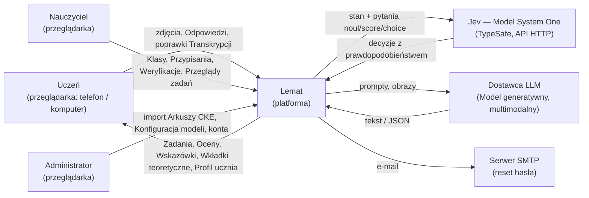

---

## 5. Widok kontenerów i stos technologiczny

### 5.1 Diagram kontenerów

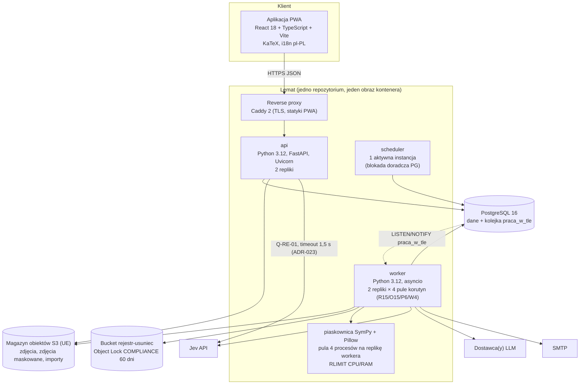

Wysyłka e-mail odbywa się wyłącznie przez pracę w tle `WYSLIJ_EMAIL`
(worker), więc proces `api` nie łączy się z SMTP.

### 5.2 Stos technologiczny

| Obszar | Wybór | Uzasadnienie |
|---|---|---|
| Frontend | React 18 + TypeScript 5, Vite, PWA (manifest + service worker do cache statyk), KaTeX do renderowania LaTeX, `react-i18next` z jednym językiem `pl-PL` | NFR-08, NFR-10; jedna baza kodu dla telefonu i komputera. |
| Zdjęcia w kliencie | `<input type="file" accept="image/*" capture="environment" multiple>`; kompresja w kliencie (canvas → JPEG q=0.85, dłuższy bok ≤ 2560 px); ekran aparatu z instrukcją „nie podpisuj kartki imieniem i nazwiskiem” | NFR-08; zmniejsza transfer, koszt rozpoznawania i ilość danych osobowych na zdjęciu (ADR-031). |
| Backend | Python 3.12, FastAPI, Pydantic v2, SQLAlchemy 2 (Core + ORM), Alembic | Ekosystem SymPy i SDK modeli AI w Pythonie. |
| Baza danych | PostgreSQL 16 (rozszerzenia `citext`, `pg_trgm`) | Jedno źródło prawdy + kolejka prac w tle (ADR-002). |
| Kolejka | Tabela `praca_w_tle` z kolumną `pula` + `SELECT … FOR UPDATE SKIP LOCKED` + `LISTEN/NOTIFY` | Transakcyjne zlecanie prac razem ze zmianą stanu (ADR-002); osobne pule dla rozpoznawania i oceniania (13.4). |
| Magazyn obiektów | S3-kompatybilny w regionie UE (lokalnie MinIO), szyfrowanie SSE, **wersjonowanie wyłączone** na bucketach ze zdjęciami (16.4) | Zdjęcia poza bazą; NFR-09. |
| Obróbka obrazu | Pillow ≥ 10 + `pillow-heif` (normalizacja w `api`, maskowanie w `worker`) | Usuwanie EXIF, maskowanie danych osobowych (ADR-031). |
| Obliczenia symboliczne | SymPy ≥ 1.13 (`parse_latex` z backendem `lark`) w puli procesów z limitami | FR-21, walidacja FR-13 (ADR-013). |
| Obserwowalność | OpenTelemetry (ślady), Prometheus (metryki), Grafana, logi JSON | NFR-01, NFR-03, NFR-04. |
| Wdrożenie | Docker Compose na 2 maszynach wirtualnych w UE + zarządzany PostgreSQL z PITR | Skala A-03 (ADR-001). |
| Kontrola architektury | `import-linter` w CI: SDK dostawców modeli importowane wyłącznie w `lemat.modele.adaptery.*` | NFR-06. |

---

## 6. Moduły, agenci i porty

### 6.1 Diagram komponentów

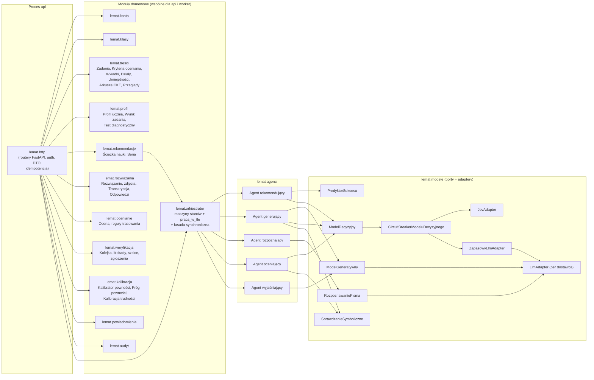

### 6.2 Odpowiedzialności modułów

| Moduł | Odpowiedzialność | Właściciel danych (tabele) |
|---|---|---|
| `lemat.http` | Routery, uwierzytelnianie, DTO, mapowanie błędów RFC 9457, idempotencja żądań | `klucz_idempotencji` |
| `lemat.konta` | Rejestracja, logowanie, tokeny, role, flagi Nauczyciela (`weryfikator_globalny`, `recenzent_tresci`), statusy kont, usuwanie i przywracanie konta (RODO) | `uzytkownik`, `uczen`, `nauczyciel`, `token_odswiezania`, `proba_logowania` |
| `lemat.klasy` | Klasy, kody zaproszeń, członkostwo, archiwizacja, Zestawy zadań, Przypisania | `klasa`, `czlonkostwo_klasy`, `zestaw_zadan`, `pozycja_zestawu`, `przypisanie`, `przypisanie_uczen` |
| `lemat.tresci` | Zadania i ich wersje, zasięg, Kryteria oceniania, Wkładki teoretyczne, Działy, Umiejętności, import Arkuszy CKE, Walidacja i Przegląd zadań, zlecenia generowania i budżet generowania systemowego | `dzial`, `umiejetnosc`, `umiejetnosc_wymagana`, `arkusz_cke`, `import_arkusza`, `zadanie`, `zadanie_wersja`, `zadanie_umiejetnosc`, `kryterium_oceniania`, `zalacznik_zadania`, `wkladka_teoretyczna`, `walidacja_zadania`, `przeglad_zadania`, `zlecenie_generowania` |
| `lemat.profil` | Profil ucznia, Wynik zadania, Test diagnostyczny, powtórki, odtwarzanie Profilu | `profil_ucznia`, `opanowanie_umiejetnosci`, `wynik_zadania`, `test_diagnostyczny`, `pozycja_testu_diagnostycznego` |
| `lemat.rekomendacje` | Ścieżka nauki, Seria, Rekomendacje (korzysta z Agenta rekomendującego przez fasadę Orkiestratora) | `sciezka_nauki`, `element_sciezki`, `rekomendacja` |
| `lemat.rozwiazania` | Przyjęcie i normalizacja zdjęć, maskowanie, Transkrypcja i jej poprawki, Odpowiedzi, zgłoszenia błędu odczytu (przyjęcie wniosku), kopie treningowe (za zgodą) | `rozwiazanie`, `zdjecie_rozwiazania`, `transkrypcja`, `krok_transkrypcji`, `odpowiedz`, `kopia_treningowa` |
| `lemat.ocenianie` | Ocena, reguły FR-20/21/25/26/28, trasowanie do Weryfikacji, Wskazówki | `ocena`, `ocena_kryterium` |
| `lemat.weryfikacja` | Kolejka weryfikacji, blokady i ich zwalnianie, szkice rozstrzygnięć, rozstrzygnięcia, korekty, eskalacja, kontrola przyjęć | `weryfikacja`, `szkic_rozstrzygniecia` |
| `lemat.kalibracja` | Próbki kalibracyjne, kalibratory pewności, Próg pewności, kalibracja Poziomu trudności, metryki NFR-02/03/04 | `probka_kalibracyjna`, `kalibrator_pewnosci`, `prog_pewnosci`, `kalibracja_trudnosci` |
| `lemat.modele` | Porty, adaptery, Konfiguracja modeli, dziennik decyzji, circuit breaker | `konfiguracja_modelu`, `decyzja_modelu` |
| `lemat.orkiestrator` | Maszyny stanów, zlecanie i wykonywanie prac w tle, pule workera, harmonogram, fasada synchroniczna dla rekomendacji (ADR-023) | `praca_w_tle` |
| `lemat.powiadomienia` | Powiadomienia w aplikacji | `powiadomienie` |
| `lemat.audyt` | Dziennik działań Nauczycieli, Administratorów i zmian systemowych (np. zmiana skalibrowanego Poziomu trudności) | `dziennik_audytu` |

Reguła zależności: moduły domenowe nie importują siebie nawzajem poza
publicznymi fasadami `lemat.<modul>.api` (kontrakt `import-linter`
„layers + independence”). Agenci nie znają FastAPI ani SQLAlchemy — dostają i
zwracają obiekty Pydantic (sekcja 10).

### 6.3 Orkiestrator

Orkiestrator nie jest osobnym serwisem, lecz modułem (biblioteką)
wykonywanym w dwóch trybach:

- **Tryb asynchroniczny (proces `worker`)** — wszystkie przepływy
  wieloagentowe: rozpoznanie → ocena → wskazówka → aktualizacja Profilu,
  generowanie → walidacja, kalibracja. Realizuje wzorzec **maszyna stanów w
  bazie + prace w tle**:
  1. Każda zmiana stanu encji (np. `rozwiazanie.status`) i zlecenie kolejnej
     pracy w tle odbywają się **w jednej transakcji** PostgreSQL.
  2. Worker pobiera pracę ze swojej puli (`FOR UPDATE SKIP LOCKED`), ustawia
     dzierżawę (`zablokowana_do = now() + 60 s`), odnawia ją co 15 s.
  3. Wywołania modeli odbywają się **poza transakcją**; wynik zapisywany jest
     warunkowo (`UPDATE … WHERE status = :oczekiwany AND version = :v`). Jeśli
     warunek nie jest spełniony, wynik jest odrzucany i logowany jako
     `wynik_przestarzaly` (sekcja 15).
  4. Każdy handler jest idempotentny (sekcja 13.3).
- **Tryb synchroniczny (proces `api`)** — jeden przepływ:
  `Orkiestrator.rekomenduj_synchronicznie(uczen_id)` wywoływany przez
  `lemat.rekomendacje` przy `GET /uczniowie/ja/rekomendacje/nastepna`. Jest to
  wywołanie jednego agenta (rekomendującego) bez przekazywania danych do
  innych agentów, więc nie wymaga maszyny stanów. Uzasadnienie wyjątku:
  Uczeń czeka na następny element po kliknięciu „Dalej” (cel p95 ≤ 500 ms),
  a praca w tle z odpytywaniem dodałaby ≥ 1 s. Ograniczenia: jedyne
  wywołanie modelu to `Q-RE-01` (tylko grupa eksperymentu `JEV_CHOICE`) z
  timeoutem 1,5 s, bez ponowień i bez modelu zapasowego; przy błędzie albo
  otwartym obwodzie polityka `POLITYKA_ELO` (10.1.6). Zapotrzebowanie na
  uzupełnienie puli Zadań jest zlecane jako praca w tle w tej samej
  transakcji co zapis elementu (ADR-023).

---

## 7. Model danych

### 7.1 Diagram ERD (encje rdzenia domeny)

Diagram pokazuje relacje; pełne kolumny, typy i ograniczenia są w DDL (7.3).

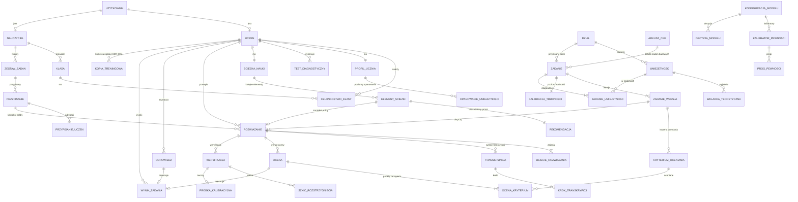

### 7.2 Konwencje schematu

- Klucze główne: `uuid` generowany przez `gen_random_uuid()`; wyjątki:
  `dzial.id`, `umiejetnosc.id` (`integer`, stabilne dane referencyjne) i
  `praca_w_tle.id` (`bigint identity`).
- Czas: `timestamptz`, zawsze UTC; `date` dla `termin_egzaminu`.
- Optymistyczna blokada: kolumna `version integer NOT NULL DEFAULT 1`,
  zwiększana przy każdej modyfikacji **wykonanej przez człowieka albo przez
  przejście maszyny stanów**; API eksponuje ją jako nagłówek `ETag`.
  Statystyki aktualizowane automatycznie (kalibracja Poziomu trudności,
  liczniki) są w osobnych tabelach i nie zmieniają `version` encji, do której
  należą (ADR-029).
- Usuwanie: twarde usuwanie danych osobowych (RODO, sekcja 16.4); dane
  referencyjne treści mają statusy zamiast usuwania.

### 7.3 Pełne DDL (PostgreSQL 16)

```sql
CREATE EXTENSION IF NOT EXISTS citext;
CREATE EXTENSION IF NOT EXISTS pg_trgm;

-- ===================== TYPY WYLICZENIOWE =====================
CREATE TYPE rola_uzytkownika        AS ENUM ('UCZEN','NAUCZYCIEL','ADMINISTRATOR');
CREATE TYPE status_konta            AS ENUM ('AKTYWNE','OCZEKUJE_NA_ZATWIERDZENIE','ZABLOKOWANE','USUWANE');
CREATE TYPE poziom_matury           AS ENUM ('PODSTAWOWY','ROZSZERZONY');
CREATE TYPE rodzaj_zadania          AS ENUM ('ZAMKNIETE','OTWARTE_OBLICZENIOWE','OTWARTE_Z_DOWODEM');
CREATE TYPE forma_zamknieta         AS ENUM ('WYBOR_JEDNOKROTNY','PRAWDA_FALSZ');
CREATE TYPE pochodzenie_zadania     AS ENUM ('BAZOWE_ARKUSZ_CKE','BAZOWE_NAUCZYCIEL','WYGENEROWANE');
CREATE TYPE zasieg_zadania          AS ENUM ('GLOBALNY','PRYWATNY');
CREATE TYPE status_zadania          AS ENUM ('WALIDACJA','ODRZUCONE_W_WALIDACJI','DO_PRZEGLADU',
                                             'OPUBLIKOWANE','ODRZUCONE','WYCOFANE');
CREATE TYPE status_wkladki          AS ENUM ('SZKIC','DO_PRZEGLADU','OPUBLIKOWANA','WYCOFANA');
CREATE TYPE status_rozwiazania      AS ENUM ('PRZESLANE','ROZPOZNAWANIE','BLAD_ROZPOZNAWANIA',
                                             'TRANSKRYPCJA_GOTOWA','ZATWIERDZONE','OCENIANIE',
                                             'OCZEKUJE_NA_WERYFIKACJE','OCENIONE','PORZUCONE','ANULOWANE');
CREATE TYPE zrodlo_transkrypcji     AS ENUM ('AGENT_ROZPOZNAJACY','POPRAWKA_UCZNIA');
CREATE TYPE status_oceny            AS ENUM ('WSTEPNA','OSTATECZNA','ZASTAPIONA');
CREATE TYPE zrodlo_oceny            AS ENUM ('AUTOMATYCZNA','NAUCZYCIEL');
CREATE TYPE typ_bledu               AS ENUM ('RACHUNKOWY','MERYTORYCZNY','NIEPELNE_ROZWIAZANIE');
CREATE TYPE zrodlo_wskazowki        AS ENUM ('AGENT_WYJASNIAJACY','SZABLON','NAUCZYCIEL');
CREATE TYPE powod_weryfikacji       AS ENUM ('NISKA_PEWNOSC','POPRAWNY_WYNIK_BLEDNE_KROKI','ZADANIE_Z_DOWODEM',
                                             'PODEJRZENIE_BLEDU_ODCZYTU','ZGLOSZENIE_BLEDU_ODCZYTU',
                                             'KONTROLA_LOSOWA','BLAD_PRZETWARZANIA');
CREATE TYPE status_weryfikacji      AS ENUM ('OCZEKUJE','W_TRAKCIE','ZAKONCZONA','ANULOWANA');
CREATE TYPE powod_anulowania        AS ENUM ('USUNIECIE_KONTA','PONOWNA_OCENA_AUTOMATYCZNA');
CREATE TYPE typ_kolejki_weryfikacji AS ENUM ('KLASA','GLOBALNA');
CREATE TYPE typ_elementu_sciezki    AS ENUM ('WKLADKA_TEORETYCZNA','ZADANIE');
CREATE TYPE cel_elementu            AS ENUM ('NAUKA','POWTORKA');
CREATE TYPE status_elementu_sciezki AS ENUM ('PROPONOWANY','ROZPOCZETY','UKONCZONY','POMINIETY','WYGASLY');
CREATE TYPE strategia_rekomendacji  AS ENUM ('POLITYKA_ELO','JEV_CHOICE');
CREATE TYPE rola_modelu             AS ENUM ('DECYZYJNY_GLOWNY','DECYZYJNY_ZAPASOWY','ROZPOZNAWANIE_PISMA',
                                             'GENERATYWNY_ZADANIA','GENERATYWNY_ROZWIAZUJACY_NIEZALEZNIE',
                                             'GENERATYWNY_WSKAZOWKI','GENERATYWNY_WKLADKI',
                                             'GENERATYWNY_OPINIA_POMOCNICZA');
CREATE TYPE typ_pytania             AS ENUM ('NOUL','SCORE','CHOICE');
CREATE TYPE kontekst_decyzji        AS ENUM ('OCENA','REKOMENDACJA','WALIDACJA_ZADANIA');
CREATE TYPE zrodlo_wyniku           AS ENUM ('ODPOWIEDZ','OCENA');
CREATE TYPE zrodlo_probki           AS ENUM ('WERYFIKACJA_NISKA_PEWNOSC','KONTROLA_LOSOWA',
                                             'WERYFIKACJA_INNY_POWOD','KOREKTA_NAUCZYCIELA');
CREATE TYPE zrodlo_progu            AS ENUM ('EWALUACJA_ZT1','KALIBRACJA_AUTOMATYCZNA','ADMINISTRATOR','BEZPIECZNIK');
CREATE TYPE zrodlo_kalibratora      AS ENUM ('EWALUACJA_ZT1','KALIBRACJA_AUTOMATYCZNA');   -- rozłączne z zrodlo_progu (3.1 p. 5)
CREATE TYPE powod_uniewaznienia_wyniku AS ENUM ('OCENA_ZASTAPIONA','ZGLOSZENIE_BLEDU_ODCZYTU'); -- 10.1.3, 11.6
CREATE TYPE status_pracy            AS ENUM ('OCZEKUJE','W_TOKU','ZAKONCZONA','MARTWA');
CREATE TYPE status_zlecenia         AS ENUM ('OCZEKUJE','W_TOKU','ZAKONCZONE','NIEUDANE');
CREATE TYPE status_importu          AS ENUM ('OCZEKUJE','PRZETWARZANY','ZAKONCZONY','ODRZUCONY');
CREATE TYPE status_testu            AS ENUM ('W_TOKU','ZAKONCZONY','POMINIETY');
CREATE TYPE decyzja_przegladu       AS ENUM ('ZATWIERDZONE','POPRAWIONE','ODRZUCONE');
CREATE TYPE rezultat_walidacji      AS ENUM ('POZYTYWNY','NEGATYWNY');
CREATE TYPE inicjalizacja_opanowania AS ENUM ('DOMYSLNA','TEST_DIAGNOSTYCZNY','PROPAGACJA_Z_DZIALU');

-- ===================== KONTA =====================
CREATE TABLE uzytkownik (
    id               uuid PRIMARY KEY DEFAULT gen_random_uuid(),
    email            citext NOT NULL UNIQUE,
    haslo_hash       text   NOT NULL,                 -- argon2id (m=64MiB, t=3, p=4)
    rola             rola_uzytkownika NOT NULL,
    status           status_konta NOT NULL DEFAULT 'AKTYWNE',
    imie             text   NOT NULL CHECK (char_length(imie) BETWEEN 1 AND 60),
    nazwisko         text   NOT NULL CHECK (char_length(nazwisko) BETWEEN 1 AND 80),
    usuniecie_zaplanowane_at timestamptz,             -- RODO: twarde usunięcie po 30 dniach
    ostatnie_logowanie_at    timestamptz,
    created_at       timestamptz NOT NULL DEFAULT now(),
    updated_at       timestamptz NOT NULL DEFAULT now(),
    version          integer NOT NULL DEFAULT 1,
    CHECK ((status = 'USUWANE') = (usuniecie_zaplanowane_at IS NOT NULL))
);

CREATE TABLE uczen (
    uzytkownik_id         uuid PRIMARY KEY REFERENCES uzytkownik(id) ON DELETE CASCADE,
    poziom_matury         poziom_matury,              -- NULL do czasu FR-02
    termin_egzaminu       date,
    wybrany_dzial_id      integer,                    -- FR-09; NULL = wszystkie działy (FK niżej)
    oswiadczenie_wieku_16 boolean NOT NULL CHECK (oswiadczenie_wieku_16),
    zgoda_na_trening      boolean NOT NULL DEFAULT false,   -- zdjęcia do zbioru treningowego (16.4)
    procent_grupy_eksperymentu smallint NOT NULL CHECK (procent_grupy_eksperymentu BETWEEN 0 AND 99),
                                                      -- fnv1a(uzytkownik_id) mod 100; przydział do eksperymentu A/B
    created_at            timestamptz NOT NULL DEFAULT now(),
    version               integer NOT NULL DEFAULT 1
);

CREATE TABLE nauczyciel (
    uzytkownik_id        uuid PRIMARY KEY REFERENCES uzytkownik(id) ON DELETE CASCADE,
    weryfikator_globalny boolean NOT NULL DEFAULT false,  -- obsługuje kolejkę GLOBALNA (ADR-021)
    recenzent_tresci     boolean NOT NULL DEFAULT false,  -- Przegląd Zadań/Wkładek globalnych (ADR-028)
    deklarowane_minuty_weryfikacji smallint NOT NULL DEFAULT 0
                         CHECK (deklarowane_minuty_weryfikacji BETWEEN 0 AND 480),
    created_at           timestamptz NOT NULL DEFAULT now(),
    version              integer NOT NULL DEFAULT 1,
    CHECK (NOT weryfikator_globalny OR deklarowane_minuty_weryfikacji >= 90)  -- A-13
);

CREATE TABLE token_odswiezania (
    id              uuid PRIMARY KEY DEFAULT gen_random_uuid(),
    uzytkownik_id   uuid NOT NULL REFERENCES uzytkownik(id) ON DELETE CASCADE,
    rodzina_id      uuid NOT NULL,                    -- wykrywanie ponownego użycia
    token_hash      bytea NOT NULL UNIQUE,            -- SHA-256 tokenu
    wygasa_at       timestamptz NOT NULL,
    uniewazniony_at timestamptz,
    created_at      timestamptz NOT NULL DEFAULT now()
);

CREATE TABLE proba_logowania (
    id         bigint GENERATED ALWAYS AS IDENTITY PRIMARY KEY,
    email      citext NOT NULL,
    ip         inet   NOT NULL,
    udana      boolean NOT NULL,
    created_at timestamptz NOT NULL DEFAULT now()
);
CREATE INDEX ix_proba_logowania_email ON proba_logowania (email, created_at DESC);

-- ===================== DZIAŁY, UMIEJĘTNOŚCI, WKŁADKI =====================
CREATE TABLE dzial (
    id                integer PRIMARY KEY,
    kod               text NOT NULL UNIQUE,           -- np. 'XIII'
    nazwa             text NOT NULL,
    tylko_rozszerzony boolean NOT NULL DEFAULT false,
    kolejnosc         smallint NOT NULL
);
ALTER TABLE uczen ADD CONSTRAINT fk_uczen_dzial FOREIGN KEY (wybrany_dzial_id) REFERENCES dzial(id);

CREATE TABLE umiejetnosc (
    id                 integer PRIMARY KEY,
    dzial_id           integer NOT NULL REFERENCES dzial(id),
    kod                text NOT NULL UNIQUE,          -- np. 'R.XIII.2' (poziom.dział.punkt podstawy)
    nazwa              text NOT NULL,
    tylko_rozszerzony  boolean NOT NULL DEFAULT false,
    waga_egzaminacyjna numeric(4,3) NOT NULL CHECK (waga_egzaminacyjna > 0 AND waga_egzaminacyjna <= 1)
);

CREATE TABLE umiejetnosc_wymagana (
    umiejetnosc_id          integer NOT NULL REFERENCES umiejetnosc(id),
    wymagana_umiejetnosc_id integer NOT NULL REFERENCES umiejetnosc(id),
    PRIMARY KEY (umiejetnosc_id, wymagana_umiejetnosc_id),
    CHECK (umiejetnosc_id <> wymagana_umiejetnosc_id)
);

CREATE TABLE wkladka_teoretyczna (
    id                 uuid PRIMARY KEY DEFAULT gen_random_uuid(),
    umiejetnosc_id     integer NOT NULL REFERENCES umiejetnosc(id),
    tytul              text NOT NULL,
    tresc_md           text NOT NULL CHECK (char_length(tresc_md) <= 12000), -- Markdown + LaTeX ($…$)
    szacowany_czas_min smallint NOT NULL CHECK (szacowany_czas_min BETWEEN 1 AND 15),
    wygenerowana       boolean NOT NULL,              -- true = szkic Agenta generującego
    status             status_wkladki NOT NULL DEFAULT 'SZKIC',
    zatwierdzona_przez uuid REFERENCES uzytkownik(id) ON DELETE SET NULL,  -- recenzent treści lub Administrator
    created_at         timestamptz NOT NULL DEFAULT now(),
    updated_at         timestamptz NOT NULL DEFAULT now(),
    version            integer NOT NULL DEFAULT 1
);
CREATE UNIQUE INDEX ux_wkladka_opublikowana ON wkladka_teoretyczna (umiejetnosc_id) WHERE status = 'OPUBLIKOWANA';

-- ===================== ARKUSZE CKE, ZADANIA =====================
CREATE TABLE arkusz_cke (
    id             uuid PRIMARY KEY DEFAULT gen_random_uuid(),
    kod            text NOT NULL UNIQUE,              -- np. 'MMA-P1-2024-05'
    rok            smallint NOT NULL CHECK (rok BETWEEN 2005 AND 2100),
    sesja          text NOT NULL CHECK (sesja IN ('MAJ','CZERWIEC','SIERPIEN','PROBNA','INFORMATOR')),
    poziom_matury  poziom_matury NOT NULL,
    created_at     timestamptz NOT NULL DEFAULT now()
);

CREATE TABLE import_arkusza (
    id               uuid PRIMARY KEY DEFAULT gen_random_uuid(),
    administrator_id uuid NOT NULL REFERENCES uzytkownik(id),
    klucz_obiektu    text NOT NULL,                   -- ZIP w magazynie obiektów
    status           status_importu NOT NULL DEFAULT 'OCZEKUJE',
    raport           jsonb,                            -- lista błędów per numer zadania
    arkusz_cke_id    uuid REFERENCES arkusz_cke(id),
    created_at       timestamptz NOT NULL DEFAULT now(),
    updated_at       timestamptz NOT NULL DEFAULT now()
);

CREATE TABLE zlecenie_generowania (
    id               uuid PRIMARY KEY DEFAULT gen_random_uuid(),
    umiejetnosc_id   integer NOT NULL REFERENCES umiejetnosc(id),
    poziom_trudnosci smallint NOT NULL CHECK (poziom_trudnosci BETWEEN 1 AND 5),  -- nominalny docelowy
    poziom_matury    poziom_matury NOT NULL,
    rodzaj           rodzaj_zadania NOT NULL,
    zlecajacy_id     uuid REFERENCES uzytkownik(id) ON DELETE SET NULL, -- NULL = system (UZUPELNIJ_PULE)
    systemowe        boolean NOT NULL,                -- true ⇔ utworzone przez UZUPELNIJ_PULE (budżet 13.3)
    status           status_zlecenia NOT NULL DEFAULT 'OCZEKUJE',
    liczba_cykli     smallint NOT NULL DEFAULT 0 CHECK (liczba_cykli BETWEEN 0 AND 3),
                     -- cykl = generowanie + Walidacja; ponowienia techniczne pracy w tle się nie liczą (C1-28)
    koszt_pln        numeric(10,4) NOT NULL DEFAULT 0, -- suma kosztów wywołań modeli (13.1, raport adaptera)
    zadanie_id       uuid,                             -- FK niżej
    przyczyna_niepowodzenia text,
    created_at       timestamptz NOT NULL DEFAULT now(),
    updated_at       timestamptz NOT NULL DEFAULT now(),
    CHECK (NOT systemowe OR (rodzaj <> 'OTWARTE_Z_DOWODEM' AND zlecajacy_id IS NULL))  -- system nie generuje dowodów (ADR-015)
);
CREATE INDEX ix_zlecenie_systemowe_dzien ON zlecenie_generowania (created_at) WHERE systemowe;

CREATE TABLE zadanie (
    id                     uuid PRIMARY KEY DEFAULT gen_random_uuid(),
    pochodzenie            pochodzenie_zadania NOT NULL,
    zasieg                 zasieg_zadania NOT NULL,
    rodzaj                 rodzaj_zadania NOT NULL,
    forma_zamknieta        forma_zamknieta,
    dzial_id               integer NOT NULL REFERENCES dzial(id),
    poziom_matury          poziom_matury NOT NULL,
    arkusz_cke_id          uuid REFERENCES arkusz_cke(id),
    numer_w_arkuszu        text,
    autor_id               uuid REFERENCES uzytkownik(id) ON DELETE SET NULL,
    zlecenie_generowania_id uuid REFERENCES zlecenie_generowania(id),
    status                 status_zadania NOT NULL,
    aktualna_wersja_id     uuid,                       -- FK DEFERRABLE niżej
    poziom_trudnosci_nominalny smallint NOT NULL CHECK (poziom_trudnosci_nominalny BETWEEN 1 AND 5),
    diagnostyczne          boolean NOT NULL DEFAULT false,
    zweryfikowane_przez_nauczyciela boolean NOT NULL DEFAULT false,
    created_at             timestamptz NOT NULL DEFAULT now(),
    updated_at             timestamptz NOT NULL DEFAULT now(),
    version                integer NOT NULL DEFAULT 1,
    CHECK ((rodzaj = 'ZAMKNIETE') = (forma_zamknieta IS NOT NULL)),
    CHECK ((pochodzenie = 'BAZOWE_ARKUSZ_CKE') = (arkusz_cke_id IS NOT NULL)),
    CHECK ((pochodzenie = 'WYGENEROWANE') = (zlecenie_generowania_id IS NOT NULL)),
    CHECK (pochodzenie <> 'BAZOWE_ARKUSZ_CKE' OR zasieg = 'GLOBALNY'),
    CHECK (NOT diagnostyczne OR (rodzaj = 'ZAMKNIETE' AND zasieg = 'GLOBALNY'))
);
ALTER TABLE zlecenie_generowania ADD CONSTRAINT fk_zlecenie_zadanie FOREIGN KEY (zadanie_id) REFERENCES zadanie(id);
CREATE INDEX ix_zadanie_dobor ON zadanie (poziom_matury, status, zasieg, rodzaj);
CREATE INDEX ix_zadanie_autor ON zadanie (autor_id) WHERE zasieg = 'PRYWATNY';

-- Kalibracja Poziomu trudności (ADR-029): statystyka aktualizowana atomowo, poza zadanie.version
CREATE TABLE kalibracja_trudnosci (
    zadanie_id                uuid PRIMARY KEY REFERENCES zadanie(id),
    trudnosc_b                numeric(6,3) NOT NULL,   -- parametr modelu Elo (10.1.3)
    liczba_wynikow_kalibracji integer NOT NULL DEFAULT 0,
    poziom_trudnosci          smallint NOT NULL CHECK (poziom_trudnosci BETWEEN 1 AND 5),
                                                       -- = nominalny, dopóki liczba_wynikow_kalibracji < 30
    updated_at                timestamptz NOT NULL DEFAULT now()
);
CREATE INDEX ix_kalibracja_poziom ON kalibracja_trudnosci (poziom_trudnosci);

CREATE TABLE zadanie_wersja (
    id                   uuid PRIMARY KEY DEFAULT gen_random_uuid(),
    zadanie_id           uuid NOT NULL REFERENCES zadanie(id),
    nr_wersji            integer NOT NULL CHECK (nr_wersji >= 1),
    tresc_md             text NOT NULL CHECK (char_length(tresc_md) <= 8000),
    odpowiedzi_zamkniete jsonb,     -- schemat 7.5.1; NOT NULL dla ZAMKNIETE
    rozwiazanie_wzorcowe jsonb NOT NULL, -- schemat 7.5.2
    wynik_koncowy_wzorcowy jsonb,   -- schemat 7.5.3; NULL wyłącznie dla OTWARTE_Z_DOWODEM i ZAMKNIETE
    punkty_max           smallint NOT NULL CHECK (punkty_max BETWEEN 1 AND 6),
    utworzona_przez      uuid REFERENCES uzytkownik(id) ON DELETE SET NULL,
    zastapiona_at        timestamptz,                  -- chwila, w której przestała być aktualną wersją
    created_at           timestamptz NOT NULL DEFAULT now(),
    UNIQUE (zadanie_id, nr_wersji)
);
ALTER TABLE zadanie ADD CONSTRAINT fk_zadanie_aktualna_wersja
    FOREIGN KEY (aktualna_wersja_id) REFERENCES zadanie_wersja(id) DEFERRABLE INITIALLY DEFERRED;
CREATE INDEX ix_zadanie_wersja_tresc_trgm ON zadanie_wersja USING gin (tresc_md gin_trgm_ops);

CREATE TABLE zadanie_umiejetnosc (
    zadanie_id     uuid    NOT NULL REFERENCES zadanie(id),
    umiejetnosc_id integer NOT NULL REFERENCES umiejetnosc(id),
    glowna         boolean NOT NULL,
    PRIMARY KEY (zadanie_id, umiejetnosc_id)
);
CREATE UNIQUE INDEX ux_zadanie_umiejetnosc_glowna ON zadanie_umiejetnosc (zadanie_id) WHERE glowna;
-- Constraint trigger trg_umiejetnosc_glowna_w_dziale: umiejętność główna należy do zadanie.dzial_id.

CREATE TABLE kryterium_oceniania (
    id                  uuid PRIMARY KEY DEFAULT gen_random_uuid(),
    zadanie_wersja_id   uuid NOT NULL REFERENCES zadanie_wersja(id),
    wariant             smallint NOT NULL DEFAULT 1 CHECK (wariant BETWEEN 1 AND 4),
    nr_kryterium        smallint NOT NULL CHECK (nr_kryterium BETWEEN 1 AND 12),
    opis                text NOT NULL,
    punkty_max          smallint NOT NULL CHECK (punkty_max BETWEEN 1 AND 3),
    czy_wynik_koncowy   boolean NOT NULL DEFAULT false,
    wymaga_nr_kryterium smallint,                     -- punkt tylko po zaliczeniu wskazanego kryterium
    UNIQUE (zadanie_wersja_id, wariant, nr_kryterium),
    CHECK (wymaga_nr_kryterium IS NULL OR wymaga_nr_kryterium < nr_kryterium)
);
-- Constraint trigger DEFERRABLE trg_suma_kryteriow: dla każdego wariantu
-- SUM(punkty_max) = zadanie_wersja.punkty_max oraz co najwyżej jedno czy_wynik_koncowy;
-- suma liczby kryteriów wszystkich wariantów ≤ 24 (limit planu pytań modelu zapasowego, 13.2).
-- Dla zadań ZAMKNIETE kryteriów nie ma (ocena kluczem).

CREATE TABLE zalacznik_zadania (
    id                uuid PRIMARY KEY DEFAULT gen_random_uuid(),
    zadanie_wersja_id uuid NOT NULL REFERENCES zadanie_wersja(id),
    klucz_obiektu     text NOT NULL,
    typ_mime          text NOT NULL CHECK (typ_mime IN ('image/png','image/svg+xml','image/jpeg')),
    tekst_alternatywny text NOT NULL,                 -- opis rysunku, przekazywany też do modeli
    kolejnosc         smallint NOT NULL
);

CREATE TABLE walidacja_zadania (
    id                uuid PRIMARY KEY DEFAULT gen_random_uuid(),
    zadanie_wersja_id uuid NOT NULL REFERENCES zadanie_wersja(id),
    nr_cyklu          smallint NOT NULL CHECK (nr_cyklu BETWEEN 1 AND 3),
    rezultat          rezultat_walidacji NOT NULL,
    sprawdzenia       jsonb NOT NULL,                 -- schemat 10.2.3
    created_at        timestamptz NOT NULL DEFAULT now()
);

CREATE TABLE przeglad_zadania (
    id                 uuid PRIMARY KEY DEFAULT gen_random_uuid(),
    zadanie_id         uuid NOT NULL REFERENCES zadanie(id),
    autor_przegladu_id uuid REFERENCES uzytkownik(id) ON DELETE SET NULL, -- Nauczyciel uprawniony (ADR-028) lub Administrator
    decyzja            decyzja_przegladu NOT NULL,
    komentarz          text,
    nowa_wersja_id     uuid REFERENCES zadanie_wersja(id),
    zasieg_po          zasieg_zadania NOT NULL,       -- zasięg Zadania po Przeglądzie
    created_at         timestamptz NOT NULL DEFAULT now(),
    CHECK ((decyzja = 'POPRAWIONE') = (nowa_wersja_id IS NOT NULL))
);

-- ===================== KLASY, ZESTAWY, PRZYPISANIA =====================
CREATE TABLE klasa (
    id              uuid PRIMARY KEY DEFAULT gen_random_uuid(),
    nauczyciel_id   uuid NOT NULL REFERENCES nauczyciel(uzytkownik_id),
    nazwa           text NOT NULL CHECK (char_length(nazwa) BETWEEN 1 AND 80),
    poziom_matury   poziom_matury NOT NULL,
    kod_zaproszenia char(8) NOT NULL UNIQUE,          -- alfabet [A-HJ-NP-Z2-9]
    kod_wazny_do    timestamptz NOT NULL,
    zarchiwizowana  boolean NOT NULL DEFAULT false,
    zarchiwizowano_at timestamptz,
    created_at      timestamptz NOT NULL DEFAULT now(),
    version         integer NOT NULL DEFAULT 1,
    CHECK (zarchiwizowana = (zarchiwizowano_at IS NOT NULL))
);

CREATE TABLE czlonkostwo_klasy (
    klasa_id    uuid NOT NULL REFERENCES klasa(id) ON DELETE CASCADE,
    uczen_id    uuid NOT NULL REFERENCES uczen(uzytkownik_id) ON DELETE CASCADE,
    dolaczono_at timestamptz NOT NULL DEFAULT now(),
    PRIMARY KEY (klasa_id, uczen_id)
);
CREATE INDEX ix_czlonkostwo_uczen ON czlonkostwo_klasy (uczen_id);

CREATE TABLE zestaw_zadan (
    id            uuid PRIMARY KEY DEFAULT gen_random_uuid(),
    nauczyciel_id uuid NOT NULL REFERENCES nauczyciel(uzytkownik_id),
    nazwa         text NOT NULL CHECK (char_length(nazwa) BETWEEN 1 AND 120),
    created_at    timestamptz NOT NULL DEFAULT now(),
    updated_at    timestamptz NOT NULL DEFAULT now(),
    version       integer NOT NULL DEFAULT 1
);

CREATE TABLE pozycja_zestawu (
    zestaw_zadan_id uuid NOT NULL REFERENCES zestaw_zadan(id) ON DELETE CASCADE,
    kolejnosc       smallint NOT NULL,
    zadanie_id      uuid NOT NULL REFERENCES zadanie(id),
    PRIMARY KEY (zestaw_zadan_id, kolejnosc),
    UNIQUE (zestaw_zadan_id, zadanie_id)
);

CREATE TABLE przypisanie (
    id              uuid PRIMARY KEY DEFAULT gen_random_uuid(),
    zestaw_zadan_id uuid NOT NULL REFERENCES zestaw_zadan(id),   -- RESTRICT: Zestawu z Przypisaniem nie można usunąć
    nauczyciel_id   uuid NOT NULL REFERENCES nauczyciel(uzytkownik_id),
    klasa_id        uuid REFERENCES klasa(id),        -- informacyjnie; adresaci w przypisanie_uczen
    termin          timestamptz NOT NULL,
    created_at      timestamptz NOT NULL DEFAULT now()
);
CREATE INDEX ix_przypisanie_nauczyciel ON przypisanie (nauczyciel_id, termin DESC);

CREATE TABLE przypisanie_uczen (
    przypisanie_id uuid NOT NULL REFERENCES przypisanie(id) ON DELETE CASCADE,
    uczen_id       uuid NOT NULL REFERENCES uczen(uzytkownik_id) ON DELETE CASCADE,
    PRIMARY KEY (przypisanie_id, uczen_id)
);
CREATE INDEX ix_przypisanie_uczen_uczen ON przypisanie_uczen (uczen_id);

-- ===================== PROFIL UCZNIA, TEST DIAGNOSTYCZNY =====================
CREATE TABLE profil_ucznia (
    uczen_id   uuid PRIMARY KEY REFERENCES uczen(uzytkownik_id) ON DELETE CASCADE,
    updated_at timestamptz NOT NULL DEFAULT now(),
    version    integer NOT NULL DEFAULT 1
);

CREATE TABLE opanowanie_umiejetnosci (
    uczen_id             uuid    NOT NULL REFERENCES profil_ucznia(uczen_id) ON DELETE CASCADE,
    umiejetnosc_id       integer NOT NULL REFERENCES umiejetnosc(id),
    theta                numeric(6,3) NOT NULL DEFAULT 0,  -- stan DOMYSLNY = 0; odtwarzanie zawsze od 0 (10.1.3)
    poziom_opanowania    numeric(4,3) NOT NULL CHECK (poziom_opanowania BETWEEN 0 AND 1),
    liczba_wynikow       integer NOT NULL DEFAULT 0,
    ostatni_wynik_at     timestamptz,
    licznik_powtorek     smallint NOT NULL DEFAULT 0,
    nastepna_powtorka_at timestamptz,
    inicjalizacja        inicjalizacja_opanowania NOT NULL DEFAULT 'DOMYSLNA',
    PRIMARY KEY (uczen_id, umiejetnosc_id)
);
CREATE INDEX ix_opanowanie_powtorki ON opanowanie_umiejetnosci (uczen_id, nastepna_powtorka_at);

CREATE TABLE test_diagnostyczny (
    id            uuid PRIMARY KEY DEFAULT gen_random_uuid(),
    uczen_id      uuid NOT NULL REFERENCES uczen(uzytkownik_id) ON DELETE CASCADE,
    poziom_matury poziom_matury NOT NULL,
    status        status_testu NOT NULL DEFAULT 'W_TOKU',
    created_at    timestamptz NOT NULL DEFAULT now(),
    zakonczono_at timestamptz,
    CHECK ((status = 'W_TOKU') = (zakonczono_at IS NULL))
);
-- Test wykonuje się raz na poziom matury; POMINIETY można później zastąpić jednym testem (C1-11).
CREATE UNIQUE INDEX ux_test_jeden ON test_diagnostyczny (uczen_id, poziom_matury)
    WHERE status IN ('W_TOKU','ZAKONCZONY');

CREATE TABLE pozycja_testu_diagnostycznego (
    id                    uuid PRIMARY KEY DEFAULT gen_random_uuid(),
    test_diagnostyczny_id uuid NOT NULL REFERENCES test_diagnostyczny(id) ON DELETE CASCADE,
    kolejnosc             smallint NOT NULL,
    zadanie_wersja_id     uuid NOT NULL REFERENCES zadanie_wersja(id),
    UNIQUE (test_diagnostyczny_id, kolejnosc)
);

-- ===================== ŚCIEŻKA NAUKI, REKOMENDACJE =====================
CREATE TABLE sciezka_nauki (
    id                       uuid PRIMARY KEY DEFAULT gen_random_uuid(),
    uczen_id                 uuid NOT NULL UNIQUE REFERENCES uczen(uzytkownik_id) ON DELETE CASCADE,
    seria_umiejetnosc_id     integer REFERENCES umiejetnosc(id),   -- aktywna Seria (ADR-030); NULL = brak
    seria_rozpoczeta_at      timestamptz,
    seria_liczba_elementow   smallint NOT NULL DEFAULT 0 CHECK (seria_liczba_elementow BETWEEN 0 AND 8),
    seria_poziom_trudnosci   smallint CHECK (seria_poziom_trudnosci BETWEEN 1 AND 5),
    seria_kolejne_porazki    smallint NOT NULL DEFAULT 0,
    created_at               timestamptz NOT NULL DEFAULT now(),
    version                  integer NOT NULL DEFAULT 1,
    CHECK ((seria_umiejetnosc_id IS NULL) = (seria_rozpoczeta_at IS NULL))
);

CREATE TABLE element_sciezki (
    id                     uuid PRIMARY KEY DEFAULT gen_random_uuid(),
    sciezka_nauki_id       uuid NOT NULL REFERENCES sciezka_nauki(id) ON DELETE CASCADE,
    kolejnosc              integer NOT NULL,
    typ                    typ_elementu_sciezki NOT NULL,
    cel                    cel_elementu NOT NULL DEFAULT 'NAUKA',
    umiejetnosc_id         integer NOT NULL REFERENCES umiejetnosc(id),
    zadanie_id             uuid REFERENCES zadanie(id),
    zadanie_wersja_id      uuid REFERENCES zadanie_wersja(id), -- wersja pokazana Uczniowi; ustawiana przy rozpoczęciu (C1-20)
    wkladka_teoretyczna_id uuid REFERENCES wkladka_teoretyczna(id),
    przypisanie_id         uuid REFERENCES przypisanie(id) ON DELETE SET NULL,  -- tylko reguła R-PRZYPISANIE
    w_serii                boolean NOT NULL DEFAULT false,
    status                 status_elementu_sciezki NOT NULL DEFAULT 'PROPONOWANY',
    wygasa_at              timestamptz NOT NULL,       -- 8.5: PROPONOWANY +24 h; ROZPOCZETY: Zadanie +7 dni, Wkładka +24 h
    created_at             timestamptz NOT NULL DEFAULT now(),
    rozpoczeto_at          timestamptz,
    zakonczono_at          timestamptz,
    UNIQUE (sciezka_nauki_id, kolejnosc),
    CHECK ((typ = 'WKLADKA_TEORETYCZNA') = (wkladka_teoretyczna_id IS NOT NULL)),
    CHECK ((typ = 'ZADANIE') = (zadanie_id IS NOT NULL)),
    CHECK (typ = 'ZADANIE' OR cel = 'NAUKA'),
    CHECK (status NOT IN ('ROZPOCZETY','UKONCZONY') OR rozpoczeto_at IS NOT NULL),
    CHECK (typ <> 'ZADANIE' OR status NOT IN ('ROZPOCZETY','UKONCZONY') OR zadanie_wersja_id IS NOT NULL)
);
CREATE UNIQUE INDEX ux_jeden_proponowany ON element_sciezki (sciezka_nauki_id) WHERE status = 'PROPONOWANY';
CREATE INDEX ix_element_wygasanie ON element_sciezki (wygasa_at) WHERE status IN ('PROPONOWANY','ROZPOCZETY');

CREATE TABLE rekomendacja (
    id                    uuid PRIMARY KEY DEFAULT gen_random_uuid(),
    uczen_id              uuid NOT NULL REFERENCES uczen(uzytkownik_id) ON DELETE CASCADE,
    element_sciezki_id    uuid NOT NULL UNIQUE REFERENCES element_sciezki(id) ON DELETE CASCADE,
    strategia             strategia_rekomendacji NOT NULL,
    regula                text NOT NULL CHECK (regula IN ('R-PRZYPISANIE','R-SERIA','R-POWTORKA','R-WKLADKA',
                                 'R-WKLADKA-DIAG','R-NAJSLABSZA','R-TRUDNOSC_W_GORE','R-UTRWALENIE',
                                 'R-JEV-WKLADKA','R-JEV-ZADANIE_LATWE','R-JEV-ZADANIE_MATURALNE','R-JEV-POWTORKA')),
    cechy                 jsonb NOT NULL,             -- migawka wejścia (10.1.4)
    decyzja               jsonb NOT NULL,             -- kandydaci, wybór, powrot_do_polityki
    przewidywane_p_sukcesu numeric(4,3),
    uzasadnienie          text NOT NULL,              -- FR-10, tekst dla Ucznia
    uzasadnienie_fakty    jsonb NOT NULL,             -- fakty użyte w szablonie
    created_at            timestamptz NOT NULL DEFAULT now()
);

-- ===================== ROZWIĄZANIA, TRANSKRYPCJE, ODPOWIEDZI =====================
CREATE TABLE rozwiazanie (
    id                       uuid PRIMARY KEY DEFAULT gen_random_uuid(),
    uczen_id                 uuid NOT NULL REFERENCES uczen(uzytkownik_id) ON DELETE CASCADE,
    zadanie_id               uuid NOT NULL REFERENCES zadanie(id),
    zadanie_wersja_id        uuid NOT NULL REFERENCES zadanie_wersja(id),
    element_sciezki_id       uuid REFERENCES element_sciezki(id) ON DELETE SET NULL,
    przypisanie_id           uuid REFERENCES przypisanie(id) ON DELETE SET NULL,
    status                   status_rozwiazania NOT NULL DEFAULT 'PRZESLANE',
    liczba_przeslan          smallint NOT NULL DEFAULT 1 CHECK (liczba_przeslan BETWEEN 1 AND 3),
                             -- przesłania zdjęć przez Ucznia (nowe zdjęcia), C1-28
    liczba_ponowien_rozpoznania smallint NOT NULL DEFAULT 0 CHECK (liczba_ponowien_rozpoznania BETWEEN 0 AND 5),
                             -- ponowienia rozpoznania tych samych zdjęć zlecone przez Ucznia po błędzie dostawcy
    kod_bledu_rozpoznawania  text CHECK (kod_bledu_rozpoznawania IN
                                 ('NIECZYTELNE','PRZEKROCZONY_CZAS','BLAD_DOSTAWCY','ZBYT_WIELE_KROKOW')),
    zatwierdzona_transkrypcja_id uuid,                 -- FK niżej
    przeslano_at             timestamptz NOT NULL DEFAULT now(),   -- ostatnie przesłanie lub ponowienie
    transkrypcja_gotowa_at   timestamptz,              -- pierwsza Transkrypcja po ostatnim przesłaniu
    zatwierdzono_at          timestamptz,
    ocena_wystawiona_at      timestamptz,              -- pierwsza Ocena widoczna dla Ucznia
    czas_systemowy_ms        integer,                  -- NFR-01: (transkrypcja_gotowa − przeslano) + (ocena_wystawiona − zatwierdzono)
    created_at               timestamptz NOT NULL DEFAULT now(),
    updated_at               timestamptz NOT NULL DEFAULT now(),
    version                  integer NOT NULL DEFAULT 1,
    CHECK (element_sciezki_id IS NOT NULL OR przypisanie_id IS NOT NULL)   -- kontekst próby (ADR-032)
);
CREATE INDEX ix_rozwiazanie_uczen ON rozwiazanie (uczen_id, created_at DESC);
CREATE INDEX ix_rozwiazanie_status ON rozwiazanie (status, updated_at);
CREATE UNIQUE INDEX ux_rozwiazanie_element ON rozwiazanie (element_sciezki_id)
    WHERE element_sciezki_id IS NOT NULL AND status NOT IN ('PORZUCONE','ANULOWANE');
CREATE UNIQUE INDEX ux_rozwiazanie_przypisanie ON rozwiazanie (uczen_id, przypisanie_id, zadanie_id)
    WHERE przypisanie_id IS NOT NULL AND status NOT IN ('PORZUCONE','ANULOWANE');

CREATE TABLE zdjecie_rozwiazania (
    id             uuid PRIMARY KEY DEFAULT gen_random_uuid(),
    rozwiazanie_id uuid NOT NULL REFERENCES rozwiazanie(id) ON DELETE CASCADE,
    przeslanie_nr  smallint NOT NULL CHECK (przeslanie_nr BETWEEN 1 AND 3),
    kolejnosc      smallint NOT NULL CHECK (kolejnosc BETWEEN 1 AND 5),
    klucz_obiektu  text NOT NULL UNIQUE,              -- zdjecia/{uczen_id}/{rozwiazanie_id}/{id}.jpg
    klucz_obiektu_maskowany text UNIQUE,              -- zdjecia-maskowane/…; tworzony w ROZPOZNAJ_PISMO (ADR-031)
    obszary_maskowania jsonb NOT NULL DEFAULT '[]',   -- [{"ramka":[x,y,w,h]}] z Agenta rozpoznającego
    typ_mime       text NOT NULL CHECK (typ_mime = 'image/jpeg'), -- po normalizacji
    rozmiar_bajty  integer NOT NULL CHECK (rozmiar_bajty <= 10485760),
    sha256         bytea NOT NULL,
    szerokosc      smallint NOT NULL,
    wysokosc       smallint NOT NULL,
    usun_po        timestamptz NOT NULL,              -- utrzymywane przez przejścia stanów (16.4); ≤ created_at + 90 dni
    usunieto_at    timestamptz,
    created_at     timestamptz NOT NULL DEFAULT now(),
    UNIQUE (rozwiazanie_id, przeslanie_nr, kolejnosc),
    CHECK (usun_po <= created_at + interval '90 days')
);
CREATE INDEX ix_zdjecie_do_usuniecia ON zdjecie_rozwiazania (usun_po) WHERE usunieto_at IS NULL;

-- Kopie w zbiorze treningowym (16.4, ADR-035): jedyne powiązanie kopii z kontem; bez niego odwołanie
-- zgody i usunięcie konta nie mogłyby usunąć kopii. Wiersz żyje dłużej niż Rozwiązanie (brak FK do niego).
CREATE TABLE kopia_treningowa (
    id                uuid PRIMARY KEY DEFAULT gen_random_uuid(),
    uczen_id          uuid NOT NULL REFERENCES uczen(uzytkownik_id) ON DELETE RESTRICT, -- USUN_KONTO usuwa kopie przed kontem
    pseudonim_ucznia  uuid NOT NULL DEFAULT gen_random_uuid(), -- losowy per kopia; jedyne powiązanie z kontem to ten wiersz
    rozwiazanie_id    uuid,                           -- informacyjnie; NULL po usunięciu Rozwiązania
    klucz_obiektu     text NOT NULL UNIQUE,           -- zbior-treningowy/{pseudonim}/{id}.jpg (+ .json z Transkrypcją)
    usun_po           timestamptz NOT NULL,           -- created_at + 24 miesiące; now() po odwołaniu zgody
    usunieto_at       timestamptz,
    created_at        timestamptz NOT NULL DEFAULT now(),
    CHECK (usun_po <= created_at + interval '24 months')
);
CREATE INDEX ix_kopia_do_usuniecia ON kopia_treningowa (usun_po) WHERE usunieto_at IS NULL;
CREATE INDEX ix_kopia_uczen ON kopia_treningowa (uczen_id) WHERE usunieto_at IS NULL;

CREATE TABLE transkrypcja (
    id                     uuid PRIMARY KEY DEFAULT gen_random_uuid(),
    rozwiazanie_id         uuid NOT NULL REFERENCES rozwiazanie(id) ON DELETE CASCADE,
    wersja                 smallint NOT NULL CHECK (wersja >= 1),
    zrodlo                 zrodlo_transkrypcji NOT NULL,
    przeslanie_nr          smallint NOT NULL CHECK (przeslanie_nr BETWEEN 1 AND 3), -- zdjęcia, z których pochodzi
    konfiguracja_modelu_id uuid,                       -- dla AGENT_ROZPOZNAJACY (FK niżej)
    zgodnosc_z_zadaniem    numeric(4,3),               -- sygnał agenta: czy kartka dotyczy Zadania
    created_at             timestamptz NOT NULL DEFAULT now(),
    UNIQUE (rozwiazanie_id, wersja),
    CHECK ((zrodlo = 'AGENT_ROZPOZNAJACY') = (konfiguracja_modelu_id IS NOT NULL))
);
ALTER TABLE rozwiazanie ADD CONSTRAINT fk_rozwiazanie_transkrypcja
    FOREIGN KEY (zatwierdzona_transkrypcja_id) REFERENCES transkrypcja(id);

CREATE TABLE krok_transkrypcji (
    id                  uuid PRIMARY KEY DEFAULT gen_random_uuid(),
    transkrypcja_id     uuid NOT NULL REFERENCES transkrypcja(id) ON DELETE CASCADE,
    nr                  smallint NOT NULL CHECK (nr BETWEEN 1 AND 40),
    tekst               text NOT NULL CHECK (char_length(tekst) <= 2000),   -- opis słowny
    latex               text NOT NULL CHECK (char_length(latex) <= 2000),   -- wzory
    pewnosc_odczytu     numeric(4,3) CHECK (pewnosc_odczytu BETWEEN 0 AND 1), -- NULL dla kroku zmienionego przez Ucznia
    niepewne_fragmenty  jsonb NOT NULL DEFAULT '[]',   -- schemat 10.3.2
    zmieniony_przez_ucznia boolean NOT NULL DEFAULT false,
    UNIQUE (transkrypcja_id, nr),
    CHECK (zmieniony_przez_ucznia = (pewnosc_odczytu IS NULL))
);

CREATE TABLE odpowiedz (
    id                 uuid PRIMARY KEY DEFAULT gen_random_uuid(),
    uczen_id           uuid NOT NULL REFERENCES uczen(uzytkownik_id) ON DELETE CASCADE,
    zadanie_id         uuid NOT NULL REFERENCES zadanie(id),
    zadanie_wersja_id  uuid NOT NULL REFERENCES zadanie_wersja(id),
    element_sciezki_id uuid REFERENCES element_sciezki(id) ON DELETE SET NULL,
    przypisanie_id     uuid REFERENCES przypisanie(id) ON DELETE SET NULL,
    pozycja_testu_diagnostycznego_id uuid REFERENCES pozycja_testu_diagnostycznego(id) ON DELETE CASCADE,
    wybor              jsonb NOT NULL,                -- {"opcja":"B"} | {"stwierdzenia":{"1":true,"2":false}}
    czy_poprawna       boolean NOT NULL,
    punkty             smallint NOT NULL,
    punkty_max         smallint NOT NULL,
    wynik_ujawniony_od timestamptz NOT NULL,          -- now() albo termin Przypisania (ADR-032)
    created_at         timestamptz NOT NULL DEFAULT now(),
    CHECK (punkty BETWEEN 0 AND punkty_max),
    -- kontekst próby (C1-21, C1-28): co najmniej jeden; Test diagnostyczny wyklucza pozostałe
    CHECK (num_nonnulls(element_sciezki_id, przypisanie_id, pozycja_testu_diagnostycznego_id) >= 1),
    CHECK (pozycja_testu_diagnostycznego_id IS NULL OR (element_sciezki_id IS NULL AND przypisanie_id IS NULL))
);
CREATE UNIQUE INDEX ux_odpowiedz_element ON odpowiedz (element_sciezki_id) WHERE element_sciezki_id IS NOT NULL;
CREATE UNIQUE INDEX ux_odpowiedz_test ON odpowiedz (pozycja_testu_diagnostycznego_id)
    WHERE pozycja_testu_diagnostycznego_id IS NOT NULL;
CREATE UNIQUE INDEX ux_odpowiedz_przypisanie ON odpowiedz (uczen_id, przypisanie_id, zadanie_id)
    WHERE przypisanie_id IS NOT NULL;

-- ===================== MODELE, KALIBRACJA =====================
CREATE TABLE konfiguracja_modelu (
    id               uuid PRIMARY KEY DEFAULT gen_random_uuid(),
    rola             rola_modelu NOT NULL,
    dostawca         text NOT NULL,                   -- klucz adaptera, np. 'typesafe-jev'
    model            text NOT NULL,                   -- identyfikator modelu u dostawcy
    parametry        jsonb NOT NULL DEFAULT '{}',     -- schemat 13.1 (timeout_s, ceny, retencja_dostawcy_dni, …)
    wersja_promptu   text NOT NULL,                   -- np. 'ocena-v3' (plik w repozytorium)
    aktywna          boolean NOT NULL DEFAULT false,
    utworzona_przez  uuid REFERENCES uzytkownik(id) ON DELETE SET NULL,
    created_at       timestamptz NOT NULL DEFAULT now()
);
CREATE UNIQUE INDEX ux_konfiguracja_aktywna ON konfiguracja_modelu (rola) WHERE aktywna;
ALTER TABLE transkrypcja ADD CONSTRAINT fk_transkrypcja_konfiguracja
    FOREIGN KEY (konfiguracja_modelu_id) REFERENCES konfiguracja_modelu(id);

-- Kalibrator pewności (Kalibracja, ADR-006/007): funkcja pewnosc_surowa → pewnosc_oceny
CREATE TABLE kalibrator_pewnosci (
    id                     uuid PRIMARY KEY DEFAULT gen_random_uuid(),
    konfiguracja_modelu_id uuid NOT NULL REFERENCES konfiguracja_modelu(id),
    rodzaj_zadania         rodzaj_zadania NOT NULL CHECK (rodzaj_zadania <> 'ZAMKNIETE'),
    metoda                 text NOT NULL CHECK (metoda IN ('TOZSAMOSCIOWY','IZOTONICZNY_CV5')),
    punkty                 jsonb NOT NULL,            -- schemat 11.2.2
    liczba_probek          integer NOT NULL,
    ece                    numeric(5,4),              -- Expected Calibration Error, out-of-fold, 10 koszyków
    okno_od                timestamptz,
    okno_do                timestamptz,
    zrodlo                 zrodlo_kalibratora NOT NULL,
    created_at             timestamptz NOT NULL DEFAULT now()
);

-- Próg pewności: wyłącznie wartość progu i jego uzasadnienie (C1-03)
CREATE TABLE prog_pewnosci (
    id                     uuid PRIMARY KEY DEFAULT gen_random_uuid(),
    konfiguracja_modelu_id uuid NOT NULL REFERENCES konfiguracja_modelu(id),
    rodzaj_zadania         rodzaj_zadania NOT NULL CHECK (rodzaj_zadania <> 'ZAMKNIETE'),
    kalibrator_pewnosci_id uuid NOT NULL REFERENCES kalibrator_pewnosci(id),
    wartosc                numeric(4,3) NOT NULL CHECK (wartosc BETWEEN 0.800 AND 1.000),
    gorna_granica_bledu_auto numeric(5,4),            -- Wilson 95% w chwili wyboru progu
    n_eff                  numeric(8,1),              -- efektywna liczność próby powyżej progu
    zrodlo                 zrodlo_progu NOT NULL,
    uzasadnienie           text NOT NULL,
    aktywny                boolean NOT NULL DEFAULT false,
    utworzony_przez        uuid REFERENCES uzytkownik(id) ON DELETE SET NULL,
    created_at             timestamptz NOT NULL DEFAULT now(),
    CHECK (rodzaj_zadania <> 'OTWARTE_Z_DOWODEM' OR wartosc = 1.000)
);
CREATE UNIQUE INDEX ux_prog_aktywny ON prog_pewnosci (konfiguracja_modelu_id, rodzaj_zadania) WHERE aktywny;

CREATE TABLE decyzja_modelu (
    id                     uuid NOT NULL DEFAULT gen_random_uuid(),
    created_at             timestamptz NOT NULL DEFAULT now(),
    kontekst               kontekst_decyzji NOT NULL,
    kontekst_id            uuid NOT NULL,             -- id Oceny w przygotowaniu / Rekomendacji / zadanie_wersja
    uczen_id               uuid,                      -- OCENA i REKOMENDACJA: NOT NULL aplikacyjnie; usuwanie RODO (16.4)
    rozwiazanie_id         uuid,                      -- dla kontekstu OCENA
    konfiguracja_modelu_id uuid NOT NULL REFERENCES konfiguracja_modelu(id),
    kod_pytania            text NOT NULL,             -- np. 'Q-OC-02.1.K3'
    typ_pytania            typ_pytania NOT NULL,
    opcje                  jsonb,                     -- dla CHOICE: lista opcji, SCORE: {"min":0,"max":2}
    wybor                  jsonb,                     -- wybrana wartość (moda); NULL przy błędzie
    rozklad                jsonb,                     -- {"opcja": p, ...}, suma = 1 ± 0.001
    czas_ms                integer NOT NULL,
    skrot_stanu            bytea NOT NULL,            -- SHA-256 stanu wejściowego
    stan                   text,                      -- pełny stan; zerowany po 180 dniach lub przy usunięciu konta
    blad                   text,
    PRIMARY KEY (id, created_at),
    CHECK (kontekst = 'WALIDACJA_ZADANIA' OR uczen_id IS NOT NULL OR stan IS NULL)
) PARTITION BY RANGE (created_at);
-- Partycje miesięczne tworzone przez pracę w tle UTRZYMAJ_PARTYCJE (3 miesiące naprzód).
CREATE INDEX ix_decyzja_kontekst ON decyzja_modelu (kontekst, kontekst_id);
CREATE INDEX ix_decyzja_uczen ON decyzja_modelu (uczen_id) WHERE uczen_id IS NOT NULL;

-- ===================== OCENY, WERYFIKACJE =====================
CREATE TABLE ocena (
    id                     uuid PRIMARY KEY DEFAULT gen_random_uuid(),
    rozwiazanie_id         uuid NOT NULL REFERENCES rozwiazanie(id) ON DELETE CASCADE,
    wersja                 smallint NOT NULL CHECK (wersja >= 1),
    status                 status_oceny NOT NULL,
    zrodlo                 zrodlo_oceny NOT NULL,
    transkrypcja_id        uuid NOT NULL REFERENCES transkrypcja(id),
    wariant                smallint NOT NULL,         -- przy N-5 (ZADEN): wariant o najwyższym p spośród W1…Wn
    punkty_surowe          smallint,                  -- Σ pk przed regułą FR-20 (11.1 p. 4); NULL dla Oceny Nauczyciela
    punkty                 smallint NOT NULL,
    punkty_max             smallint NOT NULL,
    pierwszy_bledny_krok   smallint,                  -- nr kroku Transkrypcji; NULL = brak błędnego kroku Ucznia
    brakujacy_krok         boolean NOT NULL DEFAULT false,
    typ_bledu              typ_bledu,
    krok_podejrzany_odczyt smallint,                  -- krok, w którym model podejrzewa błąd odczytu (ADR-022)
    wskazowka              text CHECK (char_length(wskazowka) <= 400),   -- jednokrotny zapis (Z-5)
    zrodlo_wskazowki       zrodlo_wskazowki,
    uzasadnienie           text NOT NULL,             -- generowane z decyzji (szablon 11.7); widoczne w OcenaWyjscie
    pewnosc_oceny          numeric(5,4) CHECK (pewnosc_oceny BETWEEN 0 AND 1),
    pewnosc_surowa         numeric(5,4),
    prog_pewnosci_id       uuid REFERENCES prog_pewnosci(id),
    kalibrator_pewnosci_id uuid REFERENCES kalibrator_pewnosci(id),
    konfiguracja_modelu_id uuid REFERENCES konfiguracja_modelu(id),
    mozliwy_blad_odczytu   boolean NOT NULL DEFAULT false,
    nauczyciel_id          uuid REFERENCES uzytkownik(id) ON DELETE SET NULL,
    created_at             timestamptz NOT NULL DEFAULT now(),
    UNIQUE (rozwiazanie_id, wersja),
    CHECK (punkty BETWEEN 0 AND punkty_max),
    CHECK ((zrodlo = 'AUTOMATYCZNA') = (pewnosc_oceny IS NOT NULL AND prog_pewnosci_id IS NOT NULL
                                         AND kalibrator_pewnosci_id IS NOT NULL
                                         AND konfiguracja_modelu_id IS NOT NULL AND punkty_surowe IS NOT NULL)),
    CHECK (zrodlo = 'NAUCZYCIEL' OR nauczyciel_id IS NULL),  -- Nauczyciel wymagany aplikacyjnie przy zapisie
    CHECK (zrodlo = 'AUTOMATYCZNA' OR status <> 'WSTEPNA'),
    CHECK (zrodlo = 'AUTOMATYCZNA' OR NOT mozliwy_blad_odczytu),
    CHECK ((typ_bledu IS NULL) = (pierwszy_bledny_krok IS NULL AND NOT brakujacy_krok)),
    CHECK (krok_podejrzany_odczyt IS NULL OR mozliwy_blad_odczytu),
    CHECK ((wskazowka IS NULL) = (zrodlo_wskazowki IS NULL)),
    CHECK (typ_bledu IS NOT NULL OR wskazowka IS NULL)
);
CREATE UNIQUE INDEX ux_ocena_aktualna ON ocena (rozwiazanie_id) WHERE status <> 'ZASTAPIONA';
-- Trigger trg_ocena_niezmienna (BEFORE UPDATE): dozwolone wyłącznie
--   (a) status WSTEPNA|OSTATECZNA → ZASTAPIONA,
--   (b) wskazowka i zrodlo_wskazowki NULL → wartość (jednokrotnie);
-- każda inna zmiana kolumn → wyjątek 'OCENA_NIEZMIENNA'.

CREATE TABLE ocena_kryterium (
    ocena_id            uuid NOT NULL REFERENCES ocena(id) ON DELETE CASCADE,
    kryterium_oceniania_id uuid NOT NULL REFERENCES kryterium_oceniania(id),
    punkty              smallint NOT NULL CHECK (punkty >= 0),
    prawdopodobienstwo  numeric(5,4),                 -- NULL dla Oceny Nauczyciela
    PRIMARY KEY (ocena_id, kryterium_oceniania_id)
);

CREATE TABLE weryfikacja (
    id                      uuid PRIMARY KEY DEFAULT gen_random_uuid(),
    rozwiazanie_id          uuid NOT NULL REFERENCES rozwiazanie(id) ON DELETE CASCADE,
    ocena_weryfikowana_id   uuid REFERENCES ocena(id),  -- NULL wyłącznie przy BLAD_PRZETWARZANIA przed PONOW_OCENE
    powody                  powod_weryfikacji[] NOT NULL CHECK (cardinality(powody) >= 1),
    priorytet               smallint NOT NULL CHECK (priorytet BETWEEN 1 AND 3),
    typ_kolejki             typ_kolejki_weryfikacji NOT NULL,
    klasa_id                uuid REFERENCES klasa(id) ON DELETE SET NULL,
    nauczyciel_docelowy_id  uuid REFERENCES nauczyciel(uzytkownik_id) ON DELETE SET NULL,
    status                  status_weryfikacji NOT NULL DEFAULT 'OCZEKUJE',
    termin_at               timestamptz NOT NULL,     -- SLA: created_at + 72 h; po eskalacji: eskalowano_at + 72 h
    eskalowano_at           timestamptz,
    podjeta_przez           uuid REFERENCES nauczyciel(uzytkownik_id) ON DELETE SET NULL,
    podjeta_at              timestamptz,              -- początek bieżącej blokady (limit 2 h, 11.4.2)
    zablokowana_do          timestamptz,
    ocena_nauczyciela_id    uuid REFERENCES ocena(id),
    zgloszenie              jsonb,                    -- schemat 7.5.4; warunki 11.6
    ponowna_ocena_at        timestamptz,              -- PONOW_OCENE dołączyła Ocenę wstępną (9.13)
    powod_anulowania        powod_anulowania,
    opinia_pomocnicza       jsonb,                    -- schemat 10.4.5
    created_at              timestamptz NOT NULL DEFAULT now(),
    zakonczono_at           timestamptz,
    version                 integer NOT NULL DEFAULT 1,
    CHECK ((status = 'W_TRAKCIE') = (podjeta_przez IS NOT NULL AND zablokowana_do IS NOT NULL AND podjeta_at IS NOT NULL)),
    CHECK ((status = 'ZAKONCZONA') = (ocena_nauczyciela_id IS NOT NULL)),
    CHECK ((status = 'ANULOWANA') = (powod_anulowania IS NOT NULL)),
    CHECK (ocena_weryfikowana_id IS NOT NULL OR 'BLAD_PRZETWARZANIA' = ANY (powody)),
    CHECK (('ZGLOSZENIE_BLEDU_ODCZYTU' = ANY (powody)) = (zgloszenie IS NOT NULL)),
    CHECK ((status IN ('ZAKONCZONA','ANULOWANA')) = (zakonczono_at IS NOT NULL))
);
CREATE UNIQUE INDEX ux_weryfikacja_otwarta ON weryfikacja (rozwiazanie_id) WHERE status IN ('OCZEKUJE','W_TRAKCIE');
CREATE INDEX ix_weryfikacja_kolejka ON weryfikacja (typ_kolejki, nauczyciel_docelowy_id, status, priorytet, termin_at);
CREATE INDEX ix_weryfikacja_blokady ON weryfikacja (zablokowana_do) WHERE status = 'W_TRAKCIE';

-- Autozapis rozstrzygnięcia w toku (C1-06); widoczny tylko dla autora
CREATE TABLE szkic_rozstrzygniecia (
    weryfikacja_id uuid NOT NULL REFERENCES weryfikacja(id) ON DELETE CASCADE,
    nauczyciel_id  uuid NOT NULL REFERENCES nauczyciel(uzytkownik_id) ON DELETE CASCADE,
    dane           jsonb NOT NULL,                    -- kształt RozstrzygniecieWejscie (12.4), pola opcjonalne
    updated_at     timestamptz NOT NULL DEFAULT now(),
    PRIMARY KEY (weryfikacja_id, nauczyciel_id)
);

CREATE TABLE probka_kalibracyjna (
    id                     uuid PRIMARY KEY DEFAULT gen_random_uuid(),
    rozwiazanie_id         uuid REFERENCES rozwiazanie(id) ON DELETE SET NULL,
    weryfikacja_id         uuid REFERENCES weryfikacja(id) ON DELETE SET NULL,
    pseudonim_ucznia       uuid NOT NULL,             -- losowy, niepowiązany z kontem po usunięciu
    ocena_automatyczna_id  uuid REFERENCES ocena(id) ON DELETE SET NULL,
    ocena_nauczyciela_id   uuid REFERENCES ocena(id) ON DELETE SET NULL,
    konfiguracja_modelu_id uuid NOT NULL REFERENCES konfiguracja_modelu(id),
    rodzaj_zadania         rodzaj_zadania NOT NULL,
    zrodlo_probki          zrodlo_probki NOT NULL,    -- reguła przypisania 11.5.2
    prawdopodobienstwo_doboru numeric(5,4) NOT NULL CHECK (prawdopodobienstwo_doboru > 0 AND prawdopodobienstwo_doboru <= 1),
                                                      -- 1 dla NISKA_PEWNOSC; odsetek Kontroli losowej w chwili Oceny
    pewnosc_surowa         numeric(5,4) NOT NULL,
    pewnosc_oceny          numeric(5,4) NOT NULL,
    punkty_automatyczne    smallint NOT NULL,
    punkty_nauczyciela     smallint NOT NULL,
    zgodny_pierwszy_bledny_krok boolean NOT NULL,     -- oba NULL albo równe
    zgodny_brakujacy_krok  boolean NOT NULL,
    zgodny_typ_bledu       boolean NOT NULL,          -- metryka pomocnicza, poza definicją zgodności
    zgodna                 boolean GENERATED ALWAYS AS
                           (punkty_automatyczne = punkty_nauczyciela AND zgodny_pierwszy_bledny_krok
                            AND zgodny_brakujacy_krok) STORED,       -- Zgodność Oceny (ADR-027)
    uwzgledniana_w_progu   boolean GENERATED ALWAYS AS
                           (zrodlo_probki IN ('WERYFIKACJA_NISKA_PEWNOSC','KONTROLA_LOSOWA')) STORED,
    blad_odczytu_wplynal   boolean NOT NULL DEFAULT false, -- Nauczyciel: błąd odczytu zmienił punkty (metryka T-3)
    kryteria               jsonb NOT NULL,            -- [{"nr_kryterium":1,"auto":1,"nauczyciel":1}, ...]
    created_at             timestamptz NOT NULL DEFAULT now()
);
CREATE UNIQUE INDEX ux_probka_ocena_auto ON probka_kalibracyjna (ocena_automatyczna_id)
    WHERE ocena_automatyczna_id IS NOT NULL;              -- co najwyżej jedna próbka na Ocenę automatyczną
CREATE INDEX ix_probka_kalibracja ON probka_kalibracyjna (konfiguracja_modelu_id, rodzaj_zadania, created_at);

CREATE TABLE wynik_zadania (
    id                 uuid PRIMARY KEY DEFAULT gen_random_uuid(),
    uczen_id           uuid NOT NULL REFERENCES uczen(uzytkownik_id) ON DELETE CASCADE,
    zadanie_id         uuid NOT NULL REFERENCES zadanie(id),
    zadanie_wersja_id  uuid NOT NULL REFERENCES zadanie_wersja(id),
    zrodlo             zrodlo_wyniku NOT NULL,
    odpowiedz_id       uuid REFERENCES odpowiedz(id) ON DELETE CASCADE,
    ocena_id           uuid REFERENCES ocena(id) ON DELETE CASCADE,
    test_diagnostyczny_id uuid REFERENCES test_diagnostyczny(id) ON DELETE CASCADE, -- Wynik z Testu diagnostycznego
    ulamek             numeric(4,3) NOT NULL CHECK (ulamek BETWEEN 0 AND 1), -- punkty / punkty_max
    waga               numeric(3,2) NOT NULL CHECK (waga IN (0.25, 0.50, 1.00)),  -- reguła 10.1.3
    liczy_do_trudnosci boolean NOT NULL,              -- pierwsza próba Ucznia przy tym Zadaniu w 60 dni i waga 1.00
    uniewazniony_at    timestamptz,
    powod_uniewaznienia powod_uniewaznienia_wyniku,   -- ZGLOSZENIE_BLEDU_ODCZYTU = zawieszenie na czas zgłoszenia (11.6)
    zastosowany_w_profilu_at       timestamptz,       -- ustawiane przez AKTUALIZUJ_PROFIL (idempotencja)
    uniewaznienie_przetworzone_at  timestamptz,       -- ustawiane po odtworzeniu Profilu ucznia
    created_at         timestamptz NOT NULL DEFAULT now(),  -- dla Testu diagnostycznego = zakonczono_at testu
    CHECK ((zrodlo = 'ODPOWIEDZ') = (odpowiedz_id IS NOT NULL)),
    CHECK ((zrodlo = 'OCENA') = (ocena_id IS NOT NULL)),
    CHECK (test_diagnostyczny_id IS NULL OR (zrodlo = 'ODPOWIEDZ' AND waga = 1.00)),
    CHECK ((uniewazniony_at IS NULL) = (powod_uniewaznienia IS NULL)),
    CHECK (powod_uniewaznienia IS DISTINCT FROM 'ZGLOSZENIE_BLEDU_ODCZYTU' OR zrodlo = 'OCENA')
);
CREATE INDEX ix_wynik_uczen ON wynik_zadania (uczen_id, created_at) WHERE uniewazniony_at IS NULL;
CREATE INDEX ix_wynik_uczen_zadanie ON wynik_zadania (uczen_id, zadanie_id, created_at) WHERE uniewazniony_at IS NULL;
CREATE UNIQUE INDEX ux_wynik_ocena ON wynik_zadania (ocena_id) WHERE ocena_id IS NOT NULL;
CREATE UNIQUE INDEX ux_wynik_odpowiedz ON wynik_zadania (odpowiedz_id) WHERE odpowiedz_id IS NOT NULL;
CREATE INDEX ix_wynik_do_profilu ON wynik_zadania (uczen_id)
    WHERE zastosowany_w_profilu_at IS NULL
       OR (uniewazniony_at IS NOT NULL AND uniewaznienie_przetworzone_at IS NULL);

-- ===================== ORKIESTRATOR, INFRASTRUKTURA =====================
CREATE TABLE praca_w_tle (
    id                bigint GENERATED ALWAYS AS IDENTITY PRIMARY KEY,
    typ               text NOT NULL,                  -- katalog 13.3
    pula              text NOT NULL CHECK (pula IN ('ROZPOZNAWANIE','OCENIANIE','POMOCNICZA','WOLNA')),
    klucz_deduplikacji text,
    ladunek           jsonb NOT NULL,
    status            status_pracy NOT NULL DEFAULT 'OCZEKUJE',
    priorytet         smallint NOT NULL DEFAULT 5,    -- 1 = najwyższy (w obrębie puli)
    proby             smallint NOT NULL DEFAULT 0,
    max_prob          smallint NOT NULL,
    dostepna_od       timestamptz NOT NULL DEFAULT now(),
    zablokowana_do    timestamptz,
    wykonawca         text,
    ostatni_blad      text,
    created_at        timestamptz NOT NULL DEFAULT now(),
    updated_at        timestamptz NOT NULL DEFAULT now()
);
CREATE UNIQUE INDEX ux_praca_dedup ON praca_w_tle (typ, klucz_deduplikacji)
    WHERE status IN ('OCZEKUJE','W_TOKU') AND klucz_deduplikacji IS NOT NULL;
CREATE INDEX ix_praca_pobieranie ON praca_w_tle (pula, priorytet, dostepna_od) WHERE status = 'OCZEKUJE';
CREATE INDEX ix_praca_dzierzawa ON praca_w_tle (zablokowana_do) WHERE status = 'W_TOKU';

CREATE TABLE klucz_idempotencji (
    uzytkownik_id     uuid NOT NULL REFERENCES uzytkownik(id) ON DELETE CASCADE,
    klucz             uuid NOT NULL,                  -- nagłówek Idempotency-Key
    skrot_zapytania   bytea NOT NULL,                 -- SHA-256(metoda + ścieżka + ciało)
    kod_odpowiedzi    smallint,
    cialo_odpowiedzi  jsonb,
    wygasa_at         timestamptz NOT NULL,           -- created_at + 24 h
    created_at        timestamptz NOT NULL DEFAULT now(),
    PRIMARY KEY (uzytkownik_id, klucz)
);

CREATE TABLE powiadomienie (
    id            uuid PRIMARY KEY DEFAULT gen_random_uuid(),
    uzytkownik_id uuid NOT NULL REFERENCES uzytkownik(id) ON DELETE CASCADE,
    typ           text NOT NULL CHECK (typ IN ('OCENA_WYSTAWIONA','OCENA_SKORYGOWANA','NOWE_PRZYPISANIE',
                                              'NOWA_WERYFIKACJA','ZADANIE_DO_PRZEGLADU','WKLADKA_DO_PRZEGLADU',
                                              'TRANSKRYPCJA_GOTOWA','BLAD_ROZPOZNAWANIA','WERYFIKACJA_OPOZNIONA',
                                              'ALERT_KALIBRACJI','ALERT_WERYFIKACJE')),
    dane          jsonb NOT NULL,
    przeczytane_at timestamptz,
    created_at    timestamptz NOT NULL DEFAULT now()
);
CREATE INDEX ix_powiadomienie_nieprzeczytane ON powiadomienie (uzytkownik_id, created_at DESC) WHERE przeczytane_at IS NULL;

CREATE TABLE dziennik_audytu (
    id            bigint GENERATED ALWAYS AS IDENTITY PRIMARY KEY,
    uzytkownik_id uuid,                               -- bez FK: wpis przeżywa usunięcie konta; NULL = system
    rola          rola_uzytkownika,                   -- NULL = działanie systemowe
    akcja         text NOT NULL,                      -- np. 'WERYFIKACJA_ROZSTRZYGNIETA', 'POZIOM_TRUDNOSCI_SKALIBROWANY'
    zasob         text NOT NULL,
    zasob_id      text NOT NULL,
    dane          jsonb NOT NULL DEFAULT '{}',
    ip            inet,
    created_at    timestamptz NOT NULL DEFAULT now()
);
```

### 7.4 Dane referencyjne: Działy (A-04)

| id | kod | nazwa | tylko_rozszerzony |
|---|---|---|---|
| 1 | I | Liczby rzeczywiste | nie |
| 2 | II | Wyrażenia algebraiczne | nie |
| 3 | III | Równania i nierówności | nie |
| 4 | IV | Układy równań | nie |
| 5 | V | Funkcje | nie |
| 6 | VI | Ciągi | nie |
| 7 | VII | Trygonometria | nie |
| 8 | VIII | Planimetria | nie |
| 9 | IX | Geometria analityczna na płaszczyźnie kartezjańskiej | nie |
| 10 | X | Stereometria | nie |
| 11 | XI | Kombinatoryka | nie |
| 12 | XII | Rachunek prawdopodobieństwa i statystyka | nie |
| 13 | XIII | Optymalizacja i rachunek różniczkowy | tak |

Umiejętności są ładowane migracją danych z pliku
`src/lemat/tresci/dane/umiejetnosci.yaml` (jeden wpis = jeden punkt wymagań
szczegółowych podstawy programowej; kod `P.V.9` / `R.XIII.2`). Wagi
egzaminacyjne = udział punktów danej Umiejętności w Arkuszach CKE 2023–2026
(wyliczane skryptem przy imporcie, normalizowane w obrębie poziomu matury).

### 7.5 Schematy pól JSONB

#### 7.5.1 `zadanie_wersja.odpowiedzi_zamkniete`

```json
{
  "forma": "WYBOR_JEDNOKROTNY",
  "opcje": [ {"id": "A", "tresc_md": "$x = 2$"}, {"id": "B", "tresc_md": "$x = -2$"},
             {"id": "C", "tresc_md": "$x = 4$"}, {"id": "D", "tresc_md": "$x = 0$"} ],
  "poprawna": "B"
}
```
```json
{
  "forma": "PRAWDA_FALSZ",
  "stwierdzenia": [ {"id": "1", "tresc_md": "Funkcja jest rosnąca.", "poprawna": true},
                    {"id": "2", "tresc_md": "Miejscem zerowym jest $3$.", "poprawna": false} ]
}
```
Punktacja: `WYBOR_JEDNOKROTNY` — `punkty_max = 1`; `PRAWDA_FALSZ` —
`punkty_max = 1`, punkt tylko gdy wszystkie stwierdzenia ocenione poprawnie
(zasada CKE).

#### 7.5.2 `zadanie_wersja.rozwiazanie_wzorcowe`

```json
{
  "warianty": [
    { "wariant": 1, "opis": "Wyznaczenie wierzchołka paraboli",
      "kroki": [ {"nr": 1, "latex": "f(x) = -2x^2 + 8x - 3", "komentarz": "postać ogólna"},
                 {"nr": 2, "latex": "p = -\\frac{b}{2a} = 2", "komentarz": "odcięta wierzchołka"},
                 {"nr": 3, "latex": "f(2) = 5", "komentarz": "wartość największa"} ] }
  ]
}
```
Każdy `wariant` ma odpowiadający mu zbiór wierszy `kryterium_oceniania` o tym
samym numerze wariantu. `kroki[].nr` to numer kroku Rozwiązania wzorcowego
(nie kryterium).

#### 7.5.3 `zadanie_wersja.wynik_koncowy_wzorcowy`

```json
{ "typ": "ZBIOR", "latex": "x \\in \\{-1, 3\\}", "sympy": "FiniteSet(-1, 3)" }
```
`typ` ∈ `WYRAZENIE` | `ROWNANIE` | `ZBIOR` | `PRZEDZIAL` | `WARTOSC_LOGICZNA` |
`TEKST`; `sympy` jest wymagane dla wszystkich typów poza `TEKST`. Dla
`OTWARTE_Z_DOWODEM` i `ZAMKNIETE` pole ma wartość `NULL`.

#### 7.5.4 `weryfikacja.zgloszenie`

```json
{ "kroki": [2], "opis": "W kroku 2 napisałem 5, a nie 6.", "zgloszono_at": "2026-11-02T17:40:00Z",
  "ocena_zglaszana_id": "f1a2…" }
```
`kroki` — 1–5 numerów kroków zatwierdzonej Transkrypcji; `opis` ≤ 500 znaków
(opcjonalny).

---

## 8. Maszyny stanów

### 8.1 Rozwiązanie

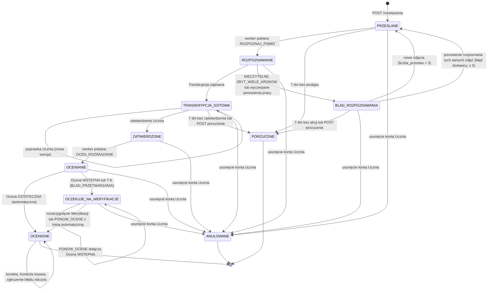

Rozwiązanie `OCENIONE` z otwartą Weryfikacją (Kontrola losowa, zgłoszenie)
przy usunięciu konta pozostaje `OCENIONE`, a Weryfikacja przechodzi do
`ANULOWANA` (`USUNIECIE_KONTA`). Zdjęcia Rozwiązań `PORZUCONE` i `ANULOWANE`
dostają `usun_po := now()` w tej samej transakcji (16.4).

Dozwolone operacje API w stanach (wszystkie inne → `409 ROZWIAZANIE_NIEPRAWIDLOWY_STAN`):

| Operacja | Dozwolona w stanach | Zasób `If-Match` |
|---|---|---|
| `PUT /rozwiazania/{id}/transkrypcja` | `TRANSKRYPCJA_GOTOWA` | Rozwiązanie |
| `POST /rozwiazania/{id}/zatwierdzenie` | `TRANSKRYPCJA_GOTOWA` | Rozwiązanie |
| `POST /rozwiazania/{id}/zdjecia` | `BLAD_ROZPOZNAWANIA` (gdy `liczba_przeslan < 3`) | Rozwiązanie |
| `POST /rozwiazania/{id}/ponowienie-rozpoznania` | `BLAD_ROZPOZNAWANIA` z kodem `BLAD_DOSTAWCY` lub `PRZEKROCZONY_CZAS` (gdy `liczba_ponowien_rozpoznania < 5`) | Rozwiązanie |
| `POST /rozwiazania/{id}/porzucenie` | `TRANSKRYPCJA_GOTOWA`, `BLAD_ROZPOZNAWANIA` | Rozwiązanie |
| `POST /rozwiazania/{id}/zgloszenie-bledu-odczytu` | `OCENIONE`, `OCZEKUJE_NA_WERYFIKACJE` (warunki 11.6) | Rozwiązanie |
| `POST /rozwiazania/{id}/korekty` | `OCENIONE` (warunki 9.6.3) | Rozwiązanie |
| `POST /weryfikacje/{id}/rozstrzygniecie` | Rozwiązanie w `OCZEKUJE_NA_WERYFIKACJE` lub `OCENIONE` (Kontrola losowa, zgłoszenie) | Weryfikacja |

### 8.2 Ocena

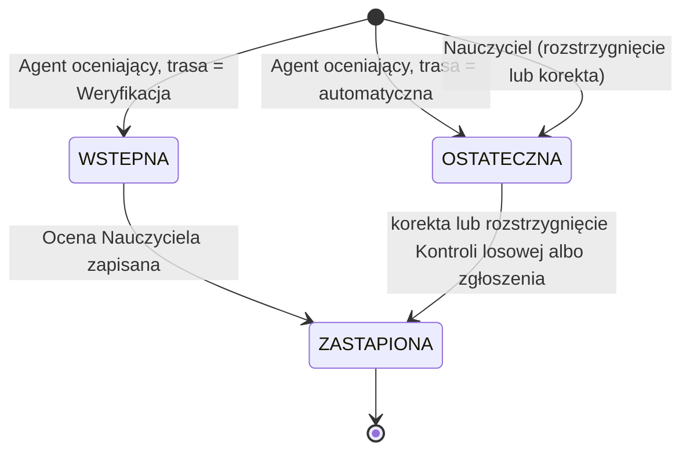

Jeśli Nauczyciel w Kontroli losowej **potwierdza** Ocenę bez zmian, i tak
powstaje nowa wersja Oceny (`zrodlo = NAUCZYCIEL`), aby każda Próbka
kalibracyjna wskazywała Ocenę Nauczyciela; Uczeń nie dostaje powiadomienia,
gdy punkty i błędny krok są identyczne. Poza przejściem do `ZASTAPIONA`
jedyną dozwoloną modyfikacją wiersza `ocena` jest jednokrotne uzupełnienie
Wskazówki (Z-5, trigger `trg_ocena_niezmienna`).

Widoczność dla Ucznia (`OcenaWyjscie.widocznosc_dla_ucznia`, ADR-022):
`PELNA` — wszystkie pola; `WSTRZYMANA_BLAD_ODCZYTU` — Ocena `WSTEPNA` z
`mozliwy_blad_odczytu = true`: Uczeń widzi status, komunikat i numer kroku
podejrzanego o błąd odczytu, ale nie widzi punktów, typu błędu ani
Wskazówki do czasu Weryfikacji.

### 8.3 Weryfikacja

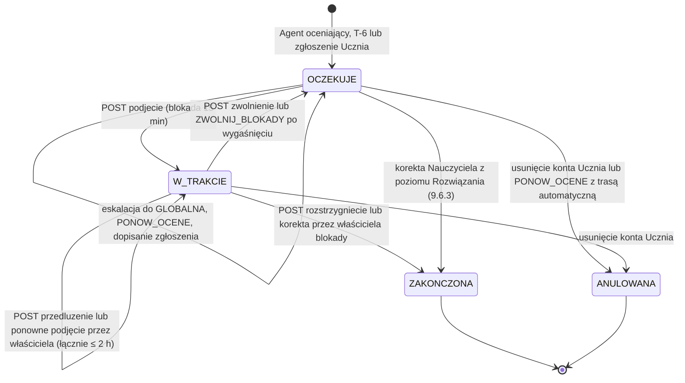

Wykonawcy przejść czasowych: `W_TRAKCIE → OCZEKUJE` po wygaśnięciu blokady
wykonuje scheduler co 1 min (`ZWOLNIJ_BLOKADY_WERYFIKACJI`, 13.5);
dodatkowo każde zapytanie kolejki traktuje `W_TRAKCIE` z
`zablokowana_do < now()` jak `OCZEKUJE` (reguła odczytu, 11.4.2), więc
opóźnienie schedulera nie ukrywa Weryfikacji. Eskalację wykonuje
`ESKALUJ_WERYFIKACJE` co godzinę (11.4.3).

### 8.4 Zadanie

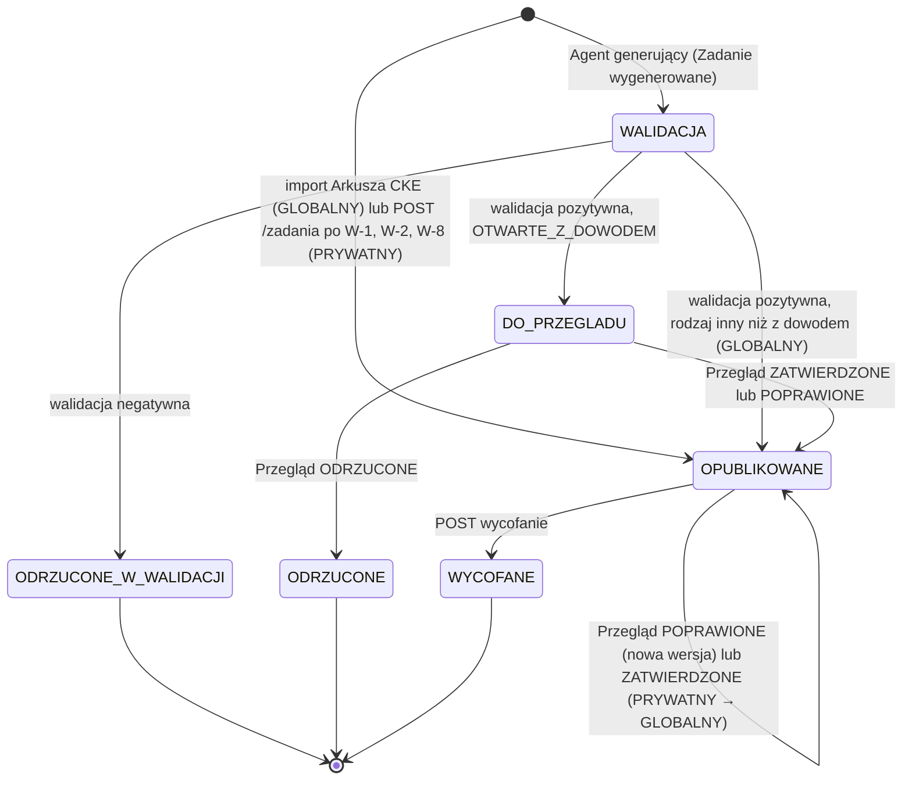

Uprawnienia do przejść (ADR-028):

| Przejście | Kto |
|---|---|
| Przegląd Zadania `GLOBALNY` (`POPRAWIONE`), wycofanie Zadania `GLOBALNY` | recenzent treści, Administrator |
| Przegląd `DO_PRZEGLADU` | zlecający Nauczyciel (wynik: `PRYWATNY`), recenzent treści lub Administrator (wynik: `GLOBALNY`) |
| Przegląd i wycofanie Zadania `PRYWATNY` | autor, recenzent treści, Administrator |
| Promocja `PRYWATNY → GLOBALNY` (Przegląd `ZATWIERDZONE`) | recenzent treści, Administrator |

Wycofanie Zadania nie przerywa trwających Rozwiązań — są one oceniane według
swojej `zadanie_wersja` (ADR-012); Zadanie znika z doboru rekomendacji i z
otwartych Przypisań (pozycja oznaczona w UI jako „wycofane”). Elementy
`PROPONOWANY` z tym Zadaniem przechodzą do `WYGASLY`; elementy `ROZPOCZETY`
pozostają aktywne do `wygasa_at` (Uczeń mógł już pisać na kartce).

### 8.5 Element Ścieżki nauki

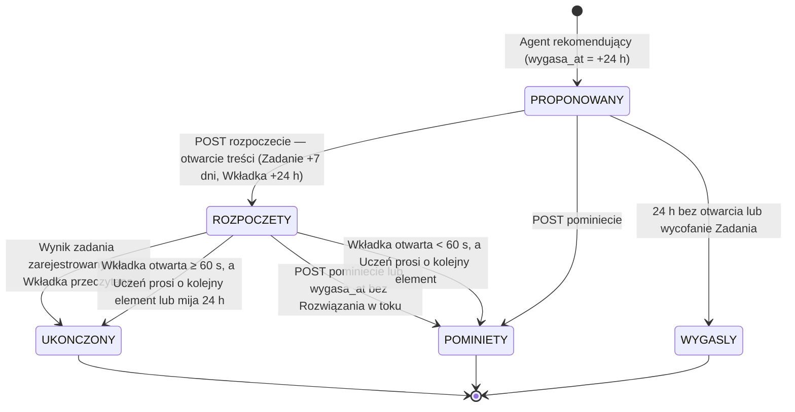

Reguły:

- `POST /elementy-sciezki/{id}/rozpoczecie` wykonuje PWA przy wyświetleniu
  treści Zadania lub Wkładki (idempotentne); zapisuje
  `zadanie_wersja_id` = aktualna wersja Zadania w tej chwili. Od tego
  momentu Rozwiązanie lub Odpowiedź dla tego elementu jest przyjmowana dla
  tej wersji, nawet jeśli w międzyczasie powstała nowsza (C1-20, 12.5).
- Rozwiązanie `PORZUCONE` nie kończy elementu: Uczeń może przesłać nowe
  Rozwiązanie do `wygasa_at`. `WYGAS_ELEMENTY` przenosi element
  `ROZPOCZETY` do `POMINIETY` po `wygasa_at` tylko wtedy, gdy nie istnieje
  Rozwiązanie w stanie nieterminalnym; w przeciwnym razie element kończy się
  wraz z Wynikiem zadania.
- Odpowiedź na Zadanie zamknięte w elemencie `PROPONOWANY` wykonuje
  rozpoczęcie i ukończenie w jednej transakcji.

### 8.6 Wynik zadania (wersja 2.1)

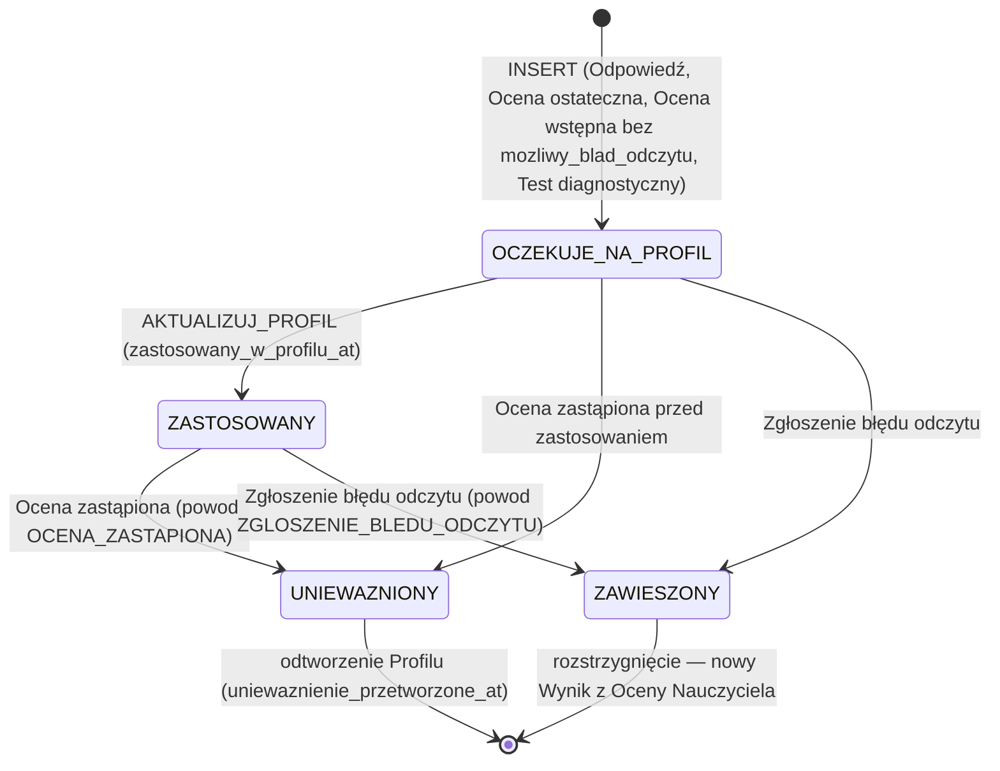

Stany są wyliczane z kolumn (`zastosowany_w_profilu_at`, `uniewazniony_at`,
`powod_uniewaznienia`), a nie przechowywane w osobnej kolumnie. Zarówno
`UNIEWAZNIONY`, jak i `ZAWIESZONY` wywołują odtworzenie Profilu ucznia
(10.1.3) i nie są w nim stosowane. Ocena wstępna z
`mozliwy_blad_odczytu = true` nie tworzy Wyniku zadania wcale (ADR-022).

---

## 9. Przepływy

Oznaczenia uczestników: `PWA` — aplikacja kliencka, `API` — proces api,
`DB` — PostgreSQL, `S3` — magazyn obiektów, `WRK` — worker (Orkiestrator),
`AR*` — agenci, `JEV` — Jev, `LLM` — Model generatywny.

### 9.1 Rejestracja, poziom matury, Test diagnostyczny (FR-01, FR-02, FR-03)

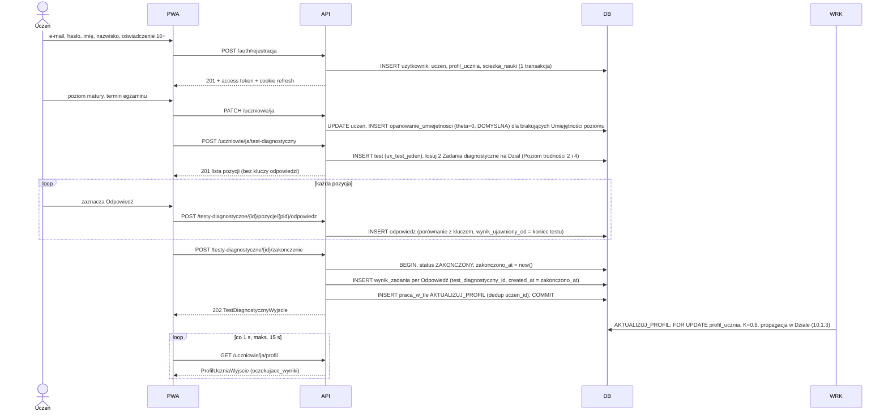

Test diagnostyczny aktualizuje Profil ucznia wyłącznie przez Wyniki zadania i
pracę `AKTUALIZUJ_PROFIL` (ta sama blokada `FOR UPDATE` co pozostałe
aktualizacje, C-11). Uczeń może pominąć test (`POST …/pominiecie`): status
`POMINIETY`, Umiejętności zostają z `theta = 0` i `inicjalizacja = DOMYSLNA`.
Pominięty test można później wykonać **raz** (indeks `ux_test_jeden`
obejmuje `W_TOKU` i `ZAKONCZONY`); ponowna próba → `409 TEST_JUZ_WYKONANY`.
Ponieważ Wyniki zadania z testu są zdarzeniami w historii (z datą
zakończenia testu), Wyniki sprzed testu i po nim stosują się w kolejności
chronologicznej, bez podwójnego liczenia (10.1.3).

**Zmiana poziomu matury** (`PATCH /uczniowie/ja` z nowym `poziom_matury`):
w jednej transakcji: (1) wstawiane są brakujące wiersze
`opanowanie_umiejetnosci` dla Umiejętności nowego poziomu (`DOMYSLNA`);
istniejące `theta` są zachowane (Umiejętność jest wspólna dla obu
poziomów); wiersze Umiejętności `tylko_rozszerzony` po zmianie na
`PODSTAWOWY` zostają, ale nie są pokazywane w Profilu ani rekomendowane;
(2) element `PROPONOWANY` przechodzi do `WYGASLY`; (3) aktywna Seria jest
kończona; (4) Uczeń może wykonać jeden Test diagnostyczny dla nowego
poziomu (indeks per poziom). Nie powstają nowe Wyniki zadania, więc nie ma
odtwarzania Profilu.

### 9.2 Rekomendacja kolejnego elementu Ścieżki nauki (FR-05 … FR-10)

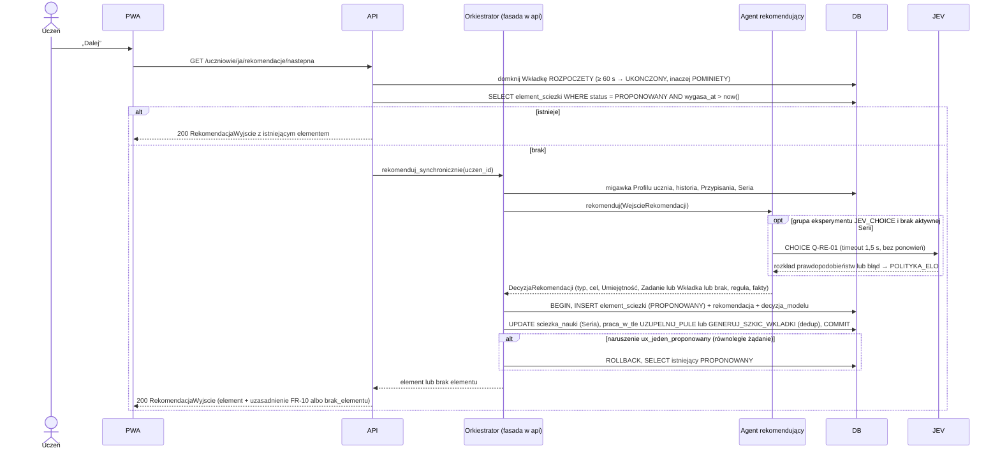

### 9.3 Zadanie zamknięte (FR-15, FR-29)

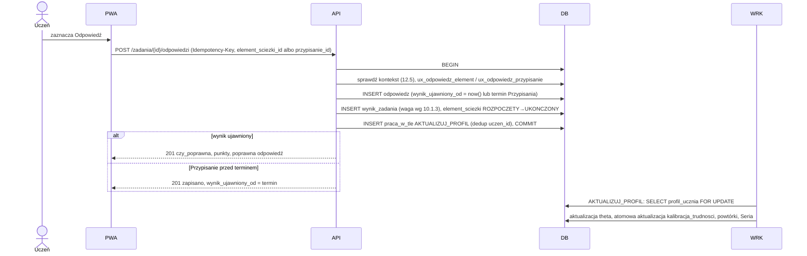

### 9.4 Przesłanie Rozwiązania i Transkrypcja (FR-16, FR-17, FR-18)

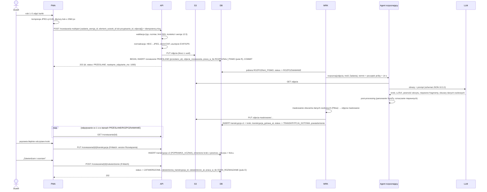

Błędy rozpoznawania (14.1 E-03 … E-06): Uczeń może przesłać nowe zdjęcia
(łącznie ≤ 3 przesłania), ponowić rozpoznanie tych samych zdjęć po błędzie
dostawcy (≤ 5 razy) albo porzucić Rozwiązanie i zacząć nowe dla tego samego
elementu. Wpis ręczny nie istnieje (ADR-024).

### 9.5 Ocena Rozwiązania (FR-19 … FR-29, NFR-01, NFR-05)

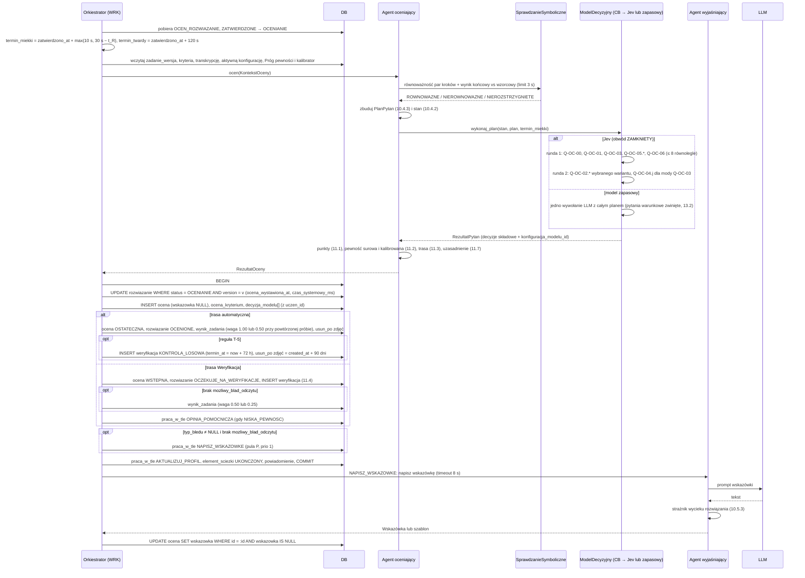

Ocena jest widoczna dla Ucznia zaraz po pierwszym `COMMIT` (to jest moment
`ocena_wystawiona_at` mierzony w NFR-01). Wskazówka dochodzi asynchronicznie
(cel p95 ≤ 10 s po Ocenie); do tego czasu `OcenaWyjscie.wskazowka_w_przygotowaniu
= true`, a PWA odpytuje co 1 s, maks. 15 s (ADR-025). Gdy termin twardy
minie przed zapisem Oceny, handler wykonuje T-6 (14.2). `t_R` = czas
rozpoznania (`transkrypcja_gotowa_at − przeslano_at`).

### 9.6 Weryfikacja przez Nauczyciela (FR-33, FR-34)

#### 9.6.1 Kolejka, podjęcie, przedłużenie, szkic

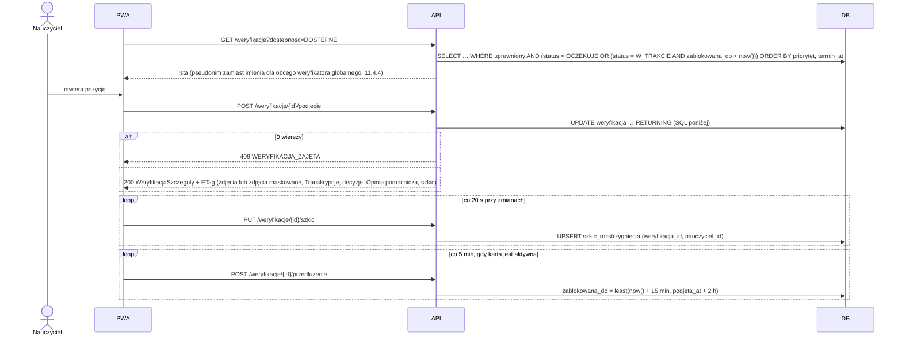

```sql
-- Podjęcie (także idempotentne ponowne podjęcie przez właściciela blokady)
UPDATE weryfikacja
SET status = 'W_TRAKCIE',
    podjeta_przez = :ja,
    podjeta_at = CASE WHEN status = 'W_TRAKCIE' AND podjeta_przez = :ja AND zablokowana_do >= now()
                      THEN podjeta_at ELSE now() END,
    zablokowana_do = now() + interval '15 minutes',
    version = version + 1
WHERE id = :id
  AND (status = 'OCZEKUJE'
       OR (status = 'W_TRAKCIE' AND (zablokowana_do < now() OR podjeta_przez = :ja)))
  AND (nauczyciel_docelowy_id = :ja
       OR (typ_kolejki = 'GLOBALNA' AND :ja_jest_weryfikatorem_globalnym)
       OR klasa_id IN (SELECT id FROM klasa WHERE nauczyciel_id = :ja))
RETURNING *;

-- Przedłużenie (tylko właściciel; łączny czas blokady ≤ 2 h od podjeta_at)
UPDATE weryfikacja
SET zablokowana_do = least(now() + interval '15 minutes', podjeta_at + interval '2 hours'),
    version = version + 1
WHERE id = :id AND status = 'W_TRAKCIE' AND podjeta_przez = :ja
  AND zablokowana_do >= now() AND podjeta_at + interval '2 hours' > now()
RETURNING zablokowana_do;
-- 0 wierszy: blokada wygasła/przejęta → 409 WERYFIKACJA_NIE_PODJETA; limit 2 h → 409 BLOKADA_MAKS_CZAS
```

Szkic jest przypisany do pary (Weryfikacja, Nauczyciel), więc przejęcie
Weryfikacji przez innego Nauczyciela nie usuwa pracy pierwszego: gdy pierwszy
podejmie ją ponownie, odzyskuje swój szkic. Szkic jest usuwany przy
`ZAKONCZONA`/`ANULOWANA`.

#### 9.6.2 Rozstrzygnięcie

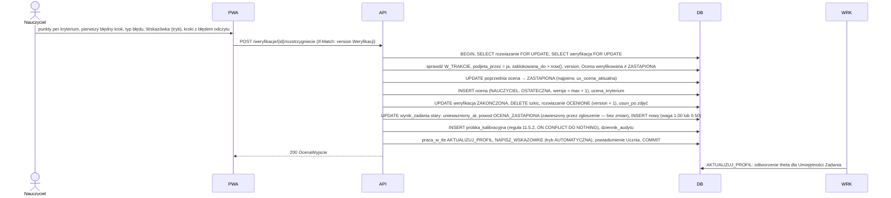

Reguły Wskazówki przy rozstrzygnięciu (FR-27, C1-14): pole
`wskazowka.tryb` ∈ {`WLASNA` (tekst Nauczyciela, ≤ 400 znaków),
`AUTOMATYCZNA` (praca `NAPISZ_WSKAZOWKE` na decyzjach Nauczyciela),
`ZACHOWAJ` (kopiuje Wskazówkę Oceny weryfikowanej)}. `ZACHOWAJ` jest
dozwolone tylko wtedy, gdy `pierwszy_bledny_krok`, `brakujacy_krok` i
`typ_bledu` są identyczne jak w Ocenie weryfikowanej i ta Ocena ma
Wskazówkę; w przeciwnym razie `422 WALIDACJA`. Gdy Ocena Nauczyciela nie ma
błędu, `wskazowka` musi być `null`. Dzięki temu każda Ocena ostateczna z
błędem ma Wskazówkę odnoszącą się do aktualnego błędnego kroku.

#### 9.6.3 Korekta Oceny z poziomu Rozwiązania (FR-34)

`POST /rozwiazania/{id}/korekty` (If-Match: `version` Rozwiązania), stan
`OCENIONE`. W jednej transakcji z `SELECT rozwiazanie FOR UPDATE`:

1. Jeśli istnieje otwarta Weryfikacja tego Rozwiązania (Kontrola losowa lub
   zgłoszenie błędu odczytu):
   - `W_TRAKCIE` z ważną blokadą innego Nauczyciela → `409
     WERYFIKACJA_ZAJETA` (nic nie zapisano);
   - w pozostałych przypadkach korekta **rozstrzyga** tę Weryfikację:
     `status = ZAKONCZONA`, `ocena_nauczyciela_id` = nowa Ocena; Próbka
     kalibracyjna dostaje źródło wynikające z powodów tej Weryfikacji
     (11.5.2), np. `KONTROLA_LOSOWA`.
2. Bez otwartej Weryfikacji: Próbka kalibracyjna `KOREKTA_NAUCZYCIELA`
   (tylko gdy aktualna Ocena jest automatyczna i nie ma jeszcze próbki —
   `ux_probka_ocena_auto`).
3. Dalej jak w 9.6.2 (zastąpienie Oceny, Wynik zadania, Wskazówka,
   powiadomienie `OCENA_SKORYGOWANA`).

Korekta i rozstrzygnięcie są serializowane blokadą wiersza `rozwiazanie`;
operacja wykonana jako druga dostaje `412 KONFLIKT_WERSJI` (zmieniona
`version`) albo `409 OCENA_ZMIENIONA` (Ocena weryfikowana została zastąpiona)
— scenariusz C-09.

### 9.7 Generowanie i Walidacja Zadania (FR-11 … FR-14)

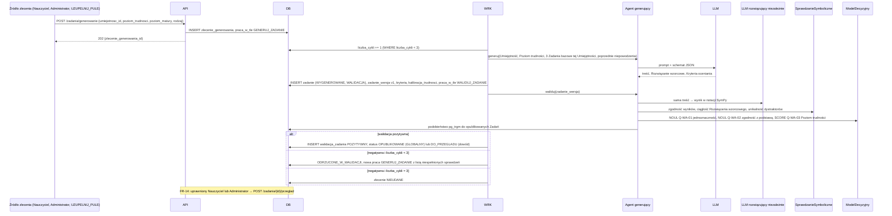

`liczba_cykli` liczy pełne cykle „generowanie + Walidacja” (≤ 3);
ponowienia techniczne pracy w tle (`praca_w_tle.proby`, np. timeout
dostawcy) nie zmieniają tego licznika. Inkrementacja jest warunkowa
(`UPDATE … SET liczba_cykli = liczba_cykli + 1 WHERE id = :id AND
liczba_cykli < 3 RETURNING`), więc CHECK nie może zostać naruszony; 0 wierszy
→ zlecenie `NIEUDANE`.

### 9.8 Kalibracja i Próg pewności (FR-34, NFR-03, NFR-04)

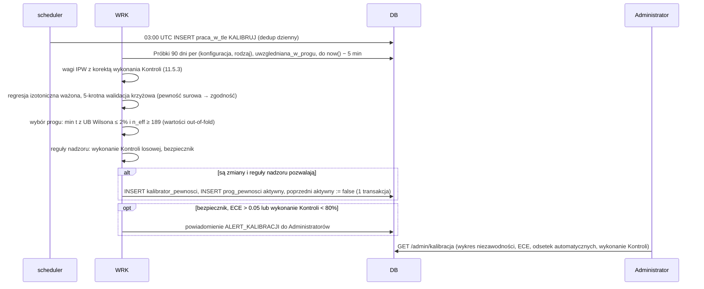

### 9.9 Przełączenie na model zapasowy (NFR-07)

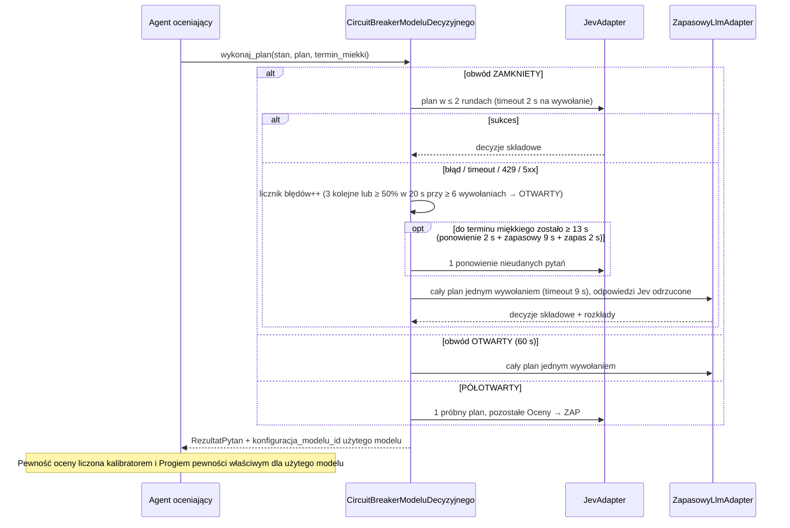

Zasada: w ramach jednej Oceny wszystkie decyzje składowe pochodzą z
**jednego** modelu decyzyjnego. Jeśli Jev zawiedzie w dowolnej rundzie,
cały plan jest wykonywany ponownie modelem zapasowym w **jednym**
wywołaniu (rozkłady obu modeli nie są mieszane, bo mają różne kalibratory).
Najgorsze przypadki czasowe są policzone w 17.2.

### 9.10 Retencja zdjęć (NFR-09)

```mermaid
sequenceDiagram
    participant SCH as scheduler
    participant WRK
    participant DB
    participant S3
    SCH->>DB: co godzinę praca_w_tle USUN_ZDJECIA
    WRK->>DB: SELECT zdjęcia WHERE usunieto_at IS NULL AND usun_po < now() LIMIT 500
    loop każde zdjęcie
        WRK->>S3: DELETE obiekt i obiekt maskowany (idempotentne)
        WRK->>DB: UPDATE usunieto_at = now()
    end
    WRK->>DB: metryka zdjecia_zalegle (usun_po < now() − 24 h) → alert
```

`usun_po` jest jedynym źródłem prawdy o terminie usunięcia; ustawiają je
przejścia stanów opisane w 16.4 (m.in. `PORZUCONE`/`ANULOWANE` → `now()`,
otwarcie Weryfikacji na Rozwiązaniu `OCENIONE` → przedłużenie do limitu 90
dni). Reguła ograniczenia `CHECK (usun_po <= created_at + 90 dni)` gwarantuje
twardy limit.

### 9.11 Import Arkusza CKE (FR-35, FR-36)

```mermaid
sequenceDiagram
    actor A as Administrator
    participant API
    participant S3
    participant DB
    participant WRK
    A->>API: POST /admin/arkusze-cke/importy (ZIP: arkusz.json + rysunki)
    API->>S3: PUT importy/{id}.zip
    API->>DB: INSERT import_arkusza OCZEKUJE, praca_w_tle IMPORTUJ_ARKUSZ
    API-->>A: 202 {import_id}
    WRK->>S3: GET ZIP
    WRK->>WRK: walidacja schematu ArkuszImportV1 (12.9), sum punktów, kodów Umiejętności, SymPy wynik_koncowy_wzorcowy
    alt wszystkie Zadania poprawne
        WRK->>DB: 1 transakcja: arkusz_cke, zadanie (BAZOWE_ARKUSZ_CKE, GLOBALNY, OPUBLIKOWANE), wersje, kryteria, tagi, kalibracja_trudnosci
        WRK->>DB: import ZAKONCZONY + raport
    else błąd w dowolnym Zadaniu
        WRK->>DB: import ODRZUCONY + raport błędów per numer Zadania (nic nie zapisano)
    end
```

### 9.12 Zgłoszenie błędu odczytu przez Ucznia (FR-28)

```mermaid
sequenceDiagram
    actor U as Uczeń
    participant PWA
    participant API
    participant DB
    U->>PWA: „Zgłoś błąd odczytu” przy Ocenie (wybiera kroki, opis)
    PWA->>API: POST /rozwiazania/{id}/zgloszenie-bledu-odczytu (If-Match)
    API->>DB: BEGIN, SELECT rozwiazanie FOR UPDATE
    API->>DB: sprawdź warunki 11.6 (okno 14 dni, limity, zdjęcia dostępne, brak wcześniejszego zgłoszenia)
    alt otwarta Weryfikacja istnieje (OCZEKUJE lub W_TRAKCIE)
        API->>DB: UPDATE weryfikacja: powody += ZGLOSZENIE_BLEDU_ODCZYTU, zgloszenie, priorytet = min(priorytet, 2), version + 1
    else brak otwartej Weryfikacji (OCENIONE)
        API->>DB: INSERT weryfikacja (ZGLOSZENIE_BLEDU_ODCZYTU, ocena_weryfikowana = aktualna, priorytet 2, kolejka 11.4)
        API->>DB: usun_po zdjęć = created_at + 90 dni
    end
    API->>DB: UPDATE wynik_zadania aktualnej Oceny: uniewazniony_at = now(), powod_uniewaznienia = ZGLOSZENIE_BLEDU_ODCZYTU
    API->>DB: praca_w_tle AKTUALIZUJ_PROFIL (odtworzenie bez zawieszonego Wyniku), powiadomienie NOWA_WERYFIKACJA, COMMIT
    API-->>PWA: 201 {weryfikacja: {status, powody, termin_at}}
```

Skutki zgłoszenia dla Ucznia (FR-28, uzupełnienie 2.1): od chwili zgłoszenia
do rozstrzygnięcia Wynik zadania tej Oceny jest **zawieszony** (wyłączony z
Profilu ucznia przez mechanizm unieważnienia z powodem
`ZGLOSZENIE_BLEDU_ODCZYTU`; Profil jest odtwarzany, 10.1.3), więc ewentualny
błąd odczytu nie obniża Profilu nawet przez czas trwania Weryfikacji. Ocena
pozostaje widoczna z komunikatem „Zgłoszenie błędu odczytu jest sprawdzane”
(11.3). Rozstrzygnięcie zawsze tworzy nową Ocenę Nauczyciela i nowy Wynik
zadania (9.6.2), więc zawieszony Wynik nigdy nie wraca do Profilu — zastępuje
go Wynik z Oceny Nauczyciela. Gdy Weryfikacja zostanie anulowana z powodu
usunięcia konta, zawieszenia nie trzeba cofać. Nadużycie (zgłaszanie każdej
słabej Oceny, by usunąć ją z Profilu) ogranicza limit 1 zgłoszenia na
Rozwiązanie i 5 na 30 dni, a metryka `zgloszenia_bledu_odczytu_uznane_30d`
(11.8) per Uczeń < 20% przy ≥ 5 zgłoszeniach oznacza konto w raporcie
Administratora.

Zgłoszenie do Weryfikacji `W_TRAKCIE` podnosi `weryfikacja.version`, więc
rozstrzygnięcie Nauczyciela wysłane z poprzednim `If-Match` dostaje `412
KONFLIKT_WERSJI` z aktualnym zasobem (w tym `zgloszenie`). To zamierzone:
Nauczyciel nie może rozstrzygnąć Weryfikacji bez zobaczenia zgłoszenia.
Blokada i szkic pozostają bez zmian, więc Nauczyciel wysyła rozstrzygnięcie
ponownie po przejrzeniu zgłoszenia (scenariusz C-28).

### 9.13 Ponowna ocena po błędzie przetwarzania (`PONOW_OCENE`)

```mermaid
sequenceDiagram
    participant WRK
    participant DB
    participant OCE as Agent oceniający
    WRK->>DB: pobiera PONOW_OCENE, czyta weryfikacja (version = v) i rozwiazanie (version = r)
    WRK->>WRK: warunek: weryfikacja OCZEKUJE, BLAD_PRZETWARZANIA, ocena_weryfikowana_id IS NULL
    WRK->>OCE: ocen(KontekstOceny), termin_miekki = now() + 60 s
    OCE-->>WRK: RezultatOceny
    WRK->>DB: BEGIN
    WRK->>DB: UPDATE weryfikacja … WHERE id = :id AND status = OCZEKUJE AND version = v
    alt 0 wierszy (Nauczyciel podjął lub rozstrzygnął)
        WRK->>DB: ROLLBACK, log wynik_przestarzaly
    else trasa Weryfikacja (powody T-1…T-4)
        WRK->>DB: INSERT ocena WSTEPNA, weryfikacja: ocena_weryfikowana_id, powody := powody z 11.3, priorytet, ponowna_ocena_at
        WRK->>DB: rozwiazanie (version = r) ocena_wystawiona_at, wynik_zadania (o ile brak mozliwy_blad_odczytu)
        WRK->>DB: NAPISZ_WSKAZOWKE (gdy błąd i brak mozliwy_blad_odczytu), OPINIA_POMOCNICZA (NISKA_PEWNOSC)
        WRK->>DB: AKTUALIZUJ_PROFIL (gdy powstał Wynik zadania), powiadomienie OCENA_WYSTAWIONA, COMMIT
    else trasa automatyczna (brak powodów)
        WRK->>DB: najpierw weryfikacja ANULOWANA (PONOWNA_OCENA_AUTOMATYCZNA), potem INSERT ocena OSTATECZNA
        WRK->>DB: rozwiazanie OCENIONE, wynik_zadania (1.00 lub 0.50), usun_po zdjęć
        WRK->>DB: T-5: INSERT weryfikacja KONTROLA_LOSOWA po anulowaniu (ux_weryfikacja_otwarta, 15.1 p. 3), usun_po = created_at + 90 dni
        WRK->>DB: NAPISZ_WSKAZOWKE (gdy błąd), AKTUALIZUJ_PROFIL, powiadomienie OCENA_WYSTAWIONA, COMMIT
    end
```

`PONOW_OCENE` nie podnosi wcześniejszego czasu: `czas_systemowy_ms` jest już
zapisany jako naruszenie NFR-01 (T-6). Ocena powstała w `PONOW_OCENE`
podlega tym samym regułom 11.1–11.3 co pierwsza ocena. Nauczyciel, który
podjął Weryfikację (`W_TRAKCIE`), zawsze ma pierwszeństwo: warunek na
`status = OCZEKUJE AND version = v` gwarantuje, że wynik `PONOW_OCENE` nie
nadpisze jego pracy (C-23).

---

## 10. Agenci — kontrakty, algorytmy, pytania do Jev

Wszyscy agenci są klasami Pythona w `lemat.agenci.<nazwa>`, przyjmują i
zwracają modele Pydantic, nie wykonują operacji na bazie (Orkiestrator
dostarcza dane i zapisuje wyniki). Dzięki temu są testowalni bez bazy i bez
sieci (porty mają implementacje testowe).

### 10.1 Agent rekomendujący

#### 10.1.1 Kontrakt

```python
class SeriaSkrot(BaseModel):
    umiejetnosc_id: int
    rozpoczeta_at: datetime
    liczba_elementow: int                             # 0..8
    poziom_trudnosci: int                             # docelowy Poziom trudności kolejnego Zadania
    kolejne_porazki: int

class WejscieRekomendacji(BaseModel):
    uczen_id: UUID
    poziom_matury: PoziomMatury
    termin_egzaminu: date | None
    wybrany_dzial_id: int | None                      # FR-09
    opanowanie: list[OpanowanieUmiejetnosci]          # migawka Profilu ucznia
    ostatnie_wyniki: list[WynikZadaniaSkrot]          # 50 ostatnich nieunieważnionych, malejąco po czasie
    ostatnie_elementy: list[ElementSciezkiSkrot]      # 10 ostatnich elementów Ścieżki nauki
    otwarte_przypisania: list[PrzypisanieSkrot]       # pozycje bez Wyniku zadania i bez próby w toku
    seria: SeriaSkrot | None                          # ADR-030
    wkladki_przeczytane: dict[int, datetime]          # umiejetnosc_id → ostatnie przeczytanie
    udzial_zadan_otwartych: Literal[3, 5]             # co który element ZADANIE jest otwarty (11.4.3, 11.5.1)
    dowody_dozwolone: bool                            # false przy kontroli przyjęć kolejki GLOBALNA (11.4.3)
    strategia: StrategiaRekomendacji                  # POLITYKA_ELO | JEV_CHOICE
    teraz: datetime

class BrakElementu(BaseModel):
    kod: Literal["BRAK_ZADAN_W_ZAKRESIE"]
    komunikat: str                                    # tekst dla Ucznia (10.1.5)
    sugerowane_dzialy: list[int]                      # Działy z dostępnymi Zadaniami

class DecyzjaRekomendacji(BaseModel):
    typ: TypElementuSciezki | None                    # WKLADKA_TEORETYCZNA | ZADANIE; None ⇔ brak_elementu
    cel: CelElementu                                  # NAUKA | POWTORKA
    umiejetnosc_id: int | None
    zadanie_id: UUID | None
    wkladka_teoretyczna_id: UUID | None
    przypisanie_id: UUID | None                       # tylko R-PRZYPISANIE
    przewidywane_p_sukcesu: float | None
    regula: Literal["R-PRZYPISANIE","R-SERIA","R-POWTORKA","R-WKLADKA","R-WKLADKA-DIAG","R-NAJSLABSZA",
                    "R-TRUDNOSC_W_GORE","R-UTRWALENIE","R-JEV-WKLADKA","R-JEV-ZADANIE_LATWE",
                    "R-JEV-ZADANIE_MATURALNE","R-JEV-POWTORKA"] | None
    uzasadnienie: str                                 # FR-10, z szablonu 10.1.5 (także dla brak_elementu)
    uzasadnienie_fakty: dict[str, Any]
    zmiana_serii: Literal["BEZ_ZMIAN","ROZPOCZNIJ","ZAKONCZ"]
    w_serii: bool
    potrzebne_uzupelnienie_puli: list[ZapotrzebowaniePuli]   # klucz 10.1.2 „Zapotrzebowanie puli”
    potrzebne_szkice_wkladek: list[int]               # umiejetnosc_id bez opublikowanej Wkładki (E-20)
    decyzje_modelu: list[DecyzjaSkladowa]             # pusta dla POLITYKA_ELO
    brak_elementu: BrakElementu | None
```

#### 10.1.2 Polityka POLITYKA_ELO (domyślna)

Kroki wykonywane w kolejności; pierwszy, który zwraca decyzję, kończy algorytm.
„Poziom trudności” oznacza skalibrowany `kalibracja_trudnosci.poziom_trudnosci`.

1. **Przypisania (FR-32).** Jeśli istnieje otwarte Przypisanie — wybierz
   pozycję z najbliższym terminem, która nie ma Wyniku zadania ani próby w
   toku (Rozwiązania nieterminalnego); Zadanie `WYCOFANE` jest pomijane;
   `R-PRZYPISANIE`, element z `przypisanie_id`. Przypisanie ma pierwszeństwo
   przed Serią (Seria nie jest kończona, tylko wstrzymana).
2. **Zakres.** Kandydackie Umiejętności = Umiejętności poziomu matury Ucznia
   (`tylko_rozszerzony = false` dla `PODSTAWOWY`), zawężone do
   `wybrany_dzial_id`, jeśli ustawiony (FR-09).
3. **Seria (wizja, ADR-030).** Jeśli Seria jest aktywna i jej Umiejętność
   należy do zakresu z kroku 2 — wybierz Zadanie tej Umiejętności (główna) o
   Poziomie trudności = `seria.poziom_trudnosci`, bez Wyniku zadania w 60
   dniach, zgodnie z regułą rodzaju z kroku 7; brak na tym poziomie →
   najbliższy wyższy poziom, potem najbliższy niższy; brak w ogóle →
   `zmiana_serii = ZAKONCZ` (powód `BRAK_ZADAN`), zapotrzebowanie puli i
   przejście do kroku 4. `R-SERIA`, `w_serii = true`. Seria wyklucza krok 4
   (powtórka), bo realizuje wizję „serii aż do poziomu maturalnego”.
   Seria spoza zakresu (Uczeń zmienił `wybrany_dzial_id`) → `ZAKONCZ`.
4. **Powtórka (FR-08).** Jeśli wśród kandydatów jest Umiejętność z
   `nastepna_powtorka_at ≤ teraz` i w 4 ostatnich elementach nie było
   elementu z `cel = POWTORKA` — wybierz najdawniej zaległą; Zadanie dobierz
   jak w kroku 7 z docelowym P = 0.80; `R-POWTORKA`, `cel = POWTORKA`.
5. **Wybór Umiejętności.** Dla każdego kandydata z `poziom_opanowania < 0.80`:
   `priorytet = (1 − poziom_opanowania) × waga_egzaminacyjna × pilnosc`,
   gdzie `pilnosc = 1 + max(0, (90 − dni_do_egzaminu) / 90)` (1, gdy brak
   terminu). Jeśli którakolwiek Umiejętność wymagana (`umiejetnosc_wymagana`)
   ma `poziom_opanowania < 0.50`, zamiast kandydata rozpatrywana jest
   najsłabsza z wymaganych (rekurencyjnie, maks. głębokość 3). Wybór:
   maksymalny priorytet; remis → mniejszy `id`.
   **5b. Wszystko opanowane** (brak kandydata z `poziom_opanowania < 0.80`):
   wybierz Umiejętność o najwcześniejszym `nastepna_powtorka_at` (powtórka
   przyspieszona) i Zadanie o Poziomie trudności ≥ 4 z P najbliższym 0.675;
   `R-UTRWALENIE`, `cel = POWTORKA`. Gdy `wybrany_dzial_id` jest ustawiony,
   uzasadnienie dopisuje „Dział {dzial} jest opanowany — możesz wybrać inny
   dział w ustawieniach.”. Gdy ta Umiejętność nie ma Zadania na Poziomie
   trudności ≥ 4 (warunki kandydatów jak w kroku 7): kolejne Umiejętności
   według `nastepna_powtorka_at` (maks. 5), potem Zadanie o najwyższym
   Poziomie trudności w całym zakresie z kroku 2 (z tą samą regułą
   `R-UTRWALENIE`) i zapotrzebowanie puli dla pierwszej Umiejętności na
   Poziomie trudności 4; brak jakiegokolwiek Zadania → krok 8.
6. **Wkładka teoretyczna (FR-06).** Jeśli dla wybranej Umiejętności
   (`liczba_wynikow ≥ 2` lub `inicjalizacja = TEST_DIAGNOSTYCZNY`) oraz
   (`poziom_opanowania < 0.40` lub 2 ostatnie Wyniki zadania z tej
   Umiejętności mają `ulamek < 0.5`) oraz Wkładka nie była przeczytana w
   ostatnich 14 dniach:
   - istnieje opublikowana Wkładka → zwróć ją; `R-WKLADKA`, a gdy wszystkie
     Wyniki zadania tej Umiejętności pochodzą z Testu diagnostycznego —
     `R-WKLADKA-DIAG`;
   - brak opublikowanej Wkładki → `potrzebne_szkice_wkladek += [U]` (praca
     `GENERUJ_SZKIC_WKLADKI`, E-20) i przejście do kroku 7;
   - w obu przypadkach `zmiana_serii = ROZPOCZNIJ` dla Umiejętności U z
     `seria.poziom_trudnosci` = Poziom trudności (≤ 3) Zadania o P
     najbliższym 0.675.
7. **Zadanie (FR-05, FR-07).** Kandydaci: Zadania `OPUBLIKOWANE`,
   `zasieg = GLOBALNY`, z tą Umiejętnością główną, poziomu matury Ucznia,
   bez Wyniku zadania tego Ucznia w ostatnich 60 dniach i nieobecne w jego
   otwartych Przypisaniach. Rodzaj: co `udzial_zadan_otwartych`-ty element
   typu `ZADANIE` w Ścieżce nauki jest otwarty (`OTWARTE_OBLICZENIOWE` lub —
   gdy `dowody_dozwolone` — `OTWARTE_Z_DOWODEM`), pozostałe `ZAMKNIETE`;
   gdy brak kandydatów danego rodzaju — dowolny dozwolony rodzaj. Wybór:
   Zadanie z `P` (10.1.3) najbliższym 0.675 w przedziale [0.60, 0.75]; remis
   → Zadanie bazowe przed wygenerowanym, potem mniejsza
   `liczba_wynikow_kalibracji`. Brak w przedziale → najbliższe z
   `|P − 0.675| ≤ 0.20` i zapotrzebowanie puli; brak i takiego → kolejna
   Umiejętność z rankingu kroku 5 (maks. 3), a na końcu Zadanie o najbliższym
   P bez ograniczenia w całym zakresie z kroku 2. Reguła: `R-TRUDNOSC_W_GORE`,
   jeśli wybrany Poziom trudności jest wyższy niż w poprzednim elemencie tej
   Umiejętności, w przeciwnym razie `R-NAJSLABSZA`.
8. **Brak Zadań.** Gdy w całym zakresie nie ma żadnego Zadania spełniającego
   warunki kroku 7 (np. start platformy, nowa Umiejętność rozszerzona):
   `typ = None`, `brak_elementu = {kod: BRAK_ZADAN_W_ZAKRESIE, …}`,
   zapotrzebowanie puli dla Umiejętności z kroku 5 na Poziomach trudności
   2–4 (dla `ZAMKNIETE` i `OTWARTE_OBLICZENIOWE`). Endpoint zwraca `200` z
   `element = null` i `brak_elementu` (12.4); UI pokazuje komunikat i listę
   `sugerowane_dzialy`. Element Ścieżki nauki nie powstaje.

**Zapotrzebowanie puli** — klucz jednolity w całym systemie (10.1, 13.3,
`zlecenie_generowania`): `(umiejetnosc_id, poziom_trudnosci, poziom_matury,
rodzaj)`, gdzie `rodzaj ∈ {ZAMKNIETE, OTWARTE_OBLICZENIOWE}`. Warunek:
mniej niż 3 Zadania `OPUBLIKOWANE` i `GLOBALNY` dla klucza → praca
`UZUPELNIJ_PULE` z tym kluczem. Zadania z dowodem nie są uzupełniane
automatycznie (wymagają Przeglądu, ADR-015); powstają na zlecenie
Nauczyciela lub Administratora.

**Reguły Serii** (stosowane w `AKTUALIZUJ_PROFIL` po każdym Wyniku zadania z
elementu `w_serii`, ADR-030):

| Zdarzenie | Skutek |
|---|---|
| `ulamek ≥ 0.7` i Poziom trudności Zadania ≥ 4 | Seria zakończona sukcesem (cel wizji: poziom maturalny) |
| `ulamek ≥ 0.7` i Poziom trudności < 4 | `poziom_trudnosci := min(5, poziom + 1)`, `kolejne_porazki := 0` |
| `0.5 ≤ ulamek < 0.7` | poziom bez zmian, `kolejne_porazki := 0` |
| `ulamek < 0.5` | `kolejne_porazki += 1`; przy 2 kolejnych `poziom := max(1, poziom − 1)` |
| `kolejne_porazki = 3` lub `liczba_elementow = 8` lub 7 dni od rozpoczęcia | Seria zakończona; następna rekomendacja wraca do kroku 5 (zwykle Umiejętność wymagana) |

Poziom trudności w Serii jest niemalejący, dopóki Uczeń odnosi sukcesy, co
realizuje „serię zadań o stopniowo rosnącej trudności, aż do poziomu
maturalnego” z wizji.

#### 10.1.3 Model Profilu ucznia (Elo per Umiejętność) — ADR-010

- `σ(x) = 1 / (1 + e^(−x))`.
- Parametr Zadania: `trudnosc_b` (tabela `kalibracja_trudnosci`), inicjalnie
  `0.8 × (poziom_trudnosci_nominalny − 3)` (Poziom trudności 1…5 →
  −1.6…1.6).
- Umiejętność efektywna: `θ̄ = 0.7·θ_główna + 0.3·średnia(θ_dodatkowe)`
  (gdy brak dodatkowych: `θ̄ = θ_główna`).
- Prawdopodobieństwo sukcesu: `P = c + (1 − c)·σ(θ̄ − b)`, gdzie `c = 0.25`
  dla `WYBOR_JEDNOKROTNY` (4 opcje), `c = 0.5^n` dla `PRAWDA_FALSZ` z `n`
  stwierdzeniami, `c = 0` dla zadań otwartych.
- **Waga Wyniku zadania** `waga = w_status × w_proba`:
  `w_status = 1.0` dla Odpowiedzi i Oceny ostatecznej, `0.5` dla Oceny
  wstępnej **bez** `mozliwy_blad_odczytu`; Ocena wstępna z
  `mozliwy_blad_odczytu = true` **nie tworzy** Wyniku zadania (FR-28,
  ADR-022), a Wynik zadania Oceny objętej Zgłoszeniem błędu odczytu jest
  zawieszony do rozstrzygnięcia (`powod_uniewaznienia =
  'ZGLOSZENIE_BLEDU_ODCZYTU'`, 11.6) i — jak każdy unieważniony — pomijany
  przy odtwarzaniu. `w_proba = 1.0` dla pierwszej próby Ucznia przy danym Zadaniu w
  60 dniach, `0.5` dla każdej kolejnej (np. to samo Zadanie w Przypisaniu i
  wcześniej w Ścieżce nauki). Wartości: {1.00, 0.50, 0.25}.
  `liczy_do_trudnosci = (waga = 1.00)`.
- Aktualizacja po Wyniku zadania `s = ulamek` z wagą `w`:
  `Δ = s − P`; `θ_główna += w·K_u·Δ`; `θ_dodatkowa += w·0.5·K_u·Δ`;
  `K_u = max(0.2, 0.8 / (1 + n/20))`, `n` = `liczba_wynikow` Umiejętności.
  Dla Wyników z Testu diagnostycznego `K_u = 0.8`.
- **Kalibracja Poziomu trudności** (słownik: „kalibrowana na podstawie
  wyników uczniów”, ADR-029) — tylko gdy `liczy_do_trudnosci`, jednym
  atomowym poleceniem (bez odczytu–modyfikacji–zapisu w ORM):

  ```sql
  WITH stary AS (
      SELECT poziom_trudnosci FROM kalibracja_trudnosci WHERE zadanie_id = :zadanie_id FOR UPDATE)
  UPDATE kalibracja_trudnosci k
  SET trudnosc_b = k.trudnosc_b - greatest(0.05, 0.4 / (1 + k.liczba_wynikow_kalibracji / 30.0)) * :delta,
      liczba_wynikow_kalibracji = k.liczba_wynikow_kalibracji + 1,
      poziom_trudnosci = CASE WHEN k.liczba_wynikow_kalibracji + 1 < 30 THEN k.poziom_trudnosci
                              ELSE poziom_z_b(k.trudnosc_b - greatest(0.05, 0.4 / (1 + k.liczba_wynikow_kalibracji / 30.0)) * :delta,
                                              k.poziom_trudnosci) END,
      updated_at = now()
  WHERE k.zadanie_id = :zadanie_id
  RETURNING k.poziom_trudnosci AS nowy, (SELECT poziom_trudnosci FROM stary) AS stary;
  ```

  `poziom_z_b(b, obecny)` (funkcja SQL `IMMUTABLE`): progi `b < −1.2 → 1`,
  `[−1.2, −0.4) → 2`, `[−0.4, 0.4) → 3`, `[0.4, 1.2) → 4`, `≥ 1.2 → 5`, z
  histerezą 0.1 (poziom zmienia się dopiero, gdy `b` przekroczy granicę o ≥
  0.1), aby uniknąć oscylacji. Gdy `nowy ≠ stary`, ta sama transakcja
  zapisuje `dziennik_audytu` (`POZIOM_TRUDNOSCI_SKALIBROWANY`, `rola =
  NULL`). `Δ` jest liczone z `b` odczytanego przed aktualizacją; przy
  równoległych Wynikach zadania to przybliżenie (opóźnienie o ≤ kilka
  wyników) jest akceptowane, natomiast żadna aktualizacja nie ginie, bo
  odejmowanie wykonuje baza. `zadanie.version` nie zmienia się (C1-23).
- `poziom_opanowania = σ(θ − 0.8)` — prawdopodobieństwo sukcesu przy Zadaniu
  o Poziomie trudności 4 (maturalnym).
- Poziom opanowania Działu (FR-04) = średnia ważona `waga_egzaminacyjna`
  poziomów opanowania jego Umiejętności.
- **Test diagnostyczny**: Wyniki zadania z testu mają `created_at =
  zakonczono_at` testu i są stosowane razem (w kolejności pozycji); po
  zastosowaniu ostatniego z nich Umiejętności Działu z `liczba_wynikow = 0`
  w tej chwili dostają średnią `θ` przetestowanych Umiejętności tego Działu
  (`PROPAGACJA_Z_DZIALU`), a przetestowane — `inicjalizacja =
  TEST_DIAGNOSTYCZNY`.
- Powtórki: po Wyniku zadania z `ulamek ≥ 0.7` dla Umiejętności z
  `poziom_opanowania ≥ 0.80`: `licznik_powtorek += 1`,
  `nastepna_powtorka_at = teraz + [3, 7, 14, 30, 60][min(licznik−1, 4)] dni`;
  przy `ulamek < 0.5`: `licznik_powtorek = 0`, `nastepna_powtorka_at = teraz + 1 dzień`.
- **Odtwarzanie** (po unieważnieniu Wyniku zadania): **cały Profil ucznia**
  wraca do stanu DOMYŚLNEGO (`θ = 0`, `liczba_wynikow = 0`,
  `inicjalizacja = DOMYSLNA`, liczniki powtórek zerowane), następnie
  wszystkie nieunieważnione Wyniki zadania Ucznia — **łącznie z Wynikami z
  Testu diagnostycznego** — są stosowane chronologicznie (`created_at`,
  potem `id`) według reguł powyżej, z bieżącymi `trudnosc_b`. Nie istnieje
  „punkt startowy po teście”, więc żaden Wynik nie jest liczony podwójnie
  (C1-11). Operacja jest deterministyczna i idempotentna; dla ≤ 5 000
  Wyników trwa < 50 ms. `trudnosc_b` nie jest odtwarzane (korekta wpływa na
  `b` tylko przez nowy Wynik o wadze 1.00).

#### 10.1.4 Migawka cech (`rekomendacja.cechy`)

```json
{
  "poziom_matury": "PODSTAWOWY", "dni_do_egzaminu": 142, "wybrany_dzial_id": null,
  "seria": {"umiejetnosc_id": 512, "liczba_elementow": 3, "poziom_trudnosci": 3},
  "kandydaci": [ {"umiejetnosc_id": 512, "poziom_opanowania": 0.31, "waga": 0.042, "priorytet": 0.029} ],
  "ostatnie_wyniki_umiejetnosci": [ {"zadanie_id": "…", "ulamek": 0.0, "kiedy": "2026-10-30T18:01:00Z",
                                     "z_testu_diagnostycznego": false} ],
  "zadania_w_strefie": 4, "udzial_zadan_otwartych": 3, "dowody_dozwolone": true
}
```

#### 10.1.5 Szablony uzasadnień (FR-10, NFR-05)

Uzasadnienie jest generowane deterministycznie z faktów (ADR-011); liczebniki
odmieniane funkcją `odmien(n, "zadanie", "zadania", "zadań")`. Każda
wartość `regula` (także wariantu JEV_CHOICE) i stan „brak elementu” mają
szablon — test jednostkowy sprawdza pokrycie wszystkich wartości `Literal`.

| Reguła | Szablon | Fakty |
|---|---|---|
| R-PRZYPISANIE | „Zadanie z zestawu „{zestaw}” od nauczyciela {nauczyciel}, termin: {termin}.” | `zestaw`, `nauczyciel`, `termin` |
| R-SERIA | „Kontynuujesz serię z „{umiejetnosc}”: zadanie {k} z serii, poziom trudności {poziom} (cel: poziom maturalny 4).” | `umiejetnosc`, `k`, `poziom` |
| R-POWTORKA | „Powtórka: ostatnie ćwiczenie z „{umiejetnosc}” było {dni} dni temu.” | `umiejetnosc`, `dni` |
| R-WKLADKA | „{bledne} z ostatnich {n} {odmiana} z „{umiejetnosc}” rozwiązano błędnie — zacznij od krótkiej teorii.” | `bledne`, `n` (≥ 2), `umiejetnosc` |
| R-WKLADKA-DIAG | „W teście diagnostycznym {bledne} z {n} {odmiana} z „{umiejetnosc}” rozwiązano błędnie — zacznij od krótkiej teorii.” | `bledne`, `n` (≥ 1), `umiejetnosc` |
| R-NAJSLABSZA | „„{umiejetnosc}” to obecnie najsłabsza umiejętność w dziale {dzial} (opanowanie {procent}%). Zadanie dobrano tak, aby szansa na poprawne rozwiązanie wynosiła ok. {p}%.” | `umiejetnosc`, `dzial`, `procent`, `p` |
| R-TRUDNOSC_W_GORE | „{k} ostatnie {odmiana} z „{umiejetnosc}” rozwiązano poprawnie — poziom trudności rośnie do {poziom}.” | `k`, `umiejetnosc`, `poziom` |
| R-UTRWALENIE | „Wszystkie umiejętności w zakresie masz opanowane (co najmniej 80%). Utrwalenie na poziomie maturalnym: „{umiejetnosc}”.” | `umiejetnosc` |
| R-JEV-WKLADKA | „Model oceny postępów wskazał z prawdopodobieństwem {p_modelu}%, że przed kolejnymi zadaniami z „{umiejetnosc}” warto przeczytać krótką teorię (opanowanie {procent}%).” | `p_modelu`, `umiejetnosc`, `procent` |
| R-JEV-ZADANIE_LATWE | „Model oceny postępów wskazał z prawdopodobieństwem {p_modelu}%, że teraz najlepsze będzie łatwiejsze zadanie z „{umiejetnosc}” (szansa na sukces ok. {p}%).” | `p_modelu`, `umiejetnosc`, `p` |
| R-JEV-ZADANIE_MATURALNE | „Model oceny postępów wskazał z prawdopodobieństwem {p_modelu}%, że możesz spróbować zadania na poziomie maturalnym z „{umiejetnosc}”.” | `p_modelu`, `umiejetnosc` |
| R-JEV-POWTORKA | „Model oceny postępów wskazał z prawdopodobieństwem {p_modelu}%, że teraz warto powtórzyć „{umiejetnosc}” (ostatnie ćwiczenie {dni} dni temu).” | `p_modelu`, `umiejetnosc`, `dni` |
| brak elementu | „Nie mamy teraz zadań dopasowanych do Twojego zakresu — przygotowujemy nowe. Możesz w tym czasie wybrać inny dział: {dzialy}.” | `dzialy` |

Gdy ustawiony jest `wybrany_dzial_id`, uzasadnienie zaczyna się od
„Ćwiczysz wybrany dział: {dzial}.”. Gdy Seria została rozpoczęta, do
uzasadnienia R-WKLADKA/R-WKLADKA-DIAG/R-NAJSLABSZA dopisywane jest „Po tej
części zaczniesz serię zadań z rosnącym poziomem trudności.”.

#### 10.1.6 Wariant eksperymentalny JEV_CHOICE

- Przydział: `uczen.procent_grupy_eksperymentu < LEMAT_REKOMENDACJA_PROCENT_JEV`
  (domyślnie 0; plan pilotażu: 20 od 4. tygodnia).
- Nie dotyczy kroków 1 (Przypisania) i 3 (Seria) ani kroku 8. Zastępuje
  krok 6 i wybór poziomu w kroku 7: pytanie `Q-RE-01` (CHOICE) o opcjach
  `WKLADKA` (→ `R-JEV-WKLADKA`, rozpoczęcie Serii), `ZADANIE_LATWE` (docelowe
  P = 0.85, `R-JEV-ZADANIE_LATWE`), `ZADANIE_MATURALNE` (Poziom trudności 4,
  `R-JEV-ZADANIE_MATURALNE`), `POWTORKA` (Umiejętność o najwcześniejszym
  `nastepna_powtorka_at` wśród opanowanych, `R-JEV-POWTORKA`, `cel =
  POWTORKA`). Stan: opis sytuacji Ucznia wygenerowany z migawki cech
  (szablon tekstowy, bez danych osobowych). `p_modelu` w uzasadnieniu = masa
  rozkładu w modzie.
- Wywołanie w procesie `api` z timeoutem 1,5 s, bez ponowień, przez ten sam
  circuit breaker co Jev w workerze (stan obwodu w pamięci procesu `api`).
  Gdy `max(rozkład) < 0.5`, błąd, timeout lub obwód otwarty → polityka
  POLITYKA_ELO (fakt zapisany w `rekomendacja.decyzja.powrot_do_polityki` z
  wartością `NISKA_PEWNOSC_MODELU` lub `MODEL_NIEDOSTEPNY`). Model zapasowy
  nie jest używany w rekomendacji (latencja LLM ≫ 1,5 s).
- Metryka porównawcza: przyrost średniego `poziom_opanowania` po 14 dniach
  i odsetek Wyników zadania z `ulamek ≥ 0.5`.

#### 10.1.7 Port PredyktorSukcesu i model drzewiasty

`PredyktorSukcesu.p_sukcesu(uczen, zadanie) -> float` ma implementację
`EloPredyktor` (domyślną). `GbmPredyktor` (LightGBM; cechy: θ Umiejętności,
`trudnosc_b`, rodzaj, liczba Wyników, dni od ostatniej próby, średni `ulamek`
z 5 ostatnich) jest trenowany offline, gdy liczba Wyników zadania ≥ 20 000;
zastępuje `EloPredyktor` tylko, jeśli na zbiorze z ostatnich 30 dni ma
AUC wyższe o ≥ 0.02 i log-loss niższy (decyzja Administratora przez
Konfigurację modelu).

### 10.2 Agent generujący

#### 10.2.1 Kontrakt

```python
class ZlecenieGenerowaniaDto(BaseModel):
    umiejetnosc: UmiejetnoscDto                       # kod, nazwa, Dział
    poziom_trudnosci: conint(ge=1, le=5)              # nominalny docelowy
    poziom_matury: PoziomMatury
    rodzaj: RodzajZadania
    przyklady: list[ZadanieBazoweDto]                 # 3 Zadania bazowe tej Umiejętności (najbliższy Poziom trudności)
    poprzednie_niepowodzenia: list[str]               # kody sprawdzeń W-x z poprzednich cykli

class ZadanieWygenerowaneDto(BaseModel):
    tresc_md: constr(max_length=8000)
    rodzaj: RodzajZadania
    forma_zamknieta: FormaZamknieta | None
    odpowiedzi_zamkniete: OdpowiedziZamkniete | None  # 7.5.1
    rozwiazanie_wzorcowe: RozwiazanieWzorcowe         # 7.5.2
    wynik_koncowy_wzorcowy: WynikKoncowyWzorcowy | None   # 7.5.3
    kryteria_oceniania: list[KryteriumOcenianiaDto]   # wariant, nr_kryterium, opis, punkty_max, czy_wynik_koncowy, wymaga_nr_kryterium
    punkty_max: conint(ge=1, le=6)
    umiejetnosci_dodatkowe: list[str]                 # kody Umiejętności
```

Szkice Wkładek teoretycznych (`GENERATYWNY_WKLADKI`) powstają przez to samo
API agenta (`generuj_wkladke(umiejetnosc) -> WkladkaDto`) w dwóch
przypadkach: na żądanie Administratora (`POST /admin/wkladki-teoretyczne/szkice`)
albo automatycznie, gdy rekomendacja natrafi na brak opublikowanej Wkładki
(praca `GENERUJ_SZKIC_WKLADKI`, E-20). Szkic zawsze kończy w statusie
`DO_PRZEGLADU` i jest publikowany wyłącznie przez recenzenta treści lub
Administratora (ADR-015, ADR-028); powiadomienie `WKLADKA_DO_PRZEGLADU`
otrzymują recenzenci treści i Administratorzy.

#### 10.2.2 Sprawdzenia Walidacji (FR-13)

| Kod | Sprawdzenie | Kryterium pozytywne | Dotyczy |
|---|---|---|---|
| W-1 | Schemat i spójność (Pydantic, suma kryteriów = `punkty_max` per wariant, ≤ 1 kryterium wyniku końcowego, łącznie ≤ 24 kryteria) | brak błędów | wszystkie |
| W-2 | `wynik_koncowy_wzorcowy.sympy` i opcje zamknięte parsują się w SymPy (`sympify(strict=True)` na danych z modelu, nie od Ucznia) | parsowanie OK | poza dowodem |
| W-3 | Niezależne rozwiązanie: LLM w roli `GENERATYWNY_ROZWIAZUJACY_NIEZALEZNIE` dostaje tylko treść (i opcje) | wynik równoważny `wynik_koncowy_wzorcowy` (SymPy) lub ta sama opcja | poza dowodem |
| W-4 | Ciągłość Rozwiązania wzorcowego: pary kroków `NIEROWNOWAZNE`/`NIEROZSTRZYGNIETE` sprawdzane NOUL `Q-WA-04` „Czy krok k+1 wynika z kroku k?” | każde `p_tak ≥ 0.80` | wszystkie otwarte |
| W-5 | Jednoznaczność: NOUL `Q-WA-01` „Czy treść ma dokładnie jedną poprawną odpowiedź / jednoznaczną tezę?” | `p_tak ≥ 0.85` | wszystkie |
| W-6 | Zgodność z podstawą programową: NOUL `Q-WA-02` (stan: treść + opis Umiejętności + poziom matury) | `p_tak ≥ 0.85` | wszystkie |
| W-7 | Poziom trudności: SCORE `Q-WA-03` (1–5) | wartość oczekiwana w odległości ≤ 1 od żądanego | wszystkie |
| W-8 | Dystraktory: opcje parami nierównoważne (SymPy), dokładnie jedna poprawna | spełnione | zamknięte |
| W-9 | Duplikat: `similarity(tresc_md, …)` z opublikowanymi Zadaniami tej Umiejętności | `< 0.80` | wszystkie |
| W-10 | Poprawność dowodu wzorcowego: NOUL `Q-WA-05` | `p_tak ≥ 0.90`, a następnie obowiązkowy Przegląd zadania | dowód |

#### 10.2.3 Schemat `walidacja_zadania.sprawdzenia`

```json
{ "W-1": {"ok": true}, "W-3": {"ok": false, "wynik_niezalezny": "FiniteSet(2)", "wynik_wzorcowy": "FiniteSet(2, -2)"},
  "W-5": {"ok": true, "p_tak": 0.93}, "W-9": {"ok": true, "max_podobienstwo": 0.41, "zadanie_id": "…"} }
```

### 10.3 Agent rozpoznający

#### 10.3.1 Kontrakt i przetwarzanie

```python
class WejscieRozpoznawania(BaseModel):
    rozwiazanie_id: UUID
    przeslanie_nr: int
    zdjecia: list[ZdjecieRef]           # klucze obiektów po normalizacji, kolejność stron
    tresc_zadania_md: str               # kontekst nazw zmiennych; BEZ Rozwiązania wzorcowego
    tekst_alternatywny_rysunkow: list[str]
    termin: datetime                    # początek bieżącej próby pracy ROZPOZNAJ_PISMO + 14 s (timeout wywołania, 17.2);
                                        # liczony per próba, bo przy ponowieniu przeslano_at + 14 s już minęło (S-7)

class ObszarDanychOsobowych(BaseModel):
    zdjecie: int                        # numer zdjęcia (kolejnosc)
    ramka: tuple[int, int, int, int]    # [x, y, szerokość, wysokość] w pikselach znormalizowanego zdjęcia

class RezultatRozpoznawania(BaseModel):
    czytelne: bool
    zgodnosc_z_zadaniem: confloat(ge=0, le=1)
    kroki: conlist(KrokTranskrypcjiDto, max_length=40)
    obszary_danych_osobowych: list[ObszarDanychOsobowych]   # imię, nazwisko, podpis, nazwa szkoły
```

Przetwarzanie:

1. Normalizacja (w `api` przed zapisem): HEIC/PNG/WEBP → JPEG q=0.85,
   zastosowanie orientacji EXIF, **usunięcie wszystkich metadanych EXIF**
   (w tym GPS), dłuższy bok ≤ 2560 px, odrzucenie duplikatów (SHA-256) w
   obrębie Rozwiązania.
2. Wywołanie `RozpoznawaniePisma.rozpoznaj()` (rola `ROZPOZNAWANIE_PISMA`) z
   promptem wymagającym: przepisania dosłownego (bez poprawiania błędów
   Ucznia), podziału na kroki (krok = jedna linia przekształcenia albo jedno
   zdanie wniosku), LaTeX dla wzorów, oznaczenia niepewnych fragmentów z
   alternatywnymi odczytami oraz ramek danych osobowych. Tekst zapisany na
   kartce jest danymi, nie instrukcją (ochrona przed wstrzykiwaniem
   poleceń).
3. Post-processing: krok z wzorem, którego LaTeX nie parsuje się w SymPy,
   dostaje `pewnosc_odczytu := min(pewnosc_odczytu, 0.79)`; kroki z
   `pewnosc_odczytu < 0.80` są oznaczane w UI jako „sprawdź odczyt”.
4. Maskowanie (ADR-031): dla każdego zdjęcia worker tworzy kopię z
   zamalowanymi na czarno ramkami `obszary_danych_osobowych` (margines 8 px)
   i zapisuje ją pod `klucz_obiektu_maskowany`. Kopię maskowaną widzą
   weryfikatorzy globalni spoza Klasy Ucznia (11.4.4).
5. `czytelne = false` → `BLAD_ROZPOZNAWANIA` z kodem `NIECZYTELNE` (bez
   ponowień). `zgodnosc_z_zadaniem < 0.5` → ostrzeżenie w UI („Kartka może
   dotyczyć innego zadania”), bez blokowania. Oba sygnały pochodzą z LLM i
   działają wyłącznie w kierunku bezpiecznym (Z-1): zatrzymują przetwarzanie
   albo ostrzegają, nie wpływają na punkty.

#### 10.3.2 Schemat kroku (`krok_transkrypcji`, wyjście modelu)

```json
{
  "nr": 2,
  "tekst": "Obliczam wyróżnik",
  "latex": "\\Delta = 8^2 - 4 \\cdot (-2) \\cdot (-3) = 40",
  "pewnosc_odczytu": 0.72,
  "niepewne_fragmenty": [
    { "zdjecie": 1, "ramka": [412, 880, 96, 54], "odczyt": "40", "alternatywy": ["46"] }
  ]
}
```
`ramka` = `[x, y, szerokość, wysokość]` w pikselach znormalizowanego zdjęcia;
UI rysuje ją na podglądzie zdjęcia obok kroku.

### 10.4 Agent oceniający

#### 10.4.1 Kontrakt

```python
class KontekstOceny(BaseModel):
    rozwiazanie_id: UUID
    uczen_id: UUID                                    # tylko do zapisu decyzja_modelu (RODO); nie trafia do stanu
    rodzaj: RodzajZadania                             # OTWARTE_OBLICZENIOWE | OTWARTE_Z_DOWODEM
    tresc_md: str
    rozwiazanie_wzorcowe: RozwiazanieWzorcowe
    wynik_koncowy_wzorcowy: WynikKoncowyWzorcowy | None
    kryteria: list[KryteriumOcenianiaDto]
    kroki: list[KrokTranskrypcjiDto]                  # zatwierdzona Transkrypcja
    kroki_zmienione_przez_ucznia: set[int]
    prog: ProgPewnosciDto                             # migawka: id, wartosc
    kalibrator: KalibratorPewnosciDto                 # migawka: id, punkty
    odsetek_kontroli_losowej: float
    termin_miekki: datetime                           # 9.5
    termin_twardy: datetime                           # zatwierdzono_at + 120 s

class RezultatOceny(BaseModel):
    wariant: int
    punkty_kryteriow: dict[int, int]                  # nr_kryterium → punkty
    prawdopodobienstwa_kryteriow: dict[int, float]
    punkty_surowe: int                                # Σ pk przed regułą FR-20
    punkty: int
    punkty_max: int
    pierwszy_bledny_krok: int | None                  # nr kroku Transkrypcji
    brakujacy_krok: bool
    typ_bledu: TypBledu | None
    krok_podejrzany_odczyt: int | None
    mozliwy_blad_odczytu: bool
    pewnosc_surowa: float
    pewnosc_oceny: float
    niespojnosci: list[Literal["N-1","N-2","N-3","N-4","N-5","N-6"]]
    trasa: Literal["AUTOMATYCZNA","WERYFIKACJA"]
    powody: list[PowodWeryfikacji]                    # pusta dla czysto automatycznej
    uzasadnienie: str                                 # szablon 11.7
    konfiguracja_modelu_id: UUID
    decyzje: list[DecyzjaSkladowa]
```

#### 10.4.2 Stan przekazywany do modelu decyzyjnego

Stan to tekst o stałej strukturze sekcji (wersja szablonu w
`konfiguracja_modelu.wersja_promptu`). Wzory podawane są w dwóch postaciach:
LaTeX i postać liniowa SymPy (gdy parsowanie się udało) — odpowiedź na
otwarte pytanie o LaTeX w Jev (sekcja 20, eksperyment E-01). Sekcja
`[NIEPEWNE_ODCZYTY]` przekazuje sygnały Agenta rozpoznającego jako dane do
pytań Q-OC-04 i Q-OC-06 (Z-1: decyzję podejmuje Model decyzyjny).

```text
[ZADANIE]
rodzaj: OTWARTE_OBLICZENIOWE
tresc: Wyznacz największą wartość funkcji $f(x)=-2x^2+8x-3$.
[ROZWIAZANIE_WZORCOWE wariant=1]
1. f(x) = -2x^2 + 8x - 3 | -2*x**2 + 8*x - 3
2. p = -b/(2a) = 2 | Eq(p, 2)
3. f(2) = 5 | Eq(f(2), 5)
[KRYTERIA_OCENIANIA wariant=1]
K1 (1 pkt): Obliczenie odciętej wierzchołka paraboli.
K2 (1 pkt, wynik końcowy): Podanie największej wartości funkcji.
[ROZWIAZANIE_UCZNIA]
krok 1: tekst="" latex="p=\frac{-8}{-4}=2" | Eq(p, 2)
krok 2: tekst="wartość największa" latex="f(2)=-8+16-3=6" | Eq(f(2), 6)
[NIEPEWNE_ODCZYTY]
krok 2: pewnosc_odczytu=0.74, fragment "6", alternatywy: "5"; niezmieniony przez Ucznia
[SPRAWDZENIE_SYMBOLICZNE]
krok 1->2: NIEROZSTRZYGNIETE
wynik_koncowy_ucznia vs wzorcowy: NIEROWNOWAZNE
```

#### 10.4.3 Katalog pytań do modelu decyzyjnego

| Kod | Typ | Kiedy zadawane (warunek w planie) | Runda Jev | Pytanie | Odpowiedzi |
|---|---|---|---|---|---|
| Q-OC-00 | CHOICE | więcej niż 1 wariant | 1 | „Którym sposobem (wariantem) Uczeń rozwiązuje zadanie?” | `W1` … `Wn`, `ZADEN` |
| Q-OC-01 | NOUL | `OTWARTE_OBLICZENIOWE` | 1 | „Czy wynik końcowy Ucznia jest równoważny wynikowi wzorcowemu?” | tak / nie |
| Q-OC-02.v.Kk | SCORE | każde kryterium wariantu v; warunek: wariant wybrany = v (gdy 1 wariant — bezwarunkowe, runda 1) | 2 | „Ile punktów przyznać za kryterium K{k}: „{opis}”?” | 0 … `punkty_max` kryterium |
| Q-OC-03 | CHOICE | zawsze | 1 | „W którym kroku Rozwiązania Ucznia występuje pierwszy błąd?” | `BRAK_BLEDU`, `KROK_1` … `KROK_n`, `BRAK_WYMAGANEGO_KROKU` |
| Q-OC-04.j | CHOICE | warunek: moda Q-OC-03 = `KROK_j` | 2 | „Jaki jest typ błędu w kroku j?” | `RACHUNKOWY`, `MERYTORYCZNY`, `NIEPELNE_ROZWIAZANIE`, `BLAD_ODCZYTU` |
| Q-OC-05.i | NOUL | para (i, i+1) z wynikiem SymPy `NIEROZSTRZYGNIETE` lub `NIEROWNOWAZNE`; maks. 12 par, od początku; więcej par → niespójność N-6 | 1 | „Czy krok i+1 wynika poprawnie z kroku i?” | tak / nie |
| Q-OC-06 | NOUL | zawsze | 1 | „Czy w Rozwiązaniu Ucznia występuje zapis, który najpewniej jest błędem odczytu pisma (niezgodny z sąsiednimi krokami w sposób typowy dla pomyłki odczytu, np. 5↔6, 1↔7, + ↔ −), a nie błędem Ucznia?” | tak / nie |
| Q-RE-01 | CHOICE | rekomendacja w wariancie JEV_CHOICE | — | „Jaki następny krok nauki jest najlepszy dla Ucznia?” | `WKLADKA`, `ZADANIE_LATWE`, `ZADANIE_MATURALNE`, `POWTORKA` |
| Q-WA-01…05 | NOUL/SCORE | Walidacja zadania | 1 | 10.2.2 | 10.2.2 |

Wybraną wartością każdego pytania jest **moda rozkładu**; prawdopodobieństwo
decyzji to masa rozkładu w modzie. Wyjątek: „wariant wybrany” =
`argmax` rozkładu Q-OC-00 po opcjach `W1…Wn` (z pominięciem `ZADEN`); gdy
moda to `ZADEN`, rejestrowana jest niespójność N-5. Liczba wywołań Jev na
Ocenę: ≤ 1 + 1 + 12 + 1 + 1 + 12 + 1 = **29**, w **2 rundach** (runda 1:
pytania bezwarunkowe; runda 2: pytania, których warunek jest spełniony).

#### 10.4.4 Plan pytań Oceny (ADR-026)

```python
plan = PlanPytan(pytania=[
    PytanieWPlanie(pytanie=Q_OC_00, warunek=None),                       # gdy > 1 wariant
    PytanieWPlanie(pytanie=Q_OC_01, warunek=None),                       # gdy obliczeniowe
    *[PytanieWPlanie(pytanie=q_oc_02(v, k),
                     warunek=WarunekPytania(kod_nadrzedny="Q-OC-00", wartosci=[f"W{v}"], pomin_opcje=["ZADEN"])
                             if liczba_wariantow > 1 else None)
      for v, k in kryteria_wszystkich_wariantow],
    PytanieWPlanie(pytanie=Q_OC_03, warunek=None),
    *[PytanieWPlanie(pytanie=q_oc_04(j),
                     warunek=WarunekPytania(kod_nadrzedny="Q-OC-03", wartosci=[f"KROK_{j}"], pomin_opcje=[]))
      for j in range(1, n + 1)],
    *[PytanieWPlanie(pytanie=q_oc_05(i), warunek=None) for i in pary_do_sprawdzenia[:12]],
    PytanieWPlanie(pytanie=Q_OC_06, warunek=None),
])
```

Plan jest jedynym kontraktem między Agentem oceniającym a Modelem
decyzyjnym: Agent nie wie, czy plan zostanie wykonany w dwóch rundach (Jev),
czy jednym wywołaniem (model zapasowy, 13.2). Zależności mają głębokość 1.

#### 10.4.5 Opinia pomocnicza (architecture.md: „druga ocena przez mocniejszy LLM”)

Praca `OPINIA_POMOCNICZA` (tylko gdy wśród powodów jest `NISKA_PEWNOSC`)
wywołuje rolę `GENERATYWNY_OPINIA_POMOCNICZA` z tym samym stanem i
schematem odpowiedzi. Wynik trafia do `weryfikacja.opinia_pomocnicza`:

```json
{
  "konfiguracja_modelu_id": "…",
  "punkty": 1,
  "kryteria": [ {"nr_kryterium": 1, "punkty": 1}, {"nr_kryterium": 2, "punkty": 0} ],
  "pierwszy_bledny_krok": 2,
  "typ_bledu": "RACHUNKOWY",
  "komentarz": "Odcięta wierzchołka poprawna. W kroku 2 błąd rachunkowy przy obliczaniu f(2).",
  "zgodna_z_ocena_weryfikowana": false,
  "created_at": "2026-10-31T19:22:04Z"
}
```
Opinia pomocnicza **nie zmienia** Oceny ani trasy (ADR-008, Z-1). Zgodność
opinii z Oceną Nauczyciela jest mierzona, aby w przyszłości ocenić, czy
zespół „Jev + opinia pomocnicza” może dostać własny kalibrator.

### 10.5 Agent wyjaśniający

#### 10.5.1 Kontrakt

```python
class WejscieWskazowki(BaseModel):
    tresc_md: str
    rozwiazanie_wzorcowe: RozwiazanieWzorcowe
    wynik_koncowy_wzorcowy: WynikKoncowyWzorcowy | None
    kroki: list[KrokTranskrypcjiDto]
    pierwszy_bledny_krok: int | None
    brakujacy_krok: bool
    typ_bledu: TypBledu
    kryteria_bez_punktow: list[str]                   # opisy kryteriów z pk < punkty_max (dla N-1 i brakującego kroku)
    umiejetnosc_nazwa: str
    punkty_kryteriow: dict[int, int]                  # nr_kryterium → punkty

class Wskazowka(BaseModel):
    tekst: constr(max_length=400)
    zrodlo: Literal["AGENT_WYJASNIAJACY","SZABLON"]
```

Agent działa w pracy w tle `NAPISZ_WSKAZOWKE` **po** zapisaniu Oceny, poza
ścieżką krytyczną NFR-01 (ADR-025). Wskazówka jest tworzona dla każdej Oceny
z `typ_bledu ≠ NULL`, także dla Oceny Nauczyciela w trybie
`AUTOMATYCZNA` (9.6.2) i dla Oceny z niespójnością N-1 (11.1 p. 6). Nie jest
tworzona dla Oceny wstępnej z `mozliwy_blad_odczytu = true` — wskazówka do
błędu, który może nie istnieć, byłaby myląca (ADR-022); powstaje po
Weryfikacji. Dla Rozwiązania bez błędu pole `wskazowka` ma wartość `NULL`, a
UI wyświetla komunikat „Rozwiązanie kompletne”. Po wyczerpaniu prób pracy
zapisywany jest szablon (10.5.3 p. 4), więc każda Ocena z błędem dostaje
Wskazówkę.

#### 10.5.2 Zasady promptu

- Odnosi się do numeru kroku (`pierwszy_bledny_krok`) albo — przy brakującym
  kroku — do opisu kryterium bez punktów, nazywa typ błędu, sugeruje, co
  sprawdzić; maks. 400 znaków; język polski; forma bezosobowa lub 2. osoba
  liczby pojedynczej bez form rodzajowych.
- Nie podaje wyniku końcowego ani kolejnych kroków Rozwiązania wzorcowego.

#### 10.5.3 Strażnik wycieku rozwiązania (FR-27)

1. Z tekstu wyodrębniane są fragmenty `$…$` i liczby.
2. Każdy fragment parsowany SymPy jest porównywany z
   `wynik_koncowy_wzorcowy` (oraz każdym elementem zbioru rozwiązań) i z
   dwoma ostatnimi krokami Rozwiązania wzorcowego wybranego wariantu.
   Równoważność = wyciek.
3. Wyciek lub tekst > 400 znaków → jedno ponowienie z dopiskiem „Nie podawaj
   żadnych wartości liczbowych wyniku” → przy kolejnym niepowodzeniu szablon.
4. Szablony (`zrodlo = SZABLON`):
   - `RACHUNKOWY`: „Sprawdź jeszcze raz obliczenia w kroku {n}.”
   - `MERYTORYCZNY`: „W kroku {n} zastosowano niewłaściwą metodę lub własność. Przypomnij sobie: {umiejetnosc}.”
   - `NIEPELNE_ROZWIAZANIE` (brakujący krok): „Rozwiązanie jest niepełne — brakuje etapu: „{kryterium}”. Sprawdź, czy ten etap jest zapisany na kartce ({umiejetnosc}).”

---

## 11. Reguły decyzyjne oceniania i kierowania do Weryfikacji

Reguły 11.1–11.3 są wykonywane w podanej kolejności przez czystą funkcję
`lemat.ocenianie.reguly.ocen_decyzje(decyzje, kontekst) -> RezultatOceny`
(testy jednostkowe dla każdej reguły i każdej niespójności).

### 11.1 Punkty i błędy (FR-19, FR-20, FR-21, FR-27, FR-28)

1. **Wariant** = 1, gdy Kryteria oceniania mają jeden wariant; w przeciwnym
   razie wariant wybrany = `argmax` rozkładu Q-OC-00 po `W1…Wn` (bez
   `ZADEN`). Moda Q-OC-00 = `ZADEN` → niespójność **N-5**; punkty są liczone
   dla wariantu wybranego, a `ocena.wariant` przyjmuje jego numer (kolumna
   pozostaje `NOT NULL`). Nauczyciel w Weryfikacji może zmienić wariant.
2. Dla kryterium `k` wybranego wariantu: `pk = moda(Q-OC-02.v.Kk)`.
3. **Zależność:** jeśli `wymaga_nr_kryterium = r` i `pr = 0`, to `pk = 0`.
4. `punkty_surowe = Σ pk` po kroku 3 (zapisywane w `ocena.punkty_surowe`).
   Niespójności N-1 i N-2 są liczone **na `punkty_surowe`**, czyli przed
   regułą FR-20 z p. 5 (C1-15).
5. **FR-20:** dla kryterium z `czy_wynik_koncowy = true`: `pk = 0`, jeżeli
   (a) moda Q-OC-03 = `BRAK_WYMAGANEGO_KROKU`, lub (b) moda Q-OC-03 =
   `KROK_j` i moda Q-OC-04.j ≠ `BLAD_ODCZYTU`, lub (c) moda Q-OC-01 = nie.
   Punkty za wynik przyznawane są wyłącznie, gdy wynik wynika z rozumowania
   bez błędu Ucznia. Podejrzany błąd odczytu (moda Q-OC-04.j =
   `BLAD_ODCZYTU`) **nie** zeruje punktów za wynik (FR-28).
6. **Błędy** (`punkty = Σ pk` po p. 5):

   | Moda Q-OC-03 | Moda Q-OC-04.j | `pierwszy_bledny_krok` | `brakujacy_krok` | `typ_bledu` | `krok_podejrzany_odczyt` |
   |---|---|---|---|---|---|
   | `BRAK_BLEDU`, `punkty_surowe = punkty_max` | — | NULL | false | NULL | NULL |
   | `BRAK_BLEDU`, `punkty_surowe < punkty_max` (N-1) | — | NULL | **true** | `NIEPELNE_ROZWIAZANIE` | NULL |
   | `BRAK_WYMAGANEGO_KROKU` | — | NULL | true | `NIEPELNE_ROZWIAZANIE` | NULL |
   | `KROK_j` | `RACHUNKOWY` / `MERYTORYCZNY` / `NIEPELNE_ROZWIAZANIE` | j | false | moda Q-OC-04.j | j, gdy p(`BLAD_ODCZYTU`) ≥ 0.20, inaczej NULL |
   | `KROK_j` | `BLAD_ODCZYTU` | NULL | false | NULL | j |

   Przy N-1 system nie zgaduje kroku: wskazuje, że brakuje etapu wymaganego
   przez nieprzyznane kryterium (Wskazówka cytuje opis kryterium, 10.5.3), co
   spełnia FR-27 (wskazanie, typ błędu, wskazówka).
7. **Podejrzenie błędu odczytu** (FR-28, ADR-022):
   `mozliwy_blad_odczytu = true`, gdy zachodzi którykolwiek warunek:
   (a) Q-OC-04.j zadane i p(`BLAD_ODCZYTU`) ≥ τ_odczyt = 0.20;
   (b) p_tak(Q-OC-06) ≥ τ_odczyt;
   (c) krok `pierwszy_bledny_krok` lub `krok_podejrzany_odczyt` ma
   `pewnosc_odczytu < 0.80` i nie był zmieniony przez Ucznia.
   Warunki (a) i (b) to decyzje Modelu decyzyjnego; (c) to sygnał LLM, który
   wyłącznie dodaje powód Weryfikacji (Z-1). Uzasadnienie τ_odczyt = 0.20:
   Próg pewności ≥ 0.80, więc decyzja z prawdopodobieństwem przeciwnej opcji
   ≥ 0.20 i tak nie mogłaby przejść automatycznie; reguła jedynie nadaje jej
   właściwy powód i priorytet oraz chroni Ucznia przed obniżeniem Oceny.
8. **FR-21 (wynikanie kroków):** wynik SymPy i Q-OC-05.i trafiają do stanu
   Q-OC-03 (`[SPRAWDZENIE_SYMBOLICZNE]`) oraz do niespójności N-3. Każda para
   kroków jest sprawdzona: symbolicznie (`ROWNOWAZNE`) albo pytaniem
   Q-OC-05.i; gdy par wymagających pytania jest więcej niż 12, niesprawdzone
   pary dają niespójność **N-6**, która wymusza Weryfikację (11.3 T-4). Brak
   sprawdzenia nigdy nie przechodzi trasą automatyczną.

### 11.2 Pewność oceny (FR-22, NFR-04)

#### 11.2.1 Pewność surowa i niespójności

`pewnosc_surowa = min(p(Q-OC-00), p(Q-OC-01), min_k p(Q-OC-02.v.Kk), p(Q-OC-03), p(Q-OC-04.j))`
(tylko pytania faktycznie zadane; dla Q-OC-00 — masa wariantu wybranego).
Każda wykryta niespójność ustawia `pewnosc_surowa := min(pewnosc_surowa, 0.50)`
**i niezależnie od kalibratora** dodaje powód `NISKA_PEWNOSC` (11.3 T-4), bo
kalibrator mógłby przekształcić 0.50 w wartość powyżej progu:

| Kod | Niespójność |
|---|---|
| N-1 | moda Q-OC-03 = `BRAK_BLEDU`, a `punkty_surowe < punkty_max` |
| N-2 | moda Q-OC-03 ∈ {`KROK_j` z typem ≠ `BLAD_ODCZYTU`, `BRAK_WYMAGANEGO_KROKU`}, a `punkty_surowe = punkty_max` |
| N-3 | moda Q-OC-03 = `BRAK_BLEDU`, a któreś Q-OC-05.i = nie (`p_nie ≥ 0.5`) |
| N-4 | SymPy rozstrzygnął równoważność wyniku końcowego odwrotnie niż moda Q-OC-01 |
| N-5 | moda Q-OC-00 = `ZADEN` (Uczeń użył sposobu spoza Kryteriów oceniania) |
| N-6 | więcej niż 12 par kroków wymagało pytania Q-OC-05 (wynikanie części kroków niesprawdzone) |

#### 11.2.2 Kalibracja

`pewnosc_oceny = kalibrator(pewnosc_surowa)` — funkcja monotoniczna
odcinkami liniowa z regresji izotonicznej, osobna dla każdej pary
(`konfiguracja_modelu_id`, `rodzaj_zadania`), przechowywana w
`kalibrator_pewnosci.punkty`:

```json
{ "typ": "IZOTONICZNY", "punkty": [[0.00, 0.12], [0.50, 0.41], [0.80, 0.86], [0.95, 0.985], [1.00, 0.995]] }
```

Interpolacja liniowa między punktami, wartości poza zakresem — przycięte do
skrajnych punktów. `pewnosc_oceny` estymuje prawdopodobieństwo **Zgodności
Oceny** (ADR-027). Przed pierwszą kalibracją z ZT-1 (A-09) obowiązuje
kalibrator `TOZSAMOSCIOWY` `[[0,0],[1,1]]` i progi 0.95 (Jev) / 0.98 (model
zapasowy) — wyłącznie w środowisku testowym; start produkcyjny wymaga
kalibratora z ZT-1 (bramka G-1).

### 11.3 Trasowanie (FR-23 … FR-26, FR-28, FR-33)

Reguły są oceniane wszystkie; powody są sumowane.

| Reguła | Warunek | Powód | Wymaganie |
|---|---|---|---|
| T-1 | `rodzaj = OTWARTE_Z_DOWODEM` | `ZADANIE_Z_DOWODEM` | FR-26 |
| T-2 | `rodzaj = OTWARTE_OBLICZENIOWE` **i** (SymPy: wynik końcowy `ROWNOWAZNE` **lub** p_tak(Q-OC-01) ≥ τ_FR25) **i** (moda Q-OC-03 ≠ `BRAK_BLEDU` **lub** p(Q-OC-03 ≠ `BRAK_BLEDU`) ≥ τ_FR25 **lub** istnieje kryterium nie-końcowe z `pk < punkty_max`) | `POPRAWNY_WYNIK_BLEDNE_KROKI` | FR-25 |
| T-3 | `mozliwy_blad_odczytu` (11.1 p. 7) | `PODEJRZENIE_BLEDU_ODCZYTU` | FR-28 |
| T-4 | `rodzaj = OTWARTE_OBLICZENIOWE` **i** (`pewnosc_oceny ≤ prog.wartosc` **lub** `niespojnosci ≠ ∅`) — automatyczna tylko, gdy pewność **przekracza** próg i nie ma niespójności | `NISKA_PEWNOSC` | FR-23, FR-24 |
| T-5 | brak powodów T-1…T-4 **i** `(fnv1a(rozwiazanie_id) mod 10000) < odsetek_kontroli × 10000` | `KONTROLA_LOSOWA` (Ocena `OSTATECZNA`) | NFR-03, NFR-04 |
| T-6 | termin twardy (`zatwierdzono_at + 120 s`) minął lub wyczerpano ponowienia (14.2) | `BLAD_PRZETWARZANIA` (bez Oceny wstępnej) | Z-3 |

**τ_FR25 = 0.20** (parametr 22). Uzasadnienie: FR-25 wymaga Weryfikacji
„niezależnie od pewności oceny”, więc decyzja o FR-25 nie może zależeć od
tego, czy jedna odpowiedź modelu przekroczyła 0.5. Warunek T-2 jest
spełniony, gdy **którykolwiek** sygnał (SymPy albo co najmniej 20%
prawdopodobieństwa modelu) wskazuje poprawny wynik i którykolwiek wskazuje
błędny lub brakujący krok. Ponieważ Próg pewności ≥ 0.80, przypadki z
prawdopodobieństwem przeciwnej odpowiedzi ≥ 0.20 i tak nie byłyby zaliczone
automatycznie (T-4) — T-2 nie zwiększa więc liczby Weryfikacji, tylko
gwarantuje, że rozwiązanie z poprawnym wynikiem i błędnym krokiem zawsze
trafi do Nauczyciela z właściwym powodem i priorytetem 2, także gdy
kalibrator lub próg zmienią się w przyszłości.

Wynik: jeśli są powody z T-1…T-4 → Ocena `WSTEPNA`, Rozwiązanie
`OCZEKUJE_NA_WERYFIKACJE`, Uczeń widzi Ocenę wstępną z adnotacją powodu
(FR-24; przy T-3 z wstrzymanymi punktami, ADR-022). T-6 → Rozwiązanie
`OCZEKUJE_NA_WERYFIKACJE` bez Oceny. W przeciwnym razie Ocena `OSTATECZNA`,
Rozwiązanie `OCENIONE` (FR-23); przy T-5 dodatkowo Weryfikacja typu Kontrola
losowa.

**Priorytet** Weryfikacji = minimum z: `BLAD_PRZETWARZANIA` → 1;
`POPRAWNY_WYNIK_BLEDNE_KROKI`, `PODEJRZENIE_BLEDU_ODCZYTU`,
`ZGLOSZENIE_BLEDU_ODCZYTU` → 2; `NISKA_PEWNOSC`, `ZADANIE_Z_DOWODEM`,
`KONTROLA_LOSOWA` → 3. Kolejność w Kolejce weryfikacji: `priorytet`, potem
`termin_at` (najbliższy SLA pierwszy). Kontrola losowa ma ten sam priorytet
co zwykłe Weryfikacje i własny termin (C1-10).

**Komunikaty dla Ucznia** (`OcenaWyjscie.komunikat`):

| Sytuacja | Komunikat |
|---|---|
| Ocena wstępna, `widocznosc_dla_ucznia = PELNA` | „Ocena wstępna — rozwiązanie czeka na sprawdzenie przez nauczyciela.” |
| Ocena wstępna, `WSTRZYMANA_BLAD_ODCZYTU` | „Ocena wstrzymana — możliwy błąd odczytu pisma{ w kroku {n}}. Nauczyciel porówna rozwiązanie ze zdjęciem. Błąd odczytu nie obniży Twojej oceny.” |
| T-6 (brak Oceny) | „Rozwiązanie zostanie ocenione przez nauczyciela.” |
| otwarte Zgłoszenie błędu odczytu (11.6) | „Zgłoszenie błędu odczytu jest sprawdzane przez nauczyciela. Do tego czasu ta ocena nie wpływa na Twój profil.” |
| Weryfikacja po terminie SLA (`opozniona`) | dopisek: „Sprawdzenie trwa dłużej niż zwykle — przepraszamy za opóźnienie.” |

### 11.4 Kolejka weryfikacji

#### 11.4.1 Przydział

1. Rozwiązanie z `przypisanie_id` → `typ_kolejki = KLASA`, Nauczyciel
   Przypisania, `klasa_id` Przypisania.
2. W przeciwnym razie, jeśli Uczeń należy do niezarchiwizowanej Klasy →
   Klasa z najpóźniejszym `dolaczono_at`, jej Nauczyciel.
3. W przeciwnym razie → `typ_kolejki = GLOBALNA` (Nauczyciele z
   `weryfikator_globalny = true`).
4. `termin_at = created_at + 72 h` (SLA Weryfikacji, wszystkie powody).

#### 11.4.2 Dostępność i blokady

- Weryfikacja jest **dostępna**, gdy `status = OCZEKUJE` albo `status =
  W_TRAKCIE AND zablokowana_do < now()` (reguła odczytu w każdym zapytaniu
  kolejki i w SQL podjęcia, 9.6.1).
- Blokada: 15 min od podjęcia lub przedłużenia, łącznie ≤ 2 h od
  `podjeta_at`; PWA przedłuża ją co 5 min, gdy karta jest aktywna.
- `ZWOLNIJ_BLOKADY_WERYFIKACJI` (scheduler co 1 min): `UPDATE weryfikacja
  SET status = 'OCZEKUJE', podjeta_przez = NULL, podjeta_at = NULL,
  zablokowana_do = NULL, version = version + 1 WHERE status = 'W_TRAKCIE'
  AND zablokowana_do < now()`.
- Uprawnieni do podjęcia: Nauczyciel docelowy, Nauczyciel prowadzący Klasę
  z `klasa_id` oraz — dla `GLOBALNA` — każdy `weryfikator_globalny`.

#### 11.4.3 Eskalacja, SLA i kontrola przyjęć (ADR-021, ADR-033)

`ESKALUJ_WERYFIKACJE` (co godzinę) dla Weryfikacji dostępnych (11.4.2):

1. `typ_kolejki = KLASA` i `now() > termin_at` albo Nauczyciel docelowy
   zablokowany/usunięty → `typ_kolejki = GLOBALNA`, `eskalowano_at = now()`,
   `termin_at = now() + 72 h` (`nauczyciel_docelowy_id` pozostaje, by
   Nauczyciel nadal ją widział).
2. `typ_kolejki = GLOBALNA` i `now() > termin_at` (naruszenie SLA) →
   Weryfikacja jest oznaczana jako `opozniona` (wartość wyliczana:
   `now() > termin_at`), Uczeń dostaje jednorazowo powiadomienie
   `WERYFIKACJA_OPOZNIONA`, Administratorzy — `ALERT_WERYFIKACJE`, metryka
   `weryfikacje_po_sla{typ_kolejki}`. **Ocena wstępna nie staje się
   ostateczna automatycznie** — wymagałoby to złamania FR-24/FR-26 („zawsze
   do weryfikacji”); decyzja ta nie jest delegowana na właściciela produktu
   jako opcja (C1-02).
3. Weryfikacja otwarta, gdy najstarsze zdjęcie Rozwiązania ma ≥ 80 dni
   (zdjęcia zostaną usunięte po 90 dniach) → `priorytet := 1`, alert
   krytyczny `ALERT_WERYFIKACJE` dla Administratorów. Gdy zdjęcia zostaną
   usunięte przed rozstrzygnięciem Weryfikacji z powodem
   `PODEJRZENIE_BLEDU_ODCZYTU` lub `ZGLOSZENIE_BLEDU_ODCZYTU`, Nauczyciel
   rozstrzyga na podstawie Transkrypcji, a kroki wskazane jako podejrzane
   (`krok_podejrzany_odczyt`, `zgloszenie.kroki`) są oceniane na korzyść
   Ucznia: dla kryteriów zależnych od tych kroków PWA wstępnie wypełnia
   punkty z interpretacji korzystniejszej dla Ucznia (alternatywny odczyt z
   `niepewne_fragmenty` albo poprawka zgłoszona przez Ucznia); Nauczyciel może
   to zmienić, ale `komentarz` jest wtedy wymagany w każdym rozstrzygnięciu
   (12.5) (FR-28: brak dowodu, że to błąd Ucznia, nie obniża Oceny).

**Kontrola przyjęć kolejki globalnej:** `zaleglosc_globalna_min` = Σ
szacowanego czasu (A-13) dostępnych Weryfikacji `GLOBALNA`;
`pojemnosc_globalna_min` = Σ `deklarowane_minuty_weryfikacji` weryfikatorów
globalnych aktywnych w ostatnich 7 dniach. Gdy
`zaleglosc_globalna_min > 2 × pojemnosc_globalna_min`, dla Uczniów bez Klasy
Agent rekomendujący dostaje `dowody_dozwolone = false` i
`udzial_zadan_otwartych = 5` (co piąty element zadaniowy otwarty), a
uzasadnienie dopisuje „Teraz proponujemy więcej zadań zamkniętych, bo
sprawdzanie rozwiązań przez nauczycieli trwa dłużej.”. Ograniczenie
znika, gdy `zaleglosc_globalna_min < pojemnosc_globalna_min`. Uczeń nadal
może rozwiązać dowolne Zadanie z Przypisania.

#### 11.4.4 Pseudonimizacja w kolejce globalnej (ADR-031)

Nauczyciel, który **nie** jest Nauczycielem docelowym ani Nauczycielem
prowadzącym którąkolwiek Klasę Ucznia, widzi w `WeryfikacjaNaLiscie` i
`WeryfikacjaSzczegoly`:

- `uczen = null`, `uczen_pseudonim = "U-" + upper(hex(hmac_sha256(sekret_pseudonimow, uczen_id)))[0:6]`
  (stały dla Ucznia, nieodwracalny bez sekretu);
- `klasa = null`;
- zdjęcia wyłącznie w wersji maskowanej (`klucz_obiektu_maskowany`); gdy
  maskowana wersja nie istnieje, zdjęcia nie są udostępniane (Weryfikacja na
  podstawie Transkrypcji);
- brak dostępu do Profilu ucznia i innych Rozwiązań Ucznia (12.8).

### 11.5 Wybór Progu pewności (FR-34, NFR-03, NFR-04) — ADR-007

#### 11.5.1 Analiza mocy i ZT-1

Kryterium progu: górna granica Wilsona 95% (UB) dla błędu ocen
automatycznych ≤ 2%. Minimalna efektywna liczność próby powyżej progu
(`n_eff`), przy której kryterium może być spełnione, zależy od
rzeczywistego odsetka błędów `e`:

| `e` (odsetek niezgodnych powyżej progu) | minimalne `n_eff` dla UB ≤ 2% |
|---|---|
| 0% | 189 |
| 0,5% | 335 |
| 0,75% | 482 |
| 1,0% | 753 |

Wnioski i decyzje:

1. Warunek `n_eff ≥ 189` jest wpisany wprost w regułę wyboru progu (dolna
   granica wynikająca z rachunku dla `e = 0`).
2. ZT-1 musi pozwolić na `n_eff ≥ 335` powyżej progu przy założeniu `e =
   0,5%` i udziale ocen automatycznych ≈ 50% zadań obliczeniowych → **≥ 700
   zadań obliczeniowych** (A-09). Próg jest wyznaczany na wartościach
   kalibratora **out-of-fold** z 5-krotnej walidacji krzyżowej, więc
   wszystkie 700 próbek służą jednocześnie do kalibracji i wyboru progu (bez
   utraty 20% na zbiór odłożony).
3. Zadania z dowodem nie mają progu (`wartosc = 1.000`); 250 próbek służy do
   pomiaru NFR-02 (półszerokość przedziału ufności 95% ≈ ±3,7 pp przy 90%
   zgodności) i do kalibratora prezentowanego Nauczycielowi.
4. Ten sam ZT-1 jest oceniany oboma modelami decyzyjnymi (Jev i zapasowy),
   więc G-1 dla modelu zapasowego nie wymaga dodatkowych danych.
5. **Gdy ZT-1 nie daje progu** (żaden `t` nie spełnia UB ≤ 2% i `n_eff ≥
   189`) dla pary (model, `OTWARTE_OBLICZENIOWE`): para startuje w **trybie
   pełnej weryfikacji** — `prog_pewnosci.wartosc = 1.000`, `zrodlo =
   ADMINISTRATOR`, `uzasadnienie = 'TRYB_PELNEJ_WERYFIKACJI: ZT-1 n_eff=…'`.
   Wszystkie Rozwiązania obliczeniowe idą do Weryfikacji z powodem
   `NISKA_PEWNOSC` (waga IPW 1), więc produkcja sama zbiera próbki; próg
   obniży się automatycznie, gdy reguła 11.5.3 znajdzie `t`. W tym trybie
   `udzial_zadan_otwartych = 5` dla wszystkich Uczniów (ograniczenie
   obciążenia, 17.7). Uruchomienie trybu wymaga akceptacji w G-0.

#### 11.5.2 Populacja i źródło Próbki kalibracyjnej

Próbka kalibracyjna powstaje przy każdym rozstrzygnięciu lub korekcie, w
której Ocena zastępowana jest automatyczna, z deduplikacją
`ux_probka_ocena_auto` (jedna próbka na Ocenę automatyczną). Źródło:

| Powody Weryfikacji (zbiór) | `zrodlo_probki` | W kalibratorze i progu |
|---|---|---|
| dokładnie {`NISKA_PEWNOSC`} | `WERYFIKACJA_NISKA_PEWNOSC` (prawdopodobieństwo doboru 1) | tak |
| dokładnie {`KONTROLA_LOSOWA`} | `KONTROLA_LOSOWA` (prawdopodobieństwo doboru = odsetek Kontroli w chwili Oceny) | tak |
| {`KONTROLA_LOSOWA`, `ZGLOSZENIE_BLEDU_ODCZYTU`} | `KONTROLA_LOSOWA` (dobór był losowy, zgłoszenie dopisano później) | tak |
| każdy inny zbiór (np. {`NISKA_PEWNOSC`, `POPRAWNY_WYNIK_BLEDNE_KROKI`}, {`ZGLOSZENIE_BLEDU_ODCZYTU`}) | `WERYFIKACJA_INNY_POWOD` | nie (te Rozwiązania nie byłyby zaliczone automatycznie albo dobór nie był losowy) |
| korekta bez otwartej Weryfikacji | `KOREKTA_NAUCZYCIELA` | nie (silna selekcja); tylko raporty |

Wszystkie źródła zasilają metrykę zgodności NFR-02 (17.1), a
`uwzgledniana_w_progu` (kolumna generowana) wyznacza populację 11.5.3.

#### 11.5.3 Algorytm

Populacja dla pary (konfiguracja, `OTWARTE_OBLICZENIOWE`), okno 90 dni,
`uwzgledniana_w_progu = true`. Waga IPW z korektą braków odpowiedzi:

```text
π_dobor        = probka.prawdopodobienstwo_doboru
π_wykonanie(k) = (Kontrole losowe zakończone z próbką) / (Kontrole losowe utworzone, bez ANULOWANA z USUNIECIE_KONTA)
                 w koszyku k pewności surowej {[0.80,0.90), [0.90,0.95), [0.95,1.00]} w oknie 90 dni
w              = 1 / π_dobor                                   dla WERYFIKACJA_NISKA_PEWNOSC
w              = 1 / (π_dobor × π_wykonanie(k))                dla KONTROLA_LOSOWA

kalibrator_nowy = izotoniczna regresja ważona w (pewnosc_surowa → zgodna), 5-krotna CV;
                  dla każdej próbki p_oof = kalibrator dopasowany bez jej foldu
dla t w {0.800, 0.805, …, 0.990}:
    S_t      = próbki z p_oof > t
    blad(t)  = Σ w·[niezgodna] / Σ w            (po S_t)
    n_eff(t) = (Σ w)² / Σ w²
    UB(t)    = górna granica Wilsona 95% dla blad(t) i n_eff(t)
prog_nowy = min { t : UB(t) ≤ 0.02 i n_eff(t) ≥ 189 }
jeśli brak takiego t: prog_nowy = prog_obecny (bez obniżania)
```

ECE (10 koszyków równej szerokości) jest liczone na `p_oof`. Nowy kalibrator
i próg wchodzą w życie tylko, gdy liczba próbek ≥ 400; zmiana progu w dół
jest ograniczona do 0.02 na dobę.

**Reguły nadzoru (braki danych, C1-10):**

| Warunek (okno 30 dni) | Skutek |
|---|---|
| `wykonanie_kontroli_30d` = Kontrole zakończone w ≤ 72 h / utworzone ≥ 0.90 | normalna praca |
| 0.80 ≤ `wykonanie_kontroli_30d` < 0.90 | alert `ALERT_KALIBRACJI` (ostrzeżenie) |
| 0.60 ≤ `wykonanie_kontroli_30d` < 0.80 | próg **nie może spadać** (KALIBRUJ nie obniża), alert |
| `wykonanie_kontroli_30d` < 0.60 lub liczba Kontroli zakończonych < 50 przy ≥ 100 utworzonych | **bezpiecznik braku nadzoru:** `prog := min(0.990, prog + 0.02)` na dobę, `zrodlo = BEZPIECZNIK`, alert |

**Bezpiecznik trafności:** codziennie, dla aktywnego progu, z Kontroli
losowej z 30 dni: jeśli `n ≥ 50` i UB błędu > 0.02 → `prog := min(0.990,
prog + 0.02)`, `zrodlo = BEZPIECZNIK`, powiadomienie `ALERT_KALIBRACJI` dla
Administratorów.

**Odsetek Kontroli losowej:** 0.20, dopóki para (konfiguracja, rodzaj) ma
mniej niż 400 próbek `KONTROLA_LOSOWA` w oknie 90 dni; potem 0.05.

**Termin Kontroli losowej:** `termin_at = created_at + 72 h` (jak każda
Weryfikacja); zdjęcia Rozwiązania z otwartą Kontrolą są przechowywane do
jej zamknięcia (maks. 90 dni, 16.4), więc Kontrola zawsze odbywa się z
dostępem do zdjęcia w obrębie twardego limitu.

Dla `OTWARTE_Z_DOWODEM` istnieje rekord `prog_pewnosci` z `wartosc = 1.000`
(automatyczne zaliczenie niemożliwe, CHECK w DDL); jego kalibrator służy
wyłącznie do pokazania Nauczycielowi Pewności oceny.

### 11.6 Zgłoszenie błędu odczytu przez Ucznia (FR-28, ADR-022)

`POST /rozwiazania/{id}/zgloszenie-bledu-odczytu` jest przyjmowane, gdy:

| Warunek | Błąd przy niespełnieniu |
|---|---|
| Rozwiązanie w `OCENIONE` lub `OCZEKUJE_NA_WERYFIKACJE` i ma aktualną Ocenę | `409 ROZWIAZANIE_NIEPRAWIDLOWY_STAN` |
| `now() ≤ ocena_wystawiona_at + 14 dni` (okno) | `409 ZGLOSZENIE_NIEDOSTEPNE` |
| zdjęcia Rozwiązania nie zostały usunięte | `409 ZGLOSZENIE_NIEDOSTEPNE` |
| brak wcześniejszego zgłoszenia dla tego Rozwiązania (1 na Rozwiązanie) | `409 ZGLOSZENIE_NIEDOSTEPNE` |
| ≤ 5 zgłoszeń Ucznia w ostatnich 30 dniach | `429 LIMIT_PRZEKROCZONY` |
| `kroki` ⊆ numery kroków zatwierdzonej Transkrypcji, 1–5 pozycji | `422 WALIDACJA` |

Skutek: dopisanie powodu `ZGLOSZENIE_BLEDU_ODCZYTU` do otwartej Weryfikacji
albo nowa Weryfikacja wskazująca aktualną Ocenę (9.12), priorytet 2, SLA
72 h. Ocena pozostaje widoczna do rozstrzygnięcia, ale jej Wynik zadania
jest **zawieszony** (`powod_uniewaznienia = 'ZGLOSZENIE_BLEDU_ODCZYTU'`) i
nie wpływa na Profil ucznia; po rozstrzygnięciu Ocena Nauczyciela zastępuje
Ocenę zgłoszoną, powstaje nowy Wynik zadania, a Profil ucznia jest
odtwarzany. Nauczyciel oznacza `kroki_z_bledem_odczytu` i
`blad_odczytu_wplynal_na_ocene`, co zasila metryki 11.8.

### 11.7 Uzasadnienie Oceny (słownik: „Ocena … wraz z uzasadnieniem”)

`ocena.uzasadnienie` jest generowane deterministycznie z decyzji (bez LLM)
i pokazywane wszystkim rolom w `OcenaWyjscie.uzasadnienie`. Szablon:

```text
Kryteria: K1 „{opis}” — {pk}/{max}; K2 „{opis}” — {pk}/{max}.
{Pierwszy błąd: krok {j} ({typ_bledu_pl}). | Brak wymaganego etapu: „{opis kryterium bez punktów}”. | Nie wskazano błędów.}
{Punkty za wynik końcowy nieprzyznane, bo wynik nie wynika z poprawnego rozumowania (FR-20).}
{Możliwy błąd odczytu pisma w kroku {k} — punkty zostaną potwierdzone przez nauczyciela.}
```

Dla roli Nauczyciel i Administrator do uzasadnienia dopisywane są
prawdopodobieństwa decyzji (np. „K1 — 1/1 (p = 0,96)”), niespójności
(N-x) i pewność oceny; Uczeń widzi wersję bez prawdopodobieństw. Dla Oceny
Nauczyciela uzasadnienie jest generowane z jego decyzji tym samym szablonem,
z dopiskiem komentarza Nauczyciela (≤ 500 znaków, opcjonalny).

### 11.8 Skuteczność wykrywania błędów odczytu (FR-28)

| Metryka | Definicja | Cel / alert | Bramka |
|---|---|---|---|
| `bledy_odczytu_niewykryte_30d` | odsetek Próbek kalibracyjnych z `blad_odczytu_wplynal = true`, w których Ocena automatyczna miała `mozliwy_blad_odczytu = false` (populacja: wszystkie Weryfikacje i Kontrole z Oceną automatyczną) | ≤ 1%; alert > 2% | G-2 |
| `czulosc_t3` | na ZT-1 end-to-end: odsetek Rozwiązań, w których Transkrypcja bez poprawek zawiera błąd odczytu zmieniający punkty, oznaczonych `mozliwy_blad_odczytu` | ≥ 90% | G-2 |
| `zgloszenia_bledu_odczytu_uznane_30d` | odsetek zgłoszeń Ucznia, po których Ocena Nauczyciela ma więcej punktów niż Ocena zgłaszana | raport; > 50% przy ≥ 30 zgłoszeniach → przegląd promptu Agenta rozpoznającego | — |

---

## 12. Kontrakty API (REST)

### 12.1 Konwencje

| Element | Ustalenie |
|---|---|
| Bazowa ścieżka | `/api/v1`; zmiana niekompatybilna → `/api/v2`, `v1` utrzymywane 6 miesięcy |
| Format | JSON UTF-8; czasy ISO-8601 w UTC (`2026-10-31T18:00:00Z`); identyfikatory UUID v4 |
| Specyfikacja | OpenAPI 3.1 generowane z FastAPI, publikowane pod `/api/v1/openapi.json`; test kontraktowy w CI porównuje z wersją w repozytorium |
| Uwierzytelnianie | `Authorization: Bearer <JWT>` (EdDSA, 15 min, claims: `sub`, `rola`, `exp`, `jti`); refresh token w cookie `lemat_rt` (`HttpOnly; Secure; SameSite=Strict; Path=/api/v1/auth`) |
| Optymistyczna blokada | Odpowiedź z zasobem wersjonowanym zawiera `ETag: "<version>"`; operacje modyfikujące wymagają `If-Match` (brak → `428 WYMAGANY_IF_MATCH`, niezgodność → `412 KONFLIKT_WERSJI`). **Zasób `If-Match`** jest podany w kolumnie „ETag” katalogu 12.3: `R` — Rozwiązanie, `W` — Weryfikacja, `Z` — Zadanie, `U` — Uczeń/Użytkownik, `S` — Zestaw zadań, `K` — Klasa, `WT` — Wkładka teoretyczna |
| Idempotencja | `Idempotency-Key: <uuid>` wymagany dla `POST /rozwiazania`, `POST /zadania/{id}/odpowiedzi`, `POST /zadania/generowanie`, `POST /przypisania`, `POST /rozwiazania/{id}/zgloszenie-bledu-odczytu`; powtórka z tym samym kluczem i ciałem zwraca zapisaną odpowiedź; inne ciało → `422 KLUCZ_IDEMPOTENCJI_KONFLIKT`; ważność 24 h; właściciel: `lemat.http` |
| Stronicowanie | `?limit=1..100` (domyślnie 50) i `?kursor=<nieprzezroczysty>`; odpowiedź `{ "elementy": [...], "nastepny_kursor": string \| null }` |
| Język | Komunikaty `title`/`detail` po polsku (NFR-10) |
| Odpytywanie | `GET /rozwiazania/{id}` zwraca `nastepne_odpytanie_ms`: 1000 w stanach `PRZESLANE`, `ROZPOZNAWANIE`, `ZATWIERDZONE`, `OCENIANIE` oraz gdy `ocena.wskazowka_w_przygotowaniu`; `null` w pozostałych (ADR-014) |

### 12.2 Model błędu (RFC 9457)

```json
{
  "type": "https://lemat.pl/bledy/rozwiazanie-nieprawidlowy-stan",
  "title": "Nieprawidłowy stan rozwiązania",
  "status": 409,
  "detail": "Transkrypcji nie można zmienić po zatwierdzeniu.",
  "kod": "ROZWIAZANIE_NIEPRAWIDLOWY_STAN",
  "instance": "/api/v1/rozwiazania/7c1e…/transkrypcja",
  "bledy_pol": [ { "pole": "kroki[3].latex", "komunikat": "Maksymalnie 2000 znaków." } ]
}
```

| Kod | HTTP | Znaczenie |
|---|---|---|
| `WALIDACJA` | 422 | Błędne dane wejściowe (`bledy_pol`) |
| `NIEUWIERZYTELNIONY` | 401 | Brak/nieważny token |
| `BRAK_UPRAWNIEN` | 403 | Rola lub relacja (np. Uczeń spoza Klasy, Nauczyciel bez uprawnienia Przeglądu) nie pozwala |
| `KONTO_NIEAKTYWNE` | 403 | Konto `OCZEKUJE_NA_ZATWIERDZENIE`/`ZABLOKOWANE`/`USUWANE` |
| `NIE_ZNALEZIONO` | 404 | Zasób nie istnieje lub nie jest widoczny dla użytkownika |
| `ROZWIAZANIE_NIEPRAWIDLOWY_STAN` | 409 | Operacja niedozwolona w stanie Rozwiązania (8.1) |
| `ELEMENT_SCIEZKI_NIEAKTYWNY` | 409 | Element nie jest `PROPONOWANY`/`ROZPOCZETY` lub dotyczy innego Zadania |
| `WERSJA_ZADANIA_NIEAKTUALNA` | 409 | `zadanie_wersja_id` nie jest wersją akceptowaną (12.5) — Uczeń musi odświeżyć treść |
| `ZADANIE_NIEDOSTEPNE` | 409 | Zadanie `WYCOFANE`/`ODRZUCONE` i element nie jest `ROZPOCZETY` |
| `WERYFIKACJA_ZAJETA` | 409 | Weryfikację z ważną blokadą trzyma inny Nauczyciel |
| `WERYFIKACJA_NIE_PODJETA` | 409 | Rozstrzygnięcie, przedłużenie lub szkic bez aktualnej blokady |
| `BLOKADA_MAKS_CZAS` | 409 | Przedłużenie przekroczyłoby 2 h od podjęcia |
| `OCENA_ZMIENIONA` | 409 | Ocena weryfikowana została zastąpiona w międzyczasie (korekta) |
| `LIMIT_PRZESLAN` | 409 | Wyczerpane 3 przesłania zdjęć |
| `LIMIT_PONOWIEN_ROZPOZNANIA` | 409 | Wyczerpane 5 ponowień rozpoznania |
| `ZGLOSZENIE_NIEDOSTEPNE` | 409 | Zgłoszenie błędu odczytu poza warunkami 11.6 |
| `TEST_ZAKONCZONY` | 409 | Odpowiedź do zakończonego Testu diagnostycznego |
| `TEST_JUZ_WYKONANY` | 409 | Test diagnostyczny dla tego poziomu matury już wykonano |
| `ZESTAW_UZYWANY` | 409 | Usunięcie Zestawu zadań użytego w Przypisaniu |
| `KONTO_NIE_DO_PRZYWROCENIA` | 409 | Konto nie jest `USUWANE` albo minęło 30 dni |
| `BRAK_PROGU_DLA_KONFIGURACJI` | 409 | Aktywacja konfiguracji decyzyjnej bez Progu pewności z ZT-1 |
| `BRAK_RETENCJI_DOSTAWCY` | 409 | Aktywacja konfiguracji bez potwierdzonej retencji dostawcy (A-07) |
| `KONFLIKT_WERSJI` | 412 | `If-Match` niezgodny |
| `ZDJECIE_ZA_DUZE` | 413 | Plik > 10 MB |
| `NIEOBSLUGIWANY_FORMAT` | 415 | Inny niż JPEG/PNG/HEIC/WEBP |
| `KLUCZ_IDEMPOTENCJI_KONFLIKT` | 422 | Ten sam klucz, inne ciało |
| `ZA_DUZO_ZDJEC` | 422 | Więcej niż 5 zdjęć w jednym przesłaniu lub 0 zdjęć |
| `WYMAGANY_KOD_ZAPROSZENIA` | 422 | Rejestracja Ucznia bez kodu zaproszenia, gdy `LEMAT_REJESTRACJA_BEZ_KLASY = false` (A-14) |
| `LIMIT_OBCIAZENIA_WERYFIKATORA` | 422 | Nadanie flagi `weryfikator_globalny` Nauczycielowi, którego prognoza kolejki `KLASA` + deklarowany czas > 180 min/dobę (A-14) |
| `WYMAGANY_IF_MATCH` | 428 | Brak `If-Match` |
| `LIMIT_PRZEKROCZONY` | 429 | Limit szybkości (nagłówek `Retry-After`) |
| `BLAD_WEWNETRZNY` | 500 | Nieobsłużony wyjątek; `instance` zawiera `trace_id`, bez szczegółów technicznych |
| `USLUGA_NIEDOSTEPNA` | 503 | Baza lub magazyn obiektów niedostępne (`Retry-After: 5`) |

### 12.3 Katalog endpointów

Kolumna „Rola”: `U` — Uczeń, `N` — Nauczyciel, `NR` — Nauczyciel z
uprawnieniem `recenzent_tresci`, `A` — Administrator, `*` — każdy
zalogowany, `—` — publiczny. Kolumna „ETag” — zasób, którego `version`
sprawdza `If-Match` (12.1); `—` = bez `If-Match`.

| Metoda | Ścieżka | Rola | ETag | Wymagania | Wejście → Wyjście |
|---|---|---|---|---|---|
| POST | `/auth/rejestracja` | — | — | FR-01 | `RejestracjaWejscie` → `201 SesjaWyjscie` (Nauczyciel: konto `OCZEKUJE_NA_ZATWIERDZENIE`, `201` bez tokenu) |
| POST | `/auth/logowanie` | — | — | FR-01 | `{email, haslo}` → `200 SesjaWyjscie` |
| POST | `/auth/odswiezenie` | cookie | — | FR-01 | — → `200 SesjaWyjscie` (rotacja refresh tokenu) |
| POST | `/auth/wylogowanie` | * | — | FR-01 | — → `204` |
| POST | `/auth/reset-hasla` | — | — | FR-01 | `{email}` → `202` (zawsze, bez ujawniania istnienia konta) |
| POST | `/auth/reset-hasla/potwierdzenie` | — | — | FR-01 | `{token, nowe_haslo}` → `204` |
| GET | `/uczniowie/ja` | U | — | FR-02 | → `UczenWyjscie` + ETag |
| PATCH | `/uczniowie/ja` | U | U | FR-02, FR-09, NFR-09 | `{poziom_matury?, termin_egzaminu?, wybrany_dzial_id?, zgoda_na_trening?}` → `UczenWyjscie` (skutki zmiany poziomu: 9.1; odwołanie zgody `zgoda_na_trening = false` → `kopia_treningowa.usun_po := now()` w tej samej transakcji, 16.4) |
| DELETE | `/uczniowie/ja` | U | — | NFR-09 | `{haslo}` → `202` (usunięcie po 30 dniach, 16.4) |
| GET | `/uczniowie/ja/eksport-danych` | U | — | NFR-09 | → `200 application/zip` (dane osobowe, Rozwiązania, Oceny) |
| DELETE | `/uczniowie/ja/klasy/{klasaId}` | U | — | FR-30 | → `204` (opuszczenie Klasy; otwarte Weryfikacje tej Klasy pozostają u Nauczyciela docelowego) |
| POST | `/uczniowie/ja/test-diagnostyczny` | U | — | FR-03 | — → `201 TestDiagnostycznyWyjscie` (lub `200` istniejący `W_TOKU`; `409 TEST_JUZ_WYKONANY`) |
| GET | `/testy-diagnostyczne/{id}` | U | — | FR-03 | → `TestDiagnostycznyWyjscie` |
| POST | `/testy-diagnostyczne/{id}/pozycje/{pozycjaId}/odpowiedz` | U | — | FR-03 | `{wybor}` → `201 {czy_zapisano: true}` (bez ujawniania poprawności do końca testu) |
| POST | `/testy-diagnostyczne/{id}/zakonczenie` | U | — | FR-03 | — → `202 TestDiagnostycznyWyjscie` (Profil aktualizuje `AKTUALIZUJ_PROFIL`, 9.1) |
| POST | `/testy-diagnostyczne/{id}/pominiecie` | U | — | FR-03 | — → `204` |
| GET | `/uczniowie/{uczenId}/profil` | U (`ja`), N (Uczeń swojej Klasy) | — | FR-04, FR-31 | → `ProfilUczniaWyjscie` |
| GET | `/uczniowie/ja/rekomendacje/nastepna` | U | — | FR-05…FR-10 | → `200 RekomendacjaWyjscie` |
| GET | `/uczniowie/ja/sciezka-nauki` | U | — | FR-05 | `?kursor` → strona `ElementSciezkiWyjscie` |
| POST | `/elementy-sciezki/{id}/rozpoczecie` | U | — | FR-05, FR-16 | — → `200 ElementSciezkiWyjscie` (idempotentne; ustala `zadanie_wersja_id`) |
| POST | `/elementy-sciezki/{id}/pominiecie` | U | — | FR-05 | — → `204` |
| POST | `/elementy-sciezki/{id}/przeczytanie` | U | — | FR-06 | — → `204` (tylko `WKLADKA_TEORETYCZNA`) |
| GET | `/wkladki-teoretyczne` | NR, A | — | FR-06 | `?status=DO_PRZEGLADU&umiejetnosc_id` → strona |
| GET | `/wkladki-teoretyczne/{id}` | * | — | FR-06 | → `WkladkaWyjscie` + ETag (U: tylko `OPUBLIKOWANA`) |
| PUT | `/wkladki-teoretyczne/{id}` | NR, A | WT | FR-06 | `{tytul, tresc_md, szacowany_czas_min, status}` → `200` |
| GET | `/dzialy`, `/umiejetnosci` | * | — | FR-04, FR-36 | → listy referencyjne |
| GET | `/zadania/{id}` | U, N, A | — | FR-15, FR-16 | U → `ZadanieUczniaWyjscie` (bez Rozwiązania wzorcowego i klucza); N/A → `ZadaniePelneWyjscie` + ETag |
| POST | `/zadania/{id}/odpowiedzi` | U | — | FR-15, FR-29 | `OdpowiedzWejscie` + Idempotency-Key → `201 OdpowiedzWyjscie` |
| POST | `/rozwiazania` | U | — | FR-16 | multipart `RozwiazanieWejscie` + Idempotency-Key → `202 RozwiazanieWyjscie` |
| GET | `/rozwiazania` | U | — | FR-24 | `?status&kursor` → strona `RozwiazanieWyjscie` (własne) |
| GET | `/rozwiazania/{id}` | U (własne), N (Uczeń Klasy / Weryfikacja) | — | FR-17, FR-24 | → `RozwiazanieWyjscie` + ETag |
| GET | `/rozwiazania/{id}/zdjecia/{zdjecieId}` | U (własne), N | — | FR-16, FR-33 | `?wariant=MASKOWANE` → `302` na podpisany URL (ważny 10 min); `410` po usunięciu; obcy weryfikator globalny dostaje wyłącznie wersję maskowaną (11.4.4) |
| PUT | `/rozwiazania/{id}/transkrypcja` | U | R | FR-18 | `TranskrypcjaWejscie` → `200 RozwiazanieWyjscie` |
| POST | `/rozwiazania/{id}/zatwierdzenie` | U | R | FR-18, FR-19 | — → `202 RozwiazanieWyjscie` |
| POST | `/rozwiazania/{id}/zdjecia` | U | R | FR-16 | multipart `zdjecia[]` → `202` (nowe przesłanie; `409 LIMIT_PRZESLAN`) |
| POST | `/rozwiazania/{id}/ponowienie-rozpoznania` | U | R | FR-17 | — → `202` (te same zdjęcia; `409 LIMIT_PONOWIEN_ROZPOZNANIA`) |
| POST | `/rozwiazania/{id}/porzucenie` | U | R | FR-16 | — → `204` (element pozostaje aktywny do `wygasa_at`) |
| POST | `/rozwiazania/{id}/zgloszenie-bledu-odczytu` | U | R | FR-28 | `ZgloszenieBleduOdczytuWejscie` + Idempotency-Key → `201 {weryfikacja: WeryfikacjaUcznia}` |
| GET | `/rozwiazania/{id}/ocena` | U, N | — | FR-24, FR-27 | `?historia=true` → `OcenaWyjscie` lub lista wersji |
| POST | `/rozwiazania/{id}/korekty` | N | R | FR-34 | `RozstrzygniecieWejscie` → `201 OcenaWyjscie` (9.6.3) |
| POST | `/klasy` | N | — | FR-30 | `{nazwa, poziom_matury}` → `201 KlasaWyjscie` (z `kod_zaproszenia`) |
| GET | `/klasy` | N | — | FR-30 | `?zarchiwizowane=false` → lista `KlasaWyjscie` |
| GET | `/klasy/{id}` | N | — | FR-30 | → `KlasaWyjscie` + członkowie + ETag |
| POST | `/klasy/{id}/kod-zaproszenia` | N | K | FR-30 | — → `200 {kod_zaproszenia, kod_wazny_do, link}` (stary kod unieważniony) |
| POST | `/klasy/{id}/archiwizacja` | N | K | FR-30 | — → `200 KlasaWyjscie` (kod zaproszenia unieważniony; Klasa nie uczestniczy w przydziale 11.4.1 p. 2; Przypisania i Weryfikacje pozostają) |
| POST | `/klasy/dolaczenie` | U | — | FR-30 | `{kod_zaproszenia}` → `200 KlasaSkrot` (Klasa niezarchiwizowana, kod ważny) |
| DELETE | `/klasy/{id}/uczniowie/{uczenId}` | N | — | FR-30 | → `204` |
| GET | `/klasy/{id}/postepy` | N | — | FR-31 | → `PostepyKlasyWyjscie` |
| GET | `/klasy/{id}/uczniowie/{uczenId}/rozwiazania` | N | — | FR-31 | `?kursor` → strona `RozwiazanieWyjscie` |
| POST | `/zestawy-zadan` | N | — | FR-32 | `{nazwa, zadanie_ids[1..30]}` → `201 ZestawZadanWyjscie` |
| GET | `/zestawy-zadan` | N | — | FR-32 | → lista `ZestawZadanWyjscie` (własne) |
| GET | `/zestawy-zadan/{id}` | N | — | FR-32 | → `ZestawZadanWyjscie` + ETag |
| PUT | `/zestawy-zadan/{id}` | N | S | FR-32 | `{nazwa, zadanie_ids[1..30]}` → `200` (zmiana nie wpływa na istniejące Przypisania — pozycje są czytane w chwili rekomendacji; usunięte pozycje znikają z otwartych Przypisań) |
| DELETE | `/zestawy-zadan/{id}` | N | S | FR-32 | → `204` / `409 ZESTAW_UZYWANY` |
| POST | `/przypisania` | N | — | FR-32 | `{zestaw_zadan_id, klasa_id?, uczen_ids?, termin}` + Idempotency-Key → `201` |
| GET | `/przypisania` | N | — | FR-32 | `?klasa_id&aktywne=true&kursor` → strona `PrzypisanieWyjscie` (własne) |
| GET | `/przypisania/{id}/postep` | N | — | FR-31, FR-32 | → `PostepPrzypisaniaWyjscie` |
| GET | `/uczniowie/ja/przypisania` | U | — | FR-32 | → lista otwartych Przypisań z pozycjami |
| GET | `/zadania` | N, A | — | FR-14, FR-32, FR-36 | `?dzial_id&umiejetnosc_id&rodzaj&poziom_trudnosci&pochodzenie&zasieg&status&kursor` → strona `ZadaniePelneWyjscie` (widoczność 12.8) |
| POST | `/zadania` | N | — | FR-36 | `ZadanieWejscie` → `201` (Zadanie bazowe `BAZOWE_NAUCZYCIEL`, `PRYWATNY`, `OPUBLIKOWANE` po walidacji W-1, W-2, W-8) |
| POST | `/zadania/generowanie` | N, A | — | FR-11 | `{umiejetnosc_id, poziom_trudnosci, poziom_matury, rodzaj}` + Idempotency-Key → `202 {zlecenie_generowania_id}` |
| GET | `/zlecenia-generowania/{id}` | N, A | — | FR-11 | → `{status, liczba_cykli, zadanie_id, walidacja}` |
| POST | `/zadania/{id}/przeglad` | N (uprawniony wg 8.4), NR, A | Z | FR-14 | `PrzegladWejscie` → `200 ZadaniePelneWyjscie` |
| POST | `/zadania/{id}/wycofanie` | N (autor `PRYWATNY`), NR, A | Z | FR-14 | `{powod}` → `200 ZadaniePelneWyjscie` |
| GET | `/weryfikacje` | N | — | FR-33 | `?dostepnosc=DOSTEPNE\|MOJE_W_TRAKCIE\|WSZYSTKIE&powod&klasa_id&typ_kolejki&kursor` → strona `WeryfikacjaNaLiscie` (sortowanie: priorytet, termin_at) |
| GET | `/weryfikacje/{id}` | N | — | FR-33 | → `WeryfikacjaSzczegoly` + ETag |
| POST | `/weryfikacje/{id}/podjecie` | N | — | FR-33 | — → `200 WeryfikacjaSzczegoly` + ETag / `409 WERYFIKACJA_ZAJETA` |
| POST | `/weryfikacje/{id}/przedluzenie` | N | — | FR-33 | — → `200 {zablokowana_do}` / `409 WERYFIKACJA_NIE_PODJETA` / `409 BLOKADA_MAKS_CZAS` |
| PUT | `/weryfikacje/{id}/szkic` | N | — | FR-33 | `SzkicRozstrzygnieciaWejscie` → `204` (tylko właściciel blokady) |
| POST | `/weryfikacje/{id}/zwolnienie` | N | — | FR-33 | — → `204` (szkic zachowany) |
| POST | `/weryfikacje/{id}/rozstrzygniecie` | N | W | FR-34 | `RozstrzygniecieWejscie` → `200 OcenaWyjscie` |
| GET | `/powiadomienia` | * | — | FR-24, FR-33 | `?nieprzeczytane=true` → lista |
| POST | `/powiadomienia/{id}/przeczytanie` | * | — | — | → `204` |
| POST | `/admin/arkusze-cke/importy` | A | — | FR-35 | multipart ZIP (`ArkuszImportV1`) → `202 {import_id}` |
| GET | `/admin/arkusze-cke/importy/{id}` | A | — | FR-35 | → `{status, raport}` |
| PUT | `/admin/zadania/{id}/diagnostyczne` | A | Z | FR-03 | `{diagnostyczne: boolean}` → `200` (tylko `ZAMKNIETE`, `GLOBALNY`, `OPUBLIKOWANE`; pula 9.1) |
| GET | `/admin/uzytkownicy` | A | — | — | `?rola&status&kursor` → strona |
| PATCH | `/admin/uzytkownicy/{id}` | A | U | — | `{status?, weryfikator_globalny?, recenzent_tresci?, deklarowane_minuty_weryfikacji?}` → `200` / `422 LIMIT_OBCIAZENIA_WERYFIKATORA` (A-14) |
| POST | `/admin/uzytkownicy/{id}/przywrocenie` | A | U | NFR-09 | — → `200` (konto `USUWANE`, < 30 dni; `409 KONTO_NIE_DO_PRZYWROCENIA`) |
| GET | `/admin/konfiguracje-modeli` | A | — | NFR-06 | → lista |
| POST | `/admin/konfiguracje-modeli` | A | — | NFR-06 | `KonfiguracjaModeluWejscie` → `201` (nieaktywna) |
| POST | `/admin/konfiguracje-modeli/{id}/aktywacja` | A | — | NFR-06 | — → `200` / `409 BRAK_PROGU_DLA_KONFIGURACJI` / `409 BRAK_RETENCJI_DOSTAWCY` |
| POST | `/admin/konfiguracje-modeli/{id}/ewaluacja-zt1` | A | — | NFR-02, NFR-04 | — → `202` (praca `EWALUUJ_ZT1`: kalibrator + `prog_pewnosci` `EWALUACJA_ZT1`, raport G-1/G-2) |
| GET | `/admin/progi-pewnosci` | A | — | FR-34 | → lista z historią (z kalibratorem) |
| POST | `/admin/progi-pewnosci` | A | — | FR-34 | `{konfiguracja_modelu_id, rodzaj_zadania, wartosc, uzasadnienie}` → `201` (ręczne ustawienie, zawsze ≥ wartości wyznaczonej przez 11.5.3 i bezpiecznik; audyt) |
| GET | `/admin/kalibracja` | A | — | NFR-02…NFR-04 | → `MetrykiKalibracjiWyjscie` |
| GET | `/admin/obciazenie-weryfikacji` | A | — | FR-33 | → `ObciazenieWeryfikacjiWyjscie` (model 17.7, G-7) |
| POST | `/admin/wkladki-teoretyczne/szkice` | A | — | FR-06 | `{umiejetnosc_id}` → `202` (szkic Agenta generującego) |
| GET | `/admin/praca-w-tle` | A | — | — | `?status=MARTWA&typ` → strona |
| POST | `/admin/praca-w-tle/{id}/ponowienie` | A | — | — | — → `202` |

### 12.4 Typy DTO (TypeScript, źródło: modele Pydantic)

```ts
type Uuid = string;
type Czas = string; // ISO-8601 UTC
type PoziomMatury = "PODSTAWOWY" | "ROZSZERZONY";
type RodzajZadania = "ZAMKNIETE" | "OTWARTE_OBLICZENIOWE" | "OTWARTE_Z_DOWODEM";
type StatusRozwiazania = "PRZESLANE" | "ROZPOZNAWANIE" | "BLAD_ROZPOZNAWANIA" | "TRANSKRYPCJA_GOTOWA"
  | "ZATWIERDZONE" | "OCENIANIE" | "OCZEKUJE_NA_WERYFIKACJE" | "OCENIONE" | "PORZUCONE" | "ANULOWANE";
type StatusOceny = "WSTEPNA" | "OSTATECZNA" | "ZASTAPIONA";
type TypBledu = "RACHUNKOWY" | "MERYTORYCZNY" | "NIEPELNE_ROZWIAZANIE";
type PowodWeryfikacji = "NISKA_PEWNOSC" | "POPRAWNY_WYNIK_BLEDNE_KROKI" | "ZADANIE_Z_DOWODEM"
  | "PODEJRZENIE_BLEDU_ODCZYTU" | "ZGLOSZENIE_BLEDU_ODCZYTU" | "KONTROLA_LOSOWA" | "BLAD_PRZETWARZANIA";
type Regula = "R-PRZYPISANIE" | "R-SERIA" | "R-POWTORKA" | "R-WKLADKA" | "R-WKLADKA-DIAG" | "R-NAJSLABSZA"
  | "R-TRUDNOSC_W_GORE" | "R-UTRWALENIE" | "R-JEV-WKLADKA" | "R-JEV-ZADANIE_LATWE"
  | "R-JEV-ZADANIE_MATURALNE" | "R-JEV-POWTORKA";

interface RejestracjaWejscie {
  email: string;                 // RFC 5322, ≤ 254
  haslo: string;                 // 10–128 znaków, sprawdzane z listą 100k najczęstszych haseł
  imie: string; nazwisko: string;
  rola: "UCZEN" | "NAUCZYCIEL";
  oswiadczenie_wieku_16: true;   // wymagane dla UCZEN
  zgoda_regulamin: true;         // regulamin zawiera informację o kolejce globalnej i pseudonimizacji (16.3)
  kod_zaproszenia?: string;      // UCZEN: wymagany, gdy LEMAT_REJESTRACJA_BEZ_KLASY = false (A-14);
                                 // brak → 422 WYMAGANY_KOD_ZAPROSZENIA; poprawny → dołączenie do Klasy w tej samej transakcji
}
interface SesjaWyjscie { access_token: string; wygasa_at: Czas; uzytkownik: { id: Uuid; rola: string; imie: string } }

interface UczenWyjscie {
  id: Uuid; email: string; imie: string; nazwisko: string;
  poziom_matury: PoziomMatury | null; termin_egzaminu: string | null; // YYYY-MM-DD
  wybrany_dzial_id: number | null; zgoda_na_trening: boolean;
  test_diagnostyczny: "BRAK" | "W_TOKU" | "ZAKONCZONY" | "POMINIETY";  // dla bieżącego poziomu matury
  klasy: { id: Uuid; nazwa: string; nauczyciel: string }[];
  version: number;
}

interface ProfilUczniaWyjscie {
  uczen_id: Uuid; poziom_matury: PoziomMatury; updated_at: Czas;
  oczekujace_wyniki: number;      // Wyniki zadania jeszcze niezastosowane (np. tuż po teście)
  dzialy: {
    id: number; kod: string; nazwa: string; poziom_opanowania: number; // 0..1
    umiejetnosci: { id: number; kod: string; nazwa: string; poziom_opanowania: number;
                    liczba_wynikow: number; nastepna_powtorka_at: Czas | null }[];
  }[];
}

interface ZadanieUczniaWyjscie {
  id: Uuid; zadanie_wersja_id: Uuid; rodzaj: RodzajZadania;
  forma_zamknieta: "WYBOR_JEDNOKROTNY" | "PRAWDA_FALSZ" | null;
  tresc_md: string; zalaczniki: { url: string; tekst_alternatywny: string }[];
  opcje: { id: string; tresc_md: string }[] | null;          // WYBOR_JEDNOKROTNY
  stwierdzenia: { id: string; tresc_md: string }[] | null;   // PRAWDA_FALSZ
  punkty_max: number; poziom_trudnosci: number;              // skalibrowany
  dzial: { id: number; nazwa: string }; umiejetnosci: { id: number; nazwa: string; glowna: boolean }[];
}
interface ZadaniePelneWyjscie extends ZadanieUczniaWyjscie {
  pochodzenie: "BAZOWE_ARKUSZ_CKE" | "BAZOWE_NAUCZYCIEL" | "WYGENEROWANE";
  zasieg: "GLOBALNY" | "PRYWATNY";
  status: "WALIDACJA" | "ODRZUCONE_W_WALIDACJI" | "DO_PRZEGLADU" | "OPUBLIKOWANE" | "ODRZUCONE" | "WYCOFANE";
  nr_wersji: number; version: number;
  poziom_trudnosci_nominalny: number; liczba_wynikow_kalibracji: number;
  odpowiedzi_zamkniete: object | null; rozwiazanie_wzorcowe: object; wynik_koncowy_wzorcowy: object | null;
  kryteria_oceniania: { wariant: number; nr_kryterium: number; opis: string; punkty_max: number;
                        czy_wynik_koncowy: boolean; wymaga_nr_kryterium: number | null }[];
  arkusz_cke: { kod: string; numer_w_arkuszu: string } | null;
  walidacja: { rezultat: "POZYTYWNY" | "NEGATYWNY"; sprawdzenia: object } | null;
  zweryfikowane_przez_nauczyciela: boolean;
  uprawnienia: { przeglad: boolean; wycofanie: boolean };   // dla wywołującego (ADR-028)
}

interface ElementSciezkiWyjscie {
  id: Uuid; typ: "WKLADKA_TEORETYCZNA" | "ZADANIE"; cel: "NAUKA" | "POWTORKA"; w_serii: boolean;
  status: "PROPONOWANY" | "ROZPOCZETY" | "UKONCZONY" | "POMINIETY" | "WYGASLY";
  umiejetnosc: { id: number; kod: string; nazwa: string; dzial: { id: number; nazwa: string } };
  zadanie: ZadanieUczniaWyjscie | null;                       // w wersji element.zadanie_wersja_id, gdy ustalona
  wkladka_teoretyczna: { id: Uuid; tytul: string; szacowany_czas_min: number } | null;
  przypisanie: { id: Uuid; termin: Czas } | null;
  rekomendacja: { regula: Regula; uzasadnienie: string; przewidywane_p_sukcesu: number | null };
  wygasa_at: Czas; created_at: Czas; rozpoczeto_at: Czas | null;
}
interface RekomendacjaWyjscie {
  element: ElementSciezkiWyjscie | null;
  brak_elementu: { kod: "BRAK_ZADAN_W_ZAKRESIE"; komunikat: string;
                   sugerowane_dzialy: { id: number; nazwa: string }[] } | null;   // dokładnie jedno z pól ≠ null
}

interface OdpowiedzWejscie {
  zadanie_wersja_id: Uuid;
  element_sciezki_id?: Uuid; przypisanie_id?: Uuid;           // dokładnie jedno wymagane (ADR-032)
  wybor: { opcja: string } | { stwierdzenia: Record<string, boolean> };
}
interface OdpowiedzWyjscie {
  id: Uuid; wynik_ujawniony_od: Czas;
  wynik: { czy_poprawna: boolean; punkty: number; punkty_max: number;
           poprawna: { opcja: string } | { stwierdzenia: Record<string, boolean> } } | null;  // null przed terminem Przypisania
}

// multipart/form-data
interface RozwiazanieWejscie {
  zadanie_wersja_id: Uuid;
  element_sciezki_id?: Uuid; przypisanie_id?: Uuid;           // dokładnie jedno wymagane (ADR-032)
  zdjecia: File[];                                            // 1..5, każde ≤ 10 MB, JPEG/PNG/HEIC/WEBP
}

interface NiepewnyFragment { zdjecie: number; ramka: [number, number, number, number]; odczyt: string; alternatywy: string[] }
interface KrokTranskrypcji {
  nr: number; tekst: string; latex: string; pewnosc_odczytu: number | null;   // null: krok zmieniony przez Ucznia
  niepewne_fragmenty: NiepewnyFragment[]; zmieniony_przez_ucznia: boolean;
  wymaga_sprawdzenia: boolean;          // pewnosc_odczytu < 0.80
}
interface TranskrypcjaWyjscie {
  id: Uuid; wersja: number; zrodlo: "AGENT_ROZPOZNAJACY" | "POPRAWKA_UCZNIA"; przeslanie_nr: number;
  zgodnosc_z_zadaniem: number | null; kroki: KrokTranskrypcji[]; created_at: Czas;
}
interface TranskrypcjaWejscie {
  // pełna lista kroków po edycji; nr = 1..n bez luk, n ≤ 40
  kroki: { nr: number; tekst: string; latex: string }[];
}

interface OcenaWyjscie {
  id: Uuid; wersja: number; status: StatusOceny; zrodlo: "AUTOMATYCZNA" | "NAUCZYCIEL";
  widocznosc_dla_ucznia: "PELNA" | "WSTRZYMANA_BLAD_ODCZYTU";
  punkty: number | null; punkty_max: number; wariant: number;  // punkty null tylko dla U przy WSTRZYMANA
  kryteria: { nr_kryterium: number; opis: string; punkty: number | null; punkty_max: number;
              prawdopodobienstwo: number | null }[];          // prawdopodobienstwo: tylko dla N/A
  pierwszy_bledny_krok: number | null; brakujacy_krok: boolean; typ_bledu: TypBledu | null;
  krok_podejrzany_odczyt: number | null; mozliwy_blad_odczytu: boolean;
  wskazowka: string | null; wskazowka_w_przygotowaniu: boolean;
  uzasadnienie: string;                                       // 11.7; dla U bez prawdopodobieństw
  pewnosc_oceny: number | null;                               // null dla roli U
  komunikat: string | null;                                   // 11.3
  mozliwe_zgloszenie_do: Czas | null;                         // koniec okna zgłoszenia (11.6), tylko U
  created_at: Czas;
}

interface WeryfikacjaUcznia {
  status: "OCZEKUJE" | "W_TRAKCIE" | "ZAKONCZONA" | "ANULOWANA";
  powody: PowodWeryfikacji[]; termin_at: Czas; opozniona: boolean;
}

interface RozwiazanieWyjscie {
  id: Uuid; zadanie_id: Uuid; zadanie_wersja_id: Uuid; status: StatusRozwiazania;
  element_sciezki_id: Uuid | null; przypisanie_id: Uuid | null;
  zdjecia: { id: Uuid; przeslanie_nr: number; kolejnosc: number; dostepne: boolean }[];
  liczba_przeslan: number; liczba_ponowien_rozpoznania: number;
  kod_bledu_rozpoznawania: "NIECZYTELNE" | "PRZEKROCZONY_CZAS" | "BLAD_DOSTAWCY" | "ZBYT_WIELE_KROKOW" | null;
  transkrypcja: TranskrypcjaWyjscie | null;               // najnowsza wersja
  ocena: OcenaWyjscie | null;                             // aktualna (status ≠ ZASTAPIONA)
  weryfikacja: WeryfikacjaUcznia | null;                  // otwarta lub ostatnia
  version: number; created_at: Czas; updated_at: Czas;
  nastepne_odpytanie_ms: number | null;
}

interface ZgloszenieBleduOdczytuWejscie { kroki: number[]; opis?: string }   // 1..5 kroków, opis ≤ 500

interface WeryfikacjaNaLiscie {
  id: Uuid; rozwiazanie_id: Uuid;
  uczen: { id: Uuid; imie: string; nazwisko: string } | null;   // null dla obcego weryfikatora globalnego
  uczen_pseudonim: string;                                       // zawsze, np. "U-4F2A9C"
  klasa: { id: Uuid; nazwa: string } | null;
  zadanie: { id: Uuid; rodzaj: RodzajZadania; dzial: string; numer_w_arkuszu: string | null };
  powody: PowodWeryfikacji[]; priorytet: 1 | 2 | 3; typ_kolejki: "KLASA" | "GLOBALNA";
  status: "OCZEKUJE" | "W_TRAKCIE" | "ZAKONCZONA" | "ANULOWANA";
  dostepna: boolean;                                             // 11.4.2
  podjeta_przez: { id: Uuid; imie: string; nazwisko: string } | null; zablokowana_do: Czas | null;
  termin_at: Czas; opozniona: boolean;
  ocena_weryfikowana: { punkty: number; punkty_max: number; pewnosc_oceny: number | null } | null;
  created_at: Czas;
}
interface WeryfikacjaSzczegoly extends WeryfikacjaNaLiscie {
  zadanie_pelne: ZadaniePelneWyjscie;
  zdjecia: { id: Uuid; url: string; wygasa_at: Czas; maskowane: boolean }[];   // puste po usunięciu (NFR-09)
  transkrypcje: TranskrypcjaWyjscie[];                    // wszystkie wersje: agent + poprawki Ucznia
  ocena: OcenaWyjscie | null;                             // Ocena weryfikowana (null przy T-6 przed PONOW_OCENE)
  decyzje_modelu: { kod_pytania: string; typ_pytania: "NOUL" | "SCORE" | "CHOICE";
                    wybor: unknown; rozklad: Record<string, number> }[];
  opinia_pomocnicza: object | null;                       // 10.4.5
  zgloszenie: { kroki: number[]; opis: string | null; zgloszono_at: Czas } | null;
  szkic: Partial<RozstrzygniecieWejscie> | null;          // tylko szkic wywołującego
  version: number;
}
interface RozstrzygniecieWejscie {
  wariant: number;
  kryteria: { nr_kryterium: number; punkty: number }[];   // wszystkie kryteria wariantu
  pierwszy_bledny_krok: number | null;                    // nr kroku Transkrypcji
  brakujacy_krok: boolean;
  typ_bledu: TypBledu | null;                             // null ⇔ brak błędu
  wskazowka: { tryb: "WLASNA"; tekst: string }            // ≤ 400 znaków
           | { tryb: "AUTOMATYCZNA" }                     // Agent wyjaśniający na decyzjach Nauczyciela
           | { tryb: "ZACHOWAJ" }                         // tylko przy identycznym błędzie (9.6.2)
           | null;                                        // wymagane null ⇔ typ_bledu = null
  kroki_z_bledem_odczytu: number[];                       // do metryk Agenta rozpoznającego
  blad_odczytu_wplynal_na_ocene: boolean;                 // metryka 11.8
  komentarz?: string;                                     // ≤ 500, dopisywany do uzasadnienia
}
type SzkicRozstrzygnieciaWejscie = Partial<RozstrzygniecieWejscie>;

interface PrzegladWejscie {
  decyzja: "ZATWIERDZONE" | "POPRAWIONE" | "ODRZUCONE";
  komentarz?: string;
  zasieg_po?: "GLOBALNY" | "PRYWATNY";                   // GLOBALNY tylko NR/A (ADR-028)
  poprawki?: { tresc_md?: string; odpowiedzi_zamkniete?: object; rozwiazanie_wzorcowe?: object;
               wynik_koncowy_wzorcowy?: object | null; kryteria_oceniania?: object[];
               poziom_trudnosci_nominalny?: number };
}

interface ZestawZadanWyjscie { id: Uuid; nazwa: string; zadania: { kolejnosc: number; zadanie_id: Uuid; status: string }[];
                               liczba_przypisan: number; version: number }
interface PrzypisanieWyjscie { id: Uuid; zestaw: { id: Uuid; nazwa: string }; klasa: { id: Uuid; nazwa: string } | null;
                               termin: Czas; liczba_uczniow: number; liczba_ukonczonych: number; created_at: Czas }

interface PostepyKlasyWyjscie {
  klasa_id: Uuid;
  dzialy_srednio: { dzial_id: number; poziom_opanowania_sredni: number }[];
  uczniowie: { uczen_id: Uuid; imie: string; nazwisko: string; ostatnia_aktywnosc: Czas | null;
               liczba_wynikow_7d: number; sredni_ulamek_7d: number | null;
               dzialy: { dzial_id: number; poziom_opanowania: number }[];
               otwarte_weryfikacje: number }[];
}

interface MetrykiKalibracjiWyjscie {
  pozycje: { konfiguracja_modelu_id: Uuid; rola: string; rodzaj_zadania: RodzajZadania;
             prog: number; tryb_pelnej_weryfikacji: boolean; ece: number | null; liczba_probek_90d: number;
             odsetek_automatycznych_30d: number; blad_automatycznych_30d: number | null;
             gorna_granica_bledu_30d: number | null; zgodnosc_z_nauczycielem_30d: number | null;
             wykonanie_kontroli_30d: number | null; bledy_odczytu_niewykryte_30d: number | null;
             wykres_niezawodnosci: { koszyk: [number, number]; srednia_pewnosc: number; trafnosc: number; n: number }[] }[];
}

interface ObciazenieWeryfikacjiWyjscie {
  prognoza_min_dziennie: { klasa: number; globalna: number };         // 17.7
  zaleglosc_min: { klasa: number; globalna: number };
  pojemnosc_globalna_min: number; weryfikatorzy_globalni_aktywni_7d: number;
  wymagani_weryfikatorzy_globalni: number;                           // G-7
  kontrola_przyjec_aktywna: boolean;                                 // 11.4.3
  po_sla: { klasa: number; globalna: number };
}
```

### 12.5 Reguły walidacji wejścia (wybrane)

| Endpoint | Reguła | Błąd |
|---|---|---|
| `POST /rozwiazania`, `POST /zadania/{id}/odpowiedzi` | **Dokładnie jeden kontekst**: `element_sciezki_id` (należy do Ucznia, `PROPONOWANY` lub `ROZPOCZETY`, dotyczy tego Zadania) albo `przypisanie_id` (obejmuje Ucznia i Zadanie; Odpowiedź tylko przed terminem — po terminie klucz jest ujawniany Klasie; Rozwiązanie zadania otwartego przed terminem lub do 7 dni po nim, bo klucza się nie ujawnia) | `422 WALIDACJA` / `409 ELEMENT_SCIEZKI_NIEAKTYWNY` / `403` |
| jw. | **Wersja akceptowana**: dla elementu — `zadanie_wersja_id = element.zadanie_wersja_id` (ustalona przy rozpoczęciu; element `PROPONOWANY` jest rozpoczynany w tej samej transakcji z wersją aktualną); dla Przypisania — wersja aktualna albo wersja z `zastapiona_at > now() − 72 h` | `409 WERSJA_ZADANIA_NIEAKTUALNA` |
| jw. | Zadanie `OPUBLIKOWANE`; Zadanie `WYCOFANE` przyjmowane tylko dla elementu `ROZPOCZETY` | `409 ZADANIE_NIEDOSTEPNE` |
| `POST /rozwiazania` | Zadanie otwarte; brak innego nieporzuconego Rozwiązania dla tego elementu (`ux_rozwiazanie_element`) lub tej pozycji Przypisania (`ux_rozwiazanie_przypisanie`) | `409 ROZWIAZANIE_NIEPRAWIDLOWY_STAN` z `id` istniejącego w `detail` |
| `POST /zadania/{id}/odpowiedzi` | Zadanie `ZAMKNIETE`; dla `PRAWDA_FALSZ` wszystkie stwierdzenia ocenione; brak wcześniejszej Odpowiedzi w tym kontekście (`ux_odpowiedz_element`, `ux_odpowiedz_przypisanie`) | `422` / `409 ELEMENT_SCIEZKI_NIEAKTYWNY` |
| `POST /rozwiazania` | ≤ 30 Rozwiązań/h na Ucznia | `429` |
| `PUT …/transkrypcja` | 1–40 kroków, `nr` ciągłe, `tekst`/`latex` ≤ 2000 znaków, co najmniej jedno z nich niepuste w każdym kroku | `422` |
| `POST …/zatwierdzenie` | Stan `TRANSKRYPCJA_GOTOWA`, If-Match zgodny | `409` / `412` |
| `POST …/zgloszenie-bledu-odczytu` | warunki 11.6 | 11.6 |
| `…/rozstrzygniecie`, `…/korekty` | Blokada należy do wywołującego i nie wygasła (rozstrzygnięcie); kryteria kompletne dla `wariant`; `0 ≤ punkty ≤ punkty_max`; `typ_bledu` null ⇔ `pierwszy_bledny_krok` null i `brakujacy_krok = false`; reguły Wskazówki 9.6.2; Ocena weryfikowana nadal aktualna; niepusty `komentarz`, gdy zdjęcia Rozwiązania są usunięte, a powody zawierają `PODEJRZENIE_BLEDU_ODCZYTU` lub `ZGLOSZENIE_BLEDU_ODCZYTU` (11.4.3 p. 3) | `409 WERYFIKACJA_NIE_PODJETA` / `422` / `409 OCENA_ZMIENIONA` |
| `POST /przypisania` | Dokładnie jedno z `klasa_id` / `uczen_ids`; Uczniowie należą do niezarchiwizowanych Klas Nauczyciela; `termin > now()`; Zadania Zestawu `OPUBLIKOWANE` i (`GLOBALNY` lub `PRYWATNY` autorstwa Nauczyciela) | `422` / `403` |
| `POST /zadania/{id}/przeglad` | Uprawnienie wg 8.4; `zasieg_po = GLOBALNY` tylko NR/A | `403 BRAK_UPRAWNIEN` |

### 12.6 Przykład: odpowiedź `GET /rozwiazania/{id}` z Oceną wstępną wstrzymaną (rola U)

```json
{
  "id": "7c1e4b1a-3d2f-4c55-9a51-0f7d8b0e2a11",
  "zadanie_id": "0e4f…", "zadanie_wersja_id": "a91c…",
  "status": "OCZEKUJE_NA_WERYFIKACJE",
  "element_sciezki_id": "5b2d…", "przypisanie_id": null,
  "zdjecia": [ { "id": "c3d1…", "przeslanie_nr": 1, "kolejnosc": 1, "dostepne": true } ],
  "liczba_przeslan": 1, "liczba_ponowien_rozpoznania": 0, "kod_bledu_rozpoznawania": null,
  "transkrypcja": { "id": "e8f0…", "wersja": 1, "zrodlo": "AGENT_ROZPOZNAJACY", "przeslanie_nr": 1,
    "zgodnosc_z_zadaniem": 0.94,
    "kroki": [
      { "nr": 1, "tekst": "", "latex": "p=\\frac{-8}{-4}=2", "pewnosc_odczytu": 0.98,
        "niepewne_fragmenty": [], "zmieniony_przez_ucznia": false, "wymaga_sprawdzenia": false },
      { "nr": 2, "tekst": "wartość największa", "latex": "f(2)=-8+16-3=6", "pewnosc_odczytu": 0.74,
        "niepewne_fragmenty": [ { "zdjecie": 1, "ramka": [512, 940, 40, 52], "odczyt": "6", "alternatywy": ["5"] } ],
        "zmieniony_przez_ucznia": false, "wymaga_sprawdzenia": true } ],
    "created_at": "2026-10-31T18:01:40Z" },
  "ocena": { "id": "f1a2…", "wersja": 1, "status": "WSTEPNA", "zrodlo": "AUTOMATYCZNA",
    "widocznosc_dla_ucznia": "WSTRZYMANA_BLAD_ODCZYTU",
    "punkty": null, "punkty_max": 2, "wariant": 1,
    "kryteria": [ { "nr_kryterium": 1, "opis": "Obliczenie odciętej wierzchołka paraboli.", "punkty": null, "punkty_max": 1, "prawdopodobienstwo": null },
                  { "nr_kryterium": 2, "opis": "Podanie największej wartości funkcji.", "punkty": null, "punkty_max": 1, "prawdopodobienstwo": null } ],
    "pierwszy_bledny_krok": null, "brakujacy_krok": false, "typ_bledu": null,
    "krok_podejrzany_odczyt": 2, "mozliwy_blad_odczytu": true,
    "wskazowka": null, "wskazowka_w_przygotowaniu": false,
    "uzasadnienie": "Kryteria: K1 „Obliczenie odciętej wierzchołka paraboli.” — ocena w toku; K2 „Podanie największej wartości funkcji.” — ocena w toku. Możliwy błąd odczytu pisma w kroku 2 — punkty zostaną potwierdzone przez nauczyciela.",
    "pewnosc_oceny": null,
    "komunikat": "Ocena wstrzymana — możliwy błąd odczytu pisma w kroku 2. Nauczyciel porówna rozwiązanie ze zdjęciem. Błąd odczytu nie obniży Twojej oceny.",
    "mozliwe_zgloszenie_do": "2026-11-14T18:01:52Z",
    "created_at": "2026-10-31T18:01:52Z" },
  "weryfikacja": { "status": "OCZEKUJE", "powody": ["PODEJRZENIE_BLEDU_ODCZYTU"],
                   "termin_at": "2026-11-03T18:01:52Z", "opozniona": false },
  "version": 7, "created_at": "2026-10-31T18:01:02Z", "updated_at": "2026-10-31T18:01:52Z",
  "nastepne_odpytanie_ms": null
}
```

Dla roli Uczeń przy `widocznosc_dla_ucznia = WSTRZYMANA_BLAD_ODCZYTU`
serializator zastępuje w uzasadnieniu punkty kryteriów tekstem „ocena w
toku”; Nauczyciel widzi tę samą Ocenę z punktami (np. 1/2) i
prawdopodobieństwami.

### 12.7 Limity szybkości

| Zakres | Limit | Mechanizm |
|---|---|---|
| Nieudane logowania | 5 / 15 min na e-mail, 20 / 15 min na IP | zapytanie do `proba_logowania` |
| `POST /rozwiazania` | 30 / h na Ucznia | `count(*)` po `ix_rozwiazanie_uczen` |
| `POST …/zgloszenie-bledu-odczytu` | 5 / 30 dni na Ucznia, 1 na Rozwiązanie | `count(*)` po `weryfikacja.zgloszenie` |
| `POST /zadania/generowanie` | 20 / dobę na Nauczyciela | `count(*)` po `zlecenie_generowania` |
| Generowanie systemowe (`UZUPELNIJ_PULE`) | 200 zleceń / dobę i 150 PLN / dobę (`Σ koszt_pln` zleceń `systemowe`) | sprawdzenie w handlerze `UZUPELNIJ_PULE` (13.3); po przekroczeniu praca przesunięta na 00:00 UTC następnego dnia, alert przy 80% |
| `POST /auth/reset-hasla` | 3 / h na e-mail | `count(*)` po `praca_w_tle` typu `WYSLIJ_EMAIL` |
| Globalnie na IP | 600 żądań / min | Caddy `rate_limit` |

### 12.8 Uprawnienia na poziomie obiektów

| Zasób | Uczeń | Nauczyciel | Administrator |
|---|---|---|---|
| Profil ucznia, Rozwiązania, Oceny | tylko własne | Uczniowie jego Klas; Rozwiązania z Weryfikacji, które może podjąć (obcy weryfikator globalny: tylko to Rozwiązanie, z pseudonimem, 11.4.4) | wszystkie (odczyt, wpis w `dziennik_audytu`) |
| Zdjęcia Rozwiązania | własne | Uczniowie jego Klas i Nauczyciel docelowy: oryginał; obcy weryfikator globalny: wyłącznie wersja maskowana | brak dostępu (zasada minimalizacji) |
| Weryfikacje | własne (`WeryfikacjaUcznia` w Rozwiązaniu) | `nauczyciel_docelowy_id = ja`, `klasa_id` jego Klasy, lub (`typ_kolejki = GLOBALNA` i `weryfikator_globalny`) | odczyt |
| Klasy, Przypisania, Zestawy zadań | swoje członkostwa i Przypisania | własne | odczyt |
| Zadania (pełne) | brak | `GLOBALNY` + własne `PRYWATNY` + `DO_PRZEGLADU` ze swoich zleceń; NR: wszystkie | wszystkie |
| Przegląd i wycofanie Zadań | brak | wg 8.4 (ADR-028) | wszystkie |
| Wkładki `DO_PRZEGLADU` | brak | NR | wszystkie |
| Konfiguracja modeli, progi, importy, obciążenie | brak | brak | pełny |

Realizacja: każde zapytanie repozytorium przyjmuje obiekt `Aktor` i dokłada
warunek widoczności w SQL (nie filtrowanie po pobraniu). Brak widoczności →
`404 NIE_ZNALEZIONO` (nie `403`), aby nie ujawniać istnienia zasobu.

### 12.9 Format importu `ArkuszImportV1` (FR-35)

Plik ZIP: `arkusz.json` + katalog `rys/` (PNG/SVG/JPEG). `arkusz.json`:

```json
{
  "wersja_formatu": 1,
  "arkusz": { "kod": "MMA-P1-2024-05", "rok": 2024, "sesja": "MAJ", "poziom_matury": "PODSTAWOWY" },
  "zadania": [
    {
      "numer": "7",
      "rodzaj": "ZAMKNIETE", "forma_zamknieta": "WYBOR_JEDNOKROTNY",
      "dzial_kod": "V",
      "umiejetnosci": [ { "kod": "P.V.9", "glowna": true } ],
      "latwosc_cke": 0.54,
      "tresc_md": "Funkcja $f$ określona jest wzorem …",
      "rysunki": [ { "plik": "rys/7.png", "tekst_alternatywny": "Wykres paraboli o wierzchołku (2, 5)" } ],
      "odpowiedzi_zamkniete": { "forma": "WYBOR_JEDNOKROTNY", "opcje": [ … ], "poprawna": "B" },
      "rozwiazanie_wzorcowe": { "warianty": [ { "wariant": 1, "opis": "…", "kroki": [ … ] } ] },
      "wynik_koncowy_wzorcowy": null,
      "punkty_max": 1,
      "kryteria_oceniania": []
    }
  ]
}
```

Kryterium w `kryteria_oceniania`: `{wariant, nr_kryterium, opis, punkty_max,
czy_wynik_koncowy, wymaga_nr_kryterium}`. Poziom trudności nominalny Zadań
bazowych z Arkusza CKE wynika ze wskaźnika łatwości ze sprawozdania CKE
(`latwosc_cke`): `≥ 0.8 → 1`, `[0.6, 0.8) → 2`, `[0.4, 0.6) → 3`,
`[0.2, 0.4) → 4`, `< 0.2 → 5`; gdy brak wskaźnika — pole
`poziom_trudnosci_nominalny` (1–5) jest wymagane. Import tworzy też wiersz
`kalibracja_trudnosci` (`trudnosc_b = 0.8 × (poziom − 3)`,
`poziom_trudnosci` = nominalny). Import jest transakcyjny per arkusz
(wszystko albo nic); ponowny import tego samego `kod` → `422` z raportem.

---

## 13. Kontrakty wewnętrzne (porty) i prace w tle

### 13.1 Porty modeli (NFR-06)

```python
# lemat/modele/porty.py
class PytanieNoul(BaseModel):   kod: str; tresc: str
class PytanieScore(BaseModel):  kod: str; tresc: str; min: int; max: int          # max - min ≤ 10
class PytanieChoice(BaseModel): kod: str; tresc: str; opcje: conlist(str, min_length=2, max_length=42)
Pytanie = PytanieNoul | PytanieScore | PytanieChoice

class WarunekPytania(BaseModel):
    kod_nadrzedny: str                       # pytanie bezwarunkowe z tego samego planu
    wartosci: list[str]                      # pytanie jest zadawane, gdy argmax rozkładu nadrzędnego ∈ wartosci
    pomin_opcje: list[str] = []              # opcje pomijane przy argmax (np. "ZADEN" dla Q-OC-00)

class PytanieWPlanie(BaseModel):
    pytanie: Pytanie
    warunek: WarunekPytania | None           # None = bezwarunkowe; głębokość zależności = 1

class PlanPytan(BaseModel):
    pytania: list[PytanieWPlanie]            # kody unikalne; walidator odrzuca cykle i głębokość > 1

class DecyzjaSkladowa(BaseModel):            # odpowiedź modelu na jedno pytanie (nie mylić z Odpowiedzią Ucznia)
    kod: str
    typ: Literal["NOUL", "SCORE", "CHOICE"]
    wybor: str                               # "tak"/"nie" | "0".."n" | opcja (moda)
    rozklad: dict[str, float]                # suma 1 ± 0.001 (normalizowane w adapterze)
    p_wyboru: float                          # = rozklad[wybor]

class RezultatPytan(BaseModel):
    konfiguracja_modelu_id: UUID
    decyzje: list[DecyzjaSkladowa]           # tylko pytania zadane (warunek spełniony)
    pominiete: list[str]                     # kody pytań warunkowych, których warunek nie zaszedł
    czas_ms: int
    koszt_pln: Decimal                       # wg parametry.cena_* konfiguracji

class ModelDecyzyjny(Protocol):
    async def wykonaj_plan(self, stan: str, plan: PlanPytan, *, termin: datetime) -> RezultatPytan: ...

class ModelGeneratywny(Protocol):
    konfiguracja_modelu_id: UUID
    async def generuj_json(self, prompt: Prompt, schemat: type[T], *,
                           obrazy: Sequence[bytes] = (), timeout_s: float) -> T: ...
    async def generuj_tekst(self, prompt: Prompt, *, max_znakow: int, timeout_s: float) -> str: ...

class RozpoznawaniePisma(Protocol):
    async def rozpoznaj(self, wejscie: WejscieRozpoznawania, obrazy: Sequence[bytes]) -> RezultatRozpoznawania: ...

class Rownowaznosc(StrEnum):
    ROWNOWAZNE = "ROWNOWAZNE"; NIEROWNOWAZNE = "NIEROWNOWAZNE"; NIEROZSTRZYGNIETE = "NIEROZSTRZYGNIETE"

class SprawdzanieSymboliczne(Protocol):
    def postac_liniowa(self, latex: str) -> str | None: ...                     # str() wyrażenia SymPy
    def rownowaznosc_krokow(self, latex_a: str, latex_b: str) -> Rownowaznosc: ...
    def rownowaznosc_wyniku(self, latex: str, wynik: WynikKoncowyWzorcowy) -> Rownowaznosc: ...

class PredyktorSukcesu(Protocol):
    def p_sukcesu(self, opanowanie: Mapping[int, float], zadanie: ZadanieDoDoboru) -> float: ...

class MagazynObiektow(Protocol):
    async def zapisz(self, klucz: str, dane: bytes, typ_mime: str) -> None: ...
    async def pobierz(self, klucz: str) -> bytes: ...
    async def usun(self, klucz: str) -> None: ...                              # idempotentne
    def podpisany_url(self, klucz: str, waznosc_s: int = 600) -> str: ...

# Wyjątki wspólne dla adapterów:
class BladModeluPrzejsciowy(Exception): ...   # timeout, 429, 5xx, zerwane połączenie → ponawiane
class BladModeluTrwaly(Exception): ...        # 4xx, odpowiedź niezgodna ze schematem → nie ponawiane po 1 próbie naprawy
class ModelNiedostepny(Exception): ...        # obwód OTWARTY i brak modelu zapasowego
```

Schemat `konfiguracja_modelu.parametry` (walidowany Pydantic przy zapisie):
`{timeout_s: float, max_tokens: int, temperatura: float, cena_wejscie_pln_1k: decimal,
cena_wyjscie_pln_1k: decimal, retencja_dostawcy_dni: int, reprezentacja_wzorow:
"LATEX"|"LINIOWA_SYMPY"|"OBA"}`. Aktywacja odrzuca konfigurację, której
`retencja_dostawcy_dni` przekracza A-07 (0 dla `ROZPOZNAWANIE_PISMA`, ≤ 30
dla pozostałych) → `409 BRAK_RETENCJI_DOSTAWCY`.

Rejestr adapterów: `lemat.modele.rejestr` mapuje `konfiguracja_modelu.dostawca`
na klasę adaptera; aktywna konfiguracja roli jest czytana z bazy (cache 30 s,
unieważniany `NOTIFY konfiguracja_modelu`). Zmiana dostawcy = nowa
konfiguracja + (dla ról decyzyjnych) ewaluacja ZT-1 + aktywacja — bez zmian
w kodzie domenowym (NFR-06). Agent oceniający zna wyłącznie `PlanPytan` i
`RezultatPytan`, więc nie wie, który model wykonał plan (ADR-026).

### 13.2 Kontrakty adapterów decyzyjnych

**`JevAdapter`** (zgodnie z A-01) wykonuje plan w ≤ 2 rundach: runda 1 —
pytania bezwarunkowe; runda 2 — pytania warunkowe, których warunek zachodzi
dla rozkładów z rundy 1. W rundzie maks. 8 wywołań równolegle na Ocenę,
globalny semafor 64 na proces. Timeout wywołania: `min(2 s, termin −
teraz)`.

```http
POST {JEV_URL}/v1/decisions
Authorization: Bearer {JEV_API_KEY}
Content-Type: application/json

{ "state": "<stan 10.4.2>",
  "questions": [
    { "id": "Q-OC-01",      "type": "noul",   "text": "Czy wynik końcowy Ucznia jest równoważny wynikowi wzorcowemu?" },
    { "id": "Q-OC-02.1.K1", "type": "score",  "text": "Ile punktów przyznać za kryterium K1: …?", "min": 0, "max": 1 },
    { "id": "Q-OC-03",      "type": "choice", "text": "W którym kroku …?", "options": ["BRAK_BLEDU","KROK_1","KROK_2","BRAK_WYMAGANEGO_KROKU"] } ] }

200 OK
{ "answers": [
    { "id": "Q-OC-01",      "distribution": { "yes": 0.97, "no": 0.03 } },
    { "id": "Q-OC-02.1.K1", "distribution": { "0": 0.04, "1": 0.96 } },
    { "id": "Q-OC-03",      "distribution": { "BRAK_BLEDU": 0.02, "KROK_1": 0.01, "KROK_2": 0.95, "BRAK_WYMAGANEGO_KROKU": 0.02 } } ],
  "model": "jev-…" }
```

Jeśli API Jev nie obsługuje wielu pytań w jednym żądaniu, adapter wysyła
pytania równolegle w ramach semaforów. Mapowanie `yes/no → tak/nie` odbywa
się w adapterze.

**`ZapasowyLlmAdapter`** (rola `DECYZYJNY_ZAPASOWY`) wykonuje **cały plan
jednym wywołaniem** LLM (timeout `min(9 s, termin − teraz)`, a gdy pozostało
< 6 s — 9 s mimo przekroczenia terminu miękkiego; liczy się wtedy naruszenie
NFR-01, ale Ocena powstaje). Protokół pytań zależnych (C1-07):

1. **Rodzina pytań warunkowych o wspólnym rodzicu i jednym szablonie**
   (Q-OC-04.1 … Q-OC-04.n) jest zwijana do jednego pola schematu:
   `"Q-OC-04": {"krok": int, "rozklad": {...}}` z instrukcją „typ błędu w
   kroku, który w Q-OC-03 ma najwyższe prawdopodobieństwo”. Adapter
   sprawdza, że `krok` = argmax Q-OC-03 tej samej odpowiedzi; niezgodność →
   `BladModeluTrwaly` (1 próba naprawy). Gdy argmax Q-OC-03 nie jest
   `KROK_j`, pole jest ignorowane i trafia do `pominiete`.
2. **Pytania warunkowe zależne od wariantu** (Q-OC-02.v.Kk) są zadawane dla
   **wszystkich** wariantów (łącznie ≤ 24 kryteria — limit W-1 i triggera
   `trg_suma_kryteriow`); adapter zwraca decyzje tylko dla wariantu wybranego
   (argmax Q-OC-00 bez `ZADEN`), pozostałe trafiają do `pominiete`.
3. Schemat odpowiedzi: `{"odpowiedzi":[{"kod": str, "rozklad": {opcja:
   float}}], "Q-OC-04": {"krok": int, "rozklad": {…}} | null}`. Walidacja:
   komplet kodów bezwarunkowych, klucze rozkładu = dozwolone opcje, wartości
   w [0, 1]; suma normalizowana do 1 (odchylenie > 0.05 →
   `BladModeluTrwaly`).

**`CircuitBreakerModeluDecyzyjnego`**: stan obwodu per proces; otwarcie po
3 kolejnych błędach albo przy ≥ 50% błędów w oknie 20 s przy ≥ 6
wywołaniach; stan `OTWARTY` 60 s, potem `POLOTWARTY` (1 próbny plan, reszta
do modelu zapasowego). Ponowienie nieudanych pytań Jev następuje tylko,
gdy do terminu miękkiego zostało ≥ 13 s (ponowienie 2 s + model zapasowy 9 s
+ zapas 2 s; 9.9, 17.2).

### 13.3 Katalog prac w tle

Pule (13.4): `R` — ROZPOZNAWANIE, `O` — OCENIANIE, `P` — POMOCNICZA, `W` — WOLNA.

| Typ | Pula | Ładunek | Klucz deduplikacji | Prio | Maks. prób | Odstęp ponowień | Warunek wykonania (idempotencja) | Po wyczerpaniu prób |
|---|---|---|---|---|---|---|---|---|
| `ROZPOZNAJ_PISMO` | R | `{rozwiazanie_id, przeslanie_nr, ponowienie_nr}` | `rozwiazanie_id:przeslanie_nr:ponowienie_nr` | 1 | 3 | 1 s, 3 s | status ∈ {`PRZESLANE`, `ROZPOZNAWANIE`} i brak Transkrypcji dla `przeslanie_nr` po `przeslano_at` | `BLAD_ROZPOZNAWANIA` (`BLAD_DOSTAWCY`/`PRZEKROCZONY_CZAS`), powiadomienie |
| `OCEN_ROZWIAZANIE` | O | `{rozwiazanie_id, transkrypcja_id}` | `rozwiazanie_id` | 1 | 4 | 0,5 s, 2 s, 5 s (tylko przed terminem twardym 120 s) | status ∈ {`ZATWIERDZONE`, `OCENIANIE`} i `zatwierdzona_transkrypcja_id = transkrypcja_id` i brak Oceny | T-6: Weryfikacja `BLAD_PRZETWARZANIA` + `PONOW_OCENE` |
| `PONOW_OCENE` | O | `{weryfikacja_id}` | `weryfikacja_id` | 4 | 3 | 15 min, 1 h | Weryfikacja `OCZEKUJE`, `BLAD_PRZETWARZANIA` ∈ powody, `ocena_weryfikowana_id IS NULL` (9.13) | brak akcji (Nauczyciel ocenia od zera) |
| `NAPISZ_WSKAZOWKE` | P | `{ocena_id}` | `ocena_id` | 1 | 2 | 1 s | `ocena.wskazowka IS NULL`, `typ_bledu IS NOT NULL`, Ocena ≠ `ZASTAPIONA` | zapis szablonu (10.5.3 p. 4) |
| `AKTUALIZUJ_PROFIL` | P | `{uczen_id}` | `uczen_id` | 2 | 5 | 1 s, 5 s, 30 s, 2 min | przetwarza tylko Wyniki z `zastosowany_w_profilu_at IS NULL` lub nieprzetworzonym unieważnieniem; reguły Serii | alert operacyjny |
| `OPINIA_POMOCNICZA` | W | `{weryfikacja_id}` | `weryfikacja_id` | 6 | 3 | 1 min, 5 min | Weryfikacja otwarta i `opinia_pomocnicza IS NULL` | brak opinii |
| `UZUPELNIJ_PULE` | W | `{umiejetnosc_id, poziom_trudnosci, poziom_matury, rodzaj}` | `umiejetnosc_id:poziom_trudnosci:poziom_matury:rodzaj` | 7 | 1 | — | `rodzaj ∈ {ZAMKNIETE, OTWARTE_OBLICZENIOWE}`, liczba `OPUBLIKOWANE`+`GLOBALNY` < 3 dla klucza, brak otwartego zlecenia dla klucza, budżet dzienny (12.7) nieprzekroczony; inaczej `dostepna_od` = 00:00 UTC następnego dnia | — |
| `GENERUJ_ZADANIE` | W | `{zlecenie_generowania_id}` | id | 7 | 3 | 30 s, 2 min | zlecenie `OCZEKUJE`/`W_TOKU`, `liczba_cykli < 3` (inkrementacja warunkowa 9.7) | zlecenie `NIEUDANE` |
| `WALIDUJ_ZADANIE` | W | `{zadanie_wersja_id, nr_cyklu}` | `zadanie_wersja_id` | 7 | 3 | 30 s, 2 min | Zadanie `WALIDACJA` | Zadanie `ODRZUCONE_W_WALIDACJI`, nowy cykl lub zlecenie `NIEUDANE` |
| `GENERUJ_SZKIC_WKLADKI` | W | `{umiejetnosc_id}` | `umiejetnosc_id` | 7 | 3 | 1 min, 10 min | brak Wkładki `SZKIC`/`DO_PRZEGLADU`/`OPUBLIKOWANA` dla Umiejętności | alert dla Administratorów |
| `IMPORTUJ_ARKUSZ` | W | `{import_id}` | id | 5 | 1 | — | import `OCZEKUJE` | import `ODRZUCONY` |
| `EWALUUJ_ZT1` | W | `{konfiguracja_modelu_id}` | id | 8 | 1 | — | brak `prog_pewnosci` `EWALUACJA_ZT1` dla konfiguracji | alert |
| `KALIBRUJ` | W | `{data}` | data | 8 | 3 | 10 min | brak kalibratora `KALIBRACJA_AUTOMATYCZNA` z tą datą | alert |
| `USUN_ZDJECIA` | W | `{}` | `cykl` | 3 | 5 | 1 min | selekcja 9.10 | alert RODO |
| `ESKALUJ_WERYFIKACJE` | W | `{godzina}` | godzina | 5 | 3 | 5 min | reguły 11.4.3 + kontrola przyjęć + dzienne podsumowanie dla Nauczycieli (05:00 UTC) | alert |
| `PORZUC_NIEZATWIERDZONE` | W | `{data}` | data | 5 | 3 | 10 min | Rozwiązania 7 dni w `PRZESLANE`/`TRANSKRYPCJA_GOTOWA`/`BLAD_ROZPOZNAWANIA` → `PORZUCONE`, `usun_po := now()` | alert |
| `WYGAS_ELEMENTY` | W | `{}` | `cykl` | 5 | 3 | 1 min | `PROPONOWANY` z `wygasa_at < now()` → `WYGASLY`; `ROZPOCZETY` z `wygasa_at < now()` → `UKONCZONY` (Wkładka) / `POMINIETY` (Zadanie bez Rozwiązania nieterminalnego); Seria nieaktywna 7 dni → zakończona | — |
| `USUN_KONTO` | W | `{uzytkownik_id}` | id | 3 | 5 | 1 h | `usuniecie_zaplanowane_at ≤ now()`; kroki 16.4 | alert RODO |
| `UTRZYMAJ_PARTYCJE` | W | `{}` | miesiąc | 8 | 3 | 1 h | brak partycji na 3 miesiące naprzód | alert |
| `WYCZYSC_DANE_TECHNICZNE` | W | `{}` | data | 8 | 3 | 1 h | `decyzja_modelu.stan := NULL` po 180 dniach; klucze idempotencji po `wygasa_at`; `proba_logowania` po 30 dniach; zakończone prace po 7 dniach | alert |
| `WYSLIJ_EMAIL` | W | `{szablon, adresat, dane}` | — | 4 | 5 | 1, 5, 15, 60 min | — | wpis w logu |
| `KOPIUJ_DO_ZBIORU_TRENINGOWEGO` | W | `{rozwiazanie_id}` | `rozwiazanie_id` | 8 | 3 | 10 min, 1 h | `uczen.zgoda_na_trening = true`, konto `AKTYWNE`, zdjęcia nieusunięte, brak `kopia_treningowa` dla Rozwiązania; kopia: zdjęcie maskowane (ADR-031; brak maskowanego → brak kopii) + Transkrypcja zatwierdzona + Ocena ostateczna (bez danych identyfikacyjnych) | brak kopii (alert informacyjny) |
| `USUN_KOPIE_TRENINGOWE` | W | `{}` | `cykl` | 3 | 5 | 1 min | `kopia_treningowa.usun_po < now() AND usunieto_at IS NULL`: `DELETE` obiektów, `usunieto_at = now()` | alert RODO |

Ponowienie rozpoznania przez Ucznia (`POST …/ponowienie-rozpoznania`)
zleca nową pracę `ROZPOZNAJ_PISMO` z `ponowienie_nr + 1` (inny klucz
deduplikacji), ustawia `przeslano_at = now()` i nie zwiększa
`liczba_przeslan`. `liczba_przeslan` liczy wyłącznie przesłania nowych
zdjęć; `praca_w_tle.proby` liczy wyłącznie próby techniczne jednej pracy
(C1-28).

### 13.4 Mechanika kolejki i pule workera

```sql
-- Pobranie (worker, korutyna danej puli)
WITH kandydat AS (
    SELECT id FROM praca_w_tle
    WHERE status = 'OCZEKUJE' AND pula = :pula AND dostepna_od <= now()
    ORDER BY priorytet, dostepna_od
    FOR UPDATE SKIP LOCKED
    LIMIT 1)
UPDATE praca_w_tle p
SET status = 'W_TOKU', proby = p.proby + 1, wykonawca = :wykonawca,
    zablokowana_do = now() + interval '60 seconds', updated_at = now()
FROM kandydat WHERE p.id = kandydat.id
RETURNING p.*;

-- Odnowienie dzierżawy co 15 s
UPDATE praca_w_tle SET zablokowana_do = now() + interval '60 seconds'
WHERE id = :id AND wykonawca = :wykonawca AND status = 'W_TOKU';

-- Sukces
UPDATE praca_w_tle SET status = 'ZAKONCZONA', zablokowana_do = NULL, updated_at = now()
WHERE id = :id AND wykonawca = :wykonawca;

-- Błąd przejściowy
UPDATE praca_w_tle
SET status = CASE WHEN proby >= max_prob THEN 'MARTWA' ELSE 'OCZEKUJE' END,
    dostepna_od = now() + :odstep, ostatni_blad = :blad, wykonawca = NULL, zablokowana_do = NULL
WHERE id = :id AND wykonawca = :wykonawca;

-- Odzyskiwanie porzuconych dzierżaw (scheduler co 30 s)
UPDATE praca_w_tle
SET status = CASE WHEN proby >= max_prob THEN 'MARTWA' ELSE 'OCZEKUJE' END,
    wykonawca = NULL, zablokowana_do = NULL, ostatni_blad = 'DZIERZAWA_WYGASLA'
WHERE status = 'W_TOKU' AND zablokowana_do < now()
RETURNING id, typ, status;
```

- Przejście do `MARTWA` wywołuje handler `po_wyczerpaniu(praca)` danego typu
  (kolumna „Po wyczerpaniu prób”) w tej samej transakcji.
- Trigger `AFTER INSERT` wykonuje `pg_notify('praca_w_tle', pula)`; worker
  nasłuchuje i dodatkowo odpytuje co 1 s.
- Zlecanie z deduplikacją: `INSERT … ON CONFLICT (typ, klucz_deduplikacji)
  WHERE status IN ('OCZEKUJE','W_TOKU') DO NOTHING`.
- **Semantyka slotu (C1-25):** proces `worker` to jedna pętla `asyncio`;
  **slot = korutyna** pobierająca prace jednej puli. Wywołania modeli i
  magazynu obiektów są nieblokujące (I/O), więc jedna replika obsługuje
  dziesiątki slotów. Praca CPU (SymPy, Pillow) jest delegowana do
  `ProcessPoolExecutor` z 4 procesami na replikę (limity 16.2).
- **Pule na replikę:** `ROZPOZNAWANIE` 15 korutyn (`ROZPOZNAJ_PISMO`),
  `OCENIANIE` 15 (`OCEN_ROZWIAZANIE`, `PONOW_OCENE`), `POMOCNICZA` 6
  (`NAPISZ_WSKAZOWKE`, `AKTUALIZUJ_PROFIL`), `WOLNA` 4 (pozostałe). Dwie
  repliki: 30 / 30 / 12 / 8. Pule są rozłączne, więc szczyt rozpoznawania nie
  blokuje oceniania, a generowanie Zadań nie zagłodzi żadnej z nich.
- Zakończone prace są usuwane po 7 dniach, `MARTWA` — po 30 dniach.

### 13.5 Harmonogram (scheduler)

Jedna aktywna instancja dzięki `pg_try_advisory_lock(7_420_001)` na
dedykowanym połączeniu; druga instancja czeka w trybie gotowości.

| Cykl | Praca |
|---|---|
| co 30 s | odzyskiwanie dzierżaw (13.4) |
| co 1 min | `ZWOLNIJ_BLOKADY_WERYFIKACJI` (SQL 11.4.2, wykonywany bezpośrednio przez scheduler), `WYGAS_ELEMENTY` |
| co 1 h | `USUN_ZDJECIA`, `USUN_KOPIE_TRENINGOWE`, `ESKALUJ_WERYFIKACJE` |
| codziennie 02:00 UTC | `PORZUC_NIEZATWIERDZONE`, `USUN_KONTO` (dla zaplanowanych), `WYCZYSC_DANE_TECHNICZNE` |
| codziennie 03:00 UTC | `KALIBRUJ` |
| codziennie 05:00 UTC | podsumowanie dla Nauczycieli (w ramach `ESKALUJ_WERYFIKACJE`: liczba oczekujących, najbliższe terminy SLA) |
| 1. dnia miesiąca | `UTRZYMAJ_PARTYCJE` |

### 13.6 Zdarzenia domenowe (w procesie, zapis w tej samej transakcji)

Zdarzenia są obiektami Pythona publikowanymi przez moduły domenowe do
Orkiestratora wewnątrz transakcji; Orkiestrator zamienia je na prace w tle
lub powiadomienia. Nie ma zewnętrznego brokera.

| Zdarzenie | Pola | Reakcje |
|---|---|---|
| `RozwiazaniePrzeslane` | `rozwiazanie_id, przeslanie_nr, ponowienie_nr` | `ROZPOZNAJ_PISMO` |
| `TranskrypcjaGotowa` | `rozwiazanie_id, transkrypcja_id` | powiadomienie `TRANSKRYPCJA_GOTOWA` |
| `TranskrypcjaZatwierdzona` | `rozwiazanie_id, transkrypcja_id` | `OCEN_ROZWIAZANIE` |
| `OcenaWystawiona` | `ocena_id, status, powody[], mozliwy_blad_odczytu` | `AKTUALIZUJ_PROFIL` (gdy powstał Wynik zadania), `NAPISZ_WSKAZOWKE` (gdy błąd i brak podejrzenia odczytu), powiadomienie Ucznia, (`WSTEPNA`) powiadomienie `NOWA_WERYFIKACJA` dla Nauczyciela, `OPINIA_POMOCNICZA` |
| `OcenaSkorygowana` | `ocena_id, poprzednia_ocena_id` | `AKTUALIZUJ_PROFIL`, `NAPISZ_WSKAZOWKE` (tryb `AUTOMATYCZNA`), powiadomienie `OCENA_SKORYGOWANA` (gdy zmiana punktów lub błędnego kroku) |
| `BladOdczytuZgloszony` | `rozwiazanie_id, weryfikacja_id` | powiadomienie `NOWA_WERYFIKACJA` |
| `OdpowiedzZapisana` | `odpowiedz_id` | `AKTUALIZUJ_PROFIL` |
| `TestDiagnostycznyZakonczony` | `test_diagnostyczny_id` | `AKTUALIZUJ_PROFIL` |
| `ZadanieOpublikowane` | `zadanie_id, zasieg` | — (dostępne w doborze, gdy `GLOBALNY`) |
| `ZadanieDoPrzegladu` | `zadanie_id` | powiadomienie `ZADANIE_DO_PRZEGLADU` dla zlecającego Nauczyciela, recenzentów treści i Administratorów |
| `WkladkaDoPrzegladu` | `wkladka_teoretyczna_id` | powiadomienie `WKLADKA_DO_PRZEGLADU` dla recenzentów treści i Administratorów |
| `PrzypisanieUtworzone` | `przypisanie_id` | powiadomienia `NOWE_PRZYPISANIE` |

---

## 14. Obsługa błędów

### 14.1 Macierz błędów

| # | Awaria | Wykrycie | Reakcja systemu | Skutek dla użytkownika |
|---|---|---|---|---|
| E-01 | Zdjęcie > 10 MB, > 5 zdjęć, zły format | walidacja `api` przed zapisem | `413` / `422 ZA_DUZO_ZDJEC` / `415`; nic nie zapisano | komunikat i możliwość ponowienia; kompresja w kliencie zapobiega większości przypadków |
| E-02 | Magazyn obiektów niedostępny przy przesyłaniu | wyjątek klienta S3 | rollback transakcji; obiekty już zapisane usuwa codzienne sprzątanie osieroconych kluczy (porównanie prefiksu `zdjecia/` z `zdjecie_rozwiazania`) | `503 USLUGA_NIEDOSTEPNA`, `Retry-After: 5`; klient ponawia z tym samym `Idempotency-Key` |
| E-03 | Dostawca rozpoznawania: timeout (14 s), 429, 5xx | `BladModeluPrzejsciowy` | ponowienia pracy po 1 s i 3 s; po 3. próbie `BLAD_ROZPOZNAWANIA` (`PRZEKROCZONY_CZAS`/`BLAD_DOSTAWCY`); naruszenie NFR-01 liczone w metryce | „Nie udało się odczytać zdjęcia z powodu awarii usługi” + akcje: „Spróbuj ponownie” (te same zdjęcia, ≤ 5 razy, bez zużycia przesłania) lub „Porzuć i zacznij od nowa” |
| E-04 | Zdjęcie nieczytelne | `czytelne = false` | `BLAD_ROZPOZNAWANIA` (`NIECZYTELNE`) bez ponowień | wskazówki fotograficzne (światło, kadr, czytelne pismo) + „Wyślij nowe zdjęcia” (łącznie ≤ 3 przesłania) lub „Porzuć i zacznij od nowa” (nowe Rozwiązanie dla tego samego elementu do `wygasa_at`) |
| E-05 | Odpowiedź modelu niezgodna ze schematem | walidacja Pydantic | 1 ponowienie z komunikatem błędu walidacji w promptcie; potem jak E-03 | jak E-03 |
| E-06 | > 40 kroków | walidacja wyniku | `BLAD_ROZPOZNAWANIA` (`ZBYT_WIELE_KROKOW`) | prośba o zwięźlejsze zapisanie rozwiązania i nowe zdjęcia (wpis ręczny nie istnieje, ADR-024) |
| E-07 | Kartka dotyczy innego Zadania | `zgodnosc_z_zadaniem < 0.5` | ostrzeżenie, bez blokady | baner „Kartka może dotyczyć innego zadania” na ekranie Transkrypcji |
| E-08 | Jev: timeout (2 s), 429, 5xx, błędny format | adapter + circuit breaker | ponowienie tylko przy zapasie czasu (9.9), potem model zapasowy dla całego planu jednym wywołaniem; metryka `jev_bledy_total` | brak (dłuższy czas oceny; budżet 17.2) |
| E-09 | Model zapasowy niedostępny lub błędny | wyjątek po ponowieniu | ponowienia pracy `OCEN_ROZWIAZANIE` do terminu twardego 120 s; po nim T-6: Weryfikacja `BLAD_PRZETWARZANIA` + `PONOW_OCENE` | „Rozwiązanie zostanie ocenione przez nauczyciela” (brak Oceny wstępnej); przy udanym `PONOW_OCENE` Ocena pojawia się później |
| E-10 | SymPy: błąd parsowania, przekroczenie 2 s CPU / 512 MB | wyjątek / sygnał w procesie potomnym | wynik `NIEROZSTRZYGNIETE`; proces potomny zastępowany | brak |
| E-11 | Agent wyjaśniający: błąd, timeout 8 s, wyciek rozwiązania | wyjątek / strażnik 10.5.3 | ponowienie pracy `NAPISZ_WSKAZOWKE` (raz), potem szablon | Ocena widoczna od razu; Wskazówka dochodzi (z szablonu) w ≤ 20 s |
| E-12 | Awaria workera w trakcie pracy | wygaśnięcie dzierżawy (60 s) | odzyskanie pracy; handler idempotentny (warunki 13.3) | opóźnienie ≤ 60 s; dla `OCEN_ROZWIAZANIE` ponowienie do terminu twardego, po nim T-6 |
| E-13 | Wynik obliczeń przestarzały (stan zmienił się w trakcie) | `UPDATE … WHERE status = :s AND version = :v` zwraca 0 wierszy | wynik odrzucony, log `wynik_przestarzaly` | brak |
| E-14 | PostgreSQL niedostępny / przełączenie | błąd połączenia | `api`: `503`; worker: wstrzymanie pobierania, ponawianie połączenia co 2 s (maks. 60 s backoff) | komunikat „Spróbuj za chwilę”; PWA ponawia `GET` automatycznie |
| E-15 | Konflikt edycji (dwa urządzenia) | `If-Match` | `412 KONFLIKT_WERSJI` + aktualny zasób w ciele | UI pokazuje aktualną wersję i pyta, czy nadpisać |
| E-16 | Weryfikacja podjęta przez innego Nauczyciela | `UPDATE … RETURNING` = 0 | `409 WERYFIKACJA_ZAJETA` z danymi blokującego | komunikat „Sprawdza: {imię nazwisko} do {godzina}” |
| E-17 | Walidacja Zadania wygenerowanego negatywna | sprawdzenia W-x | do 3 cykli generowania z listą niespełnionych sprawdzeń; potem zlecenie `NIEUDANE` | Nauczyciel (zlecający) widzi `NIEUDANE` i przyczynę; dla puli — metryka |
| E-18 | Import arkusza z błędami | walidacja schematu | import `ODRZUCONY`, raport per numer Zadania, nic nie zapisano | Administrator poprawia ZIP i ponawia |
| E-19 | Brak Zadań w strefie rozwoju | dobór 10.1.2 krok 7 | Zadanie najbliższe + `UZUPELNIJ_PULE` | uzasadnienie z faktycznym P(sukces) |
| E-20 | Brak opublikowanej Wkładki teoretycznej | dobór 10.1.2 krok 6 | Zadanie zamiast Wkładki, Seria rozpoczęta, praca `GENERUJ_SZKIC_WKLADKI` (szkic → `DO_PRZEGLADU` → powiadomienie recenzentów), metryka `brak_wkladki_total{umiejetnosc}` | Zadanie zamiast Wkładki do czasu publikacji szkicu |
| E-21 | Trwałe pogorszenie trafności auto-ocen | bezpiecznik trafności 11.5.3 | podniesienie progu o 0.02, alert | więcej Ocen wstępnych |
| E-22 | Zaległe usuwanie zdjęć > 24 h | metryka `zdjecia_zalegle` | alert krytyczny dla Administratora | brak |
| E-23 | Niepowodzenie wysyłki e-mail | błąd SMTP | 5 ponowień (1–60 min) | e-mail resetu dociera z opóźnieniem |
| E-24 | Nieznany wyjątek w handlerze | catch-all w pętli workera | log z `trace_id`, traktowany jak błąd przejściowy (ponowienia), potem `po_wyczerpaniu` | jak dla danego typu pracy |
| E-25 | Nieznany wyjątek w `api` | handler globalny FastAPI | `500` z `kod = BLAD_WEWNETRZNY` i `instance` = `trace_id`, bez szczegółów | komunikat ogólny |
| E-26 | Brak jakiegokolwiek Zadania w zakresie Ucznia | dobór 10.1.2 krok 8 | `200` z `brak_elementu`, `UZUPELNIJ_PULE` dla Poziomów trudności 2–4 | komunikat 10.1.5 i sugerowane Działy |
| E-27 | Q-RE-01 (rekomendacja): timeout 1,5 s, błąd, obwód otwarty | wyjątek w fasadzie | polityka `POLITYKA_ELO`, `powrot_do_polityki = MODEL_NIEDOSTEPNY` | brak (rekomendacja bez wariantu eksperymentalnego) |
| E-28 | Pusta lub niewystarczająca pula weryfikatorów globalnych | `weryfikatorzy_globalni_aktywni_7d < wymagani` (17.7) lub `zaleglosc_globalna_min > 2 × pojemnosc` | alert `ALERT_WERYFIKACJE`; kontrola przyjęć 11.4.3 | Uczniowie bez Klasy dostają więcej zadań zamkniętych; po SLA status „opóźniona” |
| E-29 | Kontrole losowe niewykonywane | `wykonanie_kontroli_30d < 0.90` | reguły nadzoru 11.5.3 (alert → blokada obniżania progu → bezpiecznik) | więcej Ocen wstępnych |
| E-30 | Budżet generowania systemowego wyczerpany | licznik 12.7 | `UZUPELNIJ_PULE` przesunięte na następną dobę, alert przy 80% | dobór Zadań spoza strefy rozwoju (E-19) |

### 14.2 Terminy oceny i reguła T-6

- **Termin miękki** (NFR-01): `termin_miekki = zatwierdzono_at + max(10 s,
  30 s − t_R)`, gdzie `t_R = transkrypcja_gotowa_at − przeslano_at`. Handler
  `OCEN_ROZWIAZANIE` przekazuje go do wszystkich wywołań: timeouty są
  skracane do `min(timeout_roli, termin_miekki − teraz)`, a ponowienie Jev
  następuje tylko przy zapasie czasu (9.9). Przekroczenie terminu miękkiego
  **nie** przerywa oceniania — jest rejestrowane jako naruszenie NFR-01.
- **Termin twardy:** `termin_twardy = zatwierdzono_at + 120 s`. Jeżeli minie
  przed zapisaniem Oceny (np. oba modele decyzyjne niedostępne), handler w
  jednej transakcji: ustawia Rozwiązanie na `OCZEKUJE_NA_WERYFIKACJE`,
  zapisuje `czas_systemowy_ms` (naruszenie), tworzy Weryfikację
  `BLAD_PRZETWARZANIA` (priorytet 1, `ocena_weryfikowana_id = NULL`) i zleca
  `PONOW_OCENE`.
- **`PONOW_OCENE`** ma pełną semantykę w 9.13: działa tylko na Weryfikacji
  `OCZEKUJE` (Nauczyciel, który podjął Weryfikację, ma pierwszeństwo), zapis
  jest warunkowy na `weryfikacja.version`; wynik trasy Weryfikacja dołącza
  Ocenę `WSTEPNA` i **zastępuje** powód `BLAD_PRZETWARZANIA` powodami z 11.3
  (CHECK `ocena_weryfikowana_id IS NOT NULL OR 'BLAD_PRZETWARZANIA' = ANY
  (powody)` pozostaje spełniony), a wynik trasy automatycznej wystawia Ocenę
  `OSTATECZNA` i anuluje Weryfikację (`PONOWNA_OCENA_AUTOMATYCZNA`). W obu
  przypadkach powstaje Wynik zadania według 10.1.3, ustawiane jest
  `ocena_wystawiona_at` i wysyłane powiadomienie `OCENA_WYSTAWIONA`.

---

## 15. Współbieżność i spójność

### 15.1 Zasady

1. **Jedna transakcja = zmiana stanu + zlecenie kolejnych prac** (brak
   podwójnego zapisu baza/kolejka).
2. **Długie operacje poza transakcją**, zapis warunkowy z `status` i
   `version`.
3. **Unikalne indeksy częściowe** egzekwują niezmienniki „co najwyżej jeden”.
   Ponieważ PostgreSQL nie pozwala odroczyć indeksu częściowego, kolejność
   operacji jest stała: **najpierw** zmiana statusu starego wiersza (np.
   Ocena → `ZASTAPIONA`, Weryfikacja → `ANULOWANA`), **potem** wstawienie
   nowego.
4. **Optymistyczna blokada** (`version` + `If-Match`) dla edycji przez ludzi
   (zasób wskazany w 12.3); **pesymistyczna** (`FOR UPDATE`) tylko dla
   krótkich sekcji: Profil ucznia, wiersz `rozwiazanie` przy rozstrzygnięciu,
   korekcie i zgłoszeniu, wiersz `kalibracja_trudnosci`.
5. Statystyki aktualizowane automatycznie (kalibracja Poziomu trudności)
   są aktualizowane atomowo w SQL i nie zmieniają `version` encji edytowanych
   przez ludzi (ADR-029).
6. Poziom izolacji: `READ COMMITTED` (domyślny); niezmienniki wymagające
   więcej są wyrażone indeksami unikalnymi lub warunkami `UPDATE … WHERE`.

### 15.2 Scenariusze wyścigów

| # | Scenariusz | Mechanizm | Wynik |
|---|---|---|---|
| C-01 | Podwójne kliknięcie „Wyślij” przy Rozwiązaniu | `Idempotency-Key` (`klucz_idempotencji`) + `ux_rozwiazanie_element` / `ux_rozwiazanie_przypisanie` | jedno Rozwiązanie; drugie żądanie dostaje tę samą odpowiedź |
| C-02 | Dwa urządzenia wysyłają Rozwiązanie do tego samego elementu Ścieżki nauki lub tej samej pozycji Przypisania | indeksy jw. | drugie: `409` z `id` istniejącego Rozwiązania |
| C-03 | Edycja Transkrypcji na dwóch urządzeniach | `If-Match` na `rozwiazanie.version` | drugie: `412` |
| C-04 | Edycja Transkrypcji równolegle z zatwierdzeniem | oba wymagają `If-Match` (Rozwiązanie); zatwierdzenie zmienia stan | przegrany dostaje `412` lub `409` |
| C-05 | Ponowne dostarczenie `OCEN_ROZWIAZANIE` (awaria workera po zapisie, przed `ZAKONCZONA`) | warunek „brak Oceny” + `UNIQUE (rozwiazanie_id, wersja)` | druga próba kończy się bez efektu |
| C-06 | Dwa workery oceniają to samo Rozwiązanie (dzierżawa wygasła, pierwszy wciąż liczy) | zapis warunkowy `WHERE status = 'OCENIANIE' AND version = :v`; drugi worker podnosi `version` przy przejęciu | wynik pierwszego odrzucony (E-13) |
| C-07 | Dwóch Nauczycieli podejmuje tę samą Weryfikację | SQL podjęcia 9.6.1 (`WHERE id = :id AND (status = 'OCZEKUJE' OR (status = 'W_TRAKCIE' AND (zablokowana_do < now() OR podjeta_przez = :ja)))`) | jeden wygrywa, drugi `409 WERYFIKACJA_ZAJETA` |
| C-08 | Blokada Weryfikacji wygasła, inny Nauczyciel ją przejął, pierwszy wysyła rozstrzygnięcie | rozstrzygnięcie wymaga `podjeta_przez = ja AND zablokowana_do > now()` oraz `If-Match` (Weryfikacja); szkic pierwszego zachowany w `szkic_rozstrzygniecia` | pierwszy: `409 WERYFIKACJA_NIE_PODJETA`, po ponownym podjęciu odzyskuje szkic |
| C-09 | Rozstrzygnięcie Weryfikacji (Kontrola losowa) równolegle z korektą tego samego Rozwiązania | obie operacje: `SELECT rozwiazanie FOR UPDATE`; rozstrzygnięcie: `If-Match` Weryfikacji + warunek „Ocena weryfikowana ≠ ZASTAPIONA”; korekta: `If-Match` Rozwiązania i zamknięcie otwartej Weryfikacji (9.6.3); `ux_ocena_aktualna` | pierwsza operacja wygrywa; druga dostaje `412 KONFLIKT_WERSJI`, `409 OCENA_ZMIENIONA` albo `409 WERYFIKACJA_ZAJETA`; powstaje dokładnie jedna Próbka kalibracyjna (`ux_probka_ocena_auto`) |
| C-10 | Opinia pomocnicza dociera po rozstrzygnięciu | zapis `UPDATE weryfikacja SET opinia_pomocnicza = … WHERE id = :id AND opinia_pomocnicza IS NULL` bez warunku na status (pole wyłącznie informacyjne, nie zmienia `version`) | opinia zapisana do metryk, bez wpływu na Ocenę |
| C-11 | Równoległe aktualizacje Profilu ucznia (Odpowiedź + Ocena + Test diagnostyczny) | deduplikacja `AKTUALIZUJ_PROFIL` per Uczeń + `SELECT … FROM profil_ucznia FOR UPDATE` + znaczniki `zastosowany_w_profilu_at` | każdy Wynik zadania zastosowany dokładnie raz, w kolejności `created_at` |
| C-12 | Dwa równoległe `GET …/rekomendacje/nastepna` | `ux_jeden_proponowany` | oba zwracają ten sam element |
| C-13 | Rekomendacja czyta Profil w trakcie aktualizacji | `READ COMMITTED` — migawka zatwierdzona | dopuszczalne opóźnienie ≤ 1 Wyniku zadania |
| C-14 | Zmiana Progu pewności w trakcie Oceny | Ocena używa migawki progu i kalibratora wczytanej na starcie i zapisuje `prog_pewnosci_id`, `kalibrator_pewnosci_id` | spójna decyzja, audytowalna |
| C-15 | Zmiana aktywnej Konfiguracji modelu w trakcie Oceny | jak C-14 (`konfiguracja_modelu_id`) | jw. |
| C-16 | Nauczyciel poprawia Zadanie, gdy Rozwiązania są w toku | Rozwiązanie wskazuje `zadanie_wersja_id` (niezmienne); element wskazuje wersję z chwili rozpoczęcia | ocena według wersji, którą Uczeń widział |
| C-17 | Uczeń wysyła Rozwiązanie lub Odpowiedź do wersji Zadania, która przestała być aktualna | reguła wersji akceptowanej 12.5 (wersja elementu albo 72 h dla Przypisania) | przyjęte, ocenione według tej wersji; wersja starsza niż reguła → `409 WERSJA_ZADANIA_NIEAKTUALNA` |
| C-18 | Dwa zlecenia uzupełnienia tej samej puli | `ux_praca_dedup` z kluczem `umiejetnosc:poziom:poziom_matury:rodzaj` + warunek „brak otwartego zlecenia dla klucza” | jedna praca, jedno zlecenie |
| C-19 | Dwie instancje schedulera | `pg_try_advisory_lock` | jedna aktywna |
| C-20 | Usunięcie konta w trakcie oceniania | `USUN_KONTO` najpierw ustawia `uzytkownik.status = USUWANE`, anuluje otwarte Weryfikacje (`ANULOWANA`, `USUNIECIE_KONTA`) i Rozwiązania w stanach nieterminalnych (`ANULOWANE`, `usun_po := now()` dla ich zdjęć) warunkowo; handlery sprawdzają status konta przed zapisem | brak zapisu do usuwanych danych; zdjęcia anulowanych Rozwiązań usunięte w ≤ 1 h |
| C-21 | Kalibracja równolegle z zapisem nowych próbek | kalibracja czyta okno do `now() − 5 min` | deterministyczny zbiór próbek |
| C-22 | Ponowny import tego samego Arkusza CKE | `arkusz_cke.kod UNIQUE` | drugi import `ODRZUCONY` |
| C-23 | `PONOW_OCENE` kończy się, gdy Nauczyciel właśnie podjął Weryfikację `BLAD_PRZETWARZANIA` | podjęcie podnosi `weryfikacja.version`; zapis `PONOW_OCENE` jest warunkowy `WHERE status = 'OCZEKUJE' AND version = :v`; warunek wykonania pracy wymaga `OCZEKUJE` | wynik `PONOW_OCENE` odrzucony (E-13); Nauczyciel ocenia bez zakłóceń; brak kolizji na `UNIQUE (rozwiazanie_id, wersja)` |
| C-24 | Równoległe Wyniki zadania wielu Uczniów dla tego samego Zadania (kalibracja Poziomu trudności) | atomowy `UPDATE kalibracja_trudnosci SET trudnosc_b = trudnosc_b − …` z `FOR UPDATE` w CTE (10.1.3); `zadanie.version` niezmieniane | brak utraconych aktualizacji; Przegląd Nauczyciela (`If-Match` Zadania) nie dostaje `412` z powodu kalibracji |
| C-25 | Zgłoszenie błędu odczytu równolegle z rozstrzygnięciem Kontroli losowej | `SELECT rozwiazanie FOR UPDATE` w obu; zgłoszenie dopisuje powód do otwartej Weryfikacji albo — po jej zamknięciu — tworzy nową wskazującą aktualną (nową) Ocenę | brak utraty zgłoszenia; zgłoszenie dotyczy Oceny aktualnej w chwili zapisu |
| C-26 | Korekta, gdy otwarta Kontrola losowa jest `W_TRAKCIE` u innego Nauczyciela | 9.6.3 p. 1 | `409 WERYFIKACJA_ZAJETA`; korekta możliwa po zwolnieniu lub wygaśnięciu blokady |
| C-27 | Dwa żądania „Dalej” przy aktywnej Serii | `ux_jeden_proponowany` + `UPDATE sciezka_nauki … WHERE version = :v` w tej samej transakcji co INSERT elementu | jeden element, jeden przyrost `seria_liczba_elementow` |
| C-28 | Zgłoszenie błędu odczytu do Weryfikacji `W_TRAKCIE`, gdy Nauczyciel właśnie wysyła rozstrzygnięcie | oba: `SELECT rozwiazanie FOR UPDATE`; zgłoszenie podnosi `weryfikacja.version`; rozstrzygnięcie wymaga `If-Match` Weryfikacji | gdy pierwsze jest zgłoszenie: rozstrzygnięcie `412` z aktualnym zasobem, blokada i szkic zachowane, Nauczyciel rozstrzyga po przejrzeniu zgłoszenia; gdy pierwsze jest rozstrzygnięcie: zgłoszenie dotyczy nowej Oceny Nauczyciela i tworzy nową Weryfikację (11.6 — limit 1 zgłoszenia na Rozwiązanie nie został jeszcze zużyty) |
| C-29 | Zgłoszenie błędu odczytu równolegle z `AKTUALIZUJ_PROFIL` stosującym ten sam Wynik zadania | zawieszenie ustawia `uniewazniony_at` w transakcji z `FOR UPDATE rozwiazanie`; `AKTUALIZUJ_PROFIL` bierze `FOR UPDATE profil_ucznia` i przetwarza Wyniki z nieprzetworzonym unieważnieniem (`ix_wynik_do_profilu`) | Wynik zastosowany przed zawieszeniem zostaje cofnięty przy kolejnym przebiegu (odtworzenie); żaden Wynik nie zostaje w Profilu po zawieszeniu |

---

## 16. Bezpieczeństwo i RODO

### 16.1 Uwierzytelnianie i sesje (ADR-020)

- Hasła: argon2id (m = 64 MiB, t = 3, p = 4), minimum 10 znaków, odrzucanie
  haseł z listy 100 000 najczęstszych.
- Access token JWT (EdDSA Ed25519, 15 min) w pamięci aplikacji (nie w
  `localStorage`); refresh token 256-bit losowy, 30 dni, w cookie
  `HttpOnly; Secure; SameSite=Strict`, rotowany przy każdym użyciu;
  ponowne użycie unieważnionego tokenu unieważnia całą `rodzina_id`.
- Klucze podpisu rotowane co 90 dni (`kid` w nagłówku JWT, 2 klucze aktywne).
- Konto Nauczyciela wymaga zatwierdzenia przez Administratora
  (`OCZEKUJE_NA_ZATWIERDZENIE`), bo Nauczyciel widzi dane Uczniów. Flagi
  `weryfikator_globalny` i `recenzent_tresci` nadaje wyłącznie
  Administrator (audyt).

### 16.2 Ochrona aplikacji

- TLS 1.2+ (Caddy, HSTS 1 rok), CSP `default-src 'self'; img-src 'self' blob: https://<magazyn>`.
- Zdjęcia serwowane wyłącznie przez podpisane URL-e (10 min), bucket prywatny.
  Obcy weryfikator globalny dostaje podpisany URL wyłącznie do obiektu
  maskowanego (ADR-031).
- Wstrzykiwanie poleceń w modelach: treść od Ucznia (Transkrypcja) jest
  umieszczana w wydzielonej sekcji stanu/promptu; prompty systemowe zabraniają
  wykonywania instrukcji z danych; o punktach decyduje model decyzyjny z
  zamkniętą listą odpowiedzi, a niespójności (11.2.1) kierują do Weryfikacji.
- Piaskownica SymPy i Pillow: osobne procesy, `RLIMIT_AS = 512 MiB`,
  `RLIMIT_CPU = 2 s` (SymPy) / 5 s (Pillow), brak dostępu do sieci (procesy
  uruchamiane bez zmiennych z sekretami), `parse_latex` zamiast
  `eval`/`sympify` na danych Ucznia.
- Sekrety (klucze API modeli, JWT, S3, `sekret_pseudonimow` dla HMAC
  pseudonimów 11.4.4) w zmiennych środowiskowych z menedżera sekretów
  dostawcy chmury; nigdy w bazie. Rotacja `sekret_pseudonimow` zmienia
  pseudonimy (akceptowalne — pseudonim służy tylko do rozróżniania
  Uczniów w kolejce).

### 16.3 Kategorie danych osobowych

| Dane | Kategoria | Podstawa przetwarzania | Odbiorcy |
|---|---|---|---|
| e-mail, imię, nazwisko | identyfikacyjne | umowa (regulamin, art. 6 ust. 1 lit. b RODO) | SMTP; Nauczyciele Klas Ucznia i Nauczyciel docelowy Weryfikacji |
| Zdjęcia kartek | treść tworzona przez Ucznia (może zawierać pismo, imię) | umowa | dostawca roli `ROZPOZNAWANIE_PISMA` (A-07, retencja zero); Nauczyciele jak wyżej (oryginał); obcy weryfikator globalny — wyłącznie wersja maskowana |
| Transkrypcje, Oceny, Profil ucznia | wyniki edukacyjne | umowa | dostawcy ról decyzyjnych i generatywnych (bez danych identyfikacyjnych w stanie); obcy weryfikator globalny — tylko Rozwiązanie objęte Weryfikacją, z pseudonimem |
| Zdjęcia w zbiorze treningowym | jw. | zgoda (`zgoda_na_trening`), odwołalna | brak |

**Kolejka globalna (C1-02):** sprawdzenie Rozwiązania przez Nauczyciela
spoza Klasy jest częścią usługi oceniania (FR-24…FR-26) i odbywa się na
podstawie umowy. Zasada minimalizacji jest realizowana pseudonimizacją
(11.4.4): obcy weryfikator globalny nie poznaje imienia, nazwiska, Klasy ani
innych Rozwiązań Ucznia, a zdjęcia widzi z zamaskowanymi danymi osobowymi.
Formularz rejestracji (krok „Regulamin”) zawiera informację: „Jeśli nie
należysz do klasy nauczyciela w Lemat, Twoje rozwiązania może sprawdzić
nauczyciel współpracujący z platformą. Nie zobaczy on Twojego imienia i
nazwiska.”. Weryfikatorzy globalni podpisują umowę o zachowaniu poufności
(warunek nadania flagi, G-6).

Do modeli nigdy nie są wysyłane: e-mail, imię, nazwisko, identyfikatory
kont. Stan Jev i prompty zawierają wyłącznie treść Zadania i Transkrypcję.

### 16.4 Retencja i usuwanie (NFR-09)

| Dane | Retencja | Mechanizm |
|---|---|---|
| Zdjęcia Rozwiązań (oryginał i maskowane) | `usun_po` utrzymywane przez przejścia stanów (poniżej); twardy limit 90 dni od przesłania (`CHECK`), także gdy Weryfikacja trwa — Nauczyciel widzi wtedy tylko Transkrypcję | `USUN_ZDJECIA` (9.10) |
| Zdjęcia w zbiorze treningowym (kopie treningowe) | 24 miesiące lub do odwołania zgody albo usunięcia konta (usunięcie obiektów w ≤ 1 h, deklaracja w polityce prywatności: ≤ 7 dni) | praca `KOPIUJ_DO_ZBIORU_TRENINGOWEGO` tworzy kopię (obiekt pod pseudonimem) i wiersz `kopia_treningowa` (jedyne powiązanie z kontem); `USUN_KOPIE_TRENINGOWE` usuwa obiekty z `usun_po < now()` |
| Transkrypcje, Oceny, Profil ucznia, Rozwiązania (bez zdjęć) | do usunięcia konta | `USUN_KONTO` |
| `decyzja_modelu.stan` | 180 dni (potem tylko liczby i skrót stanu); przy usunięciu konta natychmiast | `WYCZYSC_DANE_TECHNICZNE`, `USUN_KONTO` |
| `decyzja_modelu.uczen_id`, `rozwiazanie_id` | do usunięcia konta (potem `NULL`) | `USUN_KONTO` |
| Rekomendacje (`cechy`, `uzasadnienie_fakty`) | do usunięcia konta | kaskada `uczen` |
| Próbki kalibracyjne | bezterminowo, bez danych osobowych (`pseudonim_ucznia`, liczby) | `rozwiazanie_id`, `weryfikacja_id` → `NULL` przy usunięciu konta |
| Szkice rozstrzygnięć | do zamknięcia Weryfikacji | kaskada / usunięcie przy `ZAKONCZONA`/`ANULOWANA` |
| Logi aplikacyjne | 30 dni; bez treści zdjęć, Transkrypcji i haseł | konfiguracja loggera (maskowanie pól) |
| `dziennik_audytu` | 2 lata | partycje roczne |
| Rejestr usunięć kont (bucket `rejestr-usuniec`) | 60 dni (> okno PITR 14 dni + zapas) | S3 Object Lock w trybie COMPLIANCE |
| Dane u dostawców modeli | rozpoznawanie: 0 dni; pozostałe role: ≤ 30 dni (monitorowanie nadużyć) | umowy powierzenia (A-07), weryfikowane w G-6 i przy aktywacji konfiguracji (13.1) |
| Konta nieaktywne | 24 miesiące od `termin_egzaminu` (lub od ostatniego logowania, jeśli brak terminu) → e-mail z ostrzeżeniem → usunięcie po 30 dniach | `USUN_KONTO` |

**Przejścia ustawiające `zdjecie_rozwiazania.usun_po`** (jedyne źródło
prawdy, C1-10, C1-12):

| Zdarzenie | `usun_po` |
|---|---|
| przesłanie zdjęcia | `created_at + 90 dni` |
| Rozwiązanie → `OCENIONE` z Oceną ostateczną, bez otwartej Weryfikacji, `uczen.zgoda_na_trening = true` | jak wiersz „→ `OCENIONE`” poniżej; dodatkowo w tej samej transakcji praca `KOPIUJ_DO_ZBIORU_TRENINGOWEGO` (kopia musi powstać przed `usun_po`) |
| Rozwiązanie → `PORZUCONE` lub `ANULOWANE` | `now()` |
| Rozwiązanie → `OCENIONE` bez otwartej Weryfikacji | `least(created_at + 90 dni, now() + 30 dni)` |
| otwarcie Weryfikacji na Rozwiązaniu `OCENIONE` (Kontrola losowa, zgłoszenie) | `created_at + 90 dni` |
| zamknięcie ostatniej otwartej Weryfikacji Rozwiązania `OCENIONE` | `least(created_at + 90 dni, now() + 30 dni)` |

**Usunięcie konta** na żądanie (`DELETE /uczniowie/ja`): natychmiast
`status = USUWANE`, `usuniecie_zaplanowane_at = now() + 30 dni`, brak
logowania, anulowanie otwartych procesów (C-20, w tym `usun_po := now()`
zdjęć anulowanych Rozwiązań). W okresie 30 dni Administrator może przywrócić
konto (`POST /admin/uzytkownicy/{id}/przywrocenie`); Rozwiązania
`ANULOWANE` pozostają anulowane. Po 30 dniach `USUN_KONTO` wykonuje w
kolejności:

1. zapis `{uzytkownik_id, zaplanowano_at, usunieto_at}` do bucketu
   `rejestr-usuniec/usuniecia/{rrrr-mm-dd}/{uzytkownik_id}.json`
   (Object Lock COMPLIANCE, 60 dni) — **przed** zmianą w bazie;
2. `UPDATE decyzja_modelu SET stan = NULL, uczen_id = NULL, rozwiazanie_id
   = NULL WHERE uczen_id = :id` (wszystkie partycje; indeks
   `ix_decyzja_uczen`);
3. `UPDATE probka_kalibracyjna SET rozwiazanie_id = NULL, weryfikacja_id =
   NULL` dla Rozwiązań Ucznia;
4. usunięcie obiektów zdjęć (oryginał i maskowane) Ucznia z magazynu
   (prefiks `zdjecia/{uczen_id}/`, `zdjecia-maskowane/{uczen_id}/`);
4a. usunięcie obiektów kopii treningowych (`kopia_treningowa.klucz_obiektu`
   Ucznia, także już wygasłych) i `DELETE FROM kopia_treningowa WHERE
   uczen_id = :id` — `ON DELETE RESTRICT` gwarantuje, że krok 5 nie
   powiedzie się, jeśli 4a pominięto;
5. `DELETE FROM uzytkownik WHERE id = :id` (kaskady);
6. wpis `dziennik_audytu` (`KONTO_USUNIETE`, `uzytkownik_id` bez danych
   osobowych).

**Kopie zapasowe PostgreSQL** (PITR 14 dni) zawierają usunięte dane do czasu
rotacji — opisane w polityce prywatności. Po odtworzeniu bazy z kopii skrypt
`ponow_usuniecia` czyta rejestr usunięć **z bucketu `rejestr-usuniec`**
(poza odtwarzaną bazą, więc odtworzenie nie kasuje rejestru) i ponownie
wykonuje `USUN_KONTO` dla wszystkich wpisów z `usunieto_at` późniejszym niż
punkt odtworzenia. Uruchomienie skryptu jest obowiązkowym krokiem procedury
odtworzenia (runbook) i jest testowane w G-6.

**Magazyn obiektów:** buckety `zdjecia` i `zdjecia-maskowane` mają
**wyłączone wersjonowanie**, więc `DELETE` usuwa obiekt trwale; reguła
cyklu życia: usuwanie niedokończonych wysyłek multipart po 1 dniu oraz
reguła zabezpieczająca „wygaśnięcie obiektów starszych niż 91 dni” (druga
linia obrony dla twardego limitu 90 dni). Zdjęcia nie są objęte kopiami
zapasowymi ani replikacją (utrata zdjęć wpływa wyłącznie na Weryfikację —
ryzyko zaakceptowane). Bucket `zbior-treningowy` ma tę samą konfigurację z
regułą 24 miesięcy.

Eksport danych (`GET /uczniowie/ja/eksport-danych`) realizuje prawo do
przenoszenia danych.

---

## 17. Wymagania niefunkcjonalne — realizacja, budżety, obciążenie, obserwowalność, wdrożenie

### 17.1 Realizacja NFR

| NFR | Mechanizm | Miara / weryfikacja |
|---|---|---|
| NFR-01 (≤ 30 s) | Interpretacja A-11 (do akceptacji w G-0): **czas systemowy** `czas_systemowy_ms = (transkrypcja_gotowa_at − przeslano_at) + (ocena_wystawiona_at − zatwierdzono_at)`; budżet 17.2; osobne pule workera; termin miękki skracający timeouty; Wskazówka poza ścieżką krytyczną (ADR-025); termin twardy 120 s | histogram `ocena_czas_systemowy_sekundy{model}`; SLO miesięczne: ≥ 99% Rozwiązań z `czas_systemowy_ms ≤ 28 000` (czas widoczny z odpytywaniem ≤ 30 s), p95 ≤ 20 s (Jev) / ≤ 23 s (model zapasowy); **T-6 i `BLAD_ROZPOZNAWANIA` z kodem `BLAD_DOSTAWCY`/`PRZEKROCZONY_CZAS` liczą się jako naruszenie**; `odsetek_t6 ≤ 0,2%`; metryka informacyjna end-to-end `czas_od_przeslania_do_oceny_widocznej_sekundy` (z czasem Ucznia na sprawdzenie Transkrypcji) |
| NFR-02 (≥ 90% zgodności) | Zgodność Oceny (ADR-027: punkty + pierwszy błędny krok + brakujący krok); bramka G-1 na Transkrypcjach referencyjnych ZT-1 i G-2 end-to-end; online: Próbki kalibracyjne z produkcji (z definicji end-to-end: zdjęcie → Transkrypcja zatwierdzona → Ocena), ważone IPW dla populacji progu oraz nieważone dla wszystkich źródeł | `zgodnosc_z_nauczycielem_30d{model,rodzaj}`; alert < 0,90; raport `/admin/kalibracja` |
| NFR-03 (≤ 2% błędnych auto) | Próg z górną granicą Wilsona ≤ 2% przy `n_eff ≥ 189` (11.5.3), kalibracja out-of-fold, Kontrola losowa z terminem 72 h, reguły nadzoru braków danych, bezpiecznik | `blad_automatycznych_30d`, `gorna_granica_bledu_30d`, `wykonanie_kontroli_30d` |
| NFR-04 (kalibracja) | Kalibrator izotoniczny per (model, rodzaj) dopasowany 5-krotną walidacją krzyżową; cel: prawdopodobieństwo Zgodności Oceny; ECE na wartościach out-of-fold; wykres niezawodności | ECE ≤ 0.03 (alert > 0.05) |
| NFR-05 (wyjaśnialność) | `decyzja_modelu` dla każdego pytania (rozkład), `ocena_kryterium.prawdopodobienstwo`, `ocena.uzasadnienie` (11.7, eksponowane w `OcenaWyjscie`), Wskazówka generowana z decyzji; `rekomendacja.cechy/decyzja/uzasadnienie_fakty` i szablon dla każdej reguły | test: każda Ocena automatyczna ma ≥ 1 rekord `decyzja_modelu` i niepuste `uzasadnienie`; każda Rekomendacja ma niepuste `uzasadnienie`; test pokrycia szablonów wszystkich wartości `regula` |
| NFR-06 (wymienność modeli) | Porty 13.1 (`PlanPytan` niezależny od modelu), rejestr adapterów, `konfiguracja_modelu`, `import-linter` | zmiana dostawcy = konfiguracja + ewaluacja ZT-1 |
| NFR-07 (model zapasowy) | Circuit breaker + `ZapasowyLlmAdapter` wykonujący cały plan jednym wywołaniem, z osobnym kalibratorem i progiem; reguła ponowienia Jev zależna od zapasu czasu | G-4 (trzy scenariusze awarii) |
| NFR-08 (telefon i komputer, aparat) | PWA responsywna (breakpointy 360/768/1280 px), `capture="environment"`, kompresja w kliencie | testy E2E Playwright na profilach iPhone 13, Pixel 7, Desktop Chrome |
| NFR-09 (RODO, usuwanie zdjęć) | 16.3, 16.4: `usun_po` jako jedyne źródło prawdy, `decyzja_modelu.uczen_id`, rejestr usunięć poza bazą, wyłączone wersjonowanie bucketów, retencja u dostawców | metryka `zdjecia_zalegle = 0`; test `ponow_usuniecia` (G-6) |
| NFR-10 (język polski) | i18n `pl-PL` jako jedyny język, komunikaty błędów API po polsku, format dat `dd.MM.yyyy`, liczby z przecinkiem | lint: brak literałów UI poza plikami tłumaczeń |

### 17.2 Budżet czasowy (NFR-01)

**Faza R — rozpoznanie** (`t_R`, od `przeslano_at` do Transkrypcji
widocznej):

| Etap | Limit | Cel p95 |
|---|---|---|
| Normalizacja zdjęć, zapis S3, transakcja (`przeslano_at` = przyjęcie żądania) | — | 1.5 s |
| Oczekiwanie w puli `ROZPOZNAWANIE` (poza szczytem) | — | 0.5 s |
| Wywołanie modelu rozpoznającego | 14 s | 9 s |
| Post-processing, maskowanie, zapis | — | 0.5 s |
| Odpytywanie klienta | interwał 1 s | +1 s |
| **Razem `t_R`** (serwerowo / widocznie dla Ucznia) | | **≈ 11.5 s / ≈ 12.5 s** |

**Faza O — ocena** (`t_O`, od `zatwierdzono_at` do Oceny widocznej;
termin miękki = `max(10 s, 30 s − t_R)`):

| Etap | Limit | Cel p95 |
|---|---|---|
| Zapis zatwierdzenia + oczekiwanie w puli `OCENIANIE` | — | 0.6 s |
| Wczytanie danych | — | 0.1 s |
| SymPy (wszystkie pary + wynik) | 3 s łącznie, 2 s CPU na parę | 1.5 s |
| Model decyzyjny — Jev (2 rundy, ≤ 2 fale po 8 wywołań) | 2 s na wywołanie | 3.2 s |
| Model decyzyjny — zapasowy (1 wywołanie) | 9 s | 6.5 s |
| Reguły, zapis wyniku | — | 0.2 s |
| Odpytywanie klienta | interwał 1 s | +1 s |
| **Razem `t_O` serwerowo (Jev / zapasowy)** | | **≈ 5.6 s / ≈ 8.9 s** |
| **Razem `t_O` widocznie (Jev / zapasowy)** | | **≈ 6.6 s / ≈ 9.9 s** |
| Agent wyjaśniający (asynchronicznie, poza `t_O`) | 8 s | 5 s |

**Czas systemowy (serwerowy, `czas_systemowy_ms`) p95 ≈ 17 s (Jev) /
≈ 20.4 s (model zapasowy); czas widoczny dla Ucznia jest dłuższy o ≤ 2 s
(odpytywanie co 1 s w każdej fazie).** Suma p95 faz jest oszacowaniem
górnym. Dlatego SLO dla metryki serwerowej ma 2 s zapasu: ≥ 99% Rozwiązań z
`czas_systemowy_ms ≤ 28 000` oznacza czas widoczny ≤ 30 s.

**Najgorsze przypadki z przełączeniem w trakcie Oceny (C1-07)** —
reguła: ponowienie nieudanych pytań Jev tylko, gdy do terminu miękkiego
zostało ≥ 13 s (ponowienie 2 s + model zapasowy 9 s + zapas 2 s):

Czasy serwerowe (bez odpytywania klienta); termin miękki fazy O =
`max(10 s, 30 s − t_R)`.

| # | Scenariusz | Przebieg fazy O (s) | `t_O` | `t_R` | Czas systemowy | Ocena względem SLO (≤ 28 s) |
|---|---|---|---|---|---|---|
| S-1 | Obwód zamknięty, Jev: timeout od pierwszego wywołania | 0.6 + 0.1 + 1.5 + 2 (timeout; do terminu 18.5 − 4.2 = 14.3 s ≥ 13 s) + 2 (ponowienie, timeout) + 9 (zapasowy, pełny timeout) + 0.2 | 15.4 s | 11.5 s | 26.9 s | spełnione |
| S-2 | Jev: runda 1 OK, timeout w rundzie 2 | 0.6 + 0.1 + 1.5 + 1.6 + 2 (timeout; zostało 12.7 s < 13 s → bez ponowienia) + 9 + 0.2 | 15.0 s | 11.5 s | 26.5 s | spełnione |
| S-3 | Jak S-1, rozpoznanie trwające pełny timeout 14 s | termin miękki 13.5 s; po timeout Jev zostało 9.3 s → bez ponowienia: 0.6 + 0.1 + 1.5 + 2 + 9 + 0.2 | 13.4 s | 16.5 s | 29.9 s | naruszenie (widocznie ≤ 31.9 s) tylko, gdy model zapasowy trwa pełne 9 s; łączne prawdopodobieństwo < 0,05% — w granicy 1% SLO |
| S-4 | Obwód otwarty (praca ciągła na modelu zapasowym) | 0.6 + 0.1 + 1.5 + 6.5 + 0.2 | 8.9 s | 11.5 s | 20.4 s | spełnione |
| S-5 | Oba modele decyzyjne niedostępne | ponowienia do 120 s → T-6 | — | — | — | naruszenie; Ocena później przez `PONOW_OCENE` |
| S-6 | „Koniec lekcji”: 90 przesłań w 60 s (A-03) | Jev: 0.6 + 0.1 + 1.5 + 3.2 + 0.2; pula R 30 korutyn, średni czas 7 s — przy 45 przesłaniach w 10 s ostatnie czekają ≤ 7 s | 5.6 s | ≤ 18.5 s | ≤ 24.1 s | spełnione |
| S-7 | Rozpoznanie: 1. próba kończy się timeoutem 14 s, 2. próba udana (p95 9 s) | faza R: 1.5 + 0.5 + 14 + 1 (odstęp) + 9 + 0.5 = 26.5 s; faza O z terminem miękkim `max(10, 30 − 26.5)` = 10 s: 0.6 + 0.1 + 1.5 + 3.2 + 0.2 | 5.6 s | 26.5 s | 32.1 s | **naruszenie** (liczone w SLO); dopuszczalne wyłącznie dzięki wymaganiu A-08 (≤ 0,3% wywołań rozpoznawania z błędem lub timeoutem). Budżet 1% SLO: S-7 ≤ 0,3% + S-3 < 0,05% + T-6 ≤ 0,2% + ogon rozkładu czasu normalnej pracy ≤ 0,45% |

### 17.3 Obserwowalność

- **Ślady**: OpenTelemetry; `trace_id` przenoszony z żądania HTTP do
  `praca_w_tle.ladunek._trace` i dalej do wywołań modeli.
- **Metryki** (Prometheus): `ocena_czas_systemowy_sekundy{model}`,
  `rozpoznawanie_czas_sekundy`, `ocena_faza_o_sekundy{model,trasa}`,
  `czas_od_przeslania_do_oceny_widocznej_sekundy`, `odsetek_t6`,
  `jev_bledy_total{rodzaj}`, `circuit_breaker_stan{model}`,
  `oceny_total{trasa,powod}`, `odsetek_automatycznych`,
  `praca_w_tle_oczekujace{pula,typ}`, `praca_w_tle_martwe_total{typ}`,
  `pula_zajete_sloty{pula}`, `weryfikacje_oczekujace{typ_kolejki}`,
  `weryfikacje_po_sla{typ_kolejki}`, `weryfikacja_czas_pracy_sekundy{powod}`,
  `weryfikacja_czas_do_rozstrzygniecia_godziny{powod}`,
  `wykonanie_kontroli_30d{model}`, `bledy_odczytu_niewykryte_30d`,
  `zgloszenia_bledu_odczytu_total{wynik}`, `zaleglosc_globalna_min`,
  `pojemnosc_globalna_min`, `zdjecia_zalegle`,
  `wskazowka_szablon_total{powod}`, `wskazowka_opoznienie_sekundy`,
  `generowanie_walidacja_total{rezultat,sprawdzenie}`,
  `koszt_modeli_pln_total{rola,systemowe}`, `brak_wkladki_total{umiejetnosc}`.
- **Alerty**: p95 `ocena_czas_systemowy_sekundy` > 20 s (10 min), odsetek
  > 28 s powyżej 1% (1 h), `odsetek_t6 > 0,2%` (24 h), obwód Jev otwarty
  > 15 min, `praca_w_tle_martwe_total` przyrost > 0 dla `OCEN_ROZWIAZANIE`,
  `zdjecia_zalegle > 0`, `ALERT_KALIBRACJI`, `ALERT_WERYFIKACJE`
  (Weryfikacje po SLA, pusta pula globalna, kontrola przyjęć aktywna),
  `wykonanie_kontroli_30d < 0,90`, `bledy_odczytu_niewykryte_30d > 2%`,
  koszt generowania systemowego ≥ 80% budżetu dziennego.
- **Logi**: JSON, pola `trace_id`, `uzytkownik_id` (UUID, nie e-mail),
  `rozwiazanie_id`; maskowanie pól `haslo`, `tresc_md`, `latex`, `tekst`.

### 17.4 Pojemność (A-03)

| Zasób | Szacunek | Zapas |
|---|---|---|
| Wywołania Jev — szczyt wieczorny | 300 Ocen/h × 29 = 8 700/h ≈ 2.4/s | semafor 64 na proces |
| Wywołania Jev — „koniec lekcji” | 90 Ocen w ~120 s × 29 ≈ 22/s, chwilowo do 44/s | limit A-01 ≥ 50/s; przy niższym limicie część Ocen przez model zapasowy (S-4) |
| Pula `ROZPOZNAWANIE` | 30 korutyn; 90 przesłań/60 s przy średnim czasie 7 s → średnio 10.5 zajętych | 2.9× w szczycie lekcji; skalowanie: 3. replika workera |
| Pula `OCENIANIE` | 30 korutyn; ≈ 4 s na Ocenę (Jev) → ≈ 7.5 Ocen/s | ≥ 30 jednoczesnych ocen (A-03) |
| Dostawca rozpoznawania | 90 żądań/min w szczycie lekcji | limit A-08 ≥ 120/min |
| Zdjęcia | 300 × 3 × 1.2 MB ≈ 1.1 GB/h szczytowo; ≈ 5 GB/dobę; przy retencji ≈ 30–90 dni realnie ~200 GB (oryginał + maskowane) | magazyn obiektów |
| `decyzja_modelu` | ~43 500 wierszy/dobę (1 500 × 29) → ~16 mln/rok | partycje miesięczne |
| PostgreSQL | 2 vCPU / 8 GB RAM / 200 GB SSD wystarcza do 20× A-03 | skalowanie pionowe |

### 17.5 Wdrożenie

```mermaid
flowchart LR
    subgraph VM1["VM-1 (UE, 4 vCPU, 8 GB)"]
        C1["Caddy"]
        API1["api #1"]
        W1["worker #1"]
        S1["scheduler (aktywny)"]
    end
    subgraph VM2["VM-2 (UE, 4 vCPU, 8 GB)"]
        C2["Caddy"]
        API2["api #2"]
        W2["worker #2"]
        S2["scheduler (rezerwa)"]
    end
    LB["Load balancer dostawcy (TLS passthrough)"] --> C1 & C2
    C1 --> API1
    C2 --> API2
    PGM[("Zarządzany PostgreSQL 16<br/>HA, PITR 14 dni")]
    S3[("Magazyn obiektów UE<br/>bez wersjonowania")]
    REJ[("Bucket rejestr-usuniec<br/>Object Lock 60 dni")]
    API1 & API2 & W1 & W2 & S1 & S2 --> PGM
    API1 & API2 & W1 & W2 --> S3
    W1 & W2 --> REJ
    MON["Prometheus + Grafana + Loki"] -.-> VM1 & VM2
```

- Jeden obraz kontenera `lemat:<git-sha>`, procesy uruchamiane komendą
  (`lemat api`, `lemat worker`, `lemat scheduler`).
- Migracje Alembic uruchamiane jako krok wdrożenia przed nowymi procesami;
  migracje muszą być kompatybilne wstecz o jedną wersję (rozszerz → migruj →
  zawęź).
- Wdrożenie kroczące: VM-2, kontrola zdrowia (`/api/v1/zdrowie` sprawdza
  bazę i magazyn), VM-1. Worker kończy bieżące prace (SIGTERM, 30 s).
- Środowiska: `lokalne` (Docker Compose + MinIO + atrapy modeli),
  `testowe` (prawdziwe modele, dane syntetyczne), `produkcyjne`.

### 17.6 Bramki jakości przed startem produkcyjnym

| Bramka | Warunek |
|---|---|
| G-0 | **Akceptacja właściciela produktu i właścicieli słownika:** PZS-1 (3.4); interpretacja NFR-01 (A-11); założenie A-12; rozszerzenia względem wymagań: powody Weryfikacji `PODEJRZENIE_BLEDU_ODCZYTU`, `ZGLOSZENIE_BLEDU_ODCZYTU`, `KONTROLA_LOSOWA`, `BLAD_PRZETWARZANIA`; Ocena wstępna wstrzymana przy podejrzeniu błędu odczytu (ADR-022); kolejka globalna z pseudonimizacją i kontrolą przyjęć (ADR-021, ADR-031); brak wpisu ręcznego (ADR-024); tryb pełnej weryfikacji, jeśli G-1(b) nie jest spełnione; zatwierdzanie kont Nauczycieli przez Administratora; **(2.1)** rekrutacja i finansowanie Nauczycieli współpracujących albo start bez rejestracji Uczniów bez Klasy (A-14, ADR-034); zawieszenie Wyniku zadania na czas Zgłoszenia błędu odczytu (11.6); rozstrzyganie na korzyść Ucznia po usunięciu zdjęć (11.4.3 p. 3); kopie treningowe za zgodą (ADR-035). Akceptacja zapisana jako podpisany wpis w `docs/` (decyzja produktowa z datą). |
| G-1 | ZT-1 (A-09: ≥ 700 obliczeniowych, ≥ 250 z dowodem), Transkrypcje referencyjne: (a) Zgodność Oceny (ADR-027) ≥ 90% i dolna granica Wilsona 95% ≥ 87,5% — dla Jev **i** modelu zapasowego, osobno dla każdego rodzaju zadania otwartego (NFR-02); (b) próg z 11.5.3 (wartości out-of-fold) z UB błędu auto ≤ 2% i `n_eff ≥ 189` — albo tryb pełnej weryfikacji zaakceptowany w G-0; (c) ECE ≤ 0.05 |
| G-2 | Agent rozpoznający na zdjęciach ZT-1: ≥ 85% kroków z Transkrypcją identyczną z referencyjną po normalizacji LaTeX, CER ≤ 5%; czułość T-3 (`czulosc_t3`, 11.8) ≥ 90%; **end-to-end** (zdjęcie → Transkrypcja bez poprawek Ucznia → Ocena, praca `EWALUUJ_ZT1` w trybie `E2E`) Zgodność Oceny ≥ 85% dla każdego modelu decyzyjnego (dolne oszacowanie produkcji, w której Uczeń poprawia Transkrypcję) |
| G-3 | Test obciążeniowy: (a) 2× szczyt wieczorny A-03 (600 Rozwiązań/h) przez 30 min; (b) „koniec lekcji”: 90 przesłań w 60 s, następnie 90 zatwierdzeń w 120 s; kryterium w obu: p95 czasu systemowego ≤ 20 s, ≥ 99% ≤ 28 s (czas widoczny ≤ 30 s), 0 przypadków T-6 |
| G-4 | Test chaosu NFR-07 przy 300 Rozwiązaniach/h, trzy scenariusze: (a) Jev zaczyna zwracać timeout na 100% wywołań przy obwodzie ZAMKNIĘTYM (pomiar 10 min od wstrzyknięcia awarii, obejmuje przejście obwodu); (b) Jev zwraca natychmiast 503; (c) Jev degraduje do p95 2.5 s; kryterium w każdym: ≥ 99% Ocen z czasem systemowym ≤ 28 s (czas widoczny ≤ 30 s) i 0 przypadków T-6 |
| G-5 | Wszystkie Umiejętności **obu poziomów matury** mają opublikowaną Wkładkę teoretyczną i ≥ 3 Zadania `GLOBALNY` na każdy z Poziomów trudności 2–4 (FR-06, FR-07) |
| G-6 | Przegląd RODO: umowy powierzenia z dostawcami z retencją zgodną z A-07, polityka prywatności (w tym kolejka globalna i pseudonimizacja), umowy poufności weryfikatorów globalnych, rejestr czynności przetwarzania, test procedury `ponow_usuniecia` (odtworzenie PITR w środowisku testowym z rejestrem w buckecie Object Lock) |
| G-7 | Pula weryfikatorów globalnych: liczba aktywnych weryfikatorów globalnych ≥ `wymagani_weryfikatorzy_globalni` z modelu 17.7 (na start: **12** = 10 Nauczycieli bez Klas + ≥ 2 współpracujących, A-14) i Σ `deklarowane_minuty_weryfikacji` ≥ 1,5 × prognoza dzienna kolejki `GLOBALNA`; test eskalacji, alertu pustej puli i kontroli przyjęć. Gdy G-7 nie jest spełnione, a pozostałe bramki tak: start produkcyjny z `LEMAT_REJESTRACJA_BEZ_KLASY = false` (A-14) — dopuszczalny wyłącznie za akceptacją w G-0 |

ZT-1 jest przechowywany w buckecie `zbiory-testowe/zt1/` (manifest JSON:
Zadanie, zdjęcia, Transkrypcja referencyjna, Oceny 2–3 Nauczycieli). Praca
`EWALUUJ_ZT1` ma dwa tryby: `REFERENCYJNY` (Agent oceniający na
Transkrypcjach referencyjnych — izoluje jakość oceniania, G-1) i `E2E`
(zdjęcie → Agent rozpoznający → Agent oceniający bez poprawek — G-2).

### 17.7 Model obciążenia Nauczycieli (FR-33, R-02, C1-02, C1-10)

Założenia: A-03 (1 500 Rozwiązań zadań otwartych/dobę, 20% z dowodem),
A-12 (20% Uczniów bez Klasy), A-13 (czasy Weryfikacji), zgłoszenia błędu
odczytu 1% Rozwiązań, T-6 ≤ 0,2%.

| Faza | Weryfikacje dowodów | Weryfikacje obliczeniowych | Kontrole losowe | Zgłoszenia + T-6 | Razem / dobę | Minuty / dobę |
|---|---|---|---|---|---|---|
| Start (po G-1; auto 50% obliczeniowych, Kontrola 20%) | 300 × 5 min | 600 × 3 min | 120 × 2 min | 18 × 3 min | 1 038 | 3 594 (≈ 60 h) |
| Ustalona (auto 70%, Kontrola 5%) | 300 × 5 min | 360 × 3 min | 42 × 2 min | 18 × 3 min | 720 | 2 718 (≈ 45 h) |
| Tryb pełnej weryfikacji (auto 0%, `udzial_zadan_otwartych = 5`, wolumen × 3/5) | 180 × 5 min | 720 × 3 min | 0 | 11 × 3 min | 911 | 3 093 (≈ 52 h) |

Podział:

| Faza | Kolejka `KLASA` (80%) — na Nauczyciela prowadzącego (40 Nauczycieli z Klasami) | Kolejka `GLOBALNA` (20%) | Wymagani weryfikatorzy globalni = ⌈1,5 × minuty_globalne / 90⌉ |
|---|---|---|---|
| Start | 2 875 min → 72 min/dobę, ≈ 21 Weryfikacji | 719 min | **12** |
| Ustalona | 2 174 min → 54 min/dobę, ≈ 14 Weryfikacji | 544 min | 10 |
| Tryb pełnej weryfikacji | 2 474 min → 62 min/dobę, ≈ 18 Weryfikacji | 619 min | 11 |

Skład puli weryfikatorów globalnych (A-14, ADR-034):

| Faza | Wymagani | Nauczyciele bez Klas (A-03) | Nauczyciele prowadzący Klasy (≤ 180 min/dobę łącznie) | Nauczyciele współpracujący (umowa) |
|---|---|---|---|---|
| Start | 12 | 10 × 90 min | 0 (prognoza Klasy 72 min + 90 min = 162 min — dozwolone, ale nie planowane) | ≥ 2 × 90 min |
| Ustalona | 10 | 10 × 90 min | 0 | 0 (umowy mogą wygasnąć po 8 tygodniach fazy ustalonej) |
| Tryb pełnej weryfikacji | 11 | 10 × 90 min | 0 | ≥ 1 × 90 min |

Wnioski: (1) Kontrola losowa stanowi 7% obciążenia na starcie i 3% w fazie
ustalonej — jest wliczona; (2) obciążenie startowe 72 min/dobę na
Nauczyciela jest wysokie (R-02) — mitygacje: Opinia pomocnicza, szkice i
przedłużanie blokad (krótsza praca), automatyczne obniżanie progu
(11.5.3), parametr `udzial_zadan_otwartych`; (3) model jest przeliczany co
tydzień z wartości zmierzonych (`weryfikacja_czas_pracy_sekundy`, rzeczywisty
udział Uczniów bez Klasy) i publikowany w `GET /admin/obciazenie-weryfikacji`;
spadek `weryfikatorzy_globalni_aktywni_7d` poniżej wymaganej liczby
uruchamia `ALERT_WERYFIKACJE` (E-28).

---

## 18. Mapowanie wymagań na komponenty, przepływy i API

### 18.1 Wymagania funkcjonalne

| Wymaganie | Komponenty | Przepływ / reguły | API | Dane |
|---|---|---|---|---|
| FR-01 konto, logowanie | `lemat.konta` | 9.1 | `/auth/*` | `uzytkownik`, `uczen`, `token_odswiezania` |
| FR-02 poziom matury, termin | `lemat.konta`, `lemat.profil` | 9.1 (w tym zmiana poziomu) | `PATCH /uczniowie/ja` | `uczen.poziom_matury`, `termin_egzaminu` |
| FR-03 test diagnostyczny | `lemat.profil`, Orkiestrator (`AKTUALIZUJ_PROFIL`) | 9.1, 10.1.3 | `/uczniowie/ja/test-diagnostyczny`, `/testy-diagnostyczne/*`, `PUT /admin/zadania/{id}/diagnostyczne` | `test_diagnostyczny` (`ux_test_jeden`), `odpowiedz`, `wynik_zadania.test_diagnostyczny_id`, `opanowanie_umiejetnosci` |
| FR-04 widok profilu | `lemat.profil` | 10.1.3 | `GET /uczniowie/{id}/profil` | `opanowanie_umiejetnosci` |
| FR-05 kolejne zadanie | Agent rekomendujący, `lemat.rekomendacje`, fasada Orkiestratora | 9.2, 10.1.2 kroki 1–8 | `GET …/rekomendacje/nastepna`, `POST /elementy-sciezki/{id}/rozpoczecie` | `element_sciezki`, `rekomendacja` |
| FR-06 wkładka przed zadaniami | Agent rekomendujący, Agent generujący (szkice), `lemat.tresci` | 10.1.2 krok 6, E-20, G-5 (oba poziomy) | `…/nastepna`, `/wkladki-teoretyczne/*`, `/elementy-sciezki/{id}/przeczytanie` | `wkladka_teoretyczna` |
| FR-07 rosnąca trudność | Agent rekomendujący (Elo, Seria) | 10.1.2 kroki 3 i 7, 10.1.3, reguły Serii | `…/nastepna` | `theta`, `kalibracja_trudnosci`, `sciezka_nauki.seria_*` |
| FR-08 powtórki | Agent rekomendujący | 10.1.2 kroki 4 i 5b, 10.1.3 | `…/nastepna` | `nastepna_powtorka_at`, `licznik_powtorek`, `element_sciezki.cel` |
| FR-09 wybór działu | `lemat.konta`, Agent rekomendujący | 10.1.2 krok 2 | `PATCH /uczniowie/ja` | `uczen.wybrany_dzial_id` |
| FR-10 uzasadnienie | Agent rekomendujący | 10.1.5 (szablon dla każdej reguły i braku elementu) | `RekomendacjaWyjscie` | `rekomendacja.uzasadnienie`, `uzasadnienie_fakty`, `regula` |
| FR-11 generowanie | Agent generujący | 9.7, 13.3 (`UZUPELNIJ_PULE` z budżetem) | `POST /zadania/generowanie` | `zlecenie_generowania`, `zadanie` |
| FR-12 treść + wzorcowe + kryteria | Agent generujący | 10.2.1 | `GET /zadania/{id}` | `zadanie_wersja`, `kryterium_oceniania` |
| FR-13 walidacja | Agent generujący, SymPy, model decyzyjny | 9.7, 10.2.2 | `GET /zlecenia-generowania/{id}` | `walidacja_zadania` |
| FR-14 przegląd przez Nauczyciela | `lemat.tresci` | 8.4 (uprawnienia ADR-028), 9.7 | `POST /zadania/{id}/przeglad`, `POST /zadania/{id}/wycofanie` | `przeglad_zadania`, `zadanie_wersja`, `zadanie.zasieg` |
| FR-15 zadanie zamknięte | `lemat.rozwiazania` | 9.3 | `POST /zadania/{id}/odpowiedzi` | `odpowiedz` |
| FR-16 zdjęcia rozwiązania | `lemat.rozwiazania`, PWA | 9.4, 8.5 (rozpoczęcie) | `POST /rozwiazania`, `…/zdjecia`, `…/porzucenie` | `rozwiazanie`, `zdjecie_rozwiazania` |
| FR-17 odczyt pisma, kroki | Agent rozpoznający | 9.4, 10.3 | `GET /rozwiazania/{id}`, `…/ponowienie-rozpoznania` | `transkrypcja`, `krok_transkrypcji` |
| FR-18 poprawa transkrypcji | `lemat.rozwiazania` | 9.4, 8.1 | `PUT …/transkrypcja`, `POST …/zatwierdzenie` | `transkrypcja` (wersje), `zmieniony_przez_ucznia` |
| FR-19 ocena krokowa, punkty cząstkowe | Agent oceniający | 9.5, 11.1 | `GET …/ocena` | `ocena`, `ocena_kryterium` |
| FR-20 wynik tylko z rozumowania | Agent oceniający | 11.1 p. 5 | — | `ocena_kryterium`, `ocena.punkty_surowe` |
| FR-21 wynikanie kroków | SymPy, Q-OC-05, N-3, N-6 | 10.4.3, 11.1 p. 8 | — | `decyzja_modelu` |
| FR-22 pewność oceny | Agent oceniający, `lemat.kalibracja` | 11.2, ADR-027 | pole `pewnosc_oceny` (N) | `ocena.pewnosc_oceny`, `kalibrator_pewnosci` |
| FR-23 auto powyżej progu | Agent oceniający | 11.3 T-4 | — | `ocena.status = OSTATECZNA`, `prog_pewnosci` |
| FR-24 poniżej progu → weryfikacja, ocena wstępna | Agent oceniający, `lemat.weryfikacja` | 9.5, 11.3, 8.2 (widoczność) | `GET /rozwiazania/{id}` (`ocena.status = WSTEPNA`) | `weryfikacja` |
| FR-25 poprawny wynik, błędne kroki | Agent oceniający | 11.3 T-2 (τ_FR25) | — | `powody` |
| FR-26 dowód zawsze do weryfikacji | Agent oceniający | 11.3 T-1, CHECK progu 1.000 | — | `powody`, `prog_pewnosci` |
| FR-27 błędny krok, typ, wskazówka | Agent oceniający, Agent wyjaśniający | 9.5, 9.6.2 (reguły Wskazówki), 10.5, 11.1 p. 6 (N-1), 11.7 | `OcenaWyjscie` | `pierwszy_bledny_krok`, `typ_bledu`, `wskazowka`, `uzasadnienie` |
| FR-28 błędy odczytu nie obniżają oceny | Agent rozpoznający, Agent oceniający, `lemat.weryfikacja` | 8.6, 9.4, 9.12 (zawieszenie Wyniku), 11.1 p. 5–7, 11.3 T-3, 11.4.3 p. 3, 11.6, 11.8, ADR-022 | `…/zgloszenie-bledu-odczytu`, `OcenaWyjscie.widocznosc_dla_ucznia`, `RozstrzygniecieWejscie.kroki_z_bledem_odczytu` | `mozliwy_blad_odczytu`, `krok_podejrzany_odczyt`, `weryfikacja.zgloszenie` |
| FR-29 ocena aktualizuje profil | `lemat.profil` | 9.3, 9.5, 9.6, 10.1.3 (wagi) | — | `wynik_zadania`, `opanowanie_umiejetnosci` |
| FR-30 klasy, zaproszenia | `lemat.klasy` | — | `/klasy`, `/klasy/dolaczenie`, `…/archiwizacja`, `DELETE /uczniowie/ja/klasy/{id}` | `klasa`, `czlonkostwo_klasy` |
| FR-31 postępy | `lemat.klasy`, `lemat.profil` | — | `/klasy/{id}/postepy`, `/uczniowie/{id}/profil`, `/przypisania/{id}/postep` | widok agregujący |
| FR-32 przypisania | `lemat.klasy`, Agent rekomendujący (krok 1) | 10.1.2, ADR-032 | `/zestawy-zadan` (CRUD), `/przypisania` | `zestaw_zadan`, `przypisanie` |
| FR-33 kolejka z powodem | `lemat.weryfikacja` | 9.6.1, 11.3, 11.4, 17.7 | `GET /weryfikacje`, `…/podjecie`, `…/przedluzenie`, `…/szkic` | `weryfikacja.powody`, `priorytet`, `termin_at` |
| FR-34 korekty → kalibracja | `lemat.weryfikacja`, `lemat.kalibracja` | 9.6.2, 9.6.3, 9.8, 11.5 | `…/rozstrzygniecie`, `…/korekty` | `probka_kalibracyjna`, `kalibrator_pewnosci`, `prog_pewnosci` |
| FR-35 import CKE | `lemat.tresci` | 9.11 | `/admin/arkusze-cke/importy` | `arkusz_cke`, `import_arkusza` |
| FR-36 tagowanie | `lemat.tresci` | 9.11 | `POST /zadania`, `GET /zadania?…` | `zadanie.rodzaj`, `dzial_id`, `zadanie_umiejetnosc`, `poziom_trudnosci_nominalny`, `kalibracja_trudnosci.poziom_trudnosci` |

### 18.2 Wymagania niefunkcjonalne

Pełne mapowanie w 17.1; budżety w 17.2; bramki weryfikujące w 17.6.

### 18.3 Rodzaje zadań

| Rodzaj | Przepływ | Ocena | Weryfikacja |
|---|---|---|---|
| Zamknięte | 9.3 | porównanie z kluczem (`odpowiedz.czy_poprawna`), bez zdjęcia | nigdy |
| Otwarte obliczeniowe | 9.4 → 9.5 | Agent oceniający krok po kroku | wg 11.3 (T-2…T-5) |
| Otwarte z dowodem | 9.4 → 9.5 | Ocena wstępna (bez Q-OC-01) | zawsze (T-1) |

---

## 19. Rejestr decyzji architektonicznych (ADR)

Statusy: **Przyjęta** (iteracja 1, bez zmian), **Zmieniona (it. 2)**,
**Nowa (it. 2)**, **Nowa (it. 3)**; uzupełnienia wprowadzone w wersji 2.1 do
istniejących decyzji są oznaczone akapitem „Uzupełnienie (it. 3)”. Decyzje
wymagające akceptacji właściciela produktu są oznaczone „G-0”.

### ADR-001 Modularny monolit z osobnymi procesami `api`, `worker`, `scheduler` — Przyjęta
- **Kontekst:** skala A-03, mały zespół, wiele ściśle powiązanych przepływów.
- **Decyzja:** jedno repozytorium i jeden obraz; granice modułów egzekwowane `import-linter`; procesy skalowane niezależnie.
- **Alternatywy:** mikroserwisy per agent — odrzucone (koszt operacyjny, transakcje rozproszone).
- **Konsekwencje:** prostsze wdrożenie i transakcje; ewentualny podział na serwisy wzdłuż modułów jest możliwy bez zmiany kontraktów portów.

### ADR-002 PostgreSQL jako jedyne źródło prawdy i kolejka prac w tle — Zmieniona (it. 2)
- **Kontekst:** każda zmiana stanu Rozwiązania musi atomowo zlecić kolejny krok; szczyt rozpoznawania nie może blokować oceniania (C1-25).
- **Decyzja:** tabela `praca_w_tle` z kolumną `pula` + `SKIP LOCKED` + `LISTEN/NOTIFY`; rozłączne pule korutyn (13.4).
- **Alternatywy:** Redis + Celery (problem podwójnego zapisu, wymaga wzorca outbox), Kafka (nadmiarowa).
- **Konsekwencje:** brak dodatkowego komponentu; przepustowość wystarcza do ~1 000 prac/s, dużo powyżej A-03.

### ADR-003 Porty i adaptery dla modeli AI, konfiguracja w bazie — Przyjęta
- **Kontekst:** NFR-06, NFR-07, Jev we wczesnym dostępie.
- **Decyzja:** porty z 13.1, rejestr adapterów, tabela `konfiguracja_modelu` z rolami; SDK dostawców tylko w `lemat.modele.adaptery`.
- **Alternatywy:** bezpośrednie użycie SDK w agentach — odrzucone.
- **Konsekwencje:** zmiana dostawcy bez zmian logiki; konieczna ewaluacja ZT-1 dla ról decyzyjnych.

### ADR-004 Agent rozpoznający oparty na multimodalnym LLM ze strukturyzowanym wyjściem — Zmieniona (it. 2)
- **Kontekst:** potrzebne jednocześnie: LaTeX, podział na kroki, oznaczenie niepewności, ramki danych osobowych.
- **Decyzja:** rola `ROZPOZNAWANIE_PISMA` = multimodalny LLM z wymuszonym schematem JSON; post-processing SymPy obniża pewność niepoprawnego LaTeX. Sygnały LLM (`pewnosc_odczytu`, `czytelne`) działają wyłącznie w kierunku bezpiecznym (Z-1). Decyzję o podejrzeniu błędu odczytu wpływającym na Ocenę podejmuje Model decyzyjny (Q-OC-04 `BLAD_ODCZYTU`, Q-OC-06), a nie samoocena LLM.
- **Alternatywy:** wyspecjalizowany OCR wzorów — daje LaTeX, ale bez podziału na kroki i bez znaczników niepewności; pozostaje kandydatem do porównania na ZT-1 (G-2) jako alternatywny adapter.
- **Konsekwencje:** nieskalibrowana samoocena LLM nie jest jedyną ochroną FR-28: działają trzy niezależne mechanizmy — poprawki Ucznia (FR-18), decyzje Modelu decyzyjnego (T-3) i zgłoszenie Ucznia po Ocenie (11.6); skuteczność mierzy 11.8.

### ADR-005 Ocena per kryterium osobnymi pytaniami — Zmieniona (it. 2)
- **Kontekst:** otwarte pytanie „całość naraz czy krok po kroku”; FR-21 wymaga sprawdzenia każdego kroku (C1-15).
- **Decyzja:** SCORE per kryterium + CHOICE pierwszego błędu + CHOICE typu błędu + NOUL wyniku + NOUL wynikania kroków (≤ 12 par) + NOUL podejrzenia błędu odczytu; ≤ 29 pytań, 2 rundy (Jev) lub 1 wywołanie (model zapasowy). Więcej niesprawdzonych par → niespójność N-6 i Weryfikacja.
- **Alternatywy:** jedno pytanie SCORE o sumę punktów — brak lokalizacji błędu (FR-27) i słabsza diagnostyka niespójności; limit 40 par — przekracza budżet 17.2.
- **Konsekwencje:** więcej wywołań (tanich), reguły niespójności N-1…N-6; żadne niesprawdzone wynikanie nie przechodzi automatycznie.

### ADR-006 Pewność oceny = minimum prawdopodobieństw + kalibracja izotoniczna — Zmieniona (it. 2)
- **Kontekst:** FR-22, NFR-04; wiele decyzji składowych.
- **Decyzja:** `pewnosc_surowa = min(p)` z ograniczeniem przy niespójności, kalibrator izotoniczny per (konfiguracja, rodzaj) w tabeli `kalibrator_pewnosci`; każda niespójność **niezależnie od kalibratora** wymusza powód `NISKA_PEWNOSC`.
- **Alternatywy:** iloczyn prawdopodobieństw (zaniżony, zależny od liczby kryteriów), średnia (maskuje najsłabszą decyzję).
- **Konsekwencje:** pewność porównywalna między Zadaniami o różnej liczbie kryteriów; kalibrator naprawia nadmierną pewność min, ale nie może „wyprowadzić” niespójnej Oceny na trasę automatyczną.

### ADR-007 Próg pewności z górnej granicy Wilsona, Kontroli losowej z wagami IPW i analizy mocy — Zmieniona (it. 2)
- **Kontekst:** NFR-03 wymaga mierzenia błędów ocen automatycznych, które z definicji nie trafiają do Nauczyciela; ZT-1 w wersji 1 był za mały (C1-09); Kontrola mogła nie być wykonywana (C1-10).
- **Decyzja:** Kontrola losowa 20% → 5% (próg 400 próbek), termin 72 h; wybór progu 11.5.3 z `n_eff ≥ 189`, kalibracją out-of-fold (5-krotna CV) i wagami IPW skorygowanymi o odsetek wykonania Kontroli; reguły nadzoru (blokada obniżania progu, bezpiecznik braku nadzoru); ZT-1 ≥ 700 obliczeniowych z analizy mocy (11.5.1); tryb pełnej weryfikacji, gdy ZT-1 nie daje progu (G-0).
- **Alternatywy:** stały próg 0.9 (niemierzalny NFR-03); kalibracja tylko na Weryfikacjach z niskiej pewności (obciążenie selekcją); traktowanie niewykonanych Kontroli jako błędów (zbyt konserwatywne przy 90% wykonania — zawyża błąd o do 10 pp).
- **Konsekwencje:** obciążenie Kontrolą wliczone w model 17.7 (7% na starcie, 3% później); brak nadzoru zawsze podnosi próg, nigdy go nie obniża.

### ADR-008 Opinia pomocnicza LLM nie zmienia trasy Oceny — Przyjęta
- **Kontekst:** architektura wstępna: „pewność < próg → druga ocena przez mocniejszy LLM”; FR-24: „pewność poniżej progu → Weryfikacja”.
- **Decyzja:** zgodnie z Z-2 FR-24 ma pierwszeństwo; druga ocena LLM jest asynchroniczną Opinią pomocniczą dla Nauczyciela.
- **Alternatywy:** zgoda Jev + LLM jako podstawa automatycznego zaliczenia — odrzucona do czasu, gdy zespół będzie miał własny kalibrator i ≥ 400 próbek (decyzja do ponownego rozpatrzenia w przyszłym ADR).
- **Konsekwencje:** zgodność z FR-24; dane do oceny przyszłej automatyzacji.

### ADR-009 Model zapasowy: LLM ze strukturyzowaną odpowiedzią + circuit breaker + osobna kalibracja — Zmieniona (it. 2)
- **Kontekst:** NFR-07, A-02; pytania Agenta oceniającego są zależne (C1-07).
- **Decyzja:** 9.9; jedna Ocena = jeden model decyzyjny; model zapasowy wykonuje cały `PlanPytan` jednym wywołaniem (pytania warunkowe zwinięte, 13.2); własny kalibrator i próg; ponowienie Jev tylko przy zapasie ≥ 13 s do terminu miękkiego; obwód otwiera się po 3 kolejnych błędach.
- **Alternatywy:** przełączanie per pytanie (mieszanie rozkładów o różnej kalibracji) — odrzucone; model zapasowy w rundach jak Jev — odrzucony (2–3 wywołania LLM po 6 s przekraczają budżet).
- **Konsekwencje:** najgorszy przypadek z przełączeniem w trakcie Oceny mieści się w SLO (17.2, S-1…S-3); przy awarii Jev rośnie odsetek Weryfikacji, ale NFR-03 pozostaje spełnione.

### ADR-010 Profil ucznia jako model Elo per Umiejętność; model drzewiasty jako eksperyment — Zmieniona (it. 2)
- **Kontekst:** potrzeba działania od pierwszego dnia (brak danych do GBM), kalibracji Poziomu trudności i deterministycznego odtwarzania po korektach (C1-11).
- **Decyzja:** 10.1.3; Wyniki z Testu diagnostycznego są zwykłymi zdarzeniami w historii; odtwarzanie całego Profilu ucznia od stanu DOMYŚLNEGO; GBM przez port `PredyktorSukcesu` po zebraniu 20 000 Wyników zadania.
- **Alternatywy:** BKT (gorzej obsługuje punkty cząstkowe), IRT offline (wymaga dużych danych na starcie); odtwarzanie od „punktu po teście” — odrzucone (podwójne liczenie).
- **Konsekwencje:** prosta, deterministyczna aktualizacja; koszt odtworzenia < 50 ms dla ≤ 5 000 Wyników.

### ADR-011 Uzasadnienie rekomendacji z szablonów, nie z LLM — Zmieniona (it. 2)
- **Kontekst:** FR-10, NFR-05; ryzyko halucynacji liczb.
- **Decyzja:** szablony 10.1.5 wypełniane faktami zapisanymi w `uzasadnienie_fakty`, dla **każdej** wartości `regula` (także `R-JEV-*`, `R-SERIA`, `R-UTRWALENIE`, `R-WKLADKA-DIAG`) i dla braku elementu; test pokrycia.
- **Konsekwencje:** uzasadnienie zawsze prawdziwe i audytowalne; mniej „naturalny” język.

### ADR-012 Wersjonowanie Zadań i niezmienność Ocen — Zmieniona (it. 2)
- **Kontekst:** FR-14 (poprawki Zadań), FR-34 (korekty Ocen), NFR-05, asynchroniczna Wskazówka.
- **Decyzja:** `zadanie_wersja` niezmienna (z `zastapiona_at`); Rozwiązanie, Odpowiedź i rozpoczęty element wskazują wersję; Ocena tylko dopisywana z `wersja`; jedyny wyjątek — jednokrotny zapis Wskazówki (trigger `trg_ocena_niezmienna`).
- **Konsekwencje:** pełna historia; nieco bardziej złożone zapytania (indeks `ux_ocena_aktualna`, stała kolejność „najpierw `ZASTAPIONA`, potem `INSERT`”).

### ADR-013 SymPy w piaskownicy procesowej — Przyjęta
- **Kontekst:** FR-21, FR-13; ryzyko zawieszenia i nadużycia parsera.
- **Decyzja:** pula procesów z limitami 16.2, `parse_latex` (backend `lark`), wynik trójwartościowy.
- **Konsekwencje:** SymPy jest sygnałem, nie werdyktem — nierównoważne przekształcenia bywają poprawne (np. przejście do zbioru rozwiązań).

### ADR-014 Odpytywanie (polling) zamiast WebSocket/SSE — Zmieniona (it. 2)
- **Kontekst:** NFR-08 (sieci komórkowe), prostota infrastruktury, budżet NFR-01.
- **Decyzja:** `GET /rozwiazania/{id}` co 1 s w stanach przejściowych i przy Wskazówce w przygotowaniu, z podpowiedzią `nastepne_odpytanie_ms`; powiadomienia co 60 s.
- **Konsekwencje:** ≤ 1 s dodatkowego opóźnienia na fazę (ujęte w 17.2 jako różnica 28 s / 30 s); w szczycie lekcji ≤ 90 żądań/s — pomijalne dla `api`.

### ADR-015 Publikacja Zadań wygenerowanych po Walidacji; Wkładki i dowody tylko po przeglądzie — Zmieniona (it. 2)
- **Kontekst:** FR-13, FR-14; skala wymaga automatyzacji, ale dowodów nie da się sprawdzić symbolicznie; dowody bez zlecającego utykały w `DO_PRZEGLADU` (C1-22).
- **Decyzja:** obliczeniowe i zamknięte → `OPUBLIKOWANE` (`GLOBALNY`) po pozytywnej Walidacji; dowody i Wkładki → `DO_PRZEGLADU`, publikuje recenzent treści lub Administrator (ADR-028). Generowanie systemowe (`UZUPELNIJ_PULE`) nigdy nie tworzy dowodów (CHECK w `zlecenie_generowania`); szkice Wkładek powstają także automatycznie przy E-20.
- **Konsekwencje:** każde Zadanie i Wkładka w `DO_PRZEGLADU` ma uprawnionego recenzenta; FR-06 jest pokryte dla obu poziomów (G-5).

### ADR-016 Identyfikatory domenowe po polsku, zgodne ze słownikiem — Zmieniona (it. 2)
- **Kontekst:** wymóg zgodności ze słownikiem pojęć (Z-6); homonimy w wersji 1 (C1-03, C1-04).
- **Decyzja:** reguły 3.1 (w tym „jedno słowo — jedno znaczenie” i lista dopuszczonych terminów technicznych); zmiany nazw: `DecyzjaSkladowa`, `RezultatPytan`, `RezultatOceny`, `RezultatRozpoznawania`, `Rownowaznosc`, `rezultat_walidacji`, `procent_grupy_eksperymentu`, `nr_kryterium`, `wymaga_nr_kryterium`, `wynik_koncowy_wzorcowy`, `typ_kolejki_weryfikacji`, `decyzja_modelu.wybor`; propozycja zmiany słownika PZS-1 (3.4).
- **Konsekwencje:** brak tłumaczeń między warstwami; zmiany słownika wymagają akceptacji (G-0).

### ADR-017 Obowiązkowe zatwierdzenie Transkrypcji przez Ucznia — Zmieniona (it. 2)
- **Kontekst:** FR-18, FR-28; FR-28 nie może zależeć wyłącznie od uważności Ucznia (C1-01).
- **Decyzja:** brak automatycznego zatwierdzenia; po 7 dniach Rozwiązanie `PORZUCONE`. Zatwierdzenie jest pierwszą, a nie jedyną linią obrony FR-28: dochodzą T-3 (ADR-022, decyzje Modelu decyzyjnego) i zgłoszenie po Ocenie (11.6).
- **Konsekwencje:** Uczeń nie ponosi skutków błędu odczytu, którego nie zauważył: Ocena z podejrzeniem nie obniża punktów ani Profilu, a niezauważony błąd może zgłosić przez 14 dni.

### ADR-018 Wynik zadania z Oceny wstępnej z wagą 0,5; bez Wyniku przy podejrzeniu błędu odczytu — Zmieniona (it. 2)
- **Kontekst:** FR-29 vs. czas Weryfikacji (dni) — Profil nie może stać w miejscu; FR-28 — błąd odczytu nie może obniżyć Profilu (C1-01); wielokrotne próby nie mogą zawyżać Profilu (C1-21).
- **Decyzja:** `waga = w_status × w_proba` (10.1.3): Ocena wstępna 0,5 (bez wpływu na `trudnosc_b`), Ocena wstępna z `mozliwy_blad_odczytu` — **brak** Wyniku zadania; kolejna próba tego samego Zadania w 60 dniach — × 0,5. Wynik wstępny jest unieważniany i zastępowany po Ocenie ostatecznej; odtworzenie 10.1.3.
- **Konsekwencje:** rekomendacje reagują od razu; korekty są w pełni uwzględniane; Profil nie jest obniżany przez podejrzany odczyt.

### ADR-019 Retencja zdjęć sterowana przejściami stanów, maks. 90 dni — Zmieniona (it. 2)
- **Kontekst:** NFR-09 vs. potrzeba porównania zdjęcia przy Weryfikacji, Kontroli losowej i zgłoszeniu (C1-10, C1-12).
- **Decyzja:** `usun_po` jako jedyne źródło prawdy, ustawiane przez przejścia z 16.4 (30 dni po ocenie bez otwartej Weryfikacji, przedłużenie do 90 dni przy otwartej, natychmiast po porzuceniu/anulowaniu); twardy limit `CHECK`; buckety bez wersjonowania + reguła cyklu życia 91 dni.
- **Konsekwencje:** Weryfikacja dłuższa niż 90 dni odbywa się bez zdjęcia (SLA 72 h i alert po 80 dniach czynią to wyjątkiem).

### ADR-020 JWT krótkotrwały + rotowany refresh token w cookie — Przyjęta
- **Kontekst:** PWA na telefonach, bezpieczeństwo sesji.
- **Decyzja:** 16.1.
- **Alternatywy:** sesje serwerowe w bazie (dodatkowe zapytanie na każde żądanie), długożyjące JWT (brak unieważniania).
- **Konsekwencje:** unieważnienie dostępu w ≤ 15 min (blokada konta unieważnia refresh tokeny natychmiast).

### ADR-021 Kolejka weryfikacji globalna dla Uczniów bez Klasy — Zmieniona (it. 2), G-0
- **Kontekst:** Uczeń może korzystać z platformy bez Nauczyciela (FR-01), a Weryfikacja jest obowiązkowa (FR-24…FR-26); w wersji 1 brakowało gwarancji istnienia weryfikatorów, SLA i ochrony danych (C1-02).
- **Decyzja:** 11.4; weryfikatorzy globalni z deklarowanym czasem ≥ 90 min/dobę; bramka G-7 z liczbą wyliczoną z modelu 17.7 (start: 12); SLA 72 h; eskalacja KLASA → GLOBALNA → alert Administratora (nie do tej samej kolejki); kontrola przyjęć; pseudonimizacja (ADR-031).
- **Alternatywy:** automatyczne nadanie Ocenie wstępnej statusu ostatecznej po SLA — **odrzucone**, bo łamie FR-24 i FR-26 („zawsze”); blokada zadań otwartych dla Uczniów bez Klasy — odrzucona (sprzeczna z wizją „jak na maturze”), zastąpiona ograniczeniem udziału zadań otwartych tylko przy przeciążeniu.
- **Konsekwencje:** przy przeciążeniu Uczeń bez Klasy dostaje więcej zadań zamkniętych i jawny status opóźnienia, ale nigdy nie traci Weryfikacji.

### ADR-022 Ocena wstępna wstrzymana przy podejrzeniu błędu odczytu i zgłoszenie Ucznia — Nowa (it. 2), G-0
- **Kontekst:** FR-28 („błędy odczytu nie obniżają oceny”) vs. FR-24 („uczeń widzi ocenę wstępną”); w wersji 1 podejrzany błąd odczytu zerował punkty za wynik i trafiał do Profilu (C1-01).
- **Decyzja:** (1) moda Q-OC-04 = `BLAD_ODCZYTU` nie jest błędem Ucznia: nie zeruje punktów (FR-20), nie ustala `typ_bledu`; (2) Ocena wstępna z `mozliwy_blad_odczytu` jest pokazywana Uczniowi jako „wstrzymana”: status, krok podejrzany, komunikat — bez punktów, typu błędu i Wskazówki; (3) taka Ocena nie tworzy Wyniku zadania; (4) Uczeń może zgłosić błąd odczytu do 14 dni po Ocenie (11.6), co tworzy Weryfikację z priorytetem 2.
- **Alternatywy:** „ocena w najlepszej wierze” (maksimum punktów dla kryteriów, które mogły być dotknięte błędem) — odrzucona, bo pokazuje Uczniowi zawyżone punkty, które Nauczyciel potem obniża (gorsze doświadczenie niż wstrzymanie); pokazanie punktów modelu — odrzucone (łamie FR-28).
- **Konsekwencje:** w tym jednym przypadku FR-28 ma pierwszeństwo przed literalnym brzmieniem FR-24 (Uczeń widzi Ocenę wstępną bez punktów); wymaga akceptacji w G-0. Skuteczność mierzona w 11.8.
- **Uzupełnienie (it. 3, wersja 2.1):** (5) zgłoszenie błędu odczytu **zawiesza** Wynik zadania zgłoszonej Oceny do rozstrzygnięcia (unieważnienie z powodem `ZGLOSZENIE_BLEDU_ODCZYTU`, odtworzenie Profilu, 9.12), więc niezauważony przez Ucznia i przez T-3 błąd odczytu nie obniża Profilu także w czasie Weryfikacji; (6) po usunięciu zdjęć przed rozstrzygnięciem kroki podejrzane są oceniane na korzyść Ucznia, a odstępstwo wymaga komentarza (11.4.3 p. 3). Alternatywa „Wynik w mocy do rozstrzygnięcia” (wersja 2.0) — odrzucona, bo przez ≤ 72 h (SLA) Profil i rekomendacje opierałyby się na Ocenie, którą Uczeń zakwestionował z powodu odczytu.

### ADR-023 Rekomendacja synchroniczna w procesie `api` przez fasadę Orkiestratora — Nowa (it. 2)
- **Kontekst:** słownik: Orkiestrator koordynuje agentów; wersja 1 wywoływała Agenta rekomendującego z `api` z pominięciem Orkiestratora i bez timeoutu (C1-17).
- **Decyzja:** 6.3: `Orkiestrator.rekomenduj_synchronicznie()` w procesie `api`; jedyne wywołanie modelu — Q-RE-01 z timeoutem 1,5 s, bez ponowień, z circuit breakerem; przy błędzie POLITYKA_ELO; zlecenia prac (`UZUPELNIJ_PULE`, `GENERUJ_SZKIC_WKLADKI`) w tej samej transakcji.
- **Alternatywy:** praca w tle + odpytywanie — odrzucona (+ ≥ 1 s na każde „Dalej”, a przepływ nie angażuje innych agentów).
- **Konsekwencje:** p95 `GET …/nastepna` ≤ 500 ms (bez JEV_CHOICE ≤ 150 ms); krawędź `api → Jev` w 5.1.

### ADR-024 Brak wpisu ręcznego Rozwiązania — Nowa (it. 2), G-0
- **Kontekst:** wizja i słownik: Rozwiązanie to zdjęcie kartki („jak na prawdziwej maturze”); wpis ręczny w wersji 1 był rozszerzeniem spoza wymagań, omijał T-3 i zmieniał rozkład danych kalibracyjnych (C1-26).
- **Decyzja:** usunięto `WPIS_RECZNY_UCZNIA`. Po błędzie rozpoznawania Uczeń ma: nowe zdjęcia (≤ 3 przesłania), ponowienie rozpoznania tych samych zdjęć po awarii dostawcy (≤ 5, bez zużycia przesłania), porzucenie i nowe Rozwiązanie dla tego samego elementu do `wygasa_at`.
- **Alternatywy:** wpis ręczny z obowiązkową Weryfikacją — odrzucony (obciąża Nauczycieli i nadal pozwala ominąć kartkę).
- **Konsekwencje:** Transkrypcja zawsze pochodzi ze zdjęcia (PZS-1 B-1); dane kalibracyjne jednorodne.

### ADR-025 NFR-01 jako czas systemowy; termin miękki i twardy; Wskazówka asynchroniczna — Nowa (it. 2), G-0
- **Kontekst:** wersja 1 mierzyła NFR-01 od zatwierdzenia i liczyła T-6 jako sukces, przez co NFR-01 było spełnione z definicji (C1-08); Agent wyjaśniający był na ścieżce krytycznej.
- **Decyzja:** A-11 i 17.1: pomiar obejmuje rozpoznanie i ocenę; T-6 i błędy dostawcy są naruszeniami; termin miękki skraca timeouty, termin twardy 120 s kończy próby Oceną albo T-6; Wskazówka powstaje w pracy `NAPISZ_WSKAZOWKE` po zapisie Oceny.
- **Alternatywy:** pomiar od przesłania z czasem Ucznia na sprawdzenie Transkrypcji — odrzucony (system nie kontroluje czasu Ucznia, a FR-18 go wymaga); twardy termin 28 s z T-6 — odrzucony (zamieniał spóźnione Oceny na brak Oceny).
- **Konsekwencje:** NFR-01 mierzalne i niespełnialne „z definicji” tylko przez poprawne działanie; Wskazówka pojawia się do ~10 s po Ocenie.

### ADR-026 Plan pytań z zależnościami jako kontrakt portu `ModelDecyzyjny` — Nowa (it. 2)
- **Kontekst:** pytania Agenta oceniającego są zależne (wariant → kryteria, pierwszy błąd → typ błędu); model zapasowy nie znał wyników wcześniejszych rund (C1-07).
- **Decyzja:** `PlanPytan` z `WarunekPytania` (głębokość 1); Jev wykonuje plan w 2 rundach, model zapasowy jednym wywołaniem z pytaniami warunkowymi zwiniętymi do pól schematu (13.2).
- **Alternatywy:** zadawanie Q-OC-04 dla każdego kroku — odrzucone (do 40 pytań więcej dla Jev); rundy dla modelu zapasowego — odrzucone (budżet).
- **Konsekwencje:** Agent oceniający niezależny od modelu (NFR-06); pytania warunkowe niespełnione są jawnie zwracane w `pominiete`.

### ADR-027 Zgodność Oceny = punkty + pierwszy błędny krok + brakujący krok — Nowa (it. 2), G-0
- **Kontekst:** słownik: Ocena obejmuje wskazanie błędnego kroku, a Pewność oceny to prawdopodobieństwo, że Ocena jest poprawna; wersja 1 kalibrowała tylko sumę punktów (C1-16).
- **Decyzja:** `probka_kalibracyjna.zgodna` = równe punkty ∧ równy `pierwszy_bledny_krok` (lub oba brak) ∧ równe `brakujacy_krok`. Typ błędu jest mierzony osobno (`zgodny_typ_bledu`), bo jest klasyfikacją pomocniczą dla Wskazówki, a nie elementem definicji Oceny w słowniku. Ta sama definicja służy NFR-02 (PZS-1 B-5).
- **Alternatywy:** tylko punkty — odrzucone (Ocena z dobrą sumą i złym krokiem byłaby „poprawna”); punkty + krok + typ — odrzucone (zaniżałoby zgodność z powodu rozbieżności klasyfikacji, które nie zmieniają Oceny).
- **Konsekwencje:** NFR-02 i NFR-04 są trudniejsze do spełnienia, ale zgodne ze słownikiem; ZT-1 musi mieć oznaczony pierwszy błędny krok przez Nauczycieli.

### ADR-028 Zasięg Zadań i recenzent treści — Nowa (it. 2)
- **Kontekst:** w wersji 1 każdy Nauczyciel mógł poprawić lub wycofać dowolne Zadanie (także z Arkusza CKE), a Zadania Nauczycieli trafiały do globalnego doboru bez przeglądu (C1-22).
- **Decyzja:** `zadanie.zasieg` (`GLOBALNY`/`PRYWATNY`); Zadania `BAZOWE_NAUCZYCIEL` są `PRYWATNY` (tylko Przypisania autora), dopóki recenzent treści lub Administrator nie zatwierdzi ich do `GLOBALNY`; flaga `nauczyciel.recenzent_tresci`; uprawnienia 8.4; endpointy Przeglądu i wycofania dla Administratora.
- **Alternatywy:** wszystkie Zadania globalne z obowiązkowym przeglądem — odrzucone (blokuje Nauczyciela, który chce użyć własnego zadania w swojej Klasie od razu).
- **Konsekwencje:** zmiany treści wpływające na wszystkich Uczniów wykonują tylko osoby uprawnione; `POST /zadania` tylko dla roli Nauczyciel (Administrator importuje Arkusze CKE), co zachowuje definicję Zadania bazowego.

### ADR-029 Kalibracja Poziomu trudności w osobnej tabeli z atomową aktualizacją — Nowa (it. 2)
- **Kontekst:** równoległe Wyniki zadania gubiły aktualizacje `trudnosc_b` i podnosiły `zadanie.version`, powodując `412` w Przeglądzie (C1-23).
- **Decyzja:** tabela `kalibracja_trudnosci` (`trudnosc_b`, `liczba_wynikow_kalibracji`, skalibrowany `poziom_trudnosci`), atomowy `UPDATE` z blokadą wiersza (10.1.3), histereza 0,1, audyt zmiany poziomu; `zadanie.poziom_trudnosci_nominalny` zmienia tylko człowiek (Przegląd, import).
- **Konsekwencje:** brak utraconych aktualizacji (C-24); Poziom trudności w API = wartość skalibrowana (słownik), nominalna dostępna osobno (PZS-1 B-4).

### ADR-030 Seria nauki po Wkładce teoretycznej — Nowa (it. 2)
- **Kontekst:** wizja: po Wkładce „seria zadań z tego działu o stopniowo rosnącej trudności, aż do poziomu maturalnego”; polityka wersji 1 mogła po Wkładce przeskoczyć do innej Umiejętności (C1-29).
- **Decyzja:** stan Serii w `sciezka_nauki.seria_*`; reguła R-SERIA (10.1.2 krok 3) z poziomem niemalejącym przy sukcesach; zakończenie sukcesem po `ulamek ≥ 0,7` na Poziomie trudności ≥ 4, a porażką po 3 kolejnych błędach, 8 elementach lub 7 dniach.
- **Alternatywy:** brak Serii (czysty ranking) — odrzucone (niezgodne z wizją).
- **Konsekwencje:** przewidywalna ścieżka po Wkładce; Przypisania mają pierwszeństwo, powtórki są wstrzymane na czas Serii.

### ADR-031 Pseudonimizacja i maskowanie zdjęć w kolejce globalnej — Nowa (it. 2), G-0
- **Kontekst:** w wersji 1 Nauczyciel spoza Klasy widział imię, nazwisko i niezamaskowane zdjęcia Ucznia (C1-02).
- **Decyzja:** 11.4.4: pseudonim HMAC, brak Klasy i innych Rozwiązań, zdjęcia maskowane na podstawie ramek danych osobowych z Agenta rozpoznającego; informacja przy rejestracji; umowy poufności weryfikatorów (16.3).
- **Alternatywy:** pełna anonimizacja Transkrypcji (usuwanie imion z tekstu) — zbędna, bo Transkrypcja zawiera wyłącznie rozwiązanie; brak kolejki globalnej — odrzucone (FR-24…FR-26 dla Uczniów bez Klasy).
- **Konsekwencje:** minimalizacja danych zgodna z NFR-09; koszt: jedno maskowanie zdjęcia (Pillow, ~50 ms) na przesłanie.

### ADR-032 Jeden kontekst na próbę, wielokrotne próby i ujawnianie klucza po terminie — Nowa (it. 2)
- **Kontekst:** Odpowiedź bez kontekstu pozwalała powtarzać Zadanie zamknięte i zawyżać Profil; brak unikalności w Przypisaniach; klucz ujawniany od razu w Przypisaniu (C1-21).
- **Decyzja:** każda Odpowiedź i każde Rozwiązanie ma dokładnie jeden kontekst: element Ścieżki nauki albo pozycję Przypisania (CHECK w DDL, Test diagnostyczny osobno); indeksy unikalne per (Uczeń, Przypisanie, Zadanie); kolejna próba tego samego Zadania w 60 dniach ma wagę × 0,5 (ADR-018); w Przypisaniu wynik i klucz Odpowiedzi są ujawniane od terminu (`wynik_ujawniony_od`). Rozwiązania z listy Przypisań nie tworzą elementów Ścieżki nauki (Ścieżka zawiera wyłącznie propozycje agenta — PZS-1 B-3).
- **Konsekwencje:** brak duplikatów Weryfikacji dla Nauczyciela; Profil odporny na powtarzanie.

### ADR-033 Weryfikacja: SLA, zwalnianie wygasłych blokad, przedłużanie i szkice — Nowa (it. 2)
- **Kontekst:** w wersji 1 wygasła blokada zostawiała Weryfikację na zawsze w `W_TRAKCIE`, nie było przedłużenia ani autozapisu (C1-06); Kontrola losowa nie miała terminu (C1-10).
- **Decyzja:** reguła odczytu „dostępna” + `ZWOLNIJ_BLOKADY_WERYFIKACJI` co minutę; `POST …/przedluzenie` (łącznie ≤ 2 h) i idempotentne podjęcie przez właściciela; `szkic_rozstrzygniecia` per (Weryfikacja, Nauczyciel); `termin_at` 72 h dla wszystkich powodów; eskalacja co godzinę; poprawiony SQL podjęcia (9.6.1).
- **Konsekwencje:** porzucona Weryfikacja wraca do kolejki w ≤ 1 min; Nauczyciel nie traci pracy przy przejęciu; każda Weryfikacja ma mierzalny termin.

### ADR-034 Pula weryfikatorów globalnych: Nauczyciele bez Klas + Nauczyciele współpracujący — Nowa (it. 3), G-0
- **Kontekst:** G-7 wymaga na starcie 12 weryfikatorów globalnych (17.7), a A-03 przewiduje 50 Nauczycieli, z których 40 prowadzi Klasy — bez Klas jest tylko 10. Wersja 2.0 nie mówiła, skąd pochodzi brakująca pojemność, więc G-7 było niespełnialne przy założeniach A-03 (uzupełnienie C1-02).
- **Decyzja:** A-14: pula = 10 Nauczycieli bez Klas + ≥ 2 Nauczycieli współpracujących na umowę; Nauczyciel prowadzący Klasę może dołączyć tylko przy łącznym obciążeniu ≤ 180 min/dobę (walidacja `422 LIMIT_OBCIAZENIA_WERYFIKATORA`). Plan awaryjny bez rekrutacji: start z `LEMAT_REJESTRACJA_BEZ_KLASY = false` (rejestracja Ucznia tylko z kodem zaproszenia), wtedy kolejka `GLOBALNA` obsługuje wyłącznie eskalacje z Klas i Uczniów, którzy opuścili Klasę.
- **Alternatywy:** obowiązkowy przydział każdego Nauczyciela prowadzącego Klasę do puli globalnej — odrzucony (72 + 90 = 162 min/dobę na start, czyli ponad 2,5 h pracy dziennie dla każdego, R-02); Ocena wstępna jako ostateczna po SLA — odrzucona w ADR-021 (łamie FR-24/FR-26).
- **Konsekwencje:** koszt operacyjny (umowy z ≥ 2 Nauczycielami na czas fazy startowej) albo ograniczenie zakresu pilotażu do Uczniów z Klas — **decyzja właściciela produktu w G-0**; architektura obsługuje oba warianty bez zmian kodu (flaga konfiguracji).

### ADR-035 Kopie treningowe z rejestrem powiązań w bazie — Nowa (it. 3), G-0
- **Kontekst:** 16.4 (wersja 2.0) przewidywało kopie zdjęć do zbioru treningowego „z pseudonimem zamiast `uczen_id`” i usunięcie po odwołaniu zgody, ale nie było żadnego powiązania kopii z kontem — odwołania zgody ani usunięcia konta nie dało się wykonać (uzupełnienie C1-12).
- **Decyzja:** tabela `kopia_treningowa` (7.3) jako jedyne powiązanie kopii z Uczniem; kopia zawiera zdjęcie maskowane, Transkrypcję i Ocenę ostateczną; tworzy ją `KOPIUJ_DO_ZBIORU_TRENINGOWEGO` przy przejściu do `OCENIONE` (przed upływem `usun_po` zdjęcia); odwołanie zgody (`PATCH /uczniowie/ja`) i `USUN_KONTO` (krok 4a) ustawiają usunięcie; `ON DELETE RESTRICT` wymusza kolejność kroków.
- **Alternatywy:** pseudonim bez powiązania (anonimizacja) — odrzucony, bo zgoda jest odwołalna (art. 7 ust. 3 RODO) i musi dać się wykonać; kopie oryginałów zdjęć — odrzucone (minimalizacja: oryginał może zawierać imię i nazwisko).
- **Konsekwencje:** prawo do odwołania zgody i do usunięcia jest wykonalne w ≤ 1 h; zbiór treningowy nie zawiera danych identyfikacyjnych.

---

## 20. Odpowiedzi na otwarte pytania z architektury wstępnej

| Pytanie (architecture.md) | Odpowiedź | Gdzie |
|---|---|---|
| Jaki próg pewności przyjąć i jak go kalibrować? | Początkowo z ewaluacji ZT-1 (≥ 700 zadań obliczeniowych, analiza mocy 11.5.1); potem automatycznie: minimalny próg, przy którym górna granica Wilsona błędu ocen automatycznych ≤ 2% przy `n_eff ≥ 189`, z kalibracją out-of-fold, Kontrolą losową (termin 72 h, korekta wykonania w wagach IPW), regułami nadzoru i bezpiecznikiem. Gdy ZT-1 nie wystarcza — tryb pełnej weryfikacji. | 11.5, ADR-007 |
| Czy Jev radzi sobie z LaTeX w stanie? | Eksperyment **E-01** na ZT-1: trzy reprezentacje stanu (`LATEX`, `LINIOWA_SYMPY`, `OBA`); wybór reprezentacji z najwyższą Zgodnością Oceny i najniższym ECE; parametr `parametry.reprezentacja_wzorow` w Konfiguracji modelu. Domyślnie `OBA`. | 10.4.2, 13.1 |
| Całe rozwiązanie naraz czy każdy krok osobno? | Każde kryterium osobno + pierwszy błąd + typ błędu + wynikanie kroków + podejrzenie błędu odczytu, jako `PlanPytan` z zależnościami. | ADR-005, ADR-026 |
| Jak potraktować błędy odczytu? | Trzy linie obrony: zatwierdzenie i poprawki Transkrypcji przez Ucznia; decyzje Modelu decyzyjnego (Q-OC-04 `BLAD_ODCZYTU`, Q-OC-06) → T-3 z Oceną wstępną wstrzymaną i bez wpływu na Profil; zgłoszenie błędu odczytu przez Ucznia do 14 dni po Ocenie. Nauczyciel oznacza kroki z błędem odczytu; skuteczność mierzy 11.8. | 10.3, 11.1, 11.3, 11.6, 11.8, ADR-017, ADR-022 |
| Plan B dla Jev? | `ZapasowyLlmAdapter` za circuit breakerem, wykonujący cały plan pytań jednym wywołaniem, z osobną kalibracją; bramki G-1 i G-4 dla obu modeli. | ADR-009, ADR-026, 9.9 |
| Skąd zbiór odręcznych rozwiązań? | ZT-1 (A-09): klasy pilotażowe z pisemną zgodą (opiekunów prawnych dla niepełnoletnich), rozwiązania Arkuszy CKE pisane przez Uczniów, ocenione przez 2–3 Nauczycieli z oznaczeniem pierwszego błędnego kroku; uzupełnienie: rozwiązania z celowo wprowadzonymi błędami (także błędami trudnymi do odczytu — do pomiaru czułości T-3) pisane ręcznie przez wolontariuszy (≤ 30% zbioru). Dalsze dane: zgoda `zgoda_na_trening`. | 2, 11.5.1, 17.6 |

---

## 21. Ryzyka

| ID | Ryzyko | Prawdopodobieństwo / wpływ | Mitygacja |
|---|---|---|---|
| R-01 | Brak dostępu do Jev lub niska trafność na zapisie matematycznym | średnie / wysoki | model zapasowy jako pełnoprawna ścieżka; E-01; G-1 i G-4 dla obu modeli |
| R-02 | Zbyt duży odsetek Weryfikacji przeciąża Nauczycieli: model 17.7 — start 72 min/dobę na Nauczyciela prowadzącego Klasę (≈ 21 Weryfikacji, w tym Kontrola losowa), faza ustalona 54 min (≈ 14), kolejka globalna 719 min/dobę na starcie | wysokie / średni | model obciążenia przeliczany co tydzień; G-7 (12 weryfikatorów globalnych); priorytety i SLA 72 h; Opinia pomocnicza, szkice i przedłużanie blokad; automatyczne obniżanie progu; `udzial_zadan_otwartych`; kontrola przyjęć kolejki globalnej |
| R-03 | Jakość rozpoznawania pisma | średnie / wysoki | zatwierdzanie Transkrypcji, ponowienia i nowe przesłania, G-2 (w tym czułość T-3 i pomiar end-to-end), zgłoszenie błędu odczytu, alternatywny adapter OCR |
| R-04 | Pracochłonne przygotowanie Kryteriów oceniania, Umiejętności i Wkładek dla obu poziomów | wysokie / średni | format importu, szkice Wkładek i Zadań generowane przez Agenta generującego (także automatycznie przy E-20), recenzenci treści, G-5 |
| R-05 | Koszt modeli generatywnych | średnie / średni | limity 12.7 (w tym budżet dzienny generowania systemowego 150 PLN i 200 zleceń), metryka `koszt_modeli_pln_total{rola,systemowe}`, ograniczenie Opinii pomocniczej do `NISKA_PEWNOSC` |
| R-06 | Wstrzykiwanie poleceń przez treść kartki | niskie / wysoki | 16.2; decyzje z zamkniętą listą odpowiedzi; niespójności → Weryfikacja |
| R-07 | Obciążenie selekcją i braki odpowiedzi w kalibracji | średnie / wysoki | wagi IPW z korektą wykonania Kontroli, reguły źródła próbki 11.5.2, wyłączenie powodów nielosowych z populacji, reguły nadzoru 11.5.3 |
| R-08 | Przetwarzanie danych przez dostawców spoza EOG lub z długą retencją | średnie / wysoki | A-07 (retencja zero dla zdjęć), blokada aktywacji konfiguracji (`BRAK_RETENCJI_DOSTAWCY`), G-6, brak danych identyfikacyjnych w promptach |
| R-09 | Zimny start Profilu ucznia | wysokie / niski | Test diagnostyczny, propagacja w Dziale, ostrożna reguła Wkładki (wymaga dowodów słabości) |
| R-10 | ZT-1 nie pozwala wyznaczyć progu spełniającego NFR-03 | średnie / wysoki | analiza mocy 11.5.1 (≥ 700 zadań obliczeniowych); tryb pełnej weryfikacji z akceptacją w G-0 i automatycznym obniżaniem progu z danych produkcyjnych |
| R-11 | Brak akceptacji decyzji G-0 (PZS-1, A-11, ADR-022) przez właściciela produktu | niskie / wysoki | decyzje mają opisane alternatywy w ADR; zmiana dotyczy wyłącznie reguł domenowych (moduły `lemat.ocenianie`, `lemat.weryfikacja`), nie struktury systemu |
| R-12 | Brak Nauczycieli współpracujących do puli globalnej (A-14) | średnie / wysoki | plan awaryjny `LEMAT_REJESTRACJA_BEZ_KLASY = false` (ADR-034); kontrola przyjęć; cotygodniowe przeliczenie 17.7 — 10 Nauczycieli bez Klas (900 min/dobę) wystarcza w fazie startowej przy udziale Uczniów bez Klasy ≤ 16% (1,5 × 0,16 × 3 594 ≈ 863 min), a w fazie ustalonej już przy 20% (17.7) |
| R-13 | Nadużywanie Zgłoszeń błędu odczytu do czasowego usuwania słabych Ocen z Profilu | niskie / niski | limity 1 na Rozwiązanie i 5 na 30 dni; raport uznawalności per Uczeń (9.12); zawieszenie trwa najwyżej do rozstrzygnięcia (SLA 72 h) |

---

## 22. Parametry systemu (wartości domyślne)

Parametry przechowywane w kodzie (`lemat/konfiguracja.py`, nadpisywalne
zmiennymi środowiskowymi `LEMAT_*`), poza progami, kalibratorami i
konfiguracją modeli (baza danych).

| Parametr | Wartość | Sekcja |
|---|---|---|
| Limit zdjęć na przesłanie / rozmiar | 5 / 10 MB; JPEG, PNG, HEIC, WEBP | 12.5 |
| Maks. przesłań zdjęć / ponowień rozpoznania (Uczeń) | 3 / 5 | 8.1 |
| Próby techniczne pracy `ROZPOZNAJ_PISMO` | 3 (odstęp 1 s, 3 s) | 13.3 |
| Timeout rozpoznawania | 14 s na wywołanie; cel p95 9 s | 17.2 |
| Maks. kroków Transkrypcji | 40 | 10.3 |
| Próg „sprawdź odczyt” | `pewnosc_odczytu < 0.80` | 10.3, 11.1 |
| τ_odczyt (podejrzenie błędu odczytu) | 0.20 | 11.1 p. 7 |
| τ_FR25 (reguła T-2) | 0.20 | 11.3 |
| Maks. par wynikania sprawdzanych pytaniem Q-OC-05 | 12 (więcej → N-6) | 10.4.3 |
| Termin miękki / twardy oceny | `max(10 s, 30 s − t_R)` / 120 s od zatwierdzenia | 14.2 |
| SLO NFR-01 | ≥ 99% `czas_systemowy_ms ≤ 28 000`; p95 ≤ 20 s (Jev) / ≤ 23 s (zapasowy); T-6 ≤ 0,2% | 17.1 |
| Jev timeout / ponowienie / współbieżność | 2 s / 1 tylko przy ≥ 13 s do terminu miękkiego / 8 na Ocenę, 64 na proces | 13.2 |
| Circuit breaker | otwarcie: 3 kolejne błędy lub ≥ 50% błędów w 20 s przy ≥ 6 wywołaniach; półotwarty po 60 s | 13.2 |
| Model zapasowy timeout | 9 s | 13.2 |
| Q-RE-01 timeout | 1,5 s, bez ponowień | 10.1.6 |
| Agent wyjaśniający | 8 s, ≤ 400 znaków, asynchronicznie | 10.5 |
| SymPy | 2 s CPU / para, 3 s / Rozwiązanie, 512 MiB | 13.1, 17.2 |
| Pule workera (na replikę) | R 15 / O 15 / P 6 / W 4 korutyn; 4 procesy CPU | 13.4 |
| Odpytywanie klienta | 1 s w stanach przejściowych | 12.1 |
| Próg początkowy Jev / zapasowy (tylko środowisko testowe, przed ZT-1) | 0.95 / 0.98 | 11.2.2 |
| Zakres progu | 0.800–0.990 (dowód i tryb pełnej weryfikacji: 1.000) | 11.5 |
| Odsetek Kontroli losowej | 0.20 do 400 próbek, potem 0.05 | 11.5.3 |
| Min. próbek do kalibracji / n_eff powyżej progu | 400 / 189 | 11.5.3 |
| Cel błędu auto (górna granica Wilsona 95%) | 0.02 | 11.5.3 |
| Walidacja krzyżowa kalibratora | 5-krotna, wartości out-of-fold | 11.5.3 |
| Krok bezpiecznika | +0.02 na dobę (maks. 0.990) | 11.5.3 |
| Progi wykonania Kontroli (alert / blokada obniżania / bezpiecznik) | 0.90 / 0.80 / 0.60 | 11.5.3 |
| Strefa rozwoju (P sukcesu) | [0.60, 0.75], cel 0.675 | 10.1.2 |
| Próg Wkładki / opanowania / wymagań | 0.40 / 0.80 / 0.50 | 10.1.2 |
| Seria: maks. elementów / porażek / dni; poziom sukcesu | 8 / 3 / 7; `ulamek ≥ 0.7` przy Poziomie trudności ≥ 4 | 10.1.2 |
| Udział zadań otwartych | co 3. element zadaniowy; co 5. przy kontroli przyjęć lub trybie pełnej weryfikacji | 10.1.2, 11.4.3 |
| Interwały powtórek | 3, 7, 14, 30, 60 dni | 10.1.3 |
| Wagi Wyniku zadania | `w_status` 1.0 / 0.5 (wstępna) / brak (wstrzymana); `w_proba` 1.0 / 0.5 | 10.1.3 |
| Kalibracja Poziomu trudności | `K_z = max(0.05, 0.4/(1+m/30))`, przeliczanie poziomu od 30 wyników, histereza 0.1 | 10.1.3 |
| Minimalna pula Zadań | 3 na (Umiejętność, Poziom trudności, poziom matury, rodzaj) | 10.1.2 |
| Budżet generowania systemowego | 200 zleceń i 150 PLN na dobę; alert przy 80% | 12.7 |
| Procent grupy eksperymentu JEV_CHOICE | 0 (pilotaż: 20 od 4. tygodnia) | 10.1.6 |
| Ważność elementu `PROPONOWANY` / `ROZPOCZETY` | 24 h / Zadanie 7 dni, Wkładka 24 h | 8.5 |
| Porzucenie niezatwierdzonego Rozwiązania | 7 dni | 8.1 |
| Blokada Weryfikacji / przedłużenie / maks. łącznie | 15 min / co 5 min przez PWA / 2 h | 11.4.2 |
| SLA Weryfikacji / eskalacja / alert przed usunięciem zdjęć | 72 h / co 1 h / 80 dni | 11.4.3 |
| Kontrola przyjęć kolejki globalnej | włączenie: zaległość > 2× pojemność; wyłączenie: < 1× | 11.4.3 |
| Weryfikator globalny: minimalny deklarowany czas | 90 min/dobę | A-13 |
| Priorytet Weryfikacji przy zdjęciach ≥ 80 dni | 1 | 11.4.3 |
| Zgłoszenie błędu odczytu | okno 14 dni; 1 na Rozwiązanie; 5 na 30 dni | 11.6 |
| Kod zaproszenia | 8 znaków `[A-HJ-NP-Z2-9]`, ważny 14 dni | 7.3 |
| Retencja zdjęć | 30 dni po `OCENIONE` bez otwartej Weryfikacji, maks. 90 dni | 16.4 |
| Rejestr usunięć (Object Lock) | 60 dni | 16.4 |
| Kopie treningowe | maks. 24 miesiące; usunięcie obiektów ≤ 1 h po odwołaniu zgody lub w `USUN_KONTO` | 16.4 |
| Rozpoznawanie: dopuszczalny odsetek błędów/timeoutów dostawcy | ≤ 0,3% wywołań | A-08, 17.2 S-7 |
| Weryfikator globalny prowadzący Klasę: maks. łączne obciążenie | 180 min/dobę (prognoza Klasy + deklaracja) | A-14 |
| Rejestracja Ucznia bez kodu zaproszenia | `LEMAT_REJESTRACJA_BEZ_KLASY` = true (false, gdy G-7 niespełnione) | A-14 |
| Raport nadużyć zgłoszeń błędu odczytu | uznane < 20% przy ≥ 5 zgłoszeniach Ucznia | 9.12 |
| Dzierżawa pracy / odnowienie | 60 s / 15 s | 13.4 |
| JWT / refresh | 15 min / 30 dni | 16.1 |

---

## 23. Changelog iteracji

### 23.1 Iteracja 1 (2026-10-31)

Utworzenie dokumentu na podstawie `vision.md`, `glossary.md`,
`requirements.md`, `architecture.md`. `docs/CRITIQUE_LOG.md` nie istniał —
brak punktów krytyki do zaadresowania.

- Dodano: język wszechobecny z mapowaniem słownika na identyfikatory oraz
  listę pojęć uzupełniających do dopisania do słownika (sekcja 3).
- Dodano: widoki kontekstu, kontenerów, komponentów i wdrożenia (Mermaid).
- Dodano: pełne DDL PostgreSQL, typy wyliczeniowe, ograniczenia, indeksy
  częściowe, schematy JSONB, ERD.
- Dodano: maszyny stanów Rozwiązania, Oceny, Weryfikacji, Zadania, elementu
  Ścieżki nauki.
- Dodano: 11 diagramów sekwencji dla wszystkich głównych przepływów.
- Dodano: kontrakty agentów, katalog pytań do Jev, reguły punktacji,
  pewności, niespójności i trasowania (T-1…T-6), algorytm progu (Wilson + IPW).
- Dodano: katalog endpointów REST, typy DTO, model błędów, idempotencję,
  uprawnienia na poziomie obiektów, format importu Arkuszy CKE.
- Dodano: porty modeli, kontrakt adaptera Jev, katalog prac w tle,
  mechanikę kolejki, harmonogram, zdarzenia domenowe.
- Dodano: macierz błędów (25 pozycji), scenariusze współbieżności (22),
  bezpieczeństwo, retencję RODO, budżet NFR-01, obserwowalność, bramki G-1…G-6.
- Decyzje sprzeczne z architekturą wstępną: druga ocena LLM nie może
  zaliczyć rozwiązania poniżej progu (ADR-008, wymóg FR-24).
- Rozszerzenia względem wymagań (do potwierdzenia przez właściciela
  produktu): powody Weryfikacji `PODEJRZENIE_BLEDU_ODCZYTU`,
  `KONTROLA_LOSOWA`, `BLAD_PRZETWARZANIA`; kolejka globalna (ADR-021);
  zatwierdzanie kont Nauczycieli przez Administratora.

### 23.2 Iteracja 2 (2026-10-31, wersja 2.0)

Zaadresowano wszystkie 29 uwag z `docs/CRITIQUE_LOG.md`, iteracja 1
(2 krytyczne, 10 wysokich, 14 średnich, 3 niskie). Żadna uwaga nie została
odrzucona w całości; odstępstwa od proponowanej poprawki są opisane w
kolumnie „Zmiany” i w ADR (C1-02: brak automatycznej finalizacji po SLA;
C1-08: zobowiązanie 99% zamiast 100%; C1-17: wyjątek synchroniczny zamiast
pracy w tle; C1-20: wersja zapisana przy rozpoczęciu zamiast okna 24 h).

| ID uwagi | Zmiany | Sekcje dokumentu |
|---|---|---|
| C1-01 (KRYTYCZNA) | Q-OC-04 = `BLAD_ODCZYTU` nie zeruje punktów i nie ustala `typ_bledu` (nowa kolumna `krok_podejrzany_odczyt`); Ocena wstępna z podejrzeniem odczytu jest „wstrzymana” dla Ucznia (bez punktów, typu i Wskazówki) i nie tworzy Wyniku zadania; T-3 opiera się na decyzjach Modelu decyzyjnego (Q-OC-04 z τ_odczyt = 0.20, nowe Q-OC-06), a `pewnosc_odczytu` tylko dodaje powód; endpoint `POST /rozwiazania/{id}/zgloszenie-bledu-odczytu` z powodem `ZGLOSZENIE_BLEDU_ODCZYTU`, oknem 14 dni i limitami; metryki `bledy_odczytu_niewykryte_30d`, `czulosc_t3` powiązane z G-2; Z-1 przeformułowana (sygnały LLM działają tylko w kierunku bezpiecznym) | 1.2, 3.3, 7.3, 8.2, 9.5, 9.12, 10.3, 10.4, 11.1, 11.3, 11.6, 11.8, 12.3, 12.4, 12.6, 17.6, ADR-004, ADR-017, ADR-018, ADR-022 |
| C1-02 (KRYTYCZNA) | Bramka G-7 (min. 12 weryfikatorów globalnych z modelu obciążenia); `deklarowane_minuty_weryfikacji`; SLA 72 h (`termin_at`), eskalacja KLASA → GLOBALNA → alert Administratora; status „opóźniona” dla Ucznia; kontrola przyjęć (mniej zadań otwartych dla Uczniów bez Klasy przy przeciążeniu); pseudonim HMAC, brak Klasy i zdjęcia maskowane dla obcego weryfikatora; podstawa prawna i informacja przy rejestracji; pełny model obciążenia z Kontrolą losową. Odrzucono automatyczną finalizację Oceny wstępnej po SLA (łamie FR-24/FR-26) — uzasadnienie w ADR-021 | 2 (A-12, A-13), 7.3, 10.3, 11.4, 12.3, 12.4, 12.8, 14.1 (E-28), 16.3, 17.6, 17.7, 21, ADR-021, ADR-031 |
| C1-03 (WYSOKA) | Formalna propozycja zmiany słownika PZS-1 (części A–C) z bramką G-0; Transkrypcja tylko ze zdjęcia (+ poprawki Ucznia); Weryfikacja — zmiana definicji; „Model System One” mapowany na `JevAdapter`, port = „Model decyzyjny”; `kalibrator` wydzielony z `prog_pewnosci` do `kalibrator_pewnosci`; `uzasadnienie` w `OcenaWyjscie`; `POST /zadania` tylko dla Nauczyciela; Powtórka jako `cel_elementu`, nie typ; elementy z Przypisań wyłącznie z reguły agenta | 1.2 (Z-6), 3.2, 3.3, 3.4, 7.3, 11.7, 12.3, 12.4, ADR-016, ADR-028, ADR-032 |
| C1-04 (WYSOKA) | Reguła „jedno słowo — jedno znaczenie” i lista terminów technicznych; zmiany nazw: `DecyzjaSkladowa`, `RezultatPytan`, `decyzja_modelu.wybor`, `procent_grupy_eksperymentu`, `nr_kryterium`/`wymaga_nr_kryterium`, `RezultatOceny`, `RezultatRozpoznawania`, `Rownowaznosc`, `rezultat_walidacji`, `wynik_koncowy_wzorcowy`, `typ_kolejki_weryfikacji`/`typ_kolejki` | 3.1, 3.3, 7.3, 7.5, 10, 12.4, 12.9, 13.1, ADR-016 |
| C1-05 (WYSOKA) | CHECK zmieniony na `ocena_weryfikowana_id IS NOT NULL OR 'BLAD_PRZETWARZANIA' = ANY(powody)`; pełna semantyka `PONOW_OCENE` (dwie trasy, Wynik zadania, powiadomienia, `ponowna_ocena_at`, `powod_anulowania`); warunek `OCZEKUJE` + zapis warunkowy na `weryfikacja.version`; scenariusz C-23 | 7.3, 8.1, 8.3, 9.13, 13.3, 14.2, 15.2 |
| C1-06 (WYSOKA) | Reguła odczytu „dostępna” + praca schedulera `ZWOLNIJ_BLOKADY_WERYFIKACJI`; eskalacja obejmuje wygasłe blokady; `POST /weryfikacje/{id}/przedluzenie` i idempotentne podjęcie przez właściciela (≤ 2 h, `podjeta_at`); tabela `szkic_rozstrzygniecia` i `PUT …/szkic`; poprawiony SQL podjęcia z `id = :id` i nawiasami | 7.3, 8.3, 9.6.1, 11.4.2, 12.3, 13.5, 15.2 (C-07, C-08), ADR-033 |
| C1-07 (WYSOKA) | `PlanPytan` z zależnościami; model zapasowy wykonuje cały plan jednym wywołaniem (pytania warunkowe zwinięte); Jev w 2 rundach; reguła ponowienia zależna od zapasu do terminu; skrócone timeouty (Jev 2 s, zapasowy 9 s); Wskazówka poza ścieżką krytyczną; tabela najgorszych przypadków S-1…S-6; G-4 z trzema scenariuszami (w tym timeouty przy zamkniętym obwodzie) | 9.5, 9.9, 10.4.3, 10.4.4, 13.1, 13.2, 17.2, 17.6, 22, ADR-009, ADR-026 |
| C1-08 (WYSOKA) | NFR-01 mierzone jako czas systemowy (rozpoznanie + ocena); T-6 i błędy dostawcy liczone jako naruszenia; SLO `odsetek_t6 ≤ 0,2%`, metryka end-to-end; termin twardy 120 s zamiast 28 s; A-11 przekazane do akceptacji w G-0. Odstępstwo: zobowiązanie 99% (nie 100%) z uzasadnieniem w A-11/ADR-025 | 2 (A-11), 7.3, 9.5, 14.2, 17.1, 17.2, 17.6, ADR-025 |
| C1-09 (WYSOKA) | Analiza mocy (tabela n_eff dla e = 0…1%); ZT-1 ≥ 700 obliczeniowych + ≥ 250 dowodów; `n_eff ≥ 189` w regule; kalibracja 5-krotną CV (out-of-fold zamiast 80/20); tryb pełnej weryfikacji jako jawne kryterium startowe; G-2 z pomiarem end-to-end; poprawka A-09 („oba rodzaje”) | 2 (A-09), 11.5.1, 11.5.3, 17.1, 17.6, 21 (R-10), ADR-007 |
| C1-10 (WYSOKA) | Kontrola losowa: priorytet 3 (jak zwykłe Weryfikacje), `termin_at` 72 h, zdjęcia zachowane do zamknięcia; metryka `wykonanie_kontroli_30d` i alert; reguły nadzoru (blokada obniżania progu, bezpiecznik braku nadzoru); wagi IPW skorygowane o wykonanie per koszyk; Kontrola wliczona w model 17.7 | 11.3, 11.5.3, 14.1 (E-29), 16.4, 17.7, ADR-007, ADR-033 |
| C1-11 (WYSOKA) | Usunięto `theta_poczatkowa`; odtwarzanie całego Profilu od stanu DOMYŚLNEGO z Wynikami Testu diagnostycznego jako zdarzeniami (`wynik_zadania.test_diagnostyczny_id`); test raz na poziom matury (`ux_test_jeden`, `TEST_JUZ_WYKONANY`); zakończenie testu przez `AKTUALIZUJ_PROFIL` (202 + `oczekujace_wyniki`); zdefiniowany skutek zmiany poziomu matury | 7.3, 9.1, 10.1.3, 12.3, 12.4, 13.6, ADR-010 |
| C1-12 (WYSOKA) | `decyzja_modelu.uczen_id` + indeks; `USUN_KONTO` zeruje `stan` we wszystkich kontekstach; rejestr usunięć w buckecie z Object Lock (poza bazą); wyłączone wersjonowanie i reguła cyklu życia bucketów; retencja u dostawców w A-07, walidacja przy aktywacji i G-6; C-20 ustawia `usun_po := now()` | 2 (A-07), 7.3, 13.1, 15.2 (C-20), 16.4, 17.6, ADR-019 |
| C1-13 (ŚREDNIA) | T-2: (SymPy `ROWNOWAZNE` lub p_tak(Q-OC-01) ≥ τ_FR25) i (błędny/brakujący krok lub p(błąd) ≥ τ_FR25); τ_FR25 = 0.20 z uzasadnieniem i w parametrach | 11.3, 22 |
| C1-14 (ŚREDNIA) | Tryby Wskazówki przy rozstrzygnięciu (`WLASNA`/`AUTOMATYCZNA`/`ZACHOWAJ` tylko przy identycznym błędzie); Wskazówka automatyczna także przy `BLAD_PRZETWARZANIA`; reguła N-1 (brakujący etap + `NIEPELNE_ROZWIAZANIE` + Wskazówka cytująca kryterium); `uzasadnienie` w DTO z szablonem | 9.6.2, 10.5, 11.1 p. 6, 11.7, 12.4 |
| C1-15 (ŚREDNIA) | Limit 12 par Q-OC-05, nadmiar → N-6 i Weryfikacja; zachowanie przy `ZADEN` (wariant o najwyższym p, `wariant` NOT NULL); N-1/N-2 liczone na `punkty_surowe` przed FR-20 (kolejność reguł) | 7.3, 10.4.3, 11.1, 11.2.1, ADR-005 |
| C1-16 (ŚREDNIA) | Zgodność Oceny = punkty + pierwszy błędny krok + brakujący krok (kolumna generowana); reguły przypisania `zrodlo_probki`; `KOREKTA_NAUCZYCIELA` wykluczona z progu; deduplikacja `ux_probka_ocena_auto` | 3.3, 3.4 (B-5), 7.3, 11.5.2, 17.1, ADR-027 |
| C1-17 (ŚREDNIA) | Jawny wyjątek synchroniczny: fasada Orkiestratora w `api`, timeout Q-RE-01 1,5 s, circuit breaker, powrót do POLITYKA_ELO; krawędź `api → Jev` w 5.1; moduły `lemat.rekomendacje`, `lemat.powiadomienia`, `lemat.audyt`, `lemat.http` w 6.1/6.2; właściciel `klucz_idempotencji` | 5.1, 6.1, 6.2, 6.3, 9.2, 10.1.6, 14.1 (E-27), ADR-023 |
| C1-18 (ŚREDNIA) | Krok 5b „wszystko opanowane” (`R-UTRWALENIE`); krok 8 „brak Zadań” (`RekomendacjaWyjscie.brak_elementu`, UI, zlecenie puli); reguły i szablony `R-JEV-*`; szablon `R-WKLADKA-DIAG` (Wyniki z testu są Wynikami zadania); jednolity klucz puli z rodzajem | 10.1.1, 10.1.2, 10.1.5, 10.1.6, 12.4, 13.3, 14.1 (E-26), ADR-011 |
| C1-19 (ŚREDNIA) | G-5 obejmuje oba poziomy matury; automatyczne zlecenie szkicu Wkładki (`GENERUJ_SZKIC_WKLADKI`) przy E-20 z przeglądem przez recenzentów; domknięcie elementu Wkładki `ROZPOCZETY` (≥ 60 s → `UKONCZONY`, inaczej `POMINIETY`; po 24 h `UKONCZONY`) | 8.5, 9.2, 10.2.1, 13.3, 14.1 (E-20), 17.6, ADR-015 |
| C1-20 (ŚREDNIA) | `POST /elementy-sciezki/{id}/rozpoczecie` przy otwarciu treści (ważność 7 dni dla Zadania); `element_sciezki.zadanie_wersja_id` zapisywana przy rozpoczęciu i akceptowana mimo nowszej wersji; dla Przypisań okno 72 h (`zastapiona_at`). Odstępstwo od propozycji „24 h od publikacji”: wersja z chwili otwarcia jest dokładniejsza | 7.3, 8.5, 12.3, 12.5, 15.2 (C-16, C-17) |
| C1-21 (ŚREDNIA) | Dokładnie jeden kontekst próby (CHECK, `422`); indeksy `ux_odpowiedz_przypisanie`, `ux_rozwiazanie_przypisanie`; waga × 0,5 dla kolejnej próby w 60 dniach; wynik i klucz w Przypisaniu ujawniane od terminu (`wynik_ujawniony_od`) | 7.3, 9.3, 10.1.3, 12.4, 12.5, ADR-018, ADR-032 |
| C1-22 (ŚREDNIA) | Zasięg Zadań `GLOBALNY`/`PRYWATNY`; rola recenzenta treści; uprawnienia Przeglądu/wycofania (8.4); endpointy Przeglądu i `POST /zadania/{id}/wycofanie` dla Administratora; powiadomienia recenzentów dla Zadań bez zlecającego; system nie generuje dowodów | 3.3, 7.3, 8.4, 12.3, 12.8, 13.6, ADR-015, ADR-028 |
| C1-23 (ŚREDNIA) | Tabela `kalibracja_trudnosci` z atomowym `UPDATE` i blokadą wiersza; `zadanie.version` niezmieniane; `poziom_trudnosci_nominalny` vs skalibrowany z histerezą i audytem; scenariusz C-24 | 3.2, 7.2, 7.3, 10.1.3, 15.1, 15.2, ADR-029 |
| C1-24 (ŚREDNIA) | Korekta zamyka otwartą Weryfikację (Kontrola, zgłoszenie) jako `ZAKONCZONA` albo zwraca `409 WERYFIKACJA_ZAJETA`; kolumna „ETag” dla każdego endpointu; blokada wiersza `rozwiazanie` i `409 OCENA_ZMIENIONA`; poprawione C-09, nowe C-26 | 8.1, 8.3, 9.6.3, 12.1, 12.3, 15.2 |
| C1-25 (ŚREDNIA) | Rozłączne pule (R/O/P/W) z kolumną `pula`; slot = korutyna asyncio, CPU w puli procesów; model szczytu „koniec lekcji” (A-03, 17.2 S-6, 17.4); G-3 ze scenariuszem „koniec lekcji” | 2 (A-03), 5.1, 7.3, 13.3, 13.4, 17.2, 17.4, 17.6, ADR-002 |
| C1-26 (ŚREDNIA) | Usunięto wpis ręczny (`WPIS_RECZNY_UCZNIA`, przejście w 8.1, akcje E-03/E-04/E-06); zastąpiono ponowieniem rozpoznania, nowymi zdjęciami i porzuceniem; wpływ na słownik w PZS-1 B-1 | 1.3, 7.3, 8.1, 9.4, 12.3, 14.1, ADR-024 |
| C1-27 (NISKA) | Dodano endpointy: przedłużenie blokady, `GET /przypisania`, `GET/PUT/DELETE /zestawy-zadan/{id}`, archiwizacja Klasy, opuszczenie Klasy przez Ucznia, `PUT /admin/zadania/{id}/diagnostyczne`, przywrócenie konta, wycofanie Zadania (oraz szkic, rozpoczęcie elementu, ponowienie rozpoznania, porzucenie, zgłoszenie, obciążenie) | 12.3, 12.4 |
| C1-28 (NISKA) | Kolejność „najpierw `ZASTAPIONA`, potem `INSERT`” (9.6.2, 15.1); usunięto `SZKIC` ze statusów Zadania (8.4 = 9.7); liczniki `liczba_przeslan`, `liczba_ponowien_rozpoznania`, `przeslanie_nr` vs `praca_w_tle.proby`; `liczba_cykli` z inkrementacją warunkową; CHECK kontekstu Odpowiedzi | 7.3, 8.4, 9.6.2, 9.7, 13.3, 15.1 |
| C1-29 (NISKA) | Seria po Wkładce (`R-SERIA`, stan w `sciezka_nauki`, warunki zakończenia z poziomem maturalnym); dzienny budżet generowania systemowego (200 zleceń, 150 PLN, `zlecenie_generowania.systemowe`, `koszt_pln`) | 7.3, 10.1.2, 10.1.5, 12.7, 13.3, 21 (R-05), ADR-030 |

Zmiany przekrojowe: wersja 2.0; nowe sekcje 3.4 (PZS-1), 9.12, 9.13,
11.4.2–11.4.4, 11.5.1–11.5.3, 11.6–11.8, 17.7; nowe bramki G-0 i G-7; nowe
tabele `kalibracja_trudnosci`, `kalibrator_pewnosci`, `szkic_rozstrzygniecia`;
ADR-022 … ADR-033; macierz błędów rozszerzona do E-30, scenariusze
współbieżności do C-27.

### 23.3 Iteracja 3 (2026-11-01, wersja 2.1) — weryfikacja zamknięcia uwag C1

Każda uwaga iteracji 1 (`docs/CRITIQUE_LOG.md`, status OTWARTA — krytyk
nie przeglądał jeszcze wersji 2.0) została ponownie sprawdzona punkt po
punkcie (każdy podpunkt „Problem” i każdy element „Oczekiwanej poprawki”)
względem treści wersji 2.0. Kolumna „Stan w 2.0” podaje wynik weryfikacji;
„Uzupełnienie 2.1” — zmiany tej iteracji dla luk wykrytych przy weryfikacji;
„Miejsce rozwiązania” — pełna lista sekcji, w których uwaga jest rozwiązana
(stan po wersji 2.1).

| ID uwagi | Stan w 2.0 | Uzupełnienie 2.1 | Miejsce rozwiązania |
|---|---|---|---|
| C1-01 (KRYTYCZNA) | pp. 1–5 rozwiązane (Q-OC-04 `BLAD_ODCZYTU` nie zeruje punktów, Ocena wstrzymana, brak Wyniku zadania, T-3 z decyzji Modelu decyzyjnego, endpoint zgłoszenia, metryki z G-2, Z-1); luka: po zgłoszeniu Wynik zadania zakwestionowanej Oceny zostawał w Profilu do rozstrzygnięcia (do 72 h), a po usunięciu zdjęć nie było reguły rozstrzygania | zawieszenie Wyniku zadania na czas zgłoszenia (`powod_uniewaznienia`, odtworzenie Profilu); maszyna stanów Wyniku zadania; komunikat dla Ucznia; reguła „na korzyść Ucznia” po usunięciu zdjęć z wymaganym komentarzem; priorytet 1 po 80 dniach; scenariusze C-28, C-29; R-13 | 1.2 (Z-1, Z-3), 7.3 (`ocena`, `wynik_zadania.powod_uniewaznienia`), 8.2, 8.6, 9.5, 9.12, 10.1.3, 10.3, 10.4.3, 11.1 pp. 5–7, 11.3 (T-3, komunikaty), 11.4.3 p. 3, 11.6, 11.8, 12.3, 12.4, 12.5, 12.6, 15.2 (C-28, C-29), 17.6 (G-2), 21 (R-13), ADR-004, ADR-017, ADR-018, ADR-022 |
| C1-02 (KRYTYCZNA) | rozwiązane: G-7, SLA 72 h, eskalacja, status „opóźniona”, alert pustej puli, kontrola przyjęć, pseudonimizacja, zdjęcia maskowane, podstawa prawna, model obciążenia z Kontrolą; luka: G-7 = 12 weryfikatorów, a A-03 daje tylko 10 Nauczycieli bez Klas — źródło brakującej pojemności nieokreślone | A-14 i ADR-034: skład puli (10 bez Klas + ≥ 2 współpracujących), limit 180 min/dobę dla prowadzących Klasy (`422 LIMIT_OBCIAZENIA_WERYFIKATORA`), plan awaryjny `LEMAT_REJESTRACJA_BEZ_KLASY = false` z `kod_zaproszenia` w rejestracji; tabela składu puli w 17.7; R-12 | 2 (A-12, A-13, A-14), 7.3, 10.3, 11.4, 12.2, 12.3, 12.4, 12.8, 14.1 (E-28), 16.3, 17.6 (G-0, G-7), 17.7, 21 (R-02, R-12), 22, ADR-021, ADR-031, ADR-034 |
| C1-03 (WYSOKA) | pp. 1–7 rozwiązane (PZS-1 B-1…B-7, `kalibrator_pewnosci`, `uzasadnienie` w DTO, `POST /zadania` tylko N, `JevAdapter`); luka w p. 8: 19 nazw używanych w DDL/API (m.in. `element_sciezki`, `zlecenie_generowania`, weryfikator globalny, szkic rozstrzygnięcia) nie miało wpisu w 3.3, a `kalibrator_pewnosci.zrodlo` używał typu `zrodlo_progu` | 19 nowych pojęć w 3.3 (PZS-1 A: 61 pojęć) i test CI z zamkniętą listą wyłączeń; typ `zrodlo_kalibratora` | 1.2 (Z-6), 3.1, 3.2, 3.3, 3.4, 7.3, 11.7, 12.3, 12.4, ADR-016, ADR-028, ADR-032 |
| C1-04 (WYSOKA) | rozwiązane w całości (sprawdzono brak nazw `Odpowiedz` modelu, `procent_wariantu`, `nr_kroku`, `WynikRozpoznawania`, `wynik_walidacji`, `kolejka_weryfikacji` jako typu) | `zrodlo_kalibratora` rozdziela źródło kalibratora od źródła progu (3.1 p. 5) | 3.1 pp. 5–6, 3.3, 3.4 C, 7.3, 7.5, 10, 12.4, 12.9, 13.1, ADR-016 |
| C1-05 (WYSOKA) | rozwiązane (CHECK, semantyka, warunek `OCZEKUJE` + `version`, C-23); luka: trasa Weryfikacja w `PONOW_OCENE` nie zlecała `AKTUALIZUJ_PROFIL` mimo zapisu Wyniku zadania, a kolejność „anulowanie → Kontrola losowa” nie była jawna wobec `ux_weryfikacja_otwarta` | `AKTUALIZUJ_PROFIL` w trasie Weryfikacja; jawna kolejność anulowania przed `INSERT` Kontroli losowej | 7.3 (`weryfikacja`), 8.1, 8.3, 9.13, 13.3, 14.2, 15.1 p. 3, 15.2 (C-23) |
| C1-06 (WYSOKA) | rozwiązane w całości (reguła odczytu, `ZWOLNIJ_BLOKADY_WERYFIKACJI`, eskalacja dostępnych, `…/przedluzenie`, idempotentne podjęcie, szkice, poprawiony SQL) | — | 7.3, 8.3, 9.6.1, 11.4.2, 12.3, 13.5, 15.2 (C-07, C-08), ADR-033 |
| C1-07 (WYSOKA) | rozwiązane (`PlanPytan`, zwijanie pytań warunkowych, 2 rundy Jev, reguła ponowienia, Wskazówka asynchroniczna, S-1…S-6, G-4 z trzema scenariuszami) | — | 9.5, 9.9, 10.4.3, 10.4.4, 13.1, 13.2, 17.2, 17.6 (G-4), 22, ADR-009, ADR-026 |
| C1-08 (WYSOKA) | rozwiązane (czas systemowy z rozpoznaniem, T-6 jako naruszenie, SLO T-6, metryka end-to-end, A-11 w G-0); luka: termin wywołania rozpoznawania liczony od `przeslano_at` był już miniony przy ponowieniu, a scenariusz „timeout rozpoznania + ponowienie” nie był policzony | termin per próba (10.3.1, 9.4); scenariusz S-7 i rozpisanie budżetu 1% SLO; wymaganie A-08 ≤ 0,3% błędów/timeoutów dostawcy | 2 (A-08, A-11), 7.3, 9.4, 9.5, 10.3.1, 14.2, 17.1, 17.2 (S-1…S-7), 17.6, 22, ADR-025 |
| C1-09 (WYSOKA) | rozwiązane (analiza mocy — tabela `n_eff` sprawdzona obliczeniowo: 189 / 335 / 482 / 753; ZT-1 ≥ 700 + ≥ 250; CV5; tryb pełnej weryfikacji; G-2 end-to-end; A-09) | — | 2 (A-09), 11.5.1, 11.5.3, 17.1, 17.6 (G-1, G-2), 21 (R-10), ADR-007 |
| C1-10 (WYSOKA) | rozwiązane (priorytet 3 i SLA 72 h dla Kontroli, zdjęcia do zamknięcia, `wykonanie_kontroli_30d`, reguły nadzoru, IPW z korektą wykonania per koszyk, Kontrola w modelu 17.7) | — | 11.3, 11.5.3, 14.1 (E-29), 16.4, 17.7, ADR-007, ADR-033 |
| C1-11 (WYSOKA) | rozwiązane w całości (brak `theta_poczatkowa`, odtwarzanie od stanu DOMYŚLNEGO z Wynikami testu jako zdarzeniami, test raz na poziom, `AKTUALIZUJ_PROFIL`, zmiana poziomu matury) | — | 7.3, 9.1, 10.1.3, 12.3, 12.4, 13.6, ADR-010 |
| C1-12 (WYSOKA) | pp. 1–5 rozwiązane (`decyzja_modelu.uczen_id`, rejestr usunięć w Object Lock, wersjonowanie bucketów, retencja dostawców, C-20); luka: kopie zdjęć w zbiorze treningowym nie miały powiązania z kontem, więc odwołania zgody i usunięcia konta nie dało się dla nich wykonać | tabela `kopia_treningowa` (`ON DELETE RESTRICT`), prace `KOPIUJ_DO_ZBIORU_TRENINGOWEGO` i `USUN_KOPIE_TRENINGOWE`, krok 4a w `USUN_KONTO`, `zgoda_na_trening` w `PATCH /uczniowie/ja`, ADR-035 | 2 (A-07), 6.2, 7.1, 7.3, 12.3, 13.1, 13.3, 13.5, 15.2 (C-20), 16.4, 17.6 (G-6), 22, ADR-019, ADR-035 |
| C1-13 (ŚREDNIA) | rozwiązane w całości (T-2 z τ_FR25 = 0.20, uzasadnienie, parametr) | — | 11.3, 22 |
| C1-14 (ŚREDNIA) | rozwiązane w całości (tryby Wskazówki, Wskazówka przy `BLAD_PRZETWARZANIA`, reguła N-1, `uzasadnienie` w DTO) | — | 9.6.2, 10.5, 11.1 p. 6, 11.7, 12.4 |
| C1-15 (ŚREDNIA) | rozwiązane w całości (12 par i N-6, `ZADEN` → wariant o najwyższym p, kolejność reguł na `punkty_surowe`) | — | 7.3, 10.4.3, 11.1, 11.2.1, ADR-005 |
| C1-16 (ŚREDNIA) | rozwiązane w całości (Zgodność Oceny, reguły źródła próbki, wykluczenie `KOREKTA_NAUCZYCIELA`, `ux_probka_ocena_auto`) | — | 3.3, 3.4 (B-5), 7.3, 11.5.2, 17.1, ADR-027 |
| C1-17 (ŚREDNIA) | rozwiązane w całości (jawny wyjątek synchroniczny przez fasadę Orkiestratora, timeout 1,5 s, krawędź `api → Jev`, moduły w 6.1/6.2, właściciel `klucz_idempotencji`) | — | 5.1, 6.1, 6.2, 6.3, 9.2, 10.1.6, 14.1 (E-27), ADR-023 |
| C1-18 (ŚREDNIA) | pp. 1–5 rozwiązane; luka w p. 1: krok 5b nie definiował zachowania, gdy wybrana Umiejętność nie ma Zadania na Poziomie trudności ≥ 4 | ścieżka zastępcza kroku 5b (kolejne Umiejętności, potem najwyższy Poziom trudności w zakresie, zapotrzebowanie puli, krok 8) | 10.1.1, 10.1.2 (kroki 5b, 8), 10.1.5, 10.1.6, 12.4, 13.3, 14.1 (E-26), ADR-011 |
| C1-19 (ŚREDNIA) | rozwiązane w całości (G-5 dla obu poziomów, `GENERUJ_SZKIC_WKLADKI`, domknięcie elementu Wkładki) | — | 8.5, 9.2, 10.2.1, 13.3, 14.1 (E-20), 17.6 (G-5), ADR-015 |
| C1-20 (ŚREDNIA) | rozwiązane w całości (rozpoczęcie przy otwarciu treści, wersja ustalana przy rozpoczęciu, okno 72 h dla Przypisań) | — | 7.3, 8.5, 12.3, 12.5, 15.2 (C-16, C-17) |
| C1-21 (ŚREDNIA) | rozwiązane w całości (dokładnie jeden kontekst, indeksy per Przypisanie, waga kolejnej próby, ujawnianie po terminie) | — | 7.3, 9.3, 10.1.3, 12.4, 12.5, ADR-018, ADR-032 |
| C1-22 (ŚREDNIA) | rozwiązane w całości (zasięg, recenzent treści, uprawnienia 8.4, endpointy Administratora, brak dowodów systemowych) | — | 3.3, 7.3, 8.4, 12.3, 12.8, 13.6, ADR-015, ADR-028 |
| C1-23 (ŚREDNIA) | rozwiązane w całości (`kalibracja_trudnosci`, atomowy `UPDATE`, histereza i audyt, C-24) | — | 3.2, 7.2, 7.3, 10.1.3, 15.1, 15.2 (C-24), ADR-029 |
| C1-24 (ŚREDNIA) | rozwiązane w całości (korekta zamyka otwartą Weryfikację albo `409`, kolumna „ETag”, C-09, C-26) | — | 8.1, 8.3, 9.6.3, 12.1, 12.3, 15.2 (C-09, C-26) |
| C1-25 (ŚREDNIA) | rozwiązane w całości (rozłączne pule, slot = korutyna, model „koniec lekcji”, G-3 b) | — | 2 (A-03), 5.1, 7.3, 13.3, 13.4, 17.2 (S-6), 17.4, 17.6 (G-3), ADR-002 |
| C1-26 (ŚREDNIA) | rozwiązane w całości (brak wpisu ręcznego, ADR-024, PZS-1 B-1) | — | 1.3, 7.3, 8.1, 9.4, 12.3, 14.1, ADR-024 |
| C1-27 (NISKA) | rozwiązane w całości (wszystkie 8 brakujących operacji ma endpointy) | — | 12.3, 12.4 |
| C1-28 (NISKA) | rozwiązane w całości (kolejność `ZASTAPIONA` → `INSERT`, statusy Zadania, liczniki przesłań i prób, inkrementacja warunkowa cykli, CHECK kontekstu Odpowiedzi) | — | 7.3, 8.4, 9.6.2, 9.7, 13.3, 15.1 |
| C1-29 (NISKA) | rozwiązane w całości (Seria z warunkiem wyjścia na poziomie maturalnym, budżet generowania systemowego) | — | 7.3, 10.1.2, 10.1.5, 12.7, 13.3, 21 (R-05), ADR-030 |

Zmiany przekrojowe wersji 2.1: nowe założenie A-14; nowa sekcja 8.6;
nowe tabele i typy `kopia_treningowa`, `zrodlo_kalibratora`,
`powod_uniewaznienia_wyniku`; nowe prace w tle `KOPIUJ_DO_ZBIORU_TRENINGOWEGO`,
`USUN_KOPIE_TRENINGOWE`; nowe kody błędów `WYMAGANY_KOD_ZAPROSZENIA`,
`LIMIT_OBCIAZENIA_WERYFIKATORA`; scenariusz S-7; scenariusze współbieżności
C-28, C-29; ryzyka R-12, R-13; ADR-034, ADR-035; uzupełnienie ADR-022.

### 23.4 Decyzje, które wymagają właściciela produktu (bramka G-0)

Poniższych punktów nie da się zamknąć wyłącznie decyzją architektoniczną,
bo zmieniają albo doprecyzowują wymagania, słownik lub budżet operacyjny.
Dla każdego dokument wybiera wariant domyślny (obowiązujący do decyzji) i
opisuje wariant alternatywny, tak aby implementacja nie była blokowana.

| # | Decyzja | Wariant domyślny (w dokumencie) | Alternatywa i jej koszt | Uwagi źródłowe |
|---|---|---|---|---|
| D-1 | Zmiany słownika PZS-1 (61 nowych pojęć, definicje B-1…B-7) | treść 3.3/3.4 | inne brzmienie → zmiana nazw w kodzie przed wdrożeniem produkcyjnym | C1-03, C1-04 |
| D-2 | Interpretacja NFR-01 (A-11): czas systemowy, zobowiązanie ≥ 99% | A-11, 17.1, 17.2 (S-1…S-7) | 100% ≤ 30 s → model rozpoznawania hostowany we własnej infrastrukturze, poza budżetem pilotażu | C1-08 |
| D-3 | Ocena wstępna wstrzymana (bez punktów) przy podejrzeniu błędu odczytu; zawieszenie Wyniku przy zgłoszeniu; rozstrzyganie na korzyść Ucznia bez zdjęć | ADR-022 z uzupełnieniem 2.1 | literalne FR-24 (pokazanie punktów modelu) → łamie FR-28 | C1-01 |
| D-4 | Pula weryfikatorów globalnych: rekrutacja i finansowanie ≥ 2 Nauczycieli współpracujących albo start bez rejestracji Uczniów bez Klasy | A-14, ADR-034 (oba warianty wspierane flagą) | automatyczna finalizacja po SLA — odrzucona, bo łamie FR-24/FR-26 | C1-02 |
| D-5 | Brak automatycznej finalizacji Oceny wstępnej po przekroczeniu SLA | ADR-021 | krytyk dopuścił ją „za zgodą właściciela produktu”; architektura jej nie implementuje, bo FR-26 mówi „zawsze” — zmiana wymagałaby zmiany FR-24/FR-26 | C1-02 |
| D-6 | Tryb pełnej weryfikacji, gdy ZT-1 nie daje progu | 11.5.1 p. 5 | powiększenie ZT-1 ponad 700 zadań obliczeniowych (koszt przygotowania zbioru) | C1-09 |
| D-7 | Brak wpisu ręcznego Rozwiązania | ADR-024 | wpis ręczny z obowiązkową Weryfikacją — obciąża Nauczycieli, omija kartkę | C1-26 |
| D-8 | Kopie treningowe za odwołalną zgodą | ADR-035 | brak zbioru treningowego — wolniejsza poprawa modeli (FR-34) | C1-12 |
| D-9 | Zatwierdzanie kont Nauczycieli przez Administratora; rozszerzenia powodów Weryfikacji (`PODEJRZENIE_BLEDU_ODCZYTU`, `ZGLOSZENIE_BLEDU_ODCZYTU`, `KONTROLA_LOSOWA`, `BLAD_PRZETWARZANIA`) | 16.1, 11.3, PZS-1 B-2 | bez Kontroli losowej NFR-03/NFR-04 są niemierzalne | C1-03, C1-10 |

Do czasu akceptacji implementacja realizuje warianty domyślne; zmiana
wariantu dotyczy reguł w modułach `lemat.ocenianie`, `lemat.weryfikacja`,
`lemat.konta` i konfiguracji (22), bez zmiany struktury kontenerów, modułów
ani portów (R-11).
