# Lemat — Architektura szczegółowa

| Pole | Wartość |
|---|---|
| Dokument | `docs/ARCHITECTURE_DETAILED.md` |
| Wersja | 3.4 (po pętli „stos .NET 10 + Next.js”: wymaganie właściciela projektu — angielskie nazwy plików i katalogów, ADR-075; identyfikatory bez zmian) |
| Data | 2026-11-01 |
| Dokumenty źródłowe | `docs/vision.md`, `docs/glossary.md`, `docs/requirements.md`, `docs/architecture.md` |
| Stos technologiczny | .NET 10 (ASP.NET Core, EF Core + Npgsql, PostgreSQL 16) w `backend/`; warstwa agentów AI w .NET (Microsoft.Extensions.AI + Semantic Kernel); Next.js (App Router, TypeScript) w `frontend/`; REST + SSE — ADR-048 … ADR-055. Wersja 2.4 (Python/FastAPI, React + Vite) jest zastąpiona w zakresie realizacji technicznej; reguły domenowe, liczby i decyzje biznesowe wersji 2.4 obowiązują bez zmian |
| Plan pętli 3.x | iteracja 1 (wersja 3.0): moduły, projekty, katalogi, mapowanie słownika (3.5, 3.6, 5, 6); iteracja 2 (wersja 3.1): agenci AI w .NET i schemat EF Core (sekcje 7, 10, 13; `docs/spec/`); iteracja 3 (wersja 3.2): kontrakty REST/SSE Next.js ↔ .NET, błędy, przypadki brzegowe (12, 14, 15; `docs/spec/api.md`) oraz poprawki C7 w 7, 10, 13; iteracja 4 (wersja 3.3): poprawki C8 (12, 15, 22, `docs/spec/*`, ADR-067 … ADR-074) i macierz RTM (18); wersja 3.4: angielskie nazwy plików, katalogów, projektów, przestrzeni nazw i segmentów tras (ADR-075; 3.5 kolumna EN, 6.4, 6.7, 6.8, 6.11, 18) |
| Rejestr ADR | [`docs/adr/`](adr/) — jeden plik na ADR, indeks w sekcji 19 |
| Specyfikacje szczegółowe | [`docs/spec/ddl.md`](spec/ddl.md) (pełne DDL, triggery, funkcje), [`docs/spec/ef-core.md`](spec/ef-core.md) (mapowanie EF Core 10), [`docs/spec/prompts.md`](spec/prompts.md) (prompty systemowe, szablony stanów, schematy odpowiedzi modeli), [`docs/spec/api.md`](spec/api.md) (rekordy C# kontraktów, klient Next.js, kontrakty SSE, mapowanie stron na endpointy; od 3.2) |
| Historia zmian | [`docs/ARCHITECTURE_CHANGELOG.md`](ARCHITECTURE_CHANGELOG.md) |
| Zaadresowane uwagi | wersja 3.4 nie zamyka nowych uwag (brak uwag OTWARTA po iteracji 8; zmiana wynika z wymagania właściciela projektu); `docs/CRITIQUE_LOG.md`: iteracja 8 (wersja 3.3) — C8-01 … C8-12, wszystkie 12; iteracja 7 (wersja 3.2) — C7-01 … C7-15, wszystkie 15; iteracja 6 (wersja 3.1) — C6-01 … C6-15, wszystkie 15; iteracja 5 (wersja 3.0) — C5-01 … C5-05 w treści dokumentu, C5-06 … C5-09 jako wymagania dla nowego `TASKS.md` (18.5); wcześniejsze: iteracja 1 — C1-01 … C1-29 (wersje 2.0 i 2.1); iteracja 2 — ponownie otwarta C1-21 oraz C2-01 … C2-16, wszystkie 17 (wersja 2.2); iteracja 3 — C3-01 … C3-09, wszystkie 9 (wersja 2.3); iteracja 4 — C4-01 … C4-06 (w tym 10 podpunktów C4-06), wszystkie 6 (wersja 2.4); mapowanie uwaga → miejsce rozwiązania: `docs/ARCHITECTURE_CHANGELOG.md` (C1 … C8) |
| Decyzje właściciela produktu | zebrane w bramce G-0 (17.6), lista D-1 … D-17 w 23.4 |
| Status | Do przeglądu przez krytyka (`docs/CRITIQUE_LOG.md`) |

Dokument rozwija `docs/architecture.md` (wstępną) do poziomu, na którym można
rozpocząć implementację. Tam, gdzie wstępna architektura jest sprzeczna z
wymaganiami, **pierwszeństwo mają wymagania** (np. ADR-008). Każda decyzja ma
numer ADR (indeks w sekcji 19, treść w `docs/adr/`), a każde założenie — numer A-xx (sekcja 2). Decyzje,
które zmieniają lub doprecyzowują wymagania albo słownik pojęć, są zebrane w
bramce **G-0** (sekcja 17.6) i wymagają akceptacji właściciela produktu przed
startem produkcyjnym; do tego czasu obowiązują w brzmieniu z tego dokumentu.

**Konwencja odczytu wersji 3.4.** Stos techniczny opisują sekcje 5 i 6
(.NET 10 + Next.js, ADR-048 … ADR-075; nazwy plików, katalogów i przestrzeni nazw — 6.11), a mapowanie pojęć na identyfikatory
— 3.5. Sekcje 7 (model danych), 10 (agenci) i 13 (porty i prace w tle) są
od wersji 3.1 przepisane na .NET, a sekcje 12 (kontrakty REST i SSE), 14
(obsługa błędów) i 15 (współbieżność) — od wersji 3.2; długie listingi są w
`docs/spec/`. Sekcje 8, 9, 11, 16–18 zachowują treść domenową wersji 2.4 z
nazwami .NET tam, gdzie opisują realizację; odwołania do modułów
`lemat.*` w tych sekcjach tłumaczy 6.10, a zależności pythonowe — 5.5.
Fragmenty kodu oznaczone jako „sprawdzone” zostały skompilowane albo
uruchomione w projekcie .NET 10 / TypeScript 5.9 albo na PostgreSQL 16.15
(wersje pakietów w 6.4 i w ADR-058 uzup. 3.2).

## Spis treści

1. Cel, zakres i zasady nadrzędne
2. Założenia
3. Język wszechobecny (reguły nazewnictwa, PZS-1, 3.5 mapowanie słownika na model domenowy C#/PostgreSQL/TypeScript/JSON, 3.6 szkielety agregatów)
4. Widok kontekstu systemu
5. Widok kontenerów i stos technologiczny (.NET 10 + Next.js)
6. Moduły, agenci i porty (solucja .NET, reguły warstw, warstwa AI, katalogi `backend/` i `frontend/`, 6.11 angielskie nazwy plików i katalogów)
7. Model danych (ERD, konwencje, decyzje EF Core, migracje; pełne DDL w `docs/spec/ddl.md`)
8. Maszyny stanów
9. Przepływy (diagramy sekwencji)
10. Agenci — architektura .NET (10.0), kontrakty C#, algorytmy, pytania do Jev; prompty w `docs/spec/prompts.md`
11. Reguły decyzyjne oceniania i kierowania do Weryfikacji
12. Kontrakty API (REST + SSE; listingi w `docs/spec/api.md`)
13. Kontrakty wewnętrzne (porty C#) i prace w tle (`BackgroundService`, SQL sklepu prac)
14. Obsługa błędów
15. Współbieżność i spójność
16. Bezpieczeństwo i RODO
17. Wymagania niefunkcjonalne — realizacja, budżety, obciążenie, obserwowalność, wdrożenie
18. Macierz Pokrycia Wymagań (Requirements Traceability Matrix): FR, NFR, macierz odwrotna słownik → wymagania (18.5: wymagania dla planu `TASKS.md`)
19. Rejestr decyzji architektonicznych (indeks; treść w `docs/adr/`)
20. Odpowiedzi na otwarte pytania z architektury wstępnej
21. Ryzyka
22. Parametry systemu (wartości domyślne)
23. Decyzje właściciela produktu (23.4); historia iteracji w `docs/ARCHITECTURE_CHANGELOG.md`

---

## 1. Cel, zakres i zasady nadrzędne

### 1.1 Cel systemu

Lemat to platforma przeglądarkowa (telefon i komputer), w której:

- **Uczeń** rozwiązuje **Zadania** dobrane przez **Agenta rekomendującego** do
  jego **Profilu ucznia**, czyta **Wkładki teoretyczne**, a **Rozwiązania**
  zadań otwartych przesyła jako zdjęcia kartki;
- **Agent rozpoznający** tworzy **Transkrypcję**, **Agent oceniający** (silnik
  decyzyjny: **Jev**) wystawia **Ocenę** z **Pewnością oceny**, a **Agent
  wyjaśniający** pisze wskazówkę;
- **Nauczyciel** prowadzi klasę, przypisuje zadania i wykonuje **Weryfikację**;
- **Administrator** importuje **Arkusze CKE**, zarządza kontami i konfiguracją
  modeli.

### 1.2 Zasady nadrzędne

| ID | Zasada | Konsekwencja |
|---|---|---|
| Z-1 | **Jev decyduje, LLM pisze.** | Każda decyzja, która **przyznaje punkty albo pozwala zaliczyć Rozwiązanie automatycznie**, pochodzi z **Modelu decyzyjnego** (Jev — Model System One — albo model zapasowy w tej samej roli, NFR-07) i ma zapisany rozkład prawdopodobieństwa. Sygnały pochodzące z **Modelu generatywnego (LLM)** — `pewnosc_odczytu`, `czytelne`, `zgodnosc_z_zadaniem` Agenta rozpoznającego, Sprawdzenie zgodności poprawek (`zgodnosc_poprawek`, ADR-036), Opinia pomocnicza — są wyłącznie **danymi wejściowymi** i mogą działać tylko w kierunku bezpiecznym: dodać powód Weryfikacji albo zatrzymać przetwarzanie (Z-3). Nigdy nie podnoszą punktów ani nie zezwalają na trasę automatyczną. LLM produkuje tekst (zadania, wskazówki, wkładki, transkrypcje). |
| Z-2 | **Wymagania > architektura wstępna.** | Np. druga opinia LLM nie może samodzielnie zaliczyć rozwiązania poniżej progu (FR-24, ADR-008). |
| Z-3 | **Bezpieczna domyślność.** | W razie wątpliwości lub awarii rozwiązanie trafia do Weryfikacji, nigdy nie jest automatycznie zaliczane. Bezpieczna domyślność nigdy nie obniża Oceny Ucznia z powodu błędu odczytu (FR-28, ADR-022). |
| Z-4 | **Każda decyzja jest zapisana.** | Tabela `decyzja_modelu` przechowuje pytanie, wybraną wartość i pełny rozkład prawdopodobieństw (NFR-05). |
| Z-5 | **Niezmienność ocen.** | Ocena nie jest nadpisywana; korekta tworzy nową wersję, poprzednia otrzymuje status `ZASTAPIONA` (ADR-012). Jedyny wyjątek: kolumny `wskazowka` i `zrodlo_wskazowki` są **jednokrotnego zapisu** (`NULL` → wartość), bo Wskazówka powstaje asynchronicznie (ADR-025); egzekwuje to trigger `trg_ocena_niezmienna`. |
| Z-6 | **Słownik pojęć jest prawem.** | Nazwy encji, tabel, pól, endpointów i zdarzeń pochodzą ze słownika (sekcja 3). Każde pojęcie spoza słownika i każda zmiana znaczenia pojęcia słownikowego jest ujęta w formalnej propozycji zmiany słownika **PZS-1** (3.4), której akceptacja jest warunkiem bramki G-0. |

### 1.3 Zakres i poza zakresem

W zakresie: FR-01 … FR-36, NFR-01 … NFR-10.

Poza zakresem (zgodnie z `requirements.md` i decyzjami tego dokumentu):

- przedmioty inne niż matematyka; aplikacja natywna;
- automatyczne zaliczanie zadań z dowodem;
- generowanie Wkładek teoretycznych „na żądanie” w trakcie nauki ucznia —
  wkładki są przygotowywane i zatwierdzane przed udostępnieniem (ADR-015);
- automatyczna konwersja PDF Arkusza CKE do formatu importu (import przyjmuje
  ustrukturyzowany pakiet ZIP, sekcja 12.9);
- powiadomienia push i e-mail o ocenach (wyłącznie powiadomienia w aplikacji;
  e-mail służy tylko do resetu hasła);
- wpisywanie Rozwiązania zadania otwartego z klawiatury — Rozwiązanie to
  zawsze zdjęcie kartki (ADR-024); Poprawki Transkrypcji (FR-18) obejmują
  wyłącznie fragmenty błędnie odczytane: zmianę istniejących kroków i
  wstawienie najwyżej 2 kroków pominiętych przez Agenta rozpoznającego, w
  limitach ADR-036;
- usuwanie kont Nauczycieli i Administratorów jest **w zakresie** (RODO
  dotyczy wszystkich ról, ADR-044), mimo że NFR-09 wymienia wprost Uczniów.

---

## 2. Założenia

| ID | Założenie | Skutek, jeśli fałszywe |
|---|---|---|
| A-01 | Jev udostępnia API HTTP/JSON z trzema typami pytań: `noul` (tak/nie z prawdopodobieństwem), `score` (rozkład na liczbach całkowitych w zadanym zakresie), `choice` (rozkład na zamkniętej liście opcji); stan wejściowy to tekst ≤ 32 000 znaków; **żądanie wsadowe** (`questions[]`, do 32 pytań o jednym stanie) z p95 ≤ 800 ms na żądanie; limit szybkości ≥ 50 żądań HTTP/s na klucz API, liczony jako średnia w oknie ≥ 5 s **albo** z tolerancją chwilowego przekroczenia do 75 żądań w oknie 1 s (wersja 2.3, C3-04; od wersji 2.4, C4-05: łączna pojemność kubełków wszystkich procesów `B_całk = 34` niezależnie od liczby replik, więc w dowolnym oknie 1 s ≤ 34 + 40 = 74 wywołania przy 2, 3 i 4 workerach — 13.2). Wymagania dla dostawcy: tryb wsadowy i tolerancja przekroczenia (obie sprawdzane w G-4); przy ścisłym oknie 1 s bez tolerancji `B_całk = 10` (kubełek workera 4 przy 2 workerach, 13.2), a budżet trybu pojedynczego rośnie o 1,1 s (17.2). | Bez trybu wsadowego `JevAdapter` (13.2) działa w **trybie pojedynczym**: jedno pytanie na żądanie, ≤ 16 równolegle na Ocenę, plan w 3 falach (p95 3,6 s zamiast 1,6 s — budżet 17.2 i scenariusze S-1 … S-7 są liczone dla trybu pojedynczego jako najgorszego), szczyt „koniec lekcji” do 44 żądań/s (17.4). Globalny ogranicznik szybkości (13.2, ADR-039) utrzymuje ruch ≤ 80% limitu klucza; Ocena, dla której zabrakło przydziału, idzie do modelu zapasowego bez otwierania obwodu. Przy braku dostępu do Jev cały ruch obsługuje model zapasowy (ADR-009). |
| A-02 | Jev jest we wczesnym dostępie — system musi działać produkcyjnie **bez** Jev. | Model zapasowy jest pełnoprawną, osobno skalibrowaną implementacją portu `IModelDecyzyjny`. |
| A-03 | Skala pilotażu: 1 000 Uczniów, 50 Nauczycieli, 1 500 Rozwiązań zadań otwartych na dobę (20% z dowodem), szczyt 300 Rozwiązań/h wieczorem oraz szczyt „koniec lekcji”: 90 przesłań w ciągu 60 s (3 klasy jednocześnie), 30 jednoczesnych ocen. | Architektura (modularny monolit, prace w tle w PostgreSQL) wystarcza do ok. 20× tej skali (17.4); model obciążenia Nauczycieli w 17.7. |
| A-04 | Obowiązuje formuła matury od 2023 r. (podstawa programowa 2018) z 13 Działami (sekcja 7.4). | Działy i Umiejętności są danymi (tabele `dzial`, `umiejetnosc`), zmiana nie wymaga zmian kodu. |
| A-05 | Kryteria oceniania CKE da się zapisać jako uporządkowaną listę kryteriów z całkowitą liczbą punktów, pogrupowaną w warianty (sposoby rozwiązania). | Kryterium ma pole `wariant`; Model decyzyjny najpierw wybiera wariant (pytanie Q-OC-00). |
| A-06 | Uczniowie mają ukończone 16 lat (wiek zgody cyfrowej w Polsce). Rejestracja wymaga oświadczenia. | Dla osób < 16 lat potrzebny byłby przepływ zgody rodzica — poza zakresem. |
| A-07 | Dostawcy modeli generatywnych i Jev przetwarzają dane w EOG lub na podstawie SCC, z umową powierzenia, wyłączonym trenowaniem na danych oraz **retencją danych wejściowych**: zero (tryb „zero data retention”) dla roli `ROZPOZNAWANIE_PISMA` (zdjęcia) i ≤ 30 dni (wyłącznie monitorowanie nadużyć) dla pozostałych ról. | Bez tego nie wolno wysyłać Transkrypcji ani zdjęć do dostawcy (sekcja 16); konfiguracja modelu z dostawcą bez potwierdzonej retencji nie może zostać aktywowana (pole `parametry.retencja_dostawcy_dni`, 13.1, G-6). |
| A-08 | Wybrany multimodalny LLM obsługuje wejście obrazowe, wyjście zgodne ze schematem JSON, p95 ≤ 9 s dla 3 zdjęć, p95 ≤ 4 s dla wywołania Sprawdzenia zgodności poprawek (≤ 6 wycinków kroków + zdjęcie poglądowe z dłuższym bokiem 1024 px, 10.3.3), limit ≥ 150 żądań/min (wersja 2.2: ≥ 120; w szczycie „koniec lekcji” rozpoznanie 90/min + Sprawdzenie zgodności poprawek ≤ 27/min, 17.4; C3-05) oraz **odsetek wywołań zakończonych błędem lub timeoutem 14 s ≤ 0,3%** (każde takie wywołanie oznacza naruszenie NFR-01, scenariusz S-7 w 17.2; razem z S-3 i T-6 mieści się w 1% SLO). | Wymagane przy wyborze dostawcy dla roli `ROZPOZNAWANIE_PISMA`; niższa wydajność łamie budżet NFR-01 (17.2). |
| A-09 | Przed startem produkcyjnym powstaje zbiór testowy **ZT-1**: ≥ 1 050 odręcznych Rozwiązań z co najmniej 10 Działów — **≥ 700 zadań otwartych obliczeniowych i ≥ 350 zadań otwartych z dowodem** (oba rodzaje zadań otwartych) — każde ocenione niezależnie przez 2 Nauczycieli, rozbieżności rozstrzyga trzeci; ≥ 150 kartek z wpisanym imieniem i nazwiskiem (wersja 2.2: ≥ 50; 0 wystąpień na 50 kartkach daje górną granicę Wilsona 95% równą 7,1%, na 150 — 2,5%), w tym ≥ 30 kartek z imieniem lub nazwiskiem krótszym niż 4 znaki (np. Ewa, Jan, Lis) i ≥ 30 kartek z nazwiskiem równym terminowi matematycznemu (np. Pole, Kula, Suma, Prosta) — kartki są pisane na kontach testowych o zadanym imieniu i nazwisku (test Filtra danych osobowych, ADR-042, C3-02). Liczności wynikają z dwóch analiz mocy w 11.5.1: kryterium progu NFR-03 (tabela 1, zadania obliczeniowe) i kryterium zgodności G-1(a) (tabela 2, oba rodzaje). | Bez ZT-1 nie da się zmierzyć NFR-02 ani wyznaczyć początkowego Progu pewności — start produkcyjny jest zablokowany (bramka G-1). Gdy ZT-1 nie pozwala wyznaczyć progu spełniającego NFR-03, para (model, rodzaj) startuje w trybie pełnej weryfikacji (11.5.1). |
| A-10 | Klient to nowoczesna przeglądarka (Chrome/Safari/Firefox/Edge — dwie ostatnie wersje główne), obsługująca `input capture`. | Starsze przeglądarki dostają komunikat o braku wsparcia. |
| A-11 | **Interpretacja NFR-01 (do akceptacji w G-0):** „ocena rozwiązania” = czas pracy systemu nad Rozwiązaniem: rozpoznanie pisma (od ostatniego przesłania zdjęć do Transkrypcji gotowej) **plus** ocena (od zatwierdzenia Transkrypcji do Oceny widocznej dla Ucznia). Z pomiaru wyłączony jest wyłącznie czas, w którym Uczeń sprawdza i poprawia Transkrypcję (FR-18) — tego czasu system nie kontroluje. Zobowiązanie mierzalne: ≥ 99% Rozwiązań w miesiącu z czasem widocznym dla Ucznia ≤ 30 s (metryka serwerowa `czas_systemowy_ms` ≤ 28 s plus odpytywanie klienta co 1 s), p95 ≤ 20 s (≤ 23 s przy pracy na modelu zapasowym); skierowanie do Weryfikacji bez Oceny (T-6) i błąd rozpoznawania z winy dostawcy liczą się jako **naruszenie**, nie jako sukces (17.1, ADR-025). Wartość 100% nie jest gwarantowana architektonicznie, bo zależy od zewnętrznych dostawców modeli; każde przekroczenie i tak kończy się Oceną (termin twardy 120 s), a nie brakiem Oceny. | Jeśli właściciel produktu wymaga 100% ≤ 30 s, konieczna jest rezygnacja z zewnętrznego rozpoznawania pisma na rzecz modelu hostowanego we własnej infrastrukturze z gwarantowaną przepustowością (poza budżetem pilotażu) — decyzja w G-0. |
| A-12 | W pilotażu co najwyżej 20% aktywnych Uczniów nie należy do żadnej Klasy (rekrutacja pilotażu przez szkoły). | Model obciążenia kolejki globalnej (17.7) i bramka G-7 są przeliczane co tydzień z rzeczywistego udziału; przekroczenie uruchamia kontrolę przyjęć (11.4.3). |
| A-13 | Średni czas Weryfikacji: dowód 5 min, zadanie obliczeniowe 3 min, Kontrola losowa 2 min, zgłoszenie błędu odczytu 3 min (pomiar w pilotażu: `weryfikacja_czas_pracy_sekundy`). Weryfikator globalny deklaruje co najmniej 90 min pracy w każdym dniu roboczym (`nauczyciel.deklarowane_minuty_weryfikacji`, A-15). | Model 17.7 jest przeliczany z wartości zmierzonych; G-7 używa wartości zmierzonej, gdy jest dostępna. |
| A-14 | **Pula weryfikatorów globalnych (do akceptacji w G-0, ADR-034, ADR-043):** 50 Nauczycieli z A-03 to 40 prowadzących Klasy i 10 bez Klas. 10 Nauczycieli bez Klas nie wystarcza na G-7 (start: 18 weryfikatorów, model tygodniowy z eskalacjami 17.7), więc pulę tworzą: (a) Nauczyciele bez Klas z A-03 oraz (b) Nauczyciele współpracujący z platformą na podstawie umowy (rekrutowani i wynagradzani przez operatora platformy), w liczbie uzupełniającej do wartości z 17.7. Nauczyciel prowadzący Klasę może być weryfikatorem globalnym tylko wtedy, gdy prognoza jego kolejki `KLASA` na dzień roboczy (17.7) + `deklarowane_minuty_weryfikacji` ≤ 180 min (walidacja w `PATCH /admin/uzytkownicy/{id}`, `422`). Na start: 10 Nauczycieli bez Klas + ≥ 8 Nauczycieli współpracujących. | Bez rekrutacji Nauczycieli współpracujących bramka G-7 nie jest spełniona i start produkcyjny dla Uczniów bez Klasy jest zablokowany: rejestracja Ucznia bez kodu zaproszenia jest wtedy wyłączona flagą `LEMAT_REJESTRACJA_BEZ_KLASY = false` (Uczeń bez Klasy nie powstaje, więc kolejka `GLOBALNA` obsługuje tylko eskalacje z Klas; wtedy wymagani są weryfikatorzy wyłącznie dla eskalacji: start 4, 17.7). |
| A-15 | **Rytm pracy Nauczycieli (do akceptacji w G-0, ADR-043):** Nauczyciele pracują w dni robocze (poniedziałek–piątek z wyłączeniem dni ustawowo wolnych z tabeli `dzien_wolny`); deklarowane minuty dotyczą dnia roboczego; SLA Weryfikacji = 3 dni robocze (`dodaj_dni_robocze`, 7.3); 5% Weryfikacji kolejki `KLASA` jest eskalowanych do `GLOBALNA` (`odsetek_eskalacji_7d`). Rozwiązania przesyłane są przez 7 dni w tygodniu z jednakowym wolumenem dobowym (A-03). | Odsetek eskalacji > 10% w 7 dniach: model 17.7 i G-7 używają wartości zmierzonej, włącza się kontrola przyjęć dla Klas Nauczycieli z odsetkiem eskalacji ≥ 20% (11.4.3) i alert `ALERT_WERYFIKACJE`. Weryfikatorzy pracujący także w weekendy zwiększają pojemność ponad model (model zakłada najgorszy przypadek 5/7). |

---

## 3. Język wszechobecny

### 3.1 Reguły nazewnictwa

1. Nazwy domenowe w kodzie, bazie i API to **pojęcia ze słownika** zapisane
   ASCII bez polskich znaków. Od wersji 3.0 formy określa ADR-049: forma
   bazowa `snake_case` (baza, JSON API, klucze schematów odpowiedzi modeli,
   parametry zapytań i ścieżek), `PascalCase` dla typów, właściwości i metod
   C# oraz typów TypeScript, `camelCase` dla zmiennych i parametrów C#/TS,
   `kebab-case` w ścieżkach URL i segmentach tras Next.js, `UPPER_SNAKE` dla
   wartości wyliczeniowych w bazie, JSON i nazw prac w tle (w C# członek
   enumu w `PascalCase`, np. `StatusOceny.Wstepna` ↔ `'WSTEPNA'`). Każda
   forma powstaje mechanicznie z formy bazowej, więc mapowanie jest
   odwracalne (3.5).
2. Kolumny czysto techniczne mają nazwy angielskie, ujednolicone w całym
   schemacie: `id`, `created_at`, `updated_at`, `version` (licznik
   optymistycznej blokady). Nie są pojęciami domenowymi.
3. Słowo **„zadanie” jest zarezerwowane** dla pojęcia *Zadanie* ze słownika.
   Jednostka pracy asynchronicznej nazywa się **praca w tle** (`praca_w_tle`),
   nigdy „zadanie”, „task” ani „job” w kodzie domenowym. **Transliteracja
   „żądanie” (C3-07):** zapis ASCII z p. 1 zamienia „żądanie” na `zadanie`,
   dlatego słowo „żądanie” nie występuje w identyfikatorach: wniosek
   użytkownika o czynność (np. o usunięcie konta) = **wniosek**
   (`WNIOSEK_O_USUNIECIE`); żądanie HTTP do modelu lub dostawcy =
   **wywołanie** (`jev_wywolania_http_total`). W prozie dokumentu i w
   tekstach UI słowo „żądanie” jest dozwolone. Test CI (3.4, część 3) pilnuje
   tokenów `zadan*`.
4. Zakazane synonimy: „student”, „task”, „submission”, „grade”, „score”
   (poza nazwą typu pytania Jev `SCORE`), „difficulty”, „topic”, „skill”,
   „lesson”, „review” (w znaczeniu weryfikacji).
5. **Jedno słowo — jedno znaczenie.** Słowa o znaczeniu domenowym (Odpowiedź,
   Wariant, Krok, Wynik, Kolejka) są używane wyłącznie w znaczeniu z 3.2/3.3.
   Dla pojęć technicznych o podobnym sensie stosuje się nazwy rozłączne:
   odpowiedź modelu = **decyzja składowa** (`DecyzjaSkladowa`); rezultat
   operacji technicznej = **rezultat** (`RezultatOceny`,
   `RezultatRozpoznawania`, `rezultat_walidacji`); wynik porównania SymPy =
   **równoważność** (`Rownowaznosc`); grupa eksperymentu A/B = **grupa
   eksperymentu** (`procent_grupy_eksperymentu`), nigdy „wariant”; pozycja w
   Kryteriach oceniania = **kryterium** (`nr_kryterium`), nigdy „krok”; rodzaj
   kolejki = **typ kolejki** (`typ_kolejki`); odpowiedź HTTP = **status i
   ciało HTTP** (`kod_statusu_http`, `cialo_http`); opcje i klucz Zadania
   zamkniętego = **opcje zamknięte** (`opcje_zamkniete`); postać pliku
   zdjęcia = **wersja zdjęcia** (`?wersja_zdjecia=`); mechanizm pracy
   asynchronicznej = **prace w tle** (nigdy „kolejka”); punkty i klucz
   pokazywane po Odpowiedzi = **rezultat** (`OdpowiedzWyjscie.rezultat`,
   `rezultat_ujawniony_od`); odrzucony zapis przestarzałego obliczenia =
   **rezultat przestarzały** (`rezultat_przestarzaly`); możliwość wyboru w
   decyzji właściciela produktu = **opcja** (23.4), nigdy „wariant”.
   **Zdjęcie** (wersja 2.4, C4-04) oznacza wyłącznie fotografię kartki
   (`zdjecie_rozwiazania`, `?wersja_zdjecia=`, `ObszarNaZdjeciu`); wyłączenie
   mechanizmu ochronnego przez Administratora (bezpiecznika) =
   **dezaktywacja** (`POST /admin/bezpieczniki/dezaktywacja`,
   `dezaktywowany_przez`, `dezaktywowano_at`, `uzasadnienie_dezaktywacji`);
   odebranie uprawnienia (flagi) = **odebranie** (np. „flagi
   `weryfikator_globalny` są odbierane w `USUN_KONTO`”); wyłączenie flagi
   danych (np. `diagnostyczne`) = **wyłączenie**. W prozie dokumentu
   czasownik „zdjąć” i rzeczownik „zdjęcie” w innym znaczeniu niż fotografia
   nie występują. **Wstrzymanie** ma jedno znaczenie: czasowe zatrzymanie
   skutku do zdarzenia rozstrzygającego, bez zmiany stanu obiektu i
   odwracalne bez strat; identyfikator zawsze nazywa obiekt i skutek:
   `wstrzymanie_w_doborze` (Zadanie poza doborem do rozpatrzenia Zgłoszeń),
   `WSTRZYMANA_BLAD_ODCZYTU` (punkty Oceny wstępnej niewidoczne do
   Weryfikacji, ADR-022), procesy konta wstrzymane w okresie karencji
   (ADR-040; tylko proza, bez identyfikatora). Zatrzymanie innego rodzaju
   (np. blokada obniżania progu) nie jest nazywane wstrzymaniem.
   **Blokada** (wersja 3.0, C5-04; wersja 3.1, C6-13) ma dokładnie trzy
   znaczenia domenowe, zawsze z kwalifikatorem w prozie i w identyfikatorze:
   **Blokada weryfikacji** (wyłączne prawo Nauczyciela do rozstrzygnięcia:
   `zablokowana_do`, `BlokadaWeryfikacji`, `BLOKADA_MAKS_CZAS`,
   `ix_weryfikacja_blokady`), **Blokada obniżania progu** (skutek stanu
   aktywnego bezpiecznika trafności: `BlokadaObnizaniaProgu`,
   `blokada_obnizania_progu`) i **blokada konta** (konto zablokowane przez
   Administratora: `status_konta = 'ZABLOKOWANE'`, `StatusKonta.Zablokowane`,
   `Uzytkownik.Zablokuj`, `KontoZablokowane`,
   `PowodEskalacji.NauczycielDocelowyZablokowany` /
   `NAUCZYCIEL_DOCELOWY_ZABLOKOWANY`, akcja audytu `KONTO_ZABLOKOWANE`;
   w prozie zawsze „blokada konta” albo „konto zablokowane”; ADR-049 p. 12). Prawo workera do wykonania pracy w tle to
   **dzierżawa** (`praca_w_tle.dzierzawa_do`, do wersji 2.4
   `zablokowana_do`), a mechanizm PostgreSQL `pg_advisory_xact_lock` /
   `pg_try_advisory_lock` to w prozie „blokada doradcza PostgreSQL” i nie
   występuje w identyfikatorach Lemat. `stan_bezpiecznika.aktywny` oznacza
   wyłącznie „bezpiecznik w stanie aktywnym”; skutek zależy od typu
   (`TRAFNOSC` → Blokada obniżania progu, `POPRAWKI` → T-7) i jest
   wyprowadzany właściwościami `BlokadaObnizaniaProgu` i
   `KazdaPoprawkaDoWeryfikacji` (3.6).
6. **Dopuszczone terminy techniczne** (jedyne wyjątki od reguły 1 poza
   kolumnami z reguły 2): `theta` (θ — parametr umiejętności w modelu Elo),
   `trudnosc_b` (b — parametr trudności Zadania w modelu Elo), `ipw`
   (inverse probability weighting — waga odwrotności prawdopodobieństwa
   doboru), `ece` (Expected Calibration Error), `n_eff` (efektywna liczność
   próby), `cv5` (5-krotna walidacja krzyżowa), `sha256`, `latex`, `sympy`,
   `jwt`, `url`, `mime`, `trace_id`, `hmac`, `fnv1a`, `http`, `rodo`; prefiksy obiektów bazy
   `ux_` (indeks unikalny), `ix_` (indeks), `fk_` (klucz obcy), `trg_`
   (trigger). Każdy z nich ma definicję w PZS-1 (3.4, część C).
7. **Słowa techniczne stosu .NET/Next.js** (wersja 3.0, ADR-049): nazwy
   warstw w nazwach projektów (`Domain`, `Application`, `Infrastructure`,
   `Api`, `Worker`, `Scheduler`, `ImageSandbox`, `Tests`, `Architecture`),
   katalogi `Persistence`, `Migrations`, przedrostek interfejsu `I` oraz
   przyrostki narzucone przez platformę: `Exception`, `Async`, `Attribute`,
   `Handler`, `HostedService`, `DbContext`, `EntityTypeConfiguration`,
   `Interceptor`, `Converter`, `Adapter`, `Plugin`, `Mock`, `Fake`,
   `Fixture`, `Tests`. Nie oznaczają pojęć domenowych i nie mogą zastąpić
   pojęcia słownika (np. `GradeHandler` jest zakazany, `OcenRozwiazanieHandler`
   — dozwolony). Słowo `strumien` (strumień SSE, ADR-051) jest słowem
   ogólnym listy `glossary-tokens.yaml`.

### 3.2 Pojęcia słownika → identyfikatory

| Pojęcie (słownik) | Tabela / typ | Klasa domenowa | Zasób API |
|---|---|---|---|
| Uczeń | `uczen` | `Uczen` | `/uczniowie` |
| Nauczyciel | `nauczyciel` | `Nauczyciel` | `/nauczyciele` (`/nauczyciele/ja`; zasoby pracy Nauczyciela: `/klasy`, `/weryfikacje`, `/przypisania`) |
| Zadanie | `zadanie` + `zadanie_wersja` | `Zadanie`, `ZadanieWersja` | `/zadania` |
| Zadanie bazowe | `zadanie.pochodzenie IN ('BAZOWE_ARKUSZ_CKE','BAZOWE_NAUCZYCIEL')`; `BAZOWE_ARKUSZ_CKE` tworzy wyłącznie import Arkusza CKE (Administrator), `BAZOWE_NAUCZYCIEL` — wyłącznie `POST /zadania` (rola Nauczyciel) | `Zadanie.CzyBazowe` | filtr `pochodzenie` |
| Zadanie wygenerowane | `zadanie.pochodzenie = 'WYGENEROWANE'` | `Zadanie.CzyWygenerowane` | filtr `pochodzenie` |
| Dział | `dzial` | `Dzial` | `/dzialy` |
| Umiejętność | `umiejetnosc` | `Umiejetnosc` | `/umiejetnosci` |
| Profil ucznia | `profil_ucznia` + `opanowanie_umiejetnosci` | `ProfilUcznia` | `/uczniowie/{id}/profil` |
| Poziom trudności | `kalibracja_trudnosci.poziom_trudnosci` (1–5, skalibrowany na wynikach Uczniów); wartość startowa `zadanie.poziom_trudnosci_nominalny` (PZS-1 B-4) | `PoziomTrudnosci` | pola `poziom_trudnosci`, `poziom_trudnosci_nominalny` |
| Ścieżka nauki | `sciezka_nauki` + `element_sciezki` (każdy element zaproponował Agent rekomendujący; PZS-1 B-3) | `SciezkaNauki` | `/uczniowie/ja/sciezka-nauki` |
| Wkładka teoretyczna | `wkladka_teoretyczna` | `WkladkaTeoretyczna` | `/wkladki-teoretyczne` |
| Rozwiązanie | `rozwiazanie` + `zdjecie_rozwiazania` | `Rozwiazanie` | `/rozwiazania` |
| Transkrypcja | `transkrypcja` + `krok_transkrypcji` (źródła: `AGENT_ROZPOZNAJACY`, `POPRAWKA_UCZNIA` — PZS-1 B-1) | `Transkrypcja` | `/rozwiazania/{id}/transkrypcja` |
| Kryteria oceniania | `kryterium_oceniania` (wiersz = jedno kryterium z listy, numer `nr_kryterium`) | `KryteriumOceniania` | pole `kryteria_oceniania` |
| Ocena | `ocena` + `ocena_kryterium`; uzasadnienie: `ocena.uzasadnienie` (eksponowane w `OcenaWyjscie`) | `Ocena` | `/rozwiazania/{id}/ocena` |
| Pewność oceny | `ocena.pewnosc_oceny` (prawdopodobieństwo zgodności Oceny w rozumieniu ADR-027) | `PewnoscOceny` | pole `pewnosc_oceny` |
| Próg pewności | `prog_pewnosci` (wyłącznie wartość progu, jego źródło i uzasadnienie) | `ProgPewnosci` | `/admin/progi-pewnosci` |
| Weryfikacja | `weryfikacja` (PZS-1 B-2) | `Weryfikacja` | `/weryfikacje` |
| Agent | projekt `Lemat.Agents` (6.6) | `IAgent*` / `Agent*` | — |
| Orkiestrator | `Lemat.Application.Orchestration` (fasada wywoływana w procesach `worker` i `api`, ADR-023) | `Orkiestrator` | — |
| Model System One | adapter `JevAdapter` (`Lemat.Models.Jev`), rola `DECYZYJNY_GLOWNY` (Jev jest jedynym Modelem System One w systemie) | `JevAdapter` | — |
| Jev | adapter `JevAdapter`, `konfiguracja_modelu.dostawca = 'typesafe-jev'` | `JevAdapter` | — |
| Kalibracja | moduł Kalibracja (`Lemat.Domain.Calibration`: `KalibratorPewnosci`, `ProbkaKalibracyjna`; tabele `kalibrator_pewnosci`, `probka_kalibracyjna`) i moduł Tresci (`Lemat.Domain.Content.KalibracjaTrudnosci`, tabela `kalibracja_trudnosci` — kalibracja Poziomu trudności, 6.2) | `KalibratorPewnosci`, `KalibracjaTrudnosci` | `/admin/kalibracja` |
| Model generatywny (LLM) | port `IModelGeneratywny` (`Lemat.Application.Models`) nad `IChatClient` | `IModelGeneratywny` | — |
| Arkusz CKE | `arkusz_cke` | `ArkuszCke` | `/admin/arkusze-cke` |

Pełne mapowanie wszystkich pojęć na typy C#, kolumny, typy TypeScript i
nazwy JSON jest w 3.5; tabela 3.2 zachowuje formę wersji 2.4 jako indeks.
Port `IModelDecyzyjny` (w 2.4 `ModelDecyzyjny`) odpowiada pojęciu uzupełniającemu **Model decyzyjny**
(3.3) — roli, którą pełni Model System One albo model zapasowy. Pojęcie
słownikowe „Model System One” nie jest mapowane na port, bo model zapasowy
(LLM) nim nie jest.

### 3.3 Pojęcia uzupełniające

Poniższe pojęcia występują w wymaganiach lub są konieczne do modelowania. Są
używane wyłącznie w podanym znaczeniu. Każde z nich jest objęte propozycją
dopisania do słownika (PZS-1, część A).

| Pojęcie | Źródło | Definicja | Identyfikator |
|---|---|---|---|
| Administrator | requirements: Aktorzy | Osoba zarządzająca kontami, bazą zadań i konfiguracją modeli. | `ADMINISTRATOR` |
| Klasa | FR-30 | Grupa Uczniów prowadzona przez jednego Nauczyciela. | `klasa` |
| Rodzaj zadania | requirements: Rodzaje zadań | `ZAMKNIETE`, `OTWARTE_OBLICZENIOWE`, `OTWARTE_Z_DOWODEM`. | `rodzaj_zadania` |
| Odpowiedź | FR-15 | Wybór zaznaczony przez Ucznia w Zadaniu zamkniętym (nie jest Rozwiązaniem). Słowo nie jest używane dla odpowiedzi modelu (patrz Decyzja składowa). | `odpowiedz` |
| Decyzja składowa | architecture.md | Odpowiedź Modelu decyzyjnego na jedno pytanie: wybrana wartość (moda) i rozkład prawdopodobieństw. | `DecyzjaSkladowa`, `decyzja_modelu` |
| Poziom matury | FR-02 | `PODSTAWOWY` lub `ROZSZERZONY`. | `poziom_matury` |
| Termin egzaminu | FR-02 | Data egzaminu maturalnego Ucznia. | `termin_egzaminu` |
| Test diagnostyczny | FR-03 | Jednorazowy (per poziom matury) zestaw Zadań zamkniętych inicjujący Profil ucznia. | `test_diagnostyczny` |
| Zestaw zadań | FR-32 | Uporządkowana lista Zadań utworzona przez Nauczyciela. | `zestaw_zadan` |
| Przypisanie | FR-32 | Zlecenie Zestawu zadań wskazanym Uczniom z terminem. | `przypisanie` |
| Rozwiązanie wzorcowe | słownik (def. Zadania) | Poprawne rozwiązanie Zadania rozpisane na kroki, w wariantach. | `rozwiazanie_wzorcowe` |
| Wariant rozwiązania | A-05 | Jeden z dopuszczonych przez Kryteria oceniania sposobów rozwiązania. Słowo „wariant” nie oznacza grupy eksperymentu. | `wariant` |
| Krok rozwiązania | FR-17 | Jeden logiczny etap w Transkrypcji (linia przekształcenia). Numer: `krok_transkrypcji.nr`. Pozycja Kryteriów oceniania to **kryterium**, nie krok. | `krok_transkrypcji` |
| Kryterium | słownik (def. Kryteriów oceniania) | Jedna pozycja Kryteriów oceniania (opis + punkty); numer `nr_kryterium`. | `kryterium_oceniania` |
| Wynik końcowy | FR-20, FR-25 | Ostateczna odpowiedź w Rozwiązaniu Ucznia (np. zbiór rozwiązań równania). | `wynik_koncowy` (tylko w stanie dla modelu) |
| Wynik końcowy wzorcowy | słownik (def. Zadania) | Wynik końcowy Rozwiązania wzorcowego, zapisany także w postaci SymPy. | `zadanie_wersja.wynik_koncowy_wzorcowy` |
| Typ błędu | FR-27 | `RACHUNKOWY`, `MERYTORYCZNY`, `NIEPELNE_ROZWIAZANIE`. Błąd odczytu nie jest typem błędu Ucznia (FR-28). | `typ_bledu` |
| Wskazówka | FR-27, NFR-05 | Krótki tekst Agenta wyjaśniającego (albo Nauczyciela), bez gotowego rozwiązania. | `wskazowka` |
| Ocena wstępna | FR-24 | Ocena o statusie `WSTEPNA`, widoczna dla Ucznia do czasu Weryfikacji; przy podejrzeniu błędu odczytu jej punkty są wstrzymane (ADR-022). | `status_oceny.WSTEPNA` |
| Ocena ostateczna | FR-23 | Ocena o statusie `OSTATECZNA` (automatyczna albo po Weryfikacji). | `status_oceny.OSTATECZNA` |
| Kolejka weryfikacji | FR-33 | Lista Weryfikacji oczekujących na Nauczyciela. Typ kolejki: `KLASA` albo `GLOBALNA`. | `GET /weryfikacje`, `typ_kolejki_weryfikacji` |
| Powód weryfikacji | FR-33 | Przyczyna skierowania do Weryfikacji (11.3, 11.6). | `powod_weryfikacji` |
| Kontrola losowa | NFR-03, NFR-04 | Weryfikacja losowej próby ocen wystawionych automatycznie w celu pomiaru trafności i Kalibracji. | `KONTROLA_LOSOWA` |
| Zgłoszenie błędu odczytu | FR-28 | Wniosek Ucznia o Weryfikację, bo Ocena opiera się na błędnie odczytanym fragmencie pisma. | `ZGLOSZENIE_BLEDU_ODCZYTU` |
| Próbka kalibracyjna | FR-34 | Para (Ocena automatyczna, Ocena Nauczyciela) używana do Kalibracji. | `probka_kalibracyjna` |
| Zgodność Oceny | NFR-02, słownik (Pewność oceny) | Ocena automatyczna jest zgodna z Oceną Nauczyciela, gdy ma tę samą liczbę punktów, ten sam pierwszy błędny krok (lub oba brak) i tę samą wartość `brakujacy_krok` (ADR-027). | `probka_kalibracyjna.zgodna` |
| Kalibrator pewności | słownik (Kalibracja) | Monotoniczna funkcja przekształcająca pewność surową w Pewność oceny, dopasowana na Próbkach kalibracyjnych. | `kalibrator_pewnosci` |
| Opinia pomocnicza | architecture.md | Niezależna ocena mocniejszego LLM dołączona do Weryfikacji jako materiał dla Nauczyciela; nie zmienia Oceny. | `opinia_pomocnicza` |
| Model decyzyjny | architecture.md | Rola pełniona przez Model System One (Jev) albo model zapasowy (NFR-07). | port `IModelDecyzyjny` (`Lemat.Application.Models`) |
| Model zapasowy | NFR-07 | LLM ze strukturyzowaną odpowiedzią implementujący port `IModelDecyzyjny`. | rola `DECYZYJNY_ZAPASOWY`, `ZapasowyLlmAdapter` |
| Plan pytań | architecture.md (pytania do Jev) | Zbiór pytań do Modelu decyzyjnego z jawnymi zależnościami między nimi (ADR-026). | `PlanPytan` |
| Rekomendacja | FR-05, FR-10 | Decyzja Agenta rekomendującego o kolejnym elemencie Ścieżki nauki wraz z uzasadnieniem. | `rekomendacja` |
| Powtórka | FR-08 | Cel elementu Ścieżki nauki: Zadanie z Umiejętności już opanowanej. Powtórka nie jest osobnym typem elementu. | `cel_elementu.POWTORKA` |
| Seria | vision.md | Ciąg kolejnych elementów Ścieżki nauki z jednej Umiejętności o niemalejącym Poziomie trudności, rozpoczynany po Wkładce teoretycznej i kończony po rozwiązaniu Zadania na poziomie maturalnym (ADR-030). | `sciezka_nauki.seria_*` |
| Poziom opanowania | słownik (def. Profilu ucznia) | Liczba z [0, 1]: szacowane prawdopodobieństwo poprawnego rozwiązania Zadania o Poziomie trudności 4 (maturalnym) z danej Umiejętności. | `poziom_opanowania` |
| Wynik zadania | FR-29 | Znormalizowany rezultat (punkty / punkty maksymalne) Odpowiedzi lub Oceny, zasilający Profil ucznia. | `wynik_zadania` |
| Walidacja zadania | FR-13 | Automatyczne sprawdzenie Zadania wygenerowanego przed udostępnieniem. | `walidacja_zadania` |
| Przegląd zadania | FR-14 | Decyzja Nauczyciela uprawnionego (ADR-028) lub Administratora o Zadaniu (zatwierdzenie, poprawka, odrzucenie). | `przeglad_zadania` |
| Recenzent treści | FR-14, ADR-028 | Nauczyciel z uprawnieniem nadanym przez Administratora do Przeglądu Zadań i Wkładek o zasięgu globalnym. | `nauczyciel.recenzent_tresci` |
| Zasięg zadania | ADR-028 | `GLOBALNY` (w doborze rekomendacji dla wszystkich) albo `PRYWATNY` (tylko w Przypisaniach autora). | `zasieg_zadania` |
| Konfiguracja modelu | requirements: Administrator | Przypisanie dostawcy, modelu i wersji promptu do roli modelu. | `konfiguracja_modelu` |
| Praca w tle | technika | Jednostka pracy asynchronicznej Orkiestratora. | `praca_w_tle` |
| Element Ścieżki nauki | słownik (def. Ścieżki nauki) | Jedna pozycja Ścieżki nauki: Wkładka teoretyczna albo Zadanie zaproponowane przez Agenta rekomendującego, ze statusem i terminem ważności (8.5). | `element_sciezki` |
| Cel elementu | FR-08 | `NAUKA` albo `POWTORKA` — po co Agent rekomendujący zaproponował element. | `cel_elementu` |
| Przesłanie | FR-16 | Jednorazowe wysłanie kompletu 1–5 zdjęć do Rozwiązania; Rozwiązanie ma ≤ 3 przesłania. | `przeslanie_nr`, `liczba_przeslan` |
| Zdjęcie maskowane | NFR-09, ADR-031 | Kopia zdjęcia kartki z zamalowanymi obszarami danych osobowych, pokazywana weryfikatorowi globalnemu spoza Klasy Ucznia. | `klucz_obiektu_maskowany` |
| Kopia treningowa | NFR-09, 16.4 | Kopia zdjęcia i Transkrypcji w zbiorze treningowym, wykonana wyłącznie za zgodą Ucznia, usuwana po odwołaniu zgody lub usunięciu konta. | `kopia_treningowa` |
| Weryfikator globalny | ADR-021, ADR-034 | Nauczyciel z uprawnieniem do obsługi kolejki `GLOBALNA` (Uczniowie bez Klasy), z deklarowanym czasem pracy i umową poufności. | `nauczyciel.weryfikator_globalny` |
| Nauczyciel docelowy | 11.4.1 | Nauczyciel, któremu Weryfikacja została przydzielona przy utworzeniu (Nauczyciel Przypisania albo Klasy Ucznia). | `weryfikacja.nauczyciel_docelowy_id` |
| Blokada weryfikacji | FR-33, ADR-033 | Wyłączne prawo jednego Nauczyciela do rozstrzygnięcia Weryfikacji przez 15 min (przedłużane, łącznie ≤ 2 h). | `weryfikacja.zablokowana_do` |
| Szkic rozstrzygnięcia | ADR-033 | Autozapisany, niezatwierdzony stan rozstrzygnięcia jednego Nauczyciela dla jednej Weryfikacji. | `szkic_rozstrzygniecia` |
| Pseudonim Ucznia | ADR-031 | Stały, nieodwracalny bez sekretu identyfikator Ucznia pokazywany weryfikatorowi globalnemu spoza jego Klasy. | `uczen_pseudonim` |
| Kontrola przyjęć | 11.4.3 | Ograniczenie udziału zadań otwartych w rekomendacjach: dla Uczniów bez Klasy, gdy zaległość kolejki globalnej przekracza jej pojemność, oraz dla Uczniów Klasy, której Nauczyciel ma `odsetek_eskalacji_7d ≥ 0,20` (bez eskalacji z powodu karencji) albo konto w okresie karencji (wersja 2.4, C4-06 p. 6). | `kontrola_przyjec_aktywna`, `klasy_z_kontrola_przyjec` |
| Tryb pełnej weryfikacji | 11.5.1 | Stan pary (model decyzyjny, rodzaj zadania), w którym Próg pewności = 1.000, więc każda Ocena trafia do Weryfikacji. | `prog_pewnosci.wartosc = 1.000` |
| Zawieszenie Wyniku zadania | FR-28, ADR-022 | Wyłączenie Wyniku zadania z Profilu ucznia na czas rozpatrywania Zgłoszenia błędu odczytu. | `wynik_zadania.powod_uniewaznienia = 'ZGLOSZENIE_BLEDU_ODCZYTU'` |
| Czas systemowy | NFR-01, A-11 | Czas pracy systemu nad Rozwiązaniem: rozpoznanie (przesłanie → Transkrypcja gotowa) plus ocena (zatwierdzenie → Ocena widoczna). | `rozwiazanie.czas_systemowy_ms` |
| Termin miękki / termin twardy | NFR-01, ADR-025 | Termin miękki: chwila, do której Ocena powinna powstać, by spełnić NFR-01 (skraca timeouty). Termin twardy: zatwierdzenie + 120 s; po nim Rozwiązanie trafia do Weryfikacji bez Oceny (T-6). | `termin_miekki`, `termin_twardy` |
| Zlecenie generowania | FR-11 | Żądanie wygenerowania Zadania dla (Umiejętność, Poziom trudności, poziom matury, rodzaj), od Nauczyciela, Administratora albo systemu. | `zlecenie_generowania` |
| Grupa eksperymentu | 10.1.6 | Przydział Ucznia do jednej z dwóch grup eksperymentu A/B rekomendacji — grupy kontrolnej (strategia `POLITYKA_ELO`) albo grupy strategii eksperymentalnej (`JEV_CHOICE`) — na podstawie skrótu identyfikatora Ucznia. | `procent_grupy_eksperymentu` |
| Zbiór testowy ZT-1 | A-09 | Zbiór odręcznych Rozwiązań ocenionych przez Nauczycieli, używany do bramek G-1/G-2 i początkowej Kalibracji. | `zbiory-testowe/zt1/` |
| Rejestr Zdarzeń RODO | NFR-09, 16.4 | Niezmienialny (Object Lock) zapis Zdarzeń RODO poza bazą danych, używany do ponowienia wniosków o usunięcie, wykonanych usunięć, przywróceń i zmian zgody na trening po odtworzeniu bazy z kopii (ADR-041). Nazwa do wersji 2.2: „Rejestr usunięć” (C3-07). | bucket `rejestr-zdarzen-rodo` |
| Pewność surowa | FR-22, 11.2.1 | Minimum prawdopodobieństw decyzji składowych Oceny, ograniczone do 0.50 przy niespójności, przed Kalibracją. | `pewnosc_surowa` |
| Punkty surowe | FR-20, 11.1 | Suma punktów za kryteria przed zastosowaniem reguły FR-20. | `punkty_surowe` |
| Niespójność | 11.2.1 | Sprzeczność między decyzjami składowymi jednej Oceny (kody N-1 … N-6), która zawsze kieruje do Weryfikacji. | `niespojnosci`, `N-x` |
| Rozstrzygnięcie | FR-34 | Ocena Nauczyciela kończąca Weryfikację podjętą z Kolejki weryfikacji. | `/rozstrzygniecie`, `RozstrzygniecieWejscie` |
| Korekta | FR-34 | Ocena Nauczyciela wystawiona z poziomu Rozwiązania `OCENIONE`, zastępująca aktualną Ocenę (9.6.3). | `/korekty`, `KOREKTA_NAUCZYCIELA` |
| Eskalacja | 11.4.3 | Przeniesienie Weryfikacji z kolejki `KLASA` do `GLOBALNA` po terminie SLA albo po utracie Nauczyciela docelowego. | `eskalowano_at`, `odsetek_eskalacji_7d` |
| Poprawka Transkrypcji | FR-18, ADR-036 | Zmiana treści istniejącego kroku Transkrypcji albo wstawienie kroku pominiętego przez Agenta rozpoznającego, wykonana przez Ucznia przed zatwierdzeniem; usunięcie kroku nie jest Poprawką. | `POPRAWKA_UCZNIA`, `nr_kroku_agenta` |
| Zakres poprawek | ADR-036 | Miary rozległości Poprawek Transkrypcji względem odczytu Agenta rozpoznającego: liczba zmienionych i wstawionych kroków, odsetek zmienionych znaków. | `transkrypcja.zakres_poprawek` |
| Sprawdzenie zgodności poprawek | ADR-036 | Porównanie zmienionych kroków ze zdjęciem kartki przez Model generatywny w roli `ROZPOZNAWANIE_PISMA`; działa tylko w kierunku bezpiecznym (Z-1). | `transkrypcja.zgodnosc_poprawek`, `SPRAWDZ_POPRAWKI_TRANSKRYPCJI` |
| Powody początkowe | 11.5.2 | Powody Weryfikacji w chwili dołączenia Oceny weryfikowanej; wyznaczają źródło Próbki kalibracyjnej i nie zmieniają się po dopisaniu zgłoszenia. | `weryfikacja.powody_poczatkowe` |
| Zgłoszenie błędu w Zadaniu | FR-14, ADR-038 | Wniosek Nauczyciela o Przegląd Zadania o zasięgu globalnym z opisem błędu, rozpatrywany przez recenzenta treści albo Administratora. | `zgloszenie_bledu_zadania` |
| Wstrzymanie w doborze | ADR-038 | Wyłączenie Zadania z doboru rekomendacji do czasu rozpatrzenia Zgłoszeń błędu w Zadaniu; stan systemowy przechowywany poza wierszem `zadanie` (bez zmiany `zadanie.version`, ADR-029, C3-09). | tabela `wstrzymanie_w_doborze` |
| Dzień roboczy | A-15 | Dzień od poniedziałku do piątku, który nie jest dniem ustawowo wolnym; jednostka SLA Weryfikacji. | `dzien_wolny`, `dodaj_dni_robocze` |
| Zdarzenie RODO | NFR-09, ADR-041 | Wniosek o usunięcie konta, anulowanie wniosku (przywrócenie), wykonanie usunięcia, odwołanie albo udzielenie zgody na trening; zapisywane w Rejestrze Zdarzeń RODO przed zmianą w bazie — przez `api` (zdarzenia z inicjatywy użytkownika) albo przez `worker` (wykonanie usunięcia, `zrodlo = WORKER`). | `zdarzenie_rodo`, `typ_zdarzenia_rodo`, `zrodlo_zdarzenia_rodo` |
| Okres karencji | NFR-09, ADR-040 | 30 dni między żądaniem usunięcia konta a usunięciem danych; procesy konta są w tym czasie wstrzymane, a nie anulowane. | `uzytkownik.usuniecie_zaplanowane_at` |
| Filtr danych osobowych | NFR-09, ADR-042 | Przetwarzanie Transkrypcji (odczytu i Poprawek) zastępujące dane identyfikacyjne Ucznia znacznikiem przed zapisem w bazie; nie usuwa kroków i nie zmienia LaTeX (wersja 2.3, C3-02); imię i nazwisko z konta nigdy nie są traktowane jako treść matematyczna, także gdy są terminem ze Słownika terminów matematycznych (wersja 2.4, C4-03). | `FiltrDanychOsobowych`, `[DANE_OSOBOWE]` |
| Przekazanie Klasy | FR-30, ADR-044 | Zmiana Nauczyciela prowadzącego Klasę przez Administratora, wymagana przed usunięciem konta Nauczyciela. | `POST /admin/klasy/{id}/przekazanie` |
| Bezpiecznik | NFR-03, ADR-046 | Automatyczna reakcja nadzoru na **dowód** przekroczenia 2% błędu ocen automatycznych w Kontroli losowej (dolna granica Wilsona 95% > 2% przy `n_eff ≥ 50`): bezpiecznik trafności podnosi Próg pewności, bezpiecznik poprawek kieruje każdą Transkrypcję z Poprawkami do Weryfikacji (T-7). | `stan_bezpiecznika`, `typ_bezpiecznika` |
| Wniosek o usunięcie konta | NFR-09, ADR-040 | Zdarzenie RODO rozpoczynające okres karencji usunięcia konta (`DELETE /uczniowie/ja`, `DELETE /nauczyciele/ja`, `POST /admin/uzytkownicy/{id}/usuniecie`). | `WNIOSEK_O_USUNIECIE` |
| Słownik terminów matematycznych | ADR-042 | Zamknięta lista form wyrazowych terminów matematycznych (z odmianą), których Filtr danych osobowych nie zastępuje, także gdy są równe imieniu lub nazwisku z konta — z wyjątkami (wersja 2.4, C4-03; wersja 3.0, C5-01): token sąsiaduje z pełnym drugim członem imienia i nazwiska, z inicjałem z kropką w kroku bez treści matematycznej, albo leży w kroku agenta z podejrzeniem danych osobowych. | `backend/src/Lemat.Domain/Solutions/PersonalDataFilter/math-terms.txt` (w 2.4 `lemat/rozpoznawanie/slownik_matematyczny.txt`) |
| Obszar kroku | 10.3.2 | Ramka linii kroku Transkrypcji na znormalizowanym zdjęciu, używana przez Filtr danych osobowych i Sprawdzenie zgodności poprawek. | `krok_transkrypcji.obszar`, `ObszarKroku` |
| Przyjęcie planu | ADR-039 | Decyzja globalnego ogranicznika szybkości przed pierwszą falą Oceny: plan pytań Jev zostanie wykonany przed terminem miękkim albo Ocena od razu przechodzi do modelu zapasowego. | `PrzyjeciePlanu` |
| Dezaktywacja bezpiecznika | ADR-046, C4-04 | Decyzja Administratora z uzasadnieniem kończąca stan aktywny bezpiecznika (poprawek: koniec T-7 dla każdej Poprawki; trafności: koniec blokady obniżania progu) i ustawiająca nowy początek okna oceny `okno_od`. | `POST /admin/bezpieczniki/dezaktywacja`, `dezaktywowano_at` |
| Blokada obniżania progu | 11.5.3, C4-02 | Stan pary (konfiguracja, rodzaj zadania) po wyzwoleniu bezpiecznika trafności, w którym KALIBRUJ nie obniża Progu pewności, dopóki próba Kontroli losowych powyżej bieżącego progu nie wykaże UB Wilsona ≤ 2% przy `n_eff ≥ 189`. | `stan_bezpiecznika.aktywny` (typ `TRAFNOSC`) |
| Wstrzymanie | 3.1 p. 5, C4-04 | Czasowe zatrzymanie skutku (doboru Zadania, punktów Oceny wstępnej, procesów konta w karencji) do zdarzenia rozstrzygającego, bez zmiany stanu obiektu i odwracalne bez strat. | `wstrzymanie_w_doborze`, `WSTRZYMANA_BLAD_ODCZYTU` |

### 3.4 Propozycja zmiany słownika PZS-1

Status: **do akceptacji przez właścicieli słownika i właściciela produktu
(bramka G-0, 17.6)**. Po akceptacji treść części A i B jest dopisywana do
`docs/glossary.md` jednym commitem; do tego czasu implementacja może
powstawać, ale nie może zostać wdrożona produkcyjnie. Dokument nie edytuje
`docs/glossary.md` samodzielnie, bo słownik jest dokumentem źródłowym
właściciela produktu.

**Część A — nowe pojęcia.** Wszystkie wiersze tabeli 3.3 w podanym tam
brzmieniu (86 pojęć: 42 z wersji 2.0, 19 dopisanych w wersji 2.1 — od
„Element Ścieżki nauki” do „Rejestr Zdarzeń RODO” (do wersji 2.2 „Rejestr
usunięć”) —, 17 dopisanych w wersji 2.2 — od „Pewność surowa” do
„Przekazanie Klasy” —, 5 dopisanych w wersji 2.3 — od „Bezpiecznik” do
„Przyjęcie planu” — i 3 dopisane w wersji 2.4 — „Dezaktywacja
bezpiecznika”, „Blokada obniżania progu”, „Wstrzymanie”; razem 86 pojęć).

**Test w CI** (wersja 2.2, C2-11; od wersji 3.0
`backend/tests/Lemat.Architecture.Tests/Glossary/GlossaryTest.cs`, w 2.4
`tests/test_slownik.py`) ma cztery części, każda z zamkniętą listą wyjątków
w `backend/tests/Lemat.Architecture.Tests/Glossary/glossary-exceptions.yaml`
(w 2.4 `tests/slownik_wyjatki.yaml`). Od wersji 3.0 źródłami identyfikatorów
są dodatkowo: nazwy typów, właściwości i członków enumów C# z zestawów
`Lemat.Domain`, `Lemat.Application` i `Lemat.Api` (refleksja, nazwy
przekształcone do formy bazowej według ADR-049 i porównywane z kolumną C#
tabeli 3.5); od wersji 3.4 (ADR-075) segmenty tras `frontend/src/app/**`
i inne nazwy plików oraz katalogów **nie** są źródłem identyfikatorów (są
angielskie i sprawdza je test `TestNazwPlikow`, 6.11.2 p. 4), a klucze
`params` segmentów dynamicznych są na zamkniętej liście wyjątków 6.11.4;
przyrostki z 3.1 p. 7 są pomijane przed podziałem na tokeny:

1. **Tabele:** nazwy tabel z DDL 7.3 (odczyt `information_schema.tables` w
   bazie testowej po migracjach) muszą mieć wpis w 3.2/3.3. Lista
   wyłączeń: tabele techniczne (`uzytkownik` — konto logowania wspólne dla
   ról, `token_odswiezania`, `proba_logowania`, `klucz_idempotencji`,
   `praca_w_tle`, `powiadomienie`, `dziennik_audytu`, `import_arkusza`,
   `limit_szybkosci_modelu`) oraz tabele łączące, których nazwa składa się
   wyłącznie z pojęć słownikowych (`czlonkostwo_klasy`, `pozycja_zestawu`,
   `przypisanie_uczen`, `pozycja_testu_diagnostycznego`,
   `umiejetnosc_wymagana`, `zadanie_umiejetnosc`, `zalacznik_zadania`,
   `ocena_kryterium`).
2. **Tokeny identyfikatorów:** kolumny (`information_schema.columns`), typy
   wyliczeniowe i ich wartości (`pg_enum`), ścieżki, parametry i właściwości
   schematów OpenAPI (`/api/v1/openapi.json`), klucze schematów JSON
   odpowiedzi modeli (`backend/src/Lemat.Models/Schemas/*.json`, w 2.4 `lemat/modele/schematy/*.json`) i typy prac w tle
   (13.3) są dzielone na tokeny (`_`, `-`, granice `PascalCase`); każdy token
   musi należeć do słownika tokenów `glossary-tokens.yaml` (ten sam katalog), generowanego
   z identyfikatorów 3.2/3.3, terminów technicznych 3.1 p. 2 i p. 6 oraz
   zamkniętej listy słów ogólnych (np. `nr`, `opis`, `status`, `liczba`,
   `termin`, `tresc`, `koszt`; od wersji 2.4: `dezaktywacja`,
   `dezaktywowany`, `dezaktywowano`, `dezaktywacji`, `obnizania`,
   `przydzial`, `laczna`, `wykonane`, `podpisu`; od wersji 3.0: `strumien`,
   `dzierzawa`, `fasada`; od wersji 3.1: `narzedzi`, `narzedzia`, `klienta`, `czatu`, `fabryka`, `zastapiony`, `tolerancji`, `uzycia`, `umowa`, `poufnosci`, `najnowsza`, `ostatnie`, `jednostka`, `pracy`, `lider`, `adres`; token `blokada` przeniesiony do słów
   zarezerwowanych, część 3, C5-04).
3. **Słowa zarezerwowane (3.1 p. 3 i p. 5):** identyfikator zawierający token
   `odpowiedz*`, `wariant*`, `krok*`, `wynik*`, `kolejk*`, (od wersji 2.3,
   C3-07) `zadan*`, (od wersji 2.4, C4-04) `zdjec*`, `zdjet*`, `zdje*`
   (formy „zdjęcie”, „zdjęto”, „zdjęty”) i `wstrzym*` albo (od wersji 3.0,
   C5-04) `blokad*`, `zablokow*` musi być na liście
   dozwolonych użyć tego słowa (dla `zdje*` — wyłącznie znaczenie
   „fotografia kartki”: `zdjecie_rozwiazania`, `zdjecie_rozwiazania_id`,
   `zdjecia` w ścieżkach `/rozwiazania/{id}/zdjecia` i polach DTO,
   parametr ścieżki `{zdjecie_rozwiazania_id}`, klucz JSON `zdjecie`
   (numer zdjęcia w obiektach `ObszarNaZdjeciu`, `NiepewnyFragment` i
   `krok_transkrypcji.obszar`, schemat 10.3.2), `nr_zdjecia` (właściwość C#
   `ObszarNaZdjeciu.NrZdjecia`),
   `wersja_zdjecia`, `WersjaZdjecia`, `ZdjecieRef`, `ObszarNaZdjeciu`, `widoczny_na_zdjeciu`,
   `POPRAWKI_NIEZGODNE_ZE_ZDJECIEM`, `ZDJECIE_NIEPRAWIDLOWE`, `USUN_ZDJECIA`,
   `zdjecia_zalegle`, prefiksy `ux_zdjecie_*`, `ix_zdjecie_*`; tokeny
   `zdjeto`, `zdjety`, `zdjecia` w znaczeniu dezaktywacji nie mają
   dozwolonych użyć; dla `wstrzym*`: `wstrzymanie_w_doborze`,
   `WSTRZYMANA_BLAD_ODCZYTU`, pole DTO `wstrzymane_w_doborze` (wyliczane z
   tabeli `wstrzymanie_w_doborze`), `WidocznoscOcenyDlaUcznia.WstrzymanaBladOdczytu`,
   `WstrzymanieWDoborze`, `CzyProcesyWstrzymane`; dla `blokad*` i
   `zablokow*` (C5-04): `zablokowana_do`, `ix_weryfikacja_blokady`,
   `BlokadaWeryfikacji`, `BLOKADA_MAKS_CZAS`,
   `NAUCZYCIEL_DOCELOWY_ZABLOKOWANY`,
   `ZABLOKOWANE` (wartość `status_konta`), `Zablokowane` (członek
   `StatusKonta`), `Zablokuj`, `KontoZablokowane`, `KONTO_ZABLOKOWANE`,
   `NauczycielDocelowyZablokowany` (trzecie znaczenie: blokada konta, C6-13),
   `BlokadaObnizaniaProgu`,
   `blokada_obnizania_progu`, `wyjscie_z_blokady_at` (kolumna
   `stan_bezpiecznika`, wyłącznie typ `TRAFNOSC`); dla `zadan*`: identyfikatory odnoszące się do pojęcia Zadanie — `zadanie`,
   `zadanie_id`, `zadanie_ids`, `zadanie_wersja`, `zadanie_wersja_id`,
   `zadanie_umiejetnosc`, `zadania` w ścieżkach `/zadania`, `rodzaj_zadania`,
   `status_zadania`, `pochodzenie_zadania`, `zasieg_zadania`, `wynik_zadania`,
   `walidacja_zadania`, `przeglad_zadania`, `zgloszenie_bledu_zadania`,
   `zestaw_zadan`, `udzial_zadan_otwartych`, `tresc_zadania_md`,
   `zgodnosc_z_zadaniem`, wartości `ZADANIE`, `ZADANIE_LATWE`,
   `ZADANIE_MATURALNE`, `ZADANIE_Z_DOWODEM`, `ZADANIE_DO_PRZEGLADU`, klasy
   `Zadanie*`, `*Zadania*` i prefiksy `ux_zadanie_*`, `ix_zadanie_*`; pełna lista
   w `glossary-exceptions.yaml`). Przypadki kontrolne testu (wersja 2.4):
   migracja testowa z kolumną `stan_bezpiecznika.zdjeto_at` i ścieżka
   `/admin/bezpieczniki/zdjecie` muszą kończyć test błędem; (wersja 3.0,
   C5-04) migracja testowa z kolumną `praca_w_tle.zablokowana_do` i
   właściwość C# `StanBezpiecznika.BlokadaAktywna` muszą kończyć test
   błędem. Przykłady list
   dozwolonych użyć (np. dla `wynik*`: `wynik_zadania`,
   `wynik_zadania_id`, `wynik_koncowy`, `wynik_koncowy_wzorcowy`,
   `ix_wynik_*`, `ux_wynik_*`, `WynikZadaniaSkrot`; dla `odpowiedz*`:
   `odpowiedz`, `odpowiedz_id`, `OdpowiedzWejscie`, `OdpowiedzWyjscie`,
   `OdpowiedzZapisana`, `ux_odpowiedz_*`); każde inne użycie kończy test
   błędem.
4. **Zakazane synonimy (3.1 p. 4)** w identyfikatorach i w plikach
   tłumaczeń UI (od wersji 3.0: `frontend/messages/pl-PL.json`).

**Część B — zmiany definicji istniejących pojęć.**

| ID | Pojęcie | Obecna definicja | Proponowana definicja | Przyczyna |
|---|---|---|---|---|
| B-1 | Transkrypcja | Tekstowa postać rozwiązania (tekst + LaTeX) uzyskana ze zdjęcia przez moduł rozpoznawania pisma. | Tekstowa postać rozwiązania (tekst + LaTeX) uzyskana ze zdjęcia przez moduł rozpoznawania pisma, **ewentualnie poprawiona przez Ucznia przed oceną (FR-18) w zakresie fragmentów odczytanych błędnie (Poprawka Transkrypcji: zmiana istniejących kroków, wstawienie ≤ 2 kroków, bez usuwania; ADR-036)**. | FR-18 wymaga poprawek Ucznia; limity Poprawek i Sprawdzenie zgodności poprawek ze zdjęciem gwarantują, że Transkrypcja nadal pochodzi ze zdjęcia. Wpis ręczny bez zdjęcia nie istnieje (ADR-024). |
| B-2 | Weryfikacja | Sprawdzenie oceny przez nauczyciela, gdy pewność systemu jest zbyt niska. | Sprawdzenie oceny przez nauczyciela, gdy pewność systemu jest zbyt niska **albo gdy wymagają tego reguły: poprawny wynik przy błędnych krokach (FR-25), zadanie z dowodem (FR-26), podejrzenie lub zgłoszenie błędu odczytu (FR-28), Poprawki Transkrypcji niezgodne ze zdjęciem lub zbyt rozległe (ADR-036), Kontrola losowa (NFR-03), błąd przetwarzania**. | Wymagania FR-25, FR-26 i NFR-03 wymuszają Weryfikację niezależnie od pewności; ADR-036 chroni FR-18 przed obejściem kartki. |
| B-3 | Ścieżka nauki | Kolejność wkładek teoretycznych i zadań zaproponowana uczniowi przez agenta rekomendującego. | Kolejność wkładek teoretycznych i zadań zaproponowana uczniowi przez agenta rekomendującego, **z uwzględnieniem Zadań przypisanych przez nauczyciela (agent decyduje, kiedy je zaproponować) oraz powtórek**. | Element z Przypisania jest proponowany przez agenta (reguła R-PRZYPISANIE), więc definicja się utrzymuje; dopisek usuwa niejednoznaczność. Zadania rozwiązywane bezpośrednio z listy Przypisań **nie są** elementami Ścieżki nauki (ADR-032). |
| B-4 | Poziom trudności | Skala trudności zadania (np. 1–5), kalibrowana na podstawie wyników uczniów. | Skala trudności zadania 1–5, kalibrowana na podstawie wyników uczniów; **wartość startowa (nominalna) pochodzi ze wskaźnika łatwości CKE, od autora albo z zlecenia generowania**. | Rozdzielenie wartości nominalnej (tag, FR-36) od skalibrowanej (ADR-029). |
| B-5 | Pewność oceny | Oszacowane przez system prawdopodobieństwo, że ocena jest poprawna. | Oszacowane przez system prawdopodobieństwo, że ocena jest poprawna, **tj. zgodna z oceną nauczyciela co do liczby punktów, wskazania pierwszego błędnego kroku i stwierdzenia braku wymaganego kroku (Zgodność Oceny, ADR-027)**. | Mierzalność NFR-02 i NFR-04 (ADR-027). |
| B-6 | Rozwiązanie | Praca ucznia nad zadaniem przesłana jako zdjęcie kartki. | Praca ucznia nad **zadaniem otwartym** przesłana jako zdjęcie kartki (jedno lub kilka). **Wybór w zadaniu zamkniętym to Odpowiedź.** | FR-15/FR-16 rozróżniają oba przypadki. |
| B-7 | Model System One | (bez zmiany treści) | Dopisek: „W systemie jedynym Modelem System One jest Jev; rolę modelu decyzyjnego może pełnić także model zapasowy (Model decyzyjny), który Modelem System One nie jest.” | Usunięcie niejednoznaczności mapowania (3.2). |
| B-8 | Agent | Komponent AI realizujący jedno zadanie w systemie (rekomendacja, generowanie, rozpoznawanie, ocenianie). | Komponent AI realizujący jedno zadanie w systemie: rekomendację, generowanie, rozpoznawanie, ocenianie **albo wyjaśnianie (Agent wyjaśniający pisze Wskazówkę na podstawie decyzji Agenta oceniającego)**. | `architecture.md` i FR-27 przewidują Agenta wyjaśniającego; obecna definicja wylicza tylko cztery zadania. |
| B-9 | Jev | Model typu System One firmy TypeSafe; w projekcie używany jako silnik decyzyjny agenta oceniającego. | Model typu System One firmy TypeSafe; w projekcie silnik decyzyjny Agenta oceniającego, **a także Walidacji zadania (pytania Q-WA-*) i eksperymentalnej strategii Agenta rekomendującego (Q-RE-01)**. | `architecture.md` używa Jev w Walidacji i w rekomendacji; definicja musi to obejmować. |

**Część C — terminy techniczne dopuszczone w identyfikatorach** (3.1 p. 6):
θ/`theta`, `trudnosc_b`, `ipw`, `ece`, `n_eff`, `cv5`, `sha256`, `latex`,
`sympy`, `jwt`, `url`, `mime`, `trace_id`, `hmac`, `fnv1a`, `http` (protokół
odpowiedzi API), `rodo` (RODO — rozporządzenie 2016/679), prefiksy `ux_`,
`ix_`, `fk_`, `trg_` — z definicjami jak w 3.1 p. 6.


### 3.5 Mapowanie słownika pojęć na model domenowy (C#, PostgreSQL, TypeScript, JSON)

Tabela obejmuje **wszystkie 25 pojęć** `docs/glossary.md` (część I) i
**wszystkie 86 pojęć** PZS-1 część A, czyli tabeli 3.3 (część II) — razem
**111 pojęć**. Formy identyfikatorów wynikają mechanicznie z formy bazowej
`snake_case` według ADR-049 (transliteracja, PascalCase w C#/TS, `snake_case`
w bazie i JSON, `UPPER_SNAKE` dla wartości wyliczeniowych, `kebab-case` w
URL). Test słownika (3.4) sprawdza każdą kolumnę: typy C# (refleksja po
`Lemat.Domain`, `Lemat.Application`, `Lemat.Api.Contracts`), schemat bazy po
migracjach, dokument OpenAPI (z niego powstają typy TS) i schematy JSON
odpowiedzi modeli.

Skróty: `D.` = `Lemat.Domain.`, `A.` = `Lemat.Application.`, `M.` =
`Lemat.Models.`, `I.` = `Lemat.Infrastructure.`, `K.` =
`Lemat.Api.Contracts.`. Typy TS są aliasami schematów OpenAPI eksportowanymi
z `frontend/src/lib/api/types.ts` (np. `export type OcenaWyjscie =
components["schemas"]["OcenaWyjscie"]`); wyliczenia w TS to unie literałów
(`type StatusOceny = "WSTEPNA" | "OSTATECZNA" | "ZASTAPIONA"`). Rodzaj DDD:
**AG** — korzeń agregatu, **EN** — encja wewnątrz agregatu, **VO** — value
object, **EW** — wyliczenie (`enum`), **WA** — wartość wyliczenia, **PO** —
port (interfejs), **AD** — adapter, **SD** — usługa domenowa (czysta
funkcja/klasa bez stanu), **SA** — usługa aplikacyjna, **RM** — model
odczytu (zapytanie), **ZA** — zasób zewnętrzny, **ME** — metoda/właściwość
agregatu. „—” oznacza świadomy brak reprezentacji w danej warstwie (z
podanym powodem w kolumnie JSON albo w uwadze pod tabelą).

**Kolumna „Nazwa pliku/folderu (EN)” (wersja 3.4, ADR-075).** Podaje
jedyną angielską nazwę pojęcia używaną w **nazwach plików i katalogów**
(nie w identyfikatorach): forma `PascalCase` dla plików `.cs`, `.tsx` i
katalogów C#, forma `kebab-case` dla pozostałych plików TS/YAML/JSON i
katalogów frontendu (także segmentów tras App Router, w liczbie mnogiej dla
kolekcji: `exercises`, `solutions`). Każde pojęcie ma dokładnie jedną nazwę
EN, a nazwy są parami różne także po sprowadzeniu do małych liter
(sprawdzone skryptem: 111 pojęć, 111 nazw, 0 kolizji; test
`NazwyPlikowPojecUnikalne` w `Lemat.Architecture.Tests`). Plik `.cs` z
typem pojęcia nosi nazwę EN z ewentualnym przyrostkiem roli
(`Solution.cs` dla `Rozwiazanie`, `SolutionStatus.cs` dla
`StatusRozwiazania`, `SolutionsEndpoints.cs`); typ w środku zachowuje nazwę
ze słownika. Zasady, przyrostki i mapowania katalogów — 6.11. Zakazane
synonimy z 3.1 p. 4 (`student`, `task`, `grade`, `review` …) dotyczą
identyfikatorów, nie nazw plików: `Student.cs`, `Grade.cs`, `review/` są
dozwolone, a klasa w `Student.cs` nazywa się `Uczen`.

**Część I — pojęcia `docs/glossary.md` (25)**

| # | Pojęcie | Rodzaj | C# (przestrzeń nazw → typ) | PostgreSQL | TypeScript | JSON API | Nazwa pliku/folderu (EN) |
|---|---|---|---|---|---|---|---|
| 1 | Uczeń | AG | `D.Accounts.Uczen` (klucz `UczenId` = `UzytkownikId`) | `uczen` (PK `uzytkownik_id`); `uzytkownik.rola = 'UCZEN'` | `UczenWyjscie`; `RolaUzytkownika` | `uczen_id`; `"rola": "UCZEN"`; zasób `/uczniowie` | `Student` / `student` |
| 2 | Nauczyciel | AG | `D.Accounts.Nauczyciel` (klucz `NauczycielId`) | `nauczyciel` (PK `uzytkownik_id`); `uzytkownik.rola = 'NAUCZYCIEL'` | `NauczycielWyjscie` | `nauczyciel_id`; `"rola": "NAUCZYCIEL"`; zasób `/nauczyciele` | `Teacher` / `teacher` |
| 3 | Zadanie | AG + EN | `D.Content.Zadanie` (`ZadanieId`) z encją `D.Content.ZadanieWersja` (`ZadanieWersjaId`) | `zadanie`, `zadanie_wersja`, `zadanie_umiejetnosc`, `zalacznik_zadania` | `ZadaniePelneWyjscie`, `ZadanieUczniaWyjscie` | `zadanie_id`, `zadanie_wersja_id`; zasób `/zadania` | `Exercise` / `exercise` |
| 4 | Zadanie bazowe | WA + ME | `D.Content.PochodzenieZadania.BazoweArkuszCke`, `.BazoweNauczyciel`; `Zadanie.CzyBazowe` | `zadanie.pochodzenie IN ('BAZOWE_ARKUSZ_CKE','BAZOWE_NAUCZYCIEL')` | `PochodzenieZadania` | `"pochodzenie": "BAZOWE_ARKUSZ_CKE"`; filtr `?pochodzenie=` | `BaseExercise` / `base-exercise` |
| 5 | Zadanie wygenerowane | WA + ME | `PochodzenieZadania.Wygenerowane`; `Zadanie.CzyWygenerowane`, `Zadanie.ZlecenieGenerowaniaId` | `zadanie.pochodzenie = 'WYGENEROWANE'`, `zadanie.zlecenie_generowania_id` | `PochodzenieZadania` | `"pochodzenie": "WYGENEROWANE"`, `zlecenie_generowania_id` | `GeneratedExercise` / `generated-exercise` |
| 6 | Dział | AG (referencyjny) | `D.Content.Dzial` (`DzialId` = `int`) | `dzial` | `DzialWyjscie` | `dzial_id`; zasób `/dzialy` | `CurriculumSection` / `curriculum-section` |
| 7 | Umiejętność | AG (referencyjny) | `D.Content.Umiejetnosc` (`UmiejetnoscId` = `int`), kolekcja `WymaganeUmiejetnosci` | `umiejetnosc`, `umiejetnosc_wymagana` | `UmiejetnoscWyjscie` | `umiejetnosc_id`; zasób `/umiejetnosci` | `Skill` / `skill` |
| 8 | Profil ucznia | AG + EN | `D.Profile.ProfilUcznia` (klucz `UczenId`) z encją `D.Profile.OpanowanieUmiejetnosci` | `profil_ucznia`, `opanowanie_umiejetnosci` | `ProfilUczniaWyjscie` | `profil`; zasób `/uczniowie/{id}/profil` | `StudentProfile` / `student-profile` |
| 9 | Poziom trudności | VO | `D.Common.PoziomTrudnosci` (`readonly record struct`, 1–5) | `kalibracja_trudnosci.poziom_trudnosci` (skalibrowany), `zadanie.poziom_trudnosci_nominalny` (PZS-1 B-4) | `PoziomTrudnosci = 1 \| 2 \| 3 \| 4 \| 5` | `poziom_trudnosci`, `poziom_trudnosci_nominalny` | `DifficultyLevel` / `difficulty-level` |
| 10 | Ścieżka nauki | AG | `D.Recommendations.SciezkaNauki` (`SciezkaNaukiId`) z encjami `ElementSciezki` i VO `Seria` | `sciezka_nauki`, `element_sciezki` | `ElementSciezkiWyjscie` (strona) | zasób `/uczniowie/ja/sciezka-nauki` | `LearningPath` / `learning-path` |
| 11 | Wkładka teoretyczna | AG | `D.Content.WkladkaTeoretyczna` (`WkladkaTeoretycznaId`), `StatusWkladki` | `wkladka_teoretyczna`, typ `status_wkladki` | `WkladkaTeoretycznaWyjscie` | `wkladka_teoretyczna_id`; zasób `/wkladki-teoretyczne` | `TheoryInsert` / `theory-insert` |
| 12 | Rozwiązanie | AG + EN | `D.Solutions.Rozwiazanie` (`RozwiazanieId`) z encją `ZdjecieRozwiazania`; `StatusRozwiazania` | `rozwiazanie`, `zdjecie_rozwiazania`, typ `status_rozwiazania` | `RozwiazanieWejscie`, `RozwiazanieWyjscie`, `StatusRozwiazania` | `rozwiazanie_id`; zasób `/rozwiazania` | `Solution` / `solution` |
| 13 | Transkrypcja | AG (niezmienny) + EN | `D.Solutions.Transkrypcja` (`TranskrypcjaId`) z encją `KrokTranskrypcji`; `ZrodloTranskrypcji` | `transkrypcja`, `krok_transkrypcji`, typ `zrodlo_transkrypcji` | `TranskrypcjaWyjscie`, `TranskrypcjaWejscie`, `KrokTranskrypcji` | `transkrypcja`; zasób `/rozwiazania/{id}/transkrypcja` | `Transcription` / `transcription` |
| 14 | Kryteria oceniania | EN (kolekcja) | `ZadanieWersja.KryteriaOceniania : IReadOnlyList<D.Content.KryteriumOceniania>` | `kryterium_oceniania` | `KryteriumOcenianiaWyjscie[]` | `kryteria_oceniania` | `GradingCriteria` / `grading-criteria` |
| 15 | Ocena | AG (niezmienny) + EN | `D.Grading.Ocena` (`OcenaId`) z encją `OcenaKryterium`; `StatusOceny`, `ZrodloOceny` | `ocena`, `ocena_kryterium`, typy `status_oceny`, `zrodlo_oceny` | `OcenaWyjscie`, `StatusOceny` | `ocena`; zasób `/rozwiazania/{id}/ocena` | `Grade` / `grade` |
| 16 | Pewność oceny | VO | `D.Grading.PewnoscOceny` (`readonly record struct`, `decimal` 0–1, 4 miejsca) | `ocena.pewnosc_oceny numeric(5,4)` | `number` w `OcenaWyjscie` | `pewnosc_oceny` | `GradeConfidence` / `grade-confidence` |
| 17 | Próg pewności | AG | `D.Calibration.ProgPewnosci` (`ProgPewnosciId`), `ZrodloProgu` | `prog_pewnosci`, typ `zrodlo_progu` | `ProgPewnosciWyjscie` | zasób `/admin/progi-pewnosci` | `ConfidenceThreshold` / `confidence-threshold` |
| 18 | Weryfikacja | AG | `D.Verifications.Weryfikacja` (`WeryfikacjaId`), `StatusWeryfikacji` | `weryfikacja`, typ `status_weryfikacji` | `WeryfikacjaNaLiscie`, `WeryfikacjaSzczegoly`, `WeryfikacjaUcznia` | `weryfikacja_id`; zasób `/weryfikacje` | `Verification` / `verification` |
| 19 | Agent | PO + SA | `A.Agents.Recommendations.IAgentRekomendujacy`, `A.Agents.Generation.IAgentGenerujacy`, `A.Agents.Recognition.IAgentRozpoznajacy`, `A.Agents.Grading.IAgentOceniajacy`, `A.Agents.Explanation.IAgentWyjasniajacy` (10); implementacje `Lemat.Agents.*.Agent*` (6.6) | brak tabeli; ślad decyzji w `decyzja_modelu` | — | agent nie jest zasobem API; ujawniane wyłącznie wartości `"AGENT_ROZPOZNAJACY"` (`zrodlo` Transkrypcji) i `"AGENT_WYJASNIAJACY"` (`zrodlo_wskazowki`) | `Agent` / `agent` |
| 20 | Orkiestrator | SA | `A.Orchestration.Orkiestrator : IOrkiestrator` | `praca_w_tle` (stan przepływów w tabelach agregatów) | — | wewnętrzny; podgląd prac: `/admin/praca-w-tle` | `Orchestrator` / `orchestrator` |
| 21 | Model System One | AD | `M.Jev.JevAdapter : A.Models.IModelDecyzyjny` | `konfiguracja_modelu.rola = 'DECYZYJNY_GLOWNY'` | `RolaModelu` | `"rola": "DECYZYJNY_GLOWNY"` | `SystemOneModel` / `system-one-model` |
| 22 | Jev | AD | `M.Jev.JevAdapter`; stała `M.RejestrAdapterow.TypesafeJev = "typesafe-jev"` | `konfiguracja_modelu.dostawca = 'typesafe-jev'` | `KonfiguracjaModeluWyjscie` | `"dostawca": "typesafe-jev"` | `Jev` / `jev` |
| 23 | Kalibracja | AG ×2 + SA | `D.Calibration.KalibratorPewnosci` (Pewność oceny), `D.Content.KalibracjaTrudnosci` (Poziom trudności), `A.Calibration.KalibrujHandler` (praca `KALIBRUJ`) | `kalibrator_pewnosci`, `kalibracja_trudnosci`, `probka_kalibracyjna` | `MetrykiKalibracjiWyjscie` | zasób `/admin/kalibracja` | `Calibration` / `calibration` |
| 24 | Model generatywny (LLM) | PO + AD | `A.Models.IModelGeneratywny` (fabryka klientów czatu per rola, `DlaRoliAsync → KlientCzatuRoli`, ADR-058); `M.Llm.FabrykaKlientowCzatu` nad `Microsoft.Extensions.AI.IChatClient` | `konfiguracja_modelu.rola` ∈ `GENERATYWNY_*`, `ROZPOZNAWANIE_PISMA`, `DECYZYJNY_ZAPASOWY` | `RolaModelu` | `"rola": "GENERATYWNY_ZADANIA"` | `GenerativeModel` / `generative-model` |
| 25 | Arkusz CKE | AG | `D.Content.ArkuszCke` (`ArkuszCkeId`), `D.Content.ImportArkusza` (`StatusImportu`) | `arkusz_cke`, `import_arkusza` | `ArkuszCkeWyjscie`, `ImportArkuszaWyjscie` | `arkusz_cke_id`; zasób `/admin/arkusze-cke` | `CkeExamSheet` / `cke-exam-sheet` |

**Część II — pojęcia PZS-1, część A (86)**

| # | Pojęcie | Rodzaj | C# (przestrzeń nazw → typ) | PostgreSQL | TypeScript | JSON API | Nazwa pliku/folderu (EN) |
|---|---|---|---|---|---|---|---|
| 26 | Administrator | WA + AG | `D.Accounts.RolaUzytkownika.Administrator`; konto: `D.Accounts.Uzytkownik` | `uzytkownik.rola = 'ADMINISTRATOR'` (bez osobnej tabeli) | `RolaUzytkownika` | `"rola": "ADMINISTRATOR"`; zasoby `/admin/*` | `Administrator` / `administrator` |
| 27 | Klasa | AG + EN | `D.Classes.Klasa` (`KlasaId`) z encją `CzlonkostwoKlasy` | `klasa`, `czlonkostwo_klasy` | `KlasaWyjscie` | `klasa_id`; zasób `/klasy` | `SchoolClass` / `school-class` |
| 28 | Rodzaj zadania | EW | `D.Common.RodzajZadania { Zamkniete, OtwarteObliczeniowe, OtwarteZDowodem }` | typ `rodzaj_zadania` | `RodzajZadania` | `rodzaj`, `rodzaj_zadania` | `ExerciseKind` / `exercise-kind` |
| 29 | Odpowiedź | AG | `D.Solutions.Odpowiedz` (`OdpowiedzId`), VO `WyborOdpowiedzi` | `odpowiedz` | `OdpowiedzWejscie`, `OdpowiedzWyjscie` | `odpowiedz_id`; zasób `/zadania/{id}/odpowiedzi` | `Answer` / `answer` |
| 30 | Decyzja składowa | VO + AG | `D.Models.DecyzjaSkladowa` (rekord); utrwalenie `D.Models.DecyzjaModelu`; kontekst `D.Models.KontekstDecyzji { Ocena, Rekomendacja, WalidacjaZadania }` (C6-12 p. 5) | `decyzja_modelu` (partycjonowana), typ `kontekst_decyzji` | `DecyzjaSkladowaWyjscie` (wyłącznie widoki Administratora) | `decyzje`, `kontekst` | `ComponentDecision` / `component-decision` |
| 31 | Poziom matury | EW | `D.Common.PoziomMatury { Podstawowy, Rozszerzony }` | typ `poziom_matury` | `PoziomMatury` | `poziom_matury` | `MaturaLevel` / `matura-level` |
| 32 | Termin egzaminu | ME | `Uczen.TerminEgzaminu : DateOnly?` | `uczen.termin_egzaminu date` | `string` (ISO `YYYY-MM-DD`) w `UczenWyjscie` | `termin_egzaminu` | `ExamDate` / `exam-date` |
| 33 | Test diagnostyczny | AG + EN | `D.Profile.TestDiagnostyczny` (`TestDiagnostycznyId`) z encją `PozycjaTestuDiagnostycznego`; `StatusTestu` | `test_diagnostyczny`, `pozycja_testu_diagnostycznego` | `TestDiagnostycznyWyjscie` | zasoby `/uczniowie/ja/test-diagnostyczny`, `/testy-diagnostyczne` | `DiagnosticTest` / `diagnostic-test` |
| 34 | Zestaw zadań | AG + EN | `D.Classes.ZestawZadan` (`ZestawZadanId`) z encją `PozycjaZestawu` | `zestaw_zadan`, `pozycja_zestawu` | `ZestawZadanWyjscie` | `zestaw_zadan_id`; zasób `/zestawy-zadan` | `ExerciseSet` / `exercise-set` |
| 35 | Przypisanie | AG + EN | `D.Classes.Przypisanie` (`PrzypisanieId`) z encją `PrzypisanieUczen` | `przypisanie`, `przypisanie_uczen` | `PrzypisanieWyjscie`, `PostepPrzypisaniaWyjscie` | `przypisanie_id`; zasób `/przypisania` | `Assignment` / `assignment` |
| 36 | Rozwiązanie wzorcowe | VO | `D.Content.RozwiazanieWzorcowe` (rekord z listą wariantów kroków, schemat 7.5.2) | `zadanie_wersja.rozwiazanie_wzorcowe jsonb` | `RozwiazanieWzorcowe` | `rozwiazanie_wzorcowe` | `ReferenceSolution` / `reference-solution` |
| 37 | Wariant rozwiązania | VO | `D.Content.WariantRozwiazania` (`readonly record struct`, 1–4) | `kryterium_oceniania.wariant`, `ocena.wariant` | `number` | `wariant` | `SolutionVariant` / `solution-variant` |
| 38 | Krok rozwiązania | EN | `D.Solutions.KrokTranskrypcji` (numer `Nr`, 1–40) | `krok_transkrypcji` (`nr`) | `KrokTranskrypcji` | `kroki[].nr`, `pierwszy_bledny_krok` | `SolutionStep` / `solution-step` |
| 39 | Kryterium | EN | `D.Content.KryteriumOceniania` (`NrKryterium` 1–12) | `kryterium_oceniania` (`nr_kryterium`) | `KryteriumOcenianiaWyjscie` | `nr_kryterium` | `Criterion` / `criterion` |
| 40 | Wynik końcowy | VO | linia `wynik_koncowy_ucznia` sekcji `[SPRAWDZENIE_SYMBOLICZNE]` stanu budowanego przez `Lemat.Agents.Grading.BudowniczyStanuOceny` (10.4.2, `docs/spec/prompts.md` 3.1) | brak kolumny — wyłącznie w `decyzja_modelu.stan` | — | `wynik_koncowy` (wyłącznie w stanie i schemacie odpowiedzi modelu) | `FinalResult` / `final-result` |
| 41 | Wynik końcowy wzorcowy | VO | `D.Content.WynikKoncowyWzorcowy` (rekord: `Latex`, `PostacSympy`, schemat 7.5.3) | `zadanie_wersja.wynik_koncowy_wzorcowy jsonb` | `WynikKoncowyWzorcowy` | `wynik_koncowy_wzorcowy` | `ReferenceFinalResult` / `reference-final-result` |
| 42 | Typ błędu | EW | `D.Grading.TypBledu { Rachunkowy, Merytoryczny, NiepelneRozwiazanie }` | typ `typ_bledu` | `TypBledu` | `typ_bledu` | `ErrorType` / `error-type` |
| 43 | Wskazówka | VO | `D.Grading.Wskazowka` (rekord: `Tresc` ≤ 400 znaków, `Zrodlo : ZrodloWskazowki`); `Ocena.Wskazowka` zapisywana jednokrotnie | `ocena.wskazowka`, `ocena.zrodlo_wskazowki`, typ `zrodlo_wskazowki` | pola `OcenaWyjscie` | `wskazowka`, `zrodlo_wskazowki`, `wskazowka_w_przygotowaniu` | `Hint` / `hint` |
| 44 | Ocena wstępna | WA | `D.Grading.StatusOceny.Wstepna` | `status_oceny 'WSTEPNA'` | `StatusOceny` | `"status": "WSTEPNA"` | `PreliminaryGrade` / `preliminary-grade` |
| 45 | Ocena ostateczna | WA | `D.Grading.StatusOceny.Ostateczna` | `status_oceny 'OSTATECZNA'` | `StatusOceny` | `"status": "OSTATECZNA"` | `FinalGrade` / `final-grade` |
| 46 | Kolejka weryfikacji | RM + EW | `A.Verifications.Queries.KolejkaWeryfikacji` (zapytanie z regułą odczytu 11.4.2); `D.Verifications.TypKolejkiWeryfikacji { Klasa, Globalna }` | `weryfikacja.typ_kolejki` (typ `typ_kolejki_weryfikacji`), indeks `ix_weryfikacja_kolejka` | `WeryfikacjaNaLiscie`, `TypKolejkiWeryfikacji` | zasób `GET /weryfikacje`, `typ_kolejki` | `VerificationQueue` / `verification-queue` |
| 47 | Powód weryfikacji | EW | `D.Verifications.PowodWeryfikacji` (8 wartości) | typ `powod_weryfikacji`, kolumna `weryfikacja.powody powod_weryfikacji[]` | `PowodWeryfikacji` | `powody` | `VerificationReason` / `verification-reason` |
| 48 | Kontrola losowa | WA | `PowodWeryfikacji.KontrolaLosowa`, `D.Calibration.ZrodloProbki.KontrolaLosowa` | `'KONTROLA_LOSOWA'` w `powod_weryfikacji`, `zrodlo_probki` | `PowodWeryfikacji` | `"KONTROLA_LOSOWA"` | `RandomCheck` / `random-check` |
| 49 | Zgłoszenie błędu odczytu | VO + WA | `D.Verifications.ZgloszenieBleduOdczytu` (rekord, schemat 7.5.4); `PowodWeryfikacji.ZgloszenieBleduOdczytu` | `weryfikacja.zgloszenie jsonb` | `ZgloszenieBleduOdczytuWejscie` | `zgloszenie`; zasób `POST /rozwiazania/{id}/zgloszenie-bledu-odczytu` | `ReadingErrorReport` / `reading-error-report` |
| 50 | Próbka kalibracyjna | AG | `D.Calibration.ProbkaKalibracyjna` (`ProbkaKalibracyjnaId`) | `probka_kalibracyjna` | — (wyłącznie agregaty w `MetrykiKalibracjiWyjscie`) | — (dane do Kalibracji, nieeksponowane pojedynczo) | `CalibrationSample` / `calibration-sample` |
| 51 | Zgodność Oceny | ME | `ProbkaKalibracyjna.Zgodna` (= `PunktyAutomatyczne == PunktyNauczyciela && ZgodnyPierwszyBlednyKrok && ZgodnyBrakujacyKrok`, ADR-027) | `probka_kalibracyjna.zgodna` (kolumna generowana) | pola `MetrykiKalibracjiWyjscie` | `zgodna` | `GradeAgreement` / `grade-agreement` |
| 52 | Kalibrator pewności | AG | `D.Calibration.KalibratorPewnosci` (`KalibratorPewnosciId`), `MetodaKalibratora { Tozsamosciowy, IzotonicznyCv5 }`, `ZrodloKalibratora` | `kalibrator_pewnosci`, typ `zrodlo_kalibratora` | `KalibratorPewnosciWyjscie` | `kalibrator_pewnosci_id` | `ConfidenceCalibrator` / `confidence-calibrator` |
| 53 | Opinia pomocnicza | VO | `D.Verifications.OpiniaPomocnicza` (rekord, schemat 10.4.5) | `weryfikacja.opinia_pomocnicza jsonb` | `OpiniaPomocnicza` (w `WeryfikacjaSzczegoly`) | `opinia_pomocnicza` | `AuxiliaryOpinion` / `auxiliary-opinion` |
| 54 | Model decyzyjny | PO | `A.Models.IModelDecyzyjny` | `konfiguracja_modelu.rola IN ('DECYZYJNY_GLOWNY','DECYZYJNY_ZAPASOWY')` | — | — (port wewnętrzny) | `DecisionModel` / `decision-model` |
| 55 | Model zapasowy | AD + WA | `M.Fallback.ZapasowyLlmAdapter : IModelDecyzyjny`; `D.Models.RolaModelu.DecyzyjnyZapasowy` | `rola_modelu 'DECYZYJNY_ZAPASOWY'` | `RolaModelu` | `"rola": "DECYZYJNY_ZAPASOWY"` | `FallbackModel` / `fallback-model` |
| 56 | Plan pytań | VO | `D.Models.PlanPytan`, `PytanieWPlanie`, `WarunekPytania`, `Pytanie` (abstrakcyjny rekord: `PytanieNoul`, `PytanieScore`, `PytanieChoice`), `TypPytania` | `decyzja_modelu.kod_pytania`, typ `typ_pytania` | — | — (kontrakt portu, ADR-026) | `QuestionPlan` / `question-plan` |
| 57 | Rekomendacja | AG (niezmienny) | `D.Recommendations.Rekomendacja` (`RekomendacjaId`), `StrategiaRekomendacji`, `RegulaRekomendacji` | `rekomendacja`, typ `strategia_rekomendacji` | `RekomendacjaWyjscie`, `Regula` | zasób `/uczniowie/ja/rekomendacje/nastepna`; `regula` (`"R-SERIA"`) | `Recommendation` / `recommendation` |
| 58 | Powtórka | WA | `D.Recommendations.CelElementu.Powtorka` | `cel_elementu 'POWTORKA'` | `CelElementu` | `"cel": "POWTORKA"` | `Repetition` / `repetition` |
| 59 | Seria | VO | `D.Recommendations.Seria` (rekord własny `SciezkaNauki`: `UmiejetnoscId`, `RozpoczetaAt`, `LiczbaElementow`, `PoziomTrudnosci`, `KolejnePorazki`) | `sciezka_nauki.seria_*` | `SeriaWyjscie` | `seria`, `w_serii` | `Series` / `series` |
| 60 | Poziom opanowania | VO | `D.Profile.PoziomOpanowania` (`readonly record struct`, `decimal` 0–1) | `opanowanie_umiejetnosci.poziom_opanowania` | `number` w `ProfilUczniaWyjscie` | `poziom_opanowania` | `MasteryLevel` / `mastery-level` |
| 61 | Wynik zadania | AG | `D.Profile.WynikZadania` (`WynikZadaniaId`), `ZrodloWyniku`, `PowodUniewaznieniaWyniku`; typ wewnętrzny kontraktu Agenta rekomendującego `A.Agents.Recommendations.WynikZadaniaSkrot` (bez TS) | `wynik_zadania`, typy `zrodlo_wyniku`, `powod_uniewaznienia_wyniku` | `WynikZadaniaWyjscie` (widoki Nauczyciela) | `wynik_zadania` | `ExerciseResult` / `exercise-result` |
| 62 | Walidacja zadania | AG (niezmienny) | `D.Content.WalidacjaZadania` (`WalidacjaZadaniaId`), `RezultatWalidacji` | `walidacja_zadania`, typ `rezultat_walidacji` | `WalidacjaZadaniaWyjscie` | `walidacje`, `rezultat` | `ExerciseValidation` / `exercise-validation` |
| 63 | Przegląd zadania | AG (niezmienny) | `D.Content.PrzegladZadania` (`PrzegladZadaniaId`), `DecyzjaPrzegladu` | `przeglad_zadania`, typ `decyzja_przegladu` | `PrzegladWejscie` | zasób `POST /zadania/{id}/przeglad` | `ExerciseReview` / `exercise-review` |
| 64 | Recenzent treści | ME | `Nauczyciel.RecenzentTresci : bool` | `nauczyciel.recenzent_tresci` | `boolean` w `UzytkownikAdminWyjscie` | `recenzent_tresci` | `ContentReviewer` / `content-reviewer` |
| 65 | Zasięg zadania | EW | `D.Content.ZasiegZadania { Globalny, Prywatny }` | typ `zasieg_zadania` | `ZasiegZadania` | `zasieg` | `ExerciseScope` / `exercise-scope` |
| 66 | Konfiguracja modelu | AG | `D.Models.KonfiguracjaModelu` (`KonfiguracjaModeluId`), `RolaModelu`, VO `ParametryModelu` | `konfiguracja_modelu`, typ `rola_modelu` | `KonfiguracjaModeluWyjscie` | zasób `/admin/konfiguracje-modeli` | `ModelConfiguration` / `model-configuration` |
| 67 | Praca w tle | EN (techniczna) | `A.Common.BackgroundJobs.PracaWTle`, `TypPracy`, `PulaPracy`, `StatusPracy`, `IHandlerPracy`, `IZlecaniePrac` (13.4.1, C6-07) | `praca_w_tle`, typ `status_pracy` | `PracaWTleWyjscie` | zasób `/admin/praca-w-tle`; `typ` (`"ROZPOZNAJ_PISMO"`) | `BackgroundJob` / `background-job` |
| 68 | Element Ścieżki nauki | EN | `D.Recommendations.ElementSciezki` (`ElementSciezkiId`), `TypElementuSciezki`, `StatusElementuSciezki` | `element_sciezki` | `ElementSciezkiWyjscie` | `element_sciezki_id`; zasób `/elementy-sciezki` | `LearningPathElement` / `learning-path-element` |
| 69 | Cel elementu | EW | `D.Recommendations.CelElementu { Nauka, Powtorka }` | typ `cel_elementu` | `CelElementu` | `cel` | `ElementGoal` / `element-goal` |
| 70 | Przesłanie | VO | `D.Solutions.Przeslanie` (rekord: `Nr` 1–3, zdjęcia 1–5); `Rozwiazanie.LiczbaPrzeslan` | `zdjecie_rozwiazania.przeslanie_nr`, `rozwiazanie.liczba_przeslan` | pola `RozwiazanieWyjscie` | `przeslanie_nr`, `liczba_przeslan` | `Upload` / `upload` |
| 71 | Zdjęcie maskowane | ME | `ZdjecieRozwiazania.KluczObiektuMaskowany : string?`; `D.Solutions.WersjaZdjecia { Oryginalna, Maskowana }`; typ wewnętrzny kontraktu Agenta rozpoznającego `A.Agents.Recognition.ZdjecieRef` (bez TS) | `zdjecie_rozwiazania.klucz_obiektu_maskowany` | `ZdjecieRozwiazaniaWyjscie`, `AdresZdjeciaWyjscie`, `WersjaZdjecia = "ORYGINALNA" \| "MASKOWANA"` | `?wersja_zdjecia=MASKOWANA` (wartości `ORYGINALNA`, `MASKOWANA` w 3.5 i 12.3 od wersji 3.1) | `MaskedPhoto` / `masked-photo` |
| 72 | Kopia treningowa | AG | `D.Solutions.KopiaTreningowa` (`KopiaTreningowaId`) | `kopia_treningowa` | — | — (brak zasobu API; sterowana zgodą `zgoda_na_trening`) | `TrainingCopy` / `training-copy` |
| 73 | Weryfikator globalny | ME | `Nauczyciel.WeryfikatorGlobalny : bool`, `Nauczyciel.DeklarowaneMinutyWeryfikacji`, `Nauczyciel.UmowaPoufnosciAt`; `NadajWeryfikatoraGlobalnego(…)`, `OdbierzWeryfikatoraGlobalnego(…)` | `nauczyciel.weryfikator_globalny`, `deklarowane_minuty_weryfikacji`, `umowa_poufnosci_at` | `boolean` w `UzytkownikAdminWyjscie` | `weryfikator_globalny` | `GlobalVerifier` / `global-verifier` |
| 74 | Nauczyciel docelowy | ME | `Weryfikacja.NauczycielDocelowyId : NauczycielId?` | `weryfikacja.nauczyciel_docelowy_id` | pole `WeryfikacjaSzczegoly` | `nauczyciel_docelowy_id` | `TargetTeacher` / `target-teacher` |
| 75 | Blokada weryfikacji | VO | `D.Verifications.BlokadaWeryfikacji` (rekord: `PodjetaPrzez`, `PodjetaAt`, `ZablokowanaDo`; 15 min, łącznie ≤ 2 h) | `weryfikacja.podjeta_przez`, `podjeta_at`, `zablokowana_do` | pola `WeryfikacjaSzczegoly` | `zablokowana_do`; zasoby `…/podjecie`, `…/przedluzenie`, `…/zwolnienie` | `VerificationLock` / `verification-lock` |
| 76 | Szkic rozstrzygnięcia | AG | `D.Verifications.SzkicRozstrzygniecia` (klucz `(WeryfikacjaId, NauczycielId)`) | `szkic_rozstrzygniecia` | `SzkicRozstrzygnieciaWejscie` | zasób `PUT /weryfikacje/{id}/szkic` | `ResolutionDraft` / `resolution-draft` |
| 77 | Pseudonim Ucznia | VO + SD | `D.Verifications.PseudonimUcznia` (`readonly record struct`, format `U-XXXXXX`); `A.Verifications.IGeneratorPseudonimow` (HMAC-SHA256, sekret z konfiguracji) | brak kolumny (wyliczany przy odczycie) | `string` w `WeryfikacjaSzczegoly` | `uczen_pseudonim` | `StudentPseudonym` / `student-pseudonym` |
| 78 | Kontrola przyjęć | RM | `A.Verifications.Queries.StanKontroliPrzyjec` (`KontrolaPrzyjecAktywna`, `KlasyZKontrolaPrzyjec`) | brak tabeli (wyliczany z `weryfikacja` i parametrów 22) | pola `ObciazenieWeryfikacjiWyjscie` | `kontrola_przyjec_aktywna`, `klasy_z_kontrola_przyjec` | `AdmissionControl` / `admission-control` |
| 79 | Tryb pełnej weryfikacji | ME | `ProgPewnosci.TrybPelnejWeryfikacji => Wartosc == 1.000m` | `prog_pewnosci.wartosc = 1.000` | `boolean` w `ProgPewnosciWyjscie` | `tryb_pelnej_weryfikacji` | `FullVerificationMode` / `full-verification-mode` |
| 80 | Zawieszenie Wyniku zadania | ME + WA | `WynikZadania.Zawies(DateTimeOffset teraz)`; `PowodUniewaznieniaWyniku.ZgloszenieBleduOdczytu` | `wynik_zadania.uniewazniony_at`, `powod_uniewaznienia = 'ZGLOSZENIE_BLEDU_ODCZYTU'` | — | `powod_uniewaznienia` (widoki Nauczyciela) | `ExerciseResultSuspension` / `exercise-result-suspension` |
| 81 | Czas systemowy | ME | `Rozwiazanie.CzasSystemowy : TimeSpan?` (utrwalany w ms) | `rozwiazanie.czas_systemowy_ms` | `number` | `czas_systemowy_ms` | `SystemTime` / `system-time` |
| 82 | Termin miękki / termin twardy | VO | `D.Grading.TerminyOceny` (rekord: `TerminMiekki`, `TerminTwardy`; wyliczane z `ZatwierdzonoAt` i `t_R`, 14.2) | brak kolumn (wyliczane z `rozwiazanie.zatwierdzono_at`) | — | — (wewnętrzne; metryki 17.3) | `SoftAndHardDeadline` / `soft-and-hard-deadline` |
| 83 | Zlecenie generowania | AG | `D.Content.ZlecenieGenerowania` (`ZlecenieGenerowaniaId`), `StatusZlecenia` | `zlecenie_generowania`, typ `status_zlecenia` | `ZlecenieGenerowaniaWyjscie` | zasoby `POST /zadania/generowanie`, `/zlecenia-generowania/{id}` | `GenerationRequest` / `generation-request` |
| 84 | Grupa eksperymentu | VO | `D.Accounts.GrupaEksperymentu` (`ProcentGrupyEksperymentu` 0–99, metoda `Strategia(int procentJevChoice)`) | `uczen.procent_grupy_eksperymentu` | — | `procent_grupy_eksperymentu` (widoki Administratora) | `ExperimentGroup` / `experiment-group` |
| 85 | Zbiór testowy ZT-1 | ZA | `A.Calibration.ZbiorTestowyZt1` (odczyt manifestu przez `IMagazynObiektow`) | bucket `zbiory-testowe/zt1/` (poza bazą) | — | — (praca `EWALUUJ_ZT1`) | `TestSetZt1` / `test-set-zt1` |
| 86 | Rejestr Zdarzeń RODO | PO + AD | `A.Accounts.Gdpr.IRejestrZdarzenRodo`; `I.Gdpr.RejestrZdarzenRodoS3` | bucket `rejestr-zdarzen-rodo` (Object Lock) | — | — | `GdprEventRegistry` / `gdpr-event-registry` |
| 87 | Pewność surowa | VO | `D.Grading.PewnoscSurowa` (`readonly record struct`, `decimal` 0–1) | `ocena.pewnosc_surowa`, `probka_kalibracyjna.pewnosc_surowa` | `number` (widoki Administratora) | `pewnosc_surowa` | `RawConfidence` / `raw-confidence` |
| 88 | Punkty surowe | ME | `Ocena.PunktySurowe : int?` | `ocena.punkty_surowe` | — | — (nieeksponowane Uczniowi; w danych kalibracji) | `RawPoints` / `raw-points` |
| 89 | Niespójność | EW | `D.Grading.KodNiespojnosci { N1 … N6 }` z `[JsonStringEnumMemberName("N-1")]` … (ADR-049 p. 4) | brak kolumny: kody w `ocena.uzasadnienie` (szablon 11.7) i metryce `niespojnosci_total{kod}` | `KodNiespojnosci = "N-1" \| … \| "N-6"` | `niespojnosci` (widoki Nauczyciela) | `Inconsistency` / `inconsistency` |
| 90 | Rozstrzygnięcie | VO + ME | `D.Verifications.Rozstrzygniecie` (rekord), `Weryfikacja.Rozstrzygnij(...)` | `ocena` (`zrodlo = 'NAUCZYCIEL'`), `weryfikacja.ocena_nauczyciela_id` | `RozstrzygniecieWejscie` | zasób `POST /weryfikacje/{id}/rozstrzygniecie` | `Resolution` / `resolution` |
| 91 | Korekta | SA + WA | `A.Verifications.Commands.KorygujOcene` (+ `KorygujOceneHandler`); `ZrodloProbki.KorektaNauczyciela` | nowa wersja `ocena`, `zrodlo_probki 'KOREKTA_NAUCZYCIELA'` | `RozstrzygniecieWejscie` | zasób `POST /rozwiazania/{id}/korekty` | `Correction` / `correction` |
| 92 | Eskalacja | ME + EW | `Weryfikacja.Eskaluj(PowodEskalacji powod, DateTimeOffset teraz, KalendarzDniRoboczych kalendarz)`; `D.Verifications.PowodEskalacji` | `weryfikacja.eskalowano_at`, `powod_eskalacji` | `PowodEskalacji` | `eskalowano_at`, `odsetek_eskalacji_7d` | `Escalation` / `escalation` |
| 93 | Poprawka Transkrypcji | VO + SD + WA | `D.Solutions.PoprawkaTranskrypcji` (rekord kroku z `NrKrokuAgenta`), `D.Solutions.ZasadyPoprawekTranskrypcji` (limity ADR-036); `ZrodloTranskrypcji.PoprawkaUcznia` | `krok_transkrypcji.nr_kroku_agenta`, `zmieniony_przez_ucznia`; `zrodlo_transkrypcji 'POPRAWKA_UCZNIA'` | `TranskrypcjaWejscie` | zasób `PUT /rozwiazania/{id}/transkrypcja`; `nr_kroku_agenta` | `TranscriptionEdit` / `transcription-edit` |
| 94 | Zakres poprawek | VO | `D.Solutions.ZakresPoprawek` (rekord: `Zmienione`, `Wstawione`, `KrokiAgenta`, `OdsetekZnakow`) | `transkrypcja.zakres_poprawek jsonb` | `ZakresPoprawek` | `zakres_poprawek` | `EditScope` / `edit-scope` |
| 95 | Sprawdzenie zgodności poprawek | VO + WA | `D.Solutions.ZgodnoscPoprawek` (rezultat 10.3.3); `A.Common.BackgroundJobs.TypPracy.SprawdzPoprawkiTranskrypcji` | `transkrypcja.zgodnosc_poprawek jsonb` | — | `zgodnosc_poprawek` (widoki Nauczyciela); typ pracy `"SPRAWDZ_POPRAWKI_TRANSKRYPCJI"` | `EditConsistencyCheck` / `edit-consistency-check` |
| 96 | Powody początkowe | ME | `Weryfikacja.PowodyPoczatkowe : IReadOnlySet<PowodWeryfikacji>` | `weryfikacja.powody_poczatkowe powod_weryfikacji[]` | pole `WeryfikacjaSzczegoly` | `powody_poczatkowe` | `InitialReasons` / `initial-reasons` |
| 97 | Zgłoszenie błędu w Zadaniu | AG | `D.Content.ZgloszenieBleduZadania` (`ZgloszenieBleduZadaniaId`), `StatusZgloszeniaZadania` | `zgloszenie_bledu_zadania`, typ `status_zgloszenia_zadania` | `ZgloszenieBleduZadaniaWejscie`, `ZgloszenieBleduZadaniaWyjscie` | zasoby `/zadania/{id}/zgloszenia-bledu`, `/zgloszenia-bledu-zadan` | `ExerciseErrorReport` / `exercise-error-report` |
| 98 | Wstrzymanie w doborze | AG | `D.Content.WstrzymanieWDoborze` (klucz `ZadanieId`; istnienie = wstrzymanie) | `wstrzymanie_w_doborze` | `boolean` w `ZadaniePelneWyjscie` | `wstrzymane_w_doborze` | `SelectionHold` / `selection-hold` |
| 99 | Dzień roboczy | SD + EN | `D.Common.KalendarzDniRoboczych.DodajDniRobocze(DateTimeOffset od, int n)`; encja `D.Common.DzienWolny` | `dzien_wolny`, funkcja `dodaj_dni_robocze` | — | — (wpływa na `termin_at`) | `WorkingDay` / `working-day` |
| 100 | Zdarzenie RODO | AG | `D.Accounts.Gdpr.ZdarzenieRodo` (`ZdarzenieRodoId`), `TypZdarzeniaRodo`, `ZrodloZdarzeniaRodo` | `zdarzenie_rodo`, typy `typ_zdarzenia_rodo`, `zrodlo_zdarzenia_rodo` | — | — (brak zasobu API) | `GdprEvent` / `gdpr-event` |
| 101 | Okres karencji | VO | `D.Accounts.OkresKarencji` (rekord: `UsuniecieZaplanowaneAt`, `StatusPrzedWnioskiem`; 30 dni) w `Uzytkownik` | `uzytkownik.usuniecie_zaplanowane_at`, `uzytkownik.status_przed_wnioskiem`, `status_konta 'USUWANE'` | pole `SesjaWyjscie`, `UczenWyjscie` | `usuniecie_zaplanowane_at` | `GracePeriod` / `grace-period` |
| 102 | Filtr danych osobowych | SD | `D.Solutions.PersonalDataFilter.FiltrDanychOsobowych` (metody `FiltrujOdczytAgenta`, `FiltrujPoprawki`, `FiltrujKopieTreningowa`) | `krok_transkrypcji.zastapienia_danych_osobowych`, `podejrzenie_danych_osobowych`, `tylko_dane_osobowe`; `transkrypcja.dane_osobowe_usuniete`, `konflikt_filtra` | — | znacznik `"[DANE_OSOBOWE]"` w `tekst` kroku | `PersonalDataFilter` / `personal-data-filter` |
| 103 | Przekazanie Klasy | ME | `Klasa.Przekaz(NauczycielId nowy, DateTimeOffset teraz)` | `klasa.nauczyciel_id` (+ `dziennik_audytu`) | `PrzekazanieKlasyWejscie` | zasób `POST /admin/klasy/{id}/przekazanie` | `ClassTransfer` / `class-transfer` |
| 104 | Bezpiecznik | AG | `D.Calibration.StanBezpiecznika : Agregat<KluczBezpiecznika>` (klucz `KluczBezpiecznika(KonfiguracjaModeluId, RodzajZadania, TypBezpiecznika)`, `Version` od 3.1), `TypBezpiecznika { Trafnosc, Poprawki }` | `stan_bezpiecznika` (z `version`), typ `typ_bezpiecznika` | `StanBezpiecznikaWyjscie` | zasób `/admin/bezpieczniki` | `Safeguard` / `safeguard` |
| 105 | Wniosek o usunięcie konta | WA + ME | `TypZdarzeniaRodo.WniosekOUsuniecie`; `Uzytkownik.ZlozWniosekOUsuniecie(DateTimeOffset teraz)` | `zdarzenie_rodo.typ = 'WNIOSEK_O_USUNIECIE'` | — | zasoby `DELETE /uczniowie/ja`, `DELETE /nauczyciele/ja`, `POST /admin/uzytkownicy/{id}/usuniecie` | `AccountDeletionRequest` / `account-deletion-request` |
| 106 | Słownik terminów matematycznych | ZA + SD | `D.Solutions.PersonalDataFilter.SlownikTerminowMatematycznych` (zasób osadzony `Solutions/PersonalDataFilter/math-terms.txt`, ≈ 4 000 form) | — | — | — | `MathTermsDictionary` / `math-terms-dictionary` |
| 107 | Obszar kroku | VO | `D.Solutions.ObszarKroku` (dziedziczy `ObszarNaZdjeciu`: `NrZdjecia`, `Ramka`) | `krok_transkrypcji.obszar jsonb` | `ObszarNaZdjeciu` (nowa nazwa TS, lista poniżej) | `obszar` | `StepRegion` / `step-region` |
| 108 | Przyjęcie planu | VO | `A.Models.PrzyjeciePlanu` (rekord: `KonfiguracjaModeluId`, `LiczbyWywolanFal`, `TerminyFal`, `PrzewidywanyKoniec`) | brak kolumn (pamięć procesu; przydział z `limit_szybkosci_modelu`) | — | — | `PlanAdmission` / `plan-admission` |
| 109 | Dezaktywacja bezpiecznika | ME | `StanBezpiecznika.Dezaktywuj(UzytkownikId administrator, string uzasadnienie, DateTimeOffset teraz)` | `stan_bezpiecznika.dezaktywowany_przez`, `dezaktywowano_at`, `uzasadnienie_dezaktywacji`, `okno_od` | `DezaktywacjaBezpiecznikaWejscie` | zasób `POST /admin/bezpieczniki/dezaktywacja` | `SafeguardDeactivation` / `safeguard-deactivation` |
| 110 | Blokada obniżania progu | ME | `StanBezpiecznika.BlokadaObnizaniaProgu => Id.Typ == TypBezpiecznika.Trafnosc && Aktywny` | `stan_bezpiecznika.aktywny` przy `typ = 'TRAFNOSC'` | `boolean` w `StanBezpiecznikaWyjscie` | `blokada_obnizania_progu` | `ThresholdLoweringLock` / `threshold-lowering-lock` |
| 111 | Wstrzymanie | — (pojęcie zbiorcze) | `D.Content.WstrzymanieWDoborze`, `D.Grading.WidocznoscOcenyDlaUcznia.WstrzymanaBladOdczytu`, `Uzytkownik.CzyProcesyWstrzymane` (karencja) | `wstrzymanie_w_doborze`; status konta `'USUWANE'` | `WidocznoscOcenyDlaUcznia` | `"widocznosc_dla_ucznia": "WSTRZYMANA_BLAD_ODCZYTU"`, `wstrzymane_w_doborze` | `Hold` / `hold` |

Uwagi do braków reprezentacji: pojęcia bez typu TS (Agent, Orkiestrator,
Model decyzyjny, Plan pytań, Kopia treningowa, Zdarzenie RODO, Przyjęcie
planu, Termin miękki / twardy, Zbiór testowy ZT-1, Rejestr Zdarzeń RODO,
Słownik terminów matematycznych, Dzień roboczy) są mechanizmami wewnętrznymi
— frontend widzi wyłącznie ich skutki w polach innych DTO. Pojęcia bez
kolumny (Wynik końcowy, Pseudonim Ucznia, Kontrola przyjęć, Termin miękki /
twardy, Przyjęcie planu, Niespójność) są wyliczane albo istnieją wyłącznie
w stanie dla modelu, co odpowiada wersji 2.4. Nowe nazwy typów TS, których
nie było w 12.4 wersji 2.4 (`NauczycielWyjscie`, `DzialWyjscie`,
`UmiejetnoscWyjscie`, `WkladkaTeoretycznaWyjscie`, `KlasaWyjscie`,
`ProgPewnosciWyjscie`, `KalibratorPewnosciWyjscie`, `ArkuszCkeWyjscie`,
`ImportArkuszaWyjscie`, `KryteriumOcenianiaWyjscie`, `RozwiazanieWzorcowe`,
`WynikKoncowyWzorcowy`, `OpiniaPomocnicza`, `SeriaWyjscie`,
`WalidacjaZadaniaWyjscie`, `KonfiguracjaModeluWyjscie`,
`UzytkownikAdminWyjscie`, `PracaWTleWyjscie`, `ZlecenieGenerowaniaWyjscie`,
`PrzekazanieKlasyWejscie`, `DecyzjaSkladowaWyjscie`,
`WidocznoscOcenyDlaUcznia`, `KodNiespojnosci`, `WersjaZdjecia`,
`ObszarNaZdjeciu`, `WynikZadaniaWyjscie`, `ZdjecieRozwiazaniaWyjscie`,
`AdresZdjeciaWyjscie` (wersja 3.1, C6-12 p. 4),
`PochodzenieZadania`, `RolaUzytkownika`, `RolaModelu`, `TypKolejkiWeryfikacji`,
`ZasiegZadania`, `CelElementu`, `PowodEskalacji`) są tu ustalone; ich pola
definiuje iteracja 3 (12.4), wyłącznie z nazw kolumn i pól tej tabeli.

### 3.6 Szkielety głównych agregatów (C#)

Szkielety ustalają nazwy, kluczowe właściwości i niezmienniki; mapowanie
EF Core (konfiguracje encji, konwertery, `OwnsOne/OwnsMany(…).ToJson()`,
tokeny współbieżności) jest w 7.6 i [`docs/spec/ef-core.md`](spec/ef-core.md).
Od wersji 3.1 (C6-04 … C6-08, C6-15) szkielety `Uzytkownik`, `Nauczyciel`,
`Rozwiazanie`, `Weryfikacja`, `ProfilUcznia`, `SciezkaNauki` i
`StanBezpiecznika` mają komplet przejść maszyn stanów 8.x jako metod z
niezmiennikami; każdy wiersz diagramu 8.1 ma test domeny
`Lemat.Domain.Tests/Solutions/PrzejsciaRozwiazaniaTests` (teoria xUnit z
tabelą „stan, operacja → stan albo kod błędu”, 34 przypadki). Zasady wspólne:

1. Agregat dziedziczy `Agregat<TId>`; zmienia stan wyłącznie przez metody,
   które sprawdzają niezmienniki i rzucają `NiezmiennikNaruszonyException`
   z kodem błędu z 12.2 (mapowanym przez `Lemat.Api` na ProblemDetails, np.
   `409 ROZWIAZANIE_NIEPRAWIDLOWY_STAN`). Kody użyte w szkieletach, których
   nie ma w katalogu 12.3 wersji 2.4 (np. `LIMIT_PRZESLAN`,
   `ELEMENT_JUZ_PROPONOWANY`), są mapowane przez `Lemat.Api` na `409` z
   tym kodem w polu `kod` ProblemDetails, a niezmienniki odpowiadające
   regułom walidacji wejścia 12.5 — na `422`; iteracja 3 wpisuje każdy kod
   do katalogu 12.2/12.3 z kodem HTTP i komunikatem po polsku.
2. Czas jest parametrem `DateTimeOffset teraz` (z `TimeProvider` w warstwie
   aplikacji), nigdy `DateTimeOffset.UtcNow` w domenie (6.5).
3. `Version` jest tokenem współbieżności EF Core (kolumna `version`, ETag);
   zwiększa go `LematDbContext` przy zapisie agregatu zmienionego przez
   człowieka albo przejście maszyny stanów (7.2), z wyjątkami ADR-029 i
   ADR-037 zachowanymi w konfiguracji encji.
4. Agregat wskazuje inne agregaty wyłącznie identyfikatorami silnie
   typowanymi (6.2 reguła 1); kolekcje encji wewnętrznych są
   `IReadOnlyList<T>` nad prywatną listą.
5. CHECK-i DDL 7.3 są powtórzone jako niezmienniki (podwójna ochrona: błąd
   domenowy z czytelnym kodem przed zapisem, CHECK jako ostatnia linia).

```csharp
// ===== Lemat.Domain.Common =====
namespace Lemat.Domain.Common;

public abstract class Agregat<TId> where TId : struct
{
    private readonly List<IZdarzenieDomenowe> _zdarzenia = [];
    public TId Id { get; protected init; }
    public int Version { get; private set; } = 1;
    public IReadOnlyList<IZdarzenieDomenowe> Zdarzenia => _zdarzenia;
    protected void Zglos(IZdarzenieDomenowe zdarzenie) => _zdarzenia.Add(zdarzenie);
    public void WyczyscZdarzenia() => _zdarzenia.Clear();
}

public interface IZdarzenieDomenowe { DateTimeOffset Wystapilo { get; } }   // katalog zdarzeń 13.6

public sealed class NiezmiennikNaruszonyException(string kodBledu, string opis) : Exception(opis)
{
    public string KodBledu { get; } = kodBledu;                              // np. "ROZWIAZANIE_NIEPRAWIDLOWY_STAN"
}

public readonly record struct UzytkownikId(Guid Wartosc);
public readonly record struct UczenId(Guid Wartosc);                         // = UzytkownikId Ucznia
public readonly record struct NauczycielId(Guid Wartosc);                    // = UzytkownikId Nauczyciela
public readonly record struct ZadanieId(Guid Wartosc);
public readonly record struct ZadanieWersjaId(Guid Wartosc);
public readonly record struct RozwiazanieId(Guid Wartosc);
public readonly record struct TranskrypcjaId(Guid Wartosc);
public readonly record struct OcenaId(Guid Wartosc);
public readonly record struct WeryfikacjaId(Guid Wartosc);
public readonly record struct KlasaId(Guid Wartosc);
public readonly record struct PrzypisanieId(Guid Wartosc);
public readonly record struct ElementSciezkiId(Guid Wartosc);
public readonly record struct KonfiguracjaModeluId(Guid Wartosc);
public readonly record struct DzialId(int Wartosc);
public readonly record struct UmiejetnoscId(int Wartosc);
// … identyfikator na każdy korzeń agregatu z 3.5 (ten sam wzorzec)

public enum PoziomMatury { Podstawowy, Rozszerzony }
public enum RodzajZadania { Zamkniete, OtwarteObliczeniowe, OtwarteZDowodem }

public readonly record struct PoziomTrudnosci
{
    public int Wartosc { get; }
    public PoziomTrudnosci(int wartosc)
    {
        if (wartosc is < 1 or > 5)
            throw new NiezmiennikNaruszonyException("POZIOM_TRUDNOSCI_POZA_ZAKRESEM", "Poziom trudności 1–5.");
        Wartosc = wartosc;
    }
    public static readonly PoziomTrudnosci Maturalny = new(4);              // 3.3 „Poziom opanowania”
}
```

```csharp
// ===== Lemat.Domain.Accounts =====
namespace Lemat.Domain.Accounts;

public enum RolaUzytkownika { Uczen, Nauczyciel, Administrator }
public enum StatusKonta { Aktywne, OczekujeNaZatwierdzenie, Zablokowane, Usuwane }

public sealed class Uzytkownik : Agregat<UzytkownikId>
{
    public string Email { get; private set; } = "";                         // citext, unikalny
    public RolaUzytkownika Rola { get; private init; }
    public StatusKonta Status { get; private set; }
    public string Imie { get; private set; } = "";                          // 1–60 znaków
    public string Nazwisko { get; private set; } = "";                      // 1–80 znaków
    public OkresKarencji? OkresKarencji { get; private set; }               // niezmiennik: != null ⇔ Status == Usuwane
    public bool CzyProcesyWstrzymane => Status == StatusKonta.Usuwane;      // ADR-040

    public void ZlozWniosekOUsuniecie(DateTimeOffset teraz)                 // z każdego statusu poza Usuwane (C6-06)
    {
        if (Status == StatusKonta.Usuwane)
            throw new NiezmiennikNaruszonyException("KONTO_JUZ_USUWANE", "Wniosek o usunięcie konta już złożony.");
        OkresKarencji = new OkresKarencji(teraz.AddDays(30), StatusPrzedWnioskiem: Status);
        Status = StatusKonta.Usuwane;
        Zglos(new KontoUsuwane(Id, Rola, teraz));
    }

    public void Przywroc(DateTimeOffset teraz)                              // odtwarza status sprzed wniosku (C6-06 p. 1)
    {
        if (OkresKarencji is null || teraz >= OkresKarencji.UsuniecieZaplanowaneAt)
            throw new NiezmiennikNaruszonyException("PRZYWROCENIE_NIEMOZLIWE", "Okres karencji minął lub nie trwa.");
        Status = OkresKarencji.StatusPrzedWnioskiem;                        // OczekujeNaZatwierdzenie i Zablokowane pozostają takie same
        OkresKarencji = null;
        Zglos(new KontoPrzywrocone(Id, Rola, Status, teraz));
    }

    public void Zatwierdz(DateTimeOffset teraz)                             // Administrator: konto Nauczyciela (16.1)
    {
        if (Rola != RolaUzytkownika.Nauczyciel || Status != StatusKonta.OczekujeNaZatwierdzenie)
            throw new NiezmiennikNaruszonyException("KONTO_NIEPRAWIDLOWY_STAN", "Zatwierdzenie tylko konta Nauczyciela oczekującego.");
        Status = StatusKonta.Aktywne;
    }

    public void Zablokuj(DateTimeOffset teraz)                              // blokada konta (trzecie znaczenie „blokady”, 3.1 p. 5)
    {
        if (Status is StatusKonta.Usuwane or StatusKonta.Zablokowane)
            throw new NiezmiennikNaruszonyException("KONTO_NIEPRAWIDLOWY_STAN", "Konto usuwane albo już zablokowane.");
        Status = StatusKonta.Zablokowane;
        Zglos(new KontoZablokowane(Id, Rola, teraz));                       // unieważnienie rodzin refresh tokenów, eskalacja Weryfikacji
    }

    public void Odblokuj(DateTimeOffset teraz)
    {
        if (Status != StatusKonta.Zablokowane)
            throw new NiezmiennikNaruszonyException("KONTO_NIEPRAWIDLOWY_STAN", "Konto nie jest zablokowane.");
        Status = StatusKonta.Aktywne;
    }
}

public sealed record OkresKarencji(DateTimeOffset UsuniecieZaplanowaneAt, StatusKonta StatusPrzedWnioskiem)
{
    public StatusKonta StatusPrzedWnioskiem { get; } = StatusPrzedWnioskiem != StatusKonta.Usuwane ? StatusPrzedWnioskiem
        : throw new NiezmiennikNaruszonyException("STATUS_PRZED_WNIOSKIEM", "Status sprzed wniosku nie może być USUWANE.");
}
public sealed record KontoUsuwane(UzytkownikId UzytkownikId, RolaUzytkownika Rola, DateTimeOffset Wystapilo) : IZdarzenieDomenowe;
public sealed record KontoPrzywrocone(UzytkownikId UzytkownikId, RolaUzytkownika Rola, StatusKonta Status, DateTimeOffset Wystapilo) : IZdarzenieDomenowe;
public sealed record KontoZablokowane(UzytkownikId UzytkownikId, RolaUzytkownika Rola, DateTimeOffset Wystapilo) : IZdarzenieDomenowe;

public readonly record struct GrupaEksperymentu(int ProcentGrupyEksperymentu)   // fnv1a(uzytkownik_id) mod 100
{
    public StrategiaRekomendacji Strategia(int procentJevChoice) =>
        ProcentGrupyEksperymentu < procentJevChoice ? StrategiaRekomendacji.JevChoice : StrategiaRekomendacji.PolitykaElo;
}

public sealed class Uczen : Agregat<UczenId>
{
    public PoziomMatury? PoziomMatury { get; private set; }                 // NULL do FR-02
    public DateOnly? TerminEgzaminu { get; private set; }
    public DzialId? WybranyDzialId { get; private set; }                    // FR-09; null = wszystkie Działy
    public bool OswiadczenieWieku16 { get; private init; }                  // niezmiennik: zawsze true (A-06)
    public bool ZgodaNaTrening { get; private set; }
    public GrupaEksperymentu GrupaEksperymentu { get; private init; }

    public void UstawPoziomITermin(PoziomMatury poziom, DateOnly termin, DateOnly dzis)
    {
        if (termin < dzis)
            throw new NiezmiennikNaruszonyException("TERMIN_EGZAMINU_W_PRZESZLOSCI", "Termin egzaminu nie może być w przeszłości.");
        PoziomMatury = poziom;
        TerminEgzaminu = termin;
    }
}

public sealed class Nauczyciel : Agregat<NauczycielId>
{
    public bool WeryfikatorGlobalny { get; private set; }
    public bool RecenzentTresci { get; private set; }
    public int DeklarowaneMinutyWeryfikacji { get; private set; }           // 0–480
    public DateTimeOffset? UmowaPoufnosciAt { get; private set; }           // != null, gdy WeryfikatorGlobalny (CHECK 7.3)

    public void NadajWeryfikatoraGlobalnego(int deklarowaneMinuty, StatusKonta statusKonta, bool prowadziKlase,
                                            int prognozaKolejkiKlasyMinuty, DateTimeOffset? umowaPoufnosciAt)
    {
        if (statusKonta != StatusKonta.Aktywne)
            throw new NiezmiennikNaruszonyException("KONTO_NIEAKTYWNE", "Uprawnienie tylko dla konta AKTYWNE.");
        if (umowaPoufnosciAt is null)                                       // 3.3 „Weryfikator globalny” (C6-06 p. 3)
            throw new NiezmiennikNaruszonyException("UMOWA_POUFNOSCI_WYMAGANA", "Weryfikator globalny wymaga umowy poufności.");
        if (deklarowaneMinuty is < 90 or > 480)                             // A-13, CHECK 7.3
            throw new NiezmiennikNaruszonyException("DEKLAROWANY_CZAS_ZA_KROTKI", "Weryfikator globalny deklaruje 90–480 min.");
        if (prowadziKlase && prognozaKolejkiKlasyMinuty + deklarowaneMinuty > 180)   // A-14: limit tylko dla prowadzącego Klasę (C6-06 p. 2)
            throw new NiezmiennikNaruszonyException("LIMIT_OBCIAZENIA_WERYFIKATORA", "Łączne obciążenie > 180 min.");
        WeryfikatorGlobalny = true;
        DeklarowaneMinutyWeryfikacji = deklarowaneMinuty;
        UmowaPoufnosciAt = umowaPoufnosciAt;
    }

    public void OdbierzWeryfikatoraGlobalnego(DateTimeOffset teraz)         // Administrator albo USUN_KONTO (3.1 p. 5)
    {
        if (!WeryfikatorGlobalny) return;
        WeryfikatorGlobalny = false;
        DeklarowaneMinutyWeryfikacji = 0;
        Zglos(new UprawnienieOdebrane(Id, UprawnienieNauczyciela.WeryfikatorGlobalny, teraz));   // zwolnienie Blokad weryfikacji GLOBALNA
    }

    public void NadajRecenzentaTresci(StatusKonta statusKonta)
    {
        if (statusKonta != StatusKonta.Aktywne)
            throw new NiezmiennikNaruszonyException("KONTO_NIEAKTYWNE", "Uprawnienie tylko dla konta AKTYWNE.");
        RecenzentTresci = true;
    }

    public void OdbierzRecenzentaTresci() => RecenzentTresci = false;
}

public enum UprawnienieNauczyciela { WeryfikatorGlobalny, RecenzentTresci }
public sealed record UprawnienieOdebrane(NauczycielId NauczycielId, UprawnienieNauczyciela Uprawnienie,
                                         DateTimeOffset Wystapilo) : IZdarzenieDomenowe;
```

```csharp
// ===== Lemat.Domain.Classes =====
namespace Lemat.Domain.Classes;

public sealed class Klasa : Agregat<KlasaId>
{
    private readonly List<CzlonkostwoKlasy> _czlonkowie = [];
    public NauczycielId? NauczycielId { get; private set; }                 // null tylko po usunięciu konta bez Przekazania (ADR-044)
    public string Nazwa { get; private set; } = "";                         // 1–80 znaków
    public PoziomMatury PoziomMatury { get; private init; }
    public KodZaproszenia KodZaproszenia { get; private set; }              // 8 znaków [A-HJ-NP-Z2-9], ważny 14 dni
    public DateTimeOffset? ZarchiwizowanoAt { get; private set; }
    public bool Zarchiwizowana => ZarchiwizowanoAt is not null;
    public IReadOnlyList<CzlonkostwoKlasy> Czlonkowie => _czlonkowie;

    public void Dolacz(UczenId uczen, string kod, DateTimeOffset teraz)
    {
        if (Zarchiwizowana) throw new NiezmiennikNaruszonyException("KLASA_ZARCHIWIZOWANA", "Klasa zarchiwizowana.");
        if (!KodZaproszenia.CzyWazny(kod, teraz)) throw new NiezmiennikNaruszonyException("KOD_ZAPROSZENIA_NIEWAZNY", "Kod nieważny.");
        if (_czlonkowie.Any(c => c.UczenId == uczen)) return;               // idempotentne
        _czlonkowie.Add(new CzlonkostwoKlasy(uczen, teraz));
    }

    public void Przekaz(NauczycielId nowy, DateTimeOffset teraz)           // Przekazanie Klasy (ADR-044)
    {
        if (Zarchiwizowana) throw new NiezmiennikNaruszonyException("KLASA_ZARCHIWIZOWANA", "Klasa zarchiwizowana.");
        var poprzedni = NauczycielId;
        NauczycielId = nowy;
        Zglos(new KlasaPrzekazana(Id, poprzedni, nowy, teraz));
    }

    public void ArchiwizujPoUsunieciuNauczyciela(DateTimeOffset teraz)     // niezmiennik: NauczycielId != null ∨ Zarchiwizowana
    {
        NauczycielId = null;
        ZarchiwizowanoAt ??= teraz;
    }
}

public sealed record CzlonkostwoKlasy(UczenId UczenId, DateTimeOffset DolaczonoAt);
public readonly record struct KodZaproszenia(string Wartosc, DateTimeOffset WaznyDo)
{
    public bool CzyWazny(string kod, DateTimeOffset teraz) => kod == Wartosc && teraz < WaznyDo;
}
public sealed record KlasaPrzekazana(KlasaId KlasaId, NauczycielId? Poprzedni, NauczycielId Nowy, DateTimeOffset Wystapilo) : IZdarzenieDomenowe;
```

```csharp
// ===== Lemat.Domain.Content =====
namespace Lemat.Domain.Content;

public enum PochodzenieZadania { BazoweArkuszCke, BazoweNauczyciel, Wygenerowane }
public enum ZasiegZadania { Globalny, Prywatny }
public enum StatusZadania { Walidacja, OdrzuconeWWalidacji, DoPrzegladu, Opublikowane, Odrzucone, Wycofane }
public enum FormaZamknieta { WyborJednokrotny, PrawdaFalsz }

public sealed class Zadanie : Agregat<ZadanieId>
{
    private readonly List<ZadanieWersja> _wersje = [];
    public PochodzenieZadania Pochodzenie { get; private init; }
    public ZasiegZadania Zasieg { get; private set; }
    public RodzajZadania Rodzaj { get; private init; }
    public FormaZamknieta? FormaZamknieta { get; private init; }            // != null ⇔ Rodzaj == Zamkniete
    public DzialId DzialId { get; private init; }
    public PoziomMatury PoziomMatury { get; private init; }
    public ArkuszCkeId? ArkuszCkeId { get; private init; }                  // != null ⇔ BazoweArkuszCke
    public ZlecenieGenerowaniaId? ZlecenieGenerowaniaId { get; private init; } // != null ⇔ Wygenerowane
    public UzytkownikId? AutorId { get; private set; }
    public StatusZadania Status { get; private set; }
    public PoziomTrudnosci PoziomTrudnosciNominalny { get; private set; }  // zmienia tylko człowiek (ADR-029)
    public bool Diagnostyczne { get; private set; }                         // ⇒ Zamkniete ∧ Globalny
    public IReadOnlyList<ZadanieWersja> Wersje => _wersje;
    public ZadanieWersja AktualnaWersja => _wersje.Single(w => w.ZastapionaAt is null);
    public bool CzyBazowe => Pochodzenie is PochodzenieZadania.BazoweArkuszCke or PochodzenieZadania.BazoweNauczyciel;
    public bool CzyWygenerowane => Pochodzenie == PochodzenieZadania.Wygenerowane;

    public ZadanieWersja Popraw(TrescWersji tresc, UzytkownikId autor, DateTimeOffset teraz)   // ADR-012: nowa wersja, stara niezmienna
    {
        if (Status is StatusZadania.Wycofane or StatusZadania.Odrzucone)
            throw new NiezmiennikNaruszonyException("ZADANIE_NIEPRAWIDLOWY_STAN", "Zadanie wycofane lub odrzucone.");
        AktualnaWersja.Zastap(teraz);
        var nowa = ZadanieWersja.Utworz(Id, _wersje.Count + 1, Rodzaj, tresc, autor, teraz);
        _wersje.Add(nowa);
        return nowa;
    }

    public void Promuj(ZasiegZadania zasiegPo)                              // Przegląd: PRYWATNY → GLOBALNY (ADR-028, ADR-038)
    {
        if (Pochodzenie == PochodzenieZadania.BazoweArkuszCke && zasiegPo != ZasiegZadania.Globalny)
            throw new NiezmiennikNaruszonyException("ZASIEG_NIEDOZWOLONY", "Zadanie z Arkusza CKE jest zawsze GLOBALNY.");
        Zasieg = zasiegPo;
    }
}

public sealed class ZadanieWersja                                           // niezmienna po utworzeniu (ADR-012)
{
    private readonly List<KryteriumOceniania> _kryteria = [];
    public ZadanieWersjaId Id { get; private init; }
    public int NrWersji { get; private init; }                              // ≥ 1, unikalny w Zadaniu
    public string TrescMd { get; private init; } = "";                      // ≤ 8000 znaków
    public OpcjeZamkniete? OpcjeZamkniete { get; private init; }            // != null dla Zamkniete (7.5.1)
    public RozwiazanieWzorcowe RozwiazanieWzorcowe { get; private init; } = null!;   // 7.5.2
    public WynikKoncowyWzorcowy? WynikKoncowyWzorcowy { get; private init; }         // null wyłącznie dla dowodu i Zamkniete
    public int PunktyMax { get; private init; }                             // 1–6
    public DateTimeOffset? ZastapionaAt { get; private set; }
    public IReadOnlyList<KryteriumOceniania> KryteriaOceniania => _kryteria;

    internal static ZadanieWersja Utworz(ZadanieId zadanie, int nr, RodzajZadania rodzaj, TrescWersji tresc,
                                         UzytkownikId autor, DateTimeOffset teraz)
    {
        // niezmienniki trg_suma_kryteriow: dla każdego wariantu Σ PunktyMax kryteriów = PunktyMax wersji,
        // ≤ 1 kryterium CzyWynikKoncowy na wariant, łącznie ≤ 24 kryteria, brak kryteriów dla Zamkniete
        ZasadyKryteriow.Sprawdz(rodzaj, tresc.PunktyMax, tresc.Kryteria);
        var wersja = new ZadanieWersja { Id = new(Guid.CreateVersion7()), NrWersji = nr, TrescMd = tresc.TrescMd,
            OpcjeZamkniete = tresc.OpcjeZamkniete, RozwiazanieWzorcowe = tresc.RozwiazanieWzorcowe,
            WynikKoncowyWzorcowy = tresc.WynikKoncowyWzorcowy, PunktyMax = tresc.PunktyMax };
        wersja._kryteria.AddRange(tresc.Kryteria);
        return wersja;
    }
    internal void Zastap(DateTimeOffset teraz) => ZastapionaAt ??= teraz;
}

public sealed record KryteriumOceniania(WariantRozwiazania Wariant, int NrKryterium, string Opis, int PunktyMax,
                                        bool CzyWynikKoncowy, int? WymagaNrKryterium);   // NrKryterium 1–12, PunktyMax 1–3
public readonly record struct WariantRozwiazania(int Wartosc);              // 1–4
```

```csharp
// ===== Lemat.Domain.Solutions =====
namespace Lemat.Domain.Solutions;

public enum StatusRozwiazania { Przeslane, Rozpoznawanie, BladRozpoznawania, TranskrypcjaGotowa, Zatwierdzone,
                                Ocenianie, OczekujeNaWeryfikacje, Ocenione, Porzucone, Anulowane }
public enum KodBleduRozpoznawania { Nieczytelne, PrzekroczonyCzas, BladDostawcy, ZbytWieleKrokow }
public enum PowodPorzucenia { DecyzjaUcznia, BrakPostepu7Dni }

/// Kontekst próby (ADR-032): element Ścieżki nauki, pozycja Przypisania albo para — wyłącznie dla elementu R-PRZYPISANIE.
public sealed record KontekstProby
{
    public ElementSciezkiId? ElementSciezkiId { get; }
    public PrzypisanieId? PrzypisanieId { get; }
    private KontekstProby(ElementSciezkiId? e, PrzypisanieId? p) { ElementSciezkiId = e; PrzypisanieId = p; }
    public static KontekstProby ZElementu(ElementSciezkiId element, PrzypisanieId? przypisanieElementu) => new(element, przypisanieElementu);
                                                                            // przypisanieElementu = ElementSciezki.PrzypisanieId (≠ null tylko R-PRZYPISANIE)
    public static KontekstProby ZPrzypisania(PrzypisanieId przypisanie) => new(null, przypisanie);
}

/// Migawka wersji Zadania z ITresciFasada — rodzaj jest cechą wersji, a nie parametrem wywołującego (C6-04 p. 5).
public sealed record ZadanieDoProby(ZadanieId ZadanieId, ZadanieWersjaId ZadanieWersjaId, RodzajZadania Rodzaj);

public sealed class Rozwiazanie : Agregat<RozwiazanieId>
{
    private readonly List<ZdjecieRozwiazania> _zdjecia = [];
    public UczenId UczenId { get; private init; }
    public ZadanieId ZadanieId { get; private init; }
    public ZadanieWersjaId ZadanieWersjaId { get; private init; }
    public ElementSciezkiId? ElementSciezkiId { get; private init; }
    public PrzypisanieId? PrzypisanieId { get; private init; }
    public StatusRozwiazania Status { get; private set; }
    public int LiczbaPrzeslan { get; private set; } = 1;                    // 1–3
    public int LiczbaPonowienRozpoznania { get; private set; }              // 0–5
    public KodBleduRozpoznawania? KodBleduRozpoznawania { get; private set; }
    public TranskrypcjaId? NajnowszaTranskrypcjaId { get; private set; }    // najnowsza wersja (agenta albo Poprawki)
    public int? NajnowszaWersjaTranskrypcji { get; private set; }
    public TranskrypcjaId? ZatwierdzonaTranskrypcjaId { get; private set; }
    public DateTimeOffset PrzeslanoAt { get; private set; }                 // wyłącznie Przesłanie nowych zdjęć (A-11)
    public DateTimeOffset OstatnieRozpoznanieOdAt { get; private set; }     // Przesłanie albo ponowienie rozpoznania
    public DateTimeOffset? TranskrypcjaGotowaAt { get; private set; }       // pierwsza Transkrypcja agenta po ostatnim Przesłaniu
    public DateTimeOffset? ZatwierdzonoAt { get; private set; }
    public DateTimeOffset? OcenaWystawionaAt { get; private set; }
    public TimeSpan? CzasSystemowy { get; private set; }                    // NFR-01, A-11
    public IReadOnlyList<ZdjecieRozwiazania> Zdjecia => _zdjecia;
    public bool CzyTerminalne => Status is StatusRozwiazania.Ocenione or StatusRozwiazania.Porzucone or StatusRozwiazania.Anulowane;

    // ---- PRZESLANE (8.1) ----
    public static Rozwiazanie Przeslij(UczenId uczen, ZadanieDoProby zadanie, KontekstProby kontekst,
                                       IReadOnlyList<ZdjecieRozwiazania> zdjecia, DateTimeOffset teraz)
    {
        if (zadanie.Rodzaj == RodzajZadania.Zamkniete)                      // PZS-1 B-6: Zadanie zamknięte → Odpowiedź
            throw new NiezmiennikNaruszonyException("ZADANIE_ZAMKNIETE_BEZ_ROZWIAZANIA", "Zadanie zamknięte rozwiązuje się Odpowiedzią.");
        if (kontekst.ElementSciezkiId is null && kontekst.PrzypisanieId is null)
            throw new NiezmiennikNaruszonyException("KONTEKST_PROBY_WYMAGANY", "Wymagany element Ścieżki nauki albo Przypisanie.");
        Przeslanie.Sprawdz(nr: 1, zdjecia);                                 // 1–5 zdjęć, jedno Przesłanie
        var r = new Rozwiazanie { Id = new(Guid.CreateVersion7()), UczenId = uczen, ZadanieId = zadanie.ZadanieId,
                                  ZadanieWersjaId = zadanie.ZadanieWersjaId, ElementSciezkiId = kontekst.ElementSciezkiId,
                                  PrzypisanieId = kontekst.PrzypisanieId, Status = StatusRozwiazania.Przeslane,
                                  PrzeslanoAt = teraz, OstatnieRozpoznanieOdAt = teraz };
        r._zdjecia.AddRange(zdjecia);
        r.Zglos(new RozwiazaniePrzeslane(r.Id, PrzeslanieNr: 1, PonowienieNr: 0, teraz));   // obsługa zleca ROZPOZNAJ_PISMO
        return r;
    }

    public void PrzeslijPonownie(IReadOnlyList<ZdjecieRozwiazania> zdjecia, DateTimeOffset teraz)   // BLAD_ROZPOZNAWANIA → PRZESLANE
    {
        WymagajStanu(StatusRozwiazania.BladRozpoznawania);
        if (LiczbaPrzeslan >= 3) throw new NiezmiennikNaruszonyException("LIMIT_PRZESLAN", "Rozwiązanie ma ≤ 3 przesłania.");
        LiczbaPrzeslan++;
        Przeslanie.Sprawdz(LiczbaPrzeslan, zdjecia);
        _zdjecia.AddRange(zdjecia);
        Status = StatusRozwiazania.Przeslane; KodBleduRozpoznawania = null;
        PrzeslanoAt = teraz; OstatnieRozpoznanieOdAt = teraz; TranskrypcjaGotowaAt = null;          // nowe Przesłanie = nowy pomiar A-11
        Zglos(new RozwiazaniePrzeslane(Id, LiczbaPrzeslan, LiczbaPonowienRozpoznania, teraz));
    }

    public void PonowRozpoznanie(DateTimeOffset teraz)                      // BLAD_ROZPOZNAWANIA → PRZESLANE, bez zużycia Przesłania (C1-28)
    {
        WymagajStanu(StatusRozwiazania.BladRozpoznawania);
        if (KodBleduRozpoznawania is not (Rozwiazania.KodBleduRozpoznawania.BladDostawcy or Rozwiazania.KodBleduRozpoznawania.PrzekroczonyCzas))
            throw new NiezmiennikNaruszonyException("PONOWIENIE_NIEDOZWOLONE", "Ponowienie tylko po błędzie dostawcy.");
        if (LiczbaPonowienRozpoznania >= 5) throw new NiezmiennikNaruszonyException("LIMIT_PONOWIEN_ROZPOZNANIA", "≤ 5 ponowień rozpoznania.");
        LiczbaPonowienRozpoznania++;
        Status = StatusRozwiazania.Przeslane; KodBleduRozpoznawania = null;
        OstatnieRozpoznanieOdAt = teraz;                                    // PrzeslanoAt bez zmian: błąd dostawcy liczy się do NFR-01 (A-11, C6-04 p. 2)
        Zglos(new RozwiazaniePrzeslane(Id, LiczbaPrzeslan, LiczbaPonowienRozpoznania, teraz));   // C6-04 p. 1
    }

    // ---- rozpoznawanie (handler ROZPOZNAJ_PISMO) ----
    public void RozpocznijRozpoznawanie(DateTimeOffset teraz)               // PRZESLANE → ROZPOZNAWANIE; idempotentne przy ponowieniu pracy
    {
        if (Status == StatusRozwiazania.Rozpoznawanie) return;
        WymagajStanu(StatusRozwiazania.Przeslane);
        Status = StatusRozwiazania.Rozpoznawanie;
    }

    public void ZapiszTranskrypcjeAgenta(TranskrypcjaId transkrypcja, int wersja, DateTimeOffset teraz)   // ROZPOZNAWANIE → TRANSKRYPCJA_GOTOWA
    {
        WymagajStanu(StatusRozwiazania.Rozpoznawanie);
        UstawNajnowsza(transkrypcja, wersja);
        TranskrypcjaGotowaAt ??= teraz;
        Status = StatusRozwiazania.TranskrypcjaGotowa;
        Zglos(new TranskrypcjaGotowa(Id, transkrypcja, teraz));
    }

    public void ZapiszBladRozpoznawania(KodBleduRozpoznawania kod, DateTimeOffset teraz)   // PRZESLANE | ROZPOZNAWANIE → BLAD_ROZPOZNAWANIA
    {
        WymagajStanu(StatusRozwiazania.Przeslane, StatusRozwiazania.Rozpoznawanie);
        KodBleduRozpoznawania = kod;
        Status = StatusRozwiazania.BladRozpoznawania;
        Zglos(new BladRozpoznawaniaZapisany(Id, kod, teraz));               // powiadomienie BLAD_ROZPOZNAWANIA
    }

    // ---- Poprawki i zatwierdzenie (FR-18, ADR-017, ADR-036) ----
    public void ZapiszPoprawke(TranskrypcjaId nowa, int wersja, ZakresPoprawek zakres, DateTimeOffset teraz)   // TRANSKRYPCJA_GOTOWA → TRANSKRYPCJA_GOTOWA
    {
        WymagajStanu(StatusRozwiazania.TranskrypcjaGotowa);
        if (wersja != (NajnowszaWersjaTranskrypcji ?? 0) + 1)
            throw new NiezmiennikNaruszonyException("TRANSKRYPCJA_NIEAKTUALNA", "Poprawka musi tworzyć kolejną wersję Transkrypcji.");
        UstawNajnowsza(nowa, wersja);                                       // zmiana stanu → Version + 1 (ETag dla drugiej karty)
        Zglos(new TranskrypcjaPoprawiona(Id, nowa, zakres, teraz));         // obsługa zleca SPRAWDZ_POPRAWKI_TRANSKRYPCJI
    }

    public void Zatwierdz(TranskrypcjaId transkrypcja, int wersjaTranskrypcji, int oczekiwanaWersjaRozwiazania, DateTimeOffset teraz)
    {                                                                       // TRANSKRYPCJA_GOTOWA → ZATWIERDZONE (C6-04 p. 4)
        if (Version != oczekiwanaWersjaRozwiazania)
            throw new KonfliktWersjiException(Version);                     // 412 KONFLIKT_WERSJI (If-Match)
        WymagajStanu(StatusRozwiazania.TranskrypcjaGotowa);
        if (transkrypcja != NajnowszaTranskrypcjaId || wersjaTranskrypcji != NajnowszaWersjaTranskrypcji)
            throw new NiezmiennikNaruszonyException("TRANSKRYPCJA_NIEAKTUALNA", "Zatwierdzana wersja Transkrypcji nie jest najnowsza.");   // 409
        ZatwierdzonaTranskrypcjaId = transkrypcja; ZatwierdzonoAt = teraz;
        Status = StatusRozwiazania.Zatwierdzone;
        Zglos(new TranskrypcjaZatwierdzona(Id, transkrypcja, teraz));      // obsługa zleca OCEN_ROZWIAZANIE
    }

    // ---- ocenianie (handler OCEN_ROZWIAZANIE, PONOW_OCENE) ----
    public void RozpocznijOcenianie(DateTimeOffset teraz)                   // ZATWIERDZONE → OCENIANIE; idempotentne
    {
        if (Status == StatusRozwiazania.Ocenianie) return;
        WymagajStanu(StatusRozwiazania.Zatwierdzone);
        Status = StatusRozwiazania.Ocenianie;
    }

    public void ZarejestrujPierwszaOcene(bool trasaAutomatyczna, DateTimeOffset teraz)   // OCENIANIE → OCENIONE | OCZEKUJE_NA_WERYFIKACJE
    {
        WymagajStanu(StatusRozwiazania.Ocenianie);
        OcenaWystawionaAt ??= teraz;
        UstawCzasSystemowy(teraz);
        Status = trasaAutomatyczna ? StatusRozwiazania.Ocenione : StatusRozwiazania.OczekujeNaWeryfikacje;
    }

    public void ZarejestrujT6(DateTimeOffset teraz)                         // ZATWIERDZONE | OCENIANIE → OCZEKUJE_NA_WERYFIKACJE bez Oceny (14.2)
    {
        WymagajStanu(StatusRozwiazania.Zatwierdzone, StatusRozwiazania.Ocenianie);
        UstawCzasSystemowy(teraz);                                          // T-6 liczone jako naruszenie NFR-01 (A-11)
        Status = StatusRozwiazania.OczekujeNaWeryfikacje;
    }

    public void ZakonczPoWeryfikacji(DateTimeOffset teraz)                  // OCZEKUJE_NA_WERYFIKACJE → OCENIONE (Rozstrzygnięcie, PONOW_OCENE automatyczna)
    {
        if (Status == StatusRozwiazania.Ocenione) return;                   // Kontrola losowa / zgłoszenie przy OCENIONE (8.1: OCENIONE → OCENIONE)
        WymagajStanu(StatusRozwiazania.OczekujeNaWeryfikacje);
        OcenaWystawionaAt ??= teraz;                                        // pierwsza Ocena widoczna dla Ucznia po T-6
        Status = StatusRozwiazania.Ocenione;
    }

    // ---- stany terminalne ----
    public void Porzuc(PowodPorzucenia powod, DateTimeOffset teraz)
    {
        var dozwolone = powod == PowodPorzucenia.DecyzjaUcznia
            ? new[] { StatusRozwiazania.TranskrypcjaGotowa, StatusRozwiazania.BladRozpoznawania }                   // POST …/porzucenie
            : new[] { StatusRozwiazania.Przeslane, StatusRozwiazania.TranskrypcjaGotowa, StatusRozwiazania.BladRozpoznawania };  // 7 dni
        WymagajStanu(dozwolone);
        Status = StatusRozwiazania.Porzucone;
        Zglos(new RozwiazaniePorzucone(Id, powod, teraz));                 // obsługa: usun_po := now() zdjęć (16.4)
    }

    public void Anuluj(DateTimeOffset teraz)                                // USUN_KONTO krok 0 (8.1, ADR-040); OCENIONE pozostaje OCENIONE
    {
        if (CzyTerminalne) return;
        Status = StatusRozwiazania.Anulowane;
    }

    private void UstawNajnowsza(TranskrypcjaId id, int wersja) { NajnowszaTranskrypcjaId = id; NajnowszaWersjaTranskrypcji = wersja; }

    private void UstawCzasSystemowy(DateTimeOffset teraz) =>                // A-11: (transkrypcja gotowa − Przesłanie) + (Ocena − zatwierdzenie)
        CzasSystemowy ??= (TranskrypcjaGotowaAt ?? throw new InvalidOperationException("Brak TranskrypcjaGotowaAt."))
                          - PrzeslanoAt + (teraz - (ZatwierdzonoAt ?? throw new InvalidOperationException("Brak ZatwierdzonoAt.")));

    private void WymagajStanu(params StatusRozwiazania[] dozwolone)
    {
        if (!dozwolone.Contains(Status))
            throw new NiezmiennikNaruszonyException("ROZWIAZANIE_NIEPRAWIDLOWY_STAN", $"Operacja niedozwolona w stanie {Status}.");
    }
}

public sealed record RozwiazaniePrzeslane(RozwiazanieId RozwiazanieId, int PrzeslanieNr, int PonowienieNr, DateTimeOffset Wystapilo) : IZdarzenieDomenowe;
public sealed record TranskrypcjaGotowa(RozwiazanieId RozwiazanieId, TranskrypcjaId TranskrypcjaId, DateTimeOffset Wystapilo) : IZdarzenieDomenowe;
public sealed record BladRozpoznawaniaZapisany(RozwiazanieId RozwiazanieId, KodBleduRozpoznawania Kod, DateTimeOffset Wystapilo) : IZdarzenieDomenowe;
public sealed record TranskrypcjaPoprawiona(RozwiazanieId RozwiazanieId, TranskrypcjaId TranskrypcjaId, ZakresPoprawek Zakres, DateTimeOffset Wystapilo) : IZdarzenieDomenowe;
public sealed record TranskrypcjaZatwierdzona(RozwiazanieId RozwiazanieId, TranskrypcjaId TranskrypcjaId, DateTimeOffset Wystapilo) : IZdarzenieDomenowe;
public sealed record RozwiazaniePorzucone(RozwiazanieId RozwiazanieId, PowodPorzucenia Powod, DateTimeOffset Wystapilo) : IZdarzenieDomenowe;
public sealed class KonfliktWersjiException(int aktualna) : Exception("KONFLIKT_WERSJI") { public int Aktualna { get; } = aktualna; }

public sealed record ZdjecieRozwiazania(Guid Id, int PrzeslanieNr, int Kolejnosc, string KluczObiektu, string? KluczObiektuMaskowany,
                                        long RozmiarBajty, byte[] Sha256, int Szerokosc, int Wysokosc, DateTimeOffset UsunPo);
                                        // RozmiarBajty ≤ 10 485 760; UsunPo ≤ CreatedAt + 90 dni (ADR-019)

public static class Przeslanie
{
    public static void Sprawdz(int nr, IReadOnlyList<ZdjecieRozwiazania> zdjecia)
    {
        if (nr is < 1 or > 3 || zdjecia.Count is < 1 or > 5 || zdjecia.Any(z => z.PrzeslanieNr != nr))
            throw new NiezmiennikNaruszonyException("PRZESLANIE_NIEPRAWIDLOWE", "Przesłanie: 1–5 zdjęć, numer 1–3.");
    }
}

public enum ZrodloTranskrypcji { AgentRozpoznajacy, PoprawkaUcznia }

public sealed class Transkrypcja : Agregat<TranskrypcjaId>                 // niezmienna: Poprawka tworzy nową wersję
{
    private readonly List<KrokTranskrypcji> _kroki = [];
    public RozwiazanieId RozwiazanieId { get; private init; }
    public int Wersja { get; private init; }                                // ≥ 1, unikalna w Rozwiązaniu
    public ZrodloTranskrypcji Zrodlo { get; private init; }
    public int PrzeslanieNr { get; private init; }
    public KonfiguracjaModeluId? KonfiguracjaModeluId { get; private init; } // != null ⇔ AgentRozpoznajacy
    public ZakresPoprawek? ZakresPoprawek { get; private init; }            // != null ⇔ PoprawkaUcznia
    public ZgodnoscPoprawek? ZgodnoscPoprawek { get; private set; }         // tylko PoprawkaUcznia; zapis jednokrotny
    public int DaneOsoboweUsuniete { get; private init; }
    public bool KonfliktFiltra { get; private init; }                       // → T-3 (11.1 p. 7d)
    public IReadOnlyList<KrokTranskrypcji> Kroki => _kroki;                 // 1–40, numeracja ciągła

    public static Transkrypcja ZPoprawek(Transkrypcja agenta, int wersja, IReadOnlyList<PoprawkaTranskrypcji> poprawki,
                                         FiltrDanychOsobowych filtr, DaneKonta daneKonta)
    {
        var zakres = ZasadyPoprawekTranskrypcji.SprawdzLimityTwarde(agenta.Kroki, poprawki);   // 422 POPRAWKI_ZBYT_ROZLEGLE
        var kroki = filtr.FiltrujPoprawki(agenta.Kroki, poprawki, daneKonta);   // tabela „Działanie filtra na Poprawkach” (10.3.1)
        var t = new Transkrypcja { Id = new(Guid.CreateVersion7()), RozwiazanieId = agenta.RozwiazanieId, Wersja = wersja,
                                   Zrodlo = ZrodloTranskrypcji.PoprawkaUcznia, PrzeslanieNr = agenta.PrzeslanieNr,
                                   ZakresPoprawek = zakres, KonfliktFiltra = kroki.KonfliktFiltra,
                                   DaneOsoboweUsuniete = kroki.LiczbaZastapien };
        t._kroki.AddRange(kroki.Kroki);
        return t;
    }

    public void ZapiszZgodnoscPoprawek(ZgodnoscPoprawek rezultat)
    {
        if (Zrodlo != ZrodloTranskrypcji.PoprawkaUcznia || ZgodnoscPoprawek is not null)
            throw new NiezmiennikNaruszonyException("ZGODNOSC_POPRAWEK_NIEDOZWOLONA", "Rezultat tylko raz i tylko dla Poprawek.");
        ZgodnoscPoprawek = rezultat;
    }
}

public sealed record KrokTranskrypcji(int Nr, string Tekst, string Latex, decimal? PewnoscOdczytu, ObszarKroku? Obszar,
                                      bool ZmienionyPrzezUcznia, int? NrKrokuAgenta, decimal? OdlegloscEdycyjna,
                                      bool PodejrzenieDanychOsobowych, bool TylkoDaneOsobowe,
                                      IReadOnlyList<ZastapienieDanychOsobowych> ZastapieniaDanychOsobowych);
    // niezmienniki (CHECK 7.3): ZmienionyPrzezUcznia ⇔ PewnoscOdczytu == null; NrKrokuAgenta == null ⇒ ZmienionyPrzezUcznia;
    // TylkoDaneOsobowe ⇒ PodejrzenieDanychOsobowych; Tekst i Latex ≤ 2000 znaków
```

```csharp
// ===== Lemat.Domain.Grading =====
namespace Lemat.Domain.Grading;

public enum StatusOceny { Wstepna, Ostateczna, Zastapiona }
public enum ZrodloOceny { Automatyczna, Nauczyciel }
public enum TypBledu { Rachunkowy, Merytoryczny, NiepelneRozwiazanie }
public enum ZrodloWskazowki { AgentWyjasniajacy, Szablon, Nauczyciel }
public enum WidocznoscOcenyDlaUcznia { Pelna, WstrzymanaBladOdczytu }

public sealed class Ocena : Agregat<OcenaId>                               // niezmienna poza dwoma przejściami (Z-5)
{
    private readonly List<OcenaKryterium> _kryteria = [];
    public RozwiazanieId RozwiazanieId { get; private init; }
    public int Wersja { get; private init; }
    public StatusOceny Status { get; private set; }
    public ZrodloOceny Zrodlo { get; private init; }
    public TranskrypcjaId TranskrypcjaId { get; private init; }
    public WariantRozwiazania Wariant { get; private init; }
    public int? PunktySurowe { get; private init; }                         // != null ⇔ Automatyczna
    public int Punkty { get; private init; }                                // 0 … PunktyMax
    public int PunktyMax { get; private init; }
    public int? PierwszyBlednyKrok { get; private init; }
    public bool BrakujacyKrok { get; private init; }
    public TypBledu? TypBledu { get; private init; }                        // == null ⇔ PierwszyBlednyKrok == null ∧ ¬BrakujacyKrok
    public bool MozliwyBladOdczytu { get; private init; }                   // tylko Automatyczna
    public int? KrokPodejrzanyOdczyt { get; private init; }                 // ⇒ MozliwyBladOdczytu
    public PewnoscOceny? PewnoscOceny { get; private init; }                // != null ⇔ Automatyczna
    public PewnoscSurowa? PewnoscSurowa { get; private init; }
    public ProgPewnosciId? ProgPewnosciId { get; private init; }
    public KalibratorPewnosciId? KalibratorPewnosciId { get; private init; }
    public KonfiguracjaModeluId? KonfiguracjaModeluId { get; private init; }
    public NauczycielId? NauczycielId { get; private init; }                // tylko Nauczyciel
    public string Uzasadnienie { get; private init; } = "";                 // szablon 11.7
    public Wskazowka? Wskazowka { get; private set; }                       // zapis jednokrotny (ADR-025)
    public IReadOnlyList<OcenaKryterium> Kryteria => _kryteria;
    public WidocznoscOcenyDlaUcznia Widocznosc =>
        Status == StatusOceny.Wstepna && MozliwyBladOdczytu ? WidocznoscOcenyDlaUcznia.WstrzymanaBladOdczytu : WidocznoscOcenyDlaUcznia.Pelna;

    public void UzupelnijWskazowke(Wskazowka wskazowka)
    {
        if (Wskazowka is not null) throw new NiezmiennikNaruszonyException("OCENA_NIEZMIENNA", "Wskazówka zapisywana jednokrotnie.");
        if (TypBledu is null) throw new NiezmiennikNaruszonyException("WSKAZOWKA_BEZ_BLEDU", "Wskazówka wymaga typu błędu.");
        if (Status == StatusOceny.Zastapiona) throw new NiezmiennikNaruszonyException("OCENA_ZASTAPIONA", "Ocena zastąpiona.");
        Wskazowka = wskazowka;
    }

    public void Zastap()                                                    // WSTEPNA|OSTATECZNA → ZASTAPIONA; potem INSERT nowej
    {
        if (Status == StatusOceny.Zastapiona) throw new NiezmiennikNaruszonyException("OCENA_NIEZMIENNA", "Ocena już zastąpiona.");
        Status = StatusOceny.Zastapiona;
    }
    // Fabryki: Ocena.Automatyczna(RozwiazanieId, int wersja, TranskrypcjaId, RezultatOceny r, ProgPewnosciId, KalibratorPewnosciId)
    //          — RezultatOceny jest typem Lemat.Domain.Grading (10.4.1, C6-15 p. 5); Status = r.Trasa == Trasa.Automatyczna ? Ostateczna : Wstepna;
    //          Ocena.Nauczyciela(RozwiazanieId, int wersja, TranskrypcjaId, Rozstrzygniecie r, NauczycielId n) — Status = Ostateczna, Zrodlo = Nauczyciel.
    // Obie sprawdzają CHECK 7.3 (punkty w zakresie, spójność TypBledu, pola Automatycznej) i nadają Id = Guid.CreateVersion7().
}

public sealed record OcenaKryterium(Guid KryteriumOcenianiaId, int Punkty, decimal? Prawdopodobienstwo);
public sealed record Wskazowka(string Tresc, ZrodloWskazowki Zrodlo)       // Tresc ≤ 400 znaków, bez gotowego rozwiązania (FR-27)
{
    public string Tresc { get; } = Tresc.Length <= 400 ? Tresc
        : throw new NiezmiennikNaruszonyException("WSKAZOWKA_ZA_DLUGA", "Wskazówka ≤ 400 znaków.");
}
public readonly record struct PewnoscOceny(decimal Wartosc);               // 0–1, 4 miejsca
public readonly record struct PewnoscSurowa(decimal Wartosc);              // min(p) z ograniczeniem 0,50 przy niespójności (11.2.1)
public sealed record TerminyOceny(DateTimeOffset TerminMiekki, DateTimeOffset TerminTwardy)
{
    public static TerminyOceny Wyznacz(DateTimeOffset zatwierdzonoAt, TimeSpan tR) =>          // 14.2
        new(zatwierdzonoAt + TimeSpan.FromSeconds(Math.Max(10, 28 - tR.TotalSeconds)), zatwierdzonoAt + TimeSpan.FromSeconds(120));
}
```

```csharp
// ===== Lemat.Domain.Verifications =====
namespace Lemat.Domain.Verifications;

public enum StatusWeryfikacji { Oczekuje, WTrakcie, Zakonczona, Anulowana }
public enum TypKolejkiWeryfikacji { Klasa, Globalna }
public enum PowodWeryfikacji { NiskaPewnosc, PoprawnyWynikBledneKroki, ZadanieZDowodem, PodejrzenieBleduOdczytu,
                               ZgloszenieBleduOdczytu, PoprawkiNiezgodneZeZdjeciem, KontrolaLosowa, BladPrzetwarzania }
public enum PowodEskalacji { PrzekroczenieSla, NauczycielDocelowyZablokowany, KarencjaKontaNauczyciela }
public enum PowodAnulowania { UsuniecieKonta, PonownaOcenaAutomatyczna }
public enum UprawnienieDoPodjecia { Brak, NauczycielDocelowy, NauczycielKlasy, WeryfikatorGlobalny }   // wylicza aplikacja (11.4.2)
public enum WynikEskalacji { Eskalowana, JuzGlobalna, Odroczona }

/// Przydział 11.4.1 wyliczony przez aplikację (Przypisanie → Klasa najpóźniej dołączona → GLOBALNA).
public sealed record PrzydzialKolejki(TypKolejkiWeryfikacji TypKolejki, KlasaId? KlasaId, NauczycielId? NauczycielDocelowyId);

public sealed class Weryfikacja : Agregat<WeryfikacjaId>                   // Version = wersja TREŚCI, ustawia trigger (ADR-037)
{
    private readonly List<PowodWeryfikacji> _powody = [];
    private readonly List<PowodWeryfikacji> _powodyPoczatkowe = [];
    public RozwiazanieId RozwiazanieId { get; private init; }
    public OcenaId? OcenaWeryfikowanaId { get; private set; }               // null wyłącznie przy BladPrzetwarzania przed PONOW_OCENE
    public IReadOnlySet<PowodWeryfikacji> Powody => _powody.ToHashSet();
    public IReadOnlySet<PowodWeryfikacji> PowodyPoczatkowe => _powodyPoczatkowe.ToHashSet();
    public int Priorytet { get; private set; }                              // 1–3
    public TypKolejkiWeryfikacji TypKolejki { get; private set; }
    public KlasaId? KlasaId { get; private init; }                          // C6-05 p. 2
    public NauczycielId? NauczycielDocelowyId { get; private set; }         // pozostaje po eskalacji (11.4.3 p. 1)
    public StatusWeryfikacji Status { get; private set; }
    public DateTimeOffset TerminAt { get; private set; }
    public DateTimeOffset? EskalowanoAt { get; private set; }
    public PowodEskalacji? PowodEskalacji { get; private set; }             // != null ⇔ EskalowanoAt != null
    public BlokadaWeryfikacji? Blokada { get; private set; }                // != null ⇔ Status == WTrakcie
    public OcenaId? OcenaNauczycielaId { get; private set; }                // != null ⇔ Zakonczona
    public ZgloszenieBleduOdczytu? Zgloszenie { get; private set; }         // != null ⇔ ZgloszenieBleduOdczytu ∈ Powody
    public DateTimeOffset? PonownaOcenaAt { get; private set; }
    public PowodAnulowania? PowodAnulowania { get; private set; }           // != null ⇔ Anulowana
    public OpiniaPomocnicza? OpiniaPomocnicza { get; private set; }
    public DateTimeOffset? ZakonczonoAt { get; private set; }
    public bool CzyOtwarta => Status is StatusWeryfikacji.Oczekuje or StatusWeryfikacji.WTrakcie;

    public static Weryfikacja Utworz(RozwiazanieId rozwiazanie, OcenaId? ocenaWeryfikowana, IReadOnlySet<PowodWeryfikacji> powody,
                                     ZgloszenieBleduOdczytu? zgloszenie, PrzydzialKolejki przydzial,
                                     KalendarzDniRoboczych kalendarz, DateTimeOffset teraz)       // C6-05 p. 1
    {
        if (powody.Count == 0) throw new NiezmiennikNaruszonyException("POWODY_WYMAGANE", "Weryfikacja ma ≥ 1 powód.");
        if (ocenaWeryfikowana is null && !powody.Contains(PowodWeryfikacji.BladPrzetwarzania))
            throw new NiezmiennikNaruszonyException("OCENA_WERYFIKOWANA_WYMAGANA", "Bez Oceny tylko BLAD_PRZETWARZANIA (T-6).");
        if ((zgloszenie is not null) != powody.Contains(PowodWeryfikacji.ZgloszenieBleduOdczytu))
            throw new NiezmiennikNaruszonyException("ZGLOSZENIE_NIESPOJNE", "Zgłoszenie ⇔ powód ZGLOSZENIE_BLEDU_ODCZYTU.");
        if ((przydzial.TypKolejki == TypKolejkiWeryfikacji.Klasa) != (przydzial.NauczycielDocelowyId is not null))
            throw new NiezmiennikNaruszonyException("PRZYDZIAL_NIESPOJNY", "Kolejka KLASA ⇔ Nauczyciel docelowy.");
        var w = new Weryfikacja { Id = new(Guid.CreateVersion7()), RozwiazanieId = rozwiazanie, OcenaWeryfikowanaId = ocenaWeryfikowana,
                                  Priorytet = PriorytetZ(powody), TypKolejki = przydzial.TypKolejki, KlasaId = przydzial.KlasaId,
                                  NauczycielDocelowyId = przydzial.NauczycielDocelowyId, Status = StatusWeryfikacji.Oczekuje,
                                  Zgloszenie = zgloszenie, TerminAt = kalendarz.DodajDniRobocze(teraz, 3) };   // 11.4.1 p. 4
        w._powody.AddRange(powody);
        if (ocenaWeryfikowana is not null) w._powodyPoczatkowe.AddRange(powody);   // dla T-6 powody początkowe ustala DolaczOcene
        else w._powodyPoczatkowe.Add(PowodWeryfikacji.BladPrzetwarzania);
        w.Zglos(new WeryfikacjaUtworzona(w.Id, rozwiazanie, w.TypKolejki, w.NauczycielDocelowyId, teraz));
        return w;
    }

    public static int PriorytetZ(IReadOnlySet<PowodWeryfikacji> powody) => powody.Min(p => p switch   // 11.3 „Priorytet”
    {
        PowodWeryfikacji.BladPrzetwarzania => 1,
        PowodWeryfikacji.PoprawnyWynikBledneKroki or PowodWeryfikacji.PodejrzenieBleduOdczytu
            or PowodWeryfikacji.ZgloszenieBleduOdczytu or PowodWeryfikacji.PoprawkiNiezgodneZeZdjeciem => 2,
        _ => 3                                                              // NiskaPewnosc, ZadanieZDowodem, KontrolaLosowa
    });

    public bool CzyDostepna(DateTimeOffset teraz) =>                        // reguła odczytu 11.4.2
        Status == StatusWeryfikacji.Oczekuje || (Status == StatusWeryfikacji.WTrakcie && Blokada!.ZablokowanaDo < teraz);

    public void Podejmij(NauczycielId nauczyciel, UprawnienieDoPodjecia uprawnienie, DateTimeOffset teraz)   // nie zmienia Version
    {
        WymagajUprawnienia(uprawnienie);
        if (Status == StatusWeryfikacji.WTrakcie && Blokada!.PodjetaPrzez == nauczyciel)
        {                                                                   // właściciel — także po wygaśnięciu, przed zwolnieniem (C6-05 p. 3)
            if (teraz >= Blokada.PodjetaAt + BlokadaWeryfikacji.MaksymalnieLacznie)
                throw new NiezmiennikNaruszonyException("BLOKADA_MAKS_CZAS", "Blokada weryfikacji trwa łącznie ≤ 2 h (ADR-033).");
            Blokada = Blokada.Odnow(teraz);                                 // PodjetaAt zachowane
            return;
        }
        if (!CzyDostepna(teraz)) throw new NiezmiennikNaruszonyException("WERYFIKACJA_ZAJETA", "Weryfikację podjął inny Nauczyciel.");
        Blokada = BlokadaWeryfikacji.Nowa(nauczyciel, teraz);
        Status = StatusWeryfikacji.WTrakcie;
    }

    public void Przedluz(NauczycielId nauczyciel, DateTimeOffset teraz)
    {
        WymagajWaznejBlokady(nauczyciel, teraz);
        if (teraz >= Blokada!.PodjetaAt + BlokadaWeryfikacji.MaksymalnieLacznie)
            throw new NiezmiennikNaruszonyException("BLOKADA_MAKS_CZAS", "Blokada weryfikacji trwa łącznie ≤ 2 h.");
        Blokada = Blokada.Odnow(teraz);
    }

    public void Zwolnij(NauczycielId nauczyciel, DateTimeOffset teraz)      // POST …/zwolnienie; szkic zostaje (C6-05 p. 4)
    {
        if (Status != StatusWeryfikacji.WTrakcie || Blokada!.PodjetaPrzez != nauczyciel)
            throw new NiezmiennikNaruszonyException("WERYFIKACJA_NIE_PODJETA", "Zwalnia wyłącznie właściciel Blokady weryfikacji.");
        Blokada = null; Status = StatusWeryfikacji.Oczekuje;
    }

    public void ZwolnijWygasla(DateTimeOffset teraz)                        // ZWOLNIJ_BLOKADY_WERYFIKACJI (SQL 11.4.2 odpowiada tej metodzie)
    {
        if (Status == StatusWeryfikacji.WTrakcie && Blokada!.ZablokowanaDo < teraz) { Blokada = null; Status = StatusWeryfikacji.Oczekuje; }
    }

    public void DopiszZgloszenie(ZgloszenieBleduOdczytu zgloszenie)         // zmienia Version (treść)
    {
        if (!CzyOtwarta) throw new NiezmiennikNaruszonyException("WERYFIKACJA_ZAMKNIETA", "Zgłoszenie do zamkniętej Weryfikacji — nowa Weryfikacja (11.6).");
        if (Zgloszenie is not null) throw new NiezmiennikNaruszonyException("ZGLOSZENIE_JUZ_ISTNIEJE", "1 zgłoszenie na Weryfikację.");
        if (!_powody.Contains(PowodWeryfikacji.ZgloszenieBleduOdczytu)) _powody.Add(PowodWeryfikacji.ZgloszenieBleduOdczytu);
        Zgloszenie = zgloszenie;
        Priorytet = Math.Min(Priorytet, 2);                                 // Priorytet z fabryki ∈ 1–3
    }

    public void DolaczOcene(OcenaId ocena, IReadOnlySet<PowodWeryfikacji> powodyOceny, DateTimeOffset teraz)   // PONOW_OCENE (9.13)
    {
        if (Status != StatusWeryfikacji.Oczekuje || OcenaWeryfikowanaId is not null || !_powody.Contains(PowodWeryfikacji.BladPrzetwarzania))
            throw new NiezmiennikNaruszonyException("PONOWNA_OCENA_NIEDOZWOLONA", "Dołączenie Oceny tylko do oczekującej Weryfikacji T-6.");
        OcenaWeryfikowanaId = ocena; PonownaOcenaAt = teraz;
        foreach (var p in powodyOceny) if (!_powody.Contains(p)) _powody.Add(p);
        _powodyPoczatkowe.Clear(); _powodyPoczatkowe.AddRange(_powody);    // trg_powody_poczatkowe dopuszcza wyłącznie to przejście
        Priorytet = PriorytetZ(Powody);
    }

    public void Rozstrzygnij(NauczycielId nauczyciel, OcenaId ocenaNauczyciela, DateTimeOffset teraz)
    {
        WymagajWaznejBlokady(nauczyciel, teraz);
        OcenaNauczycielaId = ocenaNauczyciela; Status = StatusWeryfikacji.Zakonczona; Blokada = null; ZakonczonoAt = teraz;
        Zglos(new WeryfikacjaZakonczona(Id, RozwiazanieId, ocenaNauczyciela, teraz));
    }

    public void Anuluj(PowodAnulowania powod, DateTimeOffset teraz)         // USUN_KONTO krok 0; PONOW_OCENE z trasą automatyczną (C6-05 p. 4)
    {
        if (!CzyOtwarta) return;                                            // idempotentne
        PowodAnulowania = powod; Status = StatusWeryfikacji.Anulowana; Blokada = null; ZakonczonoAt = teraz;
    }

    public WynikEskalacji Eskaluj(PowodEskalacji powod, DateTimeOffset teraz, KalendarzDniRoboczych kalendarz)   // nie zmienia Version
    {
        if (TypKolejki == TypKolejkiWeryfikacji.Globalna) return WynikEskalacji.JuzGlobalna;   // GLOBALNA → alert (ADR-021)
        var dotyczyWlasciciela = powod is Weryfikacje.PowodEskalacji.NauczycielDocelowyZablokowany or Weryfikacje.PowodEskalacji.KarencjaKontaNauczyciela;
        if (Status == StatusWeryfikacji.WTrakcie)                           // jawna reguła C6-05 p. 5
        {
            if (Blokada!.ZablokowanaDo >= teraz && !dotyczyWlasciciela) return WynikEskalacji.Odroczona;   // ważna blokada: eskalacja w kolejnym przebiegu
            Blokada = null; Status = StatusWeryfikacji.Oczekuje;           // blokada wygasła albo jej właściciel jest zablokowany/usuwany
        }
        TypKolejki = TypKolejkiWeryfikacji.Globalna;                        // NauczycielDocelowyId pozostaje (11.4.3 p. 1)
        EskalowanoAt = teraz; PowodEskalacji = powod; TerminAt = kalendarz.DodajDniRobocze(teraz, 3);
        return WynikEskalacji.Eskalowana;
    }

    public void CofnijEskalacjeKarencji(DateTimeOffset teraz, KalendarzDniRoboczych kalendarz)   // przywrócenie konta Nauczyciela (16.4, C3-08)
    {
        if (!CzyOtwarta || PowodEskalacji != Weryfikacje.PowodEskalacji.KarencjaKontaNauczyciela) return;
        TypKolejki = TypKolejkiWeryfikacji.Klasa; EskalowanoAt = null; PowodEskalacji = null;
        TerminAt = kalendarz.DodajDniRobocze(teraz, 3);
    }

    private void WymagajUprawnienia(UprawnienieDoPodjecia u)
    {
        var ok = TypKolejki == TypKolejkiWeryfikacji.Klasa
            ? u is UprawnienieDoPodjecia.NauczycielDocelowy or UprawnienieDoPodjecia.NauczycielKlasy
            : u is UprawnienieDoPodjecia.WeryfikatorGlobalny or UprawnienieDoPodjecia.NauczycielDocelowy or UprawnienieDoPodjecia.NauczycielKlasy;
        if (!ok) throw new NiezmiennikNaruszonyException("BRAK_UPRAWNIENIA_DO_WERYFIKACJI", "Brak uprawnienia do podjęcia (11.4.2).");
    }

    private void WymagajWaznejBlokady(NauczycielId nauczyciel, DateTimeOffset teraz)
    {
        if (Status != StatusWeryfikacji.WTrakcie || Blokada!.PodjetaPrzez != nauczyciel || Blokada.ZablokowanaDo < teraz)
            throw new NiezmiennikNaruszonyException("WERYFIKACJA_NIE_PODJETA", "Blokada wygasła lub należy do innego Nauczyciela.");
    }
}

public sealed record BlokadaWeryfikacji(NauczycielId PodjetaPrzez, DateTimeOffset PodjetaAt, DateTimeOffset ZablokowanaDo)
{
    public static readonly TimeSpan Okres = TimeSpan.FromMinutes(15);
    public static readonly TimeSpan MaksymalnieLacznie = TimeSpan.FromHours(2);
    public static BlokadaWeryfikacji Nowa(NauczycielId n, DateTimeOffset teraz) => new(n, teraz, teraz + Okres);
    public BlokadaWeryfikacji Odnow(DateTimeOffset teraz) =>
        this with { ZablokowanaDo = Min(teraz + Okres, PodjetaAt + MaksymalnieLacznie) };
    private static DateTimeOffset Min(DateTimeOffset a, DateTimeOffset b) => a < b ? a : b;
}
public sealed record WeryfikacjaUtworzona(WeryfikacjaId WeryfikacjaId, RozwiazanieId RozwiazanieId, TypKolejkiWeryfikacji TypKolejki,
                                          NauczycielId? NauczycielDocelowyId, DateTimeOffset Wystapilo) : IZdarzenieDomenowe;
public sealed record WeryfikacjaZakonczona(WeryfikacjaId WeryfikacjaId, RozwiazanieId RozwiazanieId, OcenaId OcenaNauczycielaId,
                                           DateTimeOffset Wystapilo) : IZdarzenieDomenowe;
```

```csharp
// ===== Lemat.Domain.Profile i Lemat.Domain.Recommendations =====
namespace Lemat.Domain.Profile;

public enum InicjalizacjaOpanowania { Domyslna, TestDiagnostyczny, PropagacjaZDzialu }
public enum ZrodloWyniku { Odpowiedz, Ocena }
public enum PowodUniewaznieniaWyniku { OcenaZastapiona, ZgloszenieBleduOdczytu }

public sealed class ProfilUcznia : Agregat<UczenId>
{
    // 3.3 (C8-12 p. 1): lista rekordów zgodna z ef-core.md 6.5 (OwnsMany); podmiana elementu przez `with`
    private readonly List<OpanowanieUmiejetnosci> _opanowanie = [];
    public IReadOnlyList<OpanowanieUmiejetnosci> Opanowanie => _opanowanie;

    public void Zastosuj(WynikZadania wynik, IReadOnlyList<UmiejetnoscId> umiejetnosci, ModelElo elo, DateTimeOffset teraz)
    {
        if (wynik.ZastosowanyWProfiluAt is not null) return;                // idempotencja AKTUALIZUJ_PROFIL
        if (wynik.UniewaznionyAt is not null) return;                       // zawieszony/unieważniony: tylko przez Odtworz (ADR-022, C6-15 p. 3)
        foreach (var u in umiejetnosci)
        {
            var i = _opanowanie.FindIndex(o => o.UmiejetnoscId == u);
            var nowe = (i >= 0 ? _opanowanie[i] : OpanowanieUmiejetnosci.Domyslne(u)).Aktualizuj(wynik, elo, teraz);
            if (i >= 0) _opanowanie[i] = nowe; else _opanowanie.Add(nowe);
        }
        wynik.OznaczZastosowany(teraz);
    }
    // Odtworz(IEnumerable<WynikZadania> wazne, ModelElo elo): zawsze od stanu DOMYSLNEGO (theta = 0), ADR-010
}

public sealed record OpanowanieUmiejetnosci(UmiejetnoscId UmiejetnoscId, decimal Theta, PoziomOpanowania PoziomOpanowania,
                                            int LiczbaWynikow, DateTimeOffset? OstatniWynikAt, int LicznikPowtorek,
                                            DateTimeOffset? NastepnaPowtorkaAt, InicjalizacjaOpanowania Inicjalizacja)
{
    public static OpanowanieUmiejetnosci Domyslne(UmiejetnoscId u) =>
        new(u, 0m, new PoziomOpanowania(0.5m), 0, null, 0, null, InicjalizacjaOpanowania.Domyslna);
    public OpanowanieUmiejetnosci Aktualizuj(WynikZadania w, ModelElo elo, DateTimeOffset teraz) => elo.Aktualizuj(this, w, teraz);   // 10.1.3
}
public readonly record struct PoziomOpanowania(decimal Wartosc);           // P(sukces na Poziomie trudności 4), 0–1

public sealed class WynikZadania : Agregat<WynikZadaniaId>
{
    public UczenId UczenId { get; private init; }
    public ZadanieId ZadanieId { get; private init; }
    public ZrodloWyniku Zrodlo { get; private init; }
    public OdpowiedzId? OdpowiedzId { get; private init; }                  // != null ⇔ Zrodlo == Odpowiedz
    public OcenaId? OcenaId { get; private init; }                          // != null ⇔ Zrodlo == Ocena
    public decimal Ulamek { get; private init; }                            // punkty / punkty_max, 0–1
    public decimal Waga { get; private init; }                              // ∈ {0,25; 0,50; 1,00} (ADR-018)
    public bool LiczyDoTrudnosci { get; private init; }
    public DateTimeOffset? UniewaznionyAt { get; private set; }
    public PowodUniewaznieniaWyniku? PowodUniewaznienia { get; private set; }
    public DateTimeOffset? ZastosowanyWProfiluAt { get; private set; }

    public void Zawies(DateTimeOffset teraz)                                // Zawieszenie Wyniku zadania (FR-28, ADR-022)
    {
        if (Zrodlo != ZrodloWyniku.Ocena) throw new NiezmiennikNaruszonyException("ZAWIESZENIE_NIEDOZWOLONE", "Tylko Wynik z Oceny.");
        UniewaznionyAt ??= teraz; PowodUniewaznienia ??= PowodUniewaznieniaWyniku.ZgloszenieBleduOdczytu;
    }
    internal void OznaczZastosowany(DateTimeOffset teraz) => ZastosowanyWProfiluAt = teraz;
}
```

```csharp
namespace Lemat.Domain.Recommendations;

public enum TypElementuSciezki { WkladkaTeoretyczna, Zadanie }
public enum CelElementu { Nauka, Powtorka }
public enum StatusElementuSciezki { Proponowany, Rozpoczety, Ukonczony, Pominiety, Wygasly }
public enum StrategiaRekomendacji { PolitykaElo, JevChoice }

public sealed class SciezkaNauki : Agregat<SciezkaNaukiId>
{
    public const int MaksElementowSerii = 8;                                // ADR-030
    private readonly List<ElementSciezki> _aktywne = [];                    // wyłącznie PROPONOWANY i ROZPOCZETY (C6-15 p. 4)
    public UczenId UczenId { get; private init; }                           // unikalny: jedna Ścieżka nauki na Ucznia
    public Seria? Seria { get; private set; }                               // aktywna Seria (ADR-030)
    public int OstatniaKolejnosc { get; private set; }                      // sciezka_nauki.ostatnia_kolejnosc
    public IReadOnlyList<ElementSciezki> AktywneElementy => _aktywne;

    public ElementSciezki Zaproponuj(PropozycjaElementu p, DateTimeOffset teraz)
    {
        foreach (var e in _aktywne.Where(e => e.Status == StatusElementuSciezki.Proponowany && teraz >= e.WygasaAt))
            e.Wygas(teraz);                                                 // wygaszenie przed niezmiennikiem (C6-15 p. 4)
        if (_aktywne.Any(e => e.Status == StatusElementuSciezki.Proponowany))   // ux_jeden_proponowany
            throw new NiezmiennikNaruszonyException("ELEMENT_JUZ_PROPONOWANY", "Ścieżka nauki ma już element PROPONOWANY.");
        if (p.Typ == TypElementuSciezki.WkladkaTeoretyczna && p.Cel == CelElementu.Powtorka)
            throw new NiezmiennikNaruszonyException("CEL_NIEDOZWOLONY", "Powtórka dotyczy wyłącznie Zadania.");
        var wSerii = p.WSerii && Seria is not null;
        if (wSerii && Seria!.LiczbaElementow >= MaksElementowSerii)         // limit Serii w metodzie (C6-15 p. 4)
            throw new NiezmiennikNaruszonyException("SERIA_PELNA", "Seria ma ≤ 8 elementów; zakończ Serię przed kolejnym elementem.");
        OstatniaKolejnosc++;
        var e = ElementSciezki.Nowy(OstatniaKolejnosc, p, wygasaAt: p.WygasaAt ?? teraz.AddHours(24), wSerii);
        _aktywne.Add(e);
        if (wSerii) Seria = Seria! with { LiczbaElementow = Seria.LiczbaElementow + 1 };
        return e;
    }

    public void RozpocznijSerie(UmiejetnoscId umiejetnosc, PoziomTrudnosci poziom, DateTimeOffset teraz)
    {
        if (Seria is not null) throw new NiezmiennikNaruszonyException("SERIA_AKTYWNA", "Seria już trwa.");
        Seria = new Seria(umiejetnosc, teraz, LiczbaElementow: 0, poziom, KolejnePorazki: 0);
    }

    public void ZakonczSerie() => Seria = null;
}

public sealed record Seria(UmiejetnoscId UmiejetnoscId, DateTimeOffset RozpoczetaAt, int LiczbaElementow,
                           PoziomTrudnosci PoziomTrudnosci, int KolejnePorazki)
{
    public bool CzyZakonczonaPorazka(DateTimeOffset teraz) =>
        KolejnePorazki >= 3 || LiczbaElementow >= 8 || teraz - RozpoczetaAt >= TimeSpan.FromDays(7);
}

public sealed class ElementSciezki
{
    public ElementSciezkiId Id { get; private init; }
    public int Kolejnosc { get; private init; }
    public TypElementuSciezki Typ { get; private init; }
    public CelElementu Cel { get; private init; }
    public UmiejetnoscId UmiejetnoscId { get; private init; }
    public ZadanieId? ZadanieId { get; private init; }                      // != null ⇔ Typ == Zadanie
    public ZadanieWersjaId? ZadanieWersjaId { get; private set; }           // ustawiana przy rozpoczęciu (C1-20)
    public WkladkaTeoretycznaId? WkladkaTeoretycznaId { get; private init; } // != null ⇔ Typ == WkladkaTeoretyczna
    public PrzypisanieId? PrzypisanieId { get; private init; }              // tylko R-PRZYPISANIE (ADR-032)
    public bool WSerii { get; private init; }
    public StatusElementuSciezki Status { get; private set; }
    public DateTimeOffset WygasaAt { get; private set; }

    public void Rozpocznij(ZadanieWersjaId? wersja, DateTimeOffset teraz)  // 8.5
    {
        if (Status != StatusElementuSciezki.Proponowany || teraz >= WygasaAt)
            throw new NiezmiennikNaruszonyException("ELEMENT_NIEPRAWIDLOWY_STAN", "Element nie jest PROPONOWANY albo wygasł.");
        if (Typ == TypElementuSciezki.Zadanie && wersja is null)
            throw new NiezmiennikNaruszonyException("WERSJA_ZADANIA_WYMAGANA", "Rozpoczęcie Zadania wskazuje wersję.");
        ZadanieWersjaId = wersja; Status = StatusElementuSciezki.Rozpoczety;
        WygasaAt = Typ == TypElementuSciezki.Zadanie ? teraz.AddDays(7) : teraz.AddHours(24);
    }
    internal void Wygas(DateTimeOffset teraz)                               // PROPONOWANY po WygasaAt → WYGASLY (8.5)
    {
        if (Status == StatusElementuSciezki.Proponowany && teraz >= WygasaAt) Status = StatusElementuSciezki.Wygasly;
    }
    internal static ElementSciezki Nowy(int kolejnosc, PropozycjaElementu p, DateTimeOffset wygasaAt, bool wSerii) =>
        new() { Id = new(Guid.CreateVersion7()), Kolejnosc = kolejnosc, Typ = p.Typ, Cel = p.Cel, UmiejetnoscId = p.UmiejetnoscId,
                ZadanieId = p.ZadanieId, WkladkaTeoretycznaId = p.WkladkaTeoretycznaId, PrzypisanieId = p.PrzypisanieId,
                WSerii = wSerii, Status = StatusElementuSciezki.Proponowany, WygasaAt = wygasaAt };
}

public sealed record PropozycjaElementu(TypElementuSciezki Typ, CelElementu Cel, UmiejetnoscId UmiejetnoscId, ZadanieId? ZadanieId,
                                        WkladkaTeoretycznaId? WkladkaTeoretycznaId, PrzypisanieId? PrzypisanieId,
                                        bool WSerii, DateTimeOffset? WygasaAt);   // WygasaAt: termin Przypisania dla R-PRZYPISANIE z Zadaniem zamkniętym
```

```csharp
// ===== Lemat.Domain.Calibration =====
namespace Lemat.Domain.Calibration;

public enum ZrodloProgu { EwaluacjaZt1, KalibracjaAutomatyczna, Administrator, Bezpiecznik }
public enum TypBezpiecznika { Trafnosc, Poprawki }

public sealed class ProgPewnosci : Agregat<ProgPewnosciId>                 // niezmienny; zmiana progu = nowy rekord (11.5.3 krok 6)
{
    public KonfiguracjaModeluId KonfiguracjaModeluId { get; private init; }
    public RodzajZadania RodzajZadania { get; private init; }               // ≠ Zamkniete
    public KalibratorPewnosciId KalibratorPewnosciId { get; private init; }
    public decimal Wartosc { get; private init; }                           // 0,800–1,000; dowód: zawsze 1,000
    public decimal? GornaGranicaBleduAuto { get; private init; }
    public decimal? NEff { get; private init; }
    public ZrodloProgu Zrodlo { get; private init; }
    public string Uzasadnienie { get; private init; } = "";
    public bool Aktywny { get; private set; }                               // ≤ 1 aktywny na (konfiguracja, rodzaj)
    public bool TrybPelnejWeryfikacji => Wartosc == 1.000m;

    public static ProgPewnosci Utworz(KonfiguracjaModeluId k, RodzajZadania r, KalibratorPewnosciId kal, decimal wartosc,
                                      ZrodloProgu zrodlo, string uzasadnienie, decimal? ub, decimal? nEff)
    {
        if (r == RodzajZadania.Zamkniete) throw new NiezmiennikNaruszonyException("PROG_DLA_ZAMKNIETYCH", "Zadania zamknięte nie mają progu.");
        if (wartosc is < 0.800m or > 1.000m) throw new NiezmiennikNaruszonyException("PROG_POZA_ZAKRESEM", "Próg 0,800–1,000.");
        if (r == RodzajZadania.OtwarteZDowodem && wartosc != 1.000m)
            throw new NiezmiennikNaruszonyException("PROG_DOWODU", "Dla dowodu próg = 1,000 (FR-26).");
        return new ProgPewnosci { Id = new(Guid.CreateVersion7()), KonfiguracjaModeluId = k, RodzajZadania = r, KalibratorPewnosciId = kal,
                                  Wartosc = wartosc, Zrodlo = zrodlo, Uzasadnienie = uzasadnienie, GornaGranicaBleduAuto = ub, NEff = nEff };
    }
    public void Aktywuj() => Aktywny = true;
    public void Dezaktywuj() => Aktywny = false;
}

public readonly record struct KluczBezpiecznika(KonfiguracjaModeluId KonfiguracjaModeluId, RodzajZadania RodzajZadania, TypBezpiecznika Typ);

public sealed class StanBezpiecznika : Agregat<KluczBezpiecznika>          // od 3.1 agregat z Version (C6-08)
{
    public bool Aktywny { get; private set; }                               // stan aktywny bezpiecznika (jedno znaczenie, C5-04)
    public bool BlokadaObnizaniaProgu => Id.Typ == TypBezpiecznika.Trafnosc && Aktywny;     // skutek dla TRAFNOSC
    public bool KazdaPoprawkaDoWeryfikacji => Id.Typ == TypBezpiecznika.Poprawki && Aktywny; // skutek dla POPRAWKI (T-7)
    public DateTimeOffset OknoOd { get; private set; }
    public StatystykiBezpiecznika? OstatniaOcena { get; private set; }      // n_eff, blad_ipw, dolna/gorna_granica_bledu
    public DateTimeOffset? OstatnieWyzwolenieAt { get; private set; }
    public DateTimeOffset? WyjscieZBlokadyAt { get; private set; }          // wyłącznie TRAFNOSC
    public UzytkownikId? DezaktywowanyPrzez { get; private set; }
    public DateTimeOffset? DezaktywowanoAt { get; private set; }
    public string? UzasadnienieDezaktywacji { get; private set; }           // != null ⇔ DezaktywowanoAt != null; ≤ 1000 znaków

    public static StanBezpiecznika Utworz(KluczBezpiecznika klucz, DateTimeOffset teraz)
    {
        if (klucz.RodzajZadania != RodzajZadania.OtwarteObliczeniowe)       // CHECK 7.3
            throw new NiezmiennikNaruszonyException("BEZPIECZNIK_RODZAJ", "Bezpieczniki dotyczą wyłącznie OTWARTE_OBLICZENIOWE.");
        return new StanBezpiecznika { Id = klucz, OknoOd = teraz };
    }

    public void ZapiszOcene(StatystykiBezpiecznika statystyki) => OstatniaOcena = statystyki;   // KALIBRUJ, każdy przebieg

    public void Wyzwol(DateTimeOffset teraz)                                // reguła 2 klasyfikacji (11.5.3)
    {
        if (Aktywny) return;                                                // idempotentne w kolejnych przebiegach
        Aktywny = true; OstatnieWyzwolenieAt = teraz; WyjscieZBlokadyAt = null;
        Zglos(new BezpiecznikWyzwolony(Id, teraz));                         // alert, próg 1,000 przez prog_pewnosci (zrodlo BEZPIECZNIK)
    }

    public void WyjdzZBlokady(DateTimeOffset teraz)                         // TRAFNOSC: UB ≤ 2% przy n_eff ≥ 189 (11.5.3)
    {
        if (Id.Typ != TypBezpiecznika.Trafnosc || !Aktywny)
            throw new NiezmiennikNaruszonyException("BEZPIECZNIK_NIEAKTYWNY", "Wyjście z Blokady obniżania progu tylko z aktywnego TRAFNOSC.");
        Aktywny = false; WyjscieZBlokadyAt = teraz;
    }

    public void Dezaktywuj(UzytkownikId administrator, string uzasadnienie, DateTimeOffset teraz)   // ADR-046, C4-04
    {
        if (!Aktywny) throw new NiezmiennikNaruszonyException("BEZPIECZNIK_NIEAKTYWNY", "Bezpiecznik nie jest w stanie aktywnym.");   // C6-08
        if (string.IsNullOrWhiteSpace(uzasadnienie) || uzasadnienie.Length > 1000)
            throw new NiezmiennikNaruszonyException("UZASADNIENIE_WYMAGANE", "Uzasadnienie 1–1000 znaków.");
        Aktywny = false; DezaktywowanyPrzez = administrator; DezaktywowanoAt = teraz;
        UzasadnienieDezaktywacji = uzasadnienie; OknoOd = teraz;            // nowy początek okna oceny
    }

    public bool DezaktywowanyPo(DateTimeOffset chwila) => DezaktywowanoAt > chwila;   // KALIBRUJ: dezaktywacja w trakcie przebiegu wygrywa
}

public sealed record StatystykiBezpiecznika(decimal NEff, decimal BladIpw, decimal DolnaGranicaBledu, decimal GornaGranicaBledu);
public sealed record BezpiecznikWyzwolony(KluczBezpiecznika Klucz, DateTimeOffset Wystapilo) : IZdarzenieDomenowe;
```

Pozostałe agregaty z 3.5 (np. `WkladkaTeoretyczna`, `ArkuszCke`,
`ZlecenieGenerowania`, `ZgloszenieBleduZadania`, `Odpowiedz`,
`KopiaTreningowa`, `TestDiagnostyczny`, `Rekomendacja`,
`KalibratorPewnosci`, `ProbkaKalibracyjna`, `KonfiguracjaModelu`,
`DecyzjaModelu`, `ZdarzenieRodo`, `ZestawZadan`, `Przypisanie`,
`SzkicRozstrzygniecia`) stosują ten sam wzorzec: właściwości z kolumn 7.3
w PascalCase (ADR-049), niezmienniki z CHECK-ów 7.3 i maszyn stanów 8.x w
metodach. Mapowanie każdej z 60 tabel na typ, rodzaj DDD, konfigurację i
moduł podaje tabela pokrycia `docs/spec/ef-core.md` sekcja 7; metody
agregatów spoza listy powyżej wynikają z maszyn stanów 8.2–8.6 i operacji
12.3 (iteracja 3 dopisuje do 12.3 kod błędu każdej metody).

---

## 4. Widok kontekstu systemu

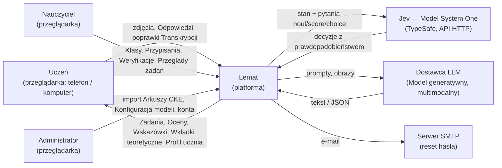

---

## 5. Widok kontenerów i stos technologiczny

Od wersji 3.0 obowiązuje stos .NET 10 + Next.js (ADR-048). Reguły
domenowe, liczby i decyzje biznesowe wersji 2.4 nie zmieniają się;
zmienia się wyłącznie realizacja techniczna. Mapowanie zależności
pythonowych i React/Vite na odpowiedniki .NET/Next.js jest w 5.5, a
mapowanie modułów `lemat.*` na projekty i przestrzenie nazw .NET — w 6.10.

### 5.1 Diagram kontenerów

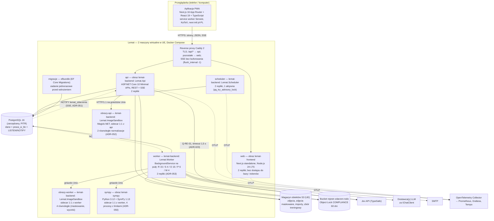

Wysyłka e-mail odbywa się wyłącznie przez pracę w tle `WYSLIJ_EMAIL`
(worker), więc proces `api` nie łączy się z SMTP. Proces `api` zapisuje do
bucketu `rejestr-zdarzen-rodo` Zdarzenia RODO z inicjatywy użytkownika
(wniosek o usunięcie, przywrócenie, odwołanie i udzielenie zgody) **przed**
zatwierdzeniem transakcji; proces `worker` zapisuje tam zdarzenie
`USUNIECIE_WYKONANE` (`zrodlo = WORKER`) przed pierwszą zmianą w bazie
wykonywaną przez `USUN_KONTO` (ADR-041, C3-03). Serwer Next.js (`web`)
renderuje wyłącznie powłokę aplikacji i strony publiczne; nie wywołuje API
w imieniu użytkownika i nie przechowuje tokenów (ADR-054), więc między `web`
a `api` nie ma połączenia. Sidecary (`obrazy-api`, `obrazy-worker`,
`sympy`) nie mają dostępu do sieci zewnętrznej, bazy ani magazynu obiektów —
dostają bajty lub tekst przez gniazdo Unix i zwracają rezultat.

### 5.2 Stos technologiczny

Tabela podaje wersję główną; dokładne wersje (łatki) są przypięte w
`backend/global.json`, `backend/Directory.Packages.props` (Central Package
Management), `frontend/package-lock.json` i `backend/sandbox/sympy/uv.lock`.
Zmiana wersji głównej wymaga nowego ADR.

| Obszar | Wybór | Uzasadnienie | ADR |
|---|---|---|---|
| Runtime backendu | .NET 10 (LTS, wsparcie do listopada 2028), C# 14; SDK `10.0.100` w `global.json` z `rollForward: latestPatch` | Decyzja właściciela; LTS na cały pilotaż i 2 lata produkcji. | ADR-048 |
| HTTP API | ASP.NET Core 10 Minimal APIs: grupa tras `MapGroup` na moduł (6.2), `TypedResults`, ProblemDetails RFC 9457 przez `AddProblemDetails` i własny `IExceptionHandler` (mapowanie wyjątków domenowych na kody 12.2); OpenAPI 3.1 z `Microsoft.AspNetCore.OpenApi`, generowane przy budowie do `backend/openapi/lemat-v1.json` i publikowane pod `/api/v1/openapi.json` | Minimal APIs mają mniejszy narzut niż kontrolery MVC, a grupy tras odpowiadają modułom; plik OpenAPI w repozytorium jest źródłem typów TypeScript (6.8) i testu kontraktowego. | ADR-048 |
| Postęp operacji | SSE (`text/event-stream`) przez `TypedResults.ServerSentEvents`, zasilane `LISTEN lemat_zdarzenia`; odpytywanie `GET /rozwiazania/{id}` jako ścieżka zapasowa | NFR-01 (bez opóźnienia odpytywania), NFR-08 (jedno połączenie HTTP/2 zamiast żądań co 1 s). | ADR-051 |
| Walidacja wejścia | FluentValidation 12 dla DTO (reguły 12.5) w `Lemat.Api`; niezmienniki w agregatach `Lemat.Domain` (3.6) | Reguły wejścia oddzielone od niezmienników domeny; komunikaty po polsku (NFR-10). | ADR-048 |
| Dostęp do danych | EF Core 10 + `Npgsql.EntityFrameworkCore.PostgreSQL` 10 + `EFCore.NamingConventions`: typy wyliczeniowe PostgreSQL przez `MapEnum` z translatorem `UPPER_SNAKE`, kolumny `jsonb` o schemacie 7.5 jako `OwnsOne/OwnsMany(…).ToJson()`, kolumny `jsonb` bez schematu (`dane`, `ladunek`) jako `JsonDocument`; jawna transakcja `IJednostkaPracy` (ADR-056); Npgsql 10 bezpośrednio (`NpgsqlDataSource`) dla `FOR UPDATE SKIP LOCKED`, `LISTEN` i blokad doradczych | EF Core dla agregatów i optymistycznej współbieżności (`version`/`xmin`); surowy SQL tam, gdzie semantyka PostgreSQL jest istotą mechanizmu (13.4, 7.6). | ADR-048, ADR-053, ADR-056 |
| Migracje | klasy EF Core `Migration` wykonujące wyłącznie pliki SQL wycięte z `docs/spec/ddl.md` (`migrationBuilder.Sql`), wydawane jako `efbundle` uruchamiany przez kontener `migracje` przed wdrożeniem (nigdy przy starcie aplikacji); model EF Core nie generuje schematu; test `ModelEfZgodnyZKatalogiem` porównuje model z katalogiem bazy (wersja 3.2, ADR-063) | DDL jest jedynym źródłem schematu; migracje są jedyną drogą zmian schematu (zastępują Alembic). | ADR-048, ADR-063 |
| Baza danych | PostgreSQL 16 (rozszerzenia `citext`, `pg_trgm`) | Jedno źródło prawdy + prace w tle (ADR-002). | ADR-002 |
| Prace w tle | Tabela `praca_w_tle` (kolumny `pula`, `dzierzawa_do`) + `SELECT … FOR UPDATE SKIP LOCKED` + `LISTEN/NOTIFY`; `BackgroundService` na pulę w `Lemat.Worker`; bez Hangfire, Quartz.NET i brokerów | Transakcyjne zlecanie prac razem ze zmianą stanu (ADR-002); rozłączne pule (13.4). | ADR-053 |
| Harmonogram | `Lemat.Scheduler`: `BackgroundService` z wyrażeniami cron (biblioteka Cronos 0.11), jedna aktywna instancja przez `pg_try_advisory_lock` | Harmonogram 13.5 bez zmian; Cronos jest wyłącznie parserem wyrażeń, bez własnego magazynu. | ADR-053 |
| Warstwa AI | Microsoft.Extensions.AI 10 (`IChatClient`, `ChatClientBuilder`: `UseOpenTelemetry`, `UseFunctionInvocation`, ustrukturyzowane wyjście `ChatResponseFormat.ForJsonSchema`); port `IModelGeneratywny` = fabryka klientów czatu per rola (ADR-058); Semantic Kernel 1 (`Microsoft.SemanticKernel.Core`, `Microsoft.SemanticKernel.Yaml`: pluginy `[KernelFunction]` jako `AIFunction`, szablony promptów systemowych YAML w formacie `semantic-kernel`); Jev przez typowany `HttpClient` (Jev nie jest LLM); Mock każdego dostawcy; walidacja odpowiedzi `JsonSchema.Net` | NFR-06: jedna abstrakcja dla modeli generatywnych; praca offline i testy bez dostawców. | ADR-055, ADR-058 |
| Obliczenia symboliczne | Sidecar `lemat-sympy`: Python 3.12, SymPy 1.13 (`parse_latex`, backend `lark`), serwer HTTP Starlette + Uvicorn na gnieździe Unix, 4 procesy z `RLIMIT_AS` 512 MiB i `RLIMIT_CPU`; port `ISprawdzanieSymboliczne` | Brak biblioteki .NET o porównywalnym parserze LaTeX i upraszczaniu (FR-21, FR-13). | ADR-050 |
| Obróbka obrazu | Magick.NET-Q8-AnyCPU 14 (ImageMagick 7 z libheif/libde265, libjpeg-turbo, libwebp, libpng) w procesie `Lemat.ImageSandbox`; usuwanie EXIF, normalizacja do JPEG, maskowanie, wycinki | HEIC z iPhone'ów (NFR-08); izolacja dekoderów natywnych od procesów `api`/`worker` (ADR-045). | ADR-052 |
| Magazyn obiektów | S3-kompatybilny w regionie UE (lokalnie MinIO), klient `AWSSDK.S3` 4; szyfrowanie SSE, wersjonowanie wyłączone na bucketach ze zdjęciami (16.4); Object Lock `COMPLIANCE` dla `rejestr-zdarzen-rodo` | Zdjęcia poza bazą; NFR-09. | ADR-048 |
| E-mail | MailKit 4 (SMTP z STARTTLS) w handlerze `WYSLIJ_EMAIL` | Jedyna rola e-maila: reset hasła (1.3). | ADR-048 |
| Uwierzytelnianie | `Microsoft.AspNetCore.Authentication.JwtBearer`; access token JWT ES256 (ECDSA P-256) 15 min w pamięci klienta; refresh token w cookie `lemat_rt`; argon2id przez `Konscious.Security.Cryptography.Argon2` (m = 64 MiB, t = 3, p = 4) | ADR-020 bez zmian merytorycznych; ES256 jest obsługiwany natywnie przez `Microsoft.IdentityModel.*` (EdDSA nie). | ADR-020, ADR-048 |
| Obserwowalność | OpenTelemetry .NET (instrumentacje ASP.NET Core, HttpClient, Npgsql, EF Core, Microsoft.Extensions.AI) → OTLP → OpenTelemetry Collector → Prometheus, Grafana, Tempo; logi JSON (`AddJsonConsole`); nazwy metryk z 17.3 bez zmian; Next.js — `@vercel/otel` → ten sam Collector | NFR-01, NFR-03, NFR-04; eksporter Prometheus w Collectorze zamiast pakietu w procesie. | ADR-048 |
| Testy backendu | xUnit v3 (`xunit.v3`), Shouldly, NSubstitute, FsCheck 3 (testy właściwości, zastępuje `hypothesis`), Testcontainers 4 (PostgreSQL 16, MinIO, `lemat-sympy`), `Microsoft.AspNetCore.Mvc.Testing` (`WebApplicationFactory`), WireMock.Net (kontrakty adapterów Jev i LLM), coverlet | Testy domeny bez infrastruktury; testy integracyjne na prawdziwym PostgreSQL 16 (semantyka `SKIP LOCKED`, triggerów, CHECK). | ADR-048 |
| Kontrola architektury | Referencje projektów (6.4) + NetArchTest.Rules (reguły 6.5) + `Microsoft.CodeAnalysis.BannedApiAnalyzers` (`BannedSymbols.txt`: SDK dostawców poza `Lemat.Models`, `DateTime.Now`/`DateTimeOffset.Now` poza `TimeProvider`) + test słownika (3.4, ADR-049) | NFR-06; zastępuje `import-linter`. | ADR-048 |
| Jakość kodu | `Directory.Build.props`: `Nullable=enable`, `TreatWarningsAsErrors=true`, `AnalysisLevel=latest-recommended`, `ImplicitUsings=enable`, `EnforceCodeStyleInBuild=true`; `.editorconfig` (6.11.3, ADR-075: IDE0130 błąd, reguły „nazwa pliku = nazwa typu” wyłączone); `dotnet format --verify-no-changes` w CI | Jednolite reguły dla wszystkich projektów. | ADR-048 |
| Frontend | Next.js 16 (App Router), React 19, TypeScript 5.9 (`strict`), Node.js 24 LTS, `output: "standalone"` | NFR-08, NFR-10; jedna baza kodu dla telefonu i komputera. | ADR-054 |
| PWA | Serwist 9 (`@serwist/next`, budowanie `next build --webpack`, bo Serwist 9 nie obsługuje Turbopacka): precache zasobów statycznych i fontów KaTeX; żądania `/api/*` omijają service worker (brak trasy, dane osobowe nie trafiają do cache, NFR-09; strumienie SSE bez pośrednictwa SW); manifest `app/manifest.ts`; strona `/offline` | Instalacja na ekranie telefonu, szybki start; zastępuje ręczny service worker Vite. | ADR-054, ADR-057 |
| i18n | next-intl 4, jedna lokalizacja `pl-PL`, bez prefiksu języka w URL; komunikaty `frontend/messages/pl-PL.json` (ICU, polskie formy liczby mnogiej `one`/`few`/`many`); daty i liczby `Intl` `pl-PL`, strefa wyświetlania `Europe/Warsaw` | NFR-10; działa w komponentach serwerowych i klienckich. | ADR-054 |
| LaTeX | KaTeX 0.16 (`katex`); Markdown z wzorami `$…$`: `react-markdown` 10 + `remark-math` 6 + `rehype-katex` 7; `throwOnError: false`, `trust: false`, `maxExpand: 1000` | Szybkie renderowanie bez MathJax; bezpieczne wobec treści z kartki (R-06). | ADR-054 |
| Dane w kliencie | TanStack Query 5; klient `openapi-fetch` z typami `openapi-typescript` 7 generowanymi z `backend/openapi/lemat-v1.json` do `frontend/src/lib/api/schema.d.ts` (CI: brak różnic); formularze react-hook-form 7 + zod 4 | Jeden kontrakt typów od C# do TypeScript; brak ręcznie pisanych DTO. | ADR-054 |
| SSE w kliencie | `fetch` z nagłówkiem `Authorization` + parser `eventsource-parser` 3, ponowne łączenie z `Last-Event-ID` | `EventSource` nie wysyła nagłówków, a access token nie może trafić do URL ani cookie (ADR-020). | ADR-051 |
| Zdjęcia w kliencie | `<input type="file" accept="image/*" capture="environment" multiple>`; kompresja w Web Workerze (`createImageBitmap` + `OffscreenCanvas.convertToBlob`, JPEG q = 0,85, dłuższy bok ≤ 2560 px; zapasowo `<canvas>` w wątku głównym); ekran aparatu z instrukcją „nie podpisuj kartki imieniem i nazwiskiem” | NFR-08; zmniejsza transfer, koszt rozpoznawania i ilość danych osobowych na zdjęciu (ADR-031); HEIC zamieniany na JPEG już w przeglądarce, gdy ją dekoduje. | ADR-054 |
| UI | Tailwind CSS 4 + prymitywy Radix UI (dialogi, menu, listy dostępne z klawiatury i czytnika ekranu) | Spójny wygląd telefon/komputer bez ciężkiej biblioteki komponentów. | ADR-054 |
| Testy frontendu | Vitest 3 + Testing Library (komponenty, hooki, kompresja zdjęć); Playwright (E2E: Chromium i WebKit z emulacją iPhone) w `frontend/e2e/` przeciw Docker Compose z modelami Mock (`dostawca = 'mock'`) | Scenariusze FR end-to-end bez dostawców modeli. | ADR-054 |
| Lint frontendu | ESLint 9 (flat config, `eslint-config-next`), dependency-cruiser 16 (granice 6.9), Prettier 3 | Granice modułów frontendu sprawdzane w CI. | ADR-054 |
| Wdrożenie | Docker Compose na 2 maszynach wirtualnych w UE + zarządzany PostgreSQL z PITR (17.5); obrazy bazowe: `mcr.microsoft.com/dotnet/aspnet:10.0-noble` (Magick.NET wymaga glibc), `node:24-bookworm-slim`, `python:3.12-slim-bookworm`, `caddy:2` | Skala A-03; brak Kubernetes w pilotażu. | ADR-048 |
| CI | GitHub Actions: `dotnet build` + `dotnet test` (z Testcontainers), `npm ci && npm run lint && npm test && npm run build`, Playwright, `pytest` sidecara, test kontraktu OpenAPI, test słownika, budowa obrazów | Wszystkie bramki jakości w jednym przebiegu. | ADR-048 |

### 5.3 Obrazy, procesy i repliki

| Kontener | Obraz | Punkt wejścia | Repliki (pilotaż) | Limit cgroup (CPU / RAM) | Nasłuch |
|---|---|---|---|---|---|
| `caddy` | `caddy:2` | `caddy run` | 1 na maszynę | 0,5 / 256 MiB | 443 |
| `web` | `lemat-frontend` | `node server.js` (Next.js standalone) | 2 | 1 / 1 GiB | 3000 (sieć wewnętrzna) |
| `api` | `lemat-backend` | `dotnet Lemat.Api.dll` | 2 | 2 / 2 GiB | 8080 (sieć wewnętrzna) |
| `obrazy-api` | `lemat-backend` | `dotnet Lemat.ImageSandbox.dll --rownoleglosc 2` (nadzorca + 2 procesy robocze, ADR-052 uzup. 3.1) | 1 na replikę `api` | 1 / 1,5 GiB (w tym `tmpfs /tmp` 512 MiB) | `/run/lemat/obrazy.sock` (wolumen współdzielony z `api`) |
| `worker` | `lemat-backend` | `dotnet Lemat.Worker.dll` | 2 | 2 / 2 GiB | brak (tylko `/zdrowie` na 8081) |
| `obrazy-worker` | `lemat-backend` | `dotnet Lemat.ImageSandbox.dll --rownoleglosc 4` (nadzorca + 4 procesy robocze) | 1 na replikę `worker` | 2 / 3 GiB (w tym `tmpfs /tmp` 1 GiB) | `/run/lemat/obrazy.sock` (wolumen współdzielony z `worker`) |
| `sympy` | `lemat-sympy` | `uvicorn lemat_sympy.server:aplikacja --uds /run/lemat/sympy.sock` | 1 na replikę `worker` | 2 / 2,5 GiB | `/run/lemat/sympy.sock` |
| `scheduler` | `lemat-backend` | `dotnet Lemat.Scheduler.dll` | 2 (1 aktywna) | 0,5 / 512 MiB | brak (tylko `/zdrowie` na 8081) |
| `migracje` | `lemat-backend` | `./efbundle --connection $LEMAT_BAZA_MIGRACJE` | 1 (jednorazowo) | 0,5 / 512 MiB | brak |

Sidecary działają z `read_only: true`, `network_mode: none`, użytkownikiem
bez uprawnień (`uid 10001`), domyślnym profilem seccomp i `pids_limit: 64`;
gniazdo Unix jest jedynym kanałem komunikacji. Kontenery `obrazy-*` mają
`tmpfs: /tmp` (`mode=1777`; pamięć podręczna pikseli ImageMagick
`ResourceLimits.Disk = 256 MiB` na operację i katalog tymczasowy
`MagickNET.SetTempDirectory("/tmp/magick")`), a `sympy` — `tmpfs: /tmp`
64 MiB (C6-11). Obraz `lemat-backend`
zawiera wszystkie projekty wykonywalne .NET (jeden build, jeden skan
podatności), a proces wybiera punkt wejścia.

### 5.4 Komunikacja między kontenerami

| Od → do | Protokół | Uwierzytelnienie | Timeout / limit | Uwagi |
|---|---|---|---|---|
| przeglądarka → `caddy` | HTTPS (HTTP/2, HTTP/3) | — | — | HSTS, TLS 1.2+ |
| `caddy` → `web` | HTTP/1.1 | sieć wewnętrzna | 30 s | ścieżki inne niż `/api/*` |
| `caddy` → `api` | HTTP/1.1 | sieć wewnętrzna | 60 s dla REST; bez limitu odczytu dla `*/strumien` | `flush_interval -1` dla SSE |
| `api` → PostgreSQL | Npgsql (TLS) | użytkownik `lemat_api` | `CommandTimeout` 5 s (żądania), pula 30 połączeń na replikę + 1 połączenie `LISTEN` (ADR-059) | |
| `worker` → PostgreSQL | Npgsql (TLS) | użytkownik `lemat_worker` | `CommandTimeout` 30 s, pula 40 połączeń na replikę + 1 `LISTEN` (ADR-059) | |
| `scheduler` → PostgreSQL | Npgsql (TLS) | użytkownik `lemat_scheduler` | 30 s, pula 3 + 1 sesja dedykowana | blokada doradcza na sesji dedykowanej; łącznie 155 połączeń, wymagane `max_connections ≥ 200`, bez PgBouncera w pilotażu (ADR-059) |
| `migracje` → PostgreSQL | Npgsql (TLS) | użytkownik `lemat_migracje` (właściciel schematu) | 10 min | jedyny użytkownik z DDL |
| `api`/`worker` → `obrazy-*` | HTTP/1.1 JSON + `application/octet-stream` na gnieździe Unix | uprawnienia pliku gniazda (0660, grupa `lemat`) | 8 s czasu ściennego na plik (ADR-045); po przekroczeniu nadzorca zabija wyłącznie proces roboczy tej operacji (`504 NORMALIZACJA_PRZEKROCZONY_CZAS`) | oczekiwanie na wolny slot > 5 s → `503` w `api`; 3 przekroczenia czasu Ucznia w 10 min → `429 LIMIT_NORMALIZACJI` na 10 min (ADR-052 uzup. 3.1) |
| `worker` → `sympy` | HTTP/1.1 JSON na gnieździe Unix | uprawnienia pliku gniazda | 2 s na parę, 3 s na Rozwiązanie (22) | przekroczenie → `NIEROZSTRZYGNIETE` |
| `api`/`worker` → S3 | HTTPS | klucz dostępu per proces (IAM: `api` bez `DeleteObject` na `zbior-treningowy/`) | 10 s | |
| `worker` → Jev | HTTPS JSON | klucz API w nagłówku | 2 s na żądanie (13.2) | globalny ogranicznik (ADR-039) |
| `api` → Jev | HTTPS JSON | klucz API | 1,5 s, bez ponowień (ADR-023) | tylko Q-RE-01 |
| `worker` → LLM | HTTPS (SDK za `IChatClient`) | klucz API / tożsamość zarządzana | wg `konfiguracja_modelu.parametry.timeout_s` | |
| `worker` → SMTP | SMTP + STARTTLS | login SMTP | 30 s | tylko `WYSLIJ_EMAIL` |
| wszystkie → Collector | OTLP/gRPC | sieć wewnętrzna | — | bez treści promptów i danych osobowych w atrybutach |

### 5.5 Odpowiedniki zależności wersji 2.4

Tabela pozwala czytać sekcje 7–18, które w wersji 3.0 zachowują treść
domenową, a w przykładach kodu nadal używają nazw pythonowych (notka na
początku sekcji 7, 10, 12–15).

| Wersja 2.4 | Wersja 3.0 | Uwagi |
|---|---|---|
| Python 3.12, FastAPI, Uvicorn | .NET 10, ASP.NET Core Minimal APIs, Kestrel | |
| Pydantic v2 (DTO, walidacja, schematy JSON) | rekordy C# + System.Text.Json (konteksty źródłowe) + FluentValidation; schematy JSON odpowiedzi modeli z `AIJsonUtilities.CreateJsonSchema` | nazwy pól bez zmian (snake_case, ADR-049) |
| SQLAlchemy 2, Alembic | EF Core 10 + Npgsql, EF Core Migrations (`efbundle`) | DDL 7.3 obowiązuje |
| `asyncio`, korutyny pul workera | `BackgroundService`, pętle asynchroniczne (`Task`) w liczbie z 13.4 | |
| `ProcessPoolExecutor` + Pillow + `pillow-heif` | `Lemat.ImageSandbox` + Magick.NET | ADR-052 |
| SymPy w puli procesów workera | sidecar `lemat-sympy` | ADR-050 |
| `import-linter` | referencje projektów + NetArchTest + BannedApiAnalyzers | |
| `pytest`, `hypothesis` | xUnit v3, FsCheck, Testcontainers | testy `tests/…/*.py` z sekcji 11–17 mają odpowiedniki w 6.7 |
| `lemat/konfiguracja.py` + zmienne `LEMAT_*` | `LematOpcje` (wzorzec Options) + `appsettings.json` + te same zmienne `LEMAT_*` | 22, ADR-049 |
| React 18 + Vite, `react-i18next` | Next.js 16 App Router, next-intl | ADR-054 |
| odpytywanie co 1 s / 60 s | SSE + odpytywanie zapasowe | ADR-051 |
| JWT EdDSA | JWT ES256 | ADR-020 (realizacja) |

---

## 6. Moduły, agenci i porty

### 6.1 Diagram komponentów

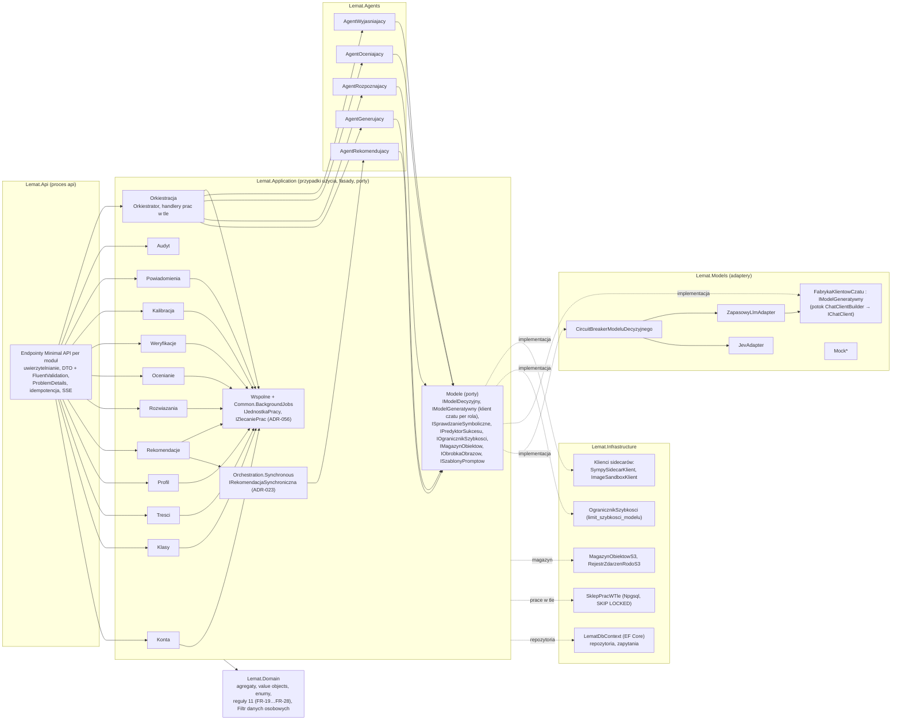

Strzałki ciągłe to wywołania; przerywane — implementacje interfejsów
zdefiniowanych w `Lemat.Application` (odwrócenie zależności: `Lemat.Models` i
`Lemat.Infrastructure` zależą od `Lemat.Application`, nie odwrotnie).
Od wersji 3.1 moduły nie zależą od `Lemat.Application.Orchestration`:
kontrakty prac w tle i jednostki pracy są w `Wspolne`, a tryb synchroniczny
rekomendacji — w osobnej przestrzeni `Orchestration.Synchronous` (C6-07).

### 6.2 Odpowiedzialności modułów

Moduł to para przestrzeni nazw `Lemat.Domain.<Module>` (agregaty, reguły) i
`Lemat.Application.<Module>` (przypadki użycia, fasada, porty repozytoriów)
oraz grupa endpointów `Lemat.Api/Endpoints/<Module>Endpoints.cs`. Nazwy
modułów są pojęciami słownika w liczbie mnogiej albo nazwą czynności, aby
przestrzeń nazw nie kolidowała z nazwą klasy agregatu (ADR-049 p. 6).

| Moduł | Przestrzenie nazw | Odpowiedzialność | Właściciel danych (tabele) | Fasada (jedyne wejście z innych modułów) | Grupa tras API |
|---|---|---|---|---|---|
| Konta | `Lemat.Domain.Accounts`, `Lemat.Domain.Accounts.Gdpr`, `Lemat.Application.Accounts` | Rejestracja, logowanie, tokeny, role, flagi Nauczyciela (`weryfikator_globalny`, `recenzent_tresci`), statusy kont, usuwanie i przywracanie kont wszystkich ról (ADR-040, ADR-044), Zdarzenia RODO i ich rejestr poza bazą (ADR-041) | `uzytkownik`, `uczen`, `nauczyciel`, `token_odswiezania`, `proba_logowania`, `zdarzenie_rodo` | `IKontaFasada` | `/auth`, `/uczniowie/ja`, `/nauczyciele/ja`, `/admin/uzytkownicy` |
| Klasy | `Lemat.Domain.Classes`, `Lemat.Application.Classes` | Klasy, kody zaproszeń, członkostwo, archiwizacja, Przekazanie Klasy, Zestawy zadań, Przypisania | `klasa`, `czlonkostwo_klasy`, `zestaw_zadan`, `pozycja_zestawu`, `przypisanie`, `przypisanie_uczen` | `IKlasyFasada` | `/klasy`, `/zestawy-zadan`, `/przypisania`, `/admin/klasy` |
| Tresci | `Lemat.Domain.Content`, `Lemat.Application.Content` | Zadania i ich wersje, zasięg, Kryteria oceniania, Wkładki teoretyczne, Działy, Umiejętności, import Arkuszy CKE, Walidacja i Przegląd zadań, Zgłoszenia błędu w Zadaniu i wstrzymanie w doborze, pula Zadań diagnostycznych, zlecenia generowania i budżet generowania systemowego, kalibracja Poziomu trudności | `dzial`, `umiejetnosc`, `umiejetnosc_wymagana`, `arkusz_cke`, `import_arkusza`, `zadanie`, `zadanie_wersja`, `zadanie_umiejetnosc`, `kryterium_oceniania`, `zalacznik_zadania`, `wkladka_teoretyczna`, `walidacja_zadania`, `przeglad_zadania`, `zlecenie_generowania`, `zgloszenie_bledu_zadania`, `wstrzymanie_w_doborze`, `kalibracja_trudnosci` | `ITresciFasada` | `/dzialy`, `/umiejetnosci`, `/zadania`, `/zlecenia-generowania`, `/zgloszenia-bledu-zadan`, `/wkladki-teoretyczne`, `/admin/arkusze-cke`, `/admin/zadania`, `/admin/pula-diagnostyczna`, `/admin/wkladki-teoretyczne` |
| Profil | `Lemat.Domain.Profile`, `Lemat.Application.Profile` | Profil ucznia, Wynik zadania, Test diagnostyczny, powtórki, odtwarzanie Profilu | `profil_ucznia`, `opanowanie_umiejetnosci`, `wynik_zadania`, `test_diagnostyczny`, `pozycja_testu_diagnostycznego` | `IProfilFasada` | `/uczniowie/{id}/profil`, `/uczniowie/ja/test-diagnostyczny`, `/testy-diagnostyczne` |
| Rekomendacje | `Lemat.Domain.Recommendations`, `Lemat.Application.Recommendations` | Ścieżka nauki, Seria, Rekomendacje (Agent rekomendujący przez fasadę Orkiestratora, ADR-023) | `sciezka_nauki`, `element_sciezki`, `rekomendacja` | `IRekomendacjeFasada` | `/uczniowie/ja/rekomendacje`, `/uczniowie/ja/sciezka-nauki`, `/elementy-sciezki` |
| Rozwiazania | `Lemat.Domain.Solutions`, `Lemat.Application.Solutions` | Przyjęcie i normalizacja zdjęć (sidecar `obrazy-api`), maskowanie, Transkrypcja, Poprawki Transkrypcji z limitami i Sprawdzeniem zgodności poprawek (ADR-036), Filtr danych osobowych (ADR-042), Odpowiedzi i kontekst próby (ADR-032), przyjęcie zgłoszenia błędu odczytu, kopie treningowe | `rozwiazanie`, `zdjecie_rozwiazania`, `transkrypcja`, `krok_transkrypcji`, `odpowiedz`, `kopia_treningowa` | `IRozwiazaniaFasada` | `/rozwiazania`, `/zadania/{id}/odpowiedzi` |
| Ocenianie | `Lemat.Domain.Grading`, `Lemat.Application.Grading` | Ocena, reguły FR-20/21/25/26/28, pewność, trasowanie do Weryfikacji (T-1 … T-7), Wskazówki | `ocena`, `ocena_kryterium` | `IOcenianieFasada` | `/rozwiazania/{id}/ocena` |
| Weryfikacje | `Lemat.Domain.Verifications`, `Lemat.Application.Verifications` | Kolejka weryfikacji, Blokady weryfikacji i ich zwalnianie, szkice rozstrzygnięć, rozstrzygnięcia, korekty, eskalacja, kontrola przyjęć | `weryfikacja`, `szkic_rozstrzygniecia` | `IWeryfikacjeFasada` | `/weryfikacje`, `/rozwiazania/{id}/korekty`, `/rozwiazania/{id}/zgloszenie-bledu-odczytu`, `/admin/obciazenie-weryfikacji` |
| Kalibracja | `Lemat.Domain.Calibration`, `Lemat.Application.Calibration` | Próbki kalibracyjne, Kalibratory pewności, Próg pewności, bezpieczniki trafności i poprawek (ADR-046), metryki NFR-02/03/04, ewaluacja ZT-1 | `probka_kalibracyjna`, `kalibrator_pewnosci`, `prog_pewnosci`, `stan_bezpiecznika` | `IKalibracjaFasada` | `/admin/progi-pewnosci`, `/admin/kalibracja`, `/admin/bezpieczniki` |
| Modele | `Lemat.Domain.Models`, `Lemat.Application.Models` (porty) | Konfiguracja modeli, plan pytań i decyzje składowe, dziennik decyzji, porty modeli i ogranicznika (implementacje: `Lemat.Models`, `Lemat.Infrastructure`) | `konfiguracja_modelu`, `decyzja_modelu`, `limit_szybkosci_modelu` | `IModeleFasada` | `/admin/konfiguracje-modeli` |
| Orkiestracja | `Lemat.Application.Orchestration` (Orkiestrator, handlery prac w tle), `Lemat.Application.Orchestration.Synchronous` (tryb synchroniczny, ADR-023 uzup. 3.1) | Maszyny stanów przepływów wieloagentowych, wykonywanie prac w tle, decyzja rekomendacji synchronicznej (6.3) | `praca_w_tle` (odczyt panelu; zapis — `Common.BackgroundJobs`) | `IOrkiestrator` (wyłącznie panel Administratora), `IRekomendacjaSynchroniczna` (wyłącznie Rekomendacje) | `/admin/praca-w-tle` |
| Powiadomienia | `Lemat.Domain.Notifications`, `Lemat.Application.Notifications` | Powiadomienia w aplikacji i ich strumień SSE (ADR-051) | `powiadomienie` | `IPowiadomieniaFasada` | `/powiadomienia` |
| Audyt | `Lemat.Domain.Audit`, `Lemat.Application.Audit` | Dziennik działań Nauczycieli, Administratorów i zmian systemowych | `dziennik_audytu` | `IAudytFasada` | — |
| Wspolne | `Lemat.Domain.Common`, `Lemat.Application.Common`, `Lemat.Application.Common.BackgroundJobs` | Jądro współdzielone: identyfikatory silnie typowane, `PoziomMatury`, `RodzajZadania`, `PoziomTrudnosci`, `Rownowaznosc`, kalendarz dni roboczych (`KalendarzDniRoboczych`, ADR-043), `TimeProvider`, `IJednostkaPracy`, `IZlecaniePrac`, `TypPracy`, `PulaPracy`, `IHandlerPracy` (ADR-056) | `dzien_wolny` | — (typy publiczne) | — |

Tabele techniczne `klucz_idempotencji` (filtr endpointów `Lemat.Api`,
repozytorium w `Lemat.Infrastructure`) i `limit_szybkosci_modelu`
(`OgranicznikSzybkosci` w `Lemat.Infrastructure.Models`) nie należą do modułu
domenowego. `dzien_wolny` przechodzi z modułu kont (2.4) do jądra
współdzielonego, bo korzystają z niego Weryfikacje, Tresci (SLA Zgłoszeń) i
Kalibracja (termin Kontroli).

Reguły zależności między modułami (egzekwowane w 6.5):

1. Agregat jednego modułu wskazuje agregat innego modułu wyłącznie przez
   identyfikator silnie typowany (`ZadanieWersjaId`, `UczenId`); typy
   wyliczeniowe innego modułu są dozwolone.
2. Przypadek użycia modułu X korzysta z modułu Y wyłącznie przez interfejs
   fasady `Lemat.Application.Y.I<Y>Fasada` (np. Ocenianie pobiera Kryteria
   oceniania przez `ITresciFasada.PobierzZadanieDoOcenyAsync`).
3. Orkiestracja (`Lemat.Application.Orchestration`) może korzystać z fasad
   wszystkich modułów; **żaden moduł nie korzysta z
   `Lemat.Application.Orchestration`** (wersja 3.1, C6-07). Zlecenie pracy w
   bieżącej transakcji jest kontraktem jądra (`Common.BackgroundJobs.IZlecaniePrac`),
   a moduł Rekomendacje korzysta z `Orchestration.Synchronous.IRekomendacjaSynchroniczna`,
   która zależy wyłącznie od `IAgentRekomendujacy` i fasad odczytu Profil,
   Tresci, Klasy, Konta — nie od `IRekomendacjeFasada`. Test
   `BrakCykliMiedzyModulamiAplikacji` (`Lemat.Architecture.Tests`) buduje
   graf zależności przestrzeni nazw `Lemat.Application.<Module>` (węzły: 13
   modułów z tabeli, `Orkiestracja` i `Orchestration.Synchronous` osobno,
   `Wspolne` pominięte jako jądro) z metadanych typów (Mono.Cecil przez
   NetArchTest) i wymaga, by był acykliczny.
4. Transakcja obejmuje zmiany agregatów jednego przypadku użycia; zmiany w
   innych modułach następują przez prace w tle albo zdarzenia domenowe w
   tej samej transakcji (13.6) — jak w wersji 2.4.

### 6.3 Orkiestrator

Orkiestrator nie jest osobnym serwisem, lecz klasą
`Lemat.Application.Orchestration.Orkiestrator` (z handlerami prac w tle w
`Lemat.Application.Orchestration.Handlers`) wykonywaną w dwóch trybach:

- **Tryb asynchroniczny (proces `Lemat.Worker`)** — wszystkie przepływy
  wieloagentowe: rozpoznanie → ocena → wskazówka → aktualizacja Profilu,
  generowanie → walidacja, kalibracja. Realizuje wzorzec **maszyna stanów w
  bazie + prace w tle** (ADR-002, ADR-053, ADR-056):
  1. Każda zmiana stanu agregatu (np. `Rozwiazanie.Status`) i zlecenie
     kolejnej pracy w tle odbywają się **w jednej jawnej transakcji**
     `IJednostkaPracy` (`BeginTransactionAsync` … `CommitAsync`).
     Zlecenie `IZlecaniePrac.ZlecAsync(...)` jest poleceniem SQL `INSERT …
     ON CONFLICT … RETURNING` na połączeniu i w transakcji jednostki pracy
     (deduplikacja nie wycofuje przypadku użycia). `NOTIFY praca_w_tle,
     '<pula>'` wysyła trigger `trg_praca_w_tle_powiadom`, więc
     powiadomienie dociera do workerów wyłącznie po `COMMIT`, nigdy po
     `ROLLBACK` (C6-01).
  2. Pętla puli pobiera pracę ze swojej puli (`FOR UPDATE SKIP LOCKED`),
     ustawia dzierżawę (`dzierzawa_do = now() + 60 s`) i odnawia ją co 15 s
     (`PeriodicTimer`); utrata dzierżawy anuluje `CancellationToken`
     handlera, a jednostka pracy handlera przed `COMMIT` potwierdza
     dzierżawę `SELECT … FOR UPDATE` (ADR-056 p. 4).
  3. Wywołania modeli odbywają się **poza transakcją**; wynik jest
     zapisywany warunkowo (`UPDATE … WHERE status = @oczekiwany AND version
     = @v`, w EF Core: `version` jako token współbieżności i
     `DbUpdateConcurrencyException`). Jeśli warunek nie jest spełniony,
     wynik jest odrzucany i logowany jako `rezultat_przestarzaly` (sekcja 15).
  4. Każdy handler jest idempotentny (sekcja 13.3) i implementuje
     `IHandlerPracy` (`TypPracy Typ`, `Task<RezultatPracy>
     WykonajAsync(PracaWTle praca, CancellationToken ct)`, `Task
     PoWyczerpaniuAsync(…)`; 13.4.1). Zapis wyniku pracy ma warunek
     `wykonawca = @ja AND status = 'W_TOKU'` (C6-15 p. 1).
- **Tryb synchroniczny (proces `Lemat.Api`)** — jeden przepływ, realizowany
  przez `IRekomendacjaSynchroniczna` (`Lemat.Application.Orchestration.Synchronous`,
  implementacja `RekomendacjaSynchroniczna`) wywoływaną przez przypadek
  użycia modułu Rekomendacje `NastepnyElementHandler` przy `GET
  /uczniowie/ja/rekomendacje/nastepna` (C6-07):

  ```csharp
  public interface IRekomendacjaSynchroniczna
  {
      /// Zbiera migawkę Profilu, Przypisań i katalogu doboru przez fasady odczytu, wywołuje IAgentRekomendujacy
      /// z timeoutem 1,5 s dla Q-RE-01 i zwraca decyzję bez zapisu.
      Task<DecyzjaRekomendacji> DecydujAsync(UczenId uczen, StanSciezkiDlaRekomendacji sciezka, CancellationToken ct);
  }
  public sealed record StanSciezkiDlaRekomendacji(IReadOnlyList<ElementSciezkiSkrot> OstatnieElementy, SeriaSkrot? Seria,
                                                  IReadOnlyDictionary<UmiejetnoscId, DateTimeOffset> WkladkiPrzeczytane);
  ```

  `NastepnyElementHandler` w jednej jednostce pracy: (1) wczytuje
  `SciezkaNauki` (aktywne elementy) i zwraca istniejący element
  `PROPONOWANY` przed `WygasaAt` (C-12); (2) wywołuje `DecydujAsync`
  **przed** otwarciem transakcji (wywołanie modelu poza transakcją); (3)
  w transakcji: `SciezkaNauki.Zaproponuj`, `Rekomendacja`,
  `ZlecAsync(UZUPELNIJ_PULE …)`, `ZlecAsync(GENERUJ_SZKIC_WKLADKI …)`.
  Uzasadnienie wyjątku: Uczeń czeka na następny element po kliknięciu
  „Dalej” (cel p95 ≤ 500 ms), a praca w tle z oczekiwaniem na wynik
  dodałaby ≥ 1 s. Ograniczenia: jedyne wywołanie modelu to `Q-RE-01`
  (tylko grupa eksperymentu `JEV_CHOICE`) z timeoutem 1,5 s
  (`CancellationTokenSource.CancelAfter`), bez ponowień i bez modelu
  zapasowego; przy błędzie albo otwartym obwodzie polityka `POLITYKA_ELO`
  (10.1.6). Zależności `RekomendacjaSynchroniczna`: `IAgentRekomendujacy`,
  `IProfilFasada`, `ITresciFasada`, `IKlasyFasada`, `IKontaFasada` (tylko
  metody odczytu); brak zależności od `IRekomendacjeFasada`, więc kontener
  DI nie ma cyklu (test `KontenerDiTests`: `ValidateOnBuild = true`,
  `ValidateScopes = true` dla kontenerów `api`, `worker` i `scheduler`).

Orkiestrator nie korzysta z mechanizmów orkiestracji agentów Semantic
Kernel (Agent Framework, Process Framework): przepływ jest zapisany w bazie,
a nie w pamięci procesu, bo musi przetrwać restart workera, być
idempotentny i audytowalny (NFR-05) — ADR-055.

### 6.4 Solucja .NET — projekty i zależności

Solucja `backend/Lemat.slnx` (format XML solucji, domyślny w .NET 10):

| Projekt | Typ (SDK) | Rola | Referencje projektów | Kluczowe pakiety |
|---|---|---|---|---|
| `Lemat.Domain` | biblioteka (`Microsoft.NET.Sdk`) | Agregaty, encje, value objects, enumy, zdarzenia domenowe, reguły czyste (11.1–11.3, Filtr danych osobowych, limity Poprawek, Zgodność Oceny) | — | brak (tylko BCL) |
| `Lemat.Application` | biblioteka | Przypadki użycia (komendy i zapytania z handlerami), fasady modułów, porty repozytoriów i modeli, Orkiestrator i handlery prac w tle, `IJednostkaPracy`, `IZlecaniePrac`, `LematOpcje` | `Lemat.Domain` | `Microsoft.Extensions.DependencyInjection.Abstractions`, `Microsoft.Extensions.Logging.Abstractions`, `Microsoft.Extensions.Options`, `Microsoft.Extensions.AI.Abstractions` (od 3.1, ADR-058: `IChatClient`, `AIFunction`, `AIJsonUtilities` w kontraktach portów) |
| `Lemat.Agents` | biblioteka | Pięciu Agentów (10.1–10.5), szablony promptów systemowych (`SzablonyPromptow : ISzablonyPromptow`), budowniczowie stanów i wiadomości, plugin Semantic Kernel, predyktor Elo | `Lemat.Application`, `Lemat.Domain` | `Microsoft.Extensions.AI.Abstractions`, `Microsoft.SemanticKernel.Core`, `Microsoft.SemanticKernel.Yaml` 1.81 (od 3.1, C6-10; bez `PromptTemplates.Handlebars`; metapakiet `Microsoft.SemanticKernel` jest zakazany w `Directory.Packages.props`, bo wciąga `Azure.AI.OpenAI` 2.9.0-beta.1 i daje NU1605 przy `Azure.AI.OpenAI` 2.1.0 — C7-15 p. 6); walidacja odpowiedzi przez port `IWywolanieUstrukturyzowane` (3.2) |
| `Lemat.Models` | biblioteka | Adaptery portów modeli: `FabrykaKlientowCzatu : IModelGeneratywny` (potok `ChatClientBuilder`, ADR-058), `WywolanieUstrukturyzowane : IWywolanieUstrukturyzowane` (schemat, walidacja, naprawa — 3.2, C7-08), `JevAdapter`, `ZapasowyLlmAdapter`, `CircuitBreakerModeluDecyzyjnego`, `PredyktorSukcesuGbm`, rejestr adapterów, implementacje Mock | `Lemat.Application`, `Lemat.Domain` | `JsonSchema.Net` (od 3.2), `Microsoft.Extensions.AI`, `Microsoft.Extensions.AI.OpenAI` 10.11 (wymusza `OpenAI` 2.14.0), `Azure.AI.OpenAI` 2.1.0 (zbudowany na `OpenAI` 2.1.0 — zgodność chroni test kontraktu `KontraktWywolaniaOpenAiTests` na WireMock.Net, ADR-058 uzup. 3.2 p. 6), `Microsoft.Extensions.Http`, `Microsoft.ML`, `Microsoft.ML.LightGbm` (od 3.1, C6-12 p. 7) |
| `Lemat.Infrastructure` | biblioteka | `LematDbContext`, konfiguracje encji, migracje, `JednostkaPracyEf`, `ZlecaniePracSql`, repozytoria i zapytania, sklep prac w tle (Npgsql), ogranicznik szybkości, magazyn S3, rejestr Zdarzeń RODO, klienci sidecarów, e-mail, tokeny JWT, haszowanie haseł | `Lemat.Application`, `Lemat.Domain` | `Microsoft.EntityFrameworkCore`, `Npgsql.EntityFrameworkCore.PostgreSQL`, `EFCore.NamingConventions`, `Microsoft.EntityFrameworkCore.Design` (`PrivateAssets=all`), `AWSSDK.S3`, `MailKit`, `Konscious.Security.Cryptography.Argon2`, `Microsoft.IdentityModel.JsonWebTokens`, `Microsoft.Extensions.Http.Resilience` (S3, SMTP) |
| `Lemat.Api` | aplikacja web (`Microsoft.NET.Sdk.Web`) | Punkt kompozycji procesu `api`: endpointy, DTO, walidatory, uwierzytelnianie, idempotencja, SSE, OpenAPI | `Lemat.Application`, `Lemat.Infrastructure`, `Lemat.Agents`, `Lemat.Models` | `Microsoft.AspNetCore.OpenApi`, `Microsoft.AspNetCore.Authentication.JwtBearer`, `FluentValidation`, `OpenTelemetry.Extensions.Hosting` |
| `Lemat.Worker` | usługa robocza (`Microsoft.NET.Sdk.Worker`) | Punkt kompozycji procesu `worker`: hosty pul prac w tle | `Lemat.Application`, `Lemat.Infrastructure`, `Lemat.Agents`, `Lemat.Models` | `OpenTelemetry.Extensions.Hosting` |
| `Lemat.Scheduler` | usługa robocza | Punkt kompozycji procesu `scheduler`: harmonogram 13.5 | `Lemat.Application`, `Lemat.Infrastructure` | `Cronos` |
| `Lemat.Tools` | aplikacja konsolowa (`Microsoft.NET.Sdk`) | Polecenia administracyjne `seed-dev` (10.0.6, ADR-065 p. 6) i `utworz-administratora` (ADR-071); w wersjach 3.2–3.3 nazwa `Lemat.Narzedzia` (ADR-075) | `Lemat.Application`, `Lemat.Infrastructure` | brak dodatkowych |
| `Lemat.ImageSandbox` | aplikacja web (Kestrel na gnieździe Unix) | Normalizacja, maskowanie, wycinki zdjęć (ADR-052) | — (celowo bez referencji do kodu Lemat) | `Magick.NET-Q8-AnyCPU` |
| `Lemat.Domain.Tests` | testy | Testy jednostkowe reguł i niezmienników | `Lemat.Domain` | `xunit.v3`, `Shouldly`, `FsCheck.Xunit.v3` |
| `Lemat.Application.Tests` | testy | Przypadki użycia na fałszywych repozytoriach i modelach Mock | `Lemat.Application`, `Lemat.Models` | `xunit.v3`, `NSubstitute`, `Shouldly` |
| `Lemat.Agents.Tests` | testy | Agenci z modelami Mock, zgodność szablonów promptów | `Lemat.Agents`, `Lemat.Models` | `xunit.v3`, `Shouldly` |
| `Lemat.Models.Tests` | testy | Kontrakty adapterów (WireMock.Net), circuit breaker, Mock | `Lemat.Models` | `WireMock.Net`, `xunit.v3` |
| `Lemat.Infrastructure.Tests` | testy integracyjne | PostgreSQL 16, MinIO i `lemat-sympy` w Testcontainers: migracje, triggery, CHECK, `SKIP LOCKED`, ogranicznik, schemat zgodny z DDL | `Lemat.Infrastructure` | `Testcontainers.PostgreSql`, `Testcontainers.Minio` |
| `Lemat.Api.Tests` | testy integracyjne | Endpointy przez `WebApplicationFactory`, ProblemDetails, ETag/If-Match, idempotencja, SSE, kontrakt OpenAPI | `Lemat.Api` | `Microsoft.AspNetCore.Mvc.Testing`, `Testcontainers.PostgreSql` |
| `Lemat.Architecture.Tests` | testy | Reguły warstw i modułów (6.5), brak cykli modułów (6.2 reguła 3), kontenery DI `api`/`worker`/`scheduler` (`ValidateOnBuild`, `ValidateScopes`), test słownika (3.4), przestrzenie nazw (ADR-049 p. 11) | wszystkie projekty `src/` | `NetArchTest.Rules`, `YamlDotNet`, `Microsoft.Extensions.Hosting` |
| `Lemat.Simulations` | testy (długie, uruchamiane nocą i przed wydaniem) | Symulacje bezpiecznika (11.5.3), ogranicznika (13.2, symulowany zegar nad algorytmem `OgranicznikSzybkosci`), obciążenia (17.7) z ustalonym ziarnem | `Lemat.Domain`, `Lemat.Application`, `Lemat.Infrastructure` (od 3.1, C6-12 p. 7) | `xunit.v3`, `FsCheck.Xunit.v3`, `Microsoft.Extensions.TimeProvider.Testing` |

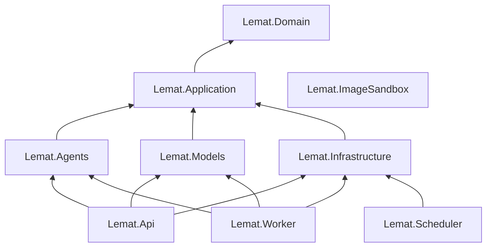

Strzałka `A --> B` oznacza „A ma referencję do B”. `Lemat.ImageSandbox` nie
ma referencji do żadnego projektu Lemat — kontrakt z klientem
`ImageSandboxKlient` (`Lemat.Infrastructure`) jest sprawdzany testem
kontraktowym w `Lemat.Infrastructure.Tests`, który uruchamia sandbox w
procesie testu.

### 6.5 Reguły warstw i ich egzekwowanie

| Projekt | Może zależeć od | Nie może zależeć od | Egzekwowanie |
|---|---|---|---|
| `Lemat.Domain` | BCL | dowolny pakiet NuGet, `System.Net.Http`, `Microsoft.EntityFrameworkCore*`, `Microsoft.AspNetCore*`, `Microsoft.Extensions.AI*`, `Microsoft.SemanticKernel*`, `Npgsql*`; `DateTime.Now`, `DateTimeOffset.UtcNow` (czas przekazywany jako parametr `DateTimeOffset teraz`) | brak `PackageReference` (test `ProjektDomenyBezPakietow`), NetArchTest `DomenaNiezaleznaOdInfrastruktury`, BannedApiAnalyzers |
| `Lemat.Application` | `Lemat.Domain`, abstrakcje `Microsoft.Extensions.*` (w tym `Microsoft.Extensions.AI.Abstractions`, ADR-058) | EF Core, Npgsql, ASP.NET Core, Semantic Kernel, `Microsoft.Extensions.AI` (implementacje), SDK dostawców modeli, `Lemat.Infrastructure`, `Lemat.Agents`, `Lemat.Models`; w kodzie: `ChatClientBuilder`, `AsIChatClient` | referencje projektów, NetArchTest `AplikacjaBezInfrastruktury`, BannedApiAnalyzers |
| `Lemat.Agents` | `Lemat.Application`, `Lemat.Domain`, `Microsoft.Extensions.AI.Abstractions`, `Microsoft.SemanticKernel.Core`, `Microsoft.SemanticKernel.Yaml`, `JsonSchema.Net` | EF Core, Npgsql, ASP.NET Core, SDK dostawców (`OpenAI.*`, `Azure.AI.*`), `Lemat.Infrastructure`, `Lemat.Models`; parametry konstruktorów typu `IChatClient`, `IChatCompletionService`, `Kernel`; `FunctionChoiceBehavior`, `Kernel.InvokePromptAsync` | referencje projektów, BannedApiAnalyzers (`BannedSymbols.txt`), NetArchTest `AgenciTylkoPrzezPorty`, `AgentNieRozwiazujeKlientaCzatuZDi` (ADR-058) |
| `Lemat.Models` | `Lemat.Application`, `Lemat.Domain`, Microsoft.Extensions.AI z pakietami dostawców | EF Core, Npgsql, ASP.NET Core, `Lemat.Infrastructure`, `Lemat.Agents` | referencje projektów, NetArchTest `SdkDostawcowTylkoWModelach` (typy z `OpenAI.*`, `Azure.AI.*` występują wyłącznie w `Lemat.Models`) |
| `Lemat.Infrastructure` | `Lemat.Application`, `Lemat.Domain`, pakiety infrastruktury | ASP.NET Core, `Lemat.Agents`, `Lemat.Models`, SDK dostawców modeli | referencje projektów, NetArchTest |
| `Lemat.Api`, `Lemat.Worker`, `Lemat.Scheduler` | wszystkie biblioteki `src/` (punkty kompozycji) | siebie nawzajem; w `Lemat.Api` endpointy nie używają `LematDbContext` ani repozytoriów — wyłącznie handlerów przypadków użycia i fasad | referencje projektów, NetArchTest `EndpointyTylkoPrzezAplikacje` |
| `Lemat.ImageSandbox` | `Magick.NET-Q8-AnyCPU`, ASP.NET Core | jakikolwiek projekt Lemat, sieć wychodząca | referencje projektów; `network_mode: none` (5.3) |
| Moduły w `Lemat.Domain` / `Lemat.Application` | 6.2 reguły 1–3 | typy innych modułów poza identyfikatorami, enumami i fasadami; jakikolwiek typ z `Lemat.Application.Orchestration` (poza Rekomendacje → `Orchestration.Synchronous`); cykle między modułami | `BrakCykliMiedzyModulamiAplikacji`; NetArchTest z regułą własną `ZaleznoscMiedzyModulamiTylkoPrzezFasade` (`ICustomRule`: typ z `Lemat.Application.X` może używać z `Lemat.Application.Y` wyłącznie typów z przestrzeni `Lemat.Application.Y` oznaczonych atrybutem `[Fasada]` i ich DTO; typ z `Lemat.Domain.X` może używać z `Lemat.Domain.Y` wyłącznie typów `*Id` i enumów) |

Testy architektury są w `backend/tests/Lemat.Architecture.Tests` i działają
w każdym przebiegu CI; naruszenie kończy budowę błędem (jak `import-linter`
w wersji 2.4).

### 6.6 Warstwa agentów AI w .NET

Pełny opis agentów (kontrakty C#, pluginy, orkiestracja, czas i błędy,
telemetria, Mock) — sekcja 10; prompty systemowe i schematy odpowiedzi —
[`docs/spec/prompts.md`](spec/prompts.md); decyzje — ADR-055, ADR-058.

| Agent (słownik) | Interfejs (`Lemat.Application.Agents.<Area>`) | Implementacja (`Lemat.Agents`) | Porty | Role `konfiguracja_modelu` | Semantic Kernel | Wywołuje |
|---|---|---|---|---|---|---|
| Agent rekomendujący | `Recommendations.IAgentRekomendujacy` | `Recommendations.AgentRekomendujacy` (+ `PredyktorSukcesuElo : IPredyktorSukcesu`) | `IDaneDoboru`, `IPredyktorSukcesu`, `IModelDecyzyjny` (wyłącznie Q-RE-01) | `DECYZYJNY_GLOWNY` | brak — uzasadnienie z szablonów (ADR-011) | `IRekomendacjaSynchroniczna` (6.3) |
| Agent generujący | `Generation.IAgentGenerujacy` | `Generation.AgentGenerujacy` | `IModelGeneratywny`, `IModelDecyzyjny` (Q-WA-*), `ISprawdzanieSymboliczne` | `GENERATYWNY_ZADANIA`, `GENERATYWNY_ROZWIAZUJACY_NIEZALEZNIE`, `GENERATYWNY_WKLADKI`, `DECYZYJNY_GLOWNY` | szablony promptów systemowych; plugin `SprawdzanieSymbolicznePlugin` (`[KernelFunction] sprawdz_rownowaznosc`, `postac_liniowa`, rejestrowany jako plugin `sympy` → narzędzia `sympy_sprawdz_rownowaznosc`, `sympy_postac_liniowa`) przekazywany jako `AIFunction` do `ChatOptions.Tools`, pętla w `FunctionInvokingChatClient`, limit 8 wywołań (`FunkcjaZLimitem`, 10.2.4, ADR-058 uzup. 3.2) | handlery `GENERUJ_ZADANIE`, `WALIDUJ_ZADANIE`, `GENERUJ_SZKIC_WKLADKI` |
| Agent rozpoznający | `Recognition.IAgentRozpoznajacy` | `Recognition.AgentRozpoznajacy` | `IModelGeneratywny`, `IMagazynObiektow`, `IObrobkaObrazow`, `ISprawdzanieSymboliczne` (poprawność LaTeX) | `ROZPOZNAWANIE_PISMA` | szablony promptów systemowych; bez pluginów (ustrukturyzowane wyjście) | handlery `ROZPOZNAJ_PISMO`, `SPRAWDZ_POPRAWKI_TRANSKRYPCJI`; Filtr danych osobowych i maskowanie stosuje handler po powrocie agenta |
| Agent oceniający | `Grading.IAgentOceniajacy` | `Grading.AgentOceniajacy` | `IModelDecyzyjny` (`PlanPytan`), `ISprawdzanieSymboliczne`, `IModelGeneratywny` (Opinia pomocnicza, 10.4.5) | `DECYZYJNY_GLOWNY`, `DECYZYJNY_ZAPASOWY`, `GENERATYWNY_OPINIA_POMOCNICZA` | szablon promptu systemowego wyłącznie dla Opinii pomocniczej; stan dla Modelu decyzyjnego (10.4.2) buduje kod C# `BudowniczyStanuOceny` bez SK (C6-10 p. 4); reguły 11 w `Lemat.Domain.Grading` | handlery `OCEN_ROZWIAZANIE`, `PONOW_OCENE`, `OPINIA_POMOCNICZA` |
| Agent wyjaśniający | `Explanation.IAgentWyjasniajacy` | `Explanation.AgentWyjasniajacy` | `IModelGeneratywny`, `ISprawdzanieSymboliczne` (strażnik wycieku) | `GENERATYWNY_WSKAZOWKI` | szablon promptu systemowego; bez pluginów | handler `NAPISZ_WSKAZOWKE` |

Adaptery portów (`Lemat.Models`, przestrzeń nazw w nawiasie):

| Port (`Lemat.Application.Models`) | Adapter | Klucz `konfiguracja_modelu.dostawca` | Uwagi |
|---|---|---|---|
| `IModelDecyzyjny` | `CircuitBreakerModeluDecyzyjnego` (`Lemat.Models.Decision`) — dekorator wybierający model główny albo zapasowy dla całej Oceny (ADR-009) | — | reguły obwodu 13.2: 3 kolejne błędy lub ≥ 50% w 20 s przy ≥ 6 wywołaniach; półotwarty po 60 s; `429` i brak przydziału nie liczą się (ADR-039); implementacja własna (Polly nie ma reguły „3 kolejne błędy”) |
| `IModelDecyzyjny` | `JevAdapter` (`Lemat.Models.Jev`) | `typesafe-jev` | typowany `HttpClient`, tryby `WSADOWY` / `POJEDYNCZY` (13.2) |
| `IModelDecyzyjny` | `ZapasowyLlmAdapter` (`Lemat.Models.Fallback`) | `zapasowy-llm` (z parametrem `dostawca_llm`) | cały `PlanPytan` jednym wywołaniem klienta czatu roli `DECYZYJNY_ZAPASOWY` ze schematem JSON (13.2, prompt `plan-pytan-v1`) |
| `IModelGeneratywny` | `FabrykaKlientowCzatu` (`Lemat.Models.Llm`) — zwraca `KlientCzatuRoli` z potokiem `ChatClientBuilder` (OpenTelemetry, limit czasu, koszt, ogranicznik dla rozpoznawania, klasyfikacja błędów, `UseFunctionInvocation`; ADR-058 p. 3) | `azure-openai`, `openai-zgodny`, `mock` | `azure-openai` — wdrożenie Azure OpenAI w strefie danych UE (`Azure.AI.OpenAI`), `openai-zgodny` — dowolny punkt końcowy zgodny z API OpenAI w UE (`Microsoft.Extensions.AI.OpenAI`); wybór dostawcy przy G-6 (A-07); rola `ROZPOZNAWANIE_PISMA` z wejściem obrazowym `DataContent` (`image/jpeg`) i wymuszonym schematem JSON (ADR-004) |
| wszystkie porty modeli | `MockChatClient : IChatClient` (wewnątrz prawdziwego potoku), `MockModelDecyzyjny` (`Lemat.Models.Mock`) | `mock` | zachowanie deterministyczne opisane w 10.0.6; aktywacja konfiguracji `mock` w środowisku `Production` → `409 DOSTAWCA_NIEDOZWOLONY`, a start procesu z aktywną konfiguracją `mock` w `Production` kończy się błędem |
| `ISprawdzanieSymboliczne` | `SympySidecarKlient` (`Lemat.Infrastructure.Sandboxes`) | — | ADR-050; w testach jednostkowych `FalszyweSprawdzanieSymboliczne` |
| `IObrobkaObrazow` | `ImageSandboxKlient` (`Lemat.Infrastructure.Sandboxes`) | — | ADR-052; w testach jednostkowych `MockObrobkaObrazow` |
| `IOgranicznikSzybkosci` | `OgranicznikSzybkosci` (`Lemat.Infrastructure.Models`) | — | tabela `limit_szybkosci_modelu`, blokada doradcza (13.2) |
| `IPredyktorSukcesu` | `PredyktorSukcesuElo` (`Lemat.Agents.Recommendations`); po 20 000 Wyników zadania eksperymentalnie `PredyktorSukcesuGbm` (`Lemat.Models.Predictors`, ML.NET `Microsoft.ML.LightGbm`) | — | ADR-010 |
| `ISzablonyPromptow` | `SzablonyPromptow` (`Lemat.Agents.Common`) | — | używany także przez `ZapasowyLlmAdapter` (13.2) |

Szablony promptów systemowych są plikami Semantic Kernel w formacie YAML
(`PromptTemplateConfig`, `template_format: semantic-kernel`, składnia
`{{$zmienna}}`, ładowane `KernelFunctionYaml.ToPromptTemplateConfig`) w
`backend/src/Lemat.Agents/Prompts/<role-folder>/<prompt-file>.yaml`
(np. `Prompts/generative-hints/hint-v1.yaml`); wartość
`konfiguracja_modelu.wersja_promptu` wskazuje plik przez indeks
`Prompts/index.yaml` (para rola i wersja promptu → plik; nazwy katalogów ról
i plików w 6.11, ADR-075). Zmienne szablonu są
wyłącznie wartościami systemowymi; treść od użytkownika i modeli trafia do
wiadomości `user` budowanej w C# (ADR-058 p. 4). Pliki są zasobami
osadzonymi; test `KazdaWersjaPromptuIstnieje` sprawdza, że każda wersja z
migracji danych i każdej aktywnej konfiguracji ma plik, a
`SzablonBezZmiennychTresci` — listę zmiennych. Schematy JSON
ustrukturyzowanych odpowiedzi są generowane z rekordów C#
(`AIJsonUtilities.CreateJsonSchema`) i zapisywane do
`backend/src/Lemat.Models/Schemas/*.json`; test porównuje zapisane pliki z
wygenerowanymi i ze schematami w `docs/spec/prompts.md` (dryf schematu
kończy test błędem) i podaje je testowi słownika.

### 6.7 Struktura katalogów `backend/`

```text
backend/
├── Lemat.slnx
├── global.json                         # SDK 10.0.100, rollForward latestPatch
├── Directory.Build.props               # Nullable, TreatWarningsAsErrors, AnalysisLevel, EnforceCodeStyleInBuild
├── Directory.Packages.props            # Central Package Management (wersje 5.2)
├── BannedSymbols.txt                   # BannedApiAnalyzers (6.5)
├── .editorconfig                       # reguły analizatorów nazw plików i przestrzeni nazw (6.11, ADR-075)
├── openapi/lemat-v1.json               # generowany przy budowie Lemat.Api; źródło typów frontendu
├── tools/                              # check_rtm.py (18), extract-ddl.sh (ADR-063)
├── src/
│   ├── Lemat.Domain/
│   │   ├── Common/                     # Aggregate.cs (Agregat<TId>), DomainEvent.cs (IZdarzenieDomenowe), Identifiers.cs,
│   │   │                               # MaturaLevel.cs (PoziomMatury), ExerciseKind.cs (RodzajZadania), DifficultyLevel.cs
│   │   │                               # (PoziomTrudnosci), WorkingDayCalendar.cs (KalendarzDniRoboczych), Errors/
│   │   ├── Accounts/  Accounts/Gdpr/  Classes/  Content/  Profile/  Recommendations/
│   │   ├── Solutions/                  # Solution.cs (Rozwiazanie), Transcription.cs (Transkrypcja), Answer.cs (Odpowiedz),
│   │   │   │                           # TrainingCopy.cs (KopiaTreningowa), TranscriptionEditRules.cs (ZasadyPoprawekTranskrypcji)
│   │   │   └── PersonalDataFilter/     # PersonalDataFilter.cs (FiltrDanychOsobowych), MathTermsDictionary.cs,
│   │   │                               # math-terms.txt (zasób osadzony)
│   │   ├── Grading/                    # Grade.cs (Ocena), GradingRules.cs (ZasadyOceniania, 11.1), GradeConfidence.cs
│   │   │                               # (PewnoscOceny, 11.2), Routing.cs (Trasowanie, 11.3)
│   │   └── Verifications/  Calibration/  Models/  Notifications/  Audit/
│   ├── Lemat.Application/
│   │   ├── Common/                     # UnitOfWork.cs (IJednostkaPracy), LematOptions.cs (LematOpcje), wyjątki aplikacyjne
│   │   │   └── BackgroundJobs/         # JobEnqueuing.cs (IZlecaniePrac, ZleceniePracy), JobType.cs (TypPracy), JobPool.cs
│   │   │                               # (PulaPracy), JobHandler.cs (IHandlerPracy, RezultatPracy), JobCatalog.cs (KatalogPrac)
│   │   ├── Accounts/ … Audit/          # na moduł: Commands/, Queries/, EventHandlers/, I<Module>Facade.cs, Repositories/
│   │   ├── Models/                     # porty modeli (13.1): DecisionModel.cs (IModelDecyzyjny), GenerativeModel.cs
│   │   │                               # (IModelGeneratywny, KlientCzatuRoli), PromptTemplates.cs (ISzablonyPromptow), wyjątki
│   │   ├── Agents/                     # Recommendations/ Generation/ Recognition/ Grading/ Explanation/: IAgent*, rekordy
│   │   └── Orchestration/              # Orchestrator.cs (Orkiestrator), Handlers/ (IHandlerPracy na typ pracy),
│   │                                   # Synchronous/ (IRekomendacjaSynchroniczna)
│   ├── Lemat.Agents/
│   │   ├── Recommendations/  Generation/  Recognition/  Grading/  Explanation/
│   │   │                               # np. Grading/GradingAgent.cs (AgentOceniajacy), Grading/GradingStateBuilder.cs
│   │   │                               # (BudowniczyStanuOceny); Recommendations/Templates/justifications.pl-PL.yaml
│   │   ├── Common/                     # ChatInvocation.cs (WywolanieCzatu), MessageBuilder.cs (BudowniczyWiadomosci),
│   │   │                               # PromptTemplates.cs (SzablonyPromptow), RateLimitedFunction.cs (FunkcjaZLimitem)
│   │   ├── Plugins/                    # SymbolicCheckPlugin.cs (SprawdzanieSymbolicznePlugin)
│   │   ├── AgentRegistration.cs        # RejestracjaAgentow.DodajAgentow
│   │   └── Prompts/<role-folder>/<prompt-file>.yaml   # docs/spec/prompts.md, mapowanie nazw 6.11
│   ├── Lemat.Models/
│   │   ├── Decision/  Jev/  Fallback/  Llm/ (ChatClientFactory.cs = FabrykaKlientowCzatu, potok)  Predictors/
│   │   ├── Mock/  Mock/Data/  Mock/Scenarios/   # implementacje Mock, dane i scenariusze (ADR-065, prompts.md 6)
│   │   ├── Schemas/                    # schematy JSON ustrukturyzowanych odpowiedzi (generowane, testowane)
│   │   └── AdapterRegistry.cs          # RejestrAdapterow
│   ├── Lemat.Infrastructure/
│   │   ├── Persistence/                # LematDbContext.cs, UnitOfWorkEf.cs (JednostkaPracyEf), repozytoria,
│   │   │   │                           # Configurations/<Module>/<Entity>EntityTypeConfiguration.cs, Schema/ddl.sql,
│   │   │   │                           # Schema/constraints.txt, Data/skills.yaml, PersistenceRegistration.cs
│   │   │   └── Migrations/  Migrations/Sql/   # migracje EF Core i pliki SQL 0000_schema.sql … 0007_api.sql
│   │   ├── BackgroundJobs/             # JobStore.cs (SklepPracWTle), SqlJobEnqueuing.cs (ZlecaniePracSql),
│   │   │                               # NotificationListener.cs (NasluchPowiadomien, LISTEN); PulaPracHostedService w Lemat.Worker
│   │   ├── Models/                     # RateLimiter.cs (OgranicznikSzybkosci)
│   │   ├── Sandboxes/                  # SympySidecarClient.cs (SympySidecarKlient), ImageSandboxClient.cs (ImageSandboxKlient)
│   │   ├── Storage/                    # S3ObjectStorage.cs (MagazynObiektowS3)
│   │   ├── Gdpr/                       # S3GdprEventRegistry.cs (RejestrZdarzenRodoS3)
│   │   ├── Security/                   # TokenIssuer.cs (WystawcaTokenow, ES256), PasswordHashing.cs (HaszowanieHasel, argon2id)
│   │   └── Email/                      # EmailSender.cs (NadawcaEmail, MailKit)
│   ├── Lemat.Api/
│   │   ├── Program.cs
│   │   ├── Endpoints/                  # AccountsEndpoints.cs … AdminEndpoints.cs (MapGroup per moduł)
│   │   ├── Contracts/<Module>/         # rekordy DTO: GradeOutput.cs (OcenaWyjscie), TranscriptionInput.cs (TranskrypcjaWejscie), …
│   │   ├── Validators/<Module>/        # FluentValidation (12.5)
│   │   ├── Errors/                     # error-catalog.yaml, BindingErrorHandling.cs (ObslugaBledowWiazania)
│   │   ├── Configuration/              # JsonApi.cs
│   │   ├── Streams/                    # EventHub.cs (KoncentratorZdarzen), SolutionStream.cs (StrumienRozwiazania), endpointy SSE
│   │   └── Infrastructure/             # ProblemDetails, idempotencja, ETag/If-Match, limity szybkości
│   ├── Lemat.Worker/                   # Program.cs, JobPoolHostedService.cs (PulaPracHostedService)
│   ├── Lemat.Scheduler/                # Program.cs, ScheduleHostedService.cs (HarmonogramHostedService), Schedule.cs (13.5)
│   ├── Lemat.Tools/                    # Program.cs: polecenia seed-dev (10.0.6), utworz-administratora (ADR-071)
│   └── Lemat.ImageSandbox/             # Program.cs (nadzorca), WorkerProcess.cs (ProcesRoboczy), Normalization.cs,
│                                       # Masking.cs, Crops.cs (Wycinki), policy.xml
├── sandbox/sympy/
│   ├── pyproject.toml  uv.lock
│   ├── lemat_sympy/server.py           # Starlette: /v1/postac-liniowa, /v1/rownowaznosc-krokow, /v1/rownowaznosc-wyniku, /zdrowie
│   ├── lemat_sympy/computations.py     # parse_latex (lark), limity, wynik trójwartościowy
│   ├── Dockerfile
│   └── tests/
├── tests/
│   ├── Lemat.Domain.Tests/  Lemat.Application.Tests/  Lemat.Agents.Tests/  Lemat.Models.Tests/
│   ├── Lemat.Infrastructure.Tests/  Lemat.Api.Tests/  Lemat.Simulations/
│   └── Lemat.Architecture.Tests/
│       └── Glossary/                   # GlossaryTest.cs (TestSlownika), FileNamesTest.cs (TestNazwPlikow, ADR-075),
│                                       # glossary-tokens.yaml, glossary-exceptions.yaml (3.4), file-names.yaml (6.11)
└── Dockerfile                          # obraz lemat-backend (wszystkie punkty wejścia + efbundle)
```

Odpowiedniki plików testowych wersji 2.4 (nazwy w sekcjach 10–17):
`tests/test_slownik.py` → `Lemat.Architecture.Tests/Glossary/GlossaryTest.cs`;
`tests/modele/test_ogranicznik.py` →
`Lemat.Infrastructure.Tests/Models/RateLimiterTests.cs` (testy (a)–(e))
i `Lemat.Simulations/RateLimiterSimulation.cs` (testy (f)–(h) z FsCheck zamiast
`hypothesis`); `tests/kalibracja/symulacja_bezpiecznika.py` →
`Lemat.Simulations/SafeguardSimulation.cs`; `test_bezpiecznik.py` →
`Lemat.Domain.Tests/Calibration/SafeguardTests.cs`; `tests/kalibracja/test_zrodlo_probki.py` →
`Lemat.Domain.Tests/Calibration/CalibrationSampleSourceTests.cs`. Litery przypadków
testowych ((a)–(k) w 11.5.3, (a)–(h) w 13.2) pozostają nazwami metod testów
(np. `G_Degradacja4ProcentProgNiemalejacy`).

### 6.8 Struktura katalogów `frontend/` i grupy tras

```text
frontend/
├── package.json  package-lock.json  next.config.ts  tsconfig.json
├── eslint.config.mjs  .dependency-cruiser.cjs  vitest.config.ts  playwright.config.ts
├── messages/pl-PL.json                  # wszystkie teksty UI (NFR-10); test słownika: zakazane synonimy
├── public/icons/                        # ikony PWA
├── tools/                               # generate-errors.ts (ADR-060), generate-events.ts (ADR-061)
├── e2e/                                 # Playwright: scenariusze przekrojowe (np. session-two-tabs.spec.ts)
│   └── acceptance/                      # testy akceptacyjne frNN-<slug>.spec.ts (np. fr16-upload.spec.ts, 18)
└── src/
    ├── proxy.ts                         # Next.js 16 (dawniej middleware.ts): przekierowania wg cookie lemat_rola
    ├── app/
    │   ├── layout.tsx                   # <html lang="pl">, NextIntlClientProvider, style KaTeX, QueryClientProvider
    │   ├── manifest.ts  sw.ts           # manifest PWA, service worker Serwist
    │   ├── offline/page.tsx
    │   ├── (public)/                    # bez logowania
    │   │   ├── page.tsx                 # /
    │   │   ├── login/page.tsx  register/page.tsx  register/teacher/page.tsx
    │   │   ├── password-reset/page.tsx  password-reset/confirm/page.tsx
    │   │   └── join/[code]/page.tsx     # dołączenie do Klasy kodem zaproszenia (FR-30); przepływ niżej (C6-14)
    │   ├── (student)/                   # layout: nawigacja Ucznia, strażnik roli UCZEN
    │   │   ├── layout.tsx
    │   │   ├── start/page.tsx           # następny element Ścieżki nauki (FR-05, FR-10)
    │   │   ├── diagnostic-test/page.tsx                          # FR-03
    │   │   ├── learning-path/page.tsx                            # FR-05 … FR-09
    │   │   ├── theory-inserts/[theoryInsertId]/page.tsx          # FR-06
    │   │   ├── exercises/[exerciseId]/page.tsx                   # FR-15 (Odpowiedź), FR-16 (zdjęcia)
    │   │   ├── solutions/page.tsx  solutions/[solutionId]/page.tsx   # SSE, Transkrypcja (FR-18), Ocena (FR-27)
    │   │   ├── profile/page.tsx                                  # FR-04
    │   │   ├── assignments/page.tsx                              # FR-32 (widok Ucznia)
    │   │   ├── classes/page.tsx                                  # członkostwo w Klasach: lista, dołączenie kodem, opuszczenie (FR-30)
    │   │   └── settings/page.tsx        # poziom matury, termin (FR-02), zgoda na trening, usunięcie konta (NFR-09)
    │   ├── (teacher)/teacher/           # layout: nawigacja Nauczyciela, strażnik roli NAUCZYCIEL
    │   │   ├── layout.tsx  page.tsx
    │   │   ├── classes/page.tsx  classes/[classId]/page.tsx  classes/[classId]/students/[studentId]/page.tsx   # FR-30, FR-31
    │   │   ├── solutions/[solutionId]/page.tsx                   # FR-34 (korekta z poziomu Rozwiązania, C8-11)
    │   │   ├── exercise-sets/page.tsx  exercise-sets/[exerciseSetId]/page.tsx                                # FR-32
    │   │   ├── assignments/page.tsx  assignments/[assignmentId]/page.tsx                                     # FR-32
    │   │   ├── verifications/page.tsx  verifications/[verificationId]/page.tsx                               # FR-33, FR-34
    │   │   ├── exercises/page.tsx  exercises/new/page.tsx  exercises/generate/page.tsx  exercises/[exerciseId]/review/page.tsx  # FR-11, FR-14
    │   │   ├── exercise-error-reports/page.tsx                   # ADR-038 (recenzent treści)
    │   │   ├── theory-inserts/page.tsx  theory-inserts/[theoryInsertId]/review/page.tsx   # recenzent treści (ADR-028), strażnik flagi
    │   │   └── settings/page.tsx
    │   └── (administrator)/admin/       # layout: nawigacja Administratora, strażnik roli ADMINISTRATOR
    │       ├── layout.tsx  page.tsx
    │       ├── users/page.tsx  classes/page.tsx  classes/[classId]/page.tsx  cke-sheets/page.tsx  cke-sheets/imports/[importId]/page.tsx  # FR-35
    │       ├── model-configurations/page.tsx  confidence-thresholds/page.tsx  calibration/page.tsx  safeguards/page.tsx
    │       ├── verification-load/page.tsx  diagnostic-pool/page.tsx  theory-inserts/page.tsx  theory-inserts/[theoryInsertId]/review/page.tsx
    │       ├── exercises/page.tsx  exercises/[exerciseId]/page.tsx  exercises/[exerciseId]/review/page.tsx   # FR-11, FR-14, ADR-028, ADR-038
    │       ├── exercise-error-reports/page.tsx  generation-requests/page.tsx  generation-requests/[generationRequestId]/page.tsx
    │       └── background-jobs/page.tsx
    ├── features/                        # moduły frontendu (granice 6.9); każdy z index.ts (publiczne API)
    │   ├── accounts/  learning/  solutions/  profile/  classes/  assignments/
    │   ├── verifications/  content/  administration/  notifications/
    │   │                                # np. solutions/TranscriptionEditor.tsx (EdytorTranskrypcji), solutions/SheetPhoto.tsx
    │   │                                # (ZdjecieKartki), solutions/save-queue.ts, <module>/schemas.ts
    ├── lib/
    │   ├── api/                         # schema.d.ts (generowany), client.ts (openapi-fetch), types.ts (aliasy 3.5),
    │   │                                # errors.ts, handle-error.ts
    │   ├── auth/                        # SessionProvider.tsx (DostawcaSesji, token w pamięci), refresh.ts (Web Locks +
    │   │                                # BroadcastChannel, ADR-057), FlagGuard.tsx (StraznikFlagi)
    │   ├── sse/                         # stream.ts (fetch + eventsource-parser, Last-Event-ID, odpytywanie), events.ts,
    │   │                                # notification-leader.ts (ADR-057 p. 3)
    │   ├── photos/                      # compression.worker.ts, compression.ts, photo-url.ts (AdresZdjeciaWyjscie, pamięć 9 min)
    │   ├── katex/                       # Formula.tsx (Wzor), MarkdownContent.tsx (TrescMarkdown)
    │   └── i18n/                        # konfiguracja next-intl (jedna lokalizacja pl-PL)
    └── ui/                              # komponenty wspólne: Button.tsx (Przycisk), Dialog.tsx, List.tsx (Lista), Form.tsx (Formularz) …
```

Grupy tras `(public)`, `(student)`, `(teacher)` i `(administrator)`
dają każdej roli osobny układ (`layout.tsx`: nawigacja, strażnik roli) bez
wpływu nawiasu na URL. Trasy Ucznia nie mają prefiksu (najczęstszy ruch,
krótkie adresy na telefonie), trasy Nauczyciela mają prefiks `/teacher`,
a Administratora `/admin`, więc segmenty o tej samej nazwie (`exercises`,
`assignments`, `classes`, `settings`) nie kolidują między grupami. Od wersji
3.4 segmenty tras (katalogi App Router) są angielskie w `kebab-case`
(ADR-075; pełne mapowanie dawnych polskich URL-i stron w 6.11), więc
adresy stron frontendu są angielskie, a ścieżki REST API .NET pozostają
polskie (ADR-049). Parametry dynamiczne mają nazwy angielskie w
`camelCase` z sufiksem `Id` (`[solutionId]`), bo nazwa katalogu jest
jednocześnie kluczem obiektu `params`; strona przypisuje je od razu do
zmiennych o nazwach ze słownika (`const { solutionId: rozwiazanieId } =
await params;`), a test słownika dopuszcza klucze `params` wyłącznie z
listy 6.11.

Strażnik roli działa w dwóch warstwach: `src/proxy.ts` odczytuje cookie
`lemat_rola` (`HttpOnly; Secure; SameSite=Strict; Path=/`, wartość
`UCZEN`/`NAUCZYCIEL`/`ADMINISTRATOR`, ustawiane przez `POST /auth/logowanie`
i `POST /auth/odswiezenie`, usuwane przez `POST /auth/wylogowanie`) i
przekierowuje do `/login` albo do strony startowej właściwej roli; jest
to wyłącznie wygoda nawigacji, bo cookie nie jest poświadczeniem.
Autoryzację wykonuje API (rola z JWT, uprawnienia obiektowe 12.8): brak
uprawnień → `403`, a klient pokazuje stronę „Brak dostępu”.

**Strażnik flagi i ekrany ról uzupełniające (wersja 3.1, C6-14).** Ekrany
recenzenta treści (`(teacher)/teacher/theory-inserts/**`,
`exercise-error-reports`, Przegląd Zadań globalnych) są opakowane
komponentem `StraznikFlagi flaga="recenzent_tresci"`, który czyta flagi z
`SesjaWyjscie.uzytkownik.flagi` (pole dodane w wersji 3.1, zwracane przez
`POST /auth/logowanie` i `POST /auth/odswiezenie` razem z access tokenem);
brak flagi → strona „Brak dostępu”, a API i tak zwraca `403`. Administrator
ma własne ekrany Zadań (strona `/admin/exercises`, Przegląd, wycofanie), Zgłoszeń
błędu w Zadaniu i zleceń generowania (z postępem przez SSE
`/zlecenia-generowania/{id}/strumien`).

**Przepływ `join/[code]` (FR-30).** Strona publiczna odczytuje sesję z
`DostawcaSesji` (próba odświeżenia tokenu, ADR-057): (a) zalogowany Uczeń →
przycisk „Dołącz do Klasy” (`POST /klasy/dolaczenie` z `kod_zaproszenia`,
odpowiedź `KlasaSkrot` z nazwą Klasy i Nauczycielem), potem przekierowanie
do strony `/classes`; (b) niezalogowany → wybór „Mam konto”
(`/login?powrot=/join/{kod}`) albo „Załóż konto”
(`/register?kod={kod}`, kod przekazywany w `POST /auth/rejestracja`); (c)
zalogowany Nauczyciel albo Administrator → komunikat „Kod zaproszenia jest
przeznaczony dla Uczniów”; (d) kod nieważny → `404 KOD_ZAPROSZENIA_NIEWAZNY`
(odpowiedź `POST /klasy/dolaczenie`) i komunikat z prośbą o nowy kod od
Nauczyciela.

**Zdjęcia kartek bez BFF (C6-14 p. 2).** `` nie wysyła nagłówka
`Authorization`, więc komponent `ZdjecieKartki` (plik `SheetPhoto.tsx`, moduł `solutions`)
pobiera przez `client.ts` `GET /rozwiazania/{id}/zdjecia/{zdjecie_rozwiazania_id}/adres?wersja_zdjecia=ORYGINALNA|MASKOWANA`
(`AdresZdjeciaWyjscie { url, wygasa_at }`, podpisany URL ważny 10 min) i
renderuje `` bezpośrednio z magazynu (CSP `img-src` zawiera
domenę magazynu, bez CORS i bez `blob:`); TanStack Query trzyma adres
`staleTime` 9 min i pobiera nowy przed `wygasa_at`. Testy: Vitest
`SheetPhoto.test.tsx` (odświeżenie adresu po 9 min, `410` → komunikat
„Zdjęcie usunięte”), Playwright `fr33-verification-photos.spec.ts`
(Nauczyciel widzi zdjęcie, obcy weryfikator — wersję maskowaną).

**Budowanie (ADR-054 uzup. 3.1):** `npm run build` = `next build --webpack`
(Serwist 9 wymaga webpacka), `npm run dev` = `next dev` (Turbopack, service
worker wyłączony).

Renderowanie: komponenty serwerowe (RSC) renderują układy, nawigację,
strony publiczne i teksty z `messages/pl-PL.json`; wszystkie dane
użytkownika są pobierane w komponentach klienckich (`"use client"`) przez
TanStack Query z access tokenem z pamięci, bo serwer Next.js nie ma tokenów
(ADR-054). Strony z danymi mają `export const dynamic = "force-dynamic"`
tylko w układach ról (powłoka bez danych), a odpowiedzi API nie są
buforowane przez Next.js (`cache: "no-store"` w kliencie).

### 6.9 Granice modułów frontendu

| Moduł (`src/features/`) | Zawartość | Może importować | Ekrany (`src/app/`) |
|---|---|---|---|
| `accounts` | logowanie, rejestracja, reset hasła, ustawienia konta, usunięcie konta | `lib/*`, `ui` | `(public)/*`, `*/settings` |
| `learning` | następny element, Ścieżka nauki, Wkładki teoretyczne, Test diagnostyczny, Odpowiedź w Zadaniu zamkniętym | `lib/*`, `ui`, `solutions` (przez `index.ts`: przycisk „Prześlij zdjęcia”) | `(student)/start`, `learning-path`, `theory-inserts`, `diagnostic-test`, `exercises` |
| `solutions` | aparat i kompresja, przesłanie, status przez SSE, edycja Transkrypcji i Poprawki, Ocena i Wskazówka, zgłoszenie błędu odczytu | `lib/*`, `ui` | `(student)/solutions`, `(student)/exercises` |
| `profile` | Profil ucznia (FR-04), postępy | `lib/*`, `ui` | `(student)/profile`, `(teacher)/teacher/classes/[classId]/students/[studentId]` |
| `classes` | Klasy, kody zaproszeń, członkostwo (Nauczyciel i Uczeń), postępy klasy | `lib/*`, `ui`, `profile` | `(teacher)/teacher/classes`, `(student)/classes`, `(public)/join` |
| `assignments` | Zestawy zadań, Przypisania, postęp Przypisania, lista Przypisań Ucznia | `lib/*`, `ui` | `(teacher)/teacher/exercise-sets`, `assignments`, `(student)/assignments` |
| `verifications` | Kolejka weryfikacji, podjęcie i przedłużanie Blokady weryfikacji, szkic, rozstrzygnięcie, korekta | `lib/*`, `ui`, `solutions` (komponent podglądu Transkrypcji i zdjęć) | `(teacher)/teacher/verifications` |
| `content` | Zadania, generowanie, Przegląd, Zgłoszenia błędu w Zadaniu, Wkładki do przeglądu, zlecenia generowania | `lib/*`, `ui` | `(teacher)/teacher/exercises`, `exercise-error-reports`, `theory-inserts`; `(administrator)/admin/exercises`, `exercise-error-reports`, `generation-requests`, `theory-inserts` |
| `administration` | użytkownicy, Przekazanie Klasy, Arkusze CKE, Konfiguracje modeli, progi, kalibracja, bezpieczniki, obciążenie, pula diagnostyczna, prace w tle | `lib/*`, `ui`, `content` | `(administrator)/admin/*` |
| `notifications` | lista i strumień SSE powiadomień (jeden strumień na przeglądarkę — karta-lider, ADR-057) | `lib/*`, `ui` | układy wszystkich ról |

Reguły dependency-cruiser (`.dependency-cruiser.cjs`, błąd w CI): (1)
`src/app/**` importuje z `src/features/<module>` wyłącznie plik `index.ts`;
(2) moduł `features/X` importuje z `features/Y` wyłącznie `index.ts` i tylko
pary z kolumny „Może importować”; (3) `src/lib/**` i `src/ui/**` nie
importują z `src/features/**` ani `src/app/**`; (4) wyłącznie
`src/lib/api/client.ts` używa `fetch` do `/api/*` (pozostały kod korzysta z
klienta), a wyłącznie `src/lib/sse/stream.ts` otwiera strumienie SSE;
wyłącznie `src/lib/auth/refresh.ts` i `src/lib/sse/notification-leader.ts`
używają `navigator.locks` i `BroadcastChannel`; zdjęcia kartek wyłącznie
przez `photo-url.ts` (podpisany URL, nigdy ``); (5)
`src/lib/api/schema.d.ts` nie jest edytowany ręcznie (CI generuje go
ponownie i porównuje).

### 6.10 Mapowanie modułów wersji 2.4 na .NET

Sekcje 7–18 odwołują się do modułów `lemat.*` z wersji 2.4. Obowiązuje
mapowanie:

| Wersja 2.4 | Wersja 3.0 |
|---|---|
| `lemat.http` | `Lemat.Api` (`Endpoints/`, `Contracts/`, `Validators/`, `Infrastructure/`, `Streams/`) |
| `lemat.konta` | `Lemat.Domain.Accounts`, `Lemat.Domain.Accounts.Gdpr`, `Lemat.Application.Accounts`, `Lemat.Infrastructure.Gdpr`, `Lemat.Infrastructure.Security` |
| `lemat.klasy` | `Lemat.Domain.Classes`, `Lemat.Application.Classes` |
| `lemat.tresci` | `Lemat.Domain.Content`, `Lemat.Application.Content` |
| `lemat.profil` | `Lemat.Domain.Profile`, `Lemat.Application.Profile` |
| `lemat.rekomendacje` | `Lemat.Domain.Recommendations`, `Lemat.Application.Recommendations` |
| `lemat.rozwiazania` | `Lemat.Domain.Solutions`, `Lemat.Application.Solutions` |
| `lemat.rozpoznawanie` (Słownik terminów matematycznych) | `Lemat.Domain.Solutions.PersonalDataFilter` (`math-terms.txt` jako zasób osadzony) |
| `lemat.ocenianie` | `Lemat.Domain.Grading`, `Lemat.Application.Grading` |
| `lemat.weryfikacja` | `Lemat.Domain.Verifications`, `Lemat.Application.Verifications` |
| `lemat.kalibracja` | `Lemat.Domain.Calibration`, `Lemat.Application.Calibration` |
| `lemat.modele` (porty) | `Lemat.Application.Models` |
| `lemat.modele.adaptery`, `lemat.modele.rejestr` | `Lemat.Models` (`RejestrAdapterow`) |
| `lemat/modele/schematy/*.json` | `backend/src/Lemat.Models/Schemas/*.json` (generowane z rekordów C#) |
| `lemat.agenci.*` | `Lemat.Agents` |
| `lemat.orkiestrator` | `Lemat.Application.Orchestration` (+ hosting w `Lemat.Worker` i `Lemat.Scheduler`) |
| `lemat.powiadomienia` | `Lemat.Domain.Notifications`, `Lemat.Application.Notifications` |
| `lemat.audyt` | `Lemat.Domain.Audit`, `Lemat.Application.Audit` |
| `lemat/konfiguracja.py` | `Lemat.Application.Common.LematOpcje` |
| PWA (React + Vite) | `frontend/` (Next.js, 6.8) |

### 6.11 Nazwy plików i katalogów (wersja 3.4, ADR-075)

**Zasada.** Wszystkie nazwy katalogów i plików w repozytorium są angielskie
i ASCII: dokumentacja, projekty i katalogi .NET, pliki `.cs`, katalogi i
pliki `frontend/` (w tym segmenty tras App Router), testy, skrypty, pliki
SQL migracji, konfiguracje, prompty i dane Mock. **Identyfikatory w kodzie
nie zmieniają się** i pozostają zgodne ze słownikiem (ADR-016, ADR-049):
typy, właściwości i członkowie enumów C#/TS, tabele, kolumny i typy
PostgreSQL, nazwy JSON, ścieżki REST API .NET (`/rozwiazania/{id}/ocena`),
nazwy zdarzeń SSE, kody błędów, typy prac w tle, wartości `wersja_promptu`
i identyfikatory scenariuszy Mock. Zakazane synonimy z 3.1 p. 4 (CLAUDE.md
§5 p. 4) dotyczą identyfikatorów, nie nazw plików i katalogów.

**Poza zakresem (nie są plikami repozytorium albo nazwy narzuca zewnętrzny
kontrakt):** klucze obiektów i nazwy bucketów magazynu
(`rejestr-zdarzen-rodo/zdarzenia/…`, `zdjecia/{uczen_id}/…`,
`zbior-treningowy/…` — dane w S3, 16.4); zawartość archiwum ZIP importu
(`arkusz.json`, `rys/` — format wymiany `ArkuszImportV1`, 12.9); kod
lokalizacji w `messages/pl-PL.json` (BCP 47); nazwy narzucone przez
narzędzia (`page.tsx`, `layout.tsx`, `error.tsx`, `Program.cs`,
`GlobalUsings.cs`, `appsettings.json`, `Directory.Build.props`); nazwy
wersji 2.4 cytowane historycznie z dopiskiem „w 2.4” albo w tabelach
odpowiedników (5.5, 6.7, 6.10).

#### 6.11.1 Projekty .NET i przestrzenie nazw

Przestrzeń nazw = ścieżka katalogu względem projektu
(`dotnet_style_namespace_match_folder = true`, IDE0130 jako błąd), więc
przestrzenie nazw są angielskie, a typy w nich — polskie
(`Lemat.Domain.Grading.Ocena`, plik `src/Lemat.Domain/Grading/Grade.cs`).

| Wersja 3.3 (projekt) | Wersja 3.4 (projekt, katalog, `RootNamespace`) |
|---|---|
| `Lemat.Domain`, `Lemat.Application`, `Lemat.Infrastructure`, `Lemat.Api`, `Lemat.Worker`, `Lemat.Scheduler`, `Lemat.ImageSandbox` | bez zmian |
| `Lemat.Agenci` | `Lemat.Agents` |
| `Lemat.Modele` | `Lemat.Models` |
| `Lemat.Narzedzia` | `Lemat.Tools` |
| `Lemat.Agenci.Tests`, `Lemat.Modele.Tests` | `Lemat.Agents.Tests`, `Lemat.Models.Tests` |
| `Lemat.Symulacje` | `Lemat.Simulations` |
| `Lemat.Domain.Tests`, `Lemat.Application.Tests`, `Lemat.Infrastructure.Tests`, `Lemat.Api.Tests`, `Lemat.Architecture.Tests`, `Lemat.ImageSandbox.Tests` | bez zmian |

Segmenty przestrzeni nazw i katalogów C# (jedno tłumaczenie dla każdego
segmentu we wszystkich projektach; moduły 6.2 zachowują w prozie polskie
nazwy):

| Segment 3.3 | Segment 3.4 | Segment 3.3 | Segment 3.4 |
|---|---|---|---|
| `Wspolne` | `Common` | `Orkiestracja` | `Orchestration` |
| `Konta` | `Accounts` | `Synchroniczna` | `Synchronous` |
| `Konta.Rodo` | `Accounts.Gdpr` | `Handlery` | `Handlers` |
| `Klasy` | `Classes` | `PraceWTle` | `BackgroundJobs` |
| `Tresci` | `Content` | `Komendy` | `Commands` |
| `Profil` | `Profile` | `Zapytania` | `Queries` |
| `Rekomendacje` | `Recommendations` | `Repozytoria` | `Repositories` |
| `Rozwiazania` | `Solutions` | `Obslugi` | `EventHandlers` |
| `Rozwiazania.FiltrDanychOsobowych` | `Solutions.PersonalDataFilter` | `Agenci` (w `Lemat.Application`) | `Agents` |
| `Ocenianie` | `Grading` | `Generowanie` | `Generation` |
| `Weryfikacje` | `Verifications` | `Rozpoznawanie` | `Recognition` |
| `Kalibracja` | `Calibration` | `Wyjasnianie` | `Explanation` |
| `Modele` | `Models` | `Pluginy` | `Plugins` |
| `Powiadomienia` | `Notifications` | `Prompty` | `Prompts` |
| `Audyt` | `Audit` | `Szablony` | `Templates` |
| `Bledy` | `Errors` | `Decyzyjne` | `Decision` |
| `Zapasowy` | `Fallback` | `Predyktory` | `Predictors` |
| `Schematy` | `Schemas` | `Dane` | `Data` |
| `Scenariusze` | `Scenarios` | `Piaskownice` | `Sandboxes` |
| `Magazyn` | `Storage` | `Bezpieczenstwo` | `Security` |
| `Rodo` (w `Lemat.Infrastructure`) | `Gdpr` | `Konfiguracje` | `Configurations` |
| `Schemat` | `Schema` | `Endpointy` | `Endpoints` |
| `Kontrakty` | `Contracts` | `Walidatory` | `Validators` |
| `Strumienie` | `Streams` | `Infrastruktura` (w `Lemat.Api`) | `Infrastructure` |
| `Konfiguracja` (w `Lemat.Api`) | `Configuration` | `Generatory` | `Generators` |
| `Slownik` (testy) | `Glossary` | `Kontrakt` (testy) | `Contract` |
| `Idempotencja` (testy) | `Idempotency` | `Limity` (testy) | `RateLimits` |
| `Uprawnienia` (testy) | `Permissions` | `Jev`, `Llm`, `Mock`, `Persistence`, `Migrations`, `Sql`, `Email` | bez zmian |

Skutek uboczny: reguła ADR-049 p. 6 (przestrzeń nazw różna od nazwy klasy)
jest spełniona przez konstrukcję — angielski segment nie może być równy
polskiej nazwie typu — więc typ `FiltrDanychOsobowych` jest w przestrzeni
`Lemat.Domain.Solutions.PersonalDataFilter` (katalog z 6.7).

#### 6.11.2 Nazwy plików `.cs`

1. **Jeden plik — jeden typ najwyższego poziomu** (typy zagnieżdżone i
   prywatne rekordy pomocnicze w tym samym pliku są dozwolone).
2. **Typ realizujący pojęcie z 3.5:** nazwa pliku = nazwa EN pojęcia z
   kolumny „Nazwa pliku/folderu (EN)” (forma `PascalCase`), opcjonalnie z
   jednym przyrostkiem roli z zamkniętej listy: `Id`, `Status`, `Source`
   (`Zrodlo*`), `Type` (`Typ*`), `Reason` (`Powod*`), `Kind` (`Rodzaj*`),
   `Input` (`*Wejscie`), `Output` (`*Wyjscie`), `Summary` (`*Skrot`),
   `Details` (`*Szczegoly`), `Rules` (`Zasady*`), `Builder`
   (`Budowniczy*`), `Handler`, `Facade` (`I*Fasada`), `Repository`
   (`*Repozytorium`), `Endpoints` (`*Endpointy`), `Validator`
   (`*Walidator`), `EntityTypeConfiguration`, `Agent` (`Agent*`), `Plugin`,
   `Adapter`, `Client` (`*Klient`), `Factory` (`Fabryka*`), `Registry`
   (`Rejestr*`), `Exception`, `Tests`, `Simulation` (`*Symulacja`).
   Przykłady: `Rozwiazanie` → `Solution.cs`, `StatusRozwiazania` →
   `SolutionStatus.cs`, `RozwiazanieId` → `SolutionId.cs`, `OcenaWyjscie` →
   `GradeOutput.cs`, `IRozwiazaniaFasada` → `ISolutionsFacade.cs`,
   `AgentOceniajacy` → `GradingAgent.cs`, `KalibratorPewnosci` →
   `ConfidenceCalibrator.cs`, `StanBezpiecznika` → `SafeguardState.cs`.
3. **Typ techniczny bez pojęcia w 3.5** (np. `OgranicznikSzybkosci`,
   `KoncentratorZdarzen`, `ZasobSql`): nazwa pliku = angielskie tłumaczenie
   nazwy typu zapisane w manifeście
   `backend/tests/Lemat.Architecture.Tests/Glossary/file-names.yaml`
   (`OgranicznikSzybkosci` → `RateLimiter.cs`, `KoncentratorZdarzen` →
   `EventHub.cs`, `ZasobSql` → `SqlResource.cs`).
4. **Manifest `file-names.yaml`** zawiera wpis dla każdego pliku `.cs` w
   `backend/src` i `backend/tests` (`- plik: src/Lemat.Domain/Solutions/Solution.cs`,
   `typ: Lemat.Domain.Solutions.Rozwiazanie`); wyjątki bez wpisu:
   `Program.cs`, `GlobalUsings.cs`, `AssemblyInfo.cs`. Test
   `TestNazwPlikow` (plik `FileNamesTest.cs`) sprawdza: (a) każdy plik ma
   wpis i deklaruje dokładnie wskazany typ najwyższego poziomu; (b)
   przestrzeń nazw typu = katalog; (c) nazwa pliku typu z 3.5 jest
   zbudowana z nazwy EN pojęcia i przyrostka z listy p. 2; (d) nazwy plików
   są unikalne w obrębie projektu; (e) w żadnej nazwie pliku ani katalogu
   repozytorium (`git ls-files`, poza wyjątkami z akapitu „Poza zakresem”)
   nie występuje token polski — zbiór tokenów to rdzenie ≥ 4 znaków form
   bazowych z kolumny PostgreSQL tabeli 3.5 (`rozwiazanie`, `zadanie`,
   `weryfikacja`, `ocena`, `transkrypcja` …) minus tokeny wspólne z
   angielskim z listy `wspolne_tokeny` manifestu (`test`, `admin`, `mock`,
   `jev`, `import`, `start`); (f) każdy segment ścieżki jest ASCII z
   alfabetu `[A-Za-z0-9._()\[\]-]`.
5. **Migracje EF Core:** plik `0001_InitialSchema.cs` zawiera klasę
   `SchematPoczatkowy` z atrybutem `[Migration("0001_SchematPoczatkowy")]`;
   identyfikator migracji (wiersz `__EFMigrationsHistory`) nie zmienia się
   (7.7). Pliki SQL: `0000_schema.sql`, `0001_functions.sql`,
   `0002_invariant_triggers.sql`, `0003_notifications.sql`,
   `0004_partitions.sql`, `0005_permissions.sql`,
   `0006_background_jobs.sql`, `0007_api.sql`; dane deweloperskie
   `Persistence/Data/0001_mock_configurations.sql` (ADR-065).

#### 6.11.3 Analizatory (`backend/.editorconfig`)

Konwencja „nazwa pliku = nazwa typu” jest wyłączona, a zgodność przestrzeni
nazw z katalogiem — wymuszona. Reguły nazw identyfikatorów (IDE1006,
`PascalCase` z polskimi nazwami ze słownika) obowiązują bez zmian, bo
IDE1006 nie dotyczy nazw plików.

```ini
root = true

[*.cs]
# ADR-075: nazwa pliku jest angielska, typ w środku polski — reguły "nazwa pliku = nazwa typu" wyłączone
dotnet_diagnostic.SA1649.severity = none      # StyleCop: File name should match first type name
dotnet_diagnostic.MA0048.severity = none      # Meziantou: File name must match type name
dotnet_diagnostic.RCS1060.severity = none     # Roslynator: Declare each type in separate file (zastąpione testem TestNazwPlikow)
# ADR-075: przestrzeń nazw = katalog (angielski)
dotnet_style_namespace_match_folder = true
dotnet_diagnostic.IDE0130.severity = error
# ADR-049: nazewnictwo identyfikatorów (PascalCase, I-prefiks, _camelCase) — bez zmian
dotnet_diagnostic.IDE1006.severity = error
dotnet_naming_rule.typy_pascal.symbols = typy
dotnet_naming_rule.typy_pascal.style = pascal
dotnet_naming_rule.typy_pascal.severity = error
dotnet_naming_symbols.typy.applicable_kinds = class, struct, interface, enum, delegate, property, method, event
dotnet_naming_style.pascal.capitalization = pascal_case
dotnet_naming_rule.interfejsy_i.symbols = interfejsy
dotnet_naming_rule.interfejsy_i.style = prefiks_i
dotnet_naming_rule.interfejsy_i.severity = error
dotnet_naming_symbols.interfejsy.applicable_kinds = interface
dotnet_naming_style.prefiks_i.required_prefix = I
dotnet_naming_style.prefiks_i.capitalization = pascal_case
dotnet_naming_rule.pola_prywatne.symbols = pola_prywatne
dotnet_naming_rule.pola_prywatne.style = podkreslnik_camel
dotnet_naming_rule.pola_prywatne.severity = error
dotnet_naming_symbols.pola_prywatne.applicable_kinds = field
dotnet_naming_symbols.pola_prywatne.applicable_accessibilities = private
dotnet_naming_style.podkreslnik_camel.required_prefix = _
dotnet_naming_style.podkreslnik_camel.capitalization = camel_case

```

`Directory.Build.props` ustawia `EnforceCodeStyleInBuild=true`, więc IDE0130
i IDE1006 działają w `dotnet build` w CI (z `TreatWarningsAsErrors`).
StyleCop, Meziantou i Roslynator nie są zależnościami projektu (5.2);
wpisy `none` zabezpieczają przed ich przypadkowym dodaniem. Frontend nie
ma analizatora nazw plików: ten sam test `TestNazwPlikow` (p. 4e–4f)
przegląda `frontend/` i `docs/`.

#### 6.11.4 Frontend: trasy App Router, moduły i pliki

Segmenty tras są katalogami, więc są angielskie; **adresy stron frontendu
zmieniają się** (akceptowane przez właściciela projektu), a ścieżki REST
API nie. Mapowanie adresów stron (grupy w nawiasach nie wchodzą do URL):

| Strona 3.3 (URL) | Strona 3.4 (URL) | Katalog 3.4 (`src/app`) |
|---|---|---|
| `/logowanie` | `/login` | `(public)/login` |
| `/rejestracja`, `/rejestracja/nauczyciel` | `/register`, `/register/teacher` | `(public)/register` |
| `/reset-hasla`, `/reset-hasla/potwierdzenie` | `/password-reset`, `/password-reset/confirm` | `(public)/password-reset` |
| `/dolacz/{kod}` | `/join/{kod}` | `(public)/join/[code]` |
| `/start` | `/start` | `(student)/start` |
| `/test-diagnostyczny` | `/diagnostic-test` | `(student)/diagnostic-test` |
| `/sciezka-nauki` | `/learning-path` | `(student)/learning-path` |
| `/wkladki-teoretyczne/{id}` | `/theory-inserts/{id}` | `(student)/theory-inserts/[theoryInsertId]` |
| `/zadania/{id}` | `/exercises/{id}` | `(student)/exercises/[exerciseId]` |
| `/rozwiazania`, `/rozwiazania/{id}` | `/solutions`, `/solutions/{id}` | `(student)/solutions/[solutionId]` |
| `/profil`, `/przypisania`, `/klasy`, `/ustawienia` | `/profile`, `/assignments`, `/classes`, `/settings` | `(student)/…` |
| `/nauczyciel` | `/teacher` | `(teacher)/teacher` |
| `/nauczyciel/klasy/{id}/uczniowie/{id}` | `/teacher/classes/{id}/students/{id}` | `(teacher)/teacher/classes/[classId]/students/[studentId]` |
| `/nauczyciel/rozwiazania/{id}` | `/teacher/solutions/{id}` | `(teacher)/teacher/solutions/[solutionId]` |
| `/nauczyciel/zestawy-zadan/{id}` | `/teacher/exercise-sets/{id}` | `(teacher)/teacher/exercise-sets/[exerciseSetId]` |
| `/nauczyciel/przypisania/{id}` | `/teacher/assignments/{id}` | `(teacher)/teacher/assignments/[assignmentId]` |
| `/nauczyciel/weryfikacje/{id}` | `/teacher/verifications/{id}` | `(teacher)/teacher/verifications/[verificationId]` |
| `/nauczyciel/zadania`, `…/nowe`, `…/generowanie`, `…/{id}/przeglad` | `/teacher/exercises`, `…/new`, `…/generate`, `…/{id}/review` | `(teacher)/teacher/exercises` |
| `/nauczyciel/zgloszenia-bledu-zadan` | `/teacher/exercise-error-reports` | `(teacher)/teacher/exercise-error-reports` |
| `/nauczyciel/wkladki-teoretyczne/{id}/przeglad` | `/teacher/theory-inserts/{id}/review` | `(teacher)/teacher/theory-inserts/[theoryInsertId]/review` |
| `/nauczyciel/ustawienia` | `/teacher/settings` | `(teacher)/teacher/settings` |
| `/admin/uzytkownicy`, `/admin/klasy/{id}` | `/admin/users`, `/admin/classes/{id}` | `(administrator)/admin/users`, `…/classes/[classId]` |
| `/admin/arkusze-cke/importy/{id}` | `/admin/cke-sheets/imports/{id}` | `(administrator)/admin/cke-sheets/imports/[importId]` |
| `/admin/konfiguracje-modeli`, `/admin/progi-pewnosci`, `/admin/kalibracja`, `/admin/bezpieczniki` | `/admin/model-configurations`, `/admin/confidence-thresholds`, `/admin/calibration`, `/admin/safeguards` | `(administrator)/admin/…` |
| `/admin/obciazenie-weryfikacji`, `/admin/pula-diagnostyczna` | `/admin/verification-load`, `/admin/diagnostic-pool` | `(administrator)/admin/…` |
| `/admin/zadania/{id}/przeglad`, `/admin/zgloszenia-bledu-zadan` | `/admin/exercises/{id}/review`, `/admin/exercise-error-reports` | `(administrator)/admin/…` |
| `/admin/zlecenia-generowania/{id}`, `/admin/wkladki-teoretyczne`, `/admin/praca-w-tle` | `/admin/generation-requests/{id}`, `/admin/theory-inserts`, `/admin/background-jobs` | `(administrator)/admin/…` |

Parametry zapytań stron (`?powrot=`, `?kod=`, `?element=`,
`?przypisanie=`) są zmiennymi TS i zostają polskie. Klucze `params` z
segmentów dynamicznych są angielskie (`code`, `theoryInsertId`,
`exerciseId`, `solutionId`, `assignmentId`, `classId`, `studentId`,
`exerciseSetId`, `verificationId`, `importId`, `generationRequestId`) i
występują wyłącznie w destrukturyzacji w `page.tsx` (`const { solutionId:
rozwiazanieId } = await params;`); test słownika (3.4) ma je na zamkniętej
liście wyjątków. Wiadomości e-mail z linkami do stron (reset hasła,
zaproszenie) używają nowych adresów; przekierowania ze starych adresów nie
są potrzebne, bo system nie był uruchomiony produkcyjnie.

Moduły `src/features/` i katalogi `src/lib/`:

| 3.3 | 3.4 | 3.3 | 3.4 |
|---|---|---|---|
| `features/konta` | `features/accounts` | `features/weryfikacje` | `features/verifications` |
| `features/nauka` | `features/learning` | `features/tresci` | `features/content` |
| `features/rozwiazania` | `features/solutions` | `features/administracja` | `features/administration` |
| `features/profil` | `features/profile` | `features/powiadomienia` | `features/notifications` |
| `features/klasy` | `features/classes` | `lib/zdjecia` | `lib/photos` |
| `features/przypisania` | `features/assignments` | `public/ikony`, `narzedzia/`, `e2e/akceptacja` | `public/icons`, `tools/`, `e2e/acceptance` |

Pliki: komponent React = plik `PascalCase.tsx` z nazwą EN (komponent w
środku zachowuje nazwę polską: `EdytorTranskrypcji` w
`TranscriptionEditor.tsx`, `ZdjecieKartki` w `SheetPhoto.tsx`,
`DostawcaSesji` w `SessionProvider.tsx`, `StraznikFlagi` w `FlagGuard.tsx`,
`Wzor` w `Formula.tsx`, `TrescMarkdown` w `MarkdownContent.tsx`); pozostałe
pliki TS = `kebab-case.ts` (`klient.ts` → `client.ts`, `typy.ts` →
`types.ts`, `bledy.ts` → `errors.ts`, `obsluzBlad.ts` → `handle-error.ts`,
`odswiezanie.ts` → `refresh.ts`, `strumien.ts` → `stream.ts`,
`zdarzenia.ts` → `events.ts`, `liderPowiadomien.ts` →
`notification-leader.ts`, `kompresja.ts` → `compression.ts`,
`kompresja.worker.ts` → `compression.worker.ts`, `adresZdjecia.ts` →
`photo-url.ts`, `kolejkaZapisow.ts` → `save-queue.ts`, `schematy.ts` →
`schemas.ts`, `generuj-bledy.ts` → `generate-errors.ts`,
`generuj-zdarzenia.ts` → `generate-events.ts`); testy Vitest dziedziczą
nazwę pliku (`stream.test.ts`, `refresh.test.ts`, `save-queue.test.ts`,
`compression.test.ts`, `clock-skew.test.ts`, `SheetPhoto.test.tsx`).

Testy Playwright (`frontend/e2e/acceptance/` dla `frNN-*`, `frontend/e2e/`
dla pozostałych):

| 3.3 | 3.4 | 3.3 | 3.4 |
|---|---|---|---|
| `fr01-konto` | `fr01-account` | `fr21-wynikanie-krokow` | `fr21-step-entailment` |
| `fr02-poziom-termin` | `fr02-level-exam-date` | `fr22-pewnosc` | `fr22-confidence` |
| `fr03-test-diagnostyczny` | `fr03-diagnostic-test` | `fr23-auto` | `fr23-auto` |
| `fr04-profil` | `fr04-profile` | `fr24-ocena-wstepna` | `fr24-preliminary-grade` |
| `fr05-rekomendacja` | `fr05-recommendation` | `fr25-wynik-bledne-kroki` | `fr25-result-wrong-steps` |
| `fr06-wkladka` | `fr06-theory-insert` | `fr26-dowod` | `fr26-proof` |
| `fr07-trudnosc` | `fr07-difficulty` | `fr27-wskazowka` | `fr27-hint` |
| `fr08-powtorki` | `fr08-repetitions` | `fr28-blad-odczytu` | `fr28-reading-error` |
| `fr09-wybor-dzialu` | `fr09-section-choice` | `fr29-profil-po-ocenie` | `fr29-profile-after-grade` |
| `fr10-uzasadnienie` | `fr10-justification` | `fr30-klasa` | `fr30-class` |
| `fr11-generowanie` | `fr11-generation` | `fr31-postepy` | `fr31-progress` |
| `fr12-tresc-kryteria` | `fr12-content-criteria` | `fr32-przypisania` | `fr32-assignments` |
| `fr13-walidacja` | `fr13-validation` | `fr33-weryfikacja-zdjecia` | `fr33-verification-photos` |
| `fr14-przeglad` | `fr14-review` | `fr34-korekta` | `fr34-correction` |
| `fr15-zamkniete` | `fr15-closed` | `fr35-import` | `fr35-import` |
| `fr16-przeslanie` | `fr16-upload` | `fr36-otagowanie` | `fr36-tagging` |
| `fr19-ocena-krokowa` | `fr19-step-grading` | `sesja-dwie-karty`, `sesja-wygasla` | `session-two-tabs`, `session-expired` |
| `fr20-wynik-z-rozumowania` | `fr20-result-from-reasoning` | `powiadomienia-dwie-karty`, `klasa-za-nat` | `notifications-two-tabs`, `class-behind-nat` |
| `aparat-przeladowanie`, `siec-komorkowa` | `camera-reload`, `cellular-network` | `autozapis-wolna-siec`, `podwojne-klikniecie` | `autosave-slow-network`, `double-click` |
| `sse-zapasowe-odpytywanie` | `sse-fallback-polling` | `kontrakt-api` | `api-contract` |

#### 6.11.5 Pliki, których nazwa wynikała z identyfikatora

Gdy nazwa pliku była wartością identyfikatora (rola modelu, wersja promptu,
scenariusz Mock, identyfikator migracji), plik dostaje nazwę angielską, a
identyfikator przechodzi do indeksu albo atrybutu; wartość w bazie, JSON i
nagłówkach się nie zmienia.

| Rola (`RolaModelu`) | Katalog promptów i plik roli Mock |
|---|---|
| `ROZPOZNAWANIE_PISMA` | `handwriting-recognition` |
| `GENERATYWNY_ZADANIA` | `generative-exercises` |
| `GENERATYWNY_ROZWIAZUJACY_NIEZALEZNIE` | `generative-independent-solver` |
| `GENERATYWNY_WKLADKI` | `generative-theory-inserts` |
| `GENERATYWNY_WSKAZOWKI` | `generative-hints` |
| `GENERATYWNY_OPINIA_POMOCNICZA` | `generative-auxiliary-opinion` |
| `DECYZYJNY_GLOWNY` | `decision-primary` |
| `DECYZYJNY_ZAPASOWY` | `decision-fallback` |

- **Prompty:** `backend/src/Lemat.Agents/Prompts/<katalog roli>/<plik>.yaml`;
  indeks `Prompts/index.yaml` wiąże (`rola_modelu`, `wersja_promptu`) z
  plikiem (`docs/spec/prompts.md` 2: `rozpoznanie-v1` →
  `recognition-v1.yaml`, `sprawdzenie-poprawek-v2` → `edit-check-v2.yaml`,
  `zadanie-v1` → `exercise-v1.yaml`, `rozwiazanie-niezalezne-v1` →
  `independent-solution-v1.yaml`, `wkladka-v1` → `theory-insert-v1.yaml`,
  `wskazowka-v1` → `hint-v1.yaml`, `opinia-pomocnicza-v1` →
  `auxiliary-opinion-v1.yaml`, `plan-pytan-v1` → `question-plan-v1.yaml`,
  `plan-pytan-walidacji-v1` → `validation-question-plan-v1.yaml`).
- **Scenariusze Mock:** `Lemat.Models/Mock/Scenarios/<katalog>/<plik roli>.json`,
  indeks `Mock/Scenarios/index.yaml` (identyfikator scenariusza → katalog;
  pełna lista w `docs/spec/prompts.md` 6); dane: `Mock/Data/<katalog
  roli>/<plik promptu bez .yaml>/*.json`, `Mock/Data/default.json`.
- **Szablony stanów i dane testów agentów:**
  `Lemat.Agents.Tests/Data/grading-state-v1/*.txt` (szablon `stan-oceny-v1`),
  `Lemat.Agents.Tests/Data/grading/*.json`.
- **Szablony uzasadnień:** `Lemat.Agents/Recommendations/Templates/justifications.pl-PL.yaml`.
- **Pozostałe pliki danych i konfiguracji:** `umiejetnosci.yaml` →
  `skills.yaml`, `slownik_matematyczny.txt` → `math-terms.txt`,
  `slownik_tokeny.yaml` → `glossary-tokens.yaml`, `slownik_wyjatki.yaml` →
  `glossary-exceptions.yaml`, `katalog-bledow.yaml` → `error-catalog.yaml`,
  `macierz-12-8.yaml` → `matrix-12-8.yaml`, `ograniczenia.txt` →
  `constraints.txt`, `polityka.xml` → `policy.xml`, `wyodrebnij-ddl.sh` →
  `extract-ddl.sh`, `sprawdz_rtm.py` → `check_rtm.py`,
  `lemat_sympy/serwer.py` → `lemat_sympy/server.py` (moduł uvicorn
  `lemat_sympy.server:aplikacja`), `lemat_sympy/obliczenia.py` →
  `lemat_sympy/computations.py`.

#### 6.11.6 Dokumentacja

Pliki `docs/adr/ADR-NNN-<english-slug>.md` (slug: angielskie tłumaczenie
tytułu, małe litery, łączniki, ≤ 60 znaków; tytuł i treść ADR pozostają po
polsku), `docs/spec/prompts.md` (dawniej `prompty.md`),
`docs/spec/tools/check_rtm.py` (dawniej `narzedzia/sprawdz_rtm.py` w `docs/spec/`).
Sprawdzenie wersji 3.4: 73 pliki ADR przemianowane (ADR-054 miał już
angielski slug), 0 martwych odnośników do plików w `docs/`, `CLAUDE.md`,
`HANDOFF.md`, `TASKS.md`, `README.md` (skrypt sprawdzający cele odnośników
Markdown i ścieżki `docs/…` w kodzie inline).

---

## 7. Model danych

Schemat PostgreSQL 16 jest **źródłem prawdy** modelu danych. Pełne DDL
(tabele, typy, ograniczenia, indeksy, triggery, funkcje, uprawnienia) jest
w [`docs/spec/ddl.md`](spec/ddl.md), mapowanie EF Core 10 — w
[`docs/spec/ef-core.md`](spec/ef-core.md). Ta sekcja zawiera ERD, konwencje,
decyzje mapowania, schematy pól JSONB i strategię migracji. Agregaty C#
(3.6) odpowiadają tabelom 1:1 albo tabeli z tabelami encji wewnętrznych
(tabela pokrycia 60 tabel: `ef-core.md` sekcja 7).

### 7.1 Diagram ERD (encje rdzenia domeny)

Diagram pokazuje relacje; pełne kolumny, typy i ograniczenia są w DDL (7.3).

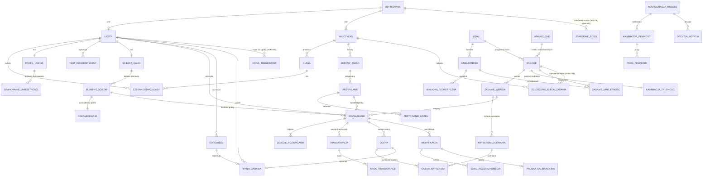

### 7.2 Konwencje schematu

- Klucze główne: `uuid`; agregaty tworzone w aplikacji dostają
  identyfikator z `Guid.CreateVersion7()` w fabryce agregatu (uporządkowany
  w czasie, lepsza lokalność indeksu B-drzewa), a `DEFAULT
  gen_random_uuid()` obsługuje wstawienia poleceniami SQL; `powiadomienie.id`
  nie ma wartości domyślnej (UUIDv7 jest `id:` zdarzenia SSE i kluczem scalania w kliencie, nie kursorem wznowienia — ADR-064,
  ADR-057). Wyjątki: `dzial.id`, `umiejetnosc.id` (`integer`, stabilne dane
  referencyjne), `praca_w_tle.id`, `proba_logowania.id`, `dziennik_audytu.id`
  (`bigint identity`).
- Czas: `timestamptz`, zawsze UTC; `date` dla `termin_egzaminu`.
- Optymistyczna blokada: kolumna `version integer NOT NULL DEFAULT 1`,
  zwiększana przy każdej modyfikacji **wykonanej przez człowieka albo przez
  przejście maszyny stanów**; API eksponuje ją jako pole `version` w ciele (warunek `If-Match`, ADR-069).
  Wyjątek: `weryfikacja.version` jest **wersją treści** — zmienia ją wyłącznie
  trigger `trg_weryfikacja_wersja` przy zmianie kolumn treści (powody,
  zgłoszenie, Ocena weryfikowana, zamknięcie); podjęcie, przedłużenie,
  zwolnienie blokady i eskalacja jej nie zmieniają (ADR-037).
  Statystyki i stany systemowe aktualizowane automatycznie (kalibracja
  Poziomu trudności, liczniki, Wstrzymanie w doborze — tabela
  `wstrzymanie_w_doborze` od wersji 2.3, C3-09) są w osobnych tabelach i nie
  zmieniają `version` encji, do której należą (ADR-029). Blokada wiersza
  (`SELECT … FOR UPDATE`) używana do serializacji takich zmian nie modyfikuje
  wiersza, więc też nie zmienia `version`.
- Usuwanie: twarde usuwanie danych osobowych (RODO, sekcja 16.4); dane
  referencyjne treści mają statusy zamiast usuwania.
- Współbieżność w EF Core (wersja 3.1): `version` jako
  `IsConcurrencyToken()` zwiększany przez `WersjaAgregatuInterceptor` w
  agregatach edytowanych przez ludzi i przejścia stanów; `weryfikacja.version`
  ustawia trigger (`ValueGeneratedOnAddOrUpdate`, ADR-037);
  agregaty zmieniane wyłącznie przez system bez ETag (`transkrypcja`,
  `wynik_zadania`, `zlecenie_generowania`, `import_arkusza`,
  `konfiguracja_modelu`, `ocena`) używają kolumny systemowej `xmin` jako
  tokenu współbieżności (brak kolumny w DDL); tabele zapisywane wyłącznie
  poleceniami SQL z warunkiem (`praca_w_tle`, `kalibracja_trudnosci`,
  `limit_szybkosci_modelu`, `wstrzymanie_w_doborze`, `klucz_idempotencji`)
  nie mają tokenu (`ef-core.md` sekcja 4).
- Nazwy: tabele, kolumny, typy, indeksy i ograniczenia w `snake_case`
  (ADR-049). Jawne nazwy z prefiksem mają indeksy (`ux_`, `ix_`), triggery
  (`trg_`), funkcje triggerów (`f_`) i dwa klucze obce dodawane `ALTER
  TABLE` (`fk_zadanie_aktualna_wersja`, `fk_rozwiazanie_najnowsza_transkrypcja`).
  Klucze główne, pozostałe klucze obce, UNIQUE i CHECK mają nazwy domyślne
  PostgreSQL (`<tabela>_pkey`, `<tabela>_<kolumna>_fkey`,
  `<tabela>_<kolumny>_key`, `<tabela>_<kolumna>_check`,
  `<tabela>_check[N]`), utrwalone w `Persistence/Schema/constraints.txt`
  i porównywane w CI (wersja 3.2, ADR-063 p. 4; prefiks `ck_` z wersji 3.1
  nie obowiązuje, bo model EF Core nie tworzy CHECK-ów).
- Klucze obce `uczen.uzytkownik_id` i `nauczyciel.uzytkownik_id` są
  `DEFERRABLE INITIALLY DEFERRED` (ADR-063 p. 3); pozostałe klucze obce mają
  w modelu EF Core relację bez nawigacji, która ustala kolejność poleceń.

### 7.3 DDL (PostgreSQL 16) — źródło prawdy

Pełne DDL: [`docs/spec/ddl.md`](spec/ddl.md) — jedyne źródło schematu (ADR-063) — blok (A) 60 tabel, 43 typy
wyliczeniowe, ograniczenia i indeksy; blok (B) funkcje
(`dodaj_dni_robocze`, `poziom_z_b`, `utworz_partycje_decyzji`), triggery
niezmienników (`trg_suma_kryteriow`, `trg_umiejetnosc_glowna_w_dziale`,
`trg_kontekst_proby`, `trg_ocena_niezmienna`, `trg_weryfikacja_wersja`,
`trg_powody_poczatkowe`), triggery powiadomień `trg_*_powiadom` (jedyne
źródło `NOTIFY`, ADR-056) i uprawnienia ról bazy. Wersja 3.0 trzymała DDL
w tej sekcji; od wersji 3.1 sekcja zawiera wyłącznie zmiany i decyzje.

| Zmiana wersji 3.1 | Obiekt | Uwaga / ADR |
|---|---|---|
| `status_przed_wnioskiem` (odtwarzany przy przywróceniu konta) | `uzytkownik` | C6-06 |
| `umowa_poufnosci_at` + CHECK dla `weryfikator_globalny` | `nauczyciel` | C6-06 |
| `zastapiony_przez`, `zastapiony_at`, `skrot_klienta_http`, `uzycia_w_oknie_tolerancji`; indeksy rodziny i użytkownika | `token_odswiezania` | C6-02, ADR-057 |
| `najnowsza_transkrypcja_id`, `najnowsza_wersja_transkrypcji`, `ostatnie_rozpoznanie_od_at`; `przeslano_at` wyłącznie dla Przesłania | `rozwiazanie` | C6-04 |
| `ostatnia_kolejnosc` | `sciezka_nauki` | C6-15 p. 4 |
| `version` | `stan_bezpiecznika` | C6-08 |
| `wywolania_narzedzi jsonb` (7.5.5) | `zlecenie_generowania` | C6-03, ADR-058 |
| `id` bez wartości domyślnej (UUIDv7) | `powiadomienie` | C6-09, ADR-057 |
| `trg_praca_w_tle_powiadom`, `trg_rozwiazanie_powiadom`, `trg_ocena_powiadom`, `trg_weryfikacja_powiadom`, `trg_powiadomienie_powiadom`, `trg_import_arkusza_powiadom`, `trg_zlecenie_generowania_powiadom`, `trg_konfiguracja_modelu_powiadom` | triggery | C6-01, C6-09, ADR-056 |
| pełna treść PL/pgSQL triggerów i funkcji wersji 2.4 | triggery, funkcje | bez zmiany semantyki |

| Zmiana wersji 3.2 | Obiekt | Uwaga / ADR |
|---|---|---|
| `max_prob` → `maks_prob` | `praca_w_tle` | C7-06 p. 7, ADR-049 p. 14 |
| klucz obcy do `uzytkownik` `DEFERRABLE INITIALLY DEFERRED` | `uczen`, `nauczyciel` | C7-06 p. 1, ADR-063 |
| nowa tabela | `przebieg_harmonogramu` | C7-13, ADR-066 |
| `ponow_prace`, `odzyskaj_dzierzawy` (`0006_background_jobs.sql`) | funkcje | C7-03, ADR-066 |
| blok `DO` tworzący role `NOLOGIN` | `0005_permissions.sql` | C7-15 p. 4 |

Sprawdzenie wersji 3.2: bloki A i B ładują się bez błędów na czystej bazie
PostgreSQL 16.15 (60 tabel + 4 partycje, 43 typy wyliczeniowe, 15
triggerów, 142 CHECK, 124 FK, 21 UNIQUE).

Typ wyliczeniowy `kontekst_decyzji` ma odpowiednik
`Lemat.Domain.Models.KontekstDecyzji { Ocena, Rekomendacja, WalidacjaZadania }`
(3.5 #30, C6-12 p. 5).

### 7.4 Dane referencyjne: Działy (A-04)

| id | kod | nazwa | tylko_rozszerzony |
|---|---|---|---|
| 1 | I | Liczby rzeczywiste | nie |
| 2 | II | Wyrażenia algebraiczne | nie |
| 3 | III | Równania i nierówności | nie |
| 4 | IV | Układy równań | nie |
| 5 | V | Funkcje | nie |
| 6 | VI | Ciągi | nie |
| 7 | VII | Trygonometria | nie |
| 8 | VIII | Planimetria | nie |
| 9 | IX | Geometria analityczna na płaszczyźnie kartezjańskiej | nie |
| 10 | X | Stereometria | nie |
| 11 | XI | Kombinatoryka | nie |
| 12 | XII | Rachunek prawdopodobieństwa i statystyka | nie |
| 13 | XIII | Optymalizacja i rachunek różniczkowy | tak |

Umiejętności są ładowane migracją danych z pliku
`backend/src/Lemat.Infrastructure/Persistence/Data/skills.yaml` (wersja 2.4: `src/lemat/tresci/dane/umiejetnosci.yaml`) (jeden wpis = jeden punkt wymagań
szczegółowych podstawy programowej; kod `P.V.9` / `R.XIII.2`). Wagi
egzaminacyjne = udział punktów danej Umiejętności w Arkuszach CKE 2023–2026
(wyliczane skryptem przy imporcie, normalizowane w obrębie poziomu matury).

### 7.5 Schematy pól JSONB

#### 7.5.1 `zadanie_wersja.opcje_zamkniete`

```json
{
  "forma": "WYBOR_JEDNOKROTNY",
  "opcje": [ {"id": "A", "tresc_md": "$x = 2$"}, {"id": "B", "tresc_md": "$x = -2$"},
             {"id": "C", "tresc_md": "$x = 4$"}, {"id": "D", "tresc_md": "$x = 0$"} ],
  "poprawna": "B"
}
```
```json
{
  "forma": "PRAWDA_FALSZ",
  "stwierdzenia": [ {"id": "1", "tresc_md": "Funkcja jest rosnąca.", "poprawna": true},
                    {"id": "2", "tresc_md": "Miejscem zerowym jest $3$.", "poprawna": false} ]
}
```
Punktacja: `WYBOR_JEDNOKROTNY` — `punkty_max = 1`; `PRAWDA_FALSZ` —
`punkty_max = 1`, punkt tylko gdy wszystkie stwierdzenia ocenione poprawnie
(zasada CKE).

#### 7.5.2 `zadanie_wersja.rozwiazanie_wzorcowe`

```json
{
  "warianty": [
    { "wariant": 1, "opis": "Wyznaczenie wierzchołka paraboli",
      "kroki": [ {"nr": 1, "latex": "f(x) = -2x^2 + 8x - 3", "komentarz": "postać ogólna"},
                 {"nr": 2, "latex": "p = -\\frac{b}{2a} = 2", "komentarz": "odcięta wierzchołka"},
                 {"nr": 3, "latex": "f(2) = 5", "komentarz": "wartość największa"} ] }
  ]
}
```
Każdy `wariant` ma odpowiadający mu zbiór wierszy `kryterium_oceniania` o tym
samym numerze wariantu. `kroki[].nr` to numer kroku Rozwiązania wzorcowego
(nie kryterium).

#### 7.5.3 `zadanie_wersja.wynik_koncowy_wzorcowy`

```json
{ "typ": "ZBIOR", "latex": "x \\in \\{-1, 3\\}", "sympy": "FiniteSet(-1, 3)" }
```
`typ` ∈ `WYRAZENIE` | `ROWNANIE` | `ZBIOR` | `PRZEDZIAL` | `WARTOSC_LOGICZNA` |
`TEKST`; `sympy` jest wymagane dla wszystkich typów poza `TEKST`. Dla
`OTWARTE_Z_DOWODEM` i `ZAMKNIETE` pole ma wartość `NULL`.

#### 7.5.4 `weryfikacja.zgloszenie`

```json
{ "kroki": [2], "opis": "W kroku 2 napisałem 5, a nie 6.", "zgloszono_at": "2026-11-02T17:40:00Z",
  "ocena_zglaszana_id": "f1a2…" }
```
`kroki` — 1–5 numerów kroków zatwierdzonej Transkrypcji; `opis` ≤ 500 znaków
(opcjonalny).


#### 7.5.5 `zlecenie_generowania.wywolania_narzedzi` (ADR-058 p. 6)

```json
[ { "cykl": 1, "nr": 1, "funkcja": "sympy_postac_liniowa", "argumenty": {"latex": "x \\in \\{-1, 3\\}"},
    "argumenty_sha256": "9f2c…", "rezultat": "FiniteSet(-1, 3)", "czas_ms": 140 },
  { "cykl": 1, "nr": 2, "funkcja": "sympy_sprawdz_rownowaznosc", "argumenty": {"latex_a": "x^2 - 2x - 3 = 0", "latex_b": "(x-3)(x+1) = 0"},
    "argumenty_sha256": "41d0…", "rezultat": "ROWNOWAZNE", "czas_ms": 210 } ]
```

`argumenty` w postaci jawnej ≤ 2 000 znaków po serializacji (dłuższe — obcięte do `{"obciete": true}`, `argumenty_sha256` zawsze z
pełnej postaci); maks. 8 wpisów na cykl, 24 na zlecenie.

### 7.6 Mapowanie EF Core — decyzje

Szczegóły i kod konfiguracji: [`docs/spec/ef-core.md`](spec/ef-core.md).

| Zagadnienie | Decyzja |
|---|---|
| Kontekst | jeden `LematDbContext` dla wszystkich modułów (modularny monolit, jedna baza); konfiguracje `<Entity>EntityTypeConfiguration` w `Persistence/Configurations/<Module>/` ładowane `ApplyConfigurationsFromAssembly`; `DbSet<T>` niepubliczne |
| Źródło schematu | DDL (ADR-063): model EF Core jest mapowaniem, nie generuje migracji; bez `HasCheckConstraint`, `HasMaxLength`, `HasTrigger`; test `ModelEfZgodnyZKatalogiem` |
| Nazwy kolumn | `EFCore.NamingConventions` (`UseSnakeCaseNamingConvention`), nazwy tabel jawne, `HasColumnName` dla nazw z cyframi (`oswiadczenie_wieku_16`, ADR-049 p. 14) i kluczy współdzielonych z PK (`uzytkownik_id`, `uczen_id`) |
| Relacje | wewnątrz agregatu — `OwnsMany`/`HasMany` z nawigacją po polu prywatnym; między agregatami — relacja bez nawigacji (`HasOne<T>().WithMany().HasForeignKey(…)`) dla porządku poleceń; klucze kont o różnych typach identyfikatorów — bez relacji, FK odroczony w DDL (ADR-063 p. 3) |
| Identyfikatory silnie typowane | konwerter `IdentyfikatorConverter<TId, TWartosc>` rejestrowany konwencją dla każdego `*Id` z `Lemat.Domain` |
| Typy wyliczeniowe PostgreSQL | `MapEnum` (43 typy) z translatorem `TlumaczNazwUpperSnake` (`OtwarteZDowodem` ↔ `OTWARTE_Z_DOWODEM`) na `NpgsqlDataSourceBuilder` i w modelu EF; wartości z CHECK tekstowym — `UpperSnakeEnumConverter<T>`; tablice enumów — `List<T>` |
| Value objects | VO z kilku kolumn tabeli właściciela (`OkresKarencji`, `BlokadaWeryfikacji`, `Wskazowka`, `Seria`, `KodZaproszenia`) — `OwnsOne` z jawnymi nazwami kolumn; VO jednokolumnowe (`PoziomTrudnosci`, `PewnoscOceny`, `PewnoscSurowa`, `PoziomOpanowania`, `WariantRozwiazania`) — konwertery konwencji |
| `jsonb` ze schematem 7.5 | `OwnsOne/OwnsMany(…).ToJson()` (obiekty używane przez domenę) albo `JsonbConverter<T>` (migawki i raporty); `UnsafeRelaxedJsonEscaping` |
| `jsonb` bez schematu | `JsonDocument` |
| Encje wewnętrzne agregatu | `OwnsMany(…).ToTable(…)` (`kryterium_oceniania`, `krok_transkrypcji`, `opanowanie_umiejetnosci` — lista `List<OpanowanieUmiejetnosci>` ze słownikiem budowanym w pamięci, C7-06 p. 2, `czlonkostwo_klasy`, `pozycja_zestawu`, `przypisanie_uczen`) albo `HasMany` z polem prywatnym (`zdjecie_rozwiazania`, `ocena_kryterium`, `zadanie_wersja`, `element_sciezki` — wyłącznie aktywne, `Include(s => EF.Property<List<ElementSciezki>>(s, "_aktywne").Where(…))`) |
| Współbieżność | 15.2; `WersjaAgregatuInterceptor` podnosi `version` korzenia przy zmianie dowolnego wiersza agregatu (C7-06 p. 8); `DbUpdateConcurrencyException` → `412 KONFLIKT_WERSJI` (z `If-Match`), `409 KONFLIKT_WSPOLBIEZNOSCI` (bez) albo `rezultat_przestarzaly` (worker) |
| Triggery | wyłącznie w plikach SQL migracji; lista 15 triggerów w `KatalogTriggerow` porównywana z `pg_trigger` (`KazdyTriggerWKatalogu`); `HasTrigger` nie jest używane (Npgsql nie zmienia SQL zapisu, ADR-063 p. 5) |
| Operacje atomowe | `ExecuteUpdateAsync`/SQL zamiast śledzenia zmian (wyniki `RETURNING` przez `SqlQuery<T>(…).ToListAsync()`, polecenie przed wczytaniem agregatu z `AsTracking()` albo `ReloadAsync()` po nim, 15.2): podjęcie, przedłużenie i zwolnienie Weryfikacji, kalibracja Poziomu trudności, zapis `zgodnosc_poprawek`, rotacja refresh tokenu, zlecanie i wynik prac w tle, ogranicznik szybkości |
| Partycje | `decyzja_modelu` — tabela nadrzędna i partycje w SQL (`0004_partitions.sql`) |
| Transakcje | wyłącznie przez `IJednostkaPracy` (jawna transakcja, ADR-056); bez `EnableRetryOnFailure` |

### 7.7 Strategia migracji (wersja 3.2, ADR-063)

1. **Jedno źródło:** `docs/spec/ddl.md` → skrypt `extract-ddl.sh` →
   `Persistence/Migrations/Sql/0000_schema.sql` (blok A) i
   `0001_functions.sql` … `0006_background_jobs.sql` (blok B); CI sprawdza brak
   różnic po ponownym wycięciu.
2. **Migracje** są klasami EF Core `Migration` zawierającymi wyłącznie
   `migrationBuilder.Sql(ZasobSql.Wczytaj(…))`: `0001_SchematPoczatkowy`
   wykonuje pliki `0000` … `0006` w kolejności; kolejne migracje —
   `NNNN_<opis>` z jednym plikiem SQL. Od wersji 3.4 (ADR-075) plik klasy
   migracji i plik SQL mają nazwę angielską (`0001_InitialSchema.cs`,
   `NNNN_<english-description>.cs` i `.sql`), a identyfikator migracji w
   atrybucie `[Migration("0001_SchematPoczatkowy")]` i w
   `__EFMigrationsHistory` pozostaje bez zmian (6.11). `dotnet ef migrations add` nie jest
   używane; migawki modelu (`*ModelSnapshot.cs`) nie ma (test
   `ZadnaMigracjaNieGenerujeSchematu` odrzuca pliki migracji z
   `CreateTable`/`AddColumn`).
3. **Zmiana schematu** = zmiana `ddl.md` + nowy plik SQL (`ALTER …`,
   `CREATE OR REPLACE FUNCTION`) + klasa migracji + ewentualna zmiana
   konfiguracji EF Core; migracje wyłącznie „w przód” w produkcji.
4. **Zmiany bez przestoju** w dwóch fazach (kolumna `NULL` → kod → `NOT
   NULL`/CHECK; usunięcie po wdrożeniu kodu, który jej nie czyta); bez
   `RENAME` przy działających replikach (zmiana `max_prob` → `maks_prob` w
   wersji 3.2 dotyczy schematu przed pierwszym wdrożeniem).
5. **Wykonanie** przez `efbundle` w kontenerze `migracje` (użytkownik
   `lemat_migracje`) przed wdrożeniem; procesy aplikacji odmawiają startu
   przy bazie starszej niż migracja w obrazie (`BazaNieaktualnaException`).
   Migracje nie wstawiają danych deweloperskich ani konfiguracji `mock`
   (ADR-065 p. 6).
6. **Testy** (Testcontainers PostgreSQL 16, każdy PR):
   `ModelEfZgodnyZKatalogiem` (model EF vs `information_schema` i `pg_index`:
   tabele, kolumny, typy, `NULL`, klucze główne, indeksy celów `ON
   CONFLICT`; sprawdzony na fragmencie schematu — wykrył rozbieżność
   `NULL` i dał 0 różnic po poprawce), `KazdyKluczObcyMaRelacjeAlboJestOdroczony`,
   `KazdyTriggerWKatalogu` (15), `OgraniczeniaZgodneZMigawka`
   (`constraints.txt`), `KazdaTabelaDdlMaWlasciciela` (60 tabel),
   `KazdyTypWyliczeniowyDdlJestZmapowany` (43 typy),
   `MigracjeNaPustejBazieBezRolIBezMock` (czysta baza bez ról → migracje
   kończą się sukcesem, brak konfiguracji `mock`).

---

## 8. Maszyny stanów

### 8.1 Rozwiązanie

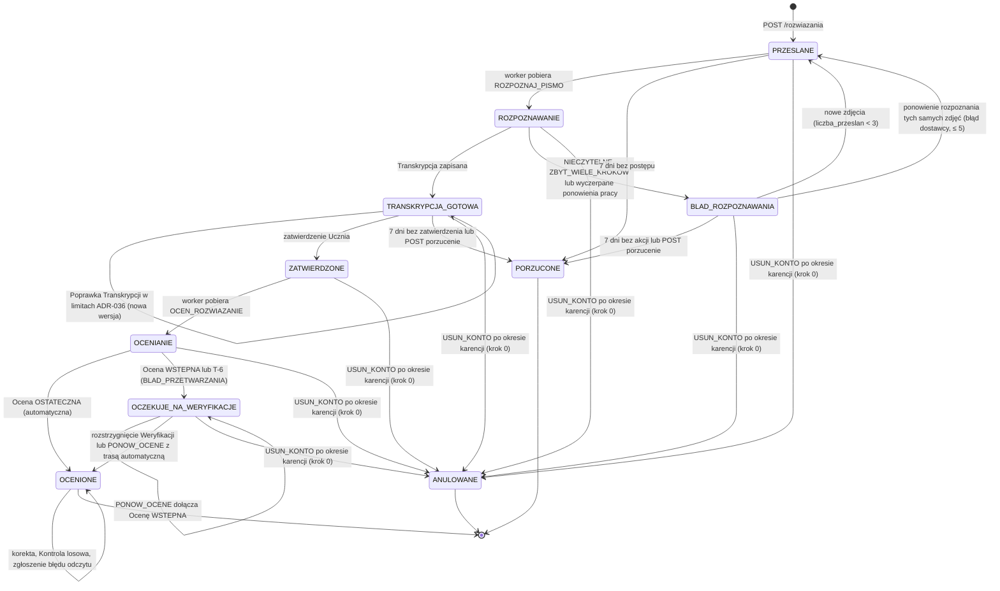

**Okres karencji (ADR-040, C2-08):** żądanie usunięcia konta **nie zmienia**
stanów Rozwiązań ani Weryfikacji. Przez 30 dni konto ma status `USUWANE`, a
procesy są **wstrzymane**: handlery prac w tle kończą się bez efektu
(warunek „konto `AKTYWNE`”, rezultat `KONTO_USUWANE`), zapytania Kolejki
weryfikacji pomijają Weryfikacje Uczniów `USUWANE`, `PORZUC_NIEZATWIERDZONE`
i `WYGAS_ELEMENTY` ich nie dotykają. Przywrócenie konta wznawia procesy
(16.4, C-33). Przejścia do `ANULOWANE` wykonuje dopiero `USUN_KONTO` w
kroku 0 (pierwszy zapis w bazie, 16.4), aby worker, który pobrał pracę przed
usunięciem, zastał stan terminalny; Rozwiązanie `OCENIONE` z otwartą
Weryfikacją pozostaje `OCENIONE`, a Weryfikacja przechodzi do `ANULOWANA`
(`USUNIECIE_KONTA`). Zdjęcia Rozwiązań `PORZUCONE` dostają `usun_po :=
now()` w tej samej transakcji (16.4); zdjęcia Rozwiązań `ANULOWANE` usuwa
krok 4 `USUN_KONTO`.

Dozwolone operacje API w stanach (wszystkie inne → `409 ROZWIAZANIE_NIEPRAWIDLOWY_STAN`):

| Operacja | Dozwolona w stanach | Zasób `If-Match` |
|---|---|---|
| `PUT /rozwiazania/{id}/transkrypcja` | `TRANSKRYPCJA_GOTOWA` (limity Poprawek ADR-036, 12.5) | Rozwiązanie |
| `POST /rozwiazania/{id}/zatwierdzenie` | `TRANSKRYPCJA_GOTOWA` | Rozwiązanie |
| `POST /rozwiazania/{id}/zdjecia` | `BLAD_ROZPOZNAWANIA` (gdy `liczba_przeslan < 3`) | Rozwiązanie |
| `POST /rozwiazania/{id}/ponowienie-rozpoznania` | `BLAD_ROZPOZNAWANIA` z kodem `BLAD_DOSTAWCY` lub `PRZEKROCZONY_CZAS` (gdy `liczba_ponowien_rozpoznania < 5`) | Rozwiązanie |
| `POST /rozwiazania/{id}/porzucenie` | `TRANSKRYPCJA_GOTOWA`, `BLAD_ROZPOZNAWANIA` | Rozwiązanie |
| `POST /rozwiazania/{id}/zgloszenie-bledu-odczytu` | `OCENIONE`, `OCZEKUJE_NA_WERYFIKACJE` (warunki 11.6) | Rozwiązanie |
| `POST /rozwiazania/{id}/korekty` | `OCENIONE` (warunki 9.6.3) | Rozwiązanie |
| `POST /weryfikacje/{id}/rozstrzygniecie` | Rozwiązanie w `OCZEKUJE_NA_WERYFIKACJE` lub `OCENIONE` (Kontrola losowa, zgłoszenie) | Weryfikacja (wersja treści, ADR-037) |

### 8.2 Ocena

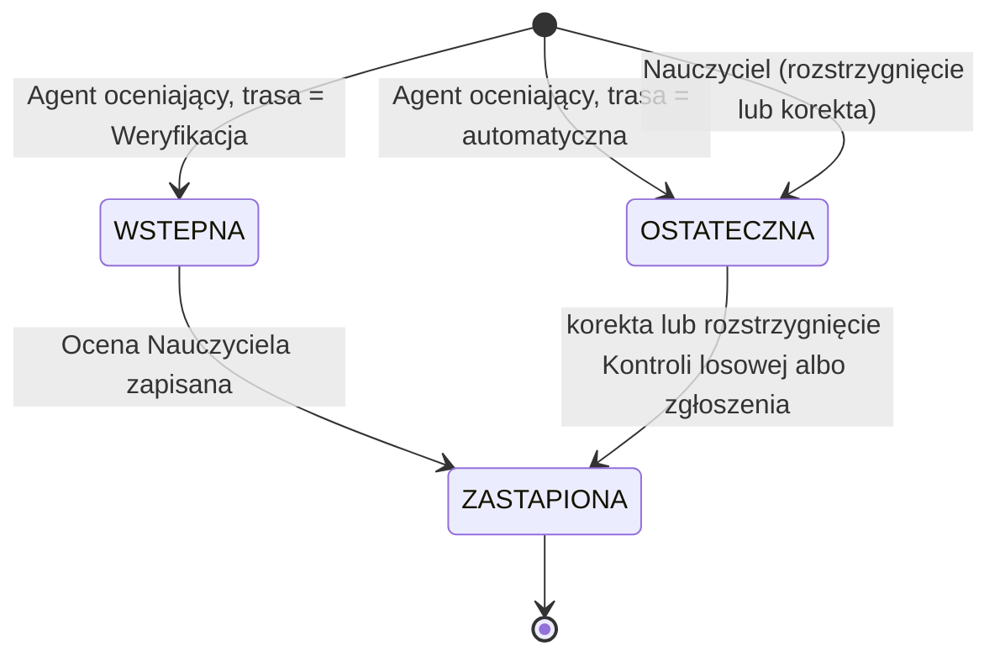

Jeśli Nauczyciel w Kontroli losowej **potwierdza** Ocenę bez zmian, i tak
powstaje nowa wersja Oceny (`zrodlo = NAUCZYCIEL`), aby każda Próbka
kalibracyjna wskazywała Ocenę Nauczyciela; Uczeń nie dostaje powiadomienia,
gdy punkty i błędny krok są identyczne. Poza przejściem do `ZASTAPIONA`
jedyną dozwoloną modyfikacją wiersza `ocena` jest jednokrotne uzupełnienie
Wskazówki (Z-5, trigger `trg_ocena_niezmienna`).

Widoczność dla Ucznia (`OcenaWyjscie.widocznosc_dla_ucznia`, ADR-022):
`PELNA` — wszystkie pola; `WSTRZYMANA_BLAD_ODCZYTU` — Ocena `WSTEPNA` z
`mozliwy_blad_odczytu = true`: Uczeń widzi status, komunikat i numer kroku
podejrzanego o błąd odczytu, ale nie widzi punktów, typu błędu ani
Wskazówki do czasu Weryfikacji.

### 8.3 Weryfikacja

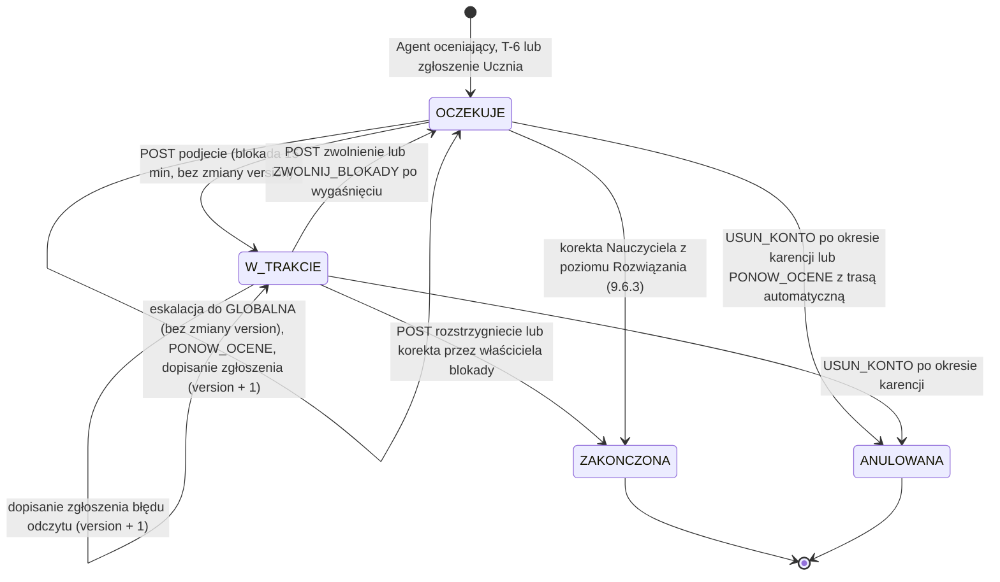

Wykonawcy przejść czasowych: `W_TRAKCIE → OCZEKUJE` po wygaśnięciu blokady
wykonuje scheduler co 1 min (`ZWOLNIJ_BLOKADY_WERYFIKACJI`, 13.5);
dodatkowo każde zapytanie kolejki traktuje `W_TRAKCIE` z
`zablokowana_do < now()` jak `OCZEKUJE` (reguła odczytu, 11.4.2), więc
opóźnienie schedulera nie ukrywa Weryfikacji. Eskalację wykonuje
`ESKALUJ_WERYFIKACJE` co godzinę (11.4.3).

**Wersja treści (ADR-037, C2-02):** `weryfikacja.version` (ETag `W`) zmienia
się wyłącznie przy zmianie treści, którą Nauczyciel musi zobaczyć przed
rozstrzygnięciem: dopisanie powodu lub zgłoszenia błędu odczytu, dołączenie
Oceny weryfikowanej przez `PONOW_OCENE`, zamknięcie lub anulowanie.
Podjęcie, ponowne podjęcie, przedłużenie, zwolnienie, `ZWOLNIJ_BLOKADY` i
eskalacja wersji nie zmieniają (trigger `trg_weryfikacja_wersja`, 7.3).
Dlatego ETag otrzymany przy podjęciu pozostaje ważny przez cały czas pracy
Nauczyciela (C-31), a `412 KONFLIKT_WERSJI` przy rozstrzygnięciu zawsze
oznacza zmianę treści; ciało `412` zawiera aktualny zasób i pole
`zmiany_tresci` (lista: `POWODY`, `ZGLOSZENIE`, `OCENA_WERYFIKOWANA`,
`ZAMKNIETA`), które PWA wyróżnia przed ponownym wysłaniem.

### 8.4 Zadanie

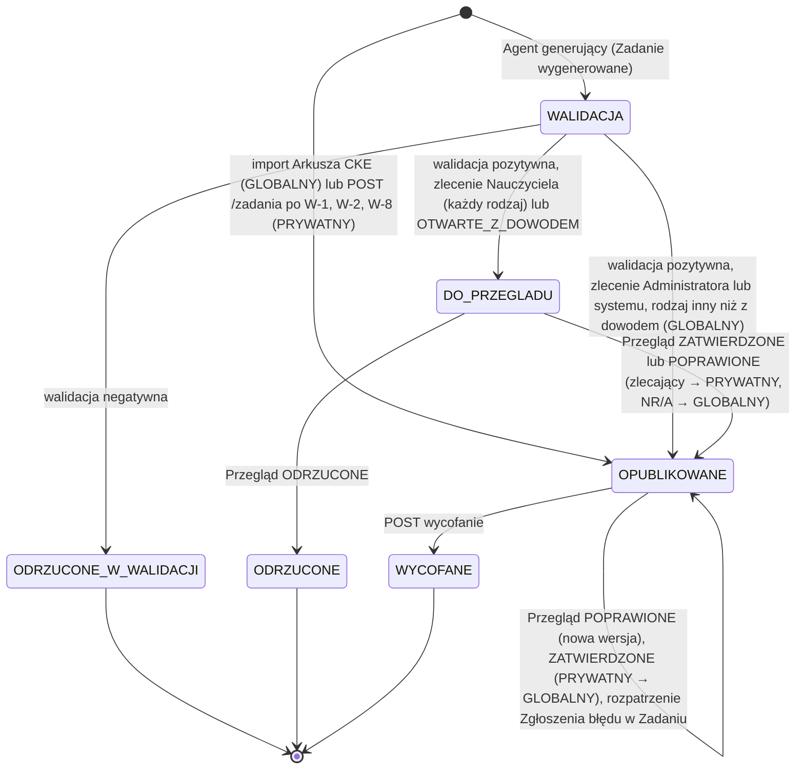

Uprawnienia do przejść (ADR-028):

| Przejście | Kto |
|---|---|
| Przegląd Zadania `GLOBALNY` (`POPRAWIONE`), wycofanie Zadania `GLOBALNY`, rozpatrzenie Zgłoszenia błędu w Zadaniu | recenzent treści, Administrator |
| Zgłoszenie błędu w Zadaniu `GLOBALNY` (`POST /zadania/{id}/zgloszenia-bledu`) | każdy Nauczyciel (FR-14, ADR-038) |
| Przegląd `DO_PRZEGLADU` Zadania wygenerowanego na zlecenie Nauczyciela | zlecający Nauczyciel (wynik: `PRYWATNY`, natychmiast do użycia w jego Przypisaniach), recenzent treści lub Administrator (wynik: `GLOBALNY`) |
| Przegląd `DO_PRZEGLADU` dowodu ze zlecenia Administratora | recenzent treści, Administrator (wynik: `GLOBALNY`) |
| Przegląd i wycofanie Zadania `PRYWATNY` | autor (dla Zadań wygenerowanych: zlecający), recenzent treści, Administrator |
| Promocja `PRYWATNY → GLOBALNY` (Przegląd `ZATWIERDZONE`) | recenzent treści, Administrator |

**FR-14 a zasięg (ADR-038, C2-03):** Zadanie wygenerowane na zlecenie
Nauczyciela (`zlecenie_generowania.zlecajacy_id` z rolą `NAUCZYCIEL`) po
pozytywnej Walidacji **zawsze** trafia do `DO_PRZEGLADU`, a zlecający
Nauczyciel może je przejrzeć, poprawić albo odrzucić (FR-14 w pełni).
Zatwierdzone przez niego jest `PRYWATNY` i może trafić do doboru dla
wszystkich dopiero po promocji przez recenzenta treści lub Administratora.
Po 14 dniach bez Przeglądu zlecającego Zadanie jest widoczne także w
kolejce Przeglądu recenzentów (`GET /zadania?status=DO_PRZEGLADU`).
Zadanie `GLOBALNY` (z Arkusza CKE, systemowe, promowane) wpływa na
wszystkich Uczniów, więc Nauczyciel bez flagi `recenzent_tresci` nie
poprawia go bezpośrednio, tylko składa **Zgłoszenie błędu w Zadaniu**:
1 otwarte zgłoszenie na (Zadanie, Nauczyciel), limit 10 zgłoszeń na dobę;
powiadomienie `ZGLOSZENIE_BLEDU_ZADANIA` dla recenzentów i Administratorów;
SLA rozpatrzenia 5 dni roboczych (metryka `zgloszenia_zadan_po_sla`). Przy
**3 otwartych zgłoszeniach od różnych Nauczycieli** Zadanie dostaje wiersz
`wstrzymanie_w_doborze` (nie jest rekomendowane i nie może być dodane
do nowego Zestawu zadań), aż recenzent rozpatrzy zgłoszenia: `UWZGLEDNIONE`
wymaga Przeglądu (`POPRAWIONE` albo wycofanie), `ODRZUCONE` wymaga
komentarza; po rozpatrzeniu wszystkich otwartych zgłoszeń wstrzymanie jest
usuwane — `DELETE FROM wstrzymanie_w_doborze` w transakcji rozpatrzenia
ostatniego otwartego zgłoszenia (o ile Zadanie nie zostało wycofane). Ani
wstrzymanie, ani jego usunięcie nie zmienia `zadanie.version` (7.2, C3-09). Zgłaszający Nauczyciel
może do czasu rozpatrzenia usunąć Zadanie ze swoich Zestawów. Zawężenie
prawa bezpośredniej poprawki Zadań `GLOBALNY` do recenzentów jest
decyzją D-11 (23.4, G-0).

Wycofanie Zadania nie przerywa trwających Rozwiązań — są one oceniane według
swojej `zadanie_wersja` (ADR-012); Zadanie znika z doboru rekomendacji i z
otwartych Przypisań (pozycja oznaczona w UI jako „wycofane”). Elementy
`PROPONOWANY` z tym Zadaniem przechodzą do `WYGASLY`; elementy `ROZPOCZETY`
pozostają aktywne do `wygasa_at` (Uczeń mógł już pisać na kartce).

### 8.5 Element Ścieżki nauki

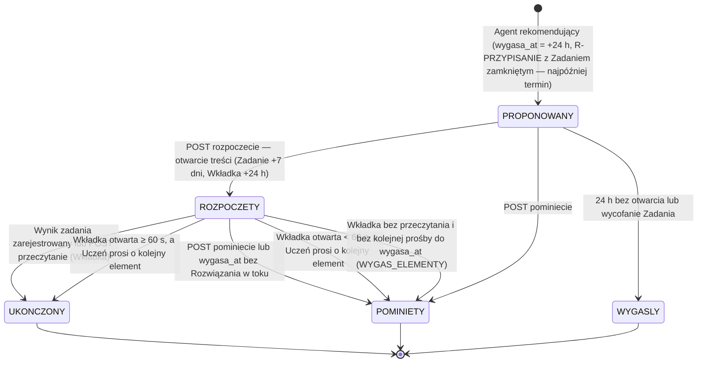

Reguły:

- `POST /elementy-sciezki/{id}/rozpoczecie` wykonuje PWA przy wyświetleniu
  treści Zadania lub Wkładki (idempotentne); zapisuje
  `zadanie_wersja_id` = aktualna wersja Zadania w tej chwili. Od tego
  momentu Rozwiązanie lub Odpowiedź dla tego elementu jest przyjmowana dla
  tej wersji, nawet jeśli w międzyczasie powstała nowsza (C1-20, 12.5).
- Rozwiązanie `PORZUCONE` nie kończy elementu: Uczeń może przesłać nowe
  Rozwiązanie do `wygasa_at`. `WYGAS_ELEMENTY` przenosi element
  `ROZPOCZETY` do `POMINIETY` po `wygasa_at` tylko wtedy, gdy nie istnieje
  Rozwiązanie w stanie nieterminalnym; w przeciwnym razie element kończy się
  wraz z Wynikiem zadania.
- Odpowiedź na Zadanie zamknięte w elemencie `PROPONOWANY` wykonuje
  rozpoczęcie i ukończenie w jednej transakcji.
- **Ukończenie Wkładki (C2-16 p. 6)** wymaga dowodu przeczytania: wywołania
  `POST …/przeczytanie` albo prośby o kolejny element po ≥ 60 s od
  `rozpoczeto_at`. `WYGAS_ELEMENTY` przenosi Wkładkę `ROZPOCZETY` po
  `wygasa_at` do `POMINIETY` (brak dowodu), więc 8.5 i 13.3 stosują tę samą
  regułę, a reguła FR-06 („Wkładka nieprzeczytana w 14 dniach”) może ją
  zaproponować ponownie.
- **Element `R-PRZYPISANIE` (C1-21):** ma `przypisanie_id`; każda próba z
  niego dziedziczy `przypisanie_id` (trigger `trg_kontekst_proby`), więc
  podlega tym samym regułom co próba z listy Przypisań (unikalność,
  ujawnianie klucza od terminu, kolejka Nauczyciela Przypisania, postęp
  Przypisania). Dla Zadania zamkniętego `wygasa_at = least(created_at +
  24 h, termin)`, a po terminie element przechodzi do `WYGASLY`; dla
  Zadania otwartego obowiązuje okno Przypisania „termin + 7 dni” (12.5).

### 8.6 Wynik zadania (wersja 2.1)

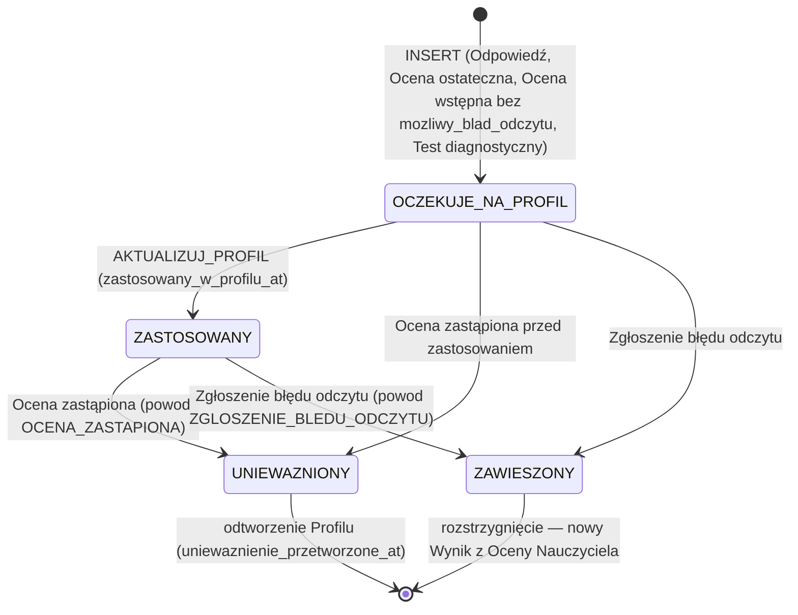

Stany są wyliczane z kolumn (`zastosowany_w_profilu_at`, `uniewazniony_at`,
`powod_uniewaznienia`), a nie przechowywane w osobnej kolumnie. Zarówno
`UNIEWAZNIONY`, jak i `ZAWIESZONY` wywołują odtworzenie Profilu ucznia
(10.1.3) i nie są w nim stosowane. Ocena wstępna z
`mozliwy_blad_odczytu = true` nie tworzy Wyniku zadania wcale (ADR-022).

---

## 9. Przepływy

Oznaczenia uczestników: `PWA` — aplikacja kliencka, `API` — proces api,
`DB` — PostgreSQL, `S3` — magazyn obiektów, `WRK` — worker (Orkiestrator),
`AR*` — agenci, `JEV` — Jev, `LLM` — Model generatywny.

### 9.1 Rejestracja, poziom matury, Test diagnostyczny (FR-01, FR-02, FR-03)

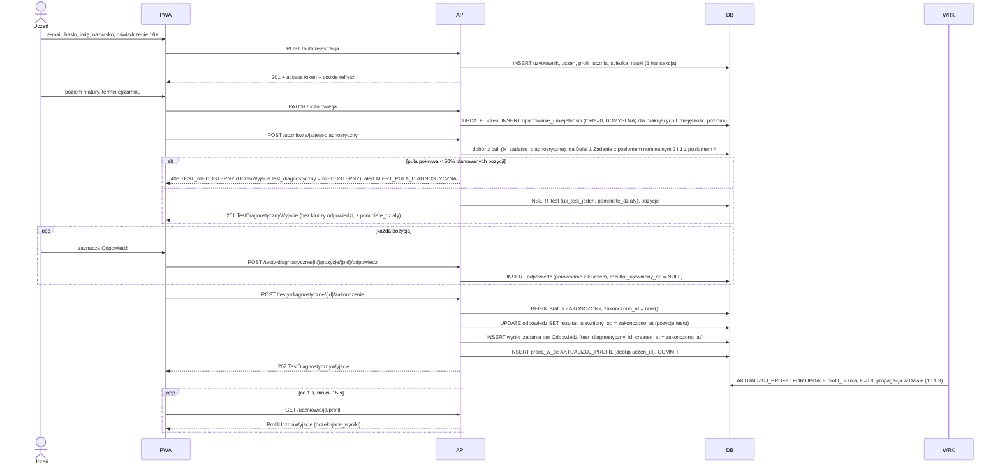

Test diagnostyczny aktualizuje Profil ucznia wyłącznie przez Wyniki zadania i
pracę `AKTUALIZUJ_PROFIL` (ta sama blokada `FOR UPDATE` co pozostałe
aktualizacje, C-11). Uczeń może pominąć test (`POST …/pominiecie`): status
`POMINIETY`, Umiejętności zostają z `theta = 0` i `inicjalizacja = DOMYSLNA`;
Odpowiedzi udzielone przed pominięciem dostają `rezultat_ujawniony_od =
now()` i **nie** tworzą Wyników zadania. Możliwość pominięcia testu jest
rozszerzeniem FR-03 („nowy uczeń rozwiązuje…”) — decyzja D-14 (23.4, G-0);
opcja domyślna: pominięcie dozwolone.

**Pula i dobór (C2-13):** dobór używa **nominalnego** Poziomu trudności
(`zadanie.poziom_trudnosci_nominalny`), bo pula jest kuratorowana przez
Administratora (`PUT /admin/zadania/{id}/diagnostyczne`) i nie może zmieniać
składu wraz z kalibracją; aktualizacja Profilu po teście używa bieżącego
`kalibracja_trudnosci.trudnosc_b` (10.1.3). Planowane pozycje: Działy
poziomu matury Ucznia (12 dla `PODSTAWOWY`, 13 dla `ROZSZERZONY`) × 2
Poziomy trudności (2 i 4) = 24 / 26 pozycji; z ≥ 3 kandydatów losowany jest
jeden (różnorodność między Uczniami). Brak kandydata na poziomie 2 (4) →
kandydat z poziomem nominalnym 1 lub 3 (3 lub 5); brak i takiego → Dział
trafia do `pominiete_dzialy`, a jego Umiejętności pozostają `DOMYSLNA`
(propagacja 10.1.3 działa tylko w obrębie przetestowanego Działu). Gdy dobrane pozycje stanowią < 50%
planowanych, test nie powstaje (`409 TEST_NIEDOSTEPNY`), Uczeń zaczyna z
Profilem `DOMYSLNA`, a Administratorzy dostają `ALERT_PULA_DIAGNOSTYCZNA`;
test można wykonać później, gdy pula zostanie uzupełniona. Bramka G-5
wymaga ≥ 3 Zadań diagnostycznych na każdą trójkę (Dział, poziom matury,
nominalny Poziom trudności ∈ {2, 4}); `SPRAWDZ_PULE_DIAGNOSTYCZNA` (13.3)
sprawdza to codziennie, a `PUT …/diagnostyczne` z `diagnostyczne = false`,
które obniżyłoby pulę poniżej 3, kończy się `409
PULA_DIAGNOSTYCZNA_ZA_MALA` (chyba że `?wymus=true` — Zadanie z błędem —
wtedy alert).
Pominięty test można później wykonać **raz** (indeks `ux_test_jeden`
obejmuje `W_TOKU` i `ZAKONCZONY`); ponowna próba → `409 TEST_JUZ_WYKONANY`.
Ponieważ Wyniki zadania z testu są zdarzeniami w historii (z datą
zakończenia testu), Wyniki sprzed testu i po nim stosują się w kolejności
chronologicznej, bez podwójnego liczenia (10.1.3).

**Zmiana poziomu matury** (`PATCH /uczniowie/ja` z nowym `poziom_matury`):
w jednej transakcji: (1) wstawiane są brakujące wiersze
`opanowanie_umiejetnosci` dla Umiejętności nowego poziomu (`DOMYSLNA`);
istniejące `theta` są zachowane (Umiejętność jest wspólna dla obu
poziomów); wiersze Umiejętności `tylko_rozszerzony` po zmianie na
`PODSTAWOWY` zostają, ale nie są pokazywane w Profilu ani rekomendowane;
(2) element `PROPONOWANY` przechodzi do `WYGASLY`; (3) aktywna Seria jest
kończona; (4) Uczeń może wykonać jeden Test diagnostyczny dla nowego
poziomu (indeks per poziom). Nie powstają nowe Wyniki zadania, więc nie ma
odtwarzania Profilu.

### 9.2 Rekomendacja kolejnego elementu Ścieżki nauki (FR-05 … FR-10)

```mermaid
sequenceDiagram
    actor U as Uczeń
    participant PWA
    participant API
    participant NEH as NastepnyElementHandler (Rekomendacje, api)
    participant SYN as IRekomendacjaSynchroniczna (Orchestration.Synchronous)
    participant REK as Agent rekomendujący
    participant DB
    participant JEV
    U->>PWA: „Dalej”
    PWA->>API: GET /uczniowie/ja/rekomendacje/nastepna
    API->>NEH: przypadek użycia (3.1, C6-07)
    NEH->>DB: domknij Wkładkę ROZPOCZETY (≥ 60 s → UKONCZONY, inaczej POMINIETY)
    NEH->>DB: wczytaj SciezkaNauki (aktywne elementy); PROPONOWANY przed wygasa_at?
    alt istnieje
        NEH-->>API: istniejący element
        API-->>PWA: 200 RekomendacjaWyjscie z istniejącym elementem
    else brak
        NEH->>SYN: DecydujAsync(uczen_id, stan Ścieżki) — poza transakcją
        SYN->>DB: migawka Profilu ucznia, historia, Przypisania (fasady odczytu)
        SYN->>REK: RekomendujAsync(WejscieRekomendacji)
        opt grupa eksperymentu JEV_CHOICE i brak aktywnej Serii
            REK->>JEV: CHOICE Q-RE-01 (timeout 1,5 s, bez ponowień)
            JEV-->>REK: rozkład prawdopodobieństw lub błąd → POLITYKA_ELO
        end
        REK-->>SYN: DecyzjaRekomendacji (typ, cel, Umiejętność, Zadanie lub Wkładka lub brak, reguła, fakty)
        SYN-->>NEH: DecyzjaRekomendacji (bez zapisu)
        NEH->>DB: BEGIN, SciezkaNauki.Zaproponuj → INSERT element_sciezki (PROPONOWANY) + rekomendacja + decyzja_modelu
        NEH->>DB: UPDATE sciezka_nauki (Seria, ostatnia_kolejnosc, version), ZlecAsync UZUPELNIJ_PULE / GENERUJ_SZKIC_WKLADKI (ON CONFLICT), COMMIT
        alt naruszenie ux_jeden_proponowany albo version (równoległe żądanie)
            NEH->>DB: ROLLBACK, SELECT istniejący PROPONOWANY
        end
        NEH-->>API: element lub brak elementu
        API-->>PWA: 200 RekomendacjaWyjscie (element + uzasadnienie FR-10 albo brak_elementu)
    end
```

### 9.3 Zadanie zamknięte (FR-15, FR-29)

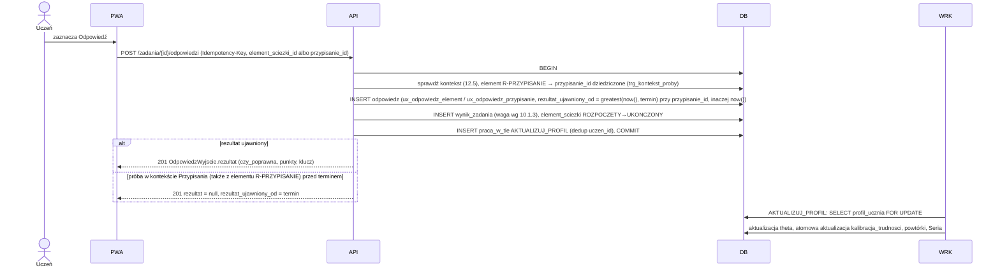

### 9.4 Przesłanie Rozwiązania i Transkrypcja (FR-16, FR-17, FR-18)

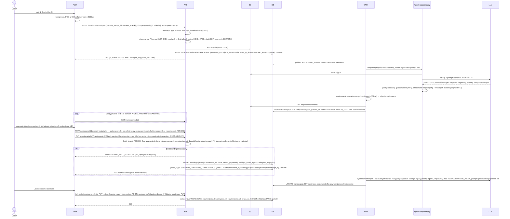

**Poprawki Transkrypcji (ADR-036, C2-01).** Uczeń poprawia **fragmenty
odczytu**, a nie pisze rozwiązania od nowa:

| Limit | Wartość | Skutek przekroczenia |
|---|---|---|
| usunięcie kroku Transkrypcji agenta | zabronione (każdy krok agenta występuje dokładnie raz, w tej samej kolejności) | `422 POPRAWKI_ZBYT_ROZLEGLE` |
| kroki wstawione (`nr_kroku_agenta = NULL`) | ≤ 2 | `422` |
| długość kroku wstawionego (`tekst` + `latex` po normalizacji LaTeX) — limit twardy (C3-05) | ≤ min(200, max(60, ⌈1,5 × mediana długości kroków agenta⌉)) znaków | `422` |
| kroki zmienione + wstawione — limit twardy | ≤ max(3, ⌈0,5 × n⌉), `n` = liczba kroków agenta | `422` |
| odsetek zmienionych znaków = (Σ po krokach zmienionych Levenshtein(odczyt, poprawka) + Σ po krokach wstawionych długość kroku) / Σ długość **wszystkich** kroków agenta bieżącego przesłania (`tekst` + `latex` po normalizacji LaTeX; od wersji 2.3 kroki wstawione są w liczniku, C3-05) — limit twardy | ≤ 0,50 | `422` |
| kroki zmienione + wstawione — limit miękki | ≤ max(2, ⌈0,25 × n⌉) | powód `POPRAWKI_NIEZGODNE_ZE_ZDJECIEM` (T-7) |
| odsetek zmienionych znaków — limit miękki | ≤ 0,25 | T-7 |
| Sprawdzenie zgodności poprawek (10.3.3) | każdy zmieniony krok z `p_zgodna_z_poprawka ≥ 0,50`; rezultat dostępny przed zapisem Oceny | T-7 |

Przykład (C3-05): Transkrypcja agenta ma 4 kroki o łącznej długości 120
znaków (mediana 30). Krok wstawiony może mieć ≤ min(200, max(60, 45)) = 60
znaków; dwa wstawione kroki po 60 znaków dają odsetek (0 + 120) / 120 =
1,00 > 0,50 → `422`. Wstawienie kompletnego rozwiązania (2 × 2000 znaków,
możliwe w wersji 2.2) jest odrzucane już limitem długości. Jeden wstawiony
krok 25 znaków (pominięta linia) daje 25 / 120 = 0,21 — mieści się w limicie
miękkim 0,25.

Zakres poprawek jest zawsze liczony względem Transkrypcji agenta
bieżącego przesłania (kolejne wersje `POPRAWKA_UCZNIA` nie „przesuwają”
punktu odniesienia). Przy `422` UI proponuje „Wyślij nowe zdjęcia” (nowe
przesłanie, ≤ 3) — jedyną drogę zmiany rozwiązania w większym zakresie.
`OCEN_ROZWIAZANIE` czeka na rezultat sprawdzenia najwyżej do
`zatwierdzono_at + 6 s` (wersja 2.4, C4-06 p. 10 — okno stałe, niezależne
od `t_R`; wersja 2.3 skracała je do `termin_miekki − 9 s`, czyli do 1 s przy
`t_R ≥ 18 s`), równolegle z SymPy i Modelem decyzyjnym; brak rezultatu →
T-7 (Z-3). Okno stałe nie narusza terminu miękkiego: termin miękki ≥ 10 s,
a zapis Oceny po oknie trwa ≤ 0,2 s (6,2 s < 10 s); rezerwa 9 s na model
zapasowy nie jest potrzebna, bo model zapasowy startuje równolegle ze
Sprawdzeniem (po błędzie Jev, najpóźniej w 4,2 s), a nie po nim.

**Autozapis i czas Sprawdzenia (C3-05, od 3.3 ADR-073).** PWA zapisuje
szkic roboczy (`PUT …/transkrypcja/szkic`, tabela `szkic_transkrypcji`) 1,5 s
po ostatniej zmianie kroku i przy opuszczeniu pola edycji (debounce), bez
nowej wersji Transkrypcji i bez zmiany `version`. Wersję domenową (`PUT
…/transkrypcja`, ≤ 20 na przesłanie) PWA wysyła po 10 s bez zmiany kroku i
przed zatwierdzeniem; przycisk „Zatwierdzam i oceniam” najpierw zapisuje
niezapisaną zmianę jako wersję. Wszystkie zapisy jednego Rozwiązania idą
przez `KolejkaZapisowRozwiazania` (api.md 6.4). Każdy
`PUT` podmienia `transkrypcja_id` w oczekującej pracy
`SPRAWDZ_POPRAWKI_TRANSKRYPCJI` (klucz deduplikacji `rozwiazanie_id`);
praca w toku dla starszej wersji kończy się bez zapisu (`rezultat
przestarzały`), a nowa jest zlecana po niej. Sprawdzenie działa w osobnej
puli `S` (13.4) i wysyła tylko wycinki zmienionych i wstawionych kroków
oraz zdjęcie poglądowe 1024 px (A-08: p95 ≤ 4 s). Okno na rezultat liczone
od ostatniego `PUT`: `G + 6 s`, gdzie `G` = czas od ostatniego `PUT` do
zatwierdzenia. Najgorszy przypadek to `G ≈ 0` (Uczeń zatwierdza od razu po
edycji): przy rozkładzie log-normalnym czasu Sprawdzenia (p50 2,5 s, p95
4,0 s, σ = 0,286) P(czas > 6 s) = P(Z > 3,06) ≈ 0,1%; z timeoutem 8 s i
drugą próbą w puli `S` bez kolejki (17.4) brak rezultatu ≤ 0,5% Rozwiązań
z Poprawkami (przyjęte w 17.7). Rachunek obowiązuje dla każdego `t_R`, bo
okno wynosi zawsze 6 s (C4-06 p. 10); przy oknie z wersji 2.3 (1 s przy
`t_R ≥ 18 s`) wynosiłby P(czas > 1 s) = P(Z > −3,20) ≈ 99,9% dla `G ≈ 0`. Metryki `czas_od_put_do_zatwierdzenia_sekundy`
i `sprawdzenie_poprawek_gotowe_przed_zatwierdzeniem` (odsetek) weryfikują
założenie w pilotażu; alert przy odsetku braku rezultatu > 1% w 24 h.

Błędy rozpoznawania (14.1 E-03 … E-06): Uczeń może przesłać nowe zdjęcia
(łącznie ≤ 3 przesłania), ponowić rozpoznanie tych samych zdjęć po błędzie
dostawcy (≤ 5 razy) albo porzucić Rozwiązanie i zacząć nowe dla tego samego
elementu. Wpis ręczny nie istnieje (ADR-024).

### 9.5 Ocena Rozwiązania (FR-19 … FR-29, NFR-01, NFR-05)

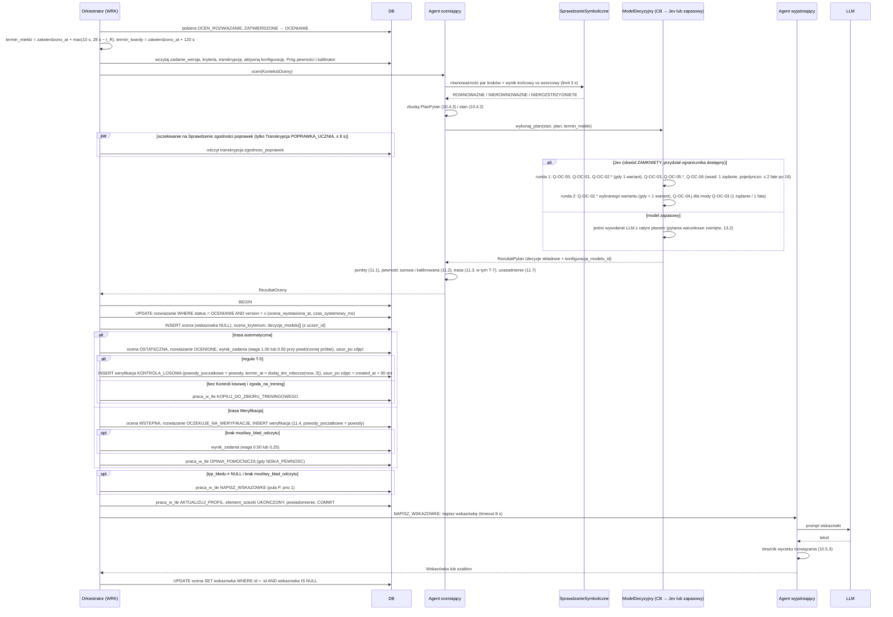

Ocena jest widoczna dla Ucznia zaraz po pierwszym `COMMIT` (to jest moment
`ocena_wystawiona_at` mierzony w NFR-01). Wskazówka dochodzi asynchronicznie
(cel p95 ≤ 10 s po Ocenie); do tego czasu `OcenaWyjscie.wskazowka_w_przygotowaniu
= true`, a PWA odpytuje co 1 s, maks. 15 s (ADR-025). Gdy termin twardy
minie przed zapisem Oceny, handler wykonuje T-6 (14.2). `t_R` = czas
rozpoznania (`transkrypcja_gotowa_at − przeslano_at`). Termin miękki
`max(10 s, 28 s − t_R)` jest zgodny z SLO serwerowym 28 s (17.1); wersja
2.1 liczyła go od 30 s, przez co scenariusze z ponowieniem Jev mieściły się
w 30 s, ale nie w 28 s (C2-07).

### 9.6 Weryfikacja przez Nauczyciela (FR-33, FR-34)

#### 9.6.1 Kolejka, podjęcie, przedłużenie, szkic

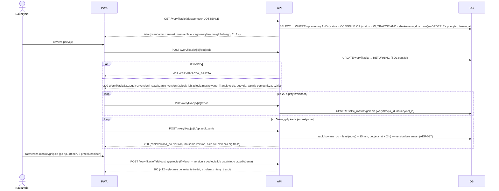

```sql
-- Podjęcie (także idempotentne ponowne podjęcie przez właściciela ważnej blokady);
-- version NIE jest zmieniana (trg_weryfikacja_wersja, ADR-037)
UPDATE weryfikacja w
SET status = 'W_TRAKCIE',
    podjeta_przez = :ja,
    podjeta_at = CASE WHEN w.status = 'W_TRAKCIE' AND w.podjeta_przez = :ja AND w.zablokowana_do >= now()
                      THEN w.podjeta_at ELSE now() END,
    zablokowana_do = CASE WHEN w.status = 'W_TRAKCIE' AND w.podjeta_przez = :ja AND w.zablokowana_do >= now()
                          THEN least(now() + interval '15 minutes', w.podjeta_at + interval '2 hours')
                          ELSE now() + interval '15 minutes' END
WHERE w.id = :id
  AND (w.status = 'OCZEKUJE'
       OR (w.status = 'W_TRAKCIE' AND w.zablokowana_do < now())
       OR (w.status = 'W_TRAKCIE' AND w.podjeta_przez = :ja
           AND w.podjeta_at + interval '2 hours' > now()))                 -- limit 2 h także przy ponownym podjęciu (C2-16)
  AND (w.nauczyciel_docelowy_id = :ja
       OR (w.typ_kolejki = 'GLOBALNA' AND :ja_jest_weryfikatorem_globalnym)
       OR w.klasa_id IN (SELECT id FROM klasa WHERE nauczyciel_id = :ja))
  AND EXISTS (SELECT 1 FROM rozwiazanie r JOIN uzytkownik u ON u.id = r.uczen_id
              WHERE r.id = w.rozwiazanie_id AND u.status = 'AKTYWNE')     -- okres karencji (ADR-040)
RETURNING *;
-- 0 wierszy: inny właściciel ważnej blokady → 409 WERYFIKACJA_ZAJETA.
-- Ponowne podjęcie przez właściciela nie wydłuża blokady poza podjeta_at + 2 h (least), więc po 2 h blokada
-- wygasa, `ZWOLNIJ_BLOKADY` zwraca Weryfikację do kolejki w ≤ 1 min, a kolejne podjęcie (przez dowolnego
-- uprawnionego, także dawnego właściciela) zaczyna nową sesję z nowym podjeta_at; szkic jest zachowany.

-- Przedłużenie (tylko właściciel; łączny czas blokady ≤ 2 h od podjeta_at); version bez zmian
UPDATE weryfikacja
SET zablokowana_do = least(now() + interval '15 minutes', podjeta_at + interval '2 hours')
WHERE id = :id AND status = 'W_TRAKCIE' AND podjeta_przez = :ja
  AND zablokowana_do >= now() AND podjeta_at + interval '2 hours' > now()
RETURNING zablokowana_do, version;
-- 0 wierszy: blokada wygasła/przejęta → 409 WERYFIKACJA_NIE_PODJETA; limit 2 h → 409 BLOKADA_MAKS_CZAS
```

Szkic jest przypisany do pary (Weryfikacja, Nauczyciel), więc przejęcie
Weryfikacji przez innego Nauczyciela nie usuwa pracy pierwszego: gdy pierwszy
podejmie ją ponownie, odzyskuje swój szkic. Szkic jest usuwany przy
`ZAKONCZONA`/`ANULOWANA`.

#### 9.6.2 Rozstrzygnięcie

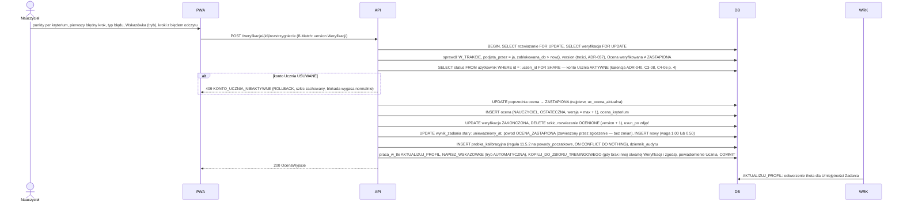

**Blokada konta Ucznia (wersja 2.4, C4-06 p. 4).** Kolejność blokad w
rozstrzygnięciu i korekcie: `rozwiazanie` (`FOR UPDATE`) → `weryfikacja`
(`FOR UPDATE`) → `uzytkownik` Ucznia (`FOR SHARE`). Transakcja wniosku o
usunięcie konta wykonuje `UPDATE uzytkownik SET status = 'USUWANE' …`, które
wymaga blokady wiersza sprzecznej z `FOR SHARE`, więc obie transakcje są
serializowane: wniosek zatwierdzony przed rozstrzygnięciem — rozstrzygnięcie
odczytuje `USUWANE` i kończy się `409 KONTO_UCZNIA_NIEAKTYWNE`; rozstrzygnięcie,
które pierwsze zablokowało wiersz — wniosek czeka na jego `COMMIT`, więc
Ocena Nauczyciela powstaje przed wnioskiem. Transakcja wniosku Ucznia nie
blokuje `rozwiazanie` ani `weryfikacja`, więc cykl blokad (zakleszczenie)
nie powstaje.

Reguły Wskazówki przy rozstrzygnięciu (FR-27, C1-14): pole
`wskazowka.tryb` ∈ {`WLASNA` (tekst Nauczyciela, ≤ 400 znaków),
`AUTOMATYCZNA` (praca `NAPISZ_WSKAZOWKE` na decyzjach Nauczyciela),
`ZACHOWAJ` (kopiuje Wskazówkę Oceny weryfikowanej)}. `ZACHOWAJ` jest
dozwolone tylko wtedy, gdy `pierwszy_bledny_krok`, `brakujacy_krok` i
`typ_bledu` są identyczne jak w Ocenie weryfikowanej i ta Ocena ma
Wskazówkę; w przeciwnym razie `422 WALIDACJA`. Gdy Ocena Nauczyciela nie ma
błędu, `wskazowka` musi być `null`. Dzięki temu każda Ocena ostateczna z
błędem ma Wskazówkę odnoszącą się do aktualnego błędnego kroku.

#### 9.6.3 Korekta Oceny z poziomu Rozwiązania (FR-34)

`POST /rozwiazania/{id}/korekty` (If-Match: `version` Rozwiązania), stan
`OCENIONE`, konto Ucznia `AKTYWNE` (inaczej `409 KONTO_UCZNIA_NIEAKTYWNE`,
C3-08) — sprawdzane `SELECT status FROM uzytkownik … FOR SHARE` po blokadzie
`rozwiazanie`, jak w 9.6.2 (C4-06 p. 4). W jednej transakcji z `SELECT
rozwiazanie FOR UPDATE`:

1. Jeśli istnieje otwarta Weryfikacja tego Rozwiązania (Kontrola losowa lub
   zgłoszenie błędu odczytu):
   - `W_TRAKCIE` z ważną blokadą innego Nauczyciela → `409
     WERYFIKACJA_ZAJETA` (nic nie zapisano);
   - w pozostałych przypadkach korekta **rozstrzyga** tę Weryfikację:
     `status = ZAKONCZONA`, `ocena_nauczyciela_id` = nowa Ocena; Próbka
     kalibracyjna dostaje źródło wynikające z powodów tej Weryfikacji
     (11.5.2), np. `KONTROLA_LOSOWA`.
2. Bez otwartej Weryfikacji: Próbka kalibracyjna `KOREKTA_NAUCZYCIELA`
   (tylko gdy aktualna Ocena jest automatyczna i nie ma jeszcze próbki —
   `ux_probka_ocena_auto`).
3. Dalej jak w 9.6.2 (zastąpienie Oceny, Wynik zadania, Wskazówka,
   powiadomienie `OCENA_SKORYGOWANA`).

Korekta i rozstrzygnięcie są serializowane blokadą wiersza `rozwiazanie`;
operacja wykonana jako druga dostaje `412 KONFLIKT_WERSJI` (zmieniona
`version`) albo `409 OCENA_ZMIENIONA` (Ocena weryfikowana została zastąpiona)
— scenariusz C-09.

### 9.7 Generowanie i Walidacja Zadania (FR-11 … FR-14)

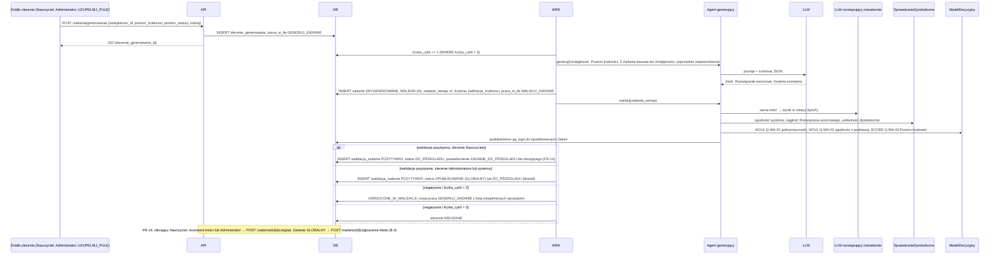

`liczba_cykli` liczy pełne cykle „generowanie + Walidacja” (≤ 3);
ponowienia techniczne pracy w tle (`praca_w_tle.proby`, np. timeout
dostawcy) nie zmieniają tego licznika. Inkrementacja jest warunkowa
(`UPDATE … SET liczba_cykli = liczba_cykli + 1 WHERE id = :id AND
liczba_cykli < 3 RETURNING`), więc CHECK nie może zostać naruszony; 0 wierszy
→ zlecenie `NIEUDANE`.

### 9.8 Kalibracja i Próg pewności (FR-34, NFR-03, NFR-04)

```mermaid
sequenceDiagram
    participant SCH as scheduler
    participant WRK
    participant DB
    participant ADM as Administrator
    SCH->>DB: 03:00 UTC INSERT praca_w_tle KALIBRUJ (dedup dzienny)
    WRK->>DB: Próbki 90 dni per (konfiguracja, rodzaj), uwzgledniana_w_progu, do now() − 5 min
    WRK->>WRK: wagi IPW z korektą wykonania Kontroli (11.5.3)
    WRK->>WRK: regresja izotoniczna ważona, 5-krotna walidacja krzyżowa (pewność surowa → zgodność)
    WRK->>WRK: krok 1 — wybór progu p_wyb: min t z UB Wilsona ≤ 2% i n_eff ≥ 189 (wartości out-of-fold, okno 90 dni)
    WRK->>WRK: krok 2 — ocena bezpieczników na stanie sprzed przebiegu (próg p0, kalibrator aktywny): wyzwolenie przy LB > 2% i n_eff ≥ 50 (ADR-046)
    WRK->>WRK: krok 3 — Blokada obniżania progu: wejście przy wyzwoleniu, wyjście przy UB ≤ 2% i n_eff ≥ 189 powyżej p0 (C4-02)
    WRK->>WRK: krok 4 — dozwolone obniżenie (≤ 0,02/dobę, test 30 dni powyżej docelowego progu, blokady)
    WRK->>WRK: krok 5 — wynik dnia p_nowy = max(p_dol, p0 + 0,02) przy wyzwoleniu (p0 = 0,990 → 1,000), inaczej p_dol
    WRK->>DB: UPDATE stan_bezpiecznika … WHERE version = :v (n_eff, blad_ipw, LB, UB, aktywny) dla TRAFNOSC i POPRAWKI; konflikt → C-44
    alt p_nowy ≠ p0 lub nowy kalibrator
        WRK->>DB: INSERT kalibrator_pewnosci, jeden INSERT prog_pewnosci aktywny (zrodlo wg kroku 5), poprzedni aktywny := false (1 transakcja)
    end
    opt bezpiecznik, ECE > 0.05 lub wykonanie Kontroli < 80%
        WRK->>DB: powiadomienie ALERT_KALIBRACJI do Administratorów
    end
    ADM->>DB: GET /admin/kalibracja (wykres niezawodności, ECE, odsetek automatycznych, wykonanie Kontroli)
```

### 9.9 Przełączenie na model zapasowy (NFR-07)

```mermaid
sequenceDiagram
    participant OCE as Agent oceniający
    participant CB as CircuitBreakerModeluDecyzyjnego
    participant JEV as JevAdapter
    participant ZAP as ZapasowyLlmAdapter
    OCE->>CB: wykonaj_plan(stan, plan, termin_miekki)
    alt obwód ZAMKNIETY
        CB->>CB: OgranicznikSzybkosci.przyjmij_plan (przewidywany koniec planu Jev ≤ termin miękki? ADR-039)
        alt plan nieprzyjęty albo brak przydziału dla fali przed jej terminem (13.2)
            CB->>ZAP: cały plan jednym wywołaniem (OGRANICZENIE_LOKALNE, obwód bez zmian)
        end
        CB->>JEV: plan w ≤ 2 rundach (wsad: 1 żądanie na rundę, pojedynczo: ≤ 3 fale, timeout 2 s na żądanie)
        alt sukces
            JEV-->>CB: decyzje składowe
        else 429
            CB->>CB: przydział × 0,5 na 30 s (bez licznika błędów obwodu), ponowienie lub model zapasowy jak niżej
        else błąd / timeout / 5xx / niezgodność ze schematem
            CB->>CB: licznik błędów++ (3 kolejne lub ≥ 50% w 20 s przy ≥ 6 wywołaniach → OTWARTY)
            opt do terminu miękkiego zostało ≥ 13 s (ponowienie 2 s + zapasowy 9 s + zapas 2 s)
                CB->>JEV: 1 ponowienie nieudanych pytań
            end
            CB->>ZAP: cały plan jednym wywołaniem (timeout 9 s), odpowiedzi Jev odrzucone
            ZAP-->>CB: decyzje składowe + rozkłady
        end
    else obwód OTWARTY (60 s)
        CB->>ZAP: cały plan jednym wywołaniem
    else PÓŁOTWARTY
        CB->>JEV: 1 próbny plan, pozostałe Oceny → ZAP
    end
    CB-->>OCE: RezultatPytan + konfiguracja_modelu_id użytego modelu
    Note over OCE: Pewność oceny liczona kalibratorem i Progiem pewności właściwym dla użytego modelu
```

Zasada: w ramach jednej Oceny wszystkie decyzje składowe pochodzą z
**jednego** modelu decyzyjnego. Jeśli Jev zawiedzie w dowolnej rundzie,
cały plan jest wykonywany ponownie modelem zapasowym w **jednym**
wywołaniu (rozkłady obu modeli nie są mieszane, bo mają różne kalibratory).
Najgorsze przypadki czasowe są policzone w 17.2.

### 9.10 Retencja zdjęć (NFR-09)

```mermaid
sequenceDiagram
    participant SCH as scheduler
    participant WRK
    participant DB
    participant S3
    SCH->>DB: co godzinę praca_w_tle USUN_ZDJECIA
    WRK->>DB: SELECT zdjęcia WHERE usunieto_at IS NULL AND usun_po < now() LIMIT 500
    loop każde zdjęcie
        WRK->>S3: DELETE obiekt i obiekt maskowany (idempotentne)
        WRK->>DB: UPDATE usunieto_at = now()
    end
    WRK->>DB: metryka zdjecia_zalegle (usun_po < now() − 24 h) → alert
```

`usun_po` jest jedynym źródłem prawdy o terminie usunięcia; ustawiają je
przejścia stanów opisane w 16.4 (m.in. `PORZUCONE`/`ANULOWANE` → `now()`,
otwarcie Weryfikacji na Rozwiązaniu `OCENIONE` → przedłużenie do limitu 90
dni). Reguła ograniczenia `CHECK (usun_po <= created_at + 90 dni)` gwarantuje
twardy limit.

### 9.11 Import Arkusza CKE (FR-35, FR-36)

```mermaid
sequenceDiagram
    actor A as Administrator
    participant API
    participant S3
    participant DB
    participant WRK
    A->>API: POST /admin/arkusze-cke/importy (ZIP: arkusz.json + rysunki)
    API->>S3: PUT importy/{id}.zip
    API->>DB: INSERT import_arkusza OCZEKUJE, praca_w_tle IMPORTUJ_ARKUSZ
    API-->>A: 202 {import_id}
    WRK->>S3: GET ZIP
    WRK->>WRK: walidacja schematu ArkuszImportV1 (12.9), sum punktów, kodów Umiejętności, SymPy wynik_koncowy_wzorcowy
    alt wszystkie Zadania poprawne
        WRK->>DB: 1 transakcja: arkusz_cke, zadanie (BAZOWE_ARKUSZ_CKE, GLOBALNY, OPUBLIKOWANE), wersje, kryteria, tagi, kalibracja_trudnosci
        WRK->>DB: import ZAKONCZONY + raport
    else błąd w dowolnym Zadaniu
        WRK->>DB: import ODRZUCONY + raport błędów per numer Zadania (nic nie zapisano)
    end
```

### 9.12 Zgłoszenie błędu odczytu przez Ucznia (FR-28)

```mermaid
sequenceDiagram
    actor U as Uczeń
    participant PWA
    participant API
    participant DB
    U->>PWA: „Zgłoś błąd odczytu” przy Ocenie (wybiera kroki, opis)
    PWA->>API: POST /rozwiazania/{id}/zgloszenie-bledu-odczytu (If-Match)
    API->>DB: BEGIN, SELECT rozwiazanie FOR UPDATE
    API->>DB: sprawdź warunki 11.6 (okno 14 dni od Oceny aktualnej, limity, zdjęcia dostępne, brak wcześniejszego zgłoszenia)
    alt otwarta Weryfikacja istnieje (OCZEKUJE lub W_TRAKCIE)
        API->>DB: UPDATE weryfikacja: powody += ZGLOSZENIE_BLEDU_ODCZYTU, zgloszenie, priorytet = min(priorytet, 2) (trigger: version + 1, powody_poczatkowe bez zmian)
    else brak otwartej Weryfikacji (OCENIONE)
        API->>DB: INSERT weryfikacja (ZGLOSZENIE_BLEDU_ODCZYTU, powody_poczatkowe = {ZGLOSZENIE_BLEDU_ODCZYTU}, ocena_weryfikowana = aktualna, priorytet 2, Kolejka weryfikacji 11.4)
        API->>DB: usun_po zdjęć = created_at + 90 dni
    end
    API->>DB: UPDATE wynik_zadania aktualnej Oceny: uniewazniony_at = now(), powod_uniewaznienia = ZGLOSZENIE_BLEDU_ODCZYTU
    API->>DB: praca_w_tle AKTUALIZUJ_PROFIL (odtworzenie bez zawieszonego Wyniku), powiadomienie NOWA_WERYFIKACJA, COMMIT
    API-->>PWA: 201 {weryfikacja: {status, powody, termin_at}}
```

Skutki zgłoszenia dla Ucznia (FR-28, uzupełnienie 2.1): od chwili zgłoszenia
do rozstrzygnięcia Wynik zadania tej Oceny jest **zawieszony** (wyłączony z
Profilu ucznia przez mechanizm unieważnienia z powodem
`ZGLOSZENIE_BLEDU_ODCZYTU`; Profil jest odtwarzany, 10.1.3), więc ewentualny
błąd odczytu nie obniża Profilu nawet przez czas trwania Weryfikacji. Ocena
pozostaje widoczna z komunikatem „Zgłoszenie błędu odczytu jest sprawdzane”
(11.3). Rozstrzygnięcie zawsze tworzy nową Ocenę Nauczyciela i nowy Wynik
zadania (9.6.2), więc zawieszony Wynik nigdy nie wraca do Profilu — zastępuje
go Wynik z Oceny Nauczyciela. W okresie karencji usunięcia konta
Weryfikacja zgłoszenia nie jest anulowana, tylko wstrzymana (ADR-040); po
przywróceniu konta wraca do kolejki z nowym terminem SLA i jest
rozstrzygana normalnie, więc zawieszony Wynik zostaje zastąpiony (C-33).
Gdy konto zostanie faktycznie usunięte, Wynik znika wraz z kontem. Nadużycie (zgłaszanie każdej
słabej Oceny, by usunąć ją z Profilu) ogranicza limit 1 zgłoszenia na
Rozwiązanie i 5 na 30 dni, a metryka `zgloszenia_bledu_odczytu_uznane_30d`
(11.8) per Uczeń < 20% przy ≥ 5 zgłoszeniach oznacza konto w raporcie
Administratora.

Zgłoszenie do Weryfikacji `W_TRAKCIE` zmienia treść, więc trigger
`trg_weryfikacja_wersja` podnosi `weryfikacja.version` (ADR-037), a
rozstrzygnięcie Nauczyciela wysłane z poprzednim `If-Match` dostaje `412
KONFLIKT_WERSJI` z aktualnym zasobem (w tym `zgloszenie`). To zamierzone:
Nauczyciel nie może rozstrzygnąć Weryfikacji bez zobaczenia zgłoszenia.
Blokada i szkic pozostają bez zmian, więc Nauczyciel wysyła rozstrzygnięcie
ponownie po przejrzeniu zgłoszenia (scenariusz C-28).

### 9.13 Ponowna ocena po błędzie przetwarzania (`PONOW_OCENE`)

```mermaid
sequenceDiagram
    participant WRK
    participant DB
    participant OCE as Agent oceniający
    WRK->>DB: pobiera PONOW_OCENE, czyta weryfikacja (version = v) i rozwiazanie (version = r)
    WRK->>WRK: warunek: weryfikacja OCZEKUJE, BLAD_PRZETWARZANIA, ocena_weryfikowana_id IS NULL
    WRK->>OCE: ocen(KontekstOceny), termin_miekki = now() + 60 s
    OCE-->>WRK: RezultatOceny
    WRK->>DB: BEGIN
    WRK->>DB: UPDATE weryfikacja … WHERE id = :id AND status = OCZEKUJE AND version = v
    alt 0 wierszy (Nauczyciel podjął lub rozstrzygnął)
        WRK->>DB: ROLLBACK, log rezultat_przestarzaly
    else trasa Weryfikacja (powody T-1…T-4)
        WRK->>DB: INSERT ocena WSTEPNA, weryfikacja: ocena_weryfikowana_id, powody := powody z 11.3, powody_poczatkowe := te same powody, priorytet, ponowna_ocena_at
        WRK->>DB: rozwiazanie (version = r) ocena_wystawiona_at, wynik_zadania (o ile brak mozliwy_blad_odczytu)
        WRK->>DB: NAPISZ_WSKAZOWKE (gdy błąd i brak mozliwy_blad_odczytu), OPINIA_POMOCNICZA (NISKA_PEWNOSC)
        WRK->>DB: AKTUALIZUJ_PROFIL (gdy powstał Wynik zadania), powiadomienie OCENA_WYSTAWIONA, COMMIT
    else trasa automatyczna (brak powodów)
        WRK->>DB: najpierw weryfikacja ANULOWANA (PONOWNA_OCENA_AUTOMATYCZNA), potem INSERT ocena OSTATECZNA
        WRK->>DB: rozwiazanie OCENIONE, wynik_zadania (1.00 lub 0.50), usun_po zdjęć
        WRK->>DB: T-5: INSERT weryfikacja KONTROLA_LOSOWA po anulowaniu (ux_weryfikacja_otwarta, 15.1 p. 3), usun_po = created_at + 90 dni
        WRK->>DB: NAPISZ_WSKAZOWKE (gdy błąd), AKTUALIZUJ_PROFIL, KOPIUJ_DO_ZBIORU_TRENINGOWEGO (bez Kontroli, za zgodą), powiadomienie OCENA_WYSTAWIONA, COMMIT
    end
```

`PONOW_OCENE` nie podnosi wcześniejszego czasu: `czas_systemowy_ms` jest już
zapisany jako naruszenie NFR-01 (T-6). Ocena powstała w `PONOW_OCENE`
podlega tym samym regułom 11.1–11.3 co pierwsza ocena. Nauczyciel, który
podjął Weryfikację (`W_TRAKCIE`), zawsze ma pierwszeństwo: warunek na
`status = OCZEKUJE AND version = v` gwarantuje, że rezultat `PONOW_OCENE`
nie nadpisze jego pracy (C-23). Od wersji 2.2 podjęcie nie zmienia
`version` (ADR-037), więc ochronę daje warunek `status = 'OCZEKUJE'`; warunek
`version = v` chroni przed równoległą zmianą treści (np. zgłoszeniem).

---

## 10. Agenci — kontrakty, algorytmy, pytania do Jev

Agenci są klasami C# w projekcie `Lemat.Agents` implementującymi interfejsy
z `Lemat.Application.Agents` (6.6). Przyjmują i zwracają rekordy C#
(niezmienne, z typami z `Lemat.Domain`), **nie wykonują zapisów w bazie**
(handlery prac w tle i przypadki użycia dostarczają dane i zapisują wyniki
w jednostce pracy, ADR-056) i korzystają wyłącznie z portów
`Lemat.Application.Models` (13.1). Dzięki temu są testowalni bez bazy i
bez sieci (implementacje Mock, 10.0.6). Zasada **Z-1 („Jev decyduje, LLM
pisze”)** obowiązuje bez zmian: punkty, trasa i Pewność oceny wynikają
wyłącznie z decyzji Modelu decyzyjnego (Jev albo model zapasowy) i reguł
11 w `Lemat.Domain.Grading`; sygnały modeli generatywnych (ramki danych
osobowych, `zgodnosc_z_zadaniem`, `czytelne`, Sprawdzenie zgodności
poprawek, Opinia pomocnicza, niezależne rozwiązanie W-3) działają
wyłącznie w kierunku bezpiecznym — zatrzymują, ostrzegają albo kierują do
Weryfikacji, nigdy nie dodają punktów ani nie dopuszczają trasy
automatycznej.

### 10.0 Architektura warstwy agentów w .NET

#### 10.0.1 Komponenty i przepływ wywołań

```mermaid
flowchart LR
    subgraph app["Lemat.Application"]
        H["Handlery prac w tle<br/>(Orkiestracja.Handlery)"]
        RS["IRekomendacjaSynchroniczna<br/>(Orchestration.Synchronous)"]
        IA["IAgentRekomendujacy · IAgentGenerujacy ·<br/>IAgentRozpoznajacy · IAgentOceniajacy · IAgentWyjasniajacy"]
        P["Porty Modele: IModelDecyzyjny, IModelGeneratywny,<br/>ISprawdzanieSymboliczne, IPredyktorSukcesu,<br/>IOgranicznikSzybkosci, IMagazynObiektow, IObrobkaObrazow"]
    end
    subgraph ag["Lemat.Agents"]
        A["Agent*<br/>(logika agenta, plany pytań, strażniki)"]
        W["Wspolne: WywolanieCzatu,<br/>BudowniczyWiadomosci, SzablonyPromptow"]
        PL["Pluginy SK: SprawdzanieSymbolicznePlugin<br/>[KernelFunction] → AIFunction"]
        ST["BudowniczyStanuOceny /<br/>Walidacji / Rekomendacji (C#)"]
    end
    subgraph mo["Lemat.Models"]
        F["FabrykaKlientowCzatu : IModelGeneratywny<br/>potok ChatClientBuilder"]
        CB["CircuitBreakerModeluDecyzyjnego : IModelDecyzyjny"]
        J["JevAdapter (HttpClient)"]
        Z["ZapasowyLlmAdapter"]
        MK["Mock: MockChatClient, MockModelDecyzyjny"]
    end
    H --> IA
    RS --> IA
    IA -. "implementacja" .-> A
    A --> W & PL & ST
    A --> P
    W --> P
    P -. "implementacja" .-> F & CB
    CB --> J & Z
    Z --> F
    F --> MK
```

Agent dostaje klienta czatu wyłącznie przez
`IModelGeneratywny.DlaRoliAsync(RolaModelu, CancellationToken)`, który
zwraca `KlientCzatuRoli` z aktywną Konfiguracją modelu roli i gotowym
potokiem `IChatClient` (ADR-058). Żaden typ `Lemat.Agents` nie przyjmuje
`IChatClient`, `IChatCompletionService` ani `Kernel` w konstruktorze
(NetArchTest `AgentNieRozwiazujeKlientaCzatuZDi`).

#### 10.0.2 Kontrakty wspólne (C#)

```csharp
namespace Lemat.Application.Models;

public sealed record KlientCzatuRoli(RolaModelu Rola, KonfiguracjaModeluId KonfiguracjaModeluId, string Dostawca,
                                     string Model, string WersjaPromptu, ParametryModelu Parametry, IChatClient Czat);

public sealed record ParametryModelu(                                       // konfiguracja_modelu.parametry (13.1)
    decimal TimeoutS, int MaxTokens, decimal Temperatura, decimal CenaWejsciePln1k, decimal CenaWyjsciePln1k,
    int RetencjaDostawcyDni, ReprezentacjaWzorow ReprezentacjaWzorow, int? MaksIteracjiFunkcji,
    TrybJev? TrybJev, string? DostawcaLlm);

public enum ReprezentacjaWzorow { Latex, LiniowaSympy, Oba }
public enum TrybJev { Wsadowy, Pojedynczy }

public sealed record ObrazWejsciowy(int NrZdjecia, ReadOnlyMemory<byte> Jpeg, int Szerokosc, int Wysokosc);

public sealed record RezultatWywolaniaModelu<T>(T Wartosc, KonfiguracjaModeluId KonfiguracjaModeluId,
                                                int TokenyWejscie, int TokenyWyjscie, decimal KosztPln, TimeSpan Czas);

// ----- Lemat.Application.Agents -----

public sealed record WywolanieNarzedzia(int Nr, string Funkcja, string ArgumentyJson, byte[] ArgumentySha256,
                                        string Rezultat, TimeSpan Czas);            // ślad NFR-05 (ADR-058 p. 6)
```

Typy domenowe używane w kontraktach agentów (`PlanPytan`, `DecyzjaSkladowa`,
`RezultatPytan`, `RezultatOceny`, `Rownowaznosc`, `KrokTranskrypcji`,
`RozwiazanieWzorcowe`, `WynikKoncowyWzorcowy`, `KryteriumOceniania`,
`Wskazowka`) są w `Lemat.Domain` (3.5, 3.6), więc reguły 11 i agregaty nie
zależą od `Lemat.Application` (C6-15 p. 5).

#### 10.0.3 Wywołanie modelu generatywnego

```csharp
namespace Lemat.Agents.Common;

public sealed class SzablonyPromptow : ISzablonyPromptow                   // port Lemat.Application.Models; pliki Prompts/<role-folder>/<prompt-file>.yaml, zasoby osadzone
{
    public Task<string> RenderujSystemowyAsync(RolaModelu rola, string wersjaPromptu,
                                               IReadOnlyDictionary<string, object> zmienne, CancellationToken ct);
    // KernelFunctionYaml.ToPromptTemplateConfig → KernelPromptTemplateFactory.Create → RenderAsync(new Kernel(), new KernelArguments(zmienne));
    // zmienne spoza input_variables pliku albo typu spoza listy ADR-058 p. 4 → ArgumentException
}

public sealed class BudowniczyWiadomosci
{
    public static readonly JsonSerializerOptions Json = new(JsonSerializerDefaults.Web)
    {
        PropertyNamingPolicy = JsonNamingPolicy.SnakeCaseLower,
        Encoder = JavaScriptEncoder.UnsafeRelaxedJsonEscaping,                // `<`, `>`, `&` bez sekwencji \u003C, \u003E, \u0026 (ADR-058 p. 4)
        DefaultIgnoreCondition = JsonIgnoreCondition.Never,
    };
    public IReadOnlyList<ChatMessage> Zbuduj<TDane>(string systemowy, TDane dane, IReadOnlyList<ObrazWejsciowy> obrazy);
    // [ChatMessage(System, systemowy), ChatMessage(User, [TextContent(JsonSerializer.Serialize(dane, Json)), DataContent(jpeg, "image/jpeg") …])]
}

public sealed class WywolanieCzatu(IWywolanieUstrukturyzowane ustrukturyzowane, TimeProvider czas, ILogger<WywolanieCzatu> log)
{
    /// Nakładka agenta (3.2, ADR-058 uzup. p. 5): termin całego wywołania agenta, wykrycie nieznanego narzędzia;
    /// schemat, walidacja i 1 próba naprawy — port IWywolanieUstrukturyzowane (implementacja w Lemat.Models.Llm).
    public Task<RezultatWywolaniaModelu<T>> GenerujJsonAsync<T>(
        KlientCzatuRoli klient, IReadOnlyList<ChatMessage> wiadomosci, DateTimeOffset termin,
        IReadOnlyList<AIFunction>? narzedzia, CancellationToken ct) where T : class;
}

// ----- Lemat.Application.Models (port, 3.2, C7-08) -----
public interface IWywolanieUstrukturyzowane
{
    Task<RezultatWywolaniaModelu<T>> WykonajAsync<T>(KlientCzatuRoli klient, IReadOnlyList<ChatMessage> wiadomosci,
        ChatOptions opcje, CancellationToken ct) where T : class;   // schemat z SchematyOdpowiedzi.Dla<T>(), walidacja, naprawa
}
```

`GenerujJsonAsync` ustawia `ChatOptions { ModelId = klient.Model,
Temperature = (float)klient.Parametry.Temperatura, MaxOutputTokens =
klient.Parametry.MaxTokens, ResponseFormat = ChatResponseFormat.ForJsonSchema(schemat,
typeof(T).Name), Tools = narzedzia, ToolMode = narzedzia is null ? null :
ChatToolMode.Auto, AllowMultipleToolCalls = false, AdditionalProperties =
{ ["strict"] = true } }` (tryb ścisły dostawców OpenAI/Azure, ADR-058 uzup.
p. 6), ogranicza czas całego wywołania agenta własnym
`CancellationTokenSource.CancelAfter(termin − teraz)` (gdy `termin ≤ teraz`
— `TerminMinalException` przed wywołaniem; limit per żądanie do dostawcy
`timeout_s` stosuje `LimitCzasuChatClient` w potoku), po odpowiedzi
sprawdza brak `FunctionCallContent` (nieznane narzędzie →
`BladModeluTrwalyException("NIEZNANE_NARZEDZIE")`) i przekazuje odpowiedź do
`IWywolanieUstrukturyzowane`, który deserializuje ją opcjami
`BudowniczyWiadomosci.Json` i waliduje walidatorem schematu (`JsonSchema.Net`)
oraz atrybutami rekordu. Schemat pochodzi z
`AIJsonUtilities.CreateJsonSchema(typeof(T), BudowniczyWiadomosci.Json,
inferenceOptions: new() { TransformOptions = new() { DisallowAdditionalProperties = true,
RequireAllProperties = true } })` i jest migawką w `Lemat.Models/Schemas/`
(C7-09). Przy
niezgodności dopisuje do rozmowy odpowiedź modelu i wiadomość naprawczą
(`docs/spec/prompts.md`, 1 p. 3) i ponawia raz; drugie niepowodzenie →
`BladModeluTrwalyException("ODPOWIEDZ_NIEZGODNA_ZE_SCHEMATEM")`.

#### 10.0.4 Czas, ponowienia, błędy i model zapasowy

Potok `IChatClient` (ADR-058 p. 3) nie ponawia wywołań. Ponowienia i model
zapasowy są decyzją agenta albo handlera, bo zależą od terminu pracy:

| Agent / operacja | Termin wywołania | Ponowienia w obrębie próby | Próby pracy w tle (13.3) | Model zapasowy | Po wyczerpaniu |
|---|---|---|---|---|---|
| Agent oceniający — plan pytań | `TerminyOceny` (14.2): miękki `max(10 s, 28 s − t_R)`, twardy 120 s | Jev: 1 ponowienie nieudanych pytań, gdy do terminu miękkiego ≥ 13 s (13.2) | `OCEN_ROZWIAZANIE`: 4 (tylko przed terminem twardym) | `ZapasowyLlmAdapter` przez `CircuitBreakerModeluDecyzyjnego` — dla całej Oceny (ADR-009) | T-6 (`BLAD_PRZETWARZANIA`, 14.2) |
| Agent oceniający — Opinia pomocnicza | 30 s | brak | `OPINIA_POMOCNICZA`: 3 | brak | brak opinii |
| Agent rozpoznający — rozpoznanie | początek próby pracy + 14 s (S-7) | brak (czas w budżecie NFR-01) | `ROZPOZNAJ_PISMO`: 3 | brak (jeden dostawca rozpoznawania, A-08) | `BLAD_ROZPOZNAWANIA` (`BLAD_DOSTAWCY` / `PRZEKROCZONY_CZAS`) |
| Agent rozpoznający — Sprawdzenie zgodności poprawek | początek próby + 8 s | brak | `SPRAWDZ_POPRAWKI_TRANSKRYPCJI`: 2 | brak | T-7 w Ocenie (Z-3) |
| Agent generujący — generowanie | 150 s na całe wywołanie agenta (≤ 9 żądań do dostawcy, `timeout_s` = 45 s na żądanie; wersja 3.2, C7-01 p. 4) | brak; limit 8 wywołań funkcji (`LIMIT_WYWOLAN_FUNKCJI`), nieznane narzędzie → `NIEZNANE_NARZEDZIE` | `GENERUJ_ZADANIE`: 3 | brak | zlecenie `NIEUDANE` |
| Agent generujący — Walidacja | 120 s na cały zestaw W-1 … W-10 | Jev: jak Ocena; W-3: brak | `WALIDUJ_ZADANIE`: 3 | Q-WA przez ten sam circuit breaker — prompt `plan-pytan-walidacji-v1` (`KontekstDecyzji.WalidacjaZadania`, C7-08) | `ODRZUCONE_W_WALIDACJI` |
| Agent rekomendujący — Q-RE-01 | 1,5 s (ADR-023) | brak | — (synchronicznie) | **brak** — `POLITYKA_ELO` | `POLITYKA_ELO` z `powrot_do_polityki` |
| Agent wyjaśniający | 8 s | 1 ponowienie po wycieku lub przekroczeniu długości (10.5.3) | `NAPISZ_WSKAZOWKE`: 2 | brak | szablon (`zrodlo = SZABLON`) |

Klasyfikacja błędów (`KlasyfikacjaBledowChatClient`, 13.1, per żądanie
do dostawcy — ADR-058 uzup. 3.2 p. 3): przekroczenie `timeout_s` żądania
(anulowanie, gdy token wywołującego nie jest anulowany),
`429`, `5xx`, zerwane połączenie → `BladModeluPrzejsciowyException`
(praca w tle ponawia z odstępem z 13.3); `4xx` poza `429`, odmowa
treści (`finish_reason = content_filter`), odpowiedź niezgodna ze schematem
po naprawie → `BladModeluTrwalyException` (bez ponowień pracy: handler
kończy pracę ścieżką „po wyczerpaniu”); brak aktywnej Konfiguracji modelu
roli → `ModelNiedostepnyException` (alert operacyjny, praca ponawiana co
13.3). Anulowanie tokenem wywołującego (termin agenta, zatrzymanie,
utrata dzierżawy) przechodzi jako `OperationCanceledException` i klasyfikuje
je pętla prac (ADR-066 p. 1). Polly (`Microsoft.Extensions.Http.Resilience`, standardowy potok
odporności) jest używane wyłącznie dla klientów HTTP magazynu S3 i SMTP;
nie dla modeli (ADR-055 p. 7).

#### 10.0.5 Telemetria (OpenTelemetry GenAI)

| Źródło | Spany | Atrybuty (bez treści, `EnableSensitiveData = false`) | Metryki |
|---|---|---|---|
| `Microsoft.Extensions.AI` (`UseOpenTelemetry` wewnątrz `UseFunctionInvocation`, nazwa źródła `Lemat.Models`) | `chat {model}` per żądanie do dostawcy, `execute_tool {funkcja}` (np. `execute_tool sympy_sprawdz_rownowaznosc`), `orchestrate_tools` (pętla wywołań) — zmierzone: 2 wywołania funkcji → 3 × `chat`, 2 × `execute_tool`, 1 × `orchestrate_tools` | `gen_ai.operation.name`, `gen_ai.system` (= `dostawca`), `gen_ai.request.model`, `gen_ai.response.model`, `gen_ai.usage.input_tokens`, `gen_ai.usage.output_tokens`, `gen_ai.response.finish_reasons` + własne `lemat.rola_modelu`, `lemat.konfiguracja_modelu_id`, `lemat.wersja_promptu` | `gen_ai.client.operation.duration`, `gen_ai.client.token.usage` |
| `Lemat.Agents` (`ActivitySource`) | `invoke_agent {agent}` (np. `invoke_agent agent_oceniajacy`) jako rodzic wywołań modeli | `gen_ai.operation.name = invoke_agent`, `gen_ai.agent.name`, `lemat.praca_w_tle.typ`, `lemat.trasa` (Ocena), `lemat.wynik` (`SUKCES`, `BLAD_PRZEJSCIOWY`, `BLAD_TRWALY`, `SZABLON`, `POLITYKA_ELO`) | `agent_czas_sekundy{agent,wynik}`, `wywolania_funkcji_total{funkcja,wynik}`, `koszt_modeli_pln_total{rola}` |
| `Lemat.Models.Jev` (`ActivitySource`) | `jev.decisions` (runda albo wywołanie fali) | `gen_ai.system = typesafe-jev`, `lemat.tryb_jev`, `lemat.runda`, `lemat.liczba_pytan` | nazwy z 17.3 (`jev_wywolania_http_total`, `jev_czas_sekundy`, `jev_ograniczenie_lokalne_total`, `obwod_stan{konfiguracja}`) |

Identyfikatory Ucznia, treści promptów, Transkrypcje i odpowiedzi modeli nie
trafiają do atrybutów ani logów (16.3); `trace_id` łączy span z pracą w tle
(`praca_w_tle.id` w atrybucie `lemat.praca_w_tle.id`) i z wierszami
`decyzja_modelu`.

#### 10.0.6 Implementacje Mock (praca offline, testy, E2E) — wersja 3.2 (ADR-065)

Dostawca `mock` w `konfiguracja_modelu` (zakazany w `Production`, ADR-055
p. 6) wybiera implementacje z `Lemat.Models.Mock`. Wszystkie są
deterministyczne, a odpowiedź wybiera **jawny scenariusz**, nie skrót
treści (C7-07).

| Mock | Zastępuje | Zachowanie |
|---|---|---|
| `MockChatClient : IChatClient` | adapter dostawcy LLM w potoku `FabrykaKlientowCzatu` (potok — wywoływanie funkcji, telemetria, klasyfikacja, limit czasu, koszt — pozostaje prawdziwy) | Scenariusz z `IKontekstScenariuszaMock` (nagłówek `X-Lemat-Mock-Scenariusz` przeniesiony przez `praca_w_tle.ladunek.mock_scenariusz`, ADR-065 p. 1) → plik `Mock/Scenarios/<scenario-folder>/<role-file>.json` (odpowiedź; dla `GENERATYWNY_ZADANIA` — sekwencja żądań wywołań `sympy_*`, potem odpowiedź końcowa; pole `"blad": "PRZEJSCIOWY" \| "TRWALY" \| "TIMEOUT"` wymusza błąd). Bez scenariusza — **odpowiedź domyślna roli** prowadząca trasą automatyczną: rozpoznanie `czytelne = true`, `przekroczono_limit_krokow = false`, `zgodnosc_z_zadaniem = 0.95`, kroki z `tekst_alternatywny_rysunkow` albo 3 kroki `x = 1` z `pewnosc_odczytu = 0.95`, ramki = całe zdjęcie; `sprawdzenie-poprawek-v2` — `p_zgodna_z_poprawka = 0.97`; `wskazowka-v1` — „Sprawdź jeszcze raz krok {n}.”; pozostałe pola z generatora ADR-065 p. 3 (liczby = `minimum` albo 0, napisy z `[PrzykladMock]`, tablice = `minItems`, unie z `null` = `null`, `boolean` = `false`). Tryb ścisły (`Lemat:Mock:TrybScisly`, środowisko `E2E`): nieznany scenariusz albo brak pliku roli → `BladModeluTrwalyException("MOCK_SCENARIUSZ_NIEZNANY")`. Opóźnienie: `LEMAT_MOCK_OPOZNIENIE_MS` (domyślnie 0; E2E 300). |
| `MockModelDecyzyjny : IModelDecyzyjny` | `JevAdapter` (`DECYZYJNY_GLOWNY`) i `ZapasowyLlmAdapter` (gdy ta rola też ma `mock`) | Scenariusz → `Mock/Scenarios/<scenario-folder>/decision-primary.json` (rozkład per `kod_pytania`, wzorce `Q-OC-05.*`); bez scenariusza — masa **0,995** na opcji wzorcowej (`KatalogPytan.OpcjaWzorcowa`: Q-OC-01 `tak`, Q-OC-02 maks. punktów, Q-OC-03 `BRAK_BLEDU`, Q-OC-05 `tak`, Q-OC-06 `nie`, Q-WA — opcja „poprawne”, Q-RE-01 — pierwsza akcja polityki Elo), reszta po równo; pytania warunkowe według ADR-026. Przy progu 0,95 i kalibratorze tożsamościowym domyślna Ocena jest automatyczna. Rozkład nie zależy od daty ani od treści stanu. |
| `FalszyweSprawdzanieSymboliczne : ISprawdzanieSymboliczne` | `SympySidecarKlient` w testach jednostkowych (w E2E działa prawdziwy sidecar) | Porównanie tekstowe po normalizacji (usunięte spacje, `\cdot` → `*`, `\frac{a}{b}` → `(a)/(b)`): równe → `ROWNOWAZNE`, w przeciwnym razie `NIEROZSTRZYGNIETE`; `PostacLiniowaAsync` zwraca znormalizowany tekst. |
| `PredyktorSukcesuElo` | — (implementacja domyślna i deterministyczna) | 10.1.3 |
| `MockObrobkaObrazow : IObrobkaObrazow` | `ImageSandboxKlient` w testach jednostkowych | Zwraca wejście bez zmian; wycinki = całe zdjęcie. |

**Czas testowy:** `LEMAT_CZAS_TESTOWY` (poza `Production`) rejestruje
`PrzesunietyTimeProvider` w `api`, `worker` i `scheduler`, więc stan
Q-RE-01 (`dni_do_egzaminu`, „dni temu”) i terminy SLA są w E2E stałe.

**Dane deweloperskie (C7-12):** migracje nie wstawiają konfiguracji
`mock`. `docker compose --profile dev up` uruchamia po kontenerze
`migracje` usługę `seed` (`dotnet Lemat.Tools.dll seed-dev`), która
tworzy aktywne Konfiguracje modelu `mock` dla 8 ról, próg 0,95, kalibrator
tożsamościowy i dane demonstracyjne; polecenie odmawia działania przy
`LEMAT_SRODOWISKO = Production`. Cały przepływ „przesłanie → rozpoznanie →
zatwierdzenie → Ocena automatyczna → Wskazówka → Profil” działa wtedy
offline bez kluczy dostawców. Macierz 15 scenariuszy E2E (trasa
automatyczna, każdy powód Weryfikacji, Kontrola losowa, T-6, T-7, błąd
przejściowy, timeout, generowanie z narzędziami i limit wywołań) — ADR-065
p. 7, dane w `docs/spec/prompts.md` 6.

#### 10.0.7 Rejestracja i testy agentów

`Lemat.Agents.RejestracjaAgentow.DodajAgentow(IServiceCollection)` rejestruje
agentów jako `Scoped` (jeden na pracę w tle albo żądanie), `SzablonyPromptow` i
`BudowniczyWiadomosci` jako `Singleton`; `FabrykaKlientowCzatu`,
`CircuitBreakerModeluDecyzyjnego`, `PamiecKonfiguracjiModeli` i
`WywolanieUstrukturyzowane` są `Singleton` (`Lemat.Models`). **Współbieżność
(C7-10):** agenci wykonują sprawdzenia równolegle (`Task.WhenAll` w
Walidacji, równoległe pobranie zdjęć), więc ani agenci, ani porty
wywoływane z agentów nie używają `LematDbContext` z zakresu: odczyty idą
przez `NpgsqlDataSource` (nowe połączenie z puli na zapytanie) albo
`IDbContextFactory<LematDbContext>` (kontekst na wywołanie), a
`DlaRoliAsync` czyta wyłącznie pamięć `PamiecKonfiguracjiModeli`
(odświeżaną `NOTIFY konfiguracja_modelu` i co 30 s przez hosta w tle).
Test architektury `AgenciIPortyAgentowNieZalezaOdLematDbContext` i test
`WalidacjaRownoleglaBezBledowKontekstu` (ADR-058 uzup. 3.2 p. 7). Testy `Lemat.Agents.Tests` używają
prawdziwego potoku `FabrykaKlientowCzatu` z `MockChatClient` (bez sieci):
każdy agent ma testy kontraktu (wejście → wyjście z danych Mock), ścieżki
naprawy odpowiedzi, błędów przejściowych i trwałych, terminu (sztuczny
`FakeTimeProvider`) oraz zgodności bajtowej treści matematycznej (ADR-058
p. 7).

### 10.1 Agent rekomendujący

#### 10.1.1 Kontrakt

```csharp
namespace Lemat.Application.Agents.Recommendations;

public interface IAgentRekomendujacy
{
    /// Czysta decyzja bez zapisu (wywołuje IRekomendacjaSynchroniczna, 6.3); deterministyczna dla POLITYKA_ELO.
    Task<DecyzjaRekomendacji> RekomendujAsync(WejscieRekomendacji wejscie, CancellationToken ct);
}

public sealed record SeriaSkrot(UmiejetnoscId UmiejetnoscId, DateTimeOffset RozpoczetaAt,
                                int LiczbaElementow,                        // 0..8
                                PoziomTrudnosci PoziomTrudnosci,            // docelowy Poziom trudności kolejnego Zadania
                                int KolejnePorazki);

public sealed record WynikZadaniaSkrot(ZadanieId ZadanieId, UmiejetnoscId UmiejetnoscGlowna, decimal Ulamek, decimal Waga,
                                       DateTimeOffset CreatedAt, bool ZTestuDiagnostycznego);   // typ wewnętrzny (bez TS)

public sealed record ElementSciezkiSkrot(ElementSciezkiId Id, TypElementuSciezki Typ, CelElementu Cel, UmiejetnoscId UmiejetnoscId,
                                         PoziomTrudnosci? PoziomTrudnosci, StatusElementuSciezki Status, DateTimeOffset CreatedAt);

public sealed record PrzypisanieSkrot(PrzypisanieId PrzypisanieId, string NazwaZestawu, string NauczycielWyswietlany,
                                      DateTimeOffset Termin, IReadOnlyList<PozycjaPrzypisaniaSkrot> PozycjeBezProby);
                                      // pozycje bez próby w kontekście Przypisania (ux_*_przypisanie)
public sealed record PozycjaPrzypisaniaSkrot(ZadanieId ZadanieId, RodzajZadania Rodzaj, UmiejetnoscId UmiejetnoscGlowna,
                                             StatusZadania Status);

public sealed record WejscieRekomendacji(
    UczenId UczenId,                                                        // wyłącznie do zapisu decyzja_modelu; nie trafia do stanu
    PoziomMatury PoziomMatury,
    DateOnly? TerminEgzaminu,
    DzialId? WybranyDzialId,                                                // FR-09
    IReadOnlyDictionary<UmiejetnoscId, OpanowanieUmiejetnosci> Opanowanie,  // migawka Profilu ucznia
    IReadOnlyList<WynikZadaniaSkrot> OstatnieWyniki,                        // 50 ostatnich nieunieważnionych, malejąco po czasie
    IReadOnlyList<ElementSciezkiSkrot> OstatnieElementy,                    // 10 ostatnich elementów Ścieżki nauki
    IReadOnlyList<PrzypisanieSkrot> OtwartePrzypisania,
    SeriaSkrot? Seria,                                                      // ADR-030
    IReadOnlyDictionary<UmiejetnoscId, DateTimeOffset> WkladkiPrzeczytane,
    int UdzialZadanOtwartych,                                               // 3 albo 5 (11.4.3, 11.5.1); inne → ArgumentOutOfRangeException
    bool DowodyDozwolone,                                                   // false przy kontroli przyjęć kolejki GLOBALNA
    StrategiaRekomendacji Strategia,                                        // PolitykaElo | JevChoice
    DateTimeOffset Teraz);

/// Port odczytu katalogu doboru (implementacja: adapter nad ITresciFasada w Orchestration.Synchronous).
public interface IDaneDoboru
{
    Task<IReadOnlyList<UmiejetnoscDoDoboru>> UmiejetnosciAsync(PoziomMatury poziom, DzialId? dzial, CancellationToken ct);
    Task<IReadOnlyList<ZadanieDoDoboru>> KandydaciAsync(FiltrDoboru filtr, CancellationToken ct);       // warunki kroku 7
    Task<WkladkaDoDoboru?> OpublikowanaWkladkaAsync(UmiejetnoscId umiejetnosc, CancellationToken ct);
    Task<int> LiczbaOpublikowanychAsync(KluczPuli klucz, CancellationToken ct);                          // „Zapotrzebowanie puli”
}
public sealed record UmiejetnoscDoDoboru(UmiejetnoscId Id, DzialId DzialId, string Nazwa, decimal WagaEgzaminacyjna,
                                         IReadOnlyList<UmiejetnoscId> Wymagane);
public sealed record ZadanieDoDoboru(ZadanieId Id, ZadanieWersjaId AktualnaWersjaId, RodzajZadania Rodzaj, FormaZamknieta? Forma,
                                     int LiczbaStwierdzen, UmiejetnoscId UmiejetnoscGlowna, IReadOnlyList<UmiejetnoscId> Dodatkowe,
                                     PoziomTrudnosci PoziomTrudnosci, decimal TrudnoscB, int LiczbaWynikowKalibracji, bool CzyBazowe);
public sealed record FiltrDoboru(UczenId UczenId, PoziomMatury Poziom, UmiejetnoscId UmiejetnoscGlowna,
                                 IReadOnlySet<RodzajZadania> Rodzaje, DateTimeOffset BezWynikuOd);   // Teraz − 60 dni
public sealed record WkladkaDoDoboru(WkladkaTeoretycznaId Id, UmiejetnoscId UmiejetnoscId, int SzacowanyCzasMin);
public sealed record KluczPuli(UmiejetnoscId UmiejetnoscId, PoziomTrudnosci PoziomTrudnosci, PoziomMatury PoziomMatury,
                               RodzajZadania Rodzaj);                       // Rodzaj ∈ {Zamkniete, OtwarteObliczeniowe}

public sealed record BrakElementu(KodBrakuElementu Kod, string Komunikat, IReadOnlyList<DzialId> SugerowaneDzialy);
public enum KodBrakuElementu { BrakZadanWZakresie }
public enum ZmianaSerii { BezZmian, Rozpocznij, Zakoncz }
public enum PowrotDoPolityki { NiskaPewnoscModelu, ModelNiedostepny }

public sealed record DecyzjaRekomendacji(
    TypElementuSciezki? Typ,                                                // null ⇔ BrakElementu != null
    CelElementu Cel,
    UmiejetnoscId? UmiejetnoscId,
    ZadanieId? ZadanieId,
    WkladkaTeoretycznaId? WkladkaTeoretycznaId,
    PrzypisanieId? PrzypisanieId,                                           // tylko RPrzypisanie
    decimal? PrzewidywanePSukcesu,
    RegulaRekomendacji? Regula,                                             // 12 wartości; kody "R-SERIA" … przez [NazwaKodu] (ADR-049 p. 4)
    string Uzasadnienie,                                                    // FR-10, z szablonu 10.1.5 (także dla BrakElementu)
    IReadOnlyDictionary<string, object> UzasadnienieFakty,
    ZmianaSerii ZmianaSerii,
    PoziomTrudnosci? PoziomTrudnosciSerii,                                  // != null ⇔ ZmianaSerii == Rozpocznij
    bool WSerii,
    IReadOnlyList<KluczPuli> PotrzebneUzupelnieniePuli,
    IReadOnlyList<UmiejetnoscId> PotrzebneSzkiceWkladek,                    // bez opublikowanej Wkładki (E-20)
    IReadOnlyList<DecyzjaSkladowa> DecyzjeModelu,                           // pusta dla PolitykaElo
    PowrotDoPolityki? PowrotDoPolityki,
    CechyRekomendacji Cechy,                                                // migawka 10.1.4 → rekomendacja.cechy
    BrakElementu? BrakElementu);
```

#### 10.1.2 Polityka POLITYKA_ELO (domyślna)

Kroki wykonywane w kolejności; pierwszy, który zwraca decyzję, kończy algorytm.
„Poziom trudności” oznacza skalibrowany `kalibracja_trudnosci.poziom_trudnosci`.

1. **Przypisania (FR-32).** Jeśli istnieje otwarte Przypisanie — wybierz
   pozycję z najbliższym terminem, dla której nie istnieje żadna próba w
   kontekście tego Przypisania (Odpowiedź albo nieporzucone Rozwiązanie z
   tym `przypisanie_id`, z dowolnej drogi — ten sam warunek co indeksy
   `ux_odpowiedz_przypisanie`, `ux_rozwiazanie_przypisanie`); Zadanie
   `WYCOFANE` jest pomijane; pozycja z Zadaniem zamkniętym jest pomijana po
   terminie (klucz jest już ujawniony Klasie, 12.5); `R-PRZYPISANIE`,
   element z `przypisanie_id`, z którego każda próba dziedziczy
   `przypisanie_id` (trigger `trg_kontekst_proby`, ADR-032). Przypisanie ma
   pierwszeństwo przed Serią (Seria nie jest kończona, tylko wstrzymana).
2. **Zakres.** Kandydackie Umiejętności = Umiejętności poziomu matury Ucznia
   (`tylko_rozszerzony = false` dla `PODSTAWOWY`), zawężone do
   `wybrany_dzial_id`, jeśli ustawiony (FR-09).
3. **Seria (wizja, ADR-030).** Jeśli Seria jest aktywna i jej Umiejętność
   należy do zakresu z kroku 2 — wybierz Zadanie tej Umiejętności (główna) o
   Poziomie trudności = `seria.poziom_trudnosci`, bez Wyniku zadania w 60
   dniach, zgodnie z regułą rodzaju z kroku 7; brak na tym poziomie →
   najbliższy wyższy poziom, potem najbliższy niższy; brak w ogóle →
   `zmiana_serii = ZAKONCZ` (powód `BRAK_ZADAN`), zapotrzebowanie puli i
   przejście do kroku 4. `R-SERIA`, `w_serii = true`. Seria wyklucza krok 4
   (powtórka), bo realizuje wizję „serii aż do poziomu maturalnego”.
   Seria spoza zakresu (Uczeń zmienił `wybrany_dzial_id`) → `ZAKONCZ`.
4. **Powtórka (FR-08).** Jeśli wśród kandydatów jest Umiejętność z
   `nastepna_powtorka_at ≤ teraz` i w 4 ostatnich elementach nie było
   elementu z `cel = POWTORKA` — wybierz najdawniej zaległą; Zadanie dobierz
   jak w kroku 7 z docelowym P = 0.80; `R-POWTORKA`, `cel = POWTORKA`.
5. **Wybór Umiejętności.** Dla każdego kandydata z `poziom_opanowania < 0.80`:
   `priorytet = (1 − poziom_opanowania) × waga_egzaminacyjna × pilnosc`,
   gdzie `pilnosc = 1 + max(0, (90 − dni_do_egzaminu) / 90)` (1, gdy brak
   terminu). Jeśli którakolwiek Umiejętność wymagana (`umiejetnosc_wymagana`)
   ma `poziom_opanowania < 0.50`, zamiast kandydata rozpatrywana jest
   najsłabsza z wymaganych (rekurencyjnie, maks. głębokość 3). Wybór:
   maksymalny priorytet; remis → mniejszy `id`.
   **5b. Wszystko opanowane** (brak kandydata z `poziom_opanowania < 0.80`):
   wybierz Umiejętność o najwcześniejszym `nastepna_powtorka_at` (powtórka
   przyspieszona) i Zadanie o Poziomie trudności ≥ 4 z P najbliższym 0.675;
   `R-UTRWALENIE`, `cel = POWTORKA`. Gdy `wybrany_dzial_id` jest ustawiony,
   uzasadnienie dopisuje „Dział {dzial} jest opanowany — możesz wybrać inny
   dział w ustawieniach.”. Gdy ta Umiejętność nie ma Zadania na Poziomie
   trudności ≥ 4 (warunki kandydatów jak w kroku 7): kolejne Umiejętności
   według `nastepna_powtorka_at` (maks. 5), potem Zadanie o najwyższym
   Poziomie trudności w całym zakresie z kroku 2 (z tą samą regułą
   `R-UTRWALENIE`) i zapotrzebowanie puli dla pierwszej Umiejętności na
   Poziomie trudności 4; brak jakiegokolwiek Zadania → krok 8.
6. **Wkładka teoretyczna (FR-06).** Jeśli dla wybranej Umiejętności
   (`liczba_wynikow ≥ 2` lub `inicjalizacja = TEST_DIAGNOSTYCZNY`) oraz
   (`poziom_opanowania < 0.40` lub 2 ostatnie Wyniki zadania z tej
   Umiejętności mają `ulamek < 0.5`) oraz Wkładka nie była przeczytana w
   ostatnich 14 dniach:
   - istnieje opublikowana Wkładka → zwróć ją; `R-WKLADKA`, a gdy wszystkie
     Wyniki zadania tej Umiejętności pochodzą z Testu diagnostycznego —
     `R-WKLADKA-DIAG`;
   - brak opublikowanej Wkładki → `potrzebne_szkice_wkladek += [U]` (praca
     `GENERUJ_SZKIC_WKLADKI`, E-20) i przejście do kroku 7;
   - w obu przypadkach `zmiana_serii = ROZPOCZNIJ` dla Umiejętności U z
     `seria.poziom_trudnosci` = Poziom trudności (≤ 3) Zadania o P
     najbliższym 0.675.
7. **Zadanie (FR-05, FR-07).** Kandydaci: Zadania `OPUBLIKOWANE`,
   `zasieg = GLOBALNY`, bez wiersza `wstrzymanie_w_doborze` (ADR-038; warunek
   obowiązuje w każdym kroku doboru 3–8), z tą Umiejętnością główną, poziomu matury Ucznia,
   bez Wyniku zadania tego Ucznia w ostatnich 60 dniach i nieobecne w jego
   otwartych Przypisaniach. Rodzaj: co `udzial_zadan_otwartych`-ty element
   typu `ZADANIE` w Ścieżce nauki jest otwarty (`OTWARTE_OBLICZENIOWE` lub —
   gdy `dowody_dozwolone` — `OTWARTE_Z_DOWODEM`), pozostałe `ZAMKNIETE`;
   gdy brak kandydatów danego rodzaju — dowolny dozwolony rodzaj. Wybór:
   Zadanie z `P` (10.1.3) najbliższym 0.675 w przedziale [0.60, 0.75]; remis
   → Zadanie bazowe przed wygenerowanym, potem mniejsza
   `liczba_wynikow_kalibracji`. Brak w przedziale → najbliższe z
   `|P − 0.675| ≤ 0.20` i zapotrzebowanie puli; brak i takiego → kolejna
   Umiejętność z rankingu kroku 5 (maks. 3), a na końcu Zadanie o najbliższym
   P bez ograniczenia w całym zakresie z kroku 2. Reguła: `R-TRUDNOSC_W_GORE`,
   jeśli wybrany Poziom trudności jest wyższy niż w poprzednim elemencie tej
   Umiejętności, w przeciwnym razie `R-NAJSLABSZA`.
8. **Brak Zadań.** Gdy w całym zakresie nie ma żadnego Zadania spełniającego
   warunki kroku 7 (np. start platformy, nowa Umiejętność rozszerzona):
   `Typ = null`, `BrakElementu = new(KodBrakuElementu.BrakZadanWZakresie, …)` (JSON: `brak_elementu.kod = "BRAK_ZADAN_W_ZAKRESIE"`),
   zapotrzebowanie puli dla Umiejętności z kroku 5 na Poziomach trudności
   2–4 (dla `ZAMKNIETE` i `OTWARTE_OBLICZENIOWE`). Endpoint zwraca `200` z
   `element = null` i `brak_elementu` (12.4); UI pokazuje komunikat i listę
   `sugerowane_dzialy`. Element Ścieżki nauki nie powstaje.

**Zapotrzebowanie puli** — klucz jednolity w całym systemie (10.1, 13.3,
`zlecenie_generowania`): `(umiejetnosc_id, poziom_trudnosci, poziom_matury,
rodzaj)`, gdzie `rodzaj ∈ {ZAMKNIETE, OTWARTE_OBLICZENIOWE}`. Warunek:
mniej niż 3 Zadania `OPUBLIKOWANE` i `GLOBALNY` dla klucza → praca
`UZUPELNIJ_PULE` z tym kluczem. Zadania z dowodem nie są uzupełniane
automatycznie (wymagają Przeglądu, ADR-015); powstają na zlecenie
Nauczyciela lub Administratora.

**Reguły Serii** (stosowane w `AKTUALIZUJ_PROFIL` po każdym Wyniku zadania z
elementu `w_serii`, ADR-030):

| Zdarzenie | Skutek |
|---|---|
| `ulamek ≥ 0.7` i Poziom trudności Zadania ≥ 4 | Seria zakończona sukcesem (cel wizji: poziom maturalny) |
| `ulamek ≥ 0.7` i Poziom trudności < 4 | `poziom_trudnosci := min(5, poziom + 1)`, `kolejne_porazki := 0` |
| `0.5 ≤ ulamek < 0.7` | poziom bez zmian, `kolejne_porazki := 0` |
| `ulamek < 0.5` | `kolejne_porazki += 1`; przy 2 kolejnych `poziom := max(1, poziom − 1)` |
| `kolejne_porazki = 3` lub `liczba_elementow = 8` lub 7 dni od rozpoczęcia | Seria zakończona; następna rekomendacja wraca do kroku 5 (zwykle Umiejętność wymagana) |

Poziom trudności w Serii jest niemalejący, dopóki Uczeń odnosi sukcesy, co
realizuje „serię zadań o stopniowo rosnącej trudności, aż do poziomu
maturalnego” z wizji.

#### 10.1.3 Model Profilu ucznia (Elo per Umiejętność) — ADR-010

- `σ(x) = 1 / (1 + e^(−x))`.
- Parametr Zadania: `trudnosc_b` (tabela `kalibracja_trudnosci`), inicjalnie
  `0.8 × (poziom_trudnosci_nominalny − 3)` (Poziom trudności 1…5 →
  −1.6…1.6).
- Umiejętność efektywna: `θ̄ = 0.7·θ_główna + 0.3·średnia(θ_dodatkowe)`
  (gdy brak dodatkowych: `θ̄ = θ_główna`).
- Prawdopodobieństwo sukcesu: `P = c + (1 − c)·σ(θ̄ − b)`, gdzie `c = 0.25`
  dla `WYBOR_JEDNOKROTNY` (4 opcje), `c = 0.5^n` dla `PRAWDA_FALSZ` z `n`
  stwierdzeniami, `c = 0` dla zadań otwartych.
- **Waga Wyniku zadania** `waga = w_status × w_proba`:
  `w_status = 1.0` dla Odpowiedzi i Oceny ostatecznej, `0.5` dla Oceny
  wstępnej **bez** `mozliwy_blad_odczytu`; Ocena wstępna z
  `mozliwy_blad_odczytu = true` **nie tworzy** Wyniku zadania (FR-28,
  ADR-022), a Wynik zadania Oceny objętej Zgłoszeniem błędu odczytu jest
  zawieszony do rozstrzygnięcia (`powod_uniewaznienia =
  'ZGLOSZENIE_BLEDU_ODCZYTU'`, 11.6) i — jak każdy unieważniony — pomijany
  przy odtwarzaniu. `w_proba = 1.0` dla pierwszej próby Ucznia przy danym Zadaniu w
  60 dniach, `0.5` dla każdej kolejnej (np. to samo Zadanie w Przypisaniu i
  wcześniej w Ścieżce nauki). Wartości: {1.00, 0.50, 0.25}.
  `liczy_do_trudnosci = (waga = 1.00)`.
- Aktualizacja po Wyniku zadania `s = ulamek` z wagą `w`:
  `Δ = s − P`; `θ_główna += w·K_u·Δ`; `θ_dodatkowa += w·0.5·K_u·Δ`;
  `K_u = max(0.2, 0.8 / (1 + n/20))`, `n` = `liczba_wynikow` Umiejętności.
  Dla Wyników z Testu diagnostycznego `K_u = 0.8`.
- **Kalibracja Poziomu trudności** (słownik: „kalibrowana na podstawie
  wyników uczniów”, ADR-029) — tylko gdy `liczy_do_trudnosci`, jednym
  atomowym poleceniem (bez odczytu–modyfikacji–zapisu w ORM):

  ```sql
  WITH stary AS (
      SELECT poziom_trudnosci FROM kalibracja_trudnosci WHERE zadanie_id = :zadanie_id FOR UPDATE)
  UPDATE kalibracja_trudnosci k
  SET trudnosc_b = k.trudnosc_b - greatest(0.05, 0.4 / (1 + k.liczba_wynikow_kalibracji / 30.0)) * :delta,
      liczba_wynikow_kalibracji = k.liczba_wynikow_kalibracji + 1,
      poziom_trudnosci = CASE WHEN k.liczba_wynikow_kalibracji + 1 < 30 THEN k.poziom_trudnosci
                              ELSE poziom_z_b(k.trudnosc_b - greatest(0.05, 0.4 / (1 + k.liczba_wynikow_kalibracji / 30.0)) * :delta,
                                              k.poziom_trudnosci) END,
      updated_at = now()
  WHERE k.zadanie_id = :zadanie_id
  RETURNING k.poziom_trudnosci AS nowy, (SELECT poziom_trudnosci FROM stary) AS stary;
  ```

  `poziom_z_b(b, obecny)` (funkcja SQL `IMMUTABLE`): progi `b < −1.2 → 1`,
  `[−1.2, −0.4) → 2`, `[−0.4, 0.4) → 3`, `[0.4, 1.2) → 4`, `≥ 1.2 → 5`, z
  histerezą 0.1 (poziom zmienia się dopiero, gdy `b` przekroczy granicę o ≥
  0.1), aby uniknąć oscylacji. Gdy `nowy ≠ stary`, ta sama transakcja
  zapisuje `dziennik_audytu` (`POZIOM_TRUDNOSCI_SKALIBROWANY`, `rola =
  NULL`). `Δ` jest liczone z `b` odczytanego przed aktualizacją; przy
  równoległych Wynikach zadania to przybliżenie (opóźnienie o ≤ kilka
  wyników) jest akceptowane, natomiast żadna aktualizacja nie ginie, bo
  odejmowanie wykonuje baza. `zadanie.version` nie zmienia się (C1-23).
- `poziom_opanowania = σ(θ − 0.8)` — prawdopodobieństwo sukcesu przy Zadaniu
  o Poziomie trudności 4 (maturalnym).
- Poziom opanowania Działu (FR-04) = średnia ważona `waga_egzaminacyjna`
  poziomów opanowania jego Umiejętności.
- **Test diagnostyczny**: Wyniki zadania z testu mają `created_at =
  zakonczono_at` testu i są stosowane razem (w kolejności pozycji); po
  zastosowaniu ostatniego z nich Umiejętności Działu z `liczba_wynikow = 0`
  w tej chwili dostają średnią `θ` przetestowanych Umiejętności tego Działu
  (`PROPAGACJA_Z_DZIALU`), a przetestowane — `inicjalizacja =
  TEST_DIAGNOSTYCZNY`.
- Powtórki: po Wyniku zadania z `ulamek ≥ 0.7` dla Umiejętności z
  `poziom_opanowania ≥ 0.80`: `licznik_powtorek += 1`,
  `nastepna_powtorka_at = teraz + [3, 7, 14, 30, 60][min(licznik−1, 4)] dni`;
  przy `ulamek < 0.5`: `licznik_powtorek = 0`, `nastepna_powtorka_at = teraz + 1 dzień`.
- **Odtwarzanie** (po unieważnieniu Wyniku zadania): **cały Profil ucznia**
  wraca do stanu DOMYŚLNEGO (`θ = 0`, `liczba_wynikow = 0`,
  `inicjalizacja = DOMYSLNA`, liczniki powtórek zerowane), następnie
  wszystkie nieunieważnione Wyniki zadania Ucznia — **łącznie z Wynikami z
  Testu diagnostycznego** — są stosowane chronologicznie (`created_at`,
  potem `id`) według reguł powyżej, z bieżącymi `trudnosc_b`. Nie istnieje
  „punkt startowy po teście”, więc żaden Wynik nie jest liczony podwójnie
  (C1-11). Operacja jest deterministyczna i idempotentna; dla ≤ 5 000
  Wyników trwa < 50 ms. `trudnosc_b` nie jest odtwarzane (korekta wpływa na
  `b` tylko przez nowy Wynik o wadze 1.00).

#### 10.1.4 Migawka cech (`rekomendacja.cechy`)

```json
{
  "poziom_matury": "PODSTAWOWY", "dni_do_egzaminu": 142, "wybrany_dzial_id": null,
  "seria": {"umiejetnosc_id": 512, "liczba_elementow": 3, "poziom_trudnosci": 3},
  "kandydaci": [ {"umiejetnosc_id": 512, "poziom_opanowania": 0.31, "waga": 0.042, "priorytet": 0.029} ],
  "ostatnie_wyniki_umiejetnosci": [ {"zadanie_id": "…", "ulamek": 0.0, "kiedy": "2026-10-30T18:01:00Z",
                                     "z_testu_diagnostycznego": false} ],
  "zadania_w_strefie": 4, "udzial_zadan_otwartych": 3, "dowody_dozwolone": true
}
```

#### 10.1.5 Szablony uzasadnień (FR-10, NFR-05)

Uzasadnienie jest generowane deterministycznie z faktów (ADR-011); liczebniki
odmieniane funkcją `Odmiana.Liczebnika(n, "zadanie", "zadania", "zadań")`. Każda
wartość `regula` (także strategii JEV_CHOICE) i stan „brak elementu” mają
szablon — test jednostkowy sprawdza pokrycie wszystkich wartości enumu `RegulaRekomendacji`.

| Reguła | Szablon | Fakty |
|---|---|---|
| R-PRZYPISANIE | „Zadanie z zestawu „{zestaw}” od nauczyciela {nauczyciel}, termin: {termin}.” | `zestaw`, `nauczyciel`, `termin` |
| R-SERIA | „Kontynuujesz serię z „{umiejetnosc}”: zadanie {k} z serii, poziom trudności {poziom} (cel: poziom maturalny 4).” | `umiejetnosc`, `k`, `poziom` |
| R-POWTORKA | „Powtórka: ostatnie ćwiczenie z „{umiejetnosc}” było {dni} dni temu.” | `umiejetnosc`, `dni` |
| R-WKLADKA | „{bledne} z ostatnich {n} {odmiana} z „{umiejetnosc}” rozwiązano błędnie — zacznij od krótkiej teorii.” | `bledne`, `n` (≥ 2), `umiejetnosc` |
| R-WKLADKA-DIAG | „W teście diagnostycznym {bledne} z {n} {odmiana} z „{umiejetnosc}” rozwiązano błędnie — zacznij od krótkiej teorii.” | `bledne`, `n` (≥ 1), `umiejetnosc` |
| R-NAJSLABSZA | „„{umiejetnosc}” to obecnie najsłabsza umiejętność w dziale {dzial} (opanowanie {procent}%). Zadanie dobrano tak, aby szansa na poprawne rozwiązanie wynosiła ok. {p}%.” | `umiejetnosc`, `dzial`, `procent`, `p` |
| R-TRUDNOSC_W_GORE | „{k} ostatnie {odmiana} z „{umiejetnosc}” rozwiązano poprawnie — poziom trudności rośnie do {poziom}.” | `k`, `umiejetnosc`, `poziom` |
| R-UTRWALENIE | „Wszystkie umiejętności w zakresie masz opanowane (co najmniej 80%). Utrwalenie na poziomie maturalnym: „{umiejetnosc}”.” | `umiejetnosc` |
| R-JEV-WKLADKA | „Model oceny postępów wskazał z prawdopodobieństwem {p_modelu}%, że przed kolejnymi zadaniami z „{umiejetnosc}” warto przeczytać krótką teorię (opanowanie {procent}%).” | `p_modelu`, `umiejetnosc`, `procent` |
| R-JEV-ZADANIE_LATWE | „Model oceny postępów wskazał z prawdopodobieństwem {p_modelu}%, że teraz najlepsze będzie łatwiejsze zadanie z „{umiejetnosc}” (szansa na sukces ok. {p}%).” | `p_modelu`, `umiejetnosc`, `p` |
| R-JEV-ZADANIE_MATURALNE | „Model oceny postępów wskazał z prawdopodobieństwem {p_modelu}%, że możesz spróbować zadania na poziomie maturalnym z „{umiejetnosc}”.” | `p_modelu`, `umiejetnosc` |
| R-JEV-POWTORKA | „Model oceny postępów wskazał z prawdopodobieństwem {p_modelu}%, że teraz warto powtórzyć „{umiejetnosc}” (ostatnie ćwiczenie {dni} dni temu).” | `p_modelu`, `umiejetnosc`, `dni` |
| brak elementu | „Nie mamy teraz zadań dopasowanych do Twojego zakresu — przygotowujemy nowe. Możesz w tym czasie wybrać inny dział: {dzialy}.” | `dzialy` |

Gdy ustawiony jest `wybrany_dzial_id`, uzasadnienie zaczyna się od
„Ćwiczysz wybrany dział: {dzial}.”. Gdy Seria została rozpoczęta, do
uzasadnienia R-WKLADKA/R-WKLADKA-DIAG/R-NAJSLABSZA dopisywane jest „Po tej
części zaczniesz serię zadań z rosnącym poziomem trudności.”.

#### 10.1.6 Strategia eksperymentalna JEV_CHOICE (grupa eksperymentu)

- Przydział: `uczen.procent_grupy_eksperymentu < LEMAT_REKOMENDACJA_PROCENT_JEV`
  (domyślnie 0; plan pilotażu: 20 od 4. tygodnia).
- Nie dotyczy kroków 1 (Przypisania) i 3 (Seria) ani kroku 8. Zastępuje
  krok 6 i wybór poziomu w kroku 7: pytanie `Q-RE-01` (CHOICE) o opcjach
  `WKLADKA` (→ `R-JEV-WKLADKA`, rozpoczęcie Serii), `ZADANIE_LATWE` (docelowe
  P = 0.85, `R-JEV-ZADANIE_LATWE`), `ZADANIE_MATURALNE` (Poziom trudności 4,
  `R-JEV-ZADANIE_MATURALNE`), `POWTORKA` (Umiejętność o najwcześniejszym
  `nastepna_powtorka_at` wśród opanowanych, `R-JEV-POWTORKA`, `cel =
  POWTORKA`). Stan: opis sytuacji Ucznia wygenerowany z migawki cech
  (szablon tekstowy, bez danych osobowych). `p_modelu` w uzasadnieniu = masa
  rozkładu w modzie.
- Wywołanie w procesie `api` z timeoutem 1,5 s, bez ponowień, przez ten sam
  circuit breaker co Jev w workerze (stan obwodu w pamięci procesu `api`).
  Gdy `max(rozkład) < 0.5`, błąd, timeout lub obwód otwarty → polityka
  POLITYKA_ELO (fakt zapisany w `rekomendacja.decyzja.powrot_do_polityki` z
  wartością `NISKA_PEWNOSC_MODELU` lub `MODEL_NIEDOSTEPNY`). Model zapasowy
  nie jest używany w rekomendacji (latencja LLM ≫ 1,5 s).
- Metryka porównawcza: przyrost średniego `poziom_opanowania` po 14 dniach
  i odsetek Wyników zadania z `ulamek ≥ 0.5`.

#### 10.1.7 Port PredyktorSukcesu i model drzewiasty

`IPredyktorSukcesu.PSukcesu(IReadOnlyDictionary<UmiejetnoscId, decimal> theta,
ZadanieDoDoboru zadanie) → decimal` ma implementację `PredyktorSukcesuElo`
(`Lemat.Agents.Recommendations`, domyślną). `PredyktorSukcesuGbm`
(`Lemat.Models.Predictors`, ML.NET `Microsoft.ML.LightGbm`; cechy: θ Umiejętności,
`trudnosc_b`, rodzaj, liczba Wyników, dni od ostatniej próby, średni `ulamek`
z 5 ostatnich) jest trenowany offline, gdy liczba Wyników zadania ≥ 20 000;
zastępuje `PredyktorSukcesuElo` tylko, jeśli na zbiorze z ostatnich 30 dni ma
AUC wyższe o ≥ 0.02 i log-loss niższy (decyzja Administratora przez
Konfigurację modelu).

#### 10.1.8 Realizacja w .NET

- **Klasa:** `Lemat.Agents.Recommendations.AgentRekomendujacy : IAgentRekomendujacy`;
  zależności: `IDaneDoboru`, `IPredyktorSukcesu`, `IModelDecyzyjny`
  (wyłącznie Q-RE-01), `GeneratorUzasadnien` (szablony 10.1.5 z
  `Recommendations/Templates/justifications.pl-PL.yaml`, odmiana liczebników
  `Odmiana.Liczebnika(n, "zadanie", "zadania", "zadań")`),
  `BudowniczyStanuRekomendacji` (`docs/spec/prompts.md` 3.3), `TimeProvider`.
- **Algorytm:** kroki 10.1.2 jako osobne klasy `IKrokPolityki`
  (`KrokPrzypisania`, `KrokSerii`, `KrokPowtorki`, `KrokWyboruUmiejetnosci`,
  `KrokWkladki`, `KrokZadania`, `KrokBrakuZadan`) wywoływane w kolejności;
  pierwszy zwracający decyzję kończy algorytm. Strategia `JevChoice`
  podmienia `KrokWkladki` i wybór poziomu w `KrokZadania` na
  `KrokJevChoice` (10.1.6).
- **Bez Semantic Kernel i bez LLM** — uzasadnienie z szablonów (ADR-011).
- **Wywołanie Jev (Q-RE-01):** `IModelDecyzyjny.WykonajPlanAsync(stan,
  PlanPytan.Jedno(QRe01), new TerminPlanu(teraz + 1,5 s, teraz + 1,5 s),
  KontekstDecyzji.Rekomendacja, ct)` przez ten sam
  `CircuitBreakerModeluDecyzyjnego` co w workerze (stan obwodu w pamięci
  procesu `api`), z flagą `BezModeluZapasowego = true` w `TerminPlanu`
  (model zapasowy nie jest używany, latencja LLM ≫ 1,5 s). Wyjątek,
  timeout albo `max(rozkład) < 0,5` → `POLITYKA_ELO` i
  `PowrotDoPolityki`.
- **Mock:** `MockModelDecyzyjny` dla Q-RE-01; `PredyktorSukcesuElo` jest
  deterministyczny; testy `Lemat.Agents.Tests/Recommendations` pokrywają każdą
  wartość `RegulaRekomendacji` i `BrakElementu` (test pokrycia szablonów).
- **Telemetria:** span `invoke_agent agent_rekomendujacy` z
  `lemat.regula`, `lemat.strategia`; metryka
  `rekomendacja_czas_sekundy{strategia}` (cel p95 ≤ 150 ms bez
  `JEV_CHOICE`, ≤ 500 ms z nim).

### 10.2 Agent generujący

#### 10.2.1 Kontrakt

```csharp
namespace Lemat.Application.Agents.Generation;

public interface IAgentGenerujacy
{
    Task<RezultatGenerowania> GenerujZadanieAsync(ZlecenieGenerowaniaDane zlecenie, CancellationToken ct);       // GENERUJ_ZADANIE
    Task<RezultatWalidacjiAgenta> WalidujAsync(ZadanieDoWalidacji zadanie, CancellationToken ct);              // WALIDUJ_ZADANIE
    Task<RezultatSzkicuWkladki> GenerujWkladkeAsync(UmiejetnoscDane umiejetnosc, PoziomMatury poziom,
                                                     IReadOnlyList<ZadanieBazoweDane> przyklady, CancellationToken ct);  // GENERUJ_SZKIC_WKLADKI
}

public sealed record UmiejetnoscDane(UmiejetnoscId Id, string Kod, string Nazwa, DzialId DzialId, string KodDzialu, string NazwaDzialu);
public sealed record ZadanieBazoweDane(string TrescMd, RozwiazanieWzorcowe RozwiazanieWzorcowe,
                                       IReadOnlyList<KryteriumOceniania> KryteriaOceniania, PoziomTrudnosci PoziomTrudnosci);
public sealed record ZlecenieGenerowaniaDane(
    ZlecenieGenerowaniaId ZlecenieId, UmiejetnoscDane Umiejetnosc,
    PoziomTrudnosci PoziomTrudnosci,                                        // nominalny docelowy
    PoziomMatury PoziomMatury, RodzajZadania Rodzaj,
    IReadOnlyList<ZadanieBazoweDane> Przyklady,                             // 3 Zadania bazowe tej Umiejętności (najbliższy Poziom trudności)
    IReadOnlyList<string> PoprzednieNiepowodzenia,                          // kody sprawdzeń W-x z poprzednich cykli
    int NrCyklu);                                                           // 1..3

public sealed record ZadanieWygenerowane(
    string TrescMd,                                                         // ≤ 8000 znaków
    RodzajZadania Rodzaj, FormaZamknieta? FormaZamknieta,
    OpcjeZamkniete? OpcjeZamkniete,                                         // 7.5.1
    RozwiazanieWzorcowe RozwiazanieWzorcowe,                                // 7.5.2
    WynikKoncowyWzorcowy? WynikKoncowyWzorcowy,                             // 7.5.3
    IReadOnlyList<KryteriumOceniania> KryteriaOceniania,
    int PunktyMax,                                                          // 1..6
    IReadOnlyList<string> UmiejetnosciDodatkowe);                           // kody Umiejętności

public sealed record RezultatGenerowania(ZadanieWygenerowane Zadanie, IReadOnlyList<WywolanieNarzedzia> WywolaniaNarzedzi,
                                         KonfiguracjaModeluId KonfiguracjaModeluId, decimal KosztPln);

public sealed record ZadanieDoWalidacji(ZadanieWersjaId ZadanieWersjaId, int NrCyklu, UmiejetnoscDane Umiejetnosc,
                                        PoziomMatury PoziomMatury, PoziomTrudnosci PoziomTrudnosciZadany, ZadanieWygenerowane Tresc);

public sealed record RezultatWalidacjiAgenta(RezultatWalidacji Rezultat,                    // Pozytywny | Negatywny
                                             IReadOnlyDictionary<string, SprawdzenieWalidacji> Sprawdzenia,   // 10.2.3
                                             IReadOnlyList<DecyzjaSkladowa> Decyzje, decimal KosztPln);
public sealed record SprawdzenieWalidacji(bool Ok, IReadOnlyDictionary<string, object> Szczegoly);

public sealed record RezultatSzkicuWkladki(string Tytul, string TrescMd, int SzacowanyCzasMin,
                                           KonfiguracjaModeluId KonfiguracjaModeluId, decimal KosztPln);
```

Szkice Wkładek teoretycznych (`GENERATYWNY_WKLADKI`) powstają przez to samo
API agenta (`IAgentGenerujacy.GenerujWkladkeAsync`) w dwóch
przypadkach: na żądanie Administratora (`POST /admin/wkladki-teoretyczne/szkice`)
albo automatycznie, gdy rekomendacja natrafi na brak opublikowanej Wkładki
(praca `GENERUJ_SZKIC_WKLADKI`, E-20, z limitami C2-16: najwyżej 2
automatyczne szkice tej Umiejętności odrzucone (`WYCOFANA`) w 30 dniach — po
drugim odrzuceniu automatyczne szkice są wstrzymane na 30 dni, a
Administratorzy dostają alert „Wkładka wymaga autora”; koszt szkicu
automatycznego liczy się do dziennego budżetu generowania systemowego
12.7). Szkic zawsze kończy w statusie
`DO_PRZEGLADU` i jest publikowany wyłącznie przez recenzenta treści lub
Administratora (ADR-015, ADR-028); powiadomienie `WKLADKA_DO_PRZEGLADU`
otrzymują recenzenci treści i Administratorzy.

#### 10.2.2 Sprawdzenia Walidacji (FR-13)

| Kod | Sprawdzenie | Kryterium pozytywne | Dotyczy |
|---|---|---|---|
| W-1 | Schemat i spójność (walidacja schematu odpowiedzi i `ZasadyKryteriow` z `Lemat.Domain.Content`: suma kryteriów = `punkty_max` per wariant, ≤ 1 kryterium wyniku końcowego, łącznie ≤ 24 kryteria) | brak błędów | wszystkie |
| W-2 | `wynik_koncowy_wzorcowy.sympy` i opcje zamknięte parsują się w SymPy (sidecar `lemat-sympy`, `sympify(strict=True)` na danych z modelu, nie od Ucznia) | parsowanie OK | poza dowodem |
| W-3 | Niezależne rozwiązanie: LLM w roli `GENERATYWNY_ROZWIAZUJACY_NIEZALEZNIE` dostaje tylko treść (i opcje) | wynik równoważny `wynik_koncowy_wzorcowy` (SymPy) lub ta sama opcja | poza dowodem |
| W-4 | Ciągłość Rozwiązania wzorcowego: pary kroków `NIEROWNOWAZNE`/`NIEROZSTRZYGNIETE` sprawdzane NOUL `Q-WA-04` „Czy krok k+1 wynika z kroku k?” | każde `p_tak ≥ 0.80` | wszystkie otwarte |
| W-5 | Jednoznaczność: NOUL `Q-WA-01` „Czy treść ma dokładnie jedną poprawną odpowiedź / jednoznaczną tezę?” | `p_tak ≥ 0.85` | wszystkie |
| W-6 | Zgodność z podstawą programową: NOUL `Q-WA-02` (stan: treść + opis Umiejętności + poziom matury) | `p_tak ≥ 0.85` | wszystkie |
| W-7 | Poziom trudności: SCORE `Q-WA-03` (1–5) | wartość oczekiwana w odległości ≤ 1 od żądanego | wszystkie |
| W-8 | Dystraktory: opcje parami nierównoważne (SymPy), dokładnie jedna poprawna | spełnione | zamknięte |
| W-9 | Duplikat: `similarity(tresc_md, …)` z opublikowanymi Zadaniami tej Umiejętności | `< 0.80` | wszystkie |
| W-10 | Poprawność dowodu wzorcowego: NOUL `Q-WA-05` | `p_tak ≥ 0.90`, a następnie obowiązkowy Przegląd zadania | dowód |

#### 10.2.3 Schemat `walidacja_zadania.sprawdzenia`

```json
{ "W-1": {"ok": true}, "W-3": {"ok": false, "wynik_niezalezny": "FiniteSet(2)", "wynik_wzorcowy": "FiniteSet(2, -2)"},
  "W-5": {"ok": true, "p_tak": 0.93}, "W-9": {"ok": true, "max_podobienstwo": 0.41, "zadanie_id": "…"} }
```

#### 10.2.4 Plugin Semantic Kernel `SprawdzanieSymbolicznePlugin`

Jedyny plugin systemu; używa go wyłącznie Agent generujący w
`GenerujZadanieAsync` (ADR-058 p. 4). Funkcje zwracają tekst (model
dostaje krótką, jednoznaczną odpowiedź), nie rzucają wyjątków (błąd
sidecara → `"NIEROZSTRZYGNIETE"`), a ich wywołania są liczone i zapisywane
(`WywolanieNarzedzia`).

```csharp
namespace Lemat.Agents.Plugins;

public sealed class SprawdzanieSymbolicznePlugin(ISprawdzanieSymboliczne sympy)
{
    [KernelFunction("sprawdz_rownowaznosc")]
    [Description("Porównuje dwa wyrażenia matematyczne zapisane w LaTeX (bez znaków $). Zwraca ROWNOWAZNE, NIEROWNOWAZNE " +
                 "albo NIEROZSTRZYGNIETE. Użyj do sprawdzenia kroków rozwiązania wzorcowego, wyniku końcowego i dystraktorów.")]
    public async Task<string> SprawdzRownowaznoscAsync(
        [Description("Pierwsze wyrażenie w LaTeX, maksymalnie 2000 znaków")] string latexA,
        [Description("Drugie wyrażenie w LaTeX, maksymalnie 2000 znaków")] string latexB,
        CancellationToken ct)
    {
        if (latexA.Length > 2000 || latexB.Length > 2000) return "NIEROZSTRZYGNIETE";
        var wynik = await sympy.RownowaznoscKrokowAsync(latexA, latexB, ct);    // 2,2 s na parę (22)
        return wynik.ToString().ToUpperInvariant() switch
        {
            "ROWNOWAZNE" => "ROWNOWAZNE", "NIEROWNOWAZNE" => "NIEROWNOWAZNE", _ => "NIEROZSTRZYGNIETE"
        };
    }

    [KernelFunction("postac_liniowa")]
    [Description("Zamienia wyrażenie LaTeX (bez znaków $) na postać liniową SymPy, np. \\frac{1}{2}x^2 → x**2/2. " +
                 "Zwraca BLAD_PARSOWANIA, gdy wyrażenia nie da się sparsować.")]
    public async Task<string> PostacLiniowaAsync(
        [Description("Wyrażenie w LaTeX, maksymalnie 2000 znaków")] string latex, CancellationToken ct)
        => latex.Length > 2000 ? "BLAD_PARSOWANIA" : await sympy.PostacLiniowaAsync(latex, ct) ?? "BLAD_PARSOWANIA";
}

// Lemat.Agents.Generation — przygotowanie narzędzi dla jednego generowania
var kernel = new Kernel(uslugi);                                             // lekki Kernel: wyłącznie logowanie i ISprawdzanieSymboliczne
var plugin = KernelPluginFactory.CreateFromObject(new SprawdzanieSymbolicznePlugin(sympy), "sympy");
var licznik = new LicznikWywolanFunkcji(limit: klient.Parametry.MaksIteracjiFunkcji ?? 8);
IReadOnlyList<AIFunction> narzedzia = plugin
    .Select(f => (AIFunction)new FunkcjaZLimitem(f.WithKernel(kernel), licznik, slad))   // slad: List<WywolanieNarzedzia>
    .ToList();
// nazwy widziane przez model (FullyQualifiedAIFunction): "sympy_sprawdz_rownowaznosc", "sympy_postac_liniowa"

public sealed class FunkcjaZLimitem(AIFunction wewn, LicznikWywolanFunkcji licznik, List<WywolanieNarzedzia> slad)
    : DelegatingAIFunction(wewn)
{
    protected override async ValueTask<object?> InvokeCoreAsync(AIFunctionArguments argumenty, CancellationToken ct)
    {
        var nr = Interlocked.Increment(ref licznik.Wartosc);
        if (nr > licznik.Limit) throw new BladModeluTrwalyException("LIMIT_WYWOLAN_FUNKCJI");   // MaximumConsecutiveErrorsPerRequest = 0 → wyjątek wychodzi z pętli
        var start = Stopwatch.GetTimestamp();
        var wynik = await base.InvokeCoreAsync(argumenty, ct);
        slad.Add(WywolanieNarzedzia.Z(nr, Name, argumenty, wynik, Stopwatch.GetElapsedTime(start)));
        return wynik;
    }
}
```

`FunkcjaZLimitem : DelegatingAIFunction` przy każdym wywołaniu
zwiększa licznik (`Interlocked.Increment`), przy wartości > 8 rzuca
`BladModeluTrwalyException("LIMIT_WYWOLAN_FUNKCJI")`, a po wykonaniu
dopisuje `WywolanieNarzedzia` (nr, nazwa `sympy_*`, argumenty JSON ≤ 2 000 znaków i
SHA-256, rezultat, czas) i metrykę `wywolania_funkcji_total{funkcja,wynik}`.
`FunctionInvokingChatClient` w potoku roli `GENERATYWNY_ZADANIA` ma
(wersja 3.2, ADR-058 uzup. p. 1) `MaximumIterationsPerRequest = limit + 1 = 9`,
`MaximumConsecutiveErrorsPerRequest = 0`, `AllowConcurrentInvocation = false`,
`TerminateOnUnknownCalls = true`. Zmierzono (MEAI 10.11, SK 1.81, fałszywy
model żądający wywołań bez końca): 8 wykonań i wyjątek
`LIMIT_WYWOLAN_FUNKCJI` przy 9. żądaniu wywołania; model żądający
dokładnie 8 wywołań — 8 wykonań i odpowiedź końcowa; wywołanie nazwy spoza
listy (`sprawdz_rownowaznosc` bez prefiksu) — 0 wykonań i odpowiedź z
`FunctionCallContent`, którą `WywolanieCzatu` zamienia na
`NIEZNANE_NARZEDZIE`.

#### 10.2.5 Orkiestracja generowania i Walidacji

```mermaid
sequenceDiagram
    autonumber
    participant H as GenerujZadanieHandler (pula W)
    participant A as AgentGenerujacy
    participant M as IModelGeneratywny (GENERATYWNY_ZADANIA)
    participant S as sidecar lemat-sympy
    participant V as WalidujZadanieHandler (pula W)
    participant D as IModelDecyzyjny (Jev / zapasowy)
    H->>H: JednostkaPracy 1: zlecenie W_TOKU, liczba_cykli += 1 (warunkowo, 9.7)
    H->>A: GenerujZadanieAsync(zlecenie)
    A->>M: DlaRoliAsync → GetResponseAsync (system: zadanie-v1, user: przykłady JSON, Tools: 2 funkcje)
    loop ≤ 8 wywołań funkcji
        M-->>A: żądanie wywołania funkcji (FunctionInvokingChatClient)
        A->>S: sympy_sprawdz_rownowaznosc / sympy_postac_liniowa
        S-->>A: ROWNOWAZNE | NIEROWNOWAZNE | NIEROZSTRZYGNIETE
    end
    M-->>A: ZadanieWygenerowaneModelu (JSON)
    A-->>H: RezultatGenerowania (+ wywołania narzędzi)
    H->>H: JednostkaPracy 2: Zadanie + ZadanieWersja (WALIDACJA), wywolania_narzedzi, koszt, ZlecAsync(WALIDUJ_ZADANIE)
    V->>A: WalidujAsync(zadanie)
    par W-1, W-2, W-8, W-9 (kod, SymPy, pg_trgm przez port)
        A->>S: parsowanie, równoważność opcji
    and W-3 (GENERATYWNY_ROZWIAZUJACY_NIEZALEZNIE)
        A->>M: rozwiazanie-niezalezne-v1 → porównanie wyniku w SymPy
    and W-4 … W-7, W-10 (jeden PlanPytan Q-WA)
        A->>D: WykonajPlanAsync(stan-walidacji-v1, plan Q-WA-01…05)
    end
    A-->>V: RezultatWalidacjiAgenta
    V->>V: JednostkaPracy 3: walidacja_zadania, decyzja_modelu, przejście Zadania (8.4), kolejny cykl albo NIEUDANE
```

Sprawdzenia W-2, W-3 i plan Q-WA są wykonywane równolegle
(`Task.WhenAll`; porty bez `LematDbContext` zakresu, 10.0.7), a W-1 przed nimi (negatywne W-1 kończy Walidację bez
wywołań modeli). Pytania Q-WA-04 (wynikanie kroków) są zadawane tylko dla
par kroków z rezultatem SymPy `NIEROWNOWAZNE`/`NIEROZSTRZYGNIETE`, maks. 12
par (jak Q-OC-05). Koszt wszystkich wywołań (raport potoku, 10.0.2) jest
sumowany do `zlecenie_generowania.koszt_pln` i budżetu 12.7.

- **Mock:** `MockChatClient` z danymi `Mock/Data/generative-exercises/exercise-v1/*.json`
  (z sekwencją wywołań funkcji) i `MockModelDecyzyjny` dla Q-WA dają
  deterministyczne Zadanie i Walidację (scenariusze
  `generowanie-z-narzedziami`, `generowanie-limit-wywolan`, ADR-065); test
  `LimitWywolanFunkcjiTests` — model żądający 9 wywołań
  `sympy_sprawdz_rownowaznosc` → 8 wykonań, zlecenie z przyczyną
  `LIMIT_WYWOLAN_FUNKCJI`; `NazwyNarzedziZgodneZPromptemIMock`;
  `WalidacjaPrzyObwodzieOtwartym` (C7-08).
- **Telemetria:** span `invoke_agent agent_generujacy` z
  `lemat.zlecenie_generowania_id`, `lemat.nr_cyklu`; spany
  `chat {model}` per żądanie, `execute_tool sympy_sprawdz_rownowaznosc` /
  `execute_tool sympy_postac_liniowa` i `orchestrate_tools` z
  `Microsoft.Extensions.AI` (kolejność potoku ADR-058 uzup. 3.2 p. 3; test
  `Lemat.Models.Tests/SpanyPotokuGenerowania`: 2 wywołania → 3 spany `chat`
  i 2 `execute_tool`).

### 10.3 Agent rozpoznający

#### 10.3.1 Kontrakt i przetwarzanie

```csharp
namespace Lemat.Application.Agents.Recognition;

public interface IAgentRozpoznajacy
{
    Task<RezultatRozpoznawania> RozpoznajAsync(WejscieRozpoznawania wejscie, CancellationToken ct);                 // ROZPOZNAJ_PISMO
    Task<RezultatSprawdzeniaPoprawek> SprawdzPoprawkiAsync(WejscieSprawdzeniaPoprawek wejscie, CancellationToken ct); // SPRAWDZ_POPRAWKI_TRANSKRYPCJI
}

public sealed record ZdjecieRef(int NrZdjecia, string KluczObiektu, int Szerokosc, int Wysokosc);   // typ wewnętrzny (bez TS)

public sealed record WejscieRozpoznawania(
    RozwiazanieId RozwiazanieId, int PrzeslanieNr,
    IReadOnlyList<ZdjecieRef> Zdjecia,                                      // klucze obiektów po normalizacji, kolejność stron
    string TrescZadaniaMd,                                                  // kontekst nazw zmiennych; BEZ Rozwiązania wzorcowego
    IReadOnlyList<string> TekstAlternatywnyRysunkow,
    DateTimeOffset Termin);                                                 // początek bieżącej próby pracy ROZPOZNAJ_PISMO + 14 s (17.2);
                                                                            // liczony per próba (ostatnie_rozpoznanie_od_at + 14 s mogło minąć, S-7)

// Lemat.Domain.Solutions (typy z 3.6): ObszarNaZdjeciu(int NrZdjecia, Ramka Ramka); ObszarKroku : ObszarNaZdjeciu;
// ObszarDanychOsobowych : ObszarNaZdjeciu; Ramka(int X, int Y, int Szerokosc, int Wysokosc) w pikselach znormalizowanego zdjęcia

public sealed record KrokOdczytany(int Nr, string Tekst, string Latex, decimal PewnoscOdczytu, ObszarKroku Obszar,
                                   IReadOnlyList<NiepewnyFragment> NiepewneFragmenty);
public sealed record NiepewnyFragment(int NrZdjecia, Ramka Ramka, string Odczyt, IReadOnlyList<string> Alternatywy);

public sealed record RezultatRozpoznawania(
    bool Czytelne, decimal ZgodnoscZZadaniem, bool PrzekroczonoLimitKrokow,
    IReadOnlyList<KrokOdczytany> Kroki,                                     // ≤ 40, po post-processingu p. 3 (przed Filtrem danych osobowych)
    IReadOnlyList<ObszarDanychOsobowych> ObszaryDanychOsobowych,            // imię, nazwisko, podpis, nazwa szkoły
    KonfiguracjaModeluId KonfiguracjaModeluId, decimal KosztPln);

public sealed record PoprawkaDoSprawdzenia(                                 // ADR-036
    int Nr,                                                                 // nr kroku w Transkrypcji z Poprawkami
    int? NrKrokuAgenta,                                                     // null = krok wstawiony
    KrokTranskrypcji? OdczytAgenta,
    KrokTranskrypcji Poprawka,
    ObszarKroku Obszar);                                                    // ramka linii kroku agenta; dla wstawionego: obszar między krokiem
                                                                            // agenta poprzedzającym i następnym (suma ich ramek z przerwą, C3-05)

public sealed record WejscieSprawdzeniaPoprawek(RozwiazanieId RozwiazanieId, TranskrypcjaId TranskrypcjaId,
                                                IReadOnlyList<ZdjecieRef> Zdjecia,
                                                IReadOnlyList<PoprawkaDoSprawdzenia> Poprawki,   // 1..22
                                                DateTimeOffset Termin);                          // początek próby + 8 s

public sealed record RezultatSprawdzeniaPoprawek(IReadOnlyList<ZgodnoscKroku> Kroki,           // schemat 10.3.3; sygnał LLM — tylko kierunek bezpieczny (Z-1)
                                                 KonfiguracjaModeluId KonfiguracjaModeluId);
public sealed record ZgodnoscKroku(int Nr,
                                   decimal PZgodnaZPoprawka,               // zapis na zdjęciu odpowiada Poprawce
                                   decimal PZgodnaZOdczytem,               // zapis odpowiada odczytowi agenta
                                   bool WidocznyNaZdjeciu);                // dla wstawionego: czy linia istnieje na kartce
```

Przetwarzanie:

1. Normalizacja (sidecar `obrazy-api`, `Lemat.ImageSandbox`, przed zapisem,
   ADR-045, ADR-052): najpierw odczyt samego nagłówka (`MagickImageInfo` bez
   dekodowania) i odrzucenie pliku z szerokością lub wysokością > 12 000 px
   albo liczbą pikseli > 40 000 000 (`ResourceLimits.Area`) albo formatem
   spoza listy → `422 ZDJECIE_NIEPRAWIDLOWE`; potem HEIC/PNG/WEBP → JPEG
   q = 0,85, zastosowanie
   orientacji EXIF, **usunięcie wszystkich metadanych EXIF** (w tym GPS),
   dłuższy bok ≤ 2560 px, odrzucenie duplikatów (SHA-256) w obrębie
   Rozwiązania.
2. Wywołanie modelu roli `ROZPOZNAWANIE_PISMA` (`IModelGeneratywny.DlaRoliAsync`)
   z promptem `rozpoznanie-v1` (pełny tekst i schemat: `docs/spec/prompts.md`
   4.1) wymagającym: przepisania dosłownego (bez poprawiania błędów
   Ucznia), podziału na kroki (krok = jedna linia przekształcenia albo jedno
   zdanie wniosku), LaTeX dla wzorów, oznaczenia niepewnych fragmentów z
   alternatywnymi odczytami, ramki linii każdego kroku (`obszar`) oraz ramek
   danych osobowych. Prompt zawiera regułę: „Nie przepisuj do kroków treści
   z obszarów danych osobowych (imię, nazwisko, podpis, nazwa szkoły,
   klasa, numer PESEL, adres e-mail); zgłoś je wyłącznie jako ramki.”. Tekst
   zapisany na kartce jest danymi, nie instrukcją (ochrona przed
   wstrzykiwaniem poleceń).
3. Post-processing (`AgentRozpoznajacy`, wywołania `ISprawdzanieSymboliczne.PostacLiniowaAsync`
   równolegle, łącznie ≤ 2 s): krok z wzorem, którego LaTeX nie parsuje się w SymPy,
   dostaje `pewnosc_odczytu := min(pewnosc_odczytu, 0.79)`; kroki z
   `pewnosc_odczytu < 0.80` są oznaczane w UI jako „sprawdź odczyt”.
3a. **Filtr danych osobowych (ADR-042, C2-10)** — kod Lemat, deterministyczny,
   wykonywany przed zapisem każdej Transkrypcji (odczytu agenta i Poprawek
   Ucznia, 9.4) oraz ponownie przed utworzeniem kopii treningowej:
   wersja 2.3 (C3-02) — **filtr nigdy nie usuwa kroku i nie zmienia
   `latex`**, więc nie może zmienić treści matematycznej ani numeracji kroków:
   (a) krok, którego `obszar` pokrywa się z ramką danych osobowych w ≥ 50%
   powierzchni obszaru kroku, dostaje `podejrzenie_danych_osobowych = true`
   i jest pokazywany Uczniowi jako „sprawdź odczyt”. Jeżeli krok **nie ma
   treści matematycznej** (`latex` pusty po normalizacji, `tekst` bez cyfr,
   bez znaków `= + − · : / ^ < > ≤ ≥` i bez tokenu ze Słownika terminów
   matematycznych, ≤ 6 tokenów — typowa linia podpisu; **od wersji 2.4
   (C4-03) przed tym sprawdzeniem z `tekst` są wyłączane tokeny równe
   imieniu lub nazwisku z konta (dopasowanie jak w regule b, także gdy token
   jest w Słowniku), inicjały imienia i nazwiska (`J.`, `P.`) oraz oznaczenie
   klasy szkolnej (wyrażenie `(kl\.?|klasa)\s*[1-4]\s*[a-z]{0,3}` i token
   `[1-4][a-z]{1,3}` bezpośrednio po nim)** — linia „Jan Pole, kl. 3b” nie
   ma więc treści matematycznej), jego `tekst` jest
   zastępowany w całości znacznikiem `[DANE_OSOBOWE]` (`tylko_dane_osobowe =
   true`); taki krok pozostaje w Transkrypcji pod swoim numerem, a stan dla
   Modelu decyzyjnego oznacza go „linia z danymi osobowymi — nie jest krokiem
   rozwiązania”. Jeżeli krok **ma** treść matematyczną, jego treść zostaje
   (poza tokenami z reguł b–c), a Transkrypcja dostaje `konflikt_filtra =
   true` → Ocena trafia do Weryfikacji z powodem `PODEJRZENIE_BLEDU_ODCZYTU`
   (11.1 p. 7d), bo sygnał LLM (ramki) nie może obniżyć Oceny bez
   Weryfikacji (Z-1, FR-28); (b) **wyłącznie w `tekst`** tokeny równe imieniu,
   nazwisku albo części lokalnej e-maila Ucznia z konta są zastępowane
   znacznikiem `[DANE_OSOBOWE]` po normalizacji (małe litery, usunięte
   diakrytyki): dla rdzeni ≥ 4 znaków — dopasowanie dokładne albo odległość
   Levenshteina ≤ 1 (rodzaj `PRZYBLIZONE`); dla imion i nazwisk krótszych niż
   4 znaki (Ewa, Jan, Ola, Iza, Ida, Lis) — dopasowanie dokładne całego tokenu
   (rodzaj `DOKLADNE`). **Token ze Słownika terminów matematycznych** (np.
   „pole”, „kula”, „granica”, „suma”, „prosta”, „koło”, „kąt” i ich formy
   odmiany) równy imieniu lub nazwisku Ucznia **jest zastępowany wyłącznie,
   gdy** (wersja 2.4, C4-03; doprecyzowanie wersji 3.0, C5-01): (b1)
   sąsiaduje (najbliższy token z pominięciem znaków interpunkcyjnych, przed
   nim albo po nim) z tokenem dopasowanym `DOKLADNE` do **pełnego** drugiego
   członu imienia i nazwiska z konta (≥ 2 litery; „Jan Pole”, „Pole Jan”) —
   w każdym kroku; albo (b1-i) sąsiaduje z **inicjałem** drugiego członu,
   przy czym inicjał to pojedyncza litera, po której **w oryginalnym
   tekście** (przed pominięciem interpunkcji) stoi kropka („J. Pole”, „Pole
   P.”), i wyłącznie w kroku **bez treści matematycznej** po wyłączeniach z
   reguły (a); w kroku **z** treścią matematyczną sąsiedztwo z inicjałem z
   kropką nie zastępuje tokenu, tylko ustawia `konflikt_filtra = true`
   (kierunek bezpieczny: T-3 i Weryfikacja, Z-1), a pojedyncza litera bez
   kropki nie jest inicjałem („Pole P trójkąta”, „prosta k”, „suma S” —
   brak zastąpienia i brak `konflikt_filtra`); albo (b2) leży w
   kroku Transkrypcji agenta z `podejrzenie_danych_osobowych = true`
   (wtedy krok ma i tak `konflikt_filtra` albo `tylko_dane_osobowe`, więc
   Ocena idzie do Weryfikacji albo krok nie jest krokiem rozwiązania). W
   pozostałych przypadkach (np. „Pole trójkąta jest równe 12” poza ramką
   danych osobowych) token Słownika nie jest zastępowany, także gdy jest
   równy nazwisku Ucznia; słownik `math-terms.txt` (od wersji 3.0 zasób osadzony `Lemat.Domain/Solutions/PersonalDataFilter/`) zawiera ≈ 350
   lematów terminów z podstawy programowej i nazw funkcji (sin, cos, log)
   rozwiniętych do wszystkich form odmiany (słownik fleksyjny generowany przy
   budowie obrazu, ≈ 4 000 form); (c) ciągi 11 cyfr (PESEL) i adresy e-mail
   (wyrażenie RFC 5322 uproszczone) w `tekst` są zastępowane tym samym
   znacznikiem; ciąg 11 cyfr w `latex` (np. wynik obliczeń) nie jest
   zmieniany. Pozycje zastąpień trafiają do
   `krok_transkrypcji.zastapienia_danych_osobowych` (bez oryginalnego
   tokenu), liczba — do `transkrypcja.dane_osobowe_usuniete` i metryki
   `dane_osobowe_w_transkrypcji_total{zrodlo,rodzaj}`. **Przywrócenie słowa
   (FR-18):** UI pokazuje znacznik `[DANE_OSOBOWE]` jako element z akcją
   „To nie są moje dane — przywróć”; Uczeń wpisuje słowo, co jest zwykłą
   Poprawką Transkrypcji (wlicza się do limitów 9.4, podlega Sprawdzeniu
   zgodności poprawek ze zdjęciem i podwójnemu odsetkowi Kontroli losowej,
   T-5). W Poprawkach Ucznia filtr stosuje tylko dopasowania `DOKLADNE`;
   dopasowania `PRZYBLIZONE` (Levenshtein = 1) nie są ponownie zastępowane,
   bo Uczeń sam przywrócił słowo. Imię i nazwisko z konta są porównywane po
   stronie Lemat i nigdy nie są wysyłane do modelu (16.3).
   **Działanie filtra na Poprawkach (wersja 2.4, C4-03 p. 3)** — dla każdego
   kroku Transkrypcji `POPRAWKA_UCZNIA`:

   | Krok | Reguła (a) — ramka | Reguła (b) | Reguła (c) | `konflikt_filtra` |
   |---|---|---|---|---|
   | niezmieniony (`zmieniony_przez_ucznia = false`) | nie jest liczona ponownie: `podejrzenie_danych_osobowych`, `tylko_dane_osobowe` i treść kopiowane z kroku agenta | — (treść jak w kroku agenta) | — | liczony jak dla agenta |
   | zmieniony, w tym przywrócony krok `tylko_dane_osobowe` | nie jest stosowana: `podejrzenie_danych_osobowych` kopiowane z kroku agenta, `tylko_dane_osobowe := false`, tekst nie jest ponownie maskowany w całości | `DOKLADNE` z warunkiem (b1) (pełny drugi człon); (b1-i) i (b2) nie dotyczą kroku zmienionego; **token wpisany przez Ucznia w miejscu znacznika `[DANE_OSOBOWE]`** (pozycja z `zastapienia_danych_osobowych` kroku agenta) **nie jest zastępowany ponownie żadną regułą b** (wersja 3.0, C5-01), więc przywrócone „Pole” w „Pole P trójkąta” zostaje, a nowo dopisane „Jan Pole” poza tą pozycją jest zastępowane | stosowana | krok nie wlicza się (kontrolę przejmuje Sprawdzenie zgodności poprawek i T-7) |
   | wstawiony | brak ramki (`obszar` NULL) | `DOKLADNE` z warunkiem (b1) (pełny drugi człon); (b1-i) nie dotyczy | stosowana | nie wlicza się |

   Krok przywrócony z `tylko_dane_osobowe` jest zwykłą Poprawką: wlicza się
   do limitów 9.4 (odległość edycyjna liczona od zapisanego tekstu
   `[DANE_OSOBOWE]`, więc cała przywrócona treść jest „zmienionymi znakami”),
   trafia do Sprawdzenia zgodności poprawek z wycinkiem `obszar` i do
   podwójnego odsetka Kontroli losowej (T-5). FR-18 działa więc także dla
   kroku zamaskowanego w całości, a dowolny tekst wpisany w krok w ramce
   przechodzi tę samą kontrolę co każda Poprawka.
4. Maskowanie (ADR-031): dla każdego zdjęcia worker tworzy kopię z
   zamalowanymi na czarno ramkami `obszary_danych_osobowych` (margines 8 px)
   i zapisuje ją pod `klucz_obiektu_maskowany`. Kopię maskowaną widzą
   weryfikatorzy globalni spoza Klasy Ucznia (11.4.4).
5. `czytelne = false` → `BLAD_ROZPOZNAWANIA` z kodem `NIECZYTELNE` (bez
   ponowień). `zgodnosc_z_zadaniem < 0.5` → ostrzeżenie w UI („Kartka może
   dotyczyć innego zadania”), bez blokowania. Oba sygnały pochodzą z LLM i
   działają wyłącznie w kierunku bezpiecznym (Z-1): zatrzymują przetwarzanie
   albo ostrzegają, nie wpływają na punkty.

#### 10.3.2 Schemat kroku (`krok_transkrypcji`, wyjście modelu)

```json
{
  "nr": 2,
  "tekst": "Obliczam wyróżnik",
  "latex": "\\Delta = 8^2 - 4 \\cdot (-2) \\cdot (-3) = 40",
  "pewnosc_odczytu": 0.72,
  "niepewne_fragmenty": [
    { "zdjecie": 1, "ramka": [412, 880, 96, 54], "odczyt": "40", "alternatywy": ["46"] }
  ]
}
```
`ramka` = `[x, y, szerokość, wysokość]` w pikselach znormalizowanego zdjęcia;
UI rysuje ją na podglądzie zdjęcia obok kroku. Wyjście modelu zawiera dla
każdego kroku także `"obszar": {"zdjecie": 1, "ramka": [380, 860, 1420, 96]}`
— ramkę całej linii kroku (typ `ObszarKroku`; filtr 3a, Sprawdzenie zgodności poprawek).

#### 10.3.3 Sprawdzenie zgodności poprawek (ADR-036)

Praca `SPRAWDZ_POPRAWKI_TRANSKRYPCJI` (pula S — od wersji 2.3, C3-05;
poprawka redakcyjna 2.4, C4-06 p. 1; zlecana przez `PUT …/transkrypcja`) wywołuje `IAgentRozpoznajacy.SprawdzPoprawkiAsync` z
aktywną konfiguracją roli `ROZPOZNAWANIE_PISMA` i promptem
`sprawdzenie-poprawek-v2` (wersja 2.3, C3-05; `docs/spec/prompts.md` 4.2): model dostaje zdjęcie
poglądowe każdej strony (dłuższy bok 1024 px) oraz dla każdego zmienionego
kroku wycinek `obszar` powiększony o 40 px, odczyt agenta i Poprawkę Ucznia,
a dla każdego kroku wstawionego wycinek obszaru między krokiem agenta
poprzedzającym i następnym (od dolnej krawędzi ramki poprzedniego do górnej
krawędzi ramki następnego, pełna szerokość obu ramek, + 40 px) i treść
wstawioną (bez Rozwiązania wzorcowego i bez informacji, która wersja jest
poprawna matematycznie). Maksymalnie 6 wycinków na wywołanie; więcej
zmienionych kroków przekracza i tak limit miękki (T-7). Rezultat zapisywany w `transkrypcja.zgodnosc_poprawek`:

```json
{ "konfiguracja_modelu_id": "…", "sprawdzono_at": "2026-11-02T17:41:03Z",
  "kroki": [ {"nr": 2, "p_zgodna_z_poprawka": 0.93, "p_zgodna_z_odczytem": 0.05, "widoczny_na_zdjeciu": true},
             {"nr": 5, "p_zgodna_z_poprawka": 0.12, "p_zgodna_z_odczytem": 0.71, "widoczny_na_zdjeciu": true} ],
  "niezgodne": [5] }
```

`niezgodne` = kroki z `p_zgodna_z_poprawka < 0.50` albo (dla wstawionych)
`widoczny_na_zdjeciu = false`. Niepusta lista `niezgodne`, brak rezultatu
przed zapisem Oceny albo przekroczenie limitu miękkiego (9.4) dodaje powód
`POPRAWKI_NIEZGODNE_ZE_ZDJECIEM` (T-7). Rezultat nigdy nie zmienia punktów
ani nie dopuszcza trasy automatycznej (Z-1). Skuteczność mierzy G-2:
na podzbiorze 200 Rozwiązań ZT-1 z syntetycznymi Poprawkami „zastępującymi”
(krok przepisany na poprawny krok Rozwiązania wzorcowego) wykrywalność
≥ 95%; na 200 Rozwiązaniach ZT-1 z syntetycznymi **„wstawieniami
rozwiązania”** (1–2 kroki Rozwiązania wzorcowego nieobecne na kartce,
wstawione w granicach limitów twardych) wykrywalność łącznie z limitami
(T-7 albo `422`) ≥ 95% (C3-05); na 200 rzeczywistych Poprawkach błędów
odczytu odsetek fałszywych alarmów ≤ 5% (wersja 2.2: ≤ 10%; zaostrzenie
wynika z modelu T-7 w 17.7).

#### 10.3.4 Realizacja w .NET

- **Klasa:** `Lemat.Agents.Recognition.AgentRozpoznajacy : IAgentRozpoznajacy`;
  zależności: `IModelGeneratywny` (rola `ROZPOZNAWANIE_PISMA`),
  `IMagazynObiektow` (bajty zdjęć), `IObrobkaObrazow` (wycinki i zdjęcia
  poglądowe 1024 px przez `obrazy-worker`), `ISprawdzanieSymboliczne`,
  `WywolanieCzatu`, `SzablonyPromptow`. Bez pluginów i bez wywoływania
  funkcji (ADR-055 p. 4).
- **Kolejność w `RozpoznajAsync`:** (1) równoległe pobranie zdjęć z S3; (2)
  jedno wywołanie modelu (wszystkie zdjęcia w jednej wiadomości `user`);
  (3) walidacja kontraktu: kolejne `nr` od 1, `NrZdjecia ≤ liczba zdjęć`,
  ramki w granicach zdjęcia (ramka poza zdjęciem → przycięcie, pusta →
  `Obszar` kroku = całe zdjęcie i `PewnoscOdczytu := min(p, 0,79)`); (4)
  post-processing p. 3. Filtr danych osobowych (p. 3a) i maskowanie
  (p. 4) wykonuje handler `RozpoznajPismoHandler` po powrocie agenta, bo
  wymagają danych konta (imię, nazwisko) i zapisu obiektów — dane konta nie
  trafiają do agenta ani do modelu (16.3).
- **Ograniczenie szybkości:** potok klienta czatu roli
  `ROZPOZNAWANIE_PISMA` zawiera `OgranicznikChatClient` z wierszem
  `limit_szybkosci_modelu` puli `ROZPOZNAWANIE` albo `SPRAWDZANIE` (13.4);
  brak tokenu przed terminem → `BladModeluPrzejsciowyException("OGRANICZENIE_LOKALNE")`.
- **`SprawdzPoprawkiAsync`:** maks. 6 wycinków na wywołanie; więcej Poprawek
  (≤ 22) → kolejne wywołania sekwencyjnie w obrębie terminu 8 s, a kroki bez
  rezultatu przed terminem nie są zwracane (handler dodaje T-7, Z-3).
- **Błędy:** przekroczenie terminu → `BladModeluPrzejsciowyException`;
  odmowa treści przez dostawcę → `BladModeluTrwalyException` (handler:
  `BLAD_ROZPOZNAWANIA` z kodem `BLAD_DOSTAWCY` bez ponowień pracy).
- **Mock:** `MockChatClient` z danymi `rozpoznanie-v1` (Transkrypcje ZT-1
  w wersji demonstracyjnej) i `sprawdzenie-poprawek-v2`; scenariusze
  `NIECZYTELNE`, `ZBYT_WIELE_KROKOW`, `TIMEOUT` sterowane plikiem danych.
- **Telemetria:** span `invoke_agent agent_rozpoznajacy` z
  `lemat.liczba_zdjec`, `lemat.liczba_krokow`, `lemat.czytelne`; metryki
  17.3 (`rozpoznawanie_czas_sekundy`, `dane_osobowe_w_transkrypcji_total`).

### 10.4 Agent oceniający

#### 10.4.1 Kontrakt

```csharp
namespace Lemat.Application.Agents.Grading;

public interface IAgentOceniajacy
{
    Task<RezultatOceny> OcenAsync(KontekstOceny kontekst, CancellationToken ct);                       // OCEN_ROZWIAZANIE, PONOW_OCENE
    Task<OpiniaPomocnicza> OpiniaPomocniczaAsync(KontekstOceny kontekst, OcenaId ocenaWeryfikowana,
                                                 CancellationToken ct);                                // OPINIA_POMOCNICZA
}

public sealed record KontekstOceny(
    RozwiazanieId RozwiazanieId,
    UczenId UczenId,                                                        // tylko do zapisu decyzja_modelu (RODO); nie trafia do stanu
    RodzajZadania Rodzaj,                                                   // OtwarteObliczeniowe | OtwarteZDowodem
    string TrescMd, IReadOnlyList<string> TekstAlternatywnyRysunkow,
    RozwiazanieWzorcowe RozwiazanieWzorcowe, WynikKoncowyWzorcowy? WynikKoncowyWzorcowy,
    IReadOnlyList<KryteriumOceniania> Kryteria,
    TranskrypcjaId TranskrypcjaId,
    IReadOnlyList<KrokTranskrypcji> Kroki,                                  // zatwierdzona Transkrypcja
    IReadOnlySet<int> KrokiZmienionePrzezUcznia,
    bool KonfliktFiltra, ZgodnoscPoprawek? ZgodnoscPoprawek, ZakresPoprawek? ZakresPoprawek,
    MigawkaProgu Prog,                                                      // ProgPewnosciId, Wartosc
    MigawkaKalibratora Kalibrator,                                          // KalibratorPewnosciId, punkty funkcji
    decimal OdsetekKontroliLosowej,
    bool KazdaPoprawkaDoWeryfikacji,                                        // StanBezpiecznika POPRAWKI aktywny (T-7)
    TerminyOceny Terminy);                                                  // 14.2: miękki, twardy = zatwierdzono_at + 120 s

// Lemat.Domain.Grading — rezultat reguł 11 (czysta funkcja ZasadyOceniania.Ocen), typ domenowy (C6-15 p. 5)
public sealed record RezultatOceny(
    WariantRozwiazania Wariant,
    IReadOnlyDictionary<int, int> PunktyKryteriow,                          // nr_kryterium → punkty
    IReadOnlyDictionary<int, decimal> PrawdopodobienstwaKryteriow,
    int PunktySurowe,                                                       // Σ pk przed regułą FR-20
    int Punkty, int PunktyMax,
    int? PierwszyBlednyKrok,                                                // nr kroku Transkrypcji
    bool BrakujacyKrok,
    TypBledu? TypBledu,
    int? KrokPodejrzanyOdczyt,
    bool MozliwyBladOdczytu,
    PewnoscSurowa PewnoscSurowa,
    PewnoscOceny PewnoscOceny,
    IReadOnlyList<KodNiespojnosci> Niespojnosci,                            // N-1 … N-6
    Trasa Trasa,                                                            // Automatyczna | Weryfikacja
    IReadOnlySet<PowodWeryfikacji> Powody,                                  // pusty dla czysto automatycznej
    bool KontrolaLosowa,                                                    // T-5 wylosowana (trasa Automatyczna + Weryfikacja KONTROLA_LOSOWA)
    string Uzasadnienie,                                                    // szablon 11.7
    KonfiguracjaModeluId KonfiguracjaModeluId,
    IReadOnlyList<DecyzjaSkladowa> Decyzje,
    string Stan, byte[] SkrotStanu);                                        // do decyzja_modelu (NFR-05)
public enum Trasa { Automatyczna, Weryfikacja }
```

#### 10.4.2 Stan przekazywany do modelu decyzyjnego

Stan to tekst o stałej strukturze sekcji (wersja szablonu w
`konfiguracja_modelu.wersja_promptu`). Wzory podawane są w dwóch postaciach:
LaTeX i postać liniowa SymPy (gdy parsowanie się udało) — odpowiedź na
otwarte pytanie o LaTeX w Jev (sekcja 20, eksperyment E-01). Sekcja
`[NIEPEWNE_ODCZYTY]` przekazuje sygnały Agenta rozpoznającego jako dane do
pytań Q-OC-04 i Q-OC-06 (Z-1: decyzję podejmuje Model decyzyjny).

```text
[ZADANIE]
rodzaj: OTWARTE_OBLICZENIOWE
tresc: Wyznacz największą wartość funkcji $f(x)=-2x^2+8x-3$.
[ROZWIAZANIE_WZORCOWE wariant=1]
1. f(x) = -2x^2 + 8x - 3 | -2*x**2 + 8*x - 3
2. p = -b/(2a) = 2 | Eq(p, 2)
3. f(2) = 5 | Eq(f(2), 5)
[KRYTERIA_OCENIANIA wariant=1]
K1 (1 pkt): Obliczenie odciętej wierzchołka paraboli.
K2 (1 pkt, wynik końcowy): Podanie największej wartości funkcji.
[ROZWIAZANIE_UCZNIA]
krok 1: tekst="" latex="p=\frac{-8}{-4}=2" | Eq(p, 2)
krok 2: tekst="wartość największa" latex="f(2)=-8+16-3=6" | Eq(f(2), 6)
[NIEPEWNE_ODCZYTY]
krok 2: pewnosc_odczytu=0.74, fragment "6", alternatywy: "5"; niezmieniony przez Ucznia
[SPRAWDZENIE_SYMBOLICZNE]
krok 1->2: NIEROZSTRZYGNIETE
wynik_koncowy_ucznia vs wzorcowy: NIEROWNOWAZNE
```

#### 10.4.3 Katalog pytań do modelu decyzyjnego

| Kod | Typ | Kiedy zadawane (warunek w planie) | Runda Jev | Pytanie | Odpowiedzi |
|---|---|---|---|---|---|
| Q-OC-00 | CHOICE | więcej niż 1 wariant | 1 | „Którym sposobem (wariantem) Uczeń rozwiązuje zadanie?” | `W1` … `Wn`, `ZADEN` |
| Q-OC-01 | NOUL | `OTWARTE_OBLICZENIOWE` | 1 | „Czy wynik końcowy Ucznia jest równoważny wynikowi wzorcowemu?” | tak / nie |
| Q-OC-02.v.Kk | SCORE | każde kryterium wariantu v; warunek: wariant wybrany = v (gdy 1 wariant — bezwarunkowe, runda 1) | 2 | „Ile punktów przyznać za kryterium K{k}: „{opis}”?” | 0 … `punkty_max` kryterium |
| Q-OC-03 | CHOICE | zawsze | 1 | „W którym kroku Rozwiązania Ucznia występuje pierwszy błąd?” | `BRAK_BLEDU`, `KROK_1` … `KROK_n`, `BRAK_WYMAGANEGO_KROKU` |
| Q-OC-04.j | CHOICE | warunek: moda Q-OC-03 = `KROK_j` | 2 | „Jaki jest typ błędu w kroku j?” | `RACHUNKOWY`, `MERYTORYCZNY`, `NIEPELNE_ROZWIAZANIE`, `BLAD_ODCZYTU` |
| Q-OC-05.i | NOUL | para (i, i+1) z wynikiem SymPy `NIEROZSTRZYGNIETE` lub `NIEROWNOWAZNE`; maks. 12 par, od początku; więcej par → niespójność N-6 | 1 | „Czy krok i+1 wynika poprawnie z kroku i?” | tak / nie |
| Q-OC-06 | NOUL | zawsze | 1 | „Czy w Rozwiązaniu Ucznia występuje zapis, który najpewniej jest błędem odczytu pisma (niezgodny z sąsiednimi krokami w sposób typowy dla pomyłki odczytu, np. 5↔6, 1↔7, + ↔ −), a nie błędem Ucznia?” | tak / nie |
| Q-RE-01 | CHOICE | rekomendacja dla Ucznia z grupy eksperymentu strategii `JEV_CHOICE` (10.1.6) | — | „Jaki następny krok nauki jest najlepszy dla Ucznia?” | `WKLADKA`, `ZADANIE_LATWE`, `ZADANIE_MATURALNE`, `POWTORKA` |
| Q-WA-01…05 | NOUL/SCORE | Walidacja zadania | 1 | 10.2.2 | 10.2.2 |

Wybraną wartością każdego pytania jest **moda rozkładu**; prawdopodobieństwo
decyzji to masa rozkładu w modzie. Wyjątek: „wariant wybrany” =
`argmax` rozkładu Q-OC-00 po opcjach `W1…Wn` (z pominięciem `ZADEN`); gdy
moda to `ZADEN`, rejestrowana jest niespójność N-5. Liczba pytań do Jev na
Ocenę: ≤ 1 + 1 + 12 + 1 + 1 + 12 + 1 = **29**, w **2 rundach** (runda 1:
pytania bezwarunkowe; runda 2: pytania, których warunek jest spełniony).
Skład rund (C2-07):

| Przypadek | Runda 1 (pytania) | Runda 2 (pytania) | Tryb wsadowy (A-01): żądania HTTP | Tryb pojedynczy: fale po ≤ 16 |
|---|---|---|---|---|
| 1 wariant, 12 kryteriów, 12 par | Q-OC-01, 12 × Q-OC-02, Q-OC-03, 12 × Q-OC-05, Q-OC-06 = **27** (+ Q-OC-00 nie występuje) | Q-OC-04.j = **1** | 2 | ⌈27/16⌉ + 1 = **3** |
| > 1 wariant (łącznie ≤ 24 kryteria, wariant ≤ 12), 12 par | Q-OC-00, Q-OC-01, Q-OC-03, 12 × Q-OC-05, Q-OC-06 = **16** | ≤ 12 × Q-OC-02 + Q-OC-04.j = **13** | 2 | 1 + 1 = **2** |
| Najgorszy przypadek budżetu | — | — | 2 żądania | **3 fale** (p95 fali 1,2 s = max z 16 wywołań) |

W trybie wsadowym Jev dostaje jedno żądanie na rundę (≤ 32 pytania); w
trybie pojedynczym — jedno żądanie na pytanie, z limitem 16 równoległych
wywołań na Ocenę.

#### 10.4.4 Plan pytań Oceny (ADR-026)

```csharp
// Lemat.Agents.Grading.FabrykaPlanuOceny — jedyny kontrakt Agent oceniający ↔ Model decyzyjny (ADR-026)
public static PlanPytan Zbuduj(KontekstOceny k, IReadOnlyList<int> paryDoSprawdzenia /* i: para (i, i+1), już ≤ 12 */)
{
    var warianty = k.Kryteria.Select(x => x.Wariant).Distinct().Order().ToList();
    var pytania = new List<PytanieWPlanie>();
    if (warianty.Count > 1)
        pytania.Add(new(KatalogPytan.QOc00(warianty), Warunek: null));
    if (k.Rodzaj == RodzajZadania.OtwarteObliczeniowe)
        pytania.Add(new(KatalogPytan.QOc01, Warunek: null));
    foreach (var kr in k.Kryteria)
        pytania.Add(new(KatalogPytan.QOc02(kr.Wariant, kr.NrKryterium, kr.Opis, kr.PunktyMax),
                        warianty.Count > 1 ? new WarunekPytania("Q-OC-00", [$"W{kr.Wariant.Wartosc}"], PominOpcje: ["ZADEN"]) : null));
    pytania.Add(new(KatalogPytan.QOc03(k.Kroki.Count), Warunek: null));
    for (var j = 1; j <= k.Kroki.Count; j++)
        pytania.Add(new(KatalogPytan.QOc04(j), new WarunekPytania("Q-OC-03", [$"KROK_{j}"], PominOpcje: [])));
    foreach (var i in paryDoSprawdzenia)
        pytania.Add(new(KatalogPytan.QOc05(i), Warunek: null));
    pytania.Add(new(KatalogPytan.QOc06, Warunek: null));
    return PlanPytan.Utworz(pytania);                                        // walidacja: kody unikalne, głębokość zależności 1, brak cykli
}
```

Plan jest jedynym kontraktem między Agentem oceniającym a Modelem
decyzyjnym: Agent nie wie, czy plan zostanie wykonany w dwóch rundach (Jev),
czy jednym wywołaniem (model zapasowy, 13.2). Zależności mają głębokość 1.

#### 10.4.5 Opinia pomocnicza (architecture.md: „druga ocena przez mocniejszy LLM”)

Praca `OPINIA_POMOCNICZA` (tylko gdy wśród powodów jest `NISKA_PEWNOSC`)
wywołuje rolę `GENERATYWNY_OPINIA_POMOCNICZA` z tym samym stanem i
schematem odpowiedzi. Wynik trafia do `weryfikacja.opinia_pomocnicza`:

```json
{
  "konfiguracja_modelu_id": "…",
  "punkty": 1,
  "kryteria": [ {"nr_kryterium": 1, "punkty": 1}, {"nr_kryterium": 2, "punkty": 0} ],
  "pierwszy_bledny_krok": 2,
  "typ_bledu": "RACHUNKOWY",
  "komentarz": "Odcięta wierzchołka poprawna. W kroku 2 błąd rachunkowy przy obliczaniu f(2).",
  "zgodna_z_ocena_weryfikowana": false,
  "created_at": "2026-10-31T19:22:04Z"
}
```
Opinia pomocnicza **nie zmienia** Oceny ani trasy (ADR-008, Z-1). Zgodność
opinii z Oceną Nauczyciela jest mierzona, aby w przyszłości ocenić, czy
zespół „Jev + opinia pomocnicza” może dostać własny kalibrator.

#### 10.4.6 Realizacja w .NET

- **Klasa:** `Lemat.Agents.Grading.AgentOceniajacy : IAgentOceniajacy`;
  zależności: `IModelDecyzyjny` (dekorator `CircuitBreakerModeluDecyzyjnego`),
  `ISprawdzanieSymboliczne`, `BudowniczyStanuOceny` (`docs/spec/prompts.md`
  3.1), `FabrykaPlanuOceny` (10.4.4), `IModelGeneratywny` (wyłącznie
  `OpiniaPomocniczaAsync`, rola `GENERATYWNY_OPINIA_POMOCNICZA`),
  `TimeProvider`. Reguły 11.1–11.3 wykonuje czysta funkcja
  `Lemat.Domain.Grading.ZasadyOceniania.Ocen(RezultatPytan, DaneDoReguł,
  MigawkaProgu, MigawkaKalibratora, ILosowanieKontroli)` — agent nie zawiera
  reguł oceniania (Z-1).
- **Kolejność i równoległość w `OcenAsync`:**

  ```mermaid
  sequenceDiagram
      autonumber
      participant H as OcenRozwiazanieHandler (pula O)
      participant A as AgentOceniajacy
      participant S as ISprawdzanieSymboliczne (sidecar)
      participant D as CircuitBreakerModeluDecyzyjnego
      participant R as ZasadyOceniania (Lemat.Domain)
      H->>H: JednostkaPracy 1: Rozwiazanie.RozpocznijOcenianie (ZATWIERDZONE → OCENIANIE)
      H->>A: OcenAsync(kontekst)
      par postacie liniowe kroków i wzorca (≤ 40 + ≤ 30)
          A->>S: PostacLiniowaAsync × n (semafor 4 na replikę)
      and równoważność par (i, i+1) i wyniku końcowego
          A->>S: RownowaznoscKrokowAsync × (n − 1), RownowaznoscWynikuAsync
      end
      Note over A,S: budżet SymPy 3 s na Rozwiązanie; brak rezultatu → NIEROZSTRZYGNIETE
      A->>A: BudowniczyStanuOceny, FabrykaPlanuOceny (pary NIEROWNOWAZNE/NIEROZSTRZYGNIETE, ≤ 12, reszta → N-6)
      A->>D: WykonajPlanAsync(stan, plan, TerminPlanu(miękki, twardy), KontekstDecyzji.Ocena)
      D-->>A: RezultatPytan (Jev w 2 rundach albo model zapasowy 1 wywołaniem)
      A->>R: ZasadyOceniania.Ocen(...)
      R-->>A: RezultatOceny (trasa, powody, pewność, uzasadnienie 11.7)
      A-->>H: RezultatOceny
      H->>H: JednostkaPracy 2: Ocena.Automatyczna, Weryfikacja.Utworz (gdy trasa/T-5), Rozwiazanie.ZarejestrujPierwszaOcene, decyzja_modelu, zdarzenie OcenaWystawiona
  ```

- **Limity:** brak wywoływania funkcji; Jev ≤ 2 żądania (wsadowy) albo ≤ 3
  fale po ≤ 16 (pojedynczy); model zapasowy — 1 wywołanie z 1 próbą
  naprawy schematu (13.2); całość ograniczona terminem twardym 120 s
  (`CancellationTokenSource.CancelAfter`).
- **Błędy modelu:** obwód otwarty albo plan nieprzyjęty przez ogranicznik →
  model zapasowy od razu (13.2); błąd obu modeli przed terminem twardym →
  `BladModeluPrzejsciowyException` (ponowienie pracy 0,5 s / 2 s / 5 s);
  po terminie twardym → handler wykonuje T-6 (14.2), nie agent.
- **`OpiniaPomocniczaAsync`:** stan 10.4.2 jako wiadomość `user`, prompt
  `opinia-pomocnicza-v1` (`docs/spec/prompts.md` 4.7), wynik zapisywany do
  `weryfikacja.opinia_pomocnicza` warunkowo (C-10); nie zmienia Oceny ani
  trasy (ADR-008).
- **Mock:** `MockModelDecyzyjny` (rozkłady z plików albo z ziarna stanu) +
  `FalszyweSprawdzanieSymboliczne` w testach jednostkowych; testy
  `Lemat.Agents.Tests/Grading` dla każdego wiersza tabel 10.4.3 i każdej
  niespójności N-1 … N-6 (dane: plany i rozkłady w
  `Data/grading/*.json`).
- **Telemetria:** span `invoke_agent agent_oceniajacy` z `lemat.trasa`,
  `lemat.model_decyzyjny` (`GLOWNY`/`ZAPASOWY`), `lemat.liczba_pytan`;
  metryki 17.3 (`ocena_czas_sekundy`, `czas_systemowy_ms`, `obwod_stan`).

### 10.5 Agent wyjaśniający

#### 10.5.1 Kontrakt

```csharp
namespace Lemat.Application.Agents.Explanation;

public interface IAgentWyjasniajacy
{
    Task<Wskazowka> NapiszWskazowkeAsync(WejscieWskazowki wejscie, CancellationToken ct);   // NAPISZ_WSKAZOWKE
}

public sealed record WejscieWskazowki(
    string TrescMd,
    RozwiazanieWzorcowe RozwiazanieWzorcowe, WariantRozwiazania Wariant,
    WynikKoncowyWzorcowy? WynikKoncowyWzorcowy,
    IReadOnlyList<KrokTranskrypcji> Kroki,
    int? PierwszyBlednyKrok, bool BrakujacyKrok,
    TypBledu TypBledu,
    IReadOnlyList<string> KryteriaBezPunktow,                               // opisy kryteriów z pk < punkty_max (dla N-1 i brakującego kroku)
    string UmiejetnoscNazwa,
    IReadOnlyDictionary<int, int> PunktyKryteriow,                          // nr_kryterium → punkty
    DateTimeOffset Termin);                                                 // początek próby + 8 s

// Lemat.Domain.Grading.Wskazowka(string Tresc ≤ 400, ZrodloWskazowki Zrodlo ∈ {AgentWyjasniajacy, Szablon}) — 3.6
```

Agent działa w pracy w tle `NAPISZ_WSKAZOWKE` **po** zapisaniu Oceny, poza
ścieżką krytyczną NFR-01 (ADR-025). Wskazówka jest tworzona dla każdej Oceny
z `typ_bledu ≠ NULL`, także dla Oceny Nauczyciela w trybie
`AUTOMATYCZNA` (9.6.2) i dla Oceny z niespójnością N-1 (11.1 p. 6). Nie jest
tworzona dla Oceny wstępnej z `mozliwy_blad_odczytu = true` — wskazówka do
błędu, który może nie istnieć, byłaby myląca (ADR-022); powstaje po
Weryfikacji. Dla Rozwiązania bez błędu pole `wskazowka` ma wartość `NULL`, a
UI wyświetla komunikat „Rozwiązanie kompletne”. Po wyczerpaniu prób pracy
zapisywany jest szablon (10.5.3 p. 4), więc każda Ocena z błędem dostaje
Wskazówkę.

#### 10.5.2 Zasady promptu

- Odnosi się do numeru kroku (`pierwszy_bledny_krok`) albo — przy brakującym
  kroku — do opisu kryterium bez punktów, nazywa typ błędu, sugeruje, co
  sprawdzić; maks. 400 znaków; język polski; forma bezosobowa lub 2. osoba
  liczby pojedynczej bez form rodzajowych.
- Nie podaje wyniku końcowego ani kolejnych kroków Rozwiązania wzorcowego.
- Pełny prompt systemowy i schemat odpowiedzi: `docs/spec/prompts.md` 4.6
  (`generative-hints/hint-v1`).

#### 10.5.3 Strażnik wycieku rozwiązania (FR-27)

1. Z tekstu wyodrębniane są fragmenty `$…$` i liczby.
2. Każdy fragment parsowany SymPy jest porównywany z
   `wynik_koncowy_wzorcowy` (oraz każdym elementem zbioru rozwiązań) i z
   dwoma ostatnimi krokami Rozwiązania wzorcowego wybranego wariantu.
   Równoważność = wyciek.
3. Wyciek lub tekst > 400 znaków → jedno ponowienie z dopiskiem „Nie podawaj
   żadnych wartości liczbowych wyniku” → przy kolejnym niepowodzeniu szablon.
4. Szablony (`zrodlo = SZABLON`):
   - `RACHUNKOWY`: „Sprawdź jeszcze raz obliczenia w kroku {n}.”
   - `MERYTORYCZNY`: „W kroku {n} zastosowano niewłaściwą metodę lub własność. Przypomnij sobie: {umiejetnosc}.”
   - `NIEPELNE_ROZWIAZANIE` (brakujący krok): „Rozwiązanie jest niepełne — brakuje etapu: „{kryterium}”. Sprawdź, czy ten etap jest zapisany na kartce ({umiejetnosc}).”

#### 10.5.4 Realizacja w .NET

- **Klasa:** `Lemat.Agents.Explanation.AgentWyjasniajacy : IAgentWyjasniajacy`;
  zależności: `IModelGeneratywny` (rola `GENERATYWNY_WSKAZOWKI`),
  `ISprawdzanieSymboliczne` (strażnik wycieku), `WywolanieCzatu`,
  `SzablonyPromptow`, `SzablonyWskazowek` (10.5.3 p. 4).
- **Kolejność:** (1) wywołanie modelu (prompt `wskazowka-v1`, dane w
  wiadomości `user`: treść, kroki, numer błędnego kroku, kryteria bez
  punktów, Rozwiązanie wzorcowe wybranego wariantu); (2)
  `StraznikWycieku.Sprawdz(tekst, wynikWzorcowy, dwaOstatnieKroki)`: ekstrakcja
  fragmentów `$…$` i liczb (wyrażenie `-?\d+([.,]\d+)?`), równoległe
  `RownowaznoscWynikuAsync`/`RownowaznoscKrokowAsync` z budżetem 2 s; (3)
  wyciek albo > 400 znaków → jedno ponowienie z dopiskiem
  (`docs/spec/prompts.md` 4.6); (4) kolejne niepowodzenie, błąd modelu albo
  przekroczenie terminu → `Wskazowka(szablon, ZrodloWskazowki.Szablon)`.
  Agent nigdy nie rzuca wyjątku na zewnątrz poza anulowaniem przez
  zamknięcie procesu — zawsze zwraca Wskazówkę (10.5.1).
- **Bez Semantic Kernel poza szablonem promptu systemowego; bez narzędzi.**
- **Mock:** `MockChatClient` z danymi `wskazowka-v1` (w tym przypadek
  wycieku „wynik to 5” → ponowienie → szablon) — test
  `StraznikWyciekuTests` dla wyniku liczbowego, zbioru, przedziału i
  ostatniego kroku wzorca.
- **Telemetria:** span `invoke_agent agent_wyjasniajacy` z `lemat.zrodlo_wskazowki`;
  metryka `wskazowki_total{zrodlo}` i `wskazowki_wyciek_total`.

---

## 11. Reguły decyzyjne oceniania i kierowania do Weryfikacji

Reguły 11.1–11.3 są wykonywane w podanej kolejności przez czystą funkcję
`Lemat.Domain.Grading.ZasadyOceniania.Ocen(RezultatPytan, DaneDoReguł, MigawkaProgu, MigawkaKalibratora, ILosowanieKontroli) → RezultatOceny` (wersja 2.4: `lemat.ocenianie.reguly.ocen_decyzje`)
(testy jednostkowe dla każdej reguły i każdej niespójności).

### 11.1 Punkty i błędy (FR-19, FR-20, FR-21, FR-27, FR-28)

1. **Wariant** = 1, gdy Kryteria oceniania mają jeden wariant; w przeciwnym
   razie wariant wybrany = `argmax` rozkładu Q-OC-00 po `W1…Wn` (bez
   `ZADEN`). Moda Q-OC-00 = `ZADEN` → niespójność **N-5**; punkty są liczone
   dla wariantu wybranego, a `ocena.wariant` przyjmuje jego numer (kolumna
   pozostaje `NOT NULL`). Nauczyciel w Weryfikacji może zmienić wariant.
2. Dla kryterium `k` wybranego wariantu: `pk = moda(Q-OC-02.v.Kk)`.
3. **Zależność:** jeśli `wymaga_nr_kryterium = r` i `pr = 0`, to `pk = 0`.
4. `punkty_surowe = Σ pk` po kroku 3 (zapisywane w `ocena.punkty_surowe`).
   Niespójności N-1 i N-2 są liczone **na `punkty_surowe`**, czyli przed
   regułą FR-20 z p. 5 (C1-15).
5. **FR-20:** dla kryterium z `czy_wynik_koncowy = true`: `pk = 0`, jeżeli
   (a) moda Q-OC-03 = `BRAK_WYMAGANEGO_KROKU`, lub (b) moda Q-OC-03 =
   `KROK_j` i moda Q-OC-04.j ≠ `BLAD_ODCZYTU`, lub (c) moda Q-OC-01 = nie.
   Punkty za wynik przyznawane są wyłącznie, gdy wynik wynika z rozumowania
   bez błędu Ucznia. Podejrzany błąd odczytu (moda Q-OC-04.j =
   `BLAD_ODCZYTU`) **nie** zeruje punktów za wynik (FR-28).
6. **Błędy** (`punkty = Σ pk` po p. 5):

   | Moda Q-OC-03 | Moda Q-OC-04.j | `pierwszy_bledny_krok` | `brakujacy_krok` | `typ_bledu` | `krok_podejrzany_odczyt` |
   |---|---|---|---|---|---|
   | `BRAK_BLEDU`, `punkty_surowe = punkty_max` | — | NULL | false | NULL | NULL |
   | `BRAK_BLEDU`, `punkty_surowe < punkty_max` (N-1) | — | NULL | **true** | `NIEPELNE_ROZWIAZANIE` | NULL |
   | `BRAK_WYMAGANEGO_KROKU` | — | NULL | true | `NIEPELNE_ROZWIAZANIE` | NULL |
   | `KROK_j` | `RACHUNKOWY` / `MERYTORYCZNY` / `NIEPELNE_ROZWIAZANIE` | j | false | moda Q-OC-04.j | j, gdy p(`BLAD_ODCZYTU`) ≥ 0.20, inaczej NULL |
   | `KROK_j` | `BLAD_ODCZYTU` | NULL | false | NULL | j |

   Przy N-1 system nie zgaduje kroku: wskazuje, że brakuje etapu wymaganego
   przez nieprzyznane kryterium (Wskazówka cytuje opis kryterium, 10.5.3), co
   spełnia FR-27 (wskazanie, typ błędu, wskazówka).
7. **Podejrzenie błędu odczytu** (FR-28, ADR-022):
   `mozliwy_blad_odczytu = true`, gdy zachodzi którykolwiek warunek:
   (a) Q-OC-04.j zadane i p(`BLAD_ODCZYTU`) ≥ τ_odczyt = 0.20;
   (b) p_tak(Q-OC-06) ≥ τ_odczyt;
   (c) krok `pierwszy_bledny_krok` lub `krok_podejrzany_odczyt` ma
   `pewnosc_odczytu < 0.80` i nie był zmieniony przez Ucznia;
   (d) (wersja 2.3, C3-02) zatwierdzona Transkrypcja ma `konflikt_filtra =
   true` — wtedy `krok_podejrzany_odczyt` = najmniejszy numer kroku
   niezmienionego przez Ucznia z `podejrzenie_danych_osobowych` i treścią
   matematyczną (po wyłączeniu tokenów imienia, nazwiska, inicjałów i
   oznaczenia klasy, 10.3.1 p. 3a, C4-03).
   Warunki (a) i (b) to decyzje Modelu decyzyjnego; (c) i (d) to sygnały LLM
   (pewność odczytu, ramki danych osobowych), które wyłącznie dodają powód
   Weryfikacji (Z-1). Kroki zmienione przez Ucznia są
   wyłączone z (c), bo nie mają `pewnosc_odczytu`; ich zgodność ze zdjęciem
   sprawdza reguła T-7 (11.3, ADR-036), więc Poprawka nie może ominąć
   kontroli odczytu. Uzasadnienie τ_odczyt = 0.20:
   Próg pewności ≥ 0.80, więc decyzja z prawdopodobieństwem przeciwnej opcji
   ≥ 0.20 i tak nie mogłaby przejść automatycznie; reguła jedynie nadaje jej
   właściwy powód i priorytet oraz chroni Ucznia przed obniżeniem Oceny.
8. **FR-21 (wynikanie kroków):** wynik SymPy i Q-OC-05.i trafiają do stanu
   Q-OC-03 (`[SPRAWDZENIE_SYMBOLICZNE]`) oraz do niespójności N-3. Każda para
   kroków jest sprawdzona: symbolicznie (`ROWNOWAZNE`) albo pytaniem
   Q-OC-05.i; gdy par wymagających pytania jest więcej niż 12, niesprawdzone
   pary dają niespójność **N-6**, która wymusza Weryfikację (11.3 T-4). Brak
   sprawdzenia nigdy nie przechodzi trasą automatyczną.

### 11.2 Pewność oceny (FR-22, NFR-04)

#### 11.2.1 Pewność surowa i niespójności

`pewnosc_surowa = min(p(Q-OC-00), p(Q-OC-01), min_k p(Q-OC-02.v.Kk), p(Q-OC-03), p(Q-OC-04.j))`
(tylko pytania faktycznie zadane; dla Q-OC-00 — masa wariantu wybranego).
Każda wykryta niespójność ustawia `pewnosc_surowa := min(pewnosc_surowa, 0.50)`
**i niezależnie od kalibratora** dodaje powód `NISKA_PEWNOSC` (11.3 T-4), bo
kalibrator mógłby przekształcić 0.50 w wartość powyżej progu:

| Kod | Niespójność |
|---|---|
| N-1 | moda Q-OC-03 = `BRAK_BLEDU`, a `punkty_surowe < punkty_max` |
| N-2 | moda Q-OC-03 ∈ {`KROK_j` z typem ≠ `BLAD_ODCZYTU`, `BRAK_WYMAGANEGO_KROKU`}, a `punkty_surowe = punkty_max` |
| N-3 | moda Q-OC-03 = `BRAK_BLEDU`, a któreś Q-OC-05.i = nie (`p_nie ≥ 0.5`) |
| N-4 | SymPy rozstrzygnął równoważność wyniku końcowego odwrotnie niż moda Q-OC-01 |
| N-5 | moda Q-OC-00 = `ZADEN` (Uczeń użył sposobu spoza Kryteriów oceniania) |
| N-6 | więcej niż 12 par kroków wymagało pytania Q-OC-05 (wynikanie części kroków niesprawdzone) |

#### 11.2.2 Kalibracja

`pewnosc_oceny = kalibrator(pewnosc_surowa)` — funkcja monotoniczna
odcinkami liniowa z regresji izotonicznej, osobna dla każdej pary
(`konfiguracja_modelu_id`, `rodzaj_zadania`), przechowywana w
`kalibrator_pewnosci.punkty`:

```json
{ "typ": "IZOTONICZNY", "punkty": [[0.00, 0.12], [0.50, 0.41], [0.80, 0.86], [0.95, 0.985], [1.00, 0.995]] }
```

Interpolacja liniowa między punktami, wartości poza zakresem — przycięte do
skrajnych punktów. `pewnosc_oceny` estymuje prawdopodobieństwo **Zgodności
Oceny** (ADR-027). Przed pierwszą kalibracją z ZT-1 (A-09) obowiązuje
kalibrator `TOZSAMOSCIOWY` `[[0,0],[1,1]]` i progi 0.95 (Jev) / 0.98 (model
zapasowy) — wyłącznie w środowisku testowym; start produkcyjny wymaga
kalibratora z ZT-1 (bramka G-1).

### 11.3 Trasowanie (FR-23 … FR-26, FR-28, FR-33)

Reguły są oceniane wszystkie; powody są sumowane.

| Reguła | Warunek | Powód | Wymaganie |
|---|---|---|---|
| T-1 | `rodzaj = OTWARTE_Z_DOWODEM` | `ZADANIE_Z_DOWODEM` | FR-26 |
| T-2 | `rodzaj = OTWARTE_OBLICZENIOWE` **i** (SymPy: wynik końcowy `ROWNOWAZNE` **lub** p_tak(Q-OC-01) ≥ τ_FR25) **i** (moda Q-OC-03 ≠ `BRAK_BLEDU` **lub** p(Q-OC-03 ≠ `BRAK_BLEDU`) ≥ τ_FR25 **lub** istnieje kryterium nie-końcowe z `pk < punkty_max`) | `POPRAWNY_WYNIK_BLEDNE_KROKI` | FR-25 |
| T-3 | `mozliwy_blad_odczytu` (11.1 p. 7) | `PODEJRZENIE_BLEDU_ODCZYTU` | FR-28 |
| T-4 | `rodzaj = OTWARTE_OBLICZENIOWE` **i** (`pewnosc_oceny ≤ prog.wartosc` **lub** `niespojnosci ≠ ∅`) — automatyczna tylko, gdy pewność **przekracza** próg i nie ma niespójności | `NISKA_PEWNOSC` | FR-23, FR-24 |
| T-7 | Transkrypcja zatwierdzona ma `zrodlo = POPRAWKA_UCZNIA` **i** (Sprawdzenie zgodności poprawek ma niepustą listę `niezgodne` **lub** brak jego rezultatu przed zapisem Oceny **lub** przekroczony limit miękki zakresu poprawek, 9.4, **lub** aktywny bezpiecznik poprawek dla użytej konfiguracji decyzyjnej — `stan_bezpiecznika.aktywny`, typ `POPRAWKI`, ADR-046) | `POPRAWKI_NIEZGODNE_ZE_ZDJECIEM` | FR-18, FR-23 (ADR-036) |
| T-5 | brak powodów T-1…T-4 i T-7 **i** `(fnv1a(rozwiazanie_id) mod 10000) < odsetek_kontroli_efektywny × 10000`, gdzie `odsetek_kontroli_efektywny = min(1, 2 × odsetek_kontroli)` dla Transkrypcji z Poprawkami i `odsetek_kontroli` w pozostałych przypadkach | `KONTROLA_LOSOWA` (Ocena `OSTATECZNA`) | NFR-03, NFR-04 |
| T-6 | termin twardy (`zatwierdzono_at + 120 s`) minął lub wyczerpano ponowienia (14.2) | `BLAD_PRZETWARZANIA` (bez Oceny wstępnej) | Z-3 |

**τ_FR25 = 0.20** (parametr 22). Uzasadnienie: FR-25 wymaga Weryfikacji
„niezależnie od pewności oceny”, więc decyzja o FR-25 nie może zależeć od
tego, czy jedna odpowiedź modelu przekroczyła 0.5. Warunek T-2 jest
spełniony, gdy **którykolwiek** sygnał (SymPy albo co najmniej 20%
prawdopodobieństwa modelu) wskazuje poprawny wynik i którykolwiek wskazuje
błędny lub brakujący krok. Ponieważ Próg pewności ≥ 0.80, przypadki z
prawdopodobieństwem przeciwnej odpowiedzi ≥ 0.20 i tak nie byłyby zaliczone
automatycznie (T-4) — T-2 nie zwiększa więc liczby Weryfikacji, tylko
gwarantuje, że rozwiązanie z poprawnym wynikiem i błędnym krokiem zawsze
trafi do Nauczyciela z właściwym powodem i priorytetem 2, także gdy
kalibrator lub próg zmienią się w przyszłości.

Rezultat trasowania: jeśli są powody z T-1…T-4 lub T-7 → Ocena `WSTEPNA`, Rozwiązanie
`OCZEKUJE_NA_WERYFIKACJE`, Uczeń widzi Ocenę wstępną z adnotacją powodu
(FR-24; przy T-3 z wstrzymanymi punktami, ADR-022). T-6 → Rozwiązanie
`OCZEKUJE_NA_WERYFIKACJE` bez Oceny. W przeciwnym razie Ocena `OSTATECZNA`,
Rozwiązanie `OCENIONE` (FR-23); przy T-5 dodatkowo Weryfikacja typu Kontrola
losowa.

**Priorytet** Weryfikacji = minimum z: `BLAD_PRZETWARZANIA` → 1;
`POPRAWNY_WYNIK_BLEDNE_KROKI`, `PODEJRZENIE_BLEDU_ODCZYTU`,
`ZGLOSZENIE_BLEDU_ODCZYTU`, `POPRAWKI_NIEZGODNE_ZE_ZDJECIEM` → 2; `NISKA_PEWNOSC`, `ZADANIE_Z_DOWODEM`,
`KONTROLA_LOSOWA` → 3. Kolejność w Kolejce weryfikacji: `priorytet`, potem
`termin_at` (najbliższy SLA pierwszy). Kontrola losowa ma ten sam priorytet
co zwykłe Weryfikacje i własny termin (C1-10).

**Komunikaty dla Ucznia** (`OcenaWyjscie.komunikat`):

| Sytuacja | Komunikat |
|---|---|
| Ocena wstępna, `widocznosc_dla_ucznia = PELNA` | „Ocena wstępna — rozwiązanie czeka na sprawdzenie przez nauczyciela.” |
| Ocena wstępna, `WSTRZYMANA_BLAD_ODCZYTU` | „Ocena wstrzymana — możliwy błąd odczytu pisma{ w kroku {n}}. Nauczyciel porówna rozwiązanie ze zdjęciem. Błąd odczytu nie obniży Twojej oceny.” |
| T-6 (brak Oceny) | „Rozwiązanie zostanie ocenione przez nauczyciela.” |
| Ocena wstępna z powodem T-7 | „Ocena wstępna — nauczyciel porówna Twoje poprawki odczytu ze zdjęciem kartki.” |
| otwarte Zgłoszenie błędu odczytu (11.6) | „Zgłoszenie błędu odczytu jest sprawdzane przez nauczyciela. Do tego czasu ta ocena nie wpływa na Twój profil.” |
| Weryfikacja po terminie SLA (`opozniona`) | dopisek: „Sprawdzenie trwa dłużej niż zwykle — przepraszamy za opóźnienie.” |

### 11.4 Kolejka weryfikacji

#### 11.4.1 Przydział

1. Rozwiązanie z `przypisanie_id` (także odziedziczonym z elementu
   `R-PRZYPISANIE`, ADR-032) → `typ_kolejki = KLASA`, Nauczyciel
   Przypisania, `klasa_id` Przypisania; gdy Przypisanie nie ma już
   Nauczyciela (`nauczyciel_id = NULL`, ADR-044) — reguła p. 2.
2. W przeciwnym razie, jeśli Uczeń należy do niezarchiwizowanej Klasy →
   Klasa z najpóźniejszym `dolaczono_at`, jej Nauczyciel.
3. W przeciwnym razie → `typ_kolejki = GLOBALNA` (Nauczyciele z
   `weryfikator_globalny = true`).
4. `termin_at = dodaj_dni_robocze(created_at, 3)` — SLA Weryfikacji: 3 dni
   robocze, wszystkie powody (A-15, ADR-043); np. Weryfikacja z piątku 18:00
   ma termin w środę 18:00, a nie w poniedziałek.

#### 11.4.2 Dostępność i blokady

- Weryfikacja jest **dostępna**, gdy `status = OCZEKUJE` albo `status =
  W_TRAKCIE AND zablokowana_do < now()` (reguła odczytu w każdym zapytaniu
  kolejki i w SQL podjęcia, 9.6.1).
- Blokada: 15 min od podjęcia lub przedłużenia, łącznie ≤ 2 h od
  `podjeta_at` (także przy ponownym podjęciu przez właściciela, 9.6.1); PWA
  przedłuża ją co 5 min, gdy karta jest aktywna. Żadna operacja na blokadzie
  nie zmienia `version` (ADR-037).
- `ZWOLNIJ_BLOKADY_WERYFIKACJI` (scheduler co 1 min): `UPDATE weryfikacja
  SET status = 'OCZEKUJE', podjeta_przez = NULL, podjeta_at = NULL,
  zablokowana_do = NULL WHERE status = 'W_TRAKCIE' AND zablokowana_do <
  now()` (bez zmiany `version`).
- Weryfikacje Uczniów z kontem `USUWANE` (okres karencji, ADR-040) nie są
  dostępne: zapytania kolejki i SQL podjęcia wymagają `uzytkownik.status =
  'AKTYWNE'` Ucznia.
- Uprawnieni do podjęcia: Nauczyciel docelowy, Nauczyciel prowadzący Klasę
  z `klasa_id` oraz — dla `GLOBALNA` — każdy `weryfikator_globalny`.

#### 11.4.3 Eskalacja, SLA i kontrola przyjęć (ADR-021, ADR-033)

`ESKALUJ_WERYFIKACJE` (co godzinę) dla Weryfikacji dostępnych (11.4.2):

1. `typ_kolejki = KLASA` i `now() > termin_at` albo Nauczyciel docelowy
   zablokowany lub w okresie karencji usunięcia konta (`USUWANE`) →
   `typ_kolejki = GLOBALNA`, `eskalowano_at = now()`, `powod_eskalacji` ∈
   {`PRZEKROCZENIE_SLA`, `NAUCZYCIEL_DOCELOWY_ZABLOKOWANY`,
   `KARENCJA_KONTA_NAUCZYCIELA`} (C3-08), `termin_at =
   dodaj_dni_robocze(now(), 3)` (`nauczyciel_docelowy_id` pozostaje, by
   Nauczyciel nadal ją widział; po usunięciu konta przyjmuje `NULL`).
   Eskalacja nie zmienia `version` (ADR-037).
2. `typ_kolejki = GLOBALNA` i `now() > termin_at` (naruszenie SLA) →
   Weryfikacja jest oznaczana jako `opozniona` (wartość wyliczana:
   `now() > termin_at`), Uczeń dostaje jednorazowo powiadomienie
   `WERYFIKACJA_OPOZNIONA`, Administratorzy — `ALERT_WERYFIKACJE`, metryka
   `weryfikacje_po_sla{typ_kolejki}`. **Ocena wstępna nie staje się
   ostateczna automatycznie** — wymagałoby to złamania FR-24/FR-26 („zawsze
   do weryfikacji”); decyzja ta nie jest delegowana na właściciela produktu
   jako opcja (C1-02).
3. Weryfikacja otwarta, gdy najstarsze zdjęcie Rozwiązania ma ≥ 80 dni
   (zdjęcia zostaną usunięte po 90 dniach) → `priorytet := 1`, alert
   krytyczny `ALERT_WERYFIKACJE` dla Administratorów. Gdy zdjęcia zostaną
   usunięte przed rozstrzygnięciem Weryfikacji z powodem
   `PODEJRZENIE_BLEDU_ODCZYTU` lub `ZGLOSZENIE_BLEDU_ODCZYTU`, Nauczyciel
   rozstrzyga na podstawie Transkrypcji, a kroki wskazane jako podejrzane
   (`krok_podejrzany_odczyt`, `zgloszenie.kroki`) są oceniane na korzyść
   Ucznia: dla kryteriów zależnych od tych kroków PWA wstępnie wypełnia
   punkty z interpretacji korzystniejszej dla Ucznia (alternatywny odczyt z
   `niepewne_fragmenty` albo poprawka zgłoszona przez Ucznia); Nauczyciel może
   to zmienić, ale `komentarz` jest wtedy wymagany w każdym rozstrzygnięciu
   (12.5) (FR-28: brak dowodu, że to błąd Ucznia, nie obniża Oceny).

**Kontrola przyjęć kolejki globalnej:** `zaleglosc_globalna_min` = Σ
szacowanego czasu (A-13) dostępnych Weryfikacji `GLOBALNA` — **łącznie z
eskalowanymi z Klas** (`eskalowano_at IS NOT NULL`), co pokazuje osobno
metryka `zaleglosc_globalna_min{zrodlo="ESKALACJA"|"BEZ_KLASY"}`;
`pojemnosc_globalna_min` = Σ `deklarowane_minuty_weryfikacji` weryfikatorów
globalnych aktywnych w ostatnich 7 dniach, liczona **na dzień roboczy**
(w sobotę, niedzielę i dzień wolny pojemność = 0, a zaległość nie
uruchamia kontroli przyjęć, jeśli `zaleglosc_globalna_min ≤ 2 ×
pojemnosc_globalna_min` następnego dnia roboczego). Gdy
`zaleglosc_globalna_min > 2 × pojemnosc_globalna_min`, dla Uczniów bez Klasy
Agent rekomendujący dostaje `dowody_dozwolone = false` i
`udzial_zadan_otwartych = 5` (co piąty element zadaniowy otwarty), a
uzasadnienie dopisuje „Teraz proponujemy więcej zadań zamkniętych, bo
sprawdzanie rozwiązań przez nauczycieli trwa dłużej.”. Ograniczenie
znika, gdy `zaleglosc_globalna_min < pojemnosc_globalna_min`. Uczeń nadal
może rozwiązać dowolne Zadanie z Przypisania.

**Kontrola przyjęć per Klasa (napływ eskalacji, C2-12):** dla każdego
Nauczyciela prowadzącego Klasę `odsetek_eskalacji_7d` = Weryfikacje
`KLASA` z jego kolejki eskalowane w ostatnich 7 dniach z `powod_eskalacji ≠
KARENCJA_KONTA_NAUCZYCIELA` / Weryfikacje `KLASA` utworzone w jego kolejce w
ostatnich 7 dniach (przy ≥ 10 utworzonych). Eskalacje z powodu karencji są
wyłączone z licznika (wersja 2.4, C4-06 p. 6), także w odsetku globalnym:
nie mierzą przepustowości Nauczyciela, a po przywróceniu konta ich wliczenie
trzymałoby Klasy pod kontrolą przyjęć do spadku odsetka < 0,10 (do 7 dni) i
fałszywie uruchamiało przeliczenie 17.7. W okresie karencji Klasy
Nauczyciela `USUWANE` są objęte kontrolą przyjęć **wprost** (warunek „konto
Nauczyciela prowadzącego `USUWANE`” w `klasy_z_kontrola_przyjec`), do
Przekazania Klasy albo przywrócenia konta — przywrócenie kończy ją w tej
samej transakcji. Gdy
`odsetek_eskalacji_7d ≥ 0,20`, Uczniowie jego Klas dostają w rekomendacjach
(nie w Przypisaniach) `dowody_dozwolone = false` i `udzial_zadan_otwartych =
5`, Nauczyciel dostaje powiadomienie `ALERT_WERYFIKACJE` z liczbą
zaległych Weryfikacji, a Administratorzy — wpis w raporcie obciążenia;
ograniczenie znika, gdy odsetek spadnie < 0,10. Globalny
`odsetek_eskalacji_7d > 0,10` (A-15; licznik bez `KARENCJA_KONTA_NAUCZYCIELA`)
uruchamia przeliczenie modelu 17.7 i `ALERT_WERYFIKACJE`. Dzięki temu napływ eskalacji jest hamowany u źródła, a
nie tylko obsługiwany w puli globalnej.

#### 11.4.4 Pseudonimizacja w kolejce globalnej (ADR-031)

Nauczyciel, który **nie** jest Nauczycielem docelowym ani Nauczycielem
prowadzącym którąkolwiek Klasę Ucznia, widzi w `WeryfikacjaNaLiscie` i
`WeryfikacjaSzczegoly`:

- `uczen = null`, `uczen_pseudonim = "U-" + upper(hex(hmac_sha256(sekret_pseudonimow, uczen_id)))[0:6]`
  (stały dla Ucznia, nieodwracalny bez sekretu);
- `klasa = null`;
- zdjęcia wyłącznie w wersji maskowanej (`klucz_obiektu_maskowany`); gdy
  maskowana wersja nie istnieje, zdjęcia nie są udostępniane (Weryfikacja na
  podstawie Transkrypcji);
- brak dostępu do Profilu ucznia i innych Rozwiązań Ucznia (12.8).

### 11.5 Wybór Progu pewności (FR-34, NFR-03, NFR-04) — ADR-007

#### 11.5.1 Analiza mocy i ZT-1

Kryterium progu: górna granica Wilsona 95% (UB) dla błędu ocen
automatycznych ≤ 2%. Minimalna efektywna liczność próby powyżej progu
(`n_eff`), przy której kryterium może być spełnione, zależy od
rzeczywistego odsetka błędów `e`:

| `e` (odsetek niezgodnych powyżej progu) | minimalne `n_eff` dla UB ≤ 2% |
|---|---|
| 0% | 189 |
| 0,5% | 335 |
| 0,75% | 482 |
| 1,0% | 753 |

Wnioski i decyzje:

1. Warunek `n_eff ≥ 189` jest wpisany wprost w regułę wyboru progu (dolna
   granica wynikająca z rachunku dla `e = 0`).
2. ZT-1 musi pozwolić na `n_eff ≥ 335` powyżej progu przy założeniu `e =
   0,5%` i udziale ocen automatycznych ≈ 50% zadań obliczeniowych → **≥ 700
   zadań obliczeniowych** (A-09). Próg jest wyznaczany na wartościach
   kalibratora **out-of-fold** z 5-krotnej walidacji krzyżowej, więc
   wszystkie 700 próbek służą jednocześnie do kalibracji i wyboru progu (bez
   utraty 20% na zbiór odłożony).
3. Zadania z dowodem nie mają progu (`wartosc = 1.000`); 350 próbek służy do
   pomiaru NFR-02 (półszerokość przedziału ufności 95% ≈ ±3,1 pp przy 90%
   zgodności) i do kalibratora prezentowanego Nauczycielowi.
4. Ten sam ZT-1 jest oceniany oboma modelami decyzyjnymi (Jev i zapasowy),
   więc G-1 dla modelu zapasowego nie wymaga dodatkowych danych.
**Analiza mocy kryterium G-1(a) (C2-06).** Kryterium zgodności mierzy
dolną granicę Wilsona 95% (LB) Zgodności Oceny na ZT-1, osobno dla każdego
rodzaju. Tabela podaje LB przy obserwowanej zgodności 90% oraz moc
(prawdopodobieństwo spełnienia kryterium) przy rzeczywistej zgodności 92%
(założenie projektowe: model o 2 pp lepszy niż NFR-02):

| Rodzaj | n | Kryterium | LB przy obserwowanych 90% | Minimalna obserwowana zgodność spełniająca kryterium | Moc przy rzeczywistych 92% |
|---|---|---|---|---|---|
| `OTWARTE_OBLICZENIOWE` | 700 | zgodność ≥ 90% **i** LB ≥ 87,5% | 87,5% | 90,0% | 97% |
| `OTWARTE_Z_DOWODEM` (wersja 2.1) | 250 | zgodność ≥ 90% i LB ≥ 87,5% | 85,7% | 91,6% | 65% |
| `OTWARTE_Z_DOWODEM` (wersja 2.2) | 350 | zgodność ≥ 90% **i** LB ≥ 85,0% | 86,4% | 90,0% (samo LB wymagałoby 88,9%) | 93% |
| `OTWARTE_Z_DOWODEM` (opcja D-12) | 700 | zgodność ≥ 90% i LB ≥ 87,5% | 87,5% | 90,0% | 97% |

Decyzja: dla dowodów **n ≥ 350 i LB ≥ 85,0%** (A-09). Uzasadnienie
łagodniejszego LB: Ocena dowodu nigdy nie jest wystawiana automatycznie
(FR-26, próg 1.000), więc błąd modelu nie trafia do Ucznia jako Ocena
ostateczna; kryterium punktowe 90% (NFR-02) pozostaje bez zmian. Kryterium
zostaje przekazane do akceptacji w G-0 (D-12); opcja alternatywna — 700
dowodów z LB ≥ 87,5% — kosztuje dodatkowo ≈ 350 × 2 oceny × 5 min ≈ 58 h
pracy Nauczycieli. Obie analizy (próg i zgodność) są liczone dla obu modeli
decyzyjnych na tym samym ZT-1.

5. **Gdy ZT-1 nie daje progu** (żaden `t` nie spełnia UB ≤ 2% i `n_eff ≥
   189`) dla pary (model, `OTWARTE_OBLICZENIOWE`): para startuje w **trybie
   pełnej weryfikacji** — `prog_pewnosci.wartosc = 1.000`, `zrodlo =
   ADMINISTRATOR`, `uzasadnienie = 'TRYB_PELNEJ_WERYFIKACJI: ZT-1 n_eff=…'`.
   Wszystkie Rozwiązania obliczeniowe idą do Weryfikacji z powodem
   `NISKA_PEWNOSC` (waga IPW 1), więc produkcja sama zbiera próbki; próg
   obniży się automatycznie, gdy reguła 11.5.3 znajdzie `t`. W tym trybie
   `udzial_zadan_otwartych = 5` dla wszystkich Uczniów (ograniczenie
   obciążenia, 17.7). Uruchomienie trybu wymaga akceptacji w G-0.

#### 11.5.2 Populacja i źródło Próbki kalibracyjnej

Próbka kalibracyjna powstaje przy każdym rozstrzygnięciu lub korekcie, w
której Ocena zastępowana jest automatyczna, z deduplikacją
`ux_probka_ocena_auto` (jedna próbka na Ocenę automatyczną). **Źródło
wynika z `weryfikacja.powody_poczatkowe`** — powodów w chwili dołączenia
Oceny weryfikowanej (INSERT albo `PONOW_OCENE`), a nie z bieżących `powody`
(C2-05). Powody dopisane później (Zgłoszenie błędu odczytu) nie zmieniają
źródła, bo dobór Rozwiązania do Weryfikacji odbył się wcześniej i nie
zależał od zgłoszenia; wykluczenie takich próbek wprowadzałoby nielosowe
braki (Uczniowie zgłaszają głównie niskie Oceny), które zaniżałyby
`blad(t)` pod progiem i obniżały próg.

| `powody_poczatkowe` (zbiór) | `zrodlo_probki` | W kalibratorze i progu |
|---|---|---|
| dokładnie {`NISKA_PEWNOSC`} (bez względu na powody dopisane później) | `WERYFIKACJA_NISKA_PEWNOSC` (prawdopodobieństwo doboru 1) | tak |
| dokładnie {`KONTROLA_LOSOWA`} (bez względu na powody dopisane później) | `KONTROLA_LOSOWA` (prawdopodobieństwo doboru = `odsetek_kontroli_efektywny` w chwili Oceny, 11.3 T-5) | tak |
| każdy inny zbiór (np. {`NISKA_PEWNOSC`, `POPRAWNY_WYNIK_BLEDNE_KROKI`}, {`POPRAWKI_NIEZGODNE_ZE_ZDJECIEM`}, {`ZGLOSZENIE_BLEDU_ODCZYTU`}) | `WERYFIKACJA_INNY_POWOD` | nie (te Rozwiązania nie byłyby zaliczone automatycznie albo dobór nie był losowy) |
| korekta bez otwartej Weryfikacji | `KOREKTA_NAUCZYCIELA` | nie (silna selekcja); tylko raporty |

Test jednostkowy `backend/tests/Lemat.Domain.Tests/Calibration/CalibrationSampleSourceTests.cs` (w 2.4 `tests/kalibracja/test_zrodlo_probki.py`) sprawdza każdy
wiersz tabeli, w tym przypadki „{`NISKA_PEWNOSC`} + dopisane
`ZGLOSZENIE_BLEDU_ODCZYTU`” → `WERYFIKACJA_NISKA_PEWNOSC`, „{`KONTROLA_LOSOWA`}
+ dopisane zgłoszenie” → `KONTROLA_LOSOWA` oraz „`PONOW_OCENE` z trasą
Weryfikacja i powodem {`NISKA_PEWNOSC`}” → `WERYFIKACJA_NISKA_PEWNOSC`.

**Poprawki Transkrypcji a populacja progu (C2-01):** Oceny z powodem T-7
mają źródło `WERYFIKACJA_INNY_POWOD` i nie wchodzą do populacji progu.
Oceny automatyczne z Poprawkami, które przeszły T-7, pozostają w populacji
(są częścią populacji ocen automatycznych, której dotyczy NFR-03) i są
dobierane do Kontroli losowej z podwójnym odsetkiem (T-5), co zapewnia im
osobny nadzór: metryka `blad_automatycznych_z_poprawkami_30d` (IPW, tylko
Kontrola losowa) z **bezpiecznikiem poprawek** (ADR-046, reguła i rachunek
w 11.5.3): wiersz `stan_bezpiecznika` typu `POPRAWKI` staje się aktywny, gdy
dolna granica Wilsona 95% błędu Kontroli losowych Ocen automatycznych z
Poprawkami przekracza 2% przy `n_eff ≥ 50`; aktywny bezpiecznik dodaje
powód T-7 każdej Transkrypcji z Poprawkami, a dezaktywuje go wyłącznie
Administrator po analizie (`POST /admin/bezpieczniki/dezaktywacja`, C4-04) (wersja 2.2: flaga
`LEMAT_POPRAWKI_ZAWSZE_DO_WERYFIKACJI` ustawiana przy `n ≥ 50` i UB > 2%,
czyli zawsze dla n < 189 — C3-01). Odsetek Rozwiązań z Poprawkami mierzy
`odsetek_rozwiazan_z_poprawkami_30d`.

Wszystkie źródła zasilają metrykę zgodności NFR-02 (17.1), a
`uwzgledniana_w_progu` (kolumna generowana) wyznacza populację 11.5.3.

#### 11.5.3 Algorytm

Populacja dla pary (konfiguracja, `OTWARTE_OBLICZENIOWE`), okno 90 dni,
`uwzgledniana_w_progu = true`. Waga IPW z korektą braków odpowiedzi:

```text
π_dobor        = probka.prawdopodobienstwo_doboru
π_wykonanie(k) = (Kontrole losowe zakończone z próbką) / (Kontrole losowe zakończone albo z termin_at ≤ now() — od wersji 3.0
                 Kontrole przed terminem i niezakończone nie są w mianowniku, C5-02 —, bez ANULOWANA z USUNIECIE_KONTA
                 i bez Kontroli Uczniów z kontem USUWANE w chwili obliczenia — okres karencji, ADR-040)
                 w koszyku k pewności surowej {[0.80,0.90), [0.90,0.95), [0.95,1.00]} w oknie 90 dni
w              = 1 / π_dobor                                   dla WERYFIKACJA_NISKA_PEWNOSC
w              = 1 / (π_dobor × π_wykonanie(k))                dla KONTROLA_LOSOWA

kalibrator_nowy = izotoniczna regresja ważona w (pewnosc_surowa → zgodna), 5-krotna CV;
                  dla każdej próbki p_oof = kalibrator dopasowany bez jej foldu
dla t w {0.800, 0.805, …, 0.990}:
    S_t      = próbki z p_oof > t
    blad(t)  = Σ w·[niezgodna] / Σ w            (po S_t)
    n_eff(t) = (Σ w)² / Σ w²
    UB(t)    = górna granica Wilsona 95% dla blad(t) i n_eff(t)
prog_nowy = min { t : UB(t) ≤ 0.02 i n_eff(t) ≥ 189 }
jeśli brak takiego t: prog_nowy = prog_obecny (bez obniżania)
```

ECE (10 koszyków równej szerokości) jest liczone na `p_oof`. Nowy kalibrator
i próg wchodzą w życie tylko, gdy liczba próbek ≥ 400; zmiana progu w dół
jest ograniczona do 0.02 na dobę i podlega warunkom `zablokowane` z kroku 4 algorytmu
„Wynik dnia KALIBRUJ” niżej (C4-02); `prog_nowy` z powyższego pseudokodu
jest w nim oznaczony `p_wyb`.

**Reguły nadzoru (braki danych, C1-10):**

| Warunek (okno 30 dni) | Skutek |
|---|---|
| `wykonanie_kontroli_30d` = Kontrole zakończone do `termin_at` (3 dni robocze) / Kontrole **wymagalne** ≥ 0.90; populacja (wersja 3.0, C5-02): Kontrole losowe pary (konfiguracja, rodzaj) utworzone w oknie `[now() − 30 dni, now()]` z `termin_at ≤ now()`, bez kont `USUWANE`; Kontrole, których termin jeszcze nie minął, nie należą ani do licznika, ani do mianownika | normalna praca |
| populacja pusta (`wykonanie_kontroli_30d = null`: brak wymagalnych Kontroli, bo w oknie nie było Ocen automatycznych — m.in. tryb pełnej weryfikacji i pierwsze 3 dni robocze po wyjściu z niego) | **brak reguły nadzoru** — ani alert, ani blokada obniżania, ani bezpiecznik braku nadzoru (C5-02); stan widoczny w `/admin/kalibracja` jako `null` |
| 0.80 ≤ `wykonanie_kontroli_30d` < 0.90 | alert `ALERT_KALIBRACJI` (ostrzeżenie) |
| 0.60 ≤ `wykonanie_kontroli_30d` < 0.80 | próg **nie może spadać** (KALIBRUJ nie obniża), alert |
| `wykonanie_kontroli_30d` < 0.60 lub liczba Kontroli zakończonych < 50 przy ≥ 100 **wymagalnych** (ta sama populacja) | **bezpiecznik braku nadzoru:** `prog := min(0.990, prog + 0.02)` na dobę, `zrodlo = BEZPIECZNIK`, alert |

**Bezpieczniki trafności i poprawek (ADR-046, wersja 2.3, C3-01).** W
wersji 2.2 bezpiecznik reagował na **brak dowodu spełnienia** („`n ≥ 50` i
UB > 2%”). Górna granica Wilsona 95% przy zerze błędów wynosi z²/(n + z²):
7,1% dla n = 50, 3,7% dla n = 100, 2,5% dla n = 150 i spada poniżej 2%
dopiero od n = 189 — warunek był więc spełniony z konstrukcji w całym
przedziale 50 ≤ n < 189, także przy bezbłędnym modelu. Od wersji 2.3
bezpiecznik reaguje na **dowód przekroczenia**:

```text
Populacja P(typ, para) — liczona codziennie w KALIBRUJ dla pary (konfiguracja, OTWARTE_OBLICZENIOWE),
NIE dla rekordu prog_pewnosci (zmiana progu nie zeruje próby):
  TRAFNOSC: Próbki KONTROLA_LOSOWA z Kontroli utworzonych w [max(now() − 30 dni, okno_od), now()],
            których kalibrator AKTYWNY w chwili obliczenia daje p(pewnosc_surowa) > prog_aktywny
            (próba warunkowa „powyżej bieżącego progu”: podniesienie progu zmniejsza próbę, ale jej nie zeruje,
            więc nie działa jak zapadka)
  POPRAWKI: jak TRAFNOSC, ale tylko Oceny z zatwierdzoną Transkrypcją POPRAWKA_UCZNIA
wagi:  w = 1 / (π_dobor × π_wykonanie(k))       (11.5.3, ten sam wzór co przy wyborze progu)
blad   = Σ w·[niezgodna] / Σ w;   n_eff = (Σ w)² / Σ w²
LB, UB = granice przedziału Wilsona 95% (z = 1,96) dla (blad, n_eff)

Klasyfikacja oceny (codziennie, krok 2 algorytmu „Wynik dnia KALIBRUJ”; P liczona dla progu p0 i
kalibratora aktywnego PRZED przebiegiem — wybór progu tego samego dnia nie zmienia próby):
  1. n_eff < 50                    → brak działania (za mało danych; metryki i panel /admin/kalibracja)
  2. n_eff ≥ 50 i LB > 0,02        → WYZWOLENIE:
        TRAFNOSC: podniesienie progu w kroku 5 (zrodlo = BEZPIECZNIK) i Blokada obniżania progu
                  (stan_bezpiecznika.aktywny := true, ostatnie_wyzwolenie_at := now()), ALERT_KALIBRACJI
        POPRAWKI: stan_bezpiecznika.aktywny := true (każda Transkrypcja z Poprawkami → T-7), ALERT_KALIBRACJI
  3. n_eff ≥ 189 i UB > 0,02 i LB ≤ 0,02 → OSTRZEŻENIE: KALIBRUJ nie obniża progu tej pary (jak przy
        0,60 ≤ wykonanie_kontroli_30d < 0,80), alert informacyjny; progu nie podnosi
  4. pozostałe                     → brak działania
```

**Wynik dnia KALIBRUJ dla pary (wersja 2.4, C4-02) — jedna, jawna kolejność.**
W wersji 2.3 bezpiecznik działał „po wyborze progu” bez określenia, czy
podnosi próg wybrany tego dnia, czy poprzedni, a wybór progu mógł codziennie
cofać podniesienie (oscylacja 0,930 ↔ 0,950 przy trwałym LB > 2%). Od wersji
2.4 każdy przebieg wykonuje kroki 1–6 w tej kolejności i zapisuje **jeden**
rekord `prog_pewnosci`:

```text
Dane: p0 = wartość aktywnego progu przed przebiegiem; K0 = aktywny kalibrator; K1 = kalibrator_nowy
      (gdy ≥ 400 próbek, inaczej K1 = K0); BT = stan_bezpiecznika (para, TRAFNOSC)
Krok 1 (wybór):      p_wyb = min{ t : UB90(t) ≤ 0,02 ∧ n_eff90(t) ≥ 189 } na p_oof(K1), okno 90 dni;
                     brak takiego t → p_wyb = p0
Krok 2 (bezpieczniki, stan sprzed przebiegu): P(TRAFNOSC), P(POPRAWKI) powyżej p0 przy K0, okno
                     [max(now − 30 dni, okno_od), now] → wyzwolenie_T, ostrzezenie_T, wyzwolenie_P (reguły 1–4)
Krok 3 (Blokada obniżania progu):
                     wyzwolenie_T                                  → BT.aktywny := true
                     BT.aktywny ∧ ¬wyzwolenie_T ∧ n_eff ≥ 189 ∧ UB ≤ 0,02 (próba kroku 2)
                                                                   → BT.aktywny := false, wyjscie_z_blokady_at := now()
                     BT.aktywny ∧ p0 = 1,000                       → bez zmian (wyjście wyłącznie przez dezaktywację)
Krok 4 (dozwolone obniżenie):
                     zablokowane = BT.aktywny ∨ ostrzezenie_T
                                   ∨ (wykonanie_kontroli_30d ≠ null ∧ wykonanie_kontroli_30d < 0,80)
                                   ∨ bezpiecznik braku nadzoru (tabela reguł nadzoru; przy null — fałsz, C5-02)
                     p_dol = max(p_wyb, p0 − 0,02)
                     p_dol < p0 ∧ ¬zablokowane → test obniżenia na oknie 30 dni: populacja wyboru progu
                         (Próbki uwzgledniana_w_progu, wagi w z 11.5.3) z p(K1) > p_dol:
                         wymagane n_eff ≥ 50 ∧ LB ≤ 0,02 ∧ (n_eff < 189 ∨ UB ≤ 0,02); niespełnione → p_dol := p0
                     zablokowane → p_dol := max(p_dol, p0)
Krok 5 (łączny wynik):
                     wyzwolenie_T:               p_nowy = 1,000                          gdy p0 ≥ 0,990
                                                 p_nowy = min(0,990, max(p_dol, p0 + 0,02)) w przeciwnym razie
                     bezpiecznik braku nadzoru:  p_nowy = min(0,990, max(p_dol, p0 + 0,02))
                     pozostałe:                  p_nowy = p_dol   (p_wyb > p0 podnosi próg bez limitu kroku)
Krok 6 (zapis, 1 transakcja): gdy p_nowy ≠ p0 lub K1 ≠ K0 — INSERT kalibrator_pewnosci (gdy K1 ≠ K0),
                     INSERT prog_pewnosci (wartosc = p_nowy, zrodlo = BEZPIECZNIK gdy p_nowy > p_dol,
                     inaczej KALIBRACJA_AUTOMATYCZNA), poprzedni aktywny := false;
                     zapis stan_bezpiecznika (TRAFNOSC, POPRAWKI) z warunkiem version = :v z początku przebiegu
                     (wersja 3.1, C6-08): konflikt → ponowny odczyt stanu, ponowna ocena kroków 2–6 na nowym stanie
                     (maks. 3 próby); bezpiecznik dezaktywowany po starcie przebiegu (DezaktywowanyPo) nie jest
                     ponownie wyzwalany w tym przebiegu — rezultat_przestarzaly (C-44)
```

Skutki: (1) dopóki trwa Blokada obniżania progu, próg pary jest
**niemalejący** — wybór progu na oknie 90 dni (rozcieńczonym danymi sprzed
degradacji) nie może go cofnąć, bo krok 4 ustawia `p_dol ≥ p0`; (2) kolejne
wyzwolenia podnoszą próg o 0,02 dziennie od `p0`, a nie od progu wybranego
tego dnia; (3) wyzwolenie przy `p0 = 0,990` przełącza parę w **tryb pełnej
weryfikacji** (`wartosc = 1.000`, CHECK 7.3 dopuszcza 1.000; alert krytyczny
`ALERT_KALIBRACJI`; `udzial_zadan_otwartych = 5` jak w 10.1.2) — decyzja D-16;
(4) **reguła wyjścia**: Blokada obniżania progu kończy się automatycznie dopiero przy dowodzie
spełnienia NFR-03 powyżej bieżącego progu (UB ≤ 2% przy `n_eff ≥ 189` na
oknie 30 dni); przy LB ≤ 2% < UB albo `n_eff < 189` (mniejsza próba powyżej
wyższego progu) Blokada obniżania progu trwa, próg się nie zmienia, a nowy wzrost LB > 2%
podnosi go dalej; w trybie pełnej weryfikacji (`p0 = 1,000`) nie ma Ocen
automatycznych, więc nie ma Kontroli losowych powyżej progu i wyjście
następuje wyłącznie przez dezaktywację bezpiecznika trafności przez
Administratora (`POST /admin/bezpieczniki/dezaktywacja`, typ `TRAFNOSC`),
po której próg obniża się o ≤ 0,02 na dobę przez test kroku 4 (populacja
wyboru progu zawiera wtedy Próbki `WERYFIKACJA_NISKA_PEWNOSC` wszystkich
Ocen, `π_dobor = 1`); (5) po wyjściu z Blokady obniżania progu obniżanie wymaga testu 30
dni powyżej progu docelowego, więc błędy z okresu degradacji (do 30 dni)
blokują powrót do niższego progu.

Rachunek dla reguły 2 (rozkład dwumianowy przy wagach równych, `n_eff = n`;
przy podwójnym odsetku Kontroli dla Poprawek `n_eff` jest o 3–6% mniejsze niż
`n`). `k_min` = najmniejsza liczba błędów, przy której LB > 2%;
„P(wyzwolenie)” = prawdopodobieństwo wyzwolenia w jednej ocenie przy
rzeczywistym błędzie `e`:

| `n_eff` | UB przy 0 błędów (reguła 2.2 wyzwalała?) | `k_min` (obserwowany błąd) | LB przy `k_min − 1` / `k_min` | P(wyzwolenie), e = 1% | e = 2% | e = 3% | e = 5% | e = 8% |
|---|---|---|---|---|---|---|---|---|
| 50 | 7,13% (tak) | 3 (6,0%) | 1,10% / 2,06% | 1,4% | 7,8% | 18,9% | 45,9% | 77,4% |
| 100 | 3,70% (tak) | 5 (5,0%) | 1,57% / 2,15% | 0,34% | 5,1% | 18,2% | 56,4% | 91,0% |
| 150 | 2,50% (tak) | 7 (4,7%) | 1,85% / 2,28% | 0,08% | 3,2% | 16,6% | 62,7% | 96,0% |
| 188 | 2,00% (tak) | 8 (4,3%) | 1,82% / 2,17% | 0,07% | 3,7% | 20,5% | 72,7% | 98,6% |
| 189 | 1,99% (nie) | 8 (4,2%) | 1,81% / 2,16% | 0,07% | 3,7% | 20,9% | 73,3% | 98,6% |
| 335 | 1,13% (nie) | 12 (3,6%) | 1,84% / 2,06% | 0,02% | 3,9% | 30,7% | 91,2% | ≈ 100% |
| 500 | 0,76% (nie) | 17 (3,4%) | 1,98% / 2,13% | < 0,01% | 2,6% | 33,4% | 96,6% | ≈ 100% |
| 1 000 | 0,38% (nie) | 29 (2,9%) | 1,94% / 2,03% | < 0,01% | 3,3% | 59,9% | ≈ 100% | ≈ 100% |

Przy zerze błędów LB = 0, więc reguła 2 **nigdy** nie wyzwala się przy
bezbłędnej próbie, niezależnie od `n` (w szczególności dla 50 ≤ n < 189).
**Rozmiar testu (wersja 2.4, C4-06 p. 5):** reguła 2 jest jednostronnym
testem H0: e ≤ 2% o nominalnym poziomie 2,5%, ale granica Wilsona jest przy
małym `n` antykonserwatywna, więc rzeczywisty rozmiar pojedynczej oceny przy
e = 2% wynosi **2,6–7,8%** (kolumna „e = 2%” tabeli), a nie ≤ 2,5%; przy e =
1% — ≤ 1,4%. Przy codziennej ocenie przez 90 dni P(≥ 1 wyzwolenie) przy e =
2% wynosi 31–36% przy oknie napełnianym od zera na starcie (tabela symulacji
niżej), a do 45%, gdy okno 30 dni jest pełne od dnia 1 (faza ustalona po
okresie stabilnym, wniosek (3) symulacji dynamiki); zakres 31–45% podany w
changelogu wersji 2.4 (C4-06 p. 5) obejmuje oba przypadki (C5-05 p. 3). Jest to świadomie przyjęty koszt
(D-16): na granicy NFR-03 bezpiecznik nie odróżnia e = 2% od e nieco
wyższego. Oczekiwana liczba **fałszywych podniesień progu na kwartał** przy
e = 2% (symulacja dynamiki niżej): **1,1**; przy e ≤ 1%: ≤ 0,01.

Ocena codzienna na kroczącym oknie 30 dni (symulacja 2 000 przebiegów po 90
dni, napływ zakończonych Kontroli: start 100/dobę, faza ustalona 35/dobę,
model zapasowy podczas awarii Jev 10/dobę; `backend/tests/Lemat.Simulations/SafeguardSimulation.cs`):

| Rzeczywisty błąd `e` | Start (100/dobę): P(≥ 1 wyzwolenie w 90 dni) / mediana dnia wyzwolenia | Faza ustalona (35/dobę) | Model zapasowy (10/dobę) |
|---|---|---|---|
| 0% | 0% / — | 0% / — | 0% / — |
| 0,5% (założenie ZT-1, 11.5.1) | 0% / — | 0,2% / dzień 2 | 0,1% / dzień 5 |
| 1,0% | 0,7% / dzień 1 | 1,0% / dzień 2 | 2,2% / dzień 5 |
| 2,0% (granica NFR-03) | 31% / dzień 19 | 34% / dzień 32 | 36% / dzień 32 |
| 4,0% (degradacja) | 100% / dzień 2 | 100% / dzień 4 | 99,4% / dzień 12 |
| 6,0% | 100% / dzień 1 | 100% / dzień 2 | 100% / dzień 5 |

Wnioski: (1) bezpiecznik nie wyłącza ocen automatycznych na starcie
produkcji ani po awarii Jev przy modelu spełniającym założenie ZT-1 —
model obciążenia 17.7 („Start: auto 47%”) pozostaje ważny (scenariusz
startowy w 17.7); (2) model, którego błąd **od początku okna** wynosi ≥ 4%,
jest wykrywany w 2 dni na starcie i w 4 dni w fazie ustalonej; **nagła**
degradacja z 0,5% do 4% w fazie ustalonej jest wykrywana później, bo okno 30
dni rozcieńcza ją danymi sprzed degradacji — mediana 13 dni od początku
degradacji do pierwszego wyzwolenia (symulacja dynamiki niżej, C4-02);
(3) błąd w przedziale (2%, 3%) nie jest
wykrywany szybko przez bezpiecznik — chroni przed nim reguła wyboru progu
(UB ≤ 2% przy `n_eff ≥ 189` na oknie 90 dni, KALIBRUJ nie obniża progu,
reguła 3 blokuje obniżanie) oraz alert `gorna_granica_bledu_30d > 0,02`.

**Symulacja dynamiki progu (wersja 2.4, C4-02;
`backend/tests/Lemat.Simulations/SafeguardSimulation.cs`, przypadek dynamiki progu).** Założenia: faza
ustalona, 1 200 Ocen obliczeniowych na dobę, pewność skalibrowana z rozkładem
`1 − p ~ Exp(0,0631)` (auto 67% przy progu 0,930; 54,7% przy 0,950; 37,8% przy
0,970; 14,7% przy 0,990), Kontrola 5%, wykonanie 0,9 (≈ 36 Kontroli/dobę przy
0,930), Próbki `WERYFIKACJA_NISKA_PEWNOSC` dla wszystkich Ocen poniżej progu,
okno 30 dni wypełnione przed dniem 1, wybór progu pesymistyczny: `p_wyb =
0,930` każdego dnia (krok 1 zawsze chce wrócić do progu sprzed degradacji),
600 przebiegów po 90 dni; reguły kroków 1–6.

| Scenariusz | P(wyzwolenie) | Mediana dni od degradacji do 1. wyzwolenia | Próg — mediana (p10–p90): dzień 70 / 75 / 80 / 90 | Udział auto — mediana: dzień 75 / 80 / 90 | P(tryb pełnej weryfikacji w dniu 90) | Spadek progu podczas blokady |
|---|---|---|---|---|---|---|
| e = 0,5% przez 90 dni | 0,0% | — | 0,930 / 0,930 / 0,930 / 0,930 | 67% / 67% / 67% | 0% | 0 |
| degradacja jednorodna: e = 0,5% w dniach 1–60, 4% w dniach 61–90 (test (g)) | 98,7% | 13 | 0,930 (0,930–0,970) / 0,970 (0,930–1,000) / 0,990 (0,950–1,000) / 1,000 (0,990–1,000) | 38% / 15% / 0% | 61% | 0 |
| degradacja skupiona: 8,5% dla p ∈ (0,930; 0,970], 0,5% powyżej, od dnia 61 (łącznie ≈ 4% przy 0,930) | 98,3% | 13 | 0,930 (0,930–0,950) / 0,950 (0,930–0,970) / 0,950 (0,950–0,970) / 0,970 (0,950–0,970) | 55% / 55% / 38% | 0% | 0 |
| e = 2% przez 90 dni (granica NFR-03) | 44,7% | — | — | średnio 57,5% (zamiast 67%) | 11% | — (wyjście z Blokady obniżania progu, potem obniżanie) |

Wnioski: (1) we wszystkich przebiegach z degradacją próg jest
niemalejący od pierwszego wyzwolenia (100%), więc reakcja jest skuteczna, a
nie tylko alarmowa; (2) degradacja jednorodna (niezależna od pewności) nie
maleje po podniesieniu progu, więc w ≤ 4 kolejnych wyzwoleniach para
przechodzi w tryb pełnej weryfikacji (61% przebiegów do dnia 90); degradacja
skupiona w niskiej pewności zatrzymuje się na progu 0,950–0,970, przy którym
LB ≤ 2%; (3) przy e = 2% P(≥ 1 wyzwolenie w 90 dniach) = 44,7% przy oknie
pełnym od dnia 1 (31–36% w tabeli wyżej, gdzie okno napełnia się od zera) —
oba wyniki opisują ten sam koszt: średnio 1,1 fałszywego podniesienia na
kwartał i 11% kwartałów z trybem pełnej weryfikacji na granicy NFR-03
(D-16, R-22); (4) **odrzucona alternatywa** — dodatkowe okno 7 dni (wyzwolenie
przy LB > 2% w oknie 30 **lub** 7 dni) skraca medianę wykrycia nagłej
degradacji z 13 do 7 dni, ale przy e = 2% podnosi P(≥ 1 wyzwolenie) do 72,5%,
średnią liczbę podniesień do 2,0 na kwartał i P(trybu pełnej weryfikacji) do
28,5%, a przy e = 1% daje 2,3% kwartałów z wyzwoleniem (okno 30 dni: 0%).

**Dezaktywacja bezpiecznika (wersja 2.4, C4-04 — dawniej „zdjęcie”):**
wyłącznie Administrator (`POST /admin/bezpieczniki/dezaktywacja`,
uzasadnienie wymagane), dla obu typów: ustawia `aktywny = false`, `okno_od =
now()`, `dezaktywowano_at`, `dezaktywowany_przez`,
`uzasadnienie_dezaktywacji`, więc ponowne wyzwolenie wymaga nowego dowodu z
Kontroli utworzonych po dezaktywacji (stary materiał nie wyzwala go
ponownie). Dla typu `POPRAWKI` kończy T-7 dla każdej Poprawki; dla typu
`TRAFNOSC` kończy Blokadę obniżania progu (jedyne wyjście z trybu pełnej
weryfikacji wywołanego bezpiecznikiem) — próg obniża potem krok 4 (o ≤ 0,02
na dobę, z testem 30 dni). Bezpiecznik trafności nie zmienia trasy Oceny
bezpośrednio: działa przez rekord `prog_pewnosci` (`zrodlo = BEZPIECZNIK`).

**Testy jednostkowe** `backend/tests/Lemat.Domain.Tests/Calibration/SafeguardTests.cs`: (a) 0 błędów
dla każdego n = 50 … 188 oraz n ∈ {189, 335, 500, 1 000, 2 000} → brak
wyzwolenia (oba typy); (b) dla n ∈ {50, 100, 189, 500, 1 000}: `k_min − 1`
błędów → brak, `k_min` → wyzwolenie (wartości z tabeli wyżej); (c)
podniesienie progu z 0,930 do 0,950 przy 300 Próbkach powyżej 0,930 i 120
powyżej 0,950 → ocena następnego dnia używa 120 Próbek, a nie 0 (brak
zapadki); (d) `n_eff < 50` przy 5/40 błędów → brak wyzwolenia; (e)
bezpiecznik poprawek po dezaktywacji: Kontrole sprzed `okno_od` nie są liczone;
(f) przypadek ostrzeżenia (n = 300, k = 3: UB 2,90%, LB 0,34%) → ostrzeżenie: KALIBRUJ nie obniża progu (krok 4),
nie podnosi go i nie ustawia stanu Blokady obniżania progu; od wersji 2.4 (C4-02): (g) degradacja 4%
przez 30 dni (dni 61–90) na tle 60 dni z błędem 0,5% (dane deterministyczne:
co 25. Kontrola błędna w dniach 61–90, co 200. w dniach 1–60), `p_wyb =
0,930` każdego dnia → próg niemalejący w każdym dniu od pierwszego
wyzwolenia, przyrosty wyłącznie o 0,02 (albo 0,990 → 1,000) i tylko w dniach
z LB > 2%; (h) dzień N: wyzwolenie przy p0 = 0,930 → p_nowy = 0,950; dzień N
+ 1: `p_wyb = 0,930`, LB ≤ 2% < UB → p_nowy = 0,950 (bez oscylacji, krok 4);
(i) wyjście z Blokady obniżania progu: próba powyżej 0,950 z n = 400, k = 2 (UB 1,80%) →
`aktywny = false`, następnego dnia obniżenie dopuszczone tylko przy
spełnionym teście 30 dni powyżej progu docelowego; (j) wyzwolenie przy p0 =
0,990 → `wartosc = 1.000`, a przy `p0 = 1.000` brak automatycznego wyjścia;
(k) dezaktywacja typu `TRAFNOSC` ustawia `okno_od` i umożliwia obniżenie o
0,02 na dobę; od wersji 3.0 (C5-02): (l) populacja pusta — para w trybie
pełnej weryfikacji (`p0 = 1,000`) bez Ocen automatycznych przez 30 dni →
`wykonanie_kontroli_30d = null`, `zablokowane = false` z powodu nadzoru;
po dezaktywacji `TRAFNOSC` przy bezbłędnych Próbkach
`WERYFIKACJA_NISKA_PEWNOSC` (`n_eff ≥ 189`) i `p_wyb = 0,930` próg spada
1,000 → 0,980 → 0,960 → 0,940 → 0,930 w kolejnych przebiegach (krok 4:
`p_dol = max(p_wyb, p0 − 0,02)`), bez wyzwolenia bezpiecznika braku nadzoru w pierwszych 3
dniach roboczych po pierwszej Ocenie automatycznej, mimo napływu ≈ 60
Kontroli na dobę z niewymagalnym jeszcze terminem; (m) 120 Kontroli
utworzonych w oknie, z czego 100 z `termin_at > now()` i 0 zakończonych →
populacja 20, reguła braku nadzoru niespełniona (< 100 wymagalnych), alert
wyłącznie przy wykonaniu < 0,90 wśród 20 wymagalnych.

**Odsetek Kontroli losowej:** 0.20, dopóki para (konfiguracja, rodzaj) ma
mniej niż 400 próbek `KONTROLA_LOSOWA` w oknie 90 dni; potem 0.05.

**Termin Kontroli losowej:** `termin_at = dodaj_dni_robocze(created_at, 3)`
(jak każda Weryfikacja); zdjęcia Rozwiązania z otwartą Kontrolą są przechowywane do
jej zamknięcia (maks. 90 dni, 16.4), więc Kontrola zawsze odbywa się z
dostępem do zdjęcia w obrębie twardego limitu.

Dla `OTWARTE_Z_DOWODEM` istnieje rekord `prog_pewnosci` z `wartosc = 1.000`
(automatyczne zaliczenie niemożliwe, CHECK w DDL); jego kalibrator służy
wyłącznie do pokazania Nauczycielowi Pewności oceny.

### 11.6 Zgłoszenie błędu odczytu przez Ucznia (FR-28, ADR-022)

`POST /rozwiazania/{id}/zgloszenie-bledu-odczytu` jest przyjmowane, gdy:

| Warunek | Błąd przy niespełnieniu |
|---|---|
| Rozwiązanie w `OCENIONE` lub `OCZEKUJE_NA_WERYFIKACJE` i ma aktualną Ocenę | `409 ROZWIAZANIE_NIEPRAWIDLOWY_STAN` |
| `now() ≤ ocena_aktualna.created_at + 14 dni` (okno liczone od Oceny aktualnej, także Oceny Nauczyciela wystawionej po Kontroli losowej lub korekcie, C2-16) | `409 ZGLOSZENIE_NIEDOSTEPNE` |
| zdjęcia Rozwiązania nie zostały usunięte | `409 ZGLOSZENIE_NIEDOSTEPNE` |
| brak wcześniejszego zgłoszenia dla tego Rozwiązania (1 na Rozwiązanie) | `409 ZGLOSZENIE_NIEDOSTEPNE` |
| ≤ 5 zgłoszeń Ucznia w ostatnich 30 dniach | `429 LIMIT_PRZEKROCZONY` |
| `kroki` ⊆ numery kroków zatwierdzonej Transkrypcji, 1–5 pozycji | `422 WALIDACJA` |

Skutek: dopisanie powodu `ZGLOSZENIE_BLEDU_ODCZYTU` do otwartej Weryfikacji
albo nowa Weryfikacja wskazująca aktualną Ocenę (9.12), priorytet 2, SLA
3 dni robocze. Ocena pozostaje widoczna do rozstrzygnięcia, ale jej Wynik zadania
jest **zawieszony** (`powod_uniewaznienia = 'ZGLOSZENIE_BLEDU_ODCZYTU'`) i
nie wpływa na Profil ucznia; po rozstrzygnięciu Ocena Nauczyciela zastępuje
Ocenę zgłoszoną, powstaje nowy Wynik zadania, a Profil ucznia jest
odtwarzany. Nauczyciel oznacza `kroki_z_bledem_odczytu` i
`blad_odczytu_wplynal_na_ocene`, co zasila metryki 11.8.

### 11.7 Uzasadnienie Oceny (słownik: „Ocena … wraz z uzasadnieniem”)

`ocena.uzasadnienie` jest generowane deterministycznie z decyzji (bez LLM)
i pokazywane wszystkim rolom w `OcenaWyjscie.uzasadnienie`. Szablon:

```text
Kryteria: K1 „{opis}” — {pk}/{max}; K2 „{opis}” — {pk}/{max}.
{Pierwszy błąd: krok {j} ({typ_bledu_pl}). | Brak wymaganego etapu: „{opis kryterium bez punktów}”. | Nie wskazano błędów.}
{Punkty za wynik końcowy nieprzyznane, bo wynik nie wynika z poprawnego rozumowania (FR-20).}
{Możliwy błąd odczytu pisma w kroku {k} — punkty zostaną potwierdzone przez nauczyciela.}
```

Dla roli Nauczyciel i Administrator do uzasadnienia dopisywane są
prawdopodobieństwa decyzji (np. „K1 — 1/1 (p = 0,96)”), niespójności
(N-x) i pewność oceny; Uczeń widzi wersję bez prawdopodobieństw. Dla Oceny
Nauczyciela uzasadnienie jest generowane z jego decyzji tym samym szablonem,
z dopiskiem komentarza Nauczyciela (≤ 500 znaków, opcjonalny).

### 11.8 Skuteczność wykrywania błędów odczytu (FR-28)

| Metryka | Definicja | Cel / alert | Bramka |
|---|---|---|---|
| `bledy_odczytu_niewykryte_30d` | odsetek Próbek kalibracyjnych z `blad_odczytu_wplynal = true`, w których Ocena automatyczna miała `mozliwy_blad_odczytu = false` (populacja: wszystkie Weryfikacje i Kontrole z Oceną automatyczną) | ≤ 1%; alert > 2% | G-2 |
| `czulosc_t3` | na ZT-1 end-to-end: odsetek Rozwiązań, w których Transkrypcja bez poprawek zawiera błąd odczytu zmieniający punkty, oznaczonych `mozliwy_blad_odczytu` | ≥ 90% | G-2 |
| `zgloszenia_bledu_odczytu_uznane_30d` | odsetek zgłoszeń Ucznia, po których Ocena Nauczyciela ma więcej punktów niż Ocena zgłaszana | raport; > 50% przy ≥ 30 zgłoszeniach → przegląd promptu Agenta rozpoznającego | — |

---

## 12. Kontrakty API (REST + SSE)

Kontrakt komunikacji między frontendem Next.js (przeglądarka, ADR-054: bez
BFF) a procesem `api` (ASP.NET Core 10, Minimal API). Źródłem kontraktu są
rekordy C# i metadane endpointów; dokument OpenAPI 3.1 i typy TypeScript są
z nich generowane (ADR-061). Decyzje: ADR-060 (błędy), ADR-061 (OpenAPI i
klient TS), ADR-062 (semantyka HTTP), ADR-064 (SSE), ADR-057 (sesja w wielu
kartach). Długie listingi (rekordy C# wszystkich kontraktów, przykład grupy
endpointów, kod klienta, kontrakty zdarzeń, mapowanie stron) są w
[`docs/spec/api.md`](spec/api.md).

```mermaid
flowchart LR
    subgraph przegladarka["Przeglądarka (Next.js, komponenty klienckie)"]
        Q["TanStack Query<br/>features/*"] --> K["lib/api/client.ts<br/>openapi-fetch + schema.d.ts"]
        S["lib/sse/stream.ts<br/>fetch + eventsource-parser"]
        T["lib/auth/refresh.ts<br/>Web Locks + BroadcastChannel"]
        K --> T
        S --> T
    end
    CD["Caddy<br/>(TLS, HTTP/2, flush_interval -1 dla */strumien)"]
    subgraph api["Proces api (ASP.NET Core 10)"]
        MW["UseExceptionHandler → UseRateLimiter →<br/>UseAuthentication → UseAuthorization"]
        F["Filtry endpointów: FiltrWalidacji,<br/>FiltrIdempotencji, FiltrWersji"]
        E["Endpointy Minimal API<br/>(MapGroup /api/v1/…)"]
        UC["Przypadki użycia<br/>Lemat.Application"]
        KZ["KoncentratorZdarzen<br/>(LISTEN lemat_zdarzenia)"]
        MW --> F --> E --> UC
        E -. "SSE" .-> KZ
    end
    K -- "REST JSON" --> CD
    CD --> MW
    S -- "text/event-stream" --> CD
    T -- "POST /auth/odswiezenie (cookie lemat_rt)" --> CD
    UC --> DB[("PostgreSQL 16")]
    DB -- "NOTIFY po COMMIT" --> KZ
```

### 12.1 Konwencje

| Element | Ustalenie |
|---|---|
| Bazowa ścieżka i wersja | `/api/v1`; w obrębie `v1` wyłącznie zmiany zgodne wstecz (nowy endpoint, nowe pole odpowiedzi, nowe pole opcjonalne żądania); zmiana niekompatybilna → `/api/v2`, `v1` utrzymywane 6 miesięcy z nagłówkami `Deprecation`/`Sunset`; `X-Lemat-Wersja-Api: 1.N.M` w każdej odpowiedzi (ADR-062 p. 1); CI `oasdiff breaking` blokuje zmianę niekompatybilną |
| Format | JSON UTF-8, `snake_case` z separacją cyfr (`oswiadczenie_wieku_16`, `liczba_wynikow_7d`; polityka `NazwyLemat`, ADR-067 p. 3), `NumberHandling.Strict`, enumy `UPPER_SNAKE` (`RegulaRekomendacji` — atrybut na każdym członku), dyskryminator unii w dowolnym miejscu obiektu, pola `null` wysyłane jawnie; czasy ISO-8601 UTC; identyfikatory UUID (`powiadomienie.id` — UUIDv7); `PATCH` = JSON Merge Patch (`Opcjonalne<T>`, ADR-072); formularze `multipart/form-data` — klasy `[AsParameters]` z `FromForm(Name)` (ADR-067 p. 1); opcje `JsonApi.Konfiguruj` (api.md 1) |
| Specyfikacja | OpenAPI 3.1.1 z `Microsoft.AspNetCore.OpenApi` 10 generowane przy budowie do `backend/openapi/lemat-v1.json` (w repozytorium) i publikowane pod `/api/v1/openapi.json` (tylko poza `Production` oraz dla roli `Administrator` w `Production`); typy TS: `openapi-typescript` 7 → `frontend/src/lib/api/schema.d.ts`; CI sprawdza brak różnic obu plików (ADR-061) |
| Uwierzytelnianie | `Authorization: Bearer <JWT>` (ES256, 15 min, claims `sub`, `rola`, `status`, `weryfikator_globalny`, `recenzent_tresci`, `exp`, `jti`); refresh token w cookie `lemat_rt` (`HttpOnly; Secure; SameSite=Strict; Path=/api/v1/auth`), rotacja z oknem tolerancji 30 s (ADR-020, ADR-057); cookie `lemat_rola` wyłącznie do przekierowań `proxy.ts` |
| Polityki autoryzacji | `Anonimowy` (`AllowAnonymous`), `Zalogowany`, `Uczen`, `Nauczyciel`, `Administrator`, `UczenLubNauczyciel`, `NauczycielLubAdministrator`, `RecenzentLubAdministrator` — przypisane **każdemu endpointowi** (nie tylko grupie); każda z wyjątkiem `Anonimowy` wymaga `status = AKTYWNE` (inaczej `403 KONTO_NIEAKTYWNE`); flagi `recenzent_tresci` i `weryfikator_globalny` są warunkami obiektowymi 12.8 (polityki `RecenzentTresci` i `WeryfikatorGlobalny` usunięte w 3.3, ADR-071 p. 7); uprawnienia obiektowe 12.8 sprawdza przypadek użycia na obiekcie `Aktor` (ADR-062 p. 2, ADR-071) |
| Optymistyczna blokada | Zasób wersjonowany ma pole `version` w ciele odpowiedzi (Weryfikacja — wersja treści, ADR-037); operacje z kolumną „ETag” ≠ — wymagają `If-Match: "<version>"` (brak → `428 WYMAGANY_IF_MATCH`, niezgodność → `412 KONFLIKT_WERSJI` z aktualnym zasobem w `szczegoly.aktualny`). Nagłówek `ETag` w odczytach, `If-None-Match` i `304` nie są obsługiwane, a odpowiedzi mają `Cache-Control: no-store` (ADR-069, C8-04). Zasoby: `R` — Rozwiązanie, `W` — Weryfikacja, `Z` — Zadanie, `U` — Uczeń/Użytkownik, `S` — Zestaw zadań, `K` — Klasa, `WT` — Wkładka teoretyczna, `B` — Stan bezpiecznika (3.2, C-44), `P` — Przypisanie (3.3, ADR-074). Operacje z `If-Match` innego zasobu niż czytany mają jego wersję w polu `<zasob>_version` (`rozwiazanie_version`, `zadanie_version`; ADR-069 p. 3). Realizacja: `FiltrWersji` + token współbieżności EF Core (15.3) |
| Idempotencja | `Idempotency-Key: <uuid>` wymagany w operacjach z kolumną „Idem.” = tak (operacje tworzące zasób albo wywołujące skutek zewnętrzny); rezerwacja klucza w `klucz_idempotencji` na 60 s (`w_toku_do`, funkcja `zarezerwuj_klucz_idempotencji`), a odpowiedź `2xx` zapisywana **w transakcji skutku** (ADR-068); powtórka z tym samym kluczem i ciałem → zapisana odpowiedź + `Idempotent-Replayed: true`; rezerwacja w toku → `409 IDEMPOTENCJA_W_TOKU` z `Retry-After` ≤ 60; po upływie rezerwacji bez odpowiedzi (awaria procesu) ponowienie przejmuje klucz; inne ciało → `422 KLUCZ_IDEMPOTENCJI_KONFLIKT`; brak → `428 WYMAGANY_IDEMPOTENCY_KEY`; odpowiedzi inne niż `2xx` (w tym `409 KONFLIKT_WSPOLBIEZNOSCI`, `429`, `5xx`) nie są zapisywane i nie mają skutku; klucz przechowywany 24 h |
| Stronicowanie | `?limit=1..100` (domyślnie 50) i `?kursor=<base64url, podpis HMAC>`; odpowiedź `Strona<T> { elementy, nastepny_kursor }`; sortowanie zawsze zakończone `id` (ADR-062 p. 5) |
| Limity | biznesowe 12.7 (`429 LIMIT_PRZEKROCZONY` z `Retry-After`), techniczne (ADR-070): `NaUzytkownika` 20 żądań/s na konto (`sub`), `Logowanie` 10/min na (IP, e-mail), `Odswiezenie` 30/min na rodzinę refresh tokenu, `Anonimowe` 300/min na IP; limit IP wyłącznie dla żądań anonimowych i nieudanych logowań (100 / 15 min); Caddy 12 000/min na IP jako ochrona przed zalewem (3 klasy za jednym NAT, 17.4); rozmiar ciała 1 MB (zdjęcia 52 MB, plik ≤ 10 MB, import 50 MB); czas żądania 30 s (`RequestTimeouts`), SSE bez limitu (zamknięcie po 10 min, ADR-064) |
| Język | `title`/`detail` po polsku (NFR-10); komunikaty UI z `messages/pl-PL.json` po `kod` (14.4) |
| Postęp operacji | SSE (12.10); odpytywanie `GET` zasobu wyłącznie jako ścieżka zapasowa (`nastepne_odpytanie_ms` = 1000 w stanach `PRZESLANE`, `ROZPOZNAWANIE`, `ZATWIERDZONE`, `OCENIANIE` i przy `ocena.wskazowka_w_przygotowaniu`, w pozostałych `null` — wtedy klient kończy odpytywanie i wraca do SSE, ADR-064 uzup. 3.3 p. 2) |
| CORS i CSRF | ten sam origin przez Caddy, bez CORS; brak cookie z poświadczeniem dla `/api/v1/*` poza `/auth/*` (`SameSite=Strict`), więc antyforgery jest wyłączone (`DisableAntiforgery` dla multipart) |

### 12.2 Model błędu (RFC 9457, ADR-060)

```json
{
  "type": "https://lemat.pl/bledy/rozwiazanie-nieprawidlowy-stan",
  "title": "Nieprawidłowy stan rozwiązania",
  "status": 409,
  "detail": "Transkrypcji nie można zmienić po zatwierdzeniu.",
  "instance": "/api/v1/rozwiazania/7c1e…/transkrypcja",
  "kod": "ROZWIAZANIE_NIEPRAWIDLOWY_STAN",
  "trace_id": "937cc0277c3834f55269f5cd2e927c23",
  "szczegoly": { "status": "ZATWIERDZONE" }
}
```

Kształt sprawdzony na ASP.NET Core 10.0.14 (`IExceptionHandler` +
`IProblemDetailsService`): `Content-Type: application/problem+json`, pola
`type`, `title`, `status`, `detail`, `instance`, `kod`, `trace_id`. Rekord
C# `ProblemDetailsLemat` i katalog `error-catalog.yaml` — api.md 2.
Wspólne kody każdego endpointu (niepowtarzane w 12.3): `401
NIEUWIERZYTELNIONY`, `403 BRAK_UPRAWNIEN`/`KONTO_NIEAKTYWNE`, `429
LIMIT_PRZEKROCZONY` (RateLimiter), `500 BLAD_WEWNETRZNY`, `503
BAZA_NIEDOSTEPNA`/`USLUGA_NIEDOSTEPNA`; ścieżka z `{id}` — `404
NIE_ZNALEZIONO`; ciało — `400 ZAPYTANIE_NIEPRAWIDLOWE` (składnia JSON), `422 WALIDACJA` (wiązanie, nieznane pole, typ, dyskryminator; ADR-067 p. 6), `413 ZAPYTANIE_ZA_DUZE`, `415 NIEOBSLUGIWANY_FORMAT`; zła trasa i metoda — `404`/`405` z `kod` (ADR-067 p. 7); ETag —
`412`/`428`; „Idem.” — `409 IDEMPOTENCJA_W_TOKU`, `422
KLUCZ_IDEMPOTENCJI_KONFLIKT`, `428 WYMAGANY_IDEMPOTENCY_KEY`; strona —
`400 KURSOR_NIEPRAWIDLOWY`.

| Kod (`kod`) | HTTP | E-xx (14.1) | Znaczenie | `szczegoly` |
|---|---|---|---|---|
| `ZAPYTANIE_NIEPRAWIDLOWE` | 400 | E-43 | Ciało nie jest poprawnym JSON (składnia, przerwane ciało); 3.3, ADR-067 p. 6 | — |
| `KURSOR_NIEPRAWIDLOWY` | 400 | — | Kursor stronicowania zmieniony, sfałszowany albo z innego zapytania (ADR-062 p. 5) | — |
| `NAGLOWEK_NIEPRAWIDLOWY` | 400 | — | `If-Match` niebędący liczbą w cudzysłowie, `Idempotency-Key` niebędący UUID | — |
| `NIEUWIERZYTELNIONY` | 401 | E-39 | Brak/nieważny token | — |
| `SESJA_UNIEWAZNIONA` | 401 | E-40 | Refresh token unieważniony, wygasły albo użyty ponownie poza oknem tolerancji (ADR-057); klient wylogowuje wszystkie karty | — |
| `BRAK_UPRAWNIEN` | 403 | — | Rola lub relacja (np. Uczeń spoza Klasy, Nauczyciel bez uprawnienia Przeglądu) nie pozwala | — |
| `KONTO_NIEAKTYWNE` | 403 | — | Konto `OCZEKUJE_NA_ZATWIERDZENIE`/`ZABLOKOWANE`/`USUWANE` | — |
| `KOD_ZAPROSZENIA_NIEWAZNY` | 404 | — | Kod zaproszenia nie istnieje, wygasł albo Klasa jest zarchiwizowana (6.8) | — |
| `NIE_ZNALEZIONO` | 404 | — | Zasób nie istnieje lub nie jest widoczny dla użytkownika | — |
| `METODA_NIEDOZWOLONA` | 405 | — | Metoda HTTP nieobsługiwana dla ścieżki | — |
| `BEZPIECZNIK_NIEAKTYWNY` | 409 | — | Dezaktywacja bezpiecznika, który nie jest aktywny (ADR-046, C4-04) | — |
| `BLOKADA_MAKS_CZAS` | 409 | — | Przedłużenie przekroczyłoby 2 h od podjęcia | — |
| `BRAK_PROGU_DLA_KONFIGURACJI` | 409 | — | Aktywacja konfiguracji decyzyjnej bez Progu pewności z ZT-1 | — |
| `BRAK_RETENCJI_DOSTAWCY` | 409 | — | Aktywacja konfiguracji bez potwierdzonej retencji dostawcy (A-07) | — |
| `DOSTAWCA_NIEDOZWOLONY` | 409 | — | Aktywacja konfiguracji `mock` w środowisku `Production` (13.1) | — |
| `ELEMENT_SCIEZKI_NIEAKTYWNY` | 409 | — | Element nie jest `PROPONOWANY`/`ROZPOCZETY` lub dotyczy innego Zadania | — |
| `KONFLIKT_WSPOLBIEZNOSCI` | 409 | E-47 | Zakleszczenie, konflikt serializacji albo konflikt tokenu współbieżności bez `If-Match` (15.2); klient ponawia z tym samym `Idempotency-Key` po `Retry-After: 1` | — |
| `IDEMPOTENCJA_W_TOKU` | 409 | E-41 | Żądanie z tym samym `Idempotency-Key` jest jeszcze wykonywane (`Retry-After: 1`, ADR-062 p. 3) | — |
| `KONTO_NIE_DO_PRZYWROCENIA` | 409 | — | Konto nie jest `USUWANE` albo minęło 30 dni | — |
| `KONTO_UCZNIA_NIEAKTYWNE` | 409 | — | Rozstrzygnięcie lub korekta dla Ucznia w okresie karencji usunięcia konta (ADR-040, C3-08); szkic rozstrzygnięcia pozostaje zapisany | — |
| `LIMIT_PONOWIEN_ROZPOZNANIA` | 409 | E-03 | Wyczerpane 5 ponowień rozpoznania | — |
| `LIMIT_PRZESLAN` | 409 | E-04 | Wyczerpane 3 przesłania zdjęć | — |
| `OCENA_ZMIENIONA` | 409 | — | Ocena weryfikowana została zastąpiona w międzyczasie (korekta) | `{aktualna_ocena_id}` |
| `OSTATNI_ADMINISTRATOR` | 409 | — | Usunięcie lub blokada ostatniego aktywnego konta Administratora | — |
| `PRZYPISANIE_PO_TERMINIE` | 409 | — | Odpowiedź w kontekście Przypisania (także z elementu `R-PRZYPISANIE`) po terminie albo Rozwiązanie po terminie + 7 dni (12.5) | — |
| `PULA_DIAGNOSTYCZNA_ZA_MALA` | 409 | — | Wyłączenie flagi `diagnostyczne` obniżyłoby pulę (Dział, poziom matury, Poziom trudności) poniżej 3 (bez `?wymus=true`) | `{pula_po: number}` |
| `ROZWIAZANIE_NIEPRAWIDLOWY_STAN` | 409 | E-13 (UI), C-01, C-02 | Operacja niedozwolona w stanie Rozwiązania (8.1) | `{istniejace_rozwiazanie_id?, status}` |
| `TEST_JUZ_WYKONANY` | 409 | — | Test diagnostyczny dla tego poziomu matury już wykonano | — |
| `TEST_NIEDOSTEPNY` | 409 | E-34 | Pula Zadań diagnostycznych pokrywa < 50% planowanych pozycji Testu diagnostycznego (9.1) | — |
| `TEST_ZAKONCZONY` | 409 | — | Odpowiedź do zakończonego Testu diagnostycznego | — |
| `EMAIL_ZAJETY` | 409 | — | Rejestracja na adres, który ma już konto (komunikat nie potwierdza istnienia konta innej osobie: „Nie udało się założyć konta na ten adres — zaloguj się albo zresetuj hasło”) | — |
| `TRANSKRYPCJA_NIEAKTUALNA` | 409 | — | Zatwierdzana Transkrypcja nie jest najnowszą wersją (C6-04) | — |
| `WERSJA_ZADANIA_NIEAKTUALNA` | 409 | — | `zadanie_wersja_id` nie jest wersją akceptowaną (12.5) — Uczeń musi odświeżyć treść | `{aktualna_zadanie_wersja_id}` |
| `WERYFIKACJA_NIE_PODJETA` | 409 | — | Rozstrzygnięcie, przedłużenie lub szkic bez aktualnej blokady | — |
| `WERYFIKACJA_ZAJETA` | 409 | E-16 | Weryfikację z ważną blokadą trzyma inny Nauczyciel | `{podjeta_przez: OsobaSkrot, zablokowana_do}` |
| `ZADANIE_NIEDOSTEPNE` | 409 | — | Zadanie `WYCOFANE`/`ODRZUCONE` i element nie jest `ROZPOCZETY` | — |
| `ZESTAW_UZYWANY` | 409 | — | Usunięcie Zestawu zadań użytego w Przypisaniu | — |
| `ZGLOSZENIE_NIEDOSTEPNE` | 409 | — | Zgłoszenie błędu odczytu poza warunkami 11.6 | — |
| `ZGLOSZENIE_ZADANIA_ISTNIEJE` | 409 | — | Nauczyciel ma już otwarte Zgłoszenie błędu w tym Zadaniu | — |
| `LIMIT_WERSJI_TRANSKRYPCJI` | 409 | — | 21. wersja `POPRAWKA_UCZNIA` w jednym przesłaniu (limit 20, ADR-073 p. 3) | `{limit: 20}` |
| `PRZYPISANIE_WYCOFANE` | 409 | — | Nowa próba albo zmiana Przypisania wycofanego przez Nauczyciela (ADR-074) | `{wycofano_at}` |
| `ZASOB_USUNIETY` | 410 | — | Zdjęcie Rozwiązania usunięte zgodnie z retencją (NFR-09, ADR-019); 3.3, C8-08 p. 5 | `{usunieto_at}` |
| `KONFLIKT_WERSJI` | 412 | E-15 | `If-Match` niezgodny | `{aktualny: <zasób z version>, zmiany_tresci?: string[]}` (bez nagłówka `ETag`, ADR-069) |
| `ZAPYTANIE_ZA_DUZE` | 413 | E-01 | Ciało żądania ponad limit endpointu (1 MB; 52 MB dla przesłania zdjęć, ADR-062 p. 7) | — |
| `ZDJECIE_ZA_DUZE` | 413 | E-01 | Plik > 10 MB | — |
| `NIEOBSLUGIWANY_FORMAT` | 415 | E-01 | Inny niż JPEG/PNG/HEIC/WEBP; także `Content-Type` żądania nieobsługiwany przez endpoint (`UseStatusCodePages`, ADR-067 p. 7) | — |
| `KLUCZ_IDEMPOTENCJI_KONFLIKT` | 422 | E-41 | Ten sam klucz, inne ciało | — |
| `LIMIT_OBCIAZENIA_WERYFIKATORA` | 422 | — | Nadanie flagi `weryfikator_globalny` Nauczycielowi, którego prognoza kolejki `KLASA` na dzień roboczy (17.7, 7/5 obciążenia dobowego) + `deklarowane_minuty_weryfikacji` > 180 min na dzień roboczy (A-14) | `{prognoza_min, limit_min}` |
| `POPRAWKI_ZBYT_ROZLEGLE` | 422 | E-31 | Poprawka Transkrypcji przekracza limit twardy ADR-036 (usunięcie kroku, > 2 kroki wstawione, krok wstawiony dłuższy niż limit 9.4, zbyt wiele zmienionych kroków lub znaków — kroki wstawione wliczone); `detail` podaje limit i wartość | `{limit, wartosc, rodzaj}` |
| `WALIDACJA` | 422 | — | Błędne dane wejściowe (`bledy_pol`) | `bledy_pol` |
| `WYMAGANY_KOD_ZAPROSZENIA` | 422 | — | Rejestracja Ucznia bez kodu zaproszenia, gdy `LEMAT_REJESTRACJA_BEZ_KLASY = false` (A-14) | — |
| `ZA_DUZO_ZDJEC` | 422 | E-01 | Więcej niż 5 zdjęć w jednym przesłaniu lub 0 zdjęć | — |
| `ZDJECIE_NIEPRAWIDLOWE` | 422 | E-35 | Plik nie dekoduje się albo przekracza 12 000 px w jednym wymiarze lub 40 mln pikseli (ADR-045) | — |
| `WYMAGANY_IDEMPOTENCY_KEY` | 428 | — | Brak nagłówka `Idempotency-Key` w operacji z kolumną „Idem.” 12.3 | — |
| `WYMAGANY_IF_MATCH` | 428 | — | Brak `If-Match` | — |
| `LIMIT_PRZEKROCZONY` | 429 | E-30 (generowanie) | Limit szybkości (nagłówek `Retry-After`) | `{zakres, limit, okno_s}` + `Retry-After` |
| `ZA_DUZO_STRUMIENI` | 429 | E-42 | Limit strumieni SSE repliki (≤ 4 na użytkownika i zasób, ≤ 12 na użytkownika, ADR-057 p. 4), `Retry-After: 30` | — |
| `BLAD_BRAMY` | 502/503/504 (tylko klient) | E-14 | Odpowiedź bez `application/problem+json` (Caddy przy wdrożeniu albo awarii `api`); nadawany przez `client.ts`, nie przez API (ADR-067 p. 7) | — |
| `SESJA_TYMCZASOWO_NIEDOSTEPNA` | — (tylko klient) | E-40 | Odświeżenie tokenu nieudane z powodu `429`/`5xx`/sieci po ponowieniach; bez wylogowania (ADR-070 p. 4) | — |
| `BLAD_WEWNETRZNY` | 500 | E-25, E-45 | Nieobsłużony wyjątek; `instance` zawiera `trace_id`, bez szczegółów technicznych | — |
| `BAZA_NIEDOSTEPNA` | 503 | E-14 | Błąd połączenia z PostgreSQL albo przekroczony czas oczekiwania na połączenie z puli (ADR-056 p. 1, ADR-059), `Retry-After: 2` | — |
| `USLUGA_NIEDOSTEPNA` | 503 | E-02, E-36 | Baza, magazyn obiektów lub bucket `rejestr-zdarzen-rodo` niedostępne, albo piaskownica normalizacji zdjęć zajęta > 5 s (`Retry-After: 5`) | — |

### 12.3 Katalog endpointów

Kolumna „Polityka (rola)”: polityka ASP.NET Core (12.1) i — w nawiasie —
rola z wersji 2.4 z warunkiem obiektowym (12.8); `U` — Uczeń, `N` —
Nauczyciel, `NR` — Nauczyciel z uprawnieniem `recenzent_tresci`, `A` —
Administrator. „ETag” — zasób `If-Match` (12.1). „Idem.” — wymagany
`Idempotency-Key`. Typy wejścia i wyjścia to rekordy C# z api.md 3 i
schematy OpenAPI o tych samych nazwach (`components["schemas"]["<Nazwa>"]`
w TS). Identyfikator operacji OpenAPI = `WithName` według ADR-049 p. 15.
„Kody błędów specyficzne” — poza wspólnymi z 12.2.

| Metoda | Ścieżka | Polityka (rola) | ETag | Idem. | Wymagania | Wejście → Wyjście | Kody błędów specyficzne |
|---|---|---|---|---|---|---|---|
| POST | `/auth/rejestracja` | `Anonimowy` | — | — | FR-01 | `RejestracjaWejscie` (`rola: UCZEN | NAUCZYCIEL`, typ `RolaRejestracji`; `ADMINISTRATOR` → `422 WALIDACJA`, ADR-071 p. 4) → `201 RejestracjaWyjscie { status_konta, sesja }` (Uczeń: `AKTYWNE` + sesja + cookie; Nauczyciel: `OCZEKUJE_NA_ZATWIERDZENIE`, `sesja = null`; ADR-072 p. 4) | `409 EMAIL_ZAJETY`, `422 WYMAGANY_KOD_ZAPROSZENIA`, `404 KOD_ZAPROSZENIA_NIEWAZNY` |
| POST | `/auth/logowanie` | `Anonimowy` | — | — | FR-01 | `LogowanieWejscie` → `200 SesjaWyjscie` | `401 NIEUWIERZYTELNIONY` (zły e-mail albo hasło, jeden komunikat), `403 KONTO_NIEAKTYWNE`, `429 LIMIT_PRZEKROCZONY` (12.7: klucz (IP, e-mail), nieudane na IP 100 / 15 min, ADR-070) |
| POST | `/auth/odswiezenie` | `Anonimowy` | — | — | FR-01 | — → `200 SesjaWyjscie` (rotacja refresh tokenu) | `401 SESJA_UNIEWAZNIONA` |
| POST | `/auth/wylogowanie` | `Zalogowany` | — | — | FR-01 | — → `204` | — |
| POST | `/auth/reset-hasla` | `Anonimowy` | — | — | FR-01 | `ResetHaslaWejscie` → `202` (zawsze, bez ujawniania istnienia konta) | — |
| POST | `/auth/reset-hasla/potwierdzenie` | `Anonimowy` | — | — | FR-01 | `PotwierdzenieResetuWejscie` → `204` | — |
| GET | `/uczniowie/ja` | `Uczen` | — | — | FR-02 | → `UczenWyjscie` (z `version`) | — |
| PATCH | `/uczniowie/ja` | `Uczen` | U | — | FR-02, FR-09, NFR-09 | `ZmianaUczniaWejscie` — JSON Merge Patch (ADR-072): pole nieobecne = bez zmiany, `wybrany_dzial_id: null` = wszystkie Działy, `termin_egzaminu: null` = brak terminu, `null` w `poziom_matury`/`zgoda_na_trening` → `422` → `UczenWyjscie` (skutki zmiany poziomu: 9.1; odwołanie zgody `zgoda_na_trening = false` → `kopia_treningowa.usun_po := now()` w tej samej transakcji, 16.4) | — |
| DELETE | `/uczniowie/ja` | `Uczen` | — | tak | NFR-09 | `{haslo}` → `202` (Zdarzenie RODO `WNIOSEK_O_USUNIECIE` w rejestrze przed zmianą w bazie; okres karencji 30 dni, ADR-040, ADR-041, 16.4) | — |
| DELETE | `/nauczyciele/ja` | `Nauczyciel` | — | tak | NFR-09 | `{haslo}` → `202` (usunięcie konta Nauczyciela po 30 dniach, ADR-044; Administratorzy dostają `KLASA_DO_PRZEKAZANIA` dla każdej niezarchiwizowanej Klasy) | — |
| GET | `/uczniowie/ja/eksport-danych` | `Uczen` | — | — | NFR-09 | → `200 application/zip` (dane osobowe, Rozwiązania, Oceny) | — |
| DELETE | `/uczniowie/ja/klasy/{id}` | `Uczen` | — | — | FR-30 | → `204` (opuszczenie Klasy; otwarte Weryfikacje tej Klasy pozostają u Nauczyciela docelowego) | — |
| POST | `/uczniowie/ja/test-diagnostyczny` | `Uczen` | — | — | FR-03 | — → `201 TestDiagnostycznyWyjscie` (lub `200` istniejący `W_TOKU`; `409 TEST_JUZ_WYKONANY`; `409 TEST_NIEDOSTEPNY`, 9.1) | `409 TEST_JUZ_WYKONANY`, `409 TEST_NIEDOSTEPNY` |
| GET | `/testy-diagnostyczne/{id}` | `Uczen` | — | — | FR-03 | → `TestDiagnostycznyWyjscie` | — |
| POST | `/testy-diagnostyczne/{id}/pozycje/{pozycja_testu_diagnostycznego_id}/odpowiedz` | `Uczen` | — | — | FR-03 | `OdpowiedzTestuWejscie` → `201 ZapisOdpowiedziWyjscie {czy_zapisano: true, nadpisano: false}`; ponowna odpowiedź na tę samą pozycję do zakończenia Testu nadpisuje → `200 {…, nadpisano: true}` (ADR-074 p. 3); bez ujawniania poprawności do końca testu; pozycja spoza Testu `{id}` → `404` (ADR-071 p. 2) | `409 TEST_ZAKONCZONY` |
| POST | `/testy-diagnostyczne/{id}/zakonczenie` | `Uczen` | — | — | FR-03 | — → `202 TestDiagnostycznyWyjscie` (Profil aktualizuje `AKTUALIZUJ_PROFIL`, 9.1) | — |
| POST | `/testy-diagnostyczne/{id}/pominiecie` | `Uczen` | — | — | FR-03 | — → `204` (D-14; Odpowiedzi bez Wyników zadania) | — |
| GET | `/uczniowie/{id}/profil` | `Nauczyciel` (N: Uczeń z aktywnym członkostwem w jego Klasie) | — | — | FR-04, FR-31 | → `ProfilUczniaWyjscie` | — |
| GET | `/uczniowie/ja/profil` | `Uczen` | — | — | FR-04 | → `ProfilUczniaWyjscie` (własny; trasa osobna, bo `{id:guid}` nie przyjmuje `ja`, C8-12 p. 8) | — |
| GET | `/uczniowie/ja/rekomendacje/nastepna` | `Uczen` | — | — | FR-05…FR-10 | → `200 RekomendacjaWyjscie` | — |
| GET | `/uczniowie/ja/sciezka-nauki` | `Uczen` | — | — | FR-05 | `?kursor` → strona `ElementSciezkiWyjscie` | — |
| POST | `/elementy-sciezki/{id}/rozpoczecie` | `Uczen` | — | — | FR-05, FR-16 | — → `200 ElementSciezkiWyjscie` (idempotentne; ustala `zadanie_wersja_id`) | — |
| POST | `/elementy-sciezki/{id}/pominiecie` | `Uczen` | — | — | FR-05 | — → `204` | — |
| POST | `/elementy-sciezki/{id}/przeczytanie` | `Uczen` | — | — | FR-06 | — → `204` (tylko `WKLADKA_TEORETYCZNA`) | — |
| GET | `/wkladki-teoretyczne` | `RecenzentLubAdministrator` (NR, A) | — | — | FR-06 | `?status=DO_PRZEGLADU&umiejetnosc_id` → strona | — |
| GET | `/wkladki-teoretyczne/{id}` | `Zalogowany` | — | — | FR-06 | → `WkladkaWyjscie` (z `version`; U: tylko `OPUBLIKOWANA`; N bez NR: tylko `OPUBLIKOWANA`) | — |
| PUT | `/wkladki-teoretyczne/{id}` | `RecenzentLubAdministrator` (NR, A) | WT | — | FR-06 | `{tytul, tresc_md, szacowany_czas_min, status}` → `200` | — |
| GET | `/dzialy`, `/umiejetnosci` | `Zalogowany` | — | — | FR-04, FR-36 | → listy referencyjne | — |
| GET | `/zadania/{id}` | `Zalogowany` (U, N, A) | — | — | FR-12, FR-14, FR-15, FR-16 | U: wymagany dokładnie jeden z `?element_sciezki_id`, `?przypisanie_id`, `?rozwiazanie_id` (brak → `422`), widoczność i wersja wg ADR-071 p. 3 → `ZadanieUczniaWyjscie` (bez Rozwiązania wzorcowego i klucza); N/A → `ZadaniePelneWyjscie` (z `version`, `diagnostyczne`; widoczność 12.8) | — |
| POST | `/zadania/{id}/odpowiedzi` | `Uczen` | — | tak | FR-15, FR-29 | `OdpowiedzWejscie` → `201 OdpowiedzWyjscie` | `409 ELEMENT_SCIEZKI_NIEAKTYWNY`, `409 WERSJA_ZADANIA_NIEAKTUALNA`, `409 ZADANIE_NIEDOSTEPNE`, `409 PRZYPISANIE_PO_TERMINIE`, `409 PRZYPISANIE_WYCOFANE` |
| POST | `/rozwiazania` | `Uczen` | — | tak | FR-16 | multipart `[AsParameters] RozwiazanieWejscie` (pola `zadanie_wersja_id`, `element_sciezki_id`, `przypisanie_id`, pliki `zdjecia`; ADR-067) → `202 RozwiazanieWyjscie` | `409 ELEMENT_SCIEZKI_NIEAKTYWNY`, `409 WERSJA_ZADANIA_NIEAKTUALNA`, `409 ZADANIE_NIEDOSTEPNE`, `409 PRZYPISANIE_PO_TERMINIE`, `409 PRZYPISANIE_WYCOFANE`, `409 ROZWIAZANIE_NIEPRAWIDLOWY_STAN`, `413 ZDJECIE_ZA_DUZE`, `415 NIEOBSLUGIWANY_FORMAT`, `422 ZA_DUZO_ZDJEC`, `422 ZDJECIE_NIEPRAWIDLOWE`, `429 LIMIT_PRZEKROCZONY`, `503 USLUGA_NIEDOSTEPNA` |
| GET | `/rozwiazania` | `Uczen` | — | — | FR-24 | `?status&kursor` → `Strona<RozwiazanieWyjscie>` (własne) | — |
| GET | `/rozwiazania/{id}` | `UczenLubNauczyciel` (U (własne), N (wg 12.8)) | — | — | FR-17, FR-18, FR-24, FR-34 | → `RozwiazanieWyjscie` (z `version`; U: z `szkic_transkrypcji`; bez `ETag`/`304`, ADR-069) | — |
| GET | `/rozwiazania/{id}/zdjecia/{zdjecie_rozwiazania_id}/adres` | `UczenLubNauczyciel` (U (własne), N) | — | — | FR-16, FR-33 | `?wersja_zdjecia=ORYGINALNA\|MASKOWANA` (domyślnie `ORYGINALNA`; wersja 3.1, C6-12 p. 1, C6-14 p. 2 — zastępuje `302` na podpisany URL) → `200 AdresZdjeciaWyjscie { url, wygasa_at }` (podpisany URL ważny 10 min); `410 ZASOB_USUNIETY` po usunięciu (retencja, NFR-09); zdjęcie spoza Rozwiązania `{id}` → `404` (ADR-071 p. 2); obcy weryfikator globalny dostaje wyłącznie wersję maskowaną (11.4.4) | `410 ZASOB_USUNIETY` |
| PUT | `/rozwiazania/{id}/transkrypcja` | `Uczen` | R | — | FR-18 | `TranskrypcjaWejscie` → `200 RozwiazanieWyjscie` (nowa wersja `POPRAWKA_UCZNIA`, ≤ 20 na przesłanie; wysyłane po 10 s stabilnej edycji i przed zatwierdzeniem, ADR-073) (z `transkrypcja.zakres_poprawek`) / `422 POPRAWKI_ZBYT_ROZLEGLE` (ADR-036) | `409 ROZWIAZANIE_NIEPRAWIDLOWY_STAN`, `422 POPRAWKI_ZBYT_ROZLEGLE`, `409 LIMIT_WERSJI_TRANSKRYPCJI` |
| PUT | `/rozwiazania/{id}/transkrypcja/szkic` | `Uczen` | — | — | FR-18 | `SzkicTranskrypcjiWejscie {transkrypcja_id, numer_zapisu, kroki}` → `204` (autozapis co 1,5 s; bez zmiany `version`, bez nowej wersji Transkrypcji i bez zdarzenia SSE; zapis o niższym `numer_zapisu` pomijany; ADR-073 p. 1) | `409 ROZWIAZANIE_NIEPRAWIDLOWY_STAN`, `409 TRANSKRYPCJA_NIEAKTUALNA`, `422 POPRAWKI_ZBYT_ROZLEGLE` |
| POST | `/rozwiazania/{id}/zatwierdzenie` | `Uczen` | R | — | FR-18, FR-19 | `{transkrypcja_id, wersja}` (wersja 3.1, C6-04: zatwierdzana Transkrypcja musi być najnowszą) → `202 RozwiazanieWyjscie` / `409 TRANSKRYPCJA_NIEAKTUALNA` / `412 KONFLIKT_WERSJI` | `409 TRANSKRYPCJA_NIEAKTUALNA`, `412 KONFLIKT_WERSJI` |
| POST | `/rozwiazania/{id}/zdjecia` | `Uczen` | R | tak | FR-16 | multipart `[AsParameters] ZdjeciaRozwiazaniaWejscie` (pliki `zdjecia`) → `202 RozwiazanieWyjscie` (nowe przesłanie; `409 LIMIT_PRZESLAN`) | `409 LIMIT_PRZESLAN`, `409 ROZWIAZANIE_NIEPRAWIDLOWY_STAN`, `413 ZDJECIE_ZA_DUZE`, `415 NIEOBSLUGIWANY_FORMAT`, `422 ZA_DUZO_ZDJEC`, `422 ZDJECIE_NIEPRAWIDLOWE` |
| POST | `/rozwiazania/{id}/ponowienie-rozpoznania` | `Uczen` | R | — | FR-17 | — → `202` (te same zdjęcia; `409 LIMIT_PONOWIEN_ROZPOZNANIA`) | `409 LIMIT_PONOWIEN_ROZPOZNANIA`, `409 ROZWIAZANIE_NIEPRAWIDLOWY_STAN` |
| POST | `/rozwiazania/{id}/porzucenie` | `Uczen` | R | — | FR-16 | — → `204` (element pozostaje aktywny do `wygasa_at`) | `409 ROZWIAZANIE_NIEPRAWIDLOWY_STAN` |
| POST | `/rozwiazania/{id}/zgloszenie-bledu-odczytu` | `Uczen` | R | tak | FR-28 | `ZgloszenieBleduOdczytuWejscie` → `201 {weryfikacja: WeryfikacjaUcznia}` | `409 ZGLOSZENIE_NIEDOSTEPNE`, `429 LIMIT_PRZEKROCZONY` |
| GET | `/rozwiazania/{id}/ocena` | `UczenLubNauczyciel` (U (własne), N (wg 12.8)) | — | — | FR-24, FR-27 | → `OcenaWyjscie` (aktualna) | — |
| GET | `/rozwiazania/{id}/ocena/historia` | `UczenLubNauczyciel` (U (własne), N (wg 12.8)) | — | — | FR-27, FR-34 | `?kursor` → `Strona<OcenaWyjscie>` (wersje Oceny od najnowszej; C8-12 p. 9) | — |
| POST | `/rozwiazania/{id}/korekty` | `Nauczyciel` | R | — | FR-34 | `RozstrzygniecieWejscie` → `201 OcenaWyjscie` (9.6.3; korekta Oceny ostatecznej także bez Weryfikacji — strona `teacher/solutions/[solutionId]`, C8-11 p. 1) / `409 KONTO_UCZNIA_NIEAKTYWNE` | `409 KONTO_UCZNIA_NIEAKTYWNE`, `409 WERYFIKACJA_ZAJETA` |
| POST | `/klasy` | `Nauczyciel` | — | tak | FR-30 | `KlasaWejscie {nazwa, poziom_matury}` → `201 KlasaWyjscie` (z `kod_zaproszenia`) | — |
| GET | `/klasy` | `Nauczyciel` | — | — | FR-30 | `?zarchiwizowane=false&kursor` → `Strona<KlasaWyjscie>` (własne; C8-12 p. 9) | — |
| GET | `/klasy/{id}` | `Nauczyciel` | — | — | FR-30 | → `KlasaWyjscie` z `czlonkowie` i `version` | — |
| POST | `/klasy/{id}/kod-zaproszenia` | `Nauczyciel` | K | — | FR-30 | — → `200 {kod_zaproszenia, kod_wazny_do, link}` (stary kod unieważniony) | — |
| POST | `/klasy/{id}/archiwizacja` | `Nauczyciel` | K | — | FR-30 | — → `200 KlasaWyjscie` (kod zaproszenia unieważniony; Klasa nie uczestniczy w przydziale 11.4.1 p. 2; Przypisania i Weryfikacje pozostają) | — |
| POST | `/klasy/dolaczenie` | `Uczen` | — | — | FR-30 | `{kod_zaproszenia}` → `200 KlasaSkrot` (Klasa niezarchiwizowana, kod ważny) | `404 KOD_ZAPROSZENIA_NIEWAZNY` |
| DELETE | `/klasy/{id}/uczniowie/{uczen_id}` | `Nauczyciel` | — | — | FR-30 | → `204` (`uczen_id` spoza Klasy `{id}` → `404`) | — |
| GET | `/klasy/{id}/postepy` | `Nauczyciel` | — | — | FR-31 | → `PostepyKlasyWyjscie` | — |
| GET | `/klasy/{id}/uczniowie/{uczen_id}/rozwiazania` | `Nauczyciel` | — | — | FR-31 | `?kursor` → `Strona<RozwiazanieWyjscie>` (`uczen_id` bez aktywnego członkostwa w Klasie `{id}` → `404`, ADR-071 p. 2) | — |
| POST | `/zestawy-zadan` | `Nauczyciel` | — | tak | FR-32 | `{nazwa, zadanie_ids[1..30]}` → `201 ZestawZadanWyjscie` | — |
| GET | `/zestawy-zadan` | `Nauczyciel` | — | — | FR-32 | `?kursor` → `Strona<ZestawZadanWyjscie>` (własne; C8-12 p. 9) | — |
| GET | `/zestawy-zadan/{id}` | `Nauczyciel` | — | — | FR-32 | → `ZestawZadanWyjscie` (z `version`) | — |
| PUT | `/zestawy-zadan/{id}` | `Nauczyciel` | S | — | FR-32 | `{nazwa, zadanie_ids[1..30]}` → `200` (zmiana nie wpływa na istniejące Przypisania — pozycje są czytane w chwili rekomendacji; usunięte pozycje znikają z otwartych Przypisań) | — |
| DELETE | `/zestawy-zadan/{id}` | `Nauczyciel` | S | — | FR-32 | → `204` / `409 ZESTAW_UZYWANY` | `409 ZESTAW_UZYWANY` |
| POST | `/przypisania` | `Nauczyciel` | — | tak | FR-32 | `PrzypisanieWejscie {zestaw_zadan_id, klasa_id?, uczen_ids?, termin}` → `201 PrzypisanieWyjscie` | — |
| GET | `/przypisania` | `Nauczyciel` | — | — | FR-32 | `?klasa_id&aktywne=true&wycofane=false&kursor` → `Strona<PrzypisanieWyjscie>` (własne) | — |
| GET | `/przypisania/{id}` | `Nauczyciel` (autor) | — | — | FR-32 | → `PrzypisanieWyjscie` (z `version`) | — |
| PATCH | `/przypisania/{id}` | `Nauczyciel` (autor) | P | — | FR-32 | `ZmianaPrzypisaniaWejscie {termin}` (JSON Merge Patch) → `200 PrzypisanieWyjscie` (termin ≥ now() + 1 h; przesuwa `rezultat_ujawniony_od` i `wygasa_at` elementów; ADR-074 p. 1) | `409 PRZYPISANIE_PO_TERMINIE`, `409 PRZYPISANIE_WYCOFANE` |
| POST | `/przypisania/{id}/wycofanie` | `Nauczyciel` (autor) | P | — | FR-32 | `WycofaniePrzypisaniaWejscie {powod}` → `200 PrzypisanieWyjscie` (elementy `PROPONOWANY` → `WYGASLY`, nowe próby `409 PRZYPISANIE_WYCOFANE`, rozpoczęte oceniane, klucz nieujawniany; ADR-074 p. 2) | `409 PRZYPISANIE_WYCOFANE` |
| GET | `/przypisania/{id}/postep` | `Nauczyciel` | — | — | FR-31, FR-32 | → `PostepPrzypisaniaWyjscie` | — |
| GET | `/uczniowie/ja/przypisania` | `Uczen` | — | — | FR-32 | → lista otwartych Przypisań z pozycjami | — |
| GET | `/zadania` | `NauczycielLubAdministrator` (N, A) | — | — | FR-14, FR-32, FR-36 | `?dzial_id&umiejetnosc_id&rodzaj&poziom_trudnosci&pochodzenie&zasieg&status&diagnostyczne&kursor` → `Strona<ZadaniePelneWyjscie>` (widoczność 12.8) | — |
| POST | `/zadania` | `Nauczyciel` | — | tak | FR-36 | `ZadanieWejscie` → `201` (Zadanie bazowe `BAZOWE_NAUCZYCIEL`, `PRYWATNY`, `OPUBLIKOWANE` po walidacji W-1, W-2, W-8) | — |
| POST | `/zadania/generowanie` | `NauczycielLubAdministrator` (N, A) | — | tak | FR-11 | `ZlecenieGenerowaniaWejscie {umiejetnosc_id, poziom_trudnosci, poziom_matury, rodzaj}` → `202 ZlecenieGenerowaniaPrzyjete` | `429 LIMIT_PRZEKROCZONY` (20 / dobę) |
| GET | `/zlecenia-generowania/{id}` | `NauczycielLubAdministrator` (N: zlecający; A) | — | — | FR-11, FR-13 | → `ZlecenieGenerowaniaWyjscie` (status, cykle, `zadanie_id`, `walidacja`; ta sama reguła co strumień) | — |
| GET | `/zlecenia-generowania` | `NauczycielLubAdministrator` (N: własne; A: wszystkie) | — | — | FR-11, FR-13 | `?status&kursor` → `Strona<ZlecenieGenerowaniaWyjscie>` | — |
| POST | `/zadania/{id}/przeglad` | `NauczycielLubAdministrator` (N (zlecający lub autor wg 8.4), NR, A) | Z | — | FR-14 | `PrzegladWejscie` → `200 ZadaniePelneWyjscie` | — |
| POST | `/zadania/{id}/wycofanie` | `NauczycielLubAdministrator` (N (autor lub zlecający, `PRYWATNY`), NR, A) | Z | — | FR-14 | `{powod}` → `200 ZadaniePelneWyjscie` | — |
| POST | `/zadania/{id}/zgloszenia-bledu` | `Nauczyciel` | — | tak | FR-14 | `ZgloszenieBleduZadaniaWejscie` → `201 ZgloszenieBleduZadaniaWyjscie` (tylko `GLOBALNY` i `OPUBLIKOWANE`; `409 ZGLOSZENIE_ZADANIA_ISTNIEJE`; 3 otwarte od różnych Nauczycieli → wiersz `wstrzymanie_w_doborze`, bez zmiany `zadanie.version`, ADR-038) | `409 ZGLOSZENIE_ZADANIA_ISTNIEJE` |
| GET | `/zgloszenia-bledu-zadan` | `NauczycielLubAdministrator` (N (własne), NR, A) | — | — | FR-14 | `?status=OTWARTE&zadanie_id&kursor` → strona `ZgloszenieBleduZadaniaWyjscie` (sortowanie: `created_at`) | — |
| POST | `/zgloszenia-bledu-zadan/{id}/rozpatrzenie` | `RecenzentLubAdministrator` (NR, A) | Z | — | FR-14 | `RozpatrzenieZgloszeniaWejscie` → `200 ZgloszenieBleduZadaniaWyjscie` (`UWZGLEDNIONE` wymaga `przeglad` albo `wycofanie` w tej samej transakcji; powiadomienie zgłaszającego) | — |
| GET | `/weryfikacje` | `Nauczyciel` | — | — | FR-33 | `?dostepnosc=DOSTEPNE\|MOJE_W_TRAKCIE\|WSZYSTKIE&powod&klasa_id&typ_kolejki&kursor` → strona `WeryfikacjaNaLiscie` (sortowanie: priorytet, termin_at) | — |
| GET | `/weryfikacje/{id}` | `Nauczyciel` | — | — | FR-33 | → `WeryfikacjaSzczegoly` (z `version` — wersja treści, ADR-037 — i `rozwiazanie_version` dla korekty, ADR-069 p. 3) | — |
| POST | `/weryfikacje/{id}/podjecie` | `Nauczyciel` | — | — | FR-33 | — → `200 WeryfikacjaSzczegoly` / `409 WERYFIKACJA_ZAJETA` | `409 WERYFIKACJA_ZAJETA` |
| POST | `/weryfikacje/{id}/przedluzenie` | `Nauczyciel` | — | — | FR-33 | — → `200 PrzedluzenieWyjscie {zablokowana_do, version}` (wersja treści, niezmieniona przez przedłużenie, ADR-037) / `409 WERYFIKACJA_NIE_PODJETA` / `409 BLOKADA_MAKS_CZAS` | `409 BLOKADA_MAKS_CZAS`, `409 WERYFIKACJA_NIE_PODJETA` |
| PUT | `/weryfikacje/{id}/szkic` | `Nauczyciel` | — | — | FR-33 | `SzkicRozstrzygnieciaWejscie` → `204` (tylko właściciel blokady) | — |
| POST | `/weryfikacje/{id}/zwolnienie` | `Nauczyciel` | — | — | FR-33 | — → `204` (szkic zachowany) | — |
| POST | `/weryfikacje/{id}/rozstrzygniecie` | `Nauczyciel` | W | — | FR-34 | `RozstrzygniecieWejscie` → `200 OcenaWyjscie` / `412 KONFLIKT_WERSJI` tylko po zmianie treści (ciało: aktualny zasób + `zmiany_tresci`, 8.3) / `409 KONTO_UCZNIA_NIEAKTYWNE` (karencja, C3-08) | `409 WERYFIKACJA_NIE_PODJETA`, `409 OCENA_ZMIENIONA`, `409 KONTO_UCZNIA_NIEAKTYWNE`, `412 KONFLIKT_WERSJI` (`szczegoly.zmiany_tresci`) |
| GET | `/powiadomienia` | `Zalogowany` | — | — | FR-24, FR-33 | `?nieprzeczytane=true&kursor` → `Strona<PowiadomienieWyjscie>` (własne) (sortowanie `created_at DESC, id`) | — |
| POST | `/powiadomienia/{id}/przeczytanie` | `Zalogowany` (właściciel) | — | — | FR-24, FR-33 | → `204` (powiadomienie innego użytkownika → `404`) | — |
| POST | `/admin/arkusze-cke/importy` | `Administrator` | — | tak | FR-35 | multipart `[AsParameters] ImportArkuszaWejscie` (plik `plik`, ZIP `ArkuszImportV1`) → `202 ImportPrzyjety` | — |
| GET | `/admin/arkusze-cke/importy/{id}` | `Administrator` | — | — | FR-35 | → `ImportArkuszaWyjscie` | — |
| PUT | `/admin/zadania/{id}/diagnostyczne` | `Administrator` | Z | — | FR-03, FR-36 | `{diagnostyczne: boolean}`, `?wymus=true` → `200` (tylko `ZAMKNIETE`, `GLOBALNY`, `OPUBLIKOWANE`; pula 9.1; `409 PULA_DIAGNOSTYCZNA_ZA_MALA`) | `409 PULA_DIAGNOSTYCZNA_ZA_MALA` |
| PUT | `/admin/zadania/{id}/otagowanie` | `Administrator` | Z | — | FR-36 | `OtagowanieZadaniaWejscie {dzial_id, umiejetnosci, poziom_trudnosci_nominalny}` → `200 ZadaniePelneWyjscie` (nowa wersja Zadania, ADR-012; rodzaj niezmienny; ADR-071 p. 6) | `422 WALIDACJA` (`UMIEJETNOSC_GLOWNA_POZA_DZIALEM`) |
| GET | `/admin/pula-diagnostyczna` | `Administrator` | — | — | FR-03 | → `[{dzial_id, poziom_matury, poziom_trudnosci_nominalny, liczba}]` (G-5) | — |
| GET | `/admin/uzytkownicy` | `Administrator` | — | — | FR-01, FR-30 | `?rola&status&kursor` → `Strona<UzytkownikNaLiscie>` (zatwierdzanie kont Nauczycieli) | — |
| POST | `/admin/uzytkownicy` | `Administrator` | — | tak | FR-01 | `UtworzenieAdministratoraWejscie` → `201 UzytkownikNaLiscie` (konto Administratora z hasłem jednorazowym e-mailem; audyt `ADMINISTRATOR_UTWORZONY`; ADR-071 p. 4) | `409 EMAIL_ZAJETY` |
| PATCH | `/admin/uzytkownicy/{id}` | `Administrator` | U | — | FR-01, FR-14, FR-33 | `ZmianaUzytkownikaWejscie` (JSON Merge Patch; `null` → `422`) → `200 UzytkownikNaLiscie` / `422 LIMIT_OBCIAZENIA_WERYFIKATORA` (A-14) | `422 LIMIT_OBCIAZENIA_WERYFIKATORA` |
| POST | `/admin/uzytkownicy/{id}/przywrocenie` | `Administrator` | U | — | NFR-09 | — → `200` (konto dowolnej roli w stanie `USUWANE`, < 30 dni; Zdarzenie RODO `ANULOWANIE_USUNIECIA`; wznowienie procesów wg tabel przywrócenia 16.4 — osobno dla Ucznia oraz dla Nauczyciela i Administratora, C3-08; `409 KONTO_NIE_DO_PRZYWROCENIA`) | `409 KONTO_NIE_DO_PRZYWROCENIA` |
| POST | `/admin/uzytkownicy/{id}/usuniecie` | `Administrator` | U | — | NFR-09 | `{powod}` → `202` (konto Nauczyciela lub innego Administratora; okres karencji 30 dni, ADR-044; `409 OSTATNI_ADMINISTRATOR`) | `409 OSTATNI_ADMINISTRATOR` |
| GET | `/admin/klasy` | `Administrator` | — | — | FR-30, NFR-09 | `?nauczyciel_id&zarchiwizowane&kursor` → `Strona<KlasaAdministratora>` (audyt `ODCZYT_ADMINISTRACYJNY`; ADR-071 p. 5) | — |
| GET | `/admin/klasy/{id}` | `Administrator` | — | — | FR-30, NFR-09 | → `KlasaAdministratora` (z `version` dla `If-Match: K` Przekazania; bez listy członków; audyt) | — |
| POST | `/admin/klasy/{id}/przekazanie` | `Administrator` | K | — | FR-30 | `{nauczyciel_id}` → `200 KlasaWyjscie` (nowy Nauczyciel prowadzący: Klasa, jej otwarte Przypisania, Zadania `PRYWATNY` użyte w tych Przypisaniach, Weryfikacje `KLASA` z `nauczyciel_docelowy_id` = poprzedni; ADR-044) | — |
| GET | `/admin/konfiguracje-modeli` | `Administrator` | — | — | NFR-06 | → lista | — |
| POST | `/admin/konfiguracje-modeli` | `Administrator` | — | tak | NFR-06 | `KonfiguracjaModeluWejscie` → `201` (nieaktywna) | — |
| POST | `/admin/konfiguracje-modeli/{id}/aktywacja` | `Administrator` | — | — | NFR-06 | — → `200` / `409 BRAK_PROGU_DLA_KONFIGURACJI` / `409 BRAK_RETENCJI_DOSTAWCY` | `409 BRAK_PROGU_DLA_KONFIGURACJI`, `409 BRAK_RETENCJI_DOSTAWCY`, `409 DOSTAWCA_NIEDOZWOLONY` |
| POST | `/admin/konfiguracje-modeli/{id}/ewaluacja-zt1` | `Administrator` | — | — | NFR-02, NFR-04 | — → `202` (praca `EWALUUJ_ZT1`: kalibrator + `prog_pewnosci` `EWALUACJA_ZT1`, raport G-1/G-2) | — |
| GET | `/admin/progi-pewnosci` | `Administrator` | — | — | FR-34 | `?konfiguracja_modelu_id&rodzaj_zadania&kursor` → `Strona<ProgPewnosciWyjscie>` (od najnowszego; C8-12 p. 9) | — |
| POST | `/admin/progi-pewnosci` | `Administrator` | — | tak | FR-34 | `{konfiguracja_modelu_id, rodzaj_zadania, wartosc, uzasadnienie}` → `201` (ręczne ustawienie, zawsze ≥ wartości wyznaczonej przez 11.5.3 i bezpiecznik; audyt) | — |
| GET | `/admin/kalibracja` | `Administrator` | — | — | NFR-02…NFR-04 | → `MetrykiKalibracjiWyjscie` | — |
| GET | `/admin/bezpieczniki` | `Administrator` | — | — | NFR-03 | → `StanBezpiecznikaWyjscie[]` (ADR-046) | — |
| POST | `/admin/bezpieczniki/dezaktywacja` | `Administrator` | B | — | NFR-03 | `DezaktywacjaBezpiecznikaWejscie {konfiguracja_modelu_id, rodzaj_zadania, typ: "POPRAWKI" \|"TRAFNOSC", uzasadnienie (10–1000 znaków)}` → `200 StanBezpiecznikaWyjscie` (`aktywny = false`, `okno_od = dezaktywowano_at = now()`; audyt `BEZPIECZNIK_DEZAKTYWOWANY`) / `409 BEZPIECZNIK_NIEAKTYWNY` / `422 WALIDACJA` (C4-04; ścieżka `/admin/bezpieczniki/zdjecie` z wersji 2.3 nie istnieje) | `409 BEZPIECZNIK_NIEAKTYWNY`, `422 WALIDACJA` |
| GET | `/admin/obciazenie-weryfikacji` | `Administrator` | — | — | FR-33 | → `ObciazenieWeryfikacjiWyjscie` (model 17.7, G-7) | — |
| POST | `/admin/wkladki-teoretyczne/szkice` | `Administrator` | — | tak | FR-06 | `{umiejetnosc_id}` → `202` (szkic Agenta generującego) | — |
| GET | `/admin/praca-w-tle` | `Administrator` | — | — | — | `?status=MARTWA&typ` → strona | — |
| POST | `/admin/praca-w-tle/{id}/ponowienie` | `Administrator` | — | — | — | — → `202` | — |
| GET | `/rozwiazania/{id}/strumien` | `Uczen` (właściciel) | — | — | FR-17, FR-24, NFR-01 | SSE: `stan`, `koniec` (`RozwiazanieWyjscie`), `ping`, `wznow`, `blad` — 12.10 | `404 NIE_ZNALEZIONO`, `429 ZA_DUZO_STRUMIENI` |
| GET | `/powiadomienia/strumien` | `Zalogowany` | — | — | FR-24, FR-33 | SSE: `migawka` (`MigawkaPowiadomien`), `powiadomienie` (`PowiadomienieWyjscie`), `ping`, `wznow` — 12.10 | `429 ZA_DUZO_STRUMIENI` |
| GET | `/zlecenia-generowania/{id}/strumien` | `NauczycielLubAdministrator` (N: zlecający; A) | — | — | FR-11 | SSE: `stan`, `koniec` (`ZlecenieGenerowaniaWyjscie`), `ping`, `wznow` | `404 NIE_ZNALEZIONO`, `429 ZA_DUZO_STRUMIENI` |
| GET | `/admin/arkusze-cke/importy/{id}/strumien` | `Administrator` | — | — | FR-35 | SSE: `stan`, `koniec` (`ImportArkuszaWyjscie`), `ping`, `wznow` | `404 NIE_ZNALEZIONO`, `429 ZA_DUZO_STRUMIENI` |
| GET | `/admin/harmonogram` | `Administrator` | — | — | — | → `PrzebiegHarmonogramuWyjscie[]` (ADR-066 p. 5) | — |
### 12.4 Typy DTO (rekordy C# → OpenAPI → TypeScript)

Rekordy C# wszystkich kontraktów są w api.md 3 (`Lemat.Api.Contracts.<Module>`),
a typy TypeScript są generowane (`schema.d.ts`), więc ręcznie pisanych DTO
nie ma. Listing niżej jest **referencją semantyki pól** (komentarze reguł
domenowych) w postaci, jaką daje generator (pola `snake_case`, `null`
jawne); test `TypyReferencyjneZgodneZSchematem` (Vitest + `tsd`) sprawdza
przypisywalność listingu do wygenerowanych typów. Aliasy w
`frontend/src/lib/api/types.ts` (`export type RozwiazanieWyjscie =
components["schemas"]["RozwiazanieWyjscie"];`).

```ts
type Uuid = string;
type Czas = string; // ISO-8601 UTC
type PoziomMatury = "PODSTAWOWY" | "ROZSZERZONY";
type RodzajZadania = "ZAMKNIETE" | "OTWARTE_OBLICZENIOWE" | "OTWARTE_Z_DOWODEM";
type StatusRozwiazania = "PRZESLANE" | "ROZPOZNAWANIE" | "BLAD_ROZPOZNAWANIA" | "TRANSKRYPCJA_GOTOWA"
  | "ZATWIERDZONE" | "OCENIANIE" | "OCZEKUJE_NA_WERYFIKACJE" | "OCENIONE" | "PORZUCONE" | "ANULOWANE";
type StatusOceny = "WSTEPNA" | "OSTATECZNA" | "ZASTAPIONA";
type TypBledu = "RACHUNKOWY" | "MERYTORYCZNY" | "NIEPELNE_ROZWIAZANIE";
type PowodWeryfikacji = "NISKA_PEWNOSC" | "POPRAWNY_WYNIK_BLEDNE_KROKI" | "ZADANIE_Z_DOWODEM"
  | "PODEJRZENIE_BLEDU_ODCZYTU" | "ZGLOSZENIE_BLEDU_ODCZYTU" | "POPRAWKI_NIEZGODNE_ZE_ZDJECIEM"
  | "KONTROLA_LOSOWA" | "BLAD_PRZETWARZANIA";
type Regula = "R-PRZYPISANIE" | "R-SERIA" | "R-POWTORKA" | "R-WKLADKA" | "R-WKLADKA-DIAG" | "R-NAJSLABSZA"
  | "R-TRUDNOSC_W_GORE" | "R-UTRWALENIE" | "R-JEV-WKLADKA" | "R-JEV-ZADANIE_LATWE"
  | "R-JEV-ZADANIE_MATURALNE" | "R-JEV-POWTORKA";

interface RejestracjaWejscie {
  email: string;                 // RFC 5322, ≤ 254
  haslo: string;                 // 10–128 znaków, sprawdzane z listą 100k najczęstszych haseł
  imie: string; nazwisko: string;
  rola: "UCZEN" | "NAUCZYCIEL";  // RolaRejestracji (3.3, ADR-071 p. 4): ADMINISTRATOR → 422
  oswiadczenie_wieku_16: true;   // wymagane dla UCZEN
  zgoda_regulamin: true;         // regulamin zawiera informację o kolejce globalnej i pseudonimizacji (16.3)
  kod_zaproszenia?: string;      // UCZEN: wymagany, gdy LEMAT_REJESTRACJA_BEZ_KLASY = false (A-14);
                                 // brak → 422 WYMAGANY_KOD_ZAPROSZENIA; poprawny → dołączenie do Klasy w tej samej transakcji
}
interface SesjaWyjscie { access_token: string; wygasa_at: Czas; uzytkownik: { id: Uuid; rola: string; imie: string;
  flagi: { weryfikator_globalny: boolean; recenzent_tresci: boolean } } }   // flagi: wersja 3.1 (C6-14)
interface RejestracjaWyjscie { status_konta: "AKTYWNE" | "OCZEKUJE_NA_ZATWIERDZENIE"; sesja: SesjaWyjscie | null }   // 3.3 (ADR-072 p. 4)
interface ZmianaUczniaWejscie {   // PATCH /uczniowie/ja — JSON Merge Patch (3.3, ADR-072): brak pola = bez zmiany, null = wyczyszczenie
  poziom_matury?: PoziomMatury; termin_egzaminu?: string | null; wybrany_dzial_id?: number | null; zgoda_na_trening?: boolean;
}
interface AdresZdjeciaWyjscie { url: string; wygasa_at: Czas }   // wersja 3.1 (C6-14): podpisany URL zdjęcia, ważny 10 min; 410 ZASOB_USUNIETY po retencji

interface UczenWyjscie {
  id: Uuid; email: string; imie: string; nazwisko: string;
  poziom_matury: PoziomMatury | null; termin_egzaminu: string | null; // YYYY-MM-DD
  wybrany_dzial_id: number | null; zgoda_na_trening: boolean;
  test_diagnostyczny: "BRAK" | "W_TOKU" | "ZAKONCZONY" | "POMINIETY" | "NIEDOSTEPNY";  // dla bieżącego poziomu matury;
                                                    // NIEDOSTEPNY: brak testu i pula < 50% (9.1)
  klasy: { id: Uuid; nazwa: string; nauczyciel: string }[];
  version: number;
}

interface TestDiagnostycznyWyjscie {
  id: Uuid; poziom_matury: PoziomMatury; status: "W_TOKU" | "ZAKONCZONY" | "POMINIETY";
  pozycje: { id: Uuid; kolejnosc: number; zadanie: ZadanieUczniaWyjscie; odpowiedz_zapisana: boolean;
             rezultat: { czy_poprawna: boolean; punkty: number; punkty_max: number } | null }[];  // rezultat po zakończeniu
  pominiete_dzialy: { id: number; nazwa: string }[];          // brak Zadań diagnostycznych (9.1)
  created_at: Czas; zakonczono_at: Czas | null;
}

interface ProfilUczniaWyjscie {
  uczen_id: Uuid; poziom_matury: PoziomMatury; updated_at: Czas;
  oczekujace_wyniki: number;      // Wyniki zadania jeszcze niezastosowane (np. tuż po teście)
  dzialy: {
    id: number; kod: string; nazwa: string; poziom_opanowania: number; // 0..1
    umiejetnosci: { id: number; kod: string; nazwa: string; poziom_opanowania: number;
                    liczba_wynikow: number; nastepna_powtorka_at: Czas | null }[];
  }[];
}

interface ZadanieUczniaWyjscie {
  id: Uuid; zadanie_wersja_id: Uuid; rodzaj: RodzajZadania;
  forma_zamknieta: "WYBOR_JEDNOKROTNY" | "PRAWDA_FALSZ" | null;
  tresc_md: string; zalaczniki: { url: string; tekst_alternatywny: string }[];
  opcje: { id: string; tresc_md: string }[] | null;          // WYBOR_JEDNOKROTNY
  stwierdzenia: { id: string; tresc_md: string }[] | null;   // PRAWDA_FALSZ
  punkty_max: number; poziom_trudnosci: number;              // skalibrowany
  dzial: { id: number; nazwa: string }; umiejetnosci: { id: number; nazwa: string; glowna: boolean }[];
}
interface ZadaniePelneWyjscie extends ZadanieUczniaWyjscie {
  pochodzenie: "BAZOWE_ARKUSZ_CKE" | "BAZOWE_NAUCZYCIEL" | "WYGENEROWANE";
  zasieg: "GLOBALNY" | "PRYWATNY";
  status: "WALIDACJA" | "ODRZUCONE_W_WALIDACJI" | "DO_PRZEGLADU" | "OPUBLIKOWANE" | "ODRZUCONE" | "WYCOFANE";
  nr_wersji: number; version: number;
  poziom_trudnosci_nominalny: number; liczba_wynikow_kalibracji: number;
  opcje_zamkniete: object | null; rozwiazanie_wzorcowe: object; wynik_koncowy_wzorcowy: object | null;
  kryteria_oceniania: { wariant: number; nr_kryterium: number; opis: string; punkty_max: number;
                        czy_wynik_koncowy: boolean; wymaga_nr_kryterium: number | null }[];
  arkusz_cke: { kod: string; numer_w_arkuszu: string } | null;
  walidacja: { rezultat: "POZYTYWNY" | "NEGATYWNY"; sprawdzenia: object } | null;
  zweryfikowane_przez_nauczyciela: boolean;
  wstrzymane_w_doborze: boolean;        // wyliczane: istnieje wiersz wstrzymanie_w_doborze (ADR-038, C3-09)
  liczba_otwartych_zgloszen_bledu: number;
  uprawnienia: { przeglad: boolean; wycofanie: boolean; zgloszenie_bledu: boolean };   // dla wywołującego (ADR-028, ADR-038)
  diagnostyczne: boolean;               // 3.3 (C8-07 p. 2): flaga puli Testu diagnostycznego
}
interface OtagowanieZadaniaWejscie {   // PUT /admin/zadania/{id}/otagowanie (3.3, ADR-071 p. 6) → nowa wersja Zadania
  dzial_id: number; umiejetnosci: { id: number; nazwa: string; glowna: boolean }[];   // 1..5, dokładnie jedna glowna w dzial_id
  poziom_trudnosci_nominalny: number;   // 1–5
}

interface ZgloszenieBleduZadaniaWejscie { opis: string; zadanie_wersja_id: Uuid }   // opis 10–1000 znaków
interface ZgloszenieBleduZadaniaWyjscie {
  id: Uuid; zadanie_id: Uuid; zadanie_wersja_id: Uuid; opis: string;
  status: "OTWARTE" | "UWZGLEDNIONE" | "ODRZUCONE";
  nauczyciel: { id: Uuid; imie: string; nazwisko: string } | null;   // null po usunięciu konta
  komentarz_rozpatrzenia: string | null; created_at: Czas; rozpatrzono_at: Czas | null;
  zadanie_version: number;              // 3.3: If-Match Z rozpatrzenia (ADR-069 p. 3)
}
interface RozpatrzenieZgloszeniaWejscie {
  decyzja: "UWZGLEDNIONE" | "ODRZUCONE";
  komentarz: string;                                         // wymagany, ≤ 1000
  przeglad?: PrzegladWejscie;                                // UWZGLEDNIONE: Przegląd POPRAWIONE …
  wycofanie?: { powod: string };                             // … albo wycofanie Zadania (dokładnie jedno)
  rozpatrz_wszystkie_otwarte: boolean;                       // true: ta decyzja zamyka wszystkie otwarte zgłoszenia Zadania
}

interface ElementSciezkiWyjscie {
  id: Uuid; typ: "WKLADKA_TEORETYCZNA" | "ZADANIE"; cel: "NAUKA" | "POWTORKA"; w_serii: boolean;
  status: "PROPONOWANY" | "ROZPOCZETY" | "UKONCZONY" | "POMINIETY" | "WYGASLY";
  umiejetnosc: { id: number; kod: string; nazwa: string; dzial: { id: number; nazwa: string } };
  zadanie: ZadanieUczniaWyjscie | null;                       // w wersji element.zadanie_wersja_id, gdy ustalona
  wkladka_teoretyczna: { id: Uuid; tytul: string; szacowany_czas_min: number } | null;
  przypisanie: { id: Uuid; termin: Czas } | null;
  rekomendacja: { regula: Regula; uzasadnienie: string; przewidywane_p_sukcesu: number | null };
  wygasa_at: Czas; created_at: Czas; rozpoczeto_at: Czas | null;
}
interface RekomendacjaWyjscie {
  element: ElementSciezkiWyjscie | null;
  brak_elementu: { kod: "BRAK_ZADAN_W_ZAKRESIE"; komunikat: string;
                   sugerowane_dzialy: { id: number; nazwa: string }[] } | null;   // dokładnie jedno z pól ≠ null
}

interface OdpowiedzWejscie {
  zadanie_wersja_id: Uuid;
  element_sciezki_id?: Uuid; przypisanie_id?: Uuid;           // klient podaje dokładnie jedno (ADR-032); przypisanie_id
                                                              // elementu R-PRZYPISANIE serwer dziedziczy (trg_kontekst_proby)
  wybor: { rodzaj: "OPCJA"; opcja: string } | { rodzaj: "STWIERDZENIA"; stwierdzenia: { id: string; prawda: boolean }[] };   // 3.2: unia z dyskryminatorem (api.md 3)
}
interface OdpowiedzWyjscie {
  id: Uuid; element_sciezki_id: Uuid | null; przypisanie_id: Uuid | null;   // przypisanie_id także odziedziczone
  rezultat_ujawniony_od: Czas;
  rezultat: { czy_poprawna: boolean; punkty: number; punkty_max: number;
              poprawna: OdpowiedzWejscie["wybor"] } | null;                                  // null przed terminem Przypisania
}

// multipart/form-data — schemat OpenAPI z TransformatorFormularzy (3.3, ADR-067 p. 2); nazwy pól formularza = nazwy niżej
interface RozwiazanieWejscie {
  zadanie_wersja_id: Uuid;
  element_sciezki_id?: Uuid | null; przypisanie_id?: Uuid | null;   // dokładnie jedno wymagane (ADR-032), brak → 422 DOKLADNIE_JEDEN_KONTEKST
  zdjecia: Blob[];                                            // 1..5, każde ≤ 10 MB, JPEG/PNG/HEIC/WEBP; plik pod inną nazwą → 422
}

interface NiepewnyFragment { zdjecie: number; ramka: number[]; odczyt: string; alternatywy: string[] }   // ramka: 4 liczby [x, y, szer, wys] (minItems = maxItems = 4)
interface KrokTranskrypcji {
  nr: number; tekst: string; latex: string; pewnosc_odczytu: number | null;   // null: krok zmieniony przez Ucznia
  niepewne_fragmenty: NiepewnyFragment[]; zmieniony_przez_ucznia: boolean;
  nr_kroku_agenta: number | null;       // ADR-036: krok agenta, który ten krok poprawia; null = wstawiony
  wymaga_sprawdzenia: boolean;          // pewnosc_odczytu < 0.80 lub podejrzenie_danych_osobowych
  podejrzenie_danych_osobowych: boolean; tylko_dane_osobowe: boolean;          // Filtr 10.3.1 p. 3a (C3-02)
  zastapienia_danych_osobowych: { od: number; do: number; rodzaj: "DOKLADNE" | "PRZYBLIZONE" }[];
                                        // pozycje znacznika [DANE_OSOBOWE] w tekst — UI: „przywróć słowo”
}
interface StanBezpiecznikaWyjscie {     // ADR-046
  konfiguracja_modelu_id: Uuid; rodzaj_zadania: RodzajZadania; typ: "TRAFNOSC" | "POPRAWKI";
  aktywny: boolean; okno_od: Czas; n_eff: number | null; blad_ipw: number | null;
  dolna_granica_bledu: number | null; gorna_granica_bledu: number | null;
  ostatnie_wyzwolenie_at: Czas | null; wyjscie_z_blokady_at: Czas | null;   // TRAFNOSC: aktywny = Blokada obniżania progu (C4-02)
  dezaktywowano_at: Czas | null; uzasadnienie_dezaktywacji: string | null;   // nazwy od 2.4 (C4-04)
  prog_pewnosci_aktywny: number | null;                                              // wartość aktywnego progu pary (1.000 = tryb pełnej weryfikacji)
  version: number;                                                          // 3.2: ETag `B` dezaktywacji (C-44)
}
interface DezaktywacjaBezpiecznikaWejscie {   // POST /admin/bezpieczniki/dezaktywacja (C4-04)
  konfiguracja_modelu_id: Uuid; rodzaj_zadania: RodzajZadania;   // 3.3 (C8-12 p. 7): typ jak w C#; walidator: tylko OTWARTE_OBLICZENIOWE, inne → 422
  typ: "TRAFNOSC" | "POPRAWKI";
  uzasadnienie: string;                       // 10..1000 znaków, zapis w stan_bezpiecznika.uzasadnienie_dezaktywacji i dziennik_audytu
}
interface ZakresPoprawek { zmienione: number; wstawione: number; kroki_agenta: number; odsetek_znakow: number;
                           limit_miekki_przekroczony: boolean }
interface TranskrypcjaWyjscie {
  id: Uuid; wersja: number; zrodlo: "AGENT_ROZPOZNAJACY" | "POPRAWKA_UCZNIA"; przeslanie_nr: number;
  zgodnosc_z_zadaniem: number | null; kroki: KrokTranskrypcji[]; created_at: Czas;
  zakres_poprawek: ZakresPoprawek | null;                 // tylko POPRAWKA_UCZNIA
  konflikt_filtra: boolean;                               // C3-02: krok z treścią matematyczną w ramce danych osobowych
  zgodnosc_poprawek: { niezgodne: number[]; sprawdzono_at: Czas } | null;   // tylko dla N/A (10.3.3)
}
interface TranskrypcjaWejscie {
  // ADR-036: lista kroków po Poprawkach; każdy krok agenta bieżącego przesłania występuje dokładnie raz,
  // w kolejności rosnących nr_kroku_agenta; kroki wstawione mają nr_kroku_agenta = null (≤ 2); n ≤ 40
  kroki: { nr_kroku_agenta: number | null; tekst: string; latex: string }[];
}

interface OcenaWyjscie {
  id: Uuid; wersja: number; status: StatusOceny; zrodlo: "AUTOMATYCZNA" | "NAUCZYCIEL";
  widocznosc_dla_ucznia: "PELNA" | "WSTRZYMANA_BLAD_ODCZYTU";
  punkty: number | null; punkty_max: number; wariant: number;  // punkty null tylko dla U przy WSTRZYMANA
  kryteria: { nr_kryterium: number; opis: string; punkty: number | null; punkty_max: number;
              prawdopodobienstwo: number | null }[];          // prawdopodobienstwo: tylko dla N/A
  pierwszy_bledny_krok: number | null; brakujacy_krok: boolean; typ_bledu: TypBledu | null;
  krok_podejrzany_odczyt: number | null; mozliwy_blad_odczytu: boolean;
  wskazowka: string | null; wskazowka_w_przygotowaniu: boolean;
  uzasadnienie: string;                                       // 11.7; dla U bez prawdopodobieństw
  pewnosc_oceny: number | null;                               // null dla roli U
  komunikat: string | null;                                   // 11.3
  mozliwe_zgloszenie_do: Czas | null;                         // koniec okna zgłoszenia (11.6), tylko U
  created_at: Czas;
}

interface WeryfikacjaUcznia {
  status: "OCZEKUJE" | "W_TRAKCIE" | "ZAKONCZONA" | "ANULOWANA";
  powody: PowodWeryfikacji[]; termin_at: Czas; opozniona: boolean;
}

interface RozwiazanieWyjscie {
  id: Uuid; zadanie_id: Uuid; zadanie_wersja_id: Uuid; status: StatusRozwiazania;
  element_sciezki_id: Uuid | null; przypisanie_id: Uuid | null;
  zdjecia: { id: Uuid; przeslanie_nr: number; kolejnosc: number; dostepne: boolean }[];
  liczba_przeslan: number; liczba_ponowien_rozpoznania: number;
  kod_bledu_rozpoznawania: "NIECZYTELNE" | "PRZEKROCZONY_CZAS" | "BLAD_DOSTAWCY" | "ZBYT_WIELE_KROKOW" | null;
  transkrypcja: TranskrypcjaWyjscie | null;               // najnowsza wersja
  ocena: OcenaWyjscie | null;                             // aktualna (status ≠ ZASTAPIONA)
  weryfikacja: WeryfikacjaUcznia | null;                  // otwarta lub ostatnia
  version: number; created_at: Czas; updated_at: Czas;
  nastepne_odpytanie_ms: number | null;
  szkic_transkrypcji: { transkrypcja_id: Uuid; numer_zapisu: number;   // 3.3 (ADR-073): tylko rola U; N → null
                        kroki: { nr_kroku_agenta: number | null; tekst: string; latex: string }[]; zapisano_at: Czas } | null;
}

interface ZgloszenieBleduOdczytuWejscie { kroki: number[]; opis?: string }   // 1..5 kroków, opis ≤ 500

interface WeryfikacjaNaLiscie {
  id: Uuid; rozwiazanie_id: Uuid;
  uczen: { id: Uuid; imie: string; nazwisko: string } | null;   // null dla obcego weryfikatora globalnego
  uczen_pseudonim: string;                                       // zawsze, np. "U-4F2A9C"
  klasa: { id: Uuid; nazwa: string } | null;
  zadanie: { id: Uuid; rodzaj: RodzajZadania; dzial: string; numer_w_arkuszu: string | null };
  powody: PowodWeryfikacji[]; priorytet: 1 | 2 | 3; typ_kolejki: "KLASA" | "GLOBALNA";
  status: "OCZEKUJE" | "W_TRAKCIE" | "ZAKONCZONA" | "ANULOWANA";
  dostepna: boolean;                                             // 11.4.2
  podjeta_przez: { id: Uuid; imie: string; nazwisko: string } | null; zablokowana_do: Czas | null;
  termin_at: Czas; opozniona: boolean;
  ocena_weryfikowana: { punkty: number; punkty_max: number; pewnosc_oceny: number | null } | null;
  created_at: Czas;
}
interface WeryfikacjaSzczegoly extends WeryfikacjaNaLiscie {   // w C# pola listy powtórzone jawnie (api.md 3)
  powody_poczatkowe: PowodWeryfikacji[];                  // 11.5.2
  zadanie_pelne: ZadaniePelneWyjscie;
  zdjecia: { id: Uuid; url: string; wygasa_at: Czas; maskowane: boolean }[];   // puste po usunięciu (NFR-09)
  transkrypcje: TranskrypcjaWyjscie[];                    // wszystkie wersje: agent + poprawki Ucznia
  ocena: OcenaWyjscie | null;                             // Ocena weryfikowana (null przy T-6 przed PONOW_OCENE)
  decyzje_modelu: { kod_pytania: string; typ_pytania: "NOUL" | "SCORE" | "CHOICE";
                    wybor: unknown; rozklad: { opcja: string; p: number }[] }[];   // 3.2: tablica par (C7-09)
  opinia_pomocnicza: object | null;                       // 10.4.5
  zgloszenie: { kroki: number[]; opis: string | null; zgloszono_at: Czas } | null;
  szkic: Partial<RozstrzygniecieWejscie> | null;          // tylko szkic wywołującego
  version: number;                                        // wersja treści (ADR-037) = If-Match W
  rozwiazanie_version: number;                            // 3.3: If-Match R korekty (ADR-069 p. 3)
}
interface RozstrzygniecieWejscie {
  wariant: number;
  kryteria: { nr_kryterium: number; punkty: number }[];   // wszystkie kryteria wariantu
  pierwszy_bledny_krok: number | null;                    // nr kroku Transkrypcji
  brakujacy_krok: boolean;
  typ_bledu: TypBledu | null;                             // null ⇔ brak błędu
  wskazowka: { tryb: "WLASNA"; tekst: string }            // ≤ 400 znaków
           | { tryb: "AUTOMATYCZNA" }                     // Agent wyjaśniający na decyzjach Nauczyciela
           | { tryb: "ZACHOWAJ" }                         // tylko przy identycznym błędzie (9.6.2)
           | null;                                        // wymagane null ⇔ typ_bledu = null
  kroki_z_bledem_odczytu: number[];                       // do metryk Agenta rozpoznającego
  blad_odczytu_wplynal_na_ocene: boolean;                 // metryka 11.8
  komentarz?: string;                                     // ≤ 500, dopisywany do uzasadnienia
}
type SzkicRozstrzygnieciaWejscie = Partial<RozstrzygniecieWejscie>;

interface PrzegladWejscie {
  decyzja: "ZATWIERDZONE" | "POPRAWIONE" | "ODRZUCONE";
  komentarz?: string;
  zasieg_po?: "GLOBALNY" | "PRYWATNY";                   // GLOBALNY tylko NR/A (ADR-028)
  poprawki?: { tresc_md?: string; opcje_zamkniete?: object; rozwiazanie_wzorcowe?: object;
               wynik_koncowy_wzorcowy?: object | null; kryteria_oceniania?: object[];
               poziom_trudnosci_nominalny?: number };
}

interface ZestawZadanWyjscie { id: Uuid; nazwa: string; zadania: { kolejnosc: number; zadanie_id: Uuid; status: string }[];
                               liczba_przypisan: number; version: number }
interface PrzypisanieWyjscie { id: Uuid; zestaw: { id: Uuid; nazwa: string }; klasa: { id: Uuid; nazwa: string } | null;
                               termin: Czas; liczba_uczniow: number; liczba_ukonczonych: number; created_at: Czas;
                               wycofano_at: Czas | null; powod_wycofania: string | null; version: number }   // 3.3 (ADR-074)
interface PostepPrzypisaniaWyjscie {
  przypisanie_id: Uuid; termin: Czas;
  uczniowie: { uczen_id: Uuid; imie: string; nazwisko: string;
               pozycje: { zadanie_id: Uuid; kolejnosc: number;
                          stan: "BRAK_PROBY" | "W_TOKU" | "OCZEKUJE_NA_WERYFIKACJE" | "OCENIONE";
                          punkty: number | null; punkty_max: number;
                          droga: "LISTA_PRZYPISAN" | "SCIEZKA_NAUKI" | null }[] }[];
  // próba liczy się do postępu, gdy ma przypisanie_id tego Przypisania — z listy Przypisań albo odziedziczone
  // z elementu R-PRZYPISANIE (droga = SCIEZKA_NAUKI); jedna próba na pozycję (ux_*_przypisanie, C1-21)
}

interface PostepyKlasyWyjscie {
  klasa_id: Uuid;
  dzialy_srednio: { dzial_id: number; poziom_opanowania_sredni: number }[];
  uczniowie: { uczen_id: Uuid; imie: string; nazwisko: string; ostatnia_aktywnosc: Czas | null;
               liczba_wynikow_7d: number; sredni_ulamek_7d: number | null;
               dzialy: { dzial_id: number; poziom_opanowania: number }[];
               otwarte_weryfikacje: number }[];
}

interface MetrykiKalibracjiWyjscie {
  pozycje: { konfiguracja_modelu_id: Uuid; rola: string; rodzaj_zadania: RodzajZadania;
             prog_pewnosci: number; tryb_pelnej_weryfikacji: boolean; ece: number | null; liczba_probek_90d: number;
             odsetek_automatycznych_30d: number; blad_automatycznych_30d: number | null;
             gorna_granica_bledu_30d: number | null; zgodnosc_z_nauczycielem_30d: number | null;
             wykonanie_kontroli_30d: number | null; bledy_odczytu_niewykryte_30d: number | null;
             wykres_niezawodnosci: { koszyk: number[]; srednia_pewnosc: number; trafnosc: number; n: number }[] }[];   // koszyk: [od, do]
}

interface ObciazenieWeryfikacjiWyjscie {
  prognoza_min_dziennie: { klasa: number; globalna: number };         // 17.7
  zaleglosc_min: { klasa: number; globalna: number };
  pojemnosc_globalna_min: number; weryfikatorzy_globalni_aktywni_7d: number;
  wymagani_weryfikatorzy_globalni: number;                           // G-7, model tygodniowy 17.7
  odsetek_eskalacji_7d: number; naplyw_eskalacji_min_7d: number;     // A-15, 11.4.3
  klasy_z_kontrola_przyjec: { klasa_id: Uuid; odsetek_eskalacji_7d: number }[];
  kontrola_przyjec_aktywna: boolean;                                 // 11.4.3
  po_sla: { klasa: number; globalna: number };
}
```


### 12.5 Reguły walidacji wejścia (wybrane)

Reguły są walidatorami FluentValidation 12 (`<Rekord>Walidator`, filtr `FiltrWalidacji<T>`, błąd `422 WALIDACJA` z `bledy_pol`) dla reguł bez stanu i metodami agregatów albo przypadków użycia dla reguł zależnych od stanu (kody 409). Ten sam zestaw reguł bezstanowych frontend odwzorowuje schematami zod 4 (`features/<module>/schemas.ts`); serwer pozostaje źródłem prawdy.

| Endpoint | Reguła | Błąd |
|---|---|---|
| `POST /rozwiazania`, `POST /zadania/{id}/odpowiedzi` | **Klient podaje dokładnie jeden kontekst**: `element_sciezki_id` (należy do Ucznia, `PROPONOWANY` lub `ROZPOCZETY`, dotyczy tego Zadania) albo `przypisanie_id` (obejmuje Ucznia i Zadanie). **Kontekst efektywny** (C1-21): dla elementu `R-PRZYPISANIE` serwer dziedziczy jego `przypisanie_id` (`trg_kontekst_proby`), więc obie drogi podlegają tym samym regułom Przypisania: Odpowiedź tylko przed terminem (po terminie klucz jest ujawniany Klasie); Rozwiązanie zadania otwartego przed terminem lub do 7 dni po nim (klucza się nie ujawnia); jedna próba na (Uczeń, Przypisanie, Zadanie) | `422 WALIDACJA` / `409 ELEMENT_SCIEZKI_NIEAKTYWNY` / `409 PRZYPISANIE_PO_TERMINIE` / `403` |
| jw. | **Wersja akceptowana**: dla elementu — `zadanie_wersja_id = element.zadanie_wersja_id` (ustalona przy rozpoczęciu; element `PROPONOWANY` jest rozpoczynany w tej samej transakcji z wersją aktualną); dla Przypisania — wersja aktualna albo wersja z `zastapiona_at > now() − 72 h` | `409 WERSJA_ZADANIA_NIEAKTUALNA` |
| jw. | Zadanie `OPUBLIKOWANE`; Zadanie `WYCOFANE` przyjmowane tylko dla elementu `ROZPOCZETY` | `409 ZADANIE_NIEDOSTEPNE` |
| `POST /rozwiazania` | Zadanie otwarte; brak innego nieporzuconego Rozwiązania dla tego elementu (`ux_rozwiazanie_element`) lub tej pozycji Przypisania — z dowolnej drogi (`ux_rozwiazanie_przypisanie` na kontekście efektywnym) | `409 ROZWIAZANIE_NIEPRAWIDLOWY_STAN` z `id` istniejącego w `detail` |
| `POST /zadania/{id}/odpowiedzi` | Zadanie `ZAMKNIETE`; dla `PRAWDA_FALSZ` wszystkie stwierdzenia ocenione; brak wcześniejszej Odpowiedzi w tym kontekście efektywnym (`ux_odpowiedz_element`, `ux_odpowiedz_przypisanie`) | `422` / `409 ELEMENT_SCIEZKI_NIEAKTYWNY` |
| `POST /rozwiazania` | ≤ 30 Rozwiązań/h na Ucznia | `429` |
| `PUT …/transkrypcja` | 1–40 kroków, `tekst`/`latex` ≤ 2000 znaków, co najmniej jedno z nich niepuste w każdym kroku; każdy krok agenta bieżącego przesłania dokładnie raz, w kolejności (bez usuwania); ≤ 2 kroki wstawione, każdy ≤ min(200, max(60, ⌈1,5 × mediana długości kroków agenta⌉)) znaków; limity twarde zakresu poprawek z 9.4 (zmienione + wstawione ≤ max(3, ⌈0,5 n⌉), odsetek znaków z krokami wstawionymi ≤ 0,50) | `422 WALIDACJA` / `422 POPRAWKI_ZBYT_ROZLEGLE` |
| `POST …/zatwierdzenie` | Stan `TRANSKRYPCJA_GOTOWA`, If-Match zgodny, `transkrypcja_id` = `najnowsza_transkrypcja_id` i `wersja` = `najnowsza_wersja_transkrypcji` (C6-04) | `409` (`ROZWIAZANIE_NIEPRAWIDLOWY_STAN`, `TRANSKRYPCJA_NIEAKTUALNA`) / `412` |
| `POST …/zgloszenie-bledu-odczytu` | warunki 11.6 | 11.6 |
| `…/rozstrzygniecie`, `…/korekty` | Konto Ucznia `AKTYWNE` (`409 KONTO_UCZNIA_NIEAKTYWNE`, C3-08); blokada należy do wywołującego i nie wygasła (rozstrzygnięcie); kryteria kompletne dla `wariant`; `0 ≤ punkty ≤ punkty_max`; `typ_bledu` null ⇔ `pierwszy_bledny_krok` null i `brakujacy_krok = false`; reguły Wskazówki 9.6.2; Ocena weryfikowana nadal aktualna; niepusty `komentarz`, gdy zdjęcia Rozwiązania są usunięte, a powody zawierają `PODEJRZENIE_BLEDU_ODCZYTU` lub `ZGLOSZENIE_BLEDU_ODCZYTU` (11.4.3 p. 3) | `409 WERYFIKACJA_NIE_PODJETA` / `422` / `409 OCENA_ZMIENIONA` |
| `POST /przypisania` | Dokładnie jedno z `klasa_id` / `uczen_ids`; Uczniowie należą do niezarchiwizowanych Klas Nauczyciela; `termin > now()`; Zadania Zestawu `OPUBLIKOWANE` i (`GLOBALNY` lub `PRYWATNY` autorstwa Nauczyciela); Zadania dodawane do Zestawu (`POST`/`PUT /zestawy-zadan`) nie mają wiersza `wstrzymanie_w_doborze` (ADR-038) | `422` / `403` |
| `POST /zadania/{id}/przeglad` | Uprawnienie wg 8.4; `zasieg_po = GLOBALNY` tylko NR/A | `403 BRAK_UPRAWNIEN` |
| `GET /zadania/{id}` (rola U) | Dokładnie jeden z `element_sciezki_id`, `przypisanie_id`, `rozwiazanie_id`; kontekst należy do Ucznia i dotyczy Zadania `{id}` (ADR-071 p. 3) | `422 WALIDACJA` / `404` |
| `PATCH /uczniowie/ja`, `PATCH /admin/uzytkownicy/{id}`, `PATCH /przypisania/{id}` | JSON Merge Patch; `null` dozwolone tylko dla `termin_egzaminu` i `wybrany_dzial_id`; `wybrany_dzial_id` — Dział poziomu matury Ucznia (ADR-072) | `422 WALIDACJA` (`NIE_MOZNA_WYCZYSCIC`) |
| `PATCH /przypisania/{id}`, `POST …/wycofanie` | Autor; Przypisanie niewycofane; obecny termin w przyszłości (zmiana terminu); nowy termin ≥ now() + 1 h (ADR-074) | `404` / `409 PRZYPISANIE_WYCOFANE` / `409 PRZYPISANIE_PO_TERMINIE` / `422` |
| `POST /rozwiazania`, `POST …/zdjecia` | Pliki wyłącznie pod nazwą `zdjecia` (ADR-067 p. 1) | `422 WALIDACJA` (`PLIK_POZA_POLEM_ZDJECIA`) |
| `PUT …/transkrypcja/szkic` | Stan `TRANSKRYPCJA_GOTOWA`; `transkrypcja_id` = najnowsza wersja; reguły `TranskrypcjaWejscie` i limity twarde ADR-036 (ADR-073 p. 1) | `409` / `422` |
| `PUT /admin/zadania/{id}/otagowanie` | 1–5 Umiejętności, dokładnie jedna `glowna` i należąca do `dzial_id` (`trg_umiejetnosc_glowna_w_dziale`); poziom 1–5 | `422 WALIDACJA` |
| `POST /admin/bezpieczniki/dezaktywacja` | `rodzaj_zadania = OTWARTE_OBLICZENIOWE` (C8-12 p. 7) | `422 WALIDACJA` |

### 12.6 Przykład: odpowiedź `GET /rozwiazania/{id}` z Oceną wstępną wstrzymaną (rola U)

```json
{
  "id": "7c1e4b1a-3d2f-4c55-9a51-0f7d8b0e2a11",
  "zadanie_id": "0e4f…", "zadanie_wersja_id": "a91c…",
  "status": "OCZEKUJE_NA_WERYFIKACJE",
  "element_sciezki_id": "5b2d…", "przypisanie_id": null,
  "zdjecia": [ { "id": "c3d1…", "przeslanie_nr": 1, "kolejnosc": 1, "dostepne": true } ],
  "liczba_przeslan": 1, "liczba_ponowien_rozpoznania": 0, "kod_bledu_rozpoznawania": null,
  "transkrypcja": { "id": "e8f0…", "wersja": 1, "zrodlo": "AGENT_ROZPOZNAJACY", "przeslanie_nr": 1,
    "zgodnosc_z_zadaniem": 0.94,
    "kroki": [
      { "nr": 1, "tekst": "", "latex": "p=\\frac{-8}{-4}=2", "pewnosc_odczytu": 0.98,
        "niepewne_fragmenty": [], "zmieniony_przez_ucznia": false, "nr_kroku_agenta": null, "wymaga_sprawdzenia": false,
        "podejrzenie_danych_osobowych": false, "tylko_dane_osobowe": false, "zastapienia_danych_osobowych": [] },
      { "nr": 2, "tekst": "wartość największa", "latex": "f(2)=-8+16-3=6", "pewnosc_odczytu": 0.74,
        "niepewne_fragmenty": [ { "zdjecie": 1, "ramka": [512, 940, 40, 52], "odczyt": "6", "alternatywy": ["5"] } ],
        "zmieniony_przez_ucznia": false, "nr_kroku_agenta": null, "wymaga_sprawdzenia": true,
        "podejrzenie_danych_osobowych": false, "tylko_dane_osobowe": false, "zastapienia_danych_osobowych": [] } ],
    "created_at": "2026-10-31T18:01:40Z", "zakres_poprawek": null, "konflikt_filtra": false, "zgodnosc_poprawek": null },
  "ocena": { "id": "f1a2…", "wersja": 1, "status": "WSTEPNA", "zrodlo": "AUTOMATYCZNA",
    "widocznosc_dla_ucznia": "WSTRZYMANA_BLAD_ODCZYTU",
    "punkty": null, "punkty_max": 2, "wariant": 1,
    "kryteria": [ { "nr_kryterium": 1, "opis": "Obliczenie odciętej wierzchołka paraboli.", "punkty": null, "punkty_max": 1, "prawdopodobienstwo": null },
                  { "nr_kryterium": 2, "opis": "Podanie największej wartości funkcji.", "punkty": null, "punkty_max": 1, "prawdopodobienstwo": null } ],
    "pierwszy_bledny_krok": null, "brakujacy_krok": false, "typ_bledu": null,
    "krok_podejrzany_odczyt": 2, "mozliwy_blad_odczytu": true,
    "wskazowka": null, "wskazowka_w_przygotowaniu": false,
    "uzasadnienie": "Kryteria: K1 „Obliczenie odciętej wierzchołka paraboli.” — ocena w toku; K2 „Podanie największej wartości funkcji.” — ocena w toku. Możliwy błąd odczytu pisma w kroku 2 — punkty zostaną potwierdzone przez nauczyciela.",
    "pewnosc_oceny": null,
    "komunikat": "Ocena wstrzymana — możliwy błąd odczytu pisma w kroku 2. Nauczyciel porówna rozwiązanie ze zdjęciem. Błąd odczytu nie obniży Twojej oceny.",
    "mozliwe_zgloszenie_do": "2026-11-14T18:01:52Z",
    "created_at": "2026-10-31T18:01:52Z" },
  "weryfikacja": { "status": "OCZEKUJE", "powody": ["PODEJRZENIE_BLEDU_ODCZYTU"],
                   "termin_at": "2026-11-05T07:00:00Z", "opozniona": false },
  "version": 7, "created_at": "2026-10-31T18:01:02Z", "updated_at": "2026-10-31T18:01:52Z",
  "nastepne_odpytanie_ms": null,
  "szkic_transkrypcji": null
}
```

Przykład zawiera wszystkie pola wymagane rekordów (`null` jawnie, 12.1);
`nr_kroku_agenta` jest `null` w krokach Transkrypcji agenta (pole dotyczy
Poprawek), a `zgodnosc_poprawek` dla roli U jest zawsze `null` (api.md 3).

`termin_at` (C3-09): Ocena powstała w sobotę 2026-10-31 o 19:01:52 czasu
warszawskiego (CET, UTC+1), więc `dodaj_dni_robocze` zaczyna liczenie od
najbliższego dnia roboczego o 08:00 — poniedziałku 2026-11-02 (niedziela
1.11 jest dniem wolnym) — i dodaje 3 dni robocze: czwartek 2026-11-05
08:00 CET = 07:00Z.

Dla roli Uczeń przy `widocznosc_dla_ucznia = WSTRZYMANA_BLAD_ODCZYTU`
serializator zastępuje w uzasadnieniu punkty kryteriów tekstem „ocena w
toku”; Nauczyciel widzi tę samą Ocenę z punktami (np. 1/2) i
prawdopodobieństwami.

### 12.7 Limity szybkości

| Zakres | Limit | Mechanizm |
|---|---|---|
| Nieudane logowania | 5 / 15 min na e-mail, 100 / 15 min na IP (udane nie są liczone; klasa za NAT, ADR-070 p. 2) | zapytanie do `proba_logowania` |
| `POST /rozwiazania` | 30 / h na Ucznia | `count(*)` po `ix_rozwiazanie_uczen` w transakcji przypadku użycia; `Retry-After` = czas do wypadnięcia najstarszego z okna |
| `POST …/zgloszenie-bledu-odczytu` | 5 / 30 dni na Ucznia, 1 na Rozwiązanie | `count(*)` po `weryfikacja.zgloszenie` |
| `POST /zadania/generowanie` | 20 / dobę na Nauczyciela | `count(*)` po `zlecenie_generowania` |
| `POST /zadania/{id}/zgloszenia-bledu` | 10 / dobę na Nauczyciela | `count(*)` po `zgloszenie_bledu_zadania` |
| Generowanie systemowe (`UZUPELNIJ_PULE` i `GENERUJ_SZKIC_WKLADKI`) | 200 zleceń i szkiców / dobę i 150 PLN / dobę (`Σ koszt_pln` zleceń `systemowe` + `Σ koszt_generowania_pln` Wkładek `wygenerowana_automatycznie`), w tym ≤ 20 szkiców Wkładek | sprawdzenie w handlerze `UZUPELNIJ_PULE` (13.3); po przekroczeniu praca przesunięta na 00:00 UTC następnego dnia, alert przy 80% |
| `POST /auth/reset-hasla` | 3 / h na e-mail | `count(*)` po `praca_w_tle` typu `WYSLIJ_EMAIL` |
| Globalnie na IP | 12 000 żądań / min (3 klasy za jednym NAT w trybie odpytywania: 7 200/min × 1,5, ADR-070 p. 3) | Caddy `rate_limit` |
| `PUT …/transkrypcja` | ≤ 20 wersji `POPRAWKA_UCZNIA` na przesłanie (ADR-073 p. 3) | `count(*)` po `transkrypcja` w transakcji przypadku użycia; `409 LIMIT_WERSJI_TRANSKRYPCJI` |


Limity techniczne repliki (ADR-070 p. 1, zastępuje ADR-062 p. 6) są
realizowane przez `AddRateLimiter` z odpowiedzią ProblemDetails `429
LIMIT_PRZEKROCZONY` (`szczegoly.zakres = "TECHNICZNY"`):

| Polityka | Endpointy | Klucz | Limit |
|---|---|---|---|
| `NaUzytkownika` | wszystkie z polityką inną niż `Anonimowy` | `sub` z JWT | token bucket 20/s, pojemność 40 |
| `Logowanie` | `POST /auth/logowanie` | (IP, e-mail po `lower()`/`trim()`) | 10 / min |
| `Odswiezenie` | `POST /auth/odswiezenie` | rodzina refresh tokenu (cookie `lemat_rt`) | 30 / min |
| `Anonimowe` | `POST /auth/rejestracja`, `/auth/reset-hasla*` | IP | 300 / min |

Klient przy nieudanym odświeżeniu wylogowuje wyłącznie po `401`; `429`,
`5xx` i błąd sieci są ponawiane bez wylogowania (ADR-070 p. 4).

### 12.8 Uprawnienia na poziomie obiektów

Macierz jest kompletna dla ścieżek z `{id}` katalogu 12.3 (ADR-071 p. 1;
test `MacierzUprawnienPokrywaKatalog`). „—” = brak dostępu (polityka albo
warunek obiektowy → `404`/`403` wg 12.2). Administrator nie czyta treści
pracy Uczniów przez endpointy U/N (ADR-071 p. 5); NR = Nauczyciel z flagą
`recenzent_tresci`, WG = z flagą `weryfikator_globalny`.

| Zasób | Ścieżki | Uczeń | Nauczyciel | Administrator |
|---|---|---|---|---|
| Konto Ucznia, eksport, członkostwa | `/uczniowie/ja*`, `/uczniowie/ja/klasy/{id}` | własne; `{id}` = Klasa z aktywnym członkostwem | — | `/admin/uzytkownicy/{id}*` (status, flagi, przywrócenie, usunięcie; audyt) |
| Profil ucznia | `/uczniowie/ja/profil`, `/uczniowie/{id}/profil` | `ja` | `{id}` z aktywnym członkostwem w jego Klasie | — (dane zagregowane) |
| Test diagnostyczny i pozycje | `/testy-diagnostyczne/{id}*`, `…/pozycje/{pozycja_testu_diagnostycznego_id}/odpowiedz` | własny Test; pozycja musi należeć do Testu `{id}` | — | — |
| Ścieżka nauki, elementy | `/elementy-sciezki/{id}/*` | własne elementy | — | — |
| Wkładki teoretyczne | `/wkladki-teoretyczne/{id}` | `OPUBLIKOWANA` | `OPUBLIKOWANA`; NR: wszystkie, edycja `DO_PRZEGLADU` | wszystkie, edycja |
| Zadania (wersja Ucznia) | `GET /zadania/{id}?…` | wyłącznie w kontekście własnego elementu, Przypisania albo Rozwiązania (ADR-071 p. 3) | — | — |
| Zadania (pełne), przegląd, wycofanie | `/zadania/{id}`, `/zadania/{id}/przeglad`, `/zadania/{id}/wycofanie` | — | `GLOBALNY` + własne `PRYWATNY` + `DO_PRZEGLADU` ze swoich zleceń; przegląd i wycofanie wg 8.4 (ADR-028, ADR-038); NR: wszystkie | wszystkie |
| Otagowanie, flaga diagnostyczne | `/admin/zadania/{id}/*` | — | — | wszystkie |
| Odpowiedzi | `/zadania/{id}/odpowiedzi` | własne, kontekst wg 12.5 | — | — |
| Rozwiązania, Transkrypcja, szkic, Ocena | `/rozwiazania/{id}`, `…/transkrypcja*`, `…/zatwierdzenie`, `…/zdjecia`, `…/ponowienie-rozpoznania`, `…/porzucenie`, `…/zgloszenie-bledu-odczytu`, `…/ocena*`, `…/strumien` | własne (mutacje i strumień tylko właściciel) | odczyt: Uczniowie jego Klas (aktywne członkostwo w chwili próby albo Weryfikacja `KLASA` z `nauczyciel_docelowy_id = ja`), Rozwiązanie z Weryfikacji, którą może podjąć (WG obcy: tylko to Rozwiązanie, pseudonim, 11.4.4); szkic Transkrypcji — nigdy | — |
| Zdjęcia Rozwiązania | `/rozwiazania/{id}/zdjecia/{zdjecie_rozwiazania_id}/adres` | własne; zdjęcie należy do Rozwiązania `{id}` | jak Rozwiązania; oryginał — Uczniowie jego Klas i Nauczyciel docelowy; WG obcy — wyłącznie wersja maskowana | — |
| Korekta Oceny | `/rozwiazania/{id}/korekty` | — | Uczeń jego Klasy albo Rozwiązanie z Weryfikacją rozstrzygniętą przez niego | — |
| Weryfikacje | `/weryfikacje/{id}*` | — (status w `WeryfikacjaUcznia`) | `nauczyciel_docelowy_id = ja`, `klasa_id` jego Klasy, albo `typ_kolejki = GLOBALNA` i WG; mutacje — właściciel blokady | — (`/admin/obciazenie-weryfikacji`) |
| Klasy, członkowie, postępy | `/klasy/{id}*`, `/klasy/{id}/uczniowie/{uczen_id}*` | dołączenie kodem; opuszczenie | własne Klasy; `uczen_id` z aktywnym członkostwem w Klasie `{id}` | `/admin/klasy/{id}` (odczyt z audytem), Przekazanie |
| Zestawy zadań | `/zestawy-zadan/{id}` | — | własne | — |
| Przypisania, postęp | `/przypisania/{id}*` | przez `/uczniowie/ja/przypisania` (adresat) | autor | — |
| Zgłoszenia błędu w Zadaniu | `/zadania/{id}/zgloszenia-bledu`, `/zgloszenia-bledu-zadan/{id}/rozpatrzenie` | — | tworzenie dla `GLOBALNY` + `OPUBLIKOWANE`; odczyt własnych; NR: odczyt i rozpatrzenie wszystkich | wszystkie |
| Zlecenia generowania | `/zlecenia-generowania/{id}`, `…/strumien` | — | zlecający (ta sama reguła dla `GET` i strumienia) | wszystkie |
| Powiadomienia | `/powiadomienia/{id}/przeczytanie`, `/powiadomienia/strumien` | właściciel | właściciel | właściciel |
| Importy Arkuszy CKE | `/admin/arkusze-cke/importy/{id}*` | — | — | wszystkie |
| Konfiguracje modeli, progi, bezpieczniki, prace w tle | `/admin/konfiguracje-modeli/{id}/*`, `/admin/praca-w-tle/{id}/ponowienie` | — | — | pełny |

**Identyfikatory zagnieżdżone (ADR-071 p. 2):** podzasób jest czytany
jednym zapytaniem z warunkiem przynależności do rodzica i widoczności
rodzica dla `Aktor`; niespełnienie dowolnej części → `404 NIE_ZNALEZIONO`.
Test `KazdyEndpointZIdMaTestIdor` sprawdza każdą ścieżkę z `{id}` (zasób
innego użytkownika tej samej roli → `404`; podzasób innego rodzica →
`404`).

Realizacja (.NET): `Aktor` (rekord z `UzytkownikId`, `RolaUzytkownika`, flagami i `WygasaAt`, wiązany z JWT przez `IBindableFromHttpContext<Aktor>`) jest parametrem każdego przypadku użycia; każde zapytanie repozytorium przyjmuje `Aktor` i dokłada
warunek widoczności w SQL (nie filtrowanie po pobraniu). Brak widoczności →
`404 NIE_ZNALEZIONO` (nie `403`), aby nie ujawniać istnienia zasobu.

### 12.9 Format importu `ArkuszImportV1` (FR-35)

Plik ZIP: `arkusz.json` + katalog `rys/` (PNG/SVG/JPEG). `arkusz.json`:

```json
{
  "wersja_formatu": 1,
  "arkusz": { "kod": "MMA-P1-2024-05", "rok": 2024, "sesja": "MAJ", "poziom_matury": "PODSTAWOWY" },
  "zadania": [
    {
      "numer": "7",
      "rodzaj": "ZAMKNIETE", "forma_zamknieta": "WYBOR_JEDNOKROTNY",
      "dzial_kod": "V",
      "umiejetnosci": [ { "kod": "P.V.9", "glowna": true } ],
      "latwosc_cke": 0.54,
      "tresc_md": "Funkcja $f$ określona jest wzorem …",
      "rysunki": [ { "plik": "rys/7.png", "tekst_alternatywny": "Wykres paraboli o wierzchołku (2, 5)" } ],
      "opcje_zamkniete": { "forma": "WYBOR_JEDNOKROTNY", "opcje": [ … ], "poprawna": "B" },
      "rozwiazanie_wzorcowe": { "warianty": [ { "wariant": 1, "opis": "…", "kroki": [ … ] } ] },
      "wynik_koncowy_wzorcowy": null,
      "punkty_max": 1,
      "kryteria_oceniania": []
    }
  ]
}
```

Kryterium w `kryteria_oceniania`: `{wariant, nr_kryterium, opis, punkty_max,
czy_wynik_koncowy, wymaga_nr_kryterium}`. Poziom trudności nominalny Zadań
bazowych z Arkusza CKE wynika ze wskaźnika łatwości ze sprawozdania CKE
(`latwosc_cke`): `≥ 0.8 → 1`, `[0.6, 0.8) → 2`, `[0.4, 0.6) → 3`,
`[0.2, 0.4) → 4`, `< 0.2 → 5`; gdy brak wskaźnika — pole
`poziom_trudnosci_nominalny` (1–5) jest wymagane. Import tworzy też wiersz
`kalibracja_trudnosci` (`trudnosc_b = 0.8 × (poziom − 3)`,
`poziom_trudnosci` = nominalny). Import jest transakcyjny per arkusz
(wszystko albo nic); ponowny import tego samego `kod` → `422` z raportem.

### 12.10 Strumienie SSE (ADR-064)

| Strumień | Zdarzenia | Dane | `id:` | Zamknięcie |
|---|---|---|---|---|
| `GET /api/v1/rozwiazania/{id}/strumien` | `stan`, `koniec`, `ping`, `wznow`, `blad` | `RozwiazanieWyjscie` | skrót SHA-256 danych | `koniec` w stanie terminalnym; `wznow` po `min(exp, 10 min)` |
| `GET /api/v1/powiadomienia/strumien` | `migawka`, `powiadomienie`, `ping`, `wznow`, `blad` | `MigawkaPowiadomien`, `PowiadomienieWyjscie` | `m` / `powiadomienie.id` | `wznow` po `min(exp, 10 min)` |
| `GET /api/v1/zlecenia-generowania/{id}/strumien` | `stan`, `koniec`, `ping`, `wznow`, `blad` | `ZlecenieGenerowaniaWyjscie` | skrót | `koniec` przy `ZAKONCZONE`/`NIEUDANE` |
| `GET /api/v1/admin/arkusze-cke/importy/{id}/strumien` | `stan`, `koniec`, `ping`, `wznow`, `blad` | `ImportArkuszaWyjscie` | skrót | `koniec` przy `ZAKONCZONY`/`ODRZUCONY` |

- **Źródło:** triggery `trg_*_powiadom` → `NOTIFY lemat_zdarzenia` po
  `COMMIT` (ADR-056) → `NasluchPowiadomien` (jedno połączenie `LISTEN` na
  replikę) → `KoncentratorZdarzen` (kanał 16 na subskrybenta) → odczyt
  stanu z bazy z uprawnieniami `Aktor` → `SseItem<T>`.
- **Wznowienie (3.3, C8-02):** strumień stanu wysyła `stan` jako pierwsze
  zdarzenie **każdego** połączenia, niezależnie od `Last-Event-ID`; skrót
  porównuje wyłącznie dla kolejnych zdarzeń tego samego połączenia
  (ADR-064 uzup. 3.3 p. 1). Strumień powiadomień zaczyna każde połączenie
  migawką ≤ 100 nieprzeczytanych z `nastepny_kursor` do dociągnięcia
  pozostałych (C7-11, C8-12 p. 10). Klient scala po `id`.
- **Heartbeat:** `ping` co 15 s; klient bez zdarzenia przez 45 s łączy się
  ponownie. Pierwsze zdarzenie ma `retry: 3000`.
- **Autoryzacja:** `Authorization: Bearer` (fetch, nie `EventSource`);
  uprawnienie sprawdzane przy otwarciu i przy każdym odczycie stanu; błąd po
  rozpoczęciu → `blad` z ProblemDetails.
- **Ponowne łączenie i ścieżka zapasowa:** odstęp 1 … 30 s z rozrzutem,
  `wznow` → natychmiast, `401` → odświeżenie tokenu i jedno ponowienie
  (drugi `401` kończy strumień), `403`/`404` → koniec, `429`/2 porażki w
  10 s/brak pierwszego zdarzenia w 5 s → odpytywanie `GET` co
  `max(1000, nastepne_odpytanie_ms)` ms (powiadomienia co 30 s);
  `nastepne_odpytanie_ms = null` kończy odpytywanie i wraca do SSE (próba
  SSE najwyżej co 60 s, między próbami odpytanie co 30 s; api.md 6.3,
  ADR-064 uzup. 3.3 p. 2–3).
- **Proxy:** Caddy `flush_interval -1`, brak `read_timeout` dla
  `*/strumien`; serwer wysyła `Cache-Control: no-cache, no-store`,
  `X-Accel-Buffering: no` i nie kompresuje (`Content-Encoding: identity`,
  sprawdzone w 10.0.14).
- **Limity:** ≤ 4 strumienie na (użytkownik, zasób) i ≤ 12 na użytkownika na
  replikę (`429 ZA_DUZO_STRUMIENI`); jeden strumień powiadomień na
  przeglądarkę (karta-lider, ADR-057 p. 3).

### 12.11 Klient Next.js

- **`lib/api/client.ts`** — `openapi-fetch` z middleware: nagłówek
  `Authorization` z `pobierzToken()` (odświeżenie 60 s przed `exp`),
  zamiana odpowiedzi `!ok` na `BladApi { status, kod, problem, retryAfterS }`,
  błędy sieci → `kod = "BLAD_SIECI"`, przerwanie → `"PRZERWANO"`;
  `wywolaj(operacja)` ponawia raz po `401 NIEUWIERZYTELNIONY` po
  odświeżeniu tokenu (operacja jest wywoływana ponownie, więc ciało
  multipart jest budowane od nowa); `cache: "no-store"` (api.md 6.1).
- **`lib/auth/refresh.ts`** — single-flight w Web Locks
  `lemat-odswiezenie` i `BroadcastChannel("lemat-sesja")`; różnica zegara
  z nagłówka `Date` (`roznicaZegara`); wyłącznie `401` z odświeżenia →
  `WYLOGOWANIE` do wszystkich kart; `429`/`5xx`/sieć → ponowienia i
  `SESJA_TYMCZASOWO_NIEDOSTEPNA` bez wylogowania (api.md 6.2, ADR-057,
  ADR-070 p. 4).
- **Idempotencja w UI (ADR-068 p. 5):** klucz tworzony raz na intencję
  (kliknięcie „Wyślij”); ten sam klucz po `BLAD_SIECI`, `5xx`, `409
  IDEMPOTENCJA_W_TOKU` (po `Retry-After`) i `409 KONFLIKT_WSPOLBIEZNOSCI`
  (≤ 3 razy); po innym `4xx` następne kliknięcie tworzy nowy klucz;
  przycisk zablokowany w trakcie żądania.
- **`If-Match`:** komponent przekazuje `version` (albo `<zasob>_version`)
  z ciała ostatniego odczytu (`ifMatch(version)`, ADR-069); zapisy jednego
  Rozwiązania idą przez `KolejkaZapisowRozwiazania` (jedno żądanie w
  locie, `If-Match` z poprzedniej odpowiedzi, api.md 6.4); `412` →
  odświeżenie zapytania i dialog „Dane zmieniły się w międzyczasie” z
  aktualną wersją (`szczegoly.aktualny`).
- **Granice błędów:** `app/error.tsx` (globalna), `(student)/error.tsx`,
  `(teacher)/teacher/error.tsx`, `(administrator)/admin/error.tsx`
  dla `5xx` i błędów sieci; `app/not-found.tsx` dla `404`; `4xx` —
  obsługa lokalna (`obsluzBlad`, 14.4).
- **Generowanie typów:** `npm run api:typy` (`openapi-typescript
  ../backend/openapi/lemat-v1.json -o src/lib/api/schema.d.ts`) i `npm run
  api:zdarzenia` (typy zdarzeń SSE z `x-lemat-zdarzenia`); sprawdzone:
  wygenerowany `schema.d.ts` i moduły `client.ts`, `refresh.ts`,
  `stream.ts` z api.md przechodzą `tsc --strict` (TypeScript 5.9.3,
  `openapi-fetch` 0.14.1, `eventsource-parser` 3).
- **Mapowanie stron App Router na endpointy** — api.md 7.

### 12.12 Testy kontraktu

| Test | Projekt | Sprawdza |
|---|---|---|
| `OpenApiBezDryfu` | CI (krok budowy) | wygenerowany `lemat-v1.json` = plik w repozytorium; `schema.d.ts` = wynik `openapi-typescript` |
| `oasdiff breaking main..HEAD` | CI | brak zmian niekompatybilnych w `v1` (ADR-062 p. 1) |
| `KazdyEndpointMaPolitykeIKody` | `Lemat.Api.Tests` | każdy endpoint z `EndpointDataSource` jest w katalogu 12.3 z tą samą polityką, metadanymi `Idempotentny`/`WymagaIfMatch` i `x-lemat-kody-bledow` ⊇ kody specyficzne z 12.3 |
| `KatalogBledowKompletny` | `Lemat.Api.Tests` + Vitest | `KodBledu` = `error-catalog.yaml` = klucze `bledy.*` w `messages/pl-PL.json` |
| `ProblemDetailsDlaKazdegoKodu` | `Lemat.Api.Tests` (`WebApplicationFactory`) | dla każdego `KodBledu` wyjątek domenowy daje odpowiedź z właściwym `status`, `type`, `kod`, `trace_id` |
| `IdempotencjaPodwojneZadanie` | `Lemat.Api.Tests` | dwa równoległe `POST /rozwiazania` z tym samym kluczem → jedno Rozwiązanie, druga odpowiedź `409 IDEMPOTENCJA_W_TOKU` albo powtórka z `Idempotent-Replayed` |
| `StrumienieSse*` | `Lemat.Api.Tests/Streams` | ADR-064 p. 9 |
| `PrzeslanieMultipartZKlientaOpenApi` | `Lemat.Api.Tests/Solutions` | formularz zbudowany z `components.schemas.RozwiazanieWejscie` wygenerowanego `lemat-v1.json`: element → `202`, Przypisanie → `202`, brak kontekstu → `422 WALIDACJA` z `bledy_pol` (ADR-067) |
| `SchematFormularzaZgodnyZWiazaniem`, `NazwyJsonZgodneZKolumnamiDdl`, `EnumyZMyslnikiemMajaAtrybutNaKazdymCzlonku` | `Lemat.Api.Tests/Contract` | nazwy pól formularzy = `FromForm.Name` = `NazwyLemat`; JSON rekordów 1:1 = kolumny DDL; atrybuty enumów (ADR-067 p. 2–4) |
| `KazdaOdpowiedzBleduMaKod` | `Lemat.Api.Tests` | niepoprawny JSON (`400`), nieznane pole, brak dyskryminatora, zły typ (`422`), zła trasa (`404`), zła metoda (`405`), zły `Content-Type` (`415`) → `application/problem+json` z `kod` z katalogu (ADR-067 p. 6–7) |
| `KluczBezOdpowiedziPoAwariiProcesuJestPrzejmowany`, `Konflikt40P01NieJestZapisywanyWKluczu`, `BladZapisuOdpowiedziNieDajeDrugiegoSkutku` | `Lemat.Api.Tests/Idempotency` (Testcontainers) | ADR-068 |
| `OdpytywanieWidziWskazowke`, `BrakNaglowkaEtagWOdczytach`, `KazdaOperacjaIfMatchMaZrodloWersji` | `Lemat.Api.Tests` | ADR-069 |
| `KazdyEndpointZIdMaTestIdor`, `MacierzUprawnienPokrywaKatalog` | `Lemat.Api.Tests/Permissions` | ADR-071 p. 1, p. 8 |
| `ZmianaUczniaWyczyszczenieDzialu`, `RejestracjaUczniaZwracaSesje`, `RejestracjaNauczycielaBezSesji` | `Lemat.Api.Tests/Accounts` | ADR-072 |
| `WznowienieZawszeWysylaPierwszyStan` | `Lemat.Api.Tests/Streams` | ADR-064 uzup. 3.3 p. 1 |
| `stream.test.ts`, `refresh.test.ts`, `save-queue.test.ts` | Vitest | ADR-064 uzup. 3.3 p. 6, ADR-070, ADR-073 |
| `class-behind-nat.spec.ts`, `autosave-slow-network.spec.ts` | Playwright | ADR-070, ADR-073 |
| `api-contract.spec.ts` | Playwright (E2E) | przepływ FR-16 … FR-27 przez `client.ts` na Docker Compose z Mock (ADR-065), w tym zerwanie SSE i powrót odpytywaniem |

---

## 13. Kontrakty wewnętrzne (porty) i prace w tle

Porty są interfejsami C# w `Lemat.Application` (`Modele`, `Wspolne`,
`Common.BackgroundJobs`); implementacje są w `Lemat.Models` (modele) i
`Lemat.Infrastructure` (baza, magazyn, sidecary, ogranicznik). Prace w tle
wykonuje `Lemat.Worker` (`BackgroundService` na pulę, ADR-053), harmonogram
— `Lemat.Scheduler`, a zlecanie i `NOTIFY` działają według ADR-056.

### 13.1 Porty modeli (NFR-06)

```csharp
// ===== Lemat.Domain.Models — Plan pytań i decyzje (ADR-026, 3.5 #30, #56) =====
namespace Lemat.Domain.Models;

public enum TypPytania { Noul, Score, Choice }
public enum KontekstDecyzji { Ocena, Rekomendacja, WalidacjaZadania }

public abstract record Pytanie(string Kod, string Tresc)
{
    public abstract TypPytania Typ { get; }
    public abstract IReadOnlyList<string> DozwoloneOdpowiedzi { get; }
}
public sealed record PytanieNoul(string Kod, string Tresc) : Pytanie(Kod, Tresc)
{
    public override TypPytania Typ => TypPytania.Noul;
    public override IReadOnlyList<string> DozwoloneOdpowiedzi => ["tak", "nie"];
}
public sealed record PytanieScore(string Kod, string Tresc, int Min, int Max) : Pytanie(Kod, Tresc)   // Max − Min ≤ 10
{
    public override TypPytania Typ => TypPytania.Score;
    public override IReadOnlyList<string> DozwoloneOdpowiedzi => [.. Enumerable.Range(Min, Max - Min + 1).Select(i => i.ToString())];
}
public sealed record PytanieChoice(string Kod, string Tresc, IReadOnlyList<string> Opcje) : Pytanie(Kod, Tresc)   // 2..42 opcje
{
    public override TypPytania Typ => TypPytania.Choice;
    public override IReadOnlyList<string> DozwoloneOdpowiedzi => Opcje;
}

public sealed record WarunekPytania(string KodNadrzedny,                   // pytanie bezwarunkowe z tego samego planu
                                    IReadOnlyList<string> Wartosci,         // zadawane, gdy argmax rozkładu nadrzędnego ∈ Wartosci
                                    IReadOnlyList<string> PominOpcje);      // opcje pomijane przy argmax (np. "ZADEN" dla Q-OC-00)
public sealed record PytanieWPlanie(Pytanie Pytanie, WarunekPytania? Warunek);   // null = bezwarunkowe; głębokość zależności = 1

public sealed class PlanPytan
{
    public IReadOnlyList<PytanieWPlanie> Pytania { get; }
    private PlanPytan(IReadOnlyList<PytanieWPlanie> p) => Pytania = p;
    public static PlanPytan Utworz(IReadOnlyList<PytanieWPlanie> pytania);   // kody unikalne; KodNadrzedny bezwarunkowy z planu; inaczej ArgumentException
    public static PlanPytan Jedno(Pytanie p) => Utworz([new(p, null)]);
    public IEnumerable<PytanieWPlanie> Bezwarunkowe => Pytania.Where(p => p.Warunek is null);
}

public sealed record DecyzjaSkladowa(string Kod, TypPytania Typ,
                                     string Wybor,                          // "tak"/"nie" | "0".."n" | opcja (moda)
                                     IReadOnlyDictionary<string, decimal> Rozklad,   // suma 1 ± 0,001 (normalizowane w adapterze)
                                     decimal PWyboru);                      // = Rozklad[Wybor]

public sealed record RezultatPytan(KonfiguracjaModeluId KonfiguracjaModeluId,
                                   IReadOnlyList<DecyzjaSkladowa> Decyzje,  // tylko pytania zadane (warunek spełniony)
                                   IReadOnlyList<string> Pominiete,         // kody pytań warunkowych, których warunek nie zaszedł
                                   TimeSpan Czas, decimal KosztPln,
                                   ModelDecyzyjnyUzyty Uzyty,               // Glowny | Zapasowy (metryki, uzasadnienie 11.7)
                                   PrzyczynaZapasowego? Przyczyna);         // ObwodOtwarty | OgraniczenieLokalne | BladGlownego | null
public enum ModelDecyzyjnyUzyty { Glowny, Zapasowy }
public enum PrzyczynaZapasowego { ObwodOtwarty, OgraniczenieLokalne, BladGlownego }
```

```csharp
// ===== Lemat.Application.Models — porty =====
namespace Lemat.Application.Models;

public sealed record TerminPlanu(DateTimeOffset Miekki, DateTimeOffset Twardy, bool BezModeluZapasowego = false);

public interface IModelDecyzyjny                                            // Model decyzyjny (3.3): Jev albo model zapasowy
{
    Task<RezultatPytan> WykonajPlanAsync(string stan, PlanPytan plan, TerminPlanu termin,
                                         KontekstDecyzji kontekst, CancellationToken ct);
}

public interface IModelGeneratywny                                          // Model generatywny (LLM) — fabryka klientów czatu per rola (ADR-058)
{
    Task<KlientCzatuRoli> DlaRoliAsync(RolaModelu rola, CancellationToken ct);
}

public enum Rownowaznosc { Rownowazne, Nierownowazne, Nierozstrzygniete }  // Lemat.Domain.Common; JSON UPPER_SNAKE

public interface ISprawdzanieSymboliczne                                    // sidecar lemat-sympy (ADR-050)
{
    Task<string?> PostacLiniowaAsync(string latex, CancellationToken ct);                       // null = nie parsuje się
    Task<Rownowaznosc> RownowaznoscKrokowAsync(string latexA, string latexB, CancellationToken ct);
    Task<Rownowaznosc> RownowaznoscWynikuAsync(string latex, WynikKoncowyWzorcowy wynik, CancellationToken ct);
    // przekroczenie 2,2 s na parę albo budżetu wywołującego → Nierozstrzygniete (nigdy wyjątek)
}

public interface IPredyktorSukcesu
{
    decimal PSukcesu(IReadOnlyDictionary<UmiejetnoscId, decimal> theta, ZadanieDoDoboru zadanie);
}

public sealed record PrzyjeciePlanu(KonfiguracjaModeluId KonfiguracjaModeluId,          // ADR-039 (C3-04), 3.5 #108
                                    IReadOnlyList<int> LiczbyWywolanFal,                 // np. [16, 11, 1] w trybie pojedynczym, [1, 1] w wsadowym
                                    IReadOnlyList<DateTimeOffset> TerminyFal,            // najpóźniejszy przydział tokenu dla fali k (13.2)
                                    DateTimeOffset PrzewidywanyKoniec);

public interface IOgranicznikSzybkosci                                      // lokalny token bucket + przydział z limit_szybkosci_modelu
{
    PrzyjeciePlanu? PrzyjmijPlan(KonfiguracjaModeluId konfiguracja, IReadOnlyList<int> liczbyWywolanFal, DateTimeOffset terminMiekki);
                                                                            // null = przewidywany koniec planu Jev > termin miękki → model zapasowy od razu
    ValueTask<bool> ZarezerwujWywolanieAsync(PrzyjeciePlanu przyjecie, int nrFali, CancellationToken ct);
                                                                            // 1 token = 1 wywołanie HTTP; fale ≥ 2 mają pierwszeństwo;
                                                                            // false = brak tokenu przed TerminyFal[nrFali] (nie jest błędem modelu)
    void Zwolnij(PrzyjeciePlanu przyjecie);                                 // usuwa niewykorzystane zapotrzebowanie (pytania warunkowe niezadane)
    void ZmniejszPrzydzial(KonfiguracjaModeluId konfiguracja);              // po 429 dostawcy: × 0,5 na 30 s
    Task<(decimal Przydzial, int Pojemnosc)> OdnowAsync(KonfiguracjaModeluId konfiguracja, PulaOgranicznika pula, CancellationToken ct);
                                                                            // co 10 s (co 2 s w trybie dołączania), pod pg_advisory_xact_lock (13.2)
}

public interface IMagazynObiektow
{
    Task ZapiszAsync(string klucz, ReadOnlyMemory<byte> dane, string typMime, CancellationToken ct);
    Task<byte[]> PobierzAsync(string klucz, CancellationToken ct);
    Task UsunAsync(string klucz, CancellationToken ct);                     // idempotentne
    PodpisanyAdres PodpisanyUrl(string klucz, TimeSpan waznosc);            // domyślnie 10 min; AdresZdjeciaWyjscie (ADR-054 uzup. 3.1)
}
public sealed record PodpisanyAdres(Uri Url, DateTimeOffset WygasaAt);

public interface IObrobkaObrazow                                            // sidecar Lemat.ImageSandbox (ADR-052)
{
    Task<ObrazZnormalizowany> NormalizujAsync(ReadOnlyMemory<byte> plik, CancellationToken ct);           // 422 / 504 → wyjątki niżej
    Task<byte[]> MaskujAsync(ReadOnlyMemory<byte> jpeg, IReadOnlyList<Ramka> ramki, int marginesPx, CancellationToken ct);
    Task<WycinkiZdjecia> WytnijAsync(ReadOnlyMemory<byte> jpeg, IReadOnlyList<Ramka> obszary, int powiekszeniePx,
                                     int dluzszyBokPogladu, CancellationToken ct);
}
public sealed record ObrazZnormalizowany(byte[] Jpeg, int Szerokosc, int Wysokosc, byte[] Sha256, bool ZHeic);
public sealed record WycinkiZdjecia(IReadOnlyList<byte[]> Wycinki, byte[] Poglad);

// Wyjątki wspólne dla adapterów (Lemat.Application.Models):
public sealed class BladModeluPrzejsciowyException(string kod, Exception? wewn = null) : Exception(kod, wewn);
    // timeout, 429, 5xx, zerwane połączenie, OGRANICZENIE_LOKALNE → ponawiane według 13.3
public sealed class BladModeluTrwalyException(string kod, Exception? wewn = null) : Exception(kod, wewn);
    // 4xx, odmowa treści, odpowiedź niezgodna ze schematem po 1 próbie naprawy, LIMIT_WYWOLAN_FUNKCJI → bez ponowień
public sealed class ModelNiedostepnyException(RolaModelu rola) : Exception($"Brak modelu dla roli {rola}.");
    // obwód OTWARTY i brak modelu zapasowego albo brak aktywnej konfiguracji roli
public sealed class ZdjecieNieprawidloweException(string kod) : Exception(kod);   // 422 ZDJECIE_NIEPRAWIDLOWE
public sealed class NormalizacjaPrzekroczonyCzasException() : Exception("NORMALIZACJA_PRZEKROCZONY_CZAS");   // 504, licznik 429 LIMIT_NORMALIZACJI
```

Schemat `konfiguracja_modelu.parametry` (rekord `ParametryModelu`, 10.0.2;
walidowany FluentValidation przy zapisie): `{timeout_s: decimal, max_tokens:
int, temperatura: decimal, cena_wejscie_pln_1k: decimal, cena_wyjscie_pln_1k:
decimal, retencja_dostawcy_dni: int, reprezentacja_wzorow:
"LATEX"|"LINIOWA_SYMPY"|"OBA", maks_iteracji_funkcji: int|null (tylko
GENERATYWNY_ZADANIA, 1–8), tryb_jev: "WSADOWY"|"POJEDYNCZY"|null (tylko
typesafe-jev), dostawca_llm: string|null (tylko zapasowy-llm)}`. Aktywacja
odrzuca konfigurację, której `retencja_dostawcy_dni` przekracza A-07 (0 dla
`ROZPOZNAWANIE_PISMA`, ≤ 30 dla pozostałych) → `409 BRAK_RETENCJI_DOSTAWCY`,
a konfigurację `mock` w środowisku `Production` → `409
DOSTAWCA_NIEDOZWOLONY`.

**Rejestr adapterów** (`Lemat.Models.RejestrAdapterow`) mapuje
`konfiguracja_modelu.dostawca` na fabrykę adaptera: `typesafe-jev` →
`JevAdapter`; `zapasowy-llm` → `ZapasowyLlmAdapter`, którego klient czatu
roli `DECYZYJNY_ZAPASOWY` buduje `FabrykaKlientowCzatu` z
`parametry.dostawca_llm` (`azure-openai`, `openai-zgodny` albo `mock`), nie z
`dostawca`; `KlientCzatuRoli.Dostawca` = `dostawca_llm` (atrybut
`gen_ai.system`), a `lemat.dostawca_konfiguracji = zapasowy-llm` (C7-15 p. 7); `azure-openai` → `AzureOpenAIClient(...).GetChatClient(model).AsIChatClient()`;
`openai-zgodny` → `OpenAIClient(klucz, new OpenAIClientOptions { Endpoint
= url }).GetChatClient(model).AsIChatClient()`; `mock` → `MockChatClient` /
`MockModelDecyzyjny`. Aktywna konfiguracja roli jest czytana z bazy
(pamięć podręczna 30 s, unieważniana `NOTIFY konfiguracja_modelu` z
triggera, ADR-056). Zmiana dostawcy = nowa konfiguracja + (dla ról
decyzyjnych) ewaluacja ZT-1 + aktywacja — bez zmian w kodzie domenowym
(NFR-06). Agent oceniający zna wyłącznie `PlanPytan` i `RezultatPytan`,
więc nie wie, który model wykonał plan (ADR-026).

### 13.2 Kontrakty adapterów decyzyjnych

**`JevAdapter`** (zgodnie z A-01) wykonuje plan w ≤ 2 rundach: runda 1 —
pytania bezwarunkowe; runda 2 — pytania warunkowe, których warunek zachodzi
dla rozkładów z rundy 1. Dwa tryby (parametr konfiguracji
`parametry.tryb_jev ∈ {WSADOWY, POJEDYNCZY}`, ustalany w G-4):

- **`WSADOWY`** (domyślny, wymaganie A-01): jedno żądanie HTTP na rundę z
  `questions[]` (≤ 32 pytania), czyli ≤ 2 żądania na Ocenę;
- **`POJEDYNCZY`**: jedno żądanie na pytanie, ≤ 16 równolegle na Ocenę,
  plan w ≤ 3 falach (10.4.3).

Timeout żądania: `min(2 s, termin − teraz)`. Każde żądanie przechodzi przez
**globalny ogranicznik szybkości** (ADR-039, C2-07; jedna formuła od wersji
2.3, C3-04; pojemność i dołączanie procesów od wersji 2.4, C4-05). Proces
rejestruje się w `limit_szybkosci_modelu` (wiersz `pula = '*'`) z wagą
swojego typu (worker 1,00, `api` 0,10), odnawia wiersz co 10 s i przy każdym
odnowieniu wylicza **przydział i pojemność** w jednej transakcji z
`pg_advisory_xact_lock(hashtext('ogranicznik:' || konfiguracja_modelu_id))`
(odnowienia jednego klucza są serializowane):

```text
w_i      = waga wiersza i;  j: wiersze z odnowiono_at > now() − 30 s
r_i      = min( 0,8 × limit × w_i / Σ w_j ,  0,8 × limit − Σ_{j≠i} przydzial_j )      (≥ 0)
B_całk   = 34  (tolerancja A-01: 75 − 0,8 × 50 × 1 s − 1 wywołanie zapasu)   albo 10 (ścisłe okno 1 s: 50 − 40), parametr 22
B_i      = 1                                                                  dla wiersza api
B_i      = min( ⌊(B_całk − n_api) × w_i / Σ_{j ≠ api} w_j⌋ ,  B_całk − Σ_{j≠i} pojemnosc_j )   dla pozostałych
publikacja: przydzial := r_i, pojemnosc := B_i; zmniejszenie stosowane lokalnie PRZED COMMIT,
            zwiększenie — PO COMMIT (używana wartość ≤ opublikowanej w każdej chwili)
niezmienniki: Σ przydzial_j ≤ 0,8 × limit;  Σ pojemnosc_j ≤ B_całk   (każde odnowienie je zachowuje, bo odczytuje
            aktualne wartości pozostałych wierszy pod blokadą i ogranicza własną wartość do reszty)
2 workery + 2 api, limit 50/s:  Σ w = 2,2;  worker r = 18,18/s, B = ⌊32 / 2⌋ = 16;  api r = 1,82/s, B = 1
```

Lokalny token bucket procesu ma pojemność `B_i` (z wiersza) i uzupełnia
się z szybkością `r_i`; zmniejszenie `B_i` obcina bieżącą liczbę tokenów do
nowej pojemności. **Dołączenie procesu** (start repliki): nowy wiersz
startuje z pustym kubełkiem (0 tokenów), `r_nowy = min(formuła, 0,8 × limit
− Σ przydziałów pozostałych)` i `B_nowy = min(formuła, B_całk − Σ
pojemności pozostałych)` — przy pełnym wykorzystaniu przez dotychczasowe
procesy oba wynoszą 0 — i odnawia wiersz co 2 s (tryb dołączania), aż
osiągnie wartości z formuły; dotychczasowe procesy zmniejszają przydział i
pojemność przy najbliższym odnowieniu (≤ 10 s), więc nowy proces osiąga
pełny przydział w ≤ 12 s. W wersji 2.3 istniejące procesy do odnowienia
miały stary przydział, a nowy — pełny (3. worker: 2 × 18,18 + 12,5 + 2 ×
1,82 ≈ 52,5/s > 50/s); od wersji 2.4 suma opublikowanych przydziałów nigdy
nie przekracza 40/s. Proces kończący pracę usuwa swój wiersz (`DELETE`);
proces, który zniknął bez tego, wypada z sum po 30 s. Liczba wierszy innych
niż `api` nie może przekroczyć `B_całk − n_api` (32): wiersz ponad tę liczbę
dostaje `B_i = 0`, `r_i = 0` i alert operacyjny
`ogranicznik_wiersze_ponad_limit > 0` (17.3; granica 8× powyżej 4 replik z
17.4).

**Granica chwilowa dla N workerów (C4-05).** W dowolnym oknie `T` s procesy
wysyłają ≤ Σ B_i + Σ r_i × T ≤ B_całk + 0,8 × limit × T wywołań —
**niezależnie od liczby procesów**, także w trakcie dołączania:

| Konfiguracja (2 × `api`) | Σ w | `r` worker / `api` | `B` worker / `api` | Σ B | Granica 1 s / 5 s (`B_całk = 34`) | Wersja 2.3 (B stałe 16 / 1): granica 1 s | Oczekiwanie fali 16 przy pełnym kubełku | Ścisłe okno (`B_całk = 10`): `B` worker, granica 1 s |
|---|---|---|---|---|---|---|---|---|
| 2 workery | 2,2 | 18,18 / 1,82 | 16 / 1 | 34 | 74 / 234 | 74 | 0 s | 4, 50 |
| 3 workery | 3,2 | 12,50 / 1,25 | 10 / 1 | 32 | 72 / 232 | 90 (> 75) | (16 − 10) / 12,5 = 0,48 s | 2, 48 |
| 4 workery | 4,2 | 9,52 / 0,95 | 8 / 1 | 34 | 74 / 234 | 106 (> 75) | (16 − 8) / 9,52 = 0,84 s | 2, 50 |

Granica 74 w oknie 1 s jest więc spełniona przy 2, 3 i 4 workerach (A-01:
tolerancja 75), a w oknie 5 s ≤ 234 ≤ 250. Koszt skalowania: fala 16
wywołań poza szczytem czeka do 0,48 s (3 repliki) albo 0,84 s (4 repliki)
na uzupełnienie kubełka; w szczycie kubełki są puste niezależnie od `B`, więc
oczekiwanie wynika z przydziału (17.4). Fala trybu pojedynczego (≤ 16
wywołań) przy 2 workerach mieści się w kubełku (`B = 16 ≥ maks. fala`). **Granulacja: jeden token = jedno wywołanie HTTP**
(tryb wsadowy: żądanie rundy; tryb pojedynczy: każde wywołanie fali). Fala
trybu pojedynczego (≤ 16 wywołań) mieści się w kubełku workera (`B = 16 ≥
maks. fala`), więc poza szczytem startuje bez czekania; przy pustym kubełku
jej wywołania startują w miarę uzupełniania (16 / 18,18 ≈ 0,9 s). Gdy G-4 wykaże ścisłe okno 1 s bez tolerancji, parametr
`pojemnosc_laczna_kubelkow = 10` daje przy 2 workerach Σ (B_i + r_i) = 2 ×
(4 + 18,18) + 2 × (1 + 1,82) = 50,0 ≤ 50 (wtedy fala czeka do 0,66 s na
tokeny, budżet 17.2 +1,1 s), a przy 3 i 4 workerach ≤ 50 (tabela wyżej).

Kolejność przydziału w procesie: **najpierw wywołania fal ≥ 2 Ocen już
przyjętych**, potem fale 1 (FIFO w obrębie klasy) — Ocena rozpoczęta nie
traci tokenów na rzecz nowych. **Przyjęcie planu** (przed falą 1, metoda
`PrzyjmijPlan`):

```text
Z      = wywołania oczekujące w procesie + pozostałe wywołania planów przyjętych (fale ≥ 2, górne oszacowanie)
czekanie_1 = max(0, (Z + n_1 − tokeny) / r)
koniec  = teraz + czekanie_1 + F × t_fali + max(0, n_2 − B) / r + 0,2 s
          (F = liczba fal planu; t_fali = 1,2 s w trybie pojedynczym, 0,8 s w wsadowym; n_1, n_2 = liczności fal 1 i 2)
koniec ≤ termin_miekki → plan przyjęty; termin fali 1 = teraz + czekanie_1 + 0,5 s
koniec > termin_miekki → plan nieprzyjęty: Ocena od razu modelem zapasowym (przyczyna OGRANICZENIE_LOKALNE)
termin fali k ≥ 2 = termin_miekki − t_fali × (F − k + 1) − 0,2 s
brak tokenu dla wywołania przed terminem jego fali → Ocena modelem zapasowym (OGRANICZENIE_LOKALNE),
          z timeoutem jak niżej (min(9 s, termin − teraz), a gdy pozostało < 6 s — 9 s)
```

Reguła zastępuje „oczekiwanie do `termin_miekki − 11 s`” z wersji 2.2, które
przy jednym tokenie na żądanie i kubełku pojemności `r` uniemożliwiało
rezerwację fali (C3-04). Brak przydziału i odrzucenie planu są liczone w
`jev_ograniczenie_lokalne_total{przyczyna}` (`PLAN_NIEPRZYJETY`,
`TERMIN_FALI`) — **bez** zliczania do circuit breakera. Odpowiedź `429` od
Jev zmniejsza przydział procesu o połowę na 30 s (`ZmniejszPrzydzial`), jest
ponawiana jak inne błędy przejściowe, ale również **nie** jest liczona do
otwarcia obwodu; obwód otwierają wyłącznie timeouty, `5xx`, błędy połączenia
i odpowiedzi niezgodne ze schematem. Test jednostkowy
`Lemat.Infrastructure.Tests/Models/OgranicznikSzybkosciTests` ((a)–(e), (g), (h)) i `Lemat.Simulations/OgranicznikSymulacja` ((f), FsCheck): (a) pusty system — fala 16 wywołań
dostaje 16 tokenów w chwili 0; (b) przy pustym kubełku 16 wywołań kończy się
w 0,88 s ± 0,01 s; (c) fale ≥ 2 wyprzedzają fale 1 złożone wcześniej; (d) plan
z przewidywanym końcem > termin miękki jest odrzucany bez zużycia tokenów;
(e) suma przydziałów = 0,8 × limit przy 2/3/4 workerach i 2 `api`; od
wersji 2.4 (C4-05): (f) **granica chwilowa** — symulowany zegar, N ∈ {2, 3,
4} workerów i 2 `api`, każdy proces wysyła z maksymalną dozwoloną szybkością,
losowe chwile dołączenia i odejścia procesów (FsCheck, 500 przypadków):
maksimum wywołań w dowolnym przesuwnym oknie 1 s ≤ 74 przy `B_całk = 34` i ≤
50 przy `B_całk = 10`, w oknie 5 s ≤ 234; (g) dołączenie 3. workera przy
pełnym wykorzystaniu: `INSERT` wiersza nowego procesu kończy się sukcesem
z `pojemnosc = 0` i `przydzial = 0` (asercja na wierszu po `INSERT`, C5-03),
przydział nowego procesu = 0 do odnowienia
pozostałych, Σ opublikowanych przydziałów ≤ 40/s w każdej chwili, pełny
przydział 12,5/s po ≤ 12 s; wiersz ponad limit `B_całk − n_api` zapisuje
się z `pojemnosc = 0`; (h) dwa jednoczesne odnowienia (dwa wątki,
blokada doradcza) nie przekraczają niezmienników.

```http
POST {JEV_URL}/v1/decisions
Authorization: Bearer {JEV_API_KEY}
Content-Type: application/json

{ "state": "<stan 10.4.2>",
  "questions": [
    { "id": "Q-OC-01",      "type": "noul",   "text": "Czy wynik końcowy Ucznia jest równoważny wynikowi wzorcowemu?" },
    { "id": "Q-OC-02.1.K1", "type": "score",  "text": "Ile punktów przyznać za kryterium K1: …?", "min": 0, "max": 1 },
    { "id": "Q-OC-03",      "type": "choice", "text": "W którym kroku …?", "options": ["BRAK_BLEDU","KROK_1","KROK_2","BRAK_WYMAGANEGO_KROKU"] } ] }

200 OK
{ "answers": [
    { "id": "Q-OC-01",      "distribution": { "yes": 0.97, "no": 0.03 } },
    { "id": "Q-OC-02.1.K1", "distribution": { "0": 0.04, "1": 0.96 } },
    { "id": "Q-OC-03",      "distribution": { "BRAK_BLEDU": 0.02, "KROK_1": 0.01, "KROK_2": 0.95, "BRAK_WYMAGANEGO_KROKU": 0.02 } } ],
  "model": "jev-…" }
```

W trybie `POJEDYNCZY` `questions[]` zawiera jedno pytanie. Mapowanie
`yes/no → tak/nie` odbywa się w adapterze.

**`ZapasowyLlmAdapter`** (rola `DECYZYJNY_ZAPASOWY`) wykonuje **cały plan
jednym wywołaniem** LLM (timeout `min(9 s, termin − teraz)`, a gdy pozostało
< 6 s — 9 s mimo przekroczenia terminu miękkiego; liczy się wtedy naruszenie
NFR-01, ale Ocena powstaje). Protokół pytań zależnych (C1-07):

1. **Rodzina pytań warunkowych o wspólnym rodzicu i jednym szablonie**
   (Q-OC-04.1 … Q-OC-04.n) jest zwijana do jednego pola schematu:
   `"Q-OC-04": {"krok": int, "rozklad": {...}}` z instrukcją „typ błędu w
   kroku, który w Q-OC-03 ma najwyższe prawdopodobieństwo”. Adapter
   sprawdza, że `krok` = argmax Q-OC-03 tej samej odpowiedzi; niezgodność →
   `BladModeluTrwalyException` (1 próba naprawy). Gdy argmax Q-OC-03 nie jest
   `KROK_j`, pole jest ignorowane i trafia do `pominiete`.
2. **Pytania warunkowe zależne od wariantu** (Q-OC-02.v.Kk) są zadawane dla
   **wszystkich** wariantów (łącznie ≤ 24 kryteria — limit W-1 i triggera
   `trg_suma_kryteriow`); adapter zwraca decyzje tylko dla wariantu wybranego
   (argmax Q-OC-00 bez `ZADEN`), pozostałe trafiają do `pominiete`.
3. Schemat odpowiedzi: `{"decyzje_skladowe":[{"kod": str, "rozklad":
   {opcja: float}}], "Q-OC-04": {"krok": int, "rozklad": {…}} | null}`
   (klucz `decyzje_skladowe` zgodnie z 3.1 p. 5 — „odpowiedź” oznacza
   wyłącznie wybór Ucznia). Walidacja:
   komplet kodów bezwarunkowych, klucze rozkładu = dozwolone opcje, wartości
   w [0, 1]; suma normalizowana do 1 (odchylenie > 0.05 →
   `BladModeluTrwalyException`). Prompt systemowy `plan-pytan-v1` i schemat
   `OdpowiedzPlanuModelu`: `docs/spec/prompts.md` 4.8.

**`CircuitBreakerModeluDecyzyjnego`**: stan obwodu per proces; otwarcie po
3 kolejnych błędach albo przy ≥ 50% błędów w oknie 20 s przy ≥ 6
wywołaniach (błędy = timeout, `5xx`, błąd połączenia, niezgodność ze
schematem; `429` i brak przydziału ogranicznika nie są błędami obwodu); stan `OTWARTY` 60 s, potem `POLOTWARTY` (1 próbny plan, reszta
do modelu zapasowego). Ponowienie nieudanych pytań Jev następuje tylko,
gdy do terminu miękkiego (`max(10 s, 28 s − t_R)`) zostało ≥ 13 s
(ponowienie 2 s + model zapasowy 9 s + zapas 2 s; 9.9, 17.2).

**Klasy adapterów (C#, `Lemat.Models`).**

```csharp
public sealed class CircuitBreakerModeluDecyzyjnego(JevAdapter glowny, ZapasowyLlmAdapter zapasowy, StanObwodu obwod,
                                                    IOgranicznikSzybkosci ogranicznik, TimeProvider czas) : IModelDecyzyjny
{
    // Kolejność: obwód OTWARTY → zapasowy (PrzyczynaZapasowego.ObwodOtwarty), chyba że termin.BezModeluZapasowego → ModelNiedostepnyException;
    // PrzyjmijPlan == null → zapasowy (OgraniczenieLokalne); Jev → przy BladModeluPrzejsciowyException/Trwaly: obwod.ZarejestrujBlad,
    // ponowienie nieudanych pytań tylko przy ≥ 13 s do terminu miękkiego, inaczej zapasowy (BladGlownego) z timeoutem min(9 s, termin − teraz)
    // (gdy pozostało < 6 s — 9 s). Model dla całej Oceny jest wybierany raz (ADR-009): po przejściu na zapasowy cały plan wykonuje zapasowy.
}
public sealed class StanObwodu                                              // per proces i konfiguracja; Zamkniety | Otwarty (60 s) | Polotwarty (1 plan próbny)
{
    public bool CzyPrzepuscic(DateTimeOffset teraz);
    public void ZarejestrujSukces(DateTimeOffset teraz);
    public void ZarejestrujBlad(DateTimeOffset teraz);                      // 3 kolejne albo ≥ 50% w 20 s przy ≥ 6 wywołaniach → Otwarty
}
public sealed class JevAdapter(HttpClient http, KonfiguracjaModelu konfiguracja, IOgranicznikSzybkosci ogranicznik, TimeProvider czas)
{
    public Task<RezultatPytan> WykonajPlanAsync(string stan, PlanPytan plan, PrzyjeciePlanu przyjecie, TerminPlanu termin, CancellationToken ct);
    // HttpClient: BaseAddress = parametry url, Authorization: Bearer (sekret LEMAT_JEV_KLUCZ_API), Timeout = Infinite (limit per żądanie:
    // CancelAfter(min(2 s, termin − teraz))); bez Polly — ponowienia według reguły 13.2; odpowiedzi 429 → ZmniejszPrzydzial, bez obwodu
}
public sealed class ZapasowyLlmAdapter(IModelGeneratywny modele, ISzablonyPromptow szablony, IWywolanieUstrukturyzowane wywolanie, TimeProvider czas)
{
    public Task<RezultatPytan> WykonajPlanAsync(string stan, PlanPytan plan, TerminPlanu termin, KontekstDecyzji kontekst, CancellationToken ct);
    // 3.2 (C7-08): modele.DlaRoliAsync(RolaModelu.DecyzyjnyZapasowy); prompt wg kontekstu:
    //   Ocena → plan-pytan-v1 (OdpowiedzPlanuModelu, zwijanie Q-OC-04, p. 1–3);
    //   WalidacjaZadania → plan-pytan-walidacji-v1 (OdpowiedzPlanuWalidacjiModelu, bez Q-OC-04, stan-walidacji-v1);
    //   Rekomendacja → ArgumentException (Q-RE-01 bez modelu zapasowego, ADR-023)
}
// CircuitBreakerModeluDecyzyjnego.WykonajPlanAsync(stan, plan, termin, kontekst, ct) przekazuje kontekst do obu adapterów.
```

`ZapasowyLlmAdapter` renderuje prompt `Prompts/decision-fallback/question-plan-v1.yaml`
(albo `validation-question-plan-v1.yaml` dla Walidacji)
przez port `ISzablonyPromptow` (`Lemat.Application.Models`), którego
implementacją jest `SzablonyPromptow` z `Lemat.Agents` (10.0.3,
rejestrowana w punkcie kompozycji), więc `Lemat.Models` nie zależy od
`Lemat.Agents`.

### 13.3 Katalog prac w tle

Pule (13.4): `R` — ROZPOZNAWANIE, `S` — SPRAWDZANIE (od wersji 2.3, C3-05), `O` — OCENIANIE, `P` — POMOCNICZA, `W` — WOLNA.

| Typ | Pula | Ładunek | Klucz deduplikacji | Prio | Maks. prób | Odstęp ponowień | Warunek wykonania (idempotencja) | Po wyczerpaniu prób |
|---|---|---|---|---|---|---|---|---|
| `ROZPOZNAJ_PISMO` | R | `{rozwiazanie_id, przeslanie_nr, ponowienie_nr}` | `rozwiazanie_id:przeslanie_nr:ponowienie_nr` | 1 | 3 | 1 s, 3 s | konto Ucznia `AKTYWNE`, status ∈ {`PRZESLANE`, `ROZPOZNAWANIE`} i brak Transkrypcji dla `przeslanie_nr` po `ostatnie_rozpoznanie_od_at` (3.1, C6-04); zapis po Filtrze danych osobowych (ADR-042) | `BLAD_ROZPOZNAWANIA` (`BLAD_DOSTAWCY`/`PRZEKROCZONY_CZAS`), powiadomienie |
| `SPRAWDZ_POPRAWKI_TRANSKRYPCJI` | S | `{transkrypcja_id}` | `rozwiazanie_id` (oczekująca praca dostaje `transkrypcja_id` najnowszego `PUT`; C3-05) | 1 | 2 | 1 s | Transkrypcja `POPRAWKA_UCZNIA` z ≥ 1 krokiem zmienionym lub wstawionym, będąca najnowszą wersją Rozwiązania (inaczej koniec z rezultatem przestarzałym), `zgodnosc_poprawek IS NULL`, Rozwiązanie w `TRANSKRYPCJA_GOTOWA`/`ZATWIERDZONE`/`OCENIANIE`; zapis `UPDATE … WHERE id = :transkrypcja_id AND zgodnosc_poprawek IS NULL` (10.3.3, ADR-036) | brak rezultatu → T-7 w Ocenie (Z-3) |
| `OCEN_ROZWIAZANIE` | O | `{rozwiazanie_id, transkrypcja_id}` | `rozwiazanie_id` | 1 | 4 | 0,5 s, 2 s, 5 s (tylko przed terminem twardym 120 s) | konto Ucznia `AKTYWNE`, status ∈ {`ZATWIERDZONE`, `OCENIANIE`} i `zatwierdzona_transkrypcja_id = transkrypcja_id` i brak Oceny; po przywróceniu konta z minionym terminem twardym — od razu T-6 (16.4) | T-6: Weryfikacja `BLAD_PRZETWARZANIA` + `PONOW_OCENE` |
| `PONOW_OCENE` | O | `{weryfikacja_id}` | `weryfikacja_id` | 4 | 3 | 15 min, 1 h | Weryfikacja `OCZEKUJE`, `BLAD_PRZETWARZANIA` ∈ powody, `ocena_weryfikowana_id IS NULL` (9.13) | brak akcji (Nauczyciel ocenia od zera) |
| `NAPISZ_WSKAZOWKE` | P | `{ocena_id}` | `ocena_id` | 1 | 2 | 1 s | `ocena.wskazowka IS NULL`, `typ_bledu IS NOT NULL`, Ocena ≠ `ZASTAPIONA` | zapis szablonu (10.5.3 p. 4) |
| `AKTUALIZUJ_PROFIL` | P | `{uczen_id}` | `uczen_id` (deduplikacja tylko wśród `OCZEKUJE`, `ux_praca_dedup_oczekujace`, C2-04) | 2 | 5 | 1 s, 5 s, 30 s, 2 min | w jednej transakcji z `SELECT … FROM profil_ucznia FOR UPDATE`: pętla „pobierz Wyniki z `zastosowany_w_profilu_at IS NULL` lub nieprzetworzonym unieważnieniem → zastosuj/odtwórz → oznacz” powtarzana do pustego wyniku (maks. 10 iteracji, potem nowa praca); reguły Serii | alert operacyjny |
| `OPINIA_POMOCNICZA` | W | `{weryfikacja_id}` | `weryfikacja_id` | 6 | 3 | 1 min, 5 min | Weryfikacja otwarta i `opinia_pomocnicza IS NULL` | brak opinii |
| `UZUPELNIJ_PULE` | W | `{umiejetnosc_id, poziom_trudnosci, poziom_matury, rodzaj}` | `umiejetnosc_id:poziom_trudnosci:poziom_matury:rodzaj` | 7 | 1 | — | `rodzaj ∈ {ZAMKNIETE, OTWARTE_OBLICZENIOWE}`, liczba `OPUBLIKOWANE`+`GLOBALNY` < 3 dla klucza, brak otwartego zlecenia dla klucza, budżet dzienny (12.7) nieprzekroczony; inaczej `dostepna_od` = 00:00 UTC następnego dnia | — |
| `GENERUJ_ZADANIE` | W | `{zlecenie_generowania_id}` | id | 7 | 3 | 30 s, 2 min | zlecenie `OCZEKUJE`/`W_TOKU`, `liczba_cykli < 3` (inkrementacja warunkowa 9.7) | zlecenie `NIEUDANE` |
| `WALIDUJ_ZADANIE` | W | `{zadanie_wersja_id, nr_cyklu}` | `zadanie_wersja_id` | 7 | 3 | 30 s, 2 min | Zadanie `WALIDACJA` | Zadanie `ODRZUCONE_W_WALIDACJI`, nowy cykl lub zlecenie `NIEUDANE` |
| `GENERUJ_SZKIC_WKLADKI` | W | `{umiejetnosc_id}` | `umiejetnosc_id` | 7 | 3 | 1 min, 10 min | brak Wkładki `SZKIC`/`DO_PRZEGLADU`/`OPUBLIKOWANA` dla Umiejętności; < 2 automatycznych szkiców tej Umiejętności `WYCOFANA` w 30 dniach (`ix_wkladka_automatyczne_odrzucone`); budżet generowania systemowego 12.7 nieprzekroczony (inaczej `dostepna_od` = 00:00 UTC następnego dnia); zapis `wygenerowana_automatycznie = true`, `koszt_generowania_pln` | alert dla Administratorów („Wkładka wymaga autora” po 2 odrzuceniach) |
| `IMPORTUJ_ARKUSZ` | W | `{import_id}` | id | 5 | 1 | — | import `OCZEKUJE` | import `ODRZUCONY` |
| `EWALUUJ_ZT1` | W | `{konfiguracja_modelu_id}` | id | 8 | 1 | — | brak `prog_pewnosci` `EWALUACJA_ZT1` dla konfiguracji | alert |
| `KALIBRUJ` | W | `{data}` | data | 8 | 3 | 10 min | brak kalibratora `KALIBRACJA_AUTOMATYCZNA` z tą datą; kroki 1–6 „Wynik dnia KALIBRUJ” (11.5.3, C4-02): wybór progu, ocena bezpieczników na stanie sprzed przebiegu, Blokada obniżania progu, dozwolone obniżenie, łączny wynik, jeden `INSERT prog_pewnosci` i zapis `stan_bezpiecznika` z tokenem `version` odczytanym na starcie przebiegu (wersja 3.1, C6-08: konflikt → ponowny odczyt i ponowna ocena wyłącznie kroku bezpieczników, maks. 3 próby; dezaktywacja wykonana w trakcie przebiegu wygrywa, C-44) (ADR-046) | alert |
| `USUN_ZDJECIA` | W | `{}` | `cykl` | 3 | 5 | 1 min | selekcja 9.10 | alert RODO |
| `ESKALUJ_WERYFIKACJE` | W | `{godzina}` | godzina | 5 | 3 | 5 min | reguły 11.4.3 (terminy w dniach roboczych) + kontrola przyjęć globalna i per Klasa (`odsetek_eskalacji_7d`) + dzienne podsumowanie dla Nauczycieli (05:00 UTC, tylko w dni robocze) | alert |
| `ZAMIATAJ_PROFILE` | W | `{}` | `cykl` | 2 | 3 | 1 min | `SELECT DISTINCT uczen_id FROM wynik_zadania` po `ix_wynik_do_profilu` z `created_at` lub `uniewazniony_at` < `now() − 2 min`, konto `AKTYWNE`, `LIMIT 500` → zlecenie `AKTUALIZUJ_PROFIL`; metryka `wynik_najstarszy_niezastosowany_sekundy` (C2-04) | alert |
| `SPRAWDZ_PULE_DIAGNOSTYCZNA` | W | `{data}` | data | 8 | 3 | 10 min | dla każdej trójki (Dział, poziom matury, nominalny Poziom trudności ∈ {2, 4}) liczba Zadań diagnostycznych `OPUBLIKOWANE` ≥ 3 (9.1, G-5) | `ALERT_PULA_DIAGNOSTYCZNA` |
| `UZGODNIJ_REJESTR_RODO` | W | `{}` | `cykl` | 3 | 5 | 1 min | (1) obiekty `rejestr-zdarzen-rodo/zdarzenia/` z okna od `max(ostatni_udany_przebieg − 5 min, now() − 60 dni)` (wersja 3.0, C5-05 p. 4: `ostatni_udany_przebieg` = `created_at` ostatniej pracy `UZGODNIJ_REJESTR_RODO` ze statusem `ZAKONCZONA`; brak takiej pracy — zakończone prace są usuwane po 7 dniach — daje `now() − 60 dni`, czyli cały okres Object Lock; przerwa > 24 h podnosi `ALERT_RODO`; w wersji 2.4: „z ostatnich 24 h”), starsze niż 5 min, z `zrodlo = API` i bez wiersza `zdarzenie_rodo` o tym `id` (zatwierdzenie transakcji `api` nie powiodło się) → zapis obiektu kompensującego `{typ: "UNIEWAZNIENIE", zdarzenie_id}`; przy cyklu co 5 min (13.5) zdarzenie bez transakcji jest unieważniane najpóźniej **10 min** po zapisie obiektu (5 min wieku + ≤ 5 min do następnego przebiegu; wersja 2.3: cykl 10 min, czyli do 15 min — C4-06 p. 2); (2) obiekty `zrodlo = WORKER` (`USUNIECIE_WYKONANE`, prefiks `rejestr-zdarzen-rodo/wykonane/` bez daty) **nigdy nie są unieważniane** — stanem docelowym jest usunięcie konta: gdy 2 h po zapisie obiektu `uzytkownik` o tym `uzytkownik_id` nadal istnieje, praca zleca ponownie `USUN_KONTO` (klucz `uzytkownik_id`), a po 26 h — `ALERT_RODO` (ADR-041, C3-03) | `ALERT_RODO` |
| `PORZUC_NIEZATWIERDZONE` | W | `{data}` | data | 5 | 3 | 10 min | Rozwiązania 7 dni (od `ostatnie_rozpoznanie_od_at`, a w `TRANSKRYPCJA_GOTOWA` od `transkrypcja_gotowa_at`) w `PRZESLANE`/`TRANSKRYPCJA_GOTOWA`/`BLAD_ROZPOZNAWANIA` → `Rozwiazanie.Porzuc` (`PORZUCONE`), `usun_po := now()`; konto `AKTYWNE` | alert |
| `WYGAS_ELEMENTY` | W | `{}` | `cykl` | 5 | 3 | 1 min | konto `AKTYWNE`; `PROPONOWANY` z `wygasa_at < now()` → `WYGASLY`; `ROZPOCZETY` z `wygasa_at < now()` → `POMINIETY` (Wkładka bez przeczytania, 8.5; Zadanie bez Rozwiązania nieterminalnego); Seria nieaktywna 7 dni → zakończona | — |
| `USUN_KONTO` | W | `{uzytkownik_id}` | id | 3 | 5 | 1 h | `status = USUWANE` i `usuniecie_zaplanowane_at ≤ now()` **albo** istnieje obiekt `USUNIECIE_WYKONANE` dla konta (ponowienie po awarii, PITR); kroki wg `uzytkownik.rola`: 0–6 z 16.4 (`UCZEN`) albo (1)–(5) z 16.4 „Usunięcie konta Nauczyciela lub Administratora” (`NAUCZYCIEL`, `ADMINISTRATOR`); krok 0 = zapis obiektu `USUNIECIE_WYKONANE` (`zrodlo = WORKER`, deterministyczne `id`, `dane.rola`, klucz bez daty `rejestr-zdarzen-rodo/wykonane/{uzytkownik_id}/{id}.json`, `If-None-Match: *` — istniejący obiekt oznacza ponowienie w dowolnym dniu i jest akceptowany, C4-06 p. 3); każdy krok jest idempotentny, więc ponowienie po przerwaniu w dowolnym kroku (awaria, PITR) kończy usunięcie (C4-01) | `ALERT_RODO` |
| `UTRZYMAJ_PARTYCJE` | W | `{}` | miesiąc | 8 | 3 | 1 h | brak partycji na 3 miesiące naprzód | alert |
| `WYCZYSC_DANE_TECHNICZNE` | W | `{}` | data | 8 | 3 | 1 h | `decyzja_modelu.stan := NULL` po 180 dniach; klucze idempotencji po `wygasa_at`; `proba_logowania` po 30 dniach; zakończone prace po 7 dniach; `DELETE FROM zdarzenie_rodo WHERE created_at < now() − interval '2 years'` (16.4, C3-09) | alert |
| `WYSLIJ_EMAIL` | W | `{szablon, adresat, dane}` | — | 4 | 5 | 1, 5, 15, 60 min | — | wpis w logu |
| `KOPIUJ_DO_ZBIORU_TRENINGOWEGO` | W | `{rozwiazanie_id}` | `rozwiazanie_id` | 8 | 3 | 10 min, 1 h | zlecana w każdej transakcji, po której Rozwiązanie jest `OCENIONE` bez otwartej Weryfikacji (zapis Oceny automatycznej bez Kontroli, rozstrzygnięcie, korekta, zamknięcie ostatniej Weryfikacji, `PONOW_OCENE`; C2-16); warunki: `uczen.zgoda_na_trening = true`, konto `AKTYWNE`, zdjęcia nieusunięte, brak otwartej Weryfikacji, brak `kopia_treningowa` dla Rozwiązania **albo** `kopia_treningowa.ocena_id ≠` id Oceny aktualnej (wtedy nadpisanie `.json`); kopia: zdjęcie maskowane (ADR-031; brak maskowanego → brak kopii) + Transkrypcja zatwierdzona po ponownym Filtrze danych osobowych (ADR-042) + Ocena aktualna | brak kopii (alert informacyjny) |
| `USUN_KOPIE_TRENINGOWE` | W | `{}` | `cykl` | 3 | 5 | 1 min | `kopia_treningowa.usun_po < now() AND usunieto_at IS NULL`: `DELETE` obiektów, `usunieto_at = now()` | alert RODO |
| `SPRZATAJ_OSIEROCONE_OBIEKTY` | W | `{tryb: "CODZIENNY" \| "ODTWORZENIE", od?}` | data | 3 | 3 | 10 min | (ADR-047, C3-06) lista obiektów w `zbior-treningowy/`, `zdjecia/`, `zdjecia-maskowane/` (paginacja po 1 000 kluczy); obiekt jest osierocony, gdy jego klucz nie występuje w `kopia_treningowa.klucz_obiektu` (także dla `.json` — porównanie po kluczu bez rozszerzenia) albo w `zdjecie_rozwiazania.klucz_obiektu` / `klucz_obiektu_maskowany`; tryb `CODZIENNY`: tylko obiekty z `LastModified < now() − 1 h` (ochrona zapisów w toku przed zatwierdzeniem transakcji); tryb `ODTWORZENIE`: obiekty z `LastModified > od` (= punkt odtworzenia `T` − 5 min), bez okna 1 h, bo `worker` nie działa; osierocone → `DELETE`, metryka `obiekty_osierocone_usuniete_total{bucket,tryb}` | `ALERT_RODO` |
| `SPRAWDZ_ZAWIESZONE_ROZWIAZANIA` | W | `{}` | `cykl` (data i godzina wystąpienia) | 2 | 1 | — | (3.2, C7-04, ADR-066 p. 6) Rozwiązania `ROZPOZNAWANIE` z `ostatnie_rozpoznanie_od_at < now() − 5 min` albo `OCENIANIE` z `zatwierdzono_at < now() − 5 min`, bez pracy `OCZEKUJE`/`W_TOKU` z kluczem tego Rozwiązania → ponowne zlecenie `ROZPOZNAJ_PISMO`/`OCEN_ROZWIAZANIE`, gdy termin pracy nie minął (rozpoznanie: liczba prób < 3; Ocena: przed terminem twardym), w przeciwnym razie ścieżka „po wyczerpaniu prób” właściwego typu (`BLAD_ROZPOZNAWANIA` `PRZEKROCZONY_CZAS` / T-6) w jednostce pracy; metryka `rozwiazania_zawieszone_total{stan}` | alert operacyjny |

Każdy handler przetwarzający dane Ucznia (oznaczone „konto `AKTYWNE`”, a
także `NAPISZ_WSKAZOWKE`, `OPINIA_POMOCNICZA`, `PONOW_OCENE`) w okresie
karencji kończy się bez efektu z rezultatem `KONTO_USUWANE`; przywrócenie
konta zleca ponownie przerwane prace (16.4, ADR-040).

Ponowienie rozpoznania przez Ucznia (`POST …/ponowienie-rozpoznania`)
zleca nową pracę `ROZPOZNAJ_PISMO` z `ponowienie_nr + 1` (inny klucz
deduplikacji) przez zdarzenie `RozwiazaniePrzeslane` zgłaszane przez
`Rozwiazanie.PonowRozpoznanie` (3.6, C6-04), ustawia
`ostatnie_rozpoznanie_od_at = now()`, **nie zmienia** `przeslano_at` (pomiar
A-11 obejmuje czas od Przesłania, więc błąd dostawcy jest liczony jako
naruszenie NFR-01) i nie zwiększa `liczba_przeslan`. `liczba_przeslan` liczy wyłącznie przesłania nowych
zdjęć; `praca_w_tle.proby` liczy wyłącznie próby techniczne jednej pracy
(C1-28).

### 13.4 Mechanika prac w tle i pule workera

#### 13.4.1 Kontrakty (C#)

```csharp
// ===== Lemat.Application.Common.BackgroundJobs (ADR-023 uzup. 3.1: poza Orkiestracja, brak cykli modułów) =====
namespace Lemat.Application.Common.BackgroundJobs;

public enum PulaPracy { Rozpoznawanie, Sprawdzanie, Ocenianie, Pomocnicza, Wolna }   // kolumna text, UPPER_SNAKE
public enum StatusPracy { Oczekuje, WToku, Zakonczona, Martwa }

public sealed record OpisTypuPracy(TypPracy Typ, PulaPracy Pula, short Priorytet, short MaksProb,
                                   IReadOnlyList<TimeSpan> OdstepyPonowien, TrybDeduplikacji Deduplikacja);
public enum TrybDeduplikacji { Brak, OczekujaceIWToku, TylkoOczekujace, TylkoOczekujaceZAktualizacjaLadunku }
// KatalogPrac.Opis(TypPracy) — wartości z tabeli 13.3; test KatalogZgodnyZTabela13_3

public sealed record ZleceniePracy(TypPracy Typ, object Ladunek, string? KluczDeduplikacji,
                                   DateTimeOffset? DostepnaOd = null, short? Priorytet = null);
public enum WynikZlecenia { Wstawiona, Zaktualizowana, Zdeduplikowana }
public sealed record RezultatZlecenia(long PracaId, WynikZlecenia Wynik);

public interface IZlecaniePrac                                              // ADR-056 p. 2
{
    Task<RezultatZlecenia> ZlecAsync(ZleceniePracy zlecenie, CancellationToken ct);   // wymaga transakcji jednostki pracy
}

public interface IJednostkaPracy                                            // ADR-056 p. 1
{
    Task<T> WykonajAsync<T>(Func<CancellationToken, Task<T>> przypadekUzycia, CancellationToken ct);
    Task WykonajAsync(Func<CancellationToken, Task> przypadekUzycia, CancellationToken ct);
}

public sealed record PracaWTle(long Id, TypPracy Typ, PulaPracy Pula, string? KluczDeduplikacji, JsonDocument Ladunek,
                               StatusPracy Status, short Priorytet, short Proby, short MaksProb, DateTimeOffset DostepnaOd,
                               string? Wykonawca, DateTimeOffset? DzierzawaDo, string? OstatniBlad,
                               DateTimeOffset CreatedAt, DateTimeOffset UpdatedAt);   // 3.2 (C7-06 p. 7): komplet kolumn, MaksProb → maks_prob

public abstract record RezultatPracy
{
    public sealed record Zakonczona(string? Opis = null) : RezultatPracy;                        // także „bez efektu” (warunek wykonania niespełniony)
    public sealed record KontoUsuwane : RezultatPracy;                                           // okres karencji (ADR-040)
    public sealed record RezultatPrzestarzaly(string Powod) : RezultatPracy;                     // zapis warunkowy odrzucony (6.3 p. 3)
    public sealed record Ponow(string Blad, TimeSpan? Odstep = null) : RezultatPracy;            // błąd przejściowy
    public sealed record Trwaly(string Blad) : RezultatPracy;                                    // od razu „po wyczerpaniu prób”
    public sealed record Przerwana : RezultatPracy;                                              // 3.2: zatrzymanie procesu — wynik nie jest zapisywany
}

public interface IHandlerPracy
{
    TypPracy Typ { get; }
    Task<RezultatPracy> WykonajAsync(PracaWTle praca, CancellationToken ct);
    Task PoWyczerpaniuAsync(PracaWTle praca, string ostatniBlad, CancellationToken ct);         // w jednostce pracy przejścia do MARTWA
    DateTimeOffset? TerminTwardy(PracaWTle praca) => null;                                       // 3.2 (ADR-066 p. 1): np. zatwierdzono_at + 120 s
}

public interface IKontekstPracy                                             // ustawiany przez PulaPracHostedService (AsyncLocal)
{
    PracaWTle? Biezaca { get; }                                             // != null → JednostkaPracyEf potwierdza dzierżawę (ADR-056 p. 4)
}
```

```csharp
// ===== Lemat.Infrastructure.BackgroundJobs =====
public interface ISklepPracWTle
{
    Task<PracaWTle?> PobierzAsync(PulaPracy pula, string wykonawca, CancellationToken ct);       // SQL „Pobranie” niżej
    Task<bool> OdnowDzierzaweAsync(long id, string wykonawca, CancellationToken ct);             // false = utrata dzierżawy
    Task<bool> ZakonczAsync(long id, string wykonawca, CancellationToken ct);                    // false = wynik odrzucony
    Task<StatusPracy?> PonowAsync(long id, string wykonawca, string blad, TimeSpan odstep, CancellationToken ct);   // Oczekuje | Martwa | null
    Task<IReadOnlyList<(long Id, TypPracy Typ, StatusPracy Status)>> OdzyskajDzierzawyAsync(CancellationToken ct); // scheduler co 30 s
}

public sealed class PulaPracHostedService(PulaPracy pula, int liczbaPetli, ISklepPracWTle sklep, NasluchPowiadomien nasluch,
                                          IServiceScopeFactory zakresy, KatalogPrac katalog, TimeProvider czas,
                                          MetrykiPrac metryki, ILogger<PulaPracHostedService> log) : BackgroundService
{
    protected override Task ExecuteAsync(CancellationToken zatrzymanie) =>
        Task.WhenAll(Enumerable.Range(1, liczbaPetli).Select(nr => PetlaAsync(nr, zatrzymanie)));

    // 3.2 (C7-04, ADR-066): pętla kończy się wyłącznie przy zatrzymaniu procesu; każdy wyjątek ma wynik.
    private async Task PetlaAsync(int nr, CancellationToken zatrzymanie)
    {
        var wykonawca = $"{Environment.MachineName}#{pula}#{nr}";
        while (!zatrzymanie.IsCancellationRequested)
        {
            metryki.OstatniaIteracjaPetli(pula, czas.GetUtcNow());                        // health check /zdrowie/gotowosc (ADR-066 p. 4)
            var praca = await PonawiajInfrastrukture(ct => sklep.PobierzAsync(pula, wykonawca, ct), zatrzymanie);
            if (praca is null) { await nasluch.CzekajAsync(pula, TimeSpan.FromSeconds(5), zatrzymanie); continue; }

            using var dzierzawa = new DzierzawaPracy(CancellationTokenSource.CreateLinkedTokenSource(zatrzymanie));
            var odnawianie = OdnawiajAsync(praca, wykonawca, dzierzawa);   // PeriodicTimer 15 s; false → dzierzawa.Utracona(czas) + Cancel
            RezultatPracy wynik;
            await using (var zakres = zakresy.CreateAsyncScope())
            {
                var handler = zakres.ServiceProvider.GetRequiredKeyedService<IHandlerPracy>(praca.Typ);
                KontekstPracy.Ustaw(praca);                                   // także IKontekstScenariuszaMock z ładunku (ADR-065)
                try { wynik = await handler.WykonajAsync(praca, dzierzawa.Token); }
                catch (Exception e) { wynik = Klasyfikuj(e, praca, handler, dzierzawa, zatrzymanie); }
                finally { KontekstPracy.Wyczysc(); dzierzawa.Zakoncz(); await odnawianie; }
                if (zatrzymanie.IsCancellationRequested && wynik is RezultatPracy.Przerwana) return;   // praca wróci po wygaśnięciu dzierżawy
                await PonawiajInfrastrukture(ct => ZapiszWynikAsync(praca, wykonawca, wynik, zakres.ServiceProvider, ct), zatrzymanie);
            }
        }
    }

    private RezultatPracy Klasyfikuj(Exception e, PracaWTle praca, IHandlerPracy handler, DzierzawaPracy dzierzawa, CancellationToken zatrzymanie)
    {
        var poTerminie = handler.TerminTwardy(praca) is { } t && czas.GetUtcNow() >= t;
        RezultatPracy PonowAlboTrwaly(string kod) => poTerminie || praca.Proby >= praca.MaksProb ? new RezultatPracy.Trwaly(kod) : new RezultatPracy.Ponow(kod);
        switch (e)
        {
            case OperationCanceledException when zatrzymanie.IsCancellationRequested:
                return new RezultatPracy.Przerwana();                                          // zatrzymanie procesu: bez zapisu
            case UtrataDzierzawyException:
            case OperationCanceledException when dzierzawa.UtraconaAt is not null:
                return new RezultatPracy.RezultatPrzestarzaly("DZIERZAWA_UTRACONA");          // ZapiszWynikAsync: bez zapisu (wiersz nie jest nasz)
            case OperationCanceledException or TimeoutException or TerminMinalException:
                return PonowAlboTrwaly("PRZEKROCZONY_CZAS");                                  // limit czasu wywołania, termin agenta, HttpClient
            case BladModeluPrzejsciowyException b: return PonowAlboTrwaly(b.Message);
            case BladModeluTrwalyException b: return new RezultatPracy.Trwaly(b.Message);
            case NiezmiennikNaruszonyException n: return new RezultatPracy.Trwaly(n.Kod.ToString());
            case NpgsqlException { IsTransient: true } or DbUpdateException { InnerException: NpgsqlException { IsTransient: true } }:
                return PonowAlboTrwaly("BLAD_INFRASTRUKTURY");
            default:
                log.LogError(e, "Nieoczekiwany wyjątek pracy {Typ} {Id}", praca.Typ, praca.Id);   // E-24, trace_id w zakresie logu
                return PonowAlboTrwaly("BLAD_NIEOCZEKIWANY");
        }
    }

    /// Ponawia operację sklepu prac przy błędzie infrastruktury: 0,5 s, 1 s, 2 s … 30 s, bez limitu prób (ADR-066 p. 2).
    private async Task<T> PonawiajInfrastrukture<T>(Func<CancellationToken, Task<T>> operacja, CancellationToken zatrzymanie) { /* … */ }
}
```

```csharp
public sealed class DzierzawaPracy(CancellationTokenSource zrodlo) : IDisposable
{
    public CancellationToken Token => zrodlo.Token;
    public DateTimeOffset? UtraconaAt { get; private set; }           // ustawia wyłącznie pętla odnawiania (OdnowDzierzaweAsync = false)
    public void Utracona(TimeProvider czas) { UtraconaAt = czas.GetUtcNow(); zrodlo.Cancel(); }
    public void Zakoncz() => zrodlo.Cancel();                          // zatrzymanie pętli odnawiania po zakończeniu handlera
    public void Dispose() => zrodlo.Dispose();
}
// Lemat.Worker/Program.cs: builder.Services.Configure<HostOptions>(h => { h.BackgroundServiceExceptionBehavior = BackgroundServiceExceptionBehavior.StopHost;
//                                                                       h.ShutdownTimeout = TimeSpan.FromSeconds(30); });   // ADR-066 p. 4
```

`ZapiszWynikAsync`: `Zakonczona`/`KontoUsuwane` → `ZakonczAsync`;
`RezultatPrzestarzaly("DZIERZAWA_UTRACONA")` → bez zapisu (licznik
`praca_zapis_po_utracie_dzierzawy_total`), inny `RezultatPrzestarzaly` →
`ZakonczAsync`; `Przerwana` → bez zapisu; `Ponow` → `PonowAsync` z odstępem z `KatalogPrac` (indeks =
`proby − 1`); `Trwaly` albo `PonowAsync` zwracające `Martwa` →
`PoWyczerpaniuAsync` handlera w jednostce pracy, która w tej samej
transakcji ustawia `status = 'MARTWA'` (warunek dzierżawy jak wyżej).
Rezultaty są liczone w `praca_w_tle_rezultat_total{typ,rezultat}`; zapis
odrzucony z powodu utraty dzierżawy — w
`praca_zapis_po_utracie_dzierzawy_total{typ}`. Handlery są rejestrowane
jako usługi z kluczem (`AddKeyedScoped<IHandlerPracy, OcenRozwiazanieHandler>(TypPracy.OcenRozwiazanie)`);
test `KazdyTypPracyMaHandler` sprawdza komplet dla wartości `TypPracy`.

#### 13.4.2 SQL sklepu prac (Npgsql, `NpgsqlDataSource`)

```sql
-- Pobranie (pętla danej puli)
WITH kandydat AS (
    SELECT id FROM praca_w_tle
    WHERE status = 'OCZEKUJE' AND pula = @pula AND dostepna_od <= now()
    ORDER BY priorytet, dostepna_od
    FOR UPDATE SKIP LOCKED
    LIMIT 1)
UPDATE praca_w_tle p
SET status = 'W_TOKU', proby = p.proby + 1, wykonawca = @wykonawca,
    dzierzawa_do = now() + interval '60 seconds', updated_at = now()
FROM kandydat WHERE p.id = kandydat.id
RETURNING p.*;

-- Odnowienie dzierżawy co 15 s
UPDATE praca_w_tle SET dzierzawa_do = now() + interval '60 seconds'
WHERE id = @id AND wykonawca = @wykonawca AND status = 'W_TOKU';

-- Sukces (3.1: warunek status = 'W_TOKU', C6-15 p. 1)
UPDATE praca_w_tle SET status = 'ZAKONCZONA', dzierzawa_do = NULL, updated_at = now()
WHERE id = @id AND wykonawca = @wykonawca AND status = 'W_TOKU';

-- Błąd przejściowy (3.2, C7-03): funkcja z ddl.md 0006 — konflikt ux_praca_dedup_oczekujace → ZAKONCZONA / ZASTAPIONA_NOWSZA
SELECT ponow_prace(@id, @wykonawca, @blad, @odstep);          -- OCZEKUJE | MARTWA | ZAKONCZONA | NULL (utrata dzierżawy)

-- Potwierdzenie dzierżawy w jednostce pracy handlera (ADR-056 p. 4)
SELECT 1 FROM praca_w_tle WHERE id = @id AND wykonawca = @wykonawca AND status = 'W_TOKU' FOR UPDATE;

-- Odzyskiwanie porzuconych dzierżaw (scheduler co 30 s; 3.2, C7-03): per wiersz w podtransakcji, ≤ 500 na przebieg
SELECT praca_id, praca_typ, praca_status FROM odzyskaj_dzierzawy(500);
-- praca_status = MARTWA → scheduler wywołuje PoWyczerpaniuAsync handlera w jednostce pracy (jak worker)

-- Zlecenie (ZlecaniePracSql, ADR-056 p. 2) — predykat konfliktu wg TrybDeduplikacji typu:
INSERT INTO praca_w_tle (typ, pula, klucz_deduplikacji, ladunek, priorytet, maks_prob, dostepna_od)
VALUES (@typ, @pula, @klucz, @ladunek, @priorytet, @maks_prob, coalesce(@dostepna_od, now()))
ON CONFLICT (typ, klucz_deduplikacji)
    WHERE status IN ('OCZEKUJE','W_TOKU') AND klucz_deduplikacji IS NOT NULL
      AND typ NOT IN ('AKTUALIZUJ_PROFIL','SPRAWDZ_POPRAWKI_TRANSKRYPCJI')
    DO NOTHING                                                           -- OczekujaceIWToku
RETURNING id, (xmax = 0) AS wstawiona;
--   TylkoOczekujace (AKTUALIZUJ_PROFIL): ON CONFLICT (typ, klucz_deduplikacji) WHERE status = 'OCZEKUJE'
--       AND klucz_deduplikacji IS NOT NULL AND typ IN ('AKTUALIZUJ_PROFIL','SPRAWDZ_POPRAWKI_TRANSKRYPCJI') DO NOTHING
--   TylkoOczekujaceZAktualizacjaLadunku (SPRAWDZ_POPRAWKI_TRANSKRYPCJI): ten sam predykat
--       DO UPDATE SET ladunek = EXCLUDED.ladunek, updated_at = now()       -- C3-05
--   brak wiersza w RETURNING (DO NOTHING) → SELECT id … WHERE typ = @typ AND klucz_deduplikacji = @klucz AND status IN (…) → Zdeduplikowana
```

- Funkcje `ponow_prace` i `odzyskaj_dzierzawy` sprawdzono na PostgreSQL
  16.15 z DDL (ADR-066 p. 3): odzyskiwanie z jedną pracą kolidującą z
  pracą `OCZEKUJE` odzyskuje pozostałe, a kolidująca kończy się
  `ZASTAPIONA_NOWSZA`.
- Przejście do `MARTWA` wywołuje `PoWyczerpaniuAsync` handlera danego typu
  (kolumna „Po wyczerpaniu prób” 13.3) w tej samej transakcji.
- `NOTIFY praca_w_tle, '<pula>'` wysyła wyłącznie trigger
  `trg_praca_w_tle_powiadom` (ADR-056), więc dociera po `COMMIT`.
  `NasluchPowiadomien` (jedno połączenie `LISTEN` na proces, ponowne
  łączenie z odstępem 0,5 … 10 s) zwalnia `SemaphoreSlim` puli; pętla bez
  powiadomienia sprawdza tabelę co 5 s.
- **Semantyka slotu (C1-25, wersja 3.1):** slot = jedna pętla asynchroniczna
  (`Task`) `PulaPracHostedService`; wywołania modeli, magazynu i sidecarów
  są asynchroniczne (I/O), więc jedna replika obsługuje 44 pętle. Praca CPU
  (SymPy, obróbka obrazów) jest w sidecarach `lemat-sympy` (4 procesy) i
  `obrazy-worker` (4 procesy robocze, ADR-052 uzup. 3.1) — proces `worker`
  nie wykonuje kodu natywnego dekoderów ani SymPy.
- **Pule na replikę:** `ROZPOZNAWANIE` 15 pętli (`ROZPOZNAJ_PISMO`),
  `SPRAWDZANIE` 4 (`SPRAWDZ_POPRAWKI_TRANSKRYPCJI`; wersja 2.2 — pula R z
  priorytetem 2, przez co w szczycie Sprawdzenie czekało za rozpoznaniami,
  C3-05), `OCENIANIE` 15 (`OCEN_ROZWIAZANIE`, `PONOW_OCENE`), `POMOCNICZA` 6
  (`NAPISZ_WSKAZOWKE`, `AKTUALIZUJ_PROFIL`), `WOLNA` 4 (pozostałe). Dwie
  repliki: 30 / 8 / 30 / 12 / 8. Pule R i S korzystają z jednego limitu
  dostawcy rozpoznawania (A-08 ≥ 150/min), pilnowanego ogranicznikiem o tej
  samej konstrukcji co 13.2 (przydział 0,8 × 150 = 120/min, okno 60 s,
  `B_całk = 150 − 120 = 30`, wagi R 1,0 i S 0,3). Klucz rejestru
  `(konfiguracja_modelu_id, wykonawca, pula)` (C4-06 p. 8): każda replika ma
  dwa wiersze konfiguracji roli `ROZPOZNAWANIE_PISMA` — `('worker#1',
  'ROZPOZNAWANIE')` i `('worker#1', 'SPRAWDZANIE')`; przy 2 replikach Σ w =
  2,6, R: 46,2/min i `B = ⌊30 × 1,0 / 2,6⌋ = 11`, S: 13,8/min i `B = ⌊30 ×
  0,3 / 2,6⌋ = 3` na replikę (Σ B = 28 ≤ 30; w oknie 60 s ≤ 28 + 120 = 148 ≤
  150). Pule są rozłączne, więc szczyt rozpoznawania nie blokuje oceniania,
  a generowanie Zadań nie zagłodzi żadnej z nich. Połączenia z bazą: pula
  główna `worker` 40 + 1 `LISTEN` (ADR-059).
- Zakończone prace są usuwane po 7 dniach, `MARTWA` — po 30 dniach.
- **Zamknięcie procesu:** `HostOptions.ShutdownTimeout = 30 s`; po
  `SIGTERM` pętle przestają pobierać prace, handlery dostają anulowanie po
  25 s, a niezakończone dzierżawy wygasają po 60 s i są odzyskiwane.

### 13.5 Harmonogram (scheduler)

Jedna aktywna instancja dzięki `pg_try_advisory_lock(7_420_001)` na
dedykowanym połączeniu (`HarmonogramHostedService : BackgroundService`);
druga instancja czeka w trybie gotowości i ponawia próbę co 5 s, więc
przejmuje rolę w ≤ 10 s po utracie sesji przez pierwszą.

```csharp
public sealed record WpisHarmonogramu(string Nazwa, CronExpression Cron, TimeZoneInfo Strefa, bool Nadrabiany,
                                      Func<DateTimeOffset, ZleceniePracy?> Zlecenie,       // null = akcja wykonywana bezpośrednio
                                      Func<IServiceProvider, CancellationToken, Task>? Bezposrednio = null);

public sealed class HarmonogramHostedService(IEnumerable<WpisHarmonogramu> wpisy, NpgsqlDataSource baza,
                                             IServiceScopeFactory zakresy, TimeProvider czas) : BackgroundService
{
    // 1. Otwiera połączenie dedykowane i wykonuje SELECT pg_try_advisory_lock(7420001); false → czeka 5 s i ponawia.
    // 2. Po objęciu roli (3.2, C7-13, ADR-066 p. 5) czyta przebieg_harmonogramu; dla wpisu bez wiersza ostatnie = teraz − 24 h.
    // 3. Co 1 s dla każdego wpisu: wystąpienia w = Cron.GetOccurrences(max(ostatnie, teraz − 24 h), teraz, Strefa, fromInclusive: false)
    //    — dla wpisów Nadrabiany = true wszystkie po kolei, dla pozostałych tylko ostatnie; każde w jednostce pracy:
    //    ZlecAsync(Zlecenie(w)) z kluczem deduplikacji z datą wystąpienia (13.3) albo Bezposrednio, oraz
    //    INSERT INTO przebieg_harmonogramu (nazwa, ostatnie_wystapienie, instancja) VALUES (@n, @w, @ja)
    //    ON CONFLICT (nazwa) DO UPDATE SET ostatnie_wystapienie = EXCLUDED.ostatnie_wystapienie, zlecono_at = now(), instancja = EXCLUDED.instancja
    //    WHERE przebieg_harmonogramu.ostatnie_wystapienie < EXCLUDED.ostatnie_wystapienie;
    // 4. Utrata połączenia blokady (NpgsqlException, broken) → koniec roli aktywnej, powrót do kroku 1 (z odstępem 0,5 … 10 s).
}
```

Wyrażenia cron (Cronos 0.13, `CronFormat.IncludeSeconds` dla cyklu 30 s),
strefa `UTC`. Kolumna „Nadr.” — nadrabianie wszystkich wystąpień z
ostatnich 24 h po przerwie (wpisy dzienne i miesięczne); wpisy krótszych
cykli nadrabiają tylko ostatnie wystąpienie (są stanowe).

| Cykl | Cron | Nadr. | Praca |
|---|---|---|---|
| co 30 s | `*/30 * * * * *` | — | odzyskiwanie dzierżaw (`odzyskaj_dzierzawy`, 13.4.2), bezpośrednio |
| co 1 min | `0 * * * * *` | — | `ZWOLNIJ_BLOKADY_WERYFIKACJI` (SQL 11.4.2, bezpośrednio), `WYGAS_ELEMENTY` |
| co 5 min | `0 */5 * * * *` | — | `ZAMIATAJ_PROFILE` (C2-04), `UZGODNIJ_REJESTR_RODO` (ADR-041; okno unieważniania ≤ 10 min, C4-06 p. 2), `SPRAWDZ_ZAWIESZONE_ROZWIAZANIA` (3.2, ADR-066 p. 6) |
| co 1 h | `0 0 * * * *` | tak | `USUN_ZDJECIA`, `USUN_KOPIE_TRENINGOWE`, `ESKALUJ_WERYFIKACJE` |
| codziennie 02:00 UTC | `0 0 2 * * *` | tak | `PORZUC_NIEZATWIERDZONE`, `USUN_KONTO` (dla zaplanowanych), `WYCZYSC_DANE_TECHNICZNE` |
| codziennie 03:00 UTC | `0 0 3 * * *` | tak | `KALIBRUJ` |
| codziennie 04:00 UTC | `0 0 4 * * *` | tak | `SPRAWDZ_PULE_DIAGNOSTYCZNA` |
| codziennie 04:30 UTC | `0 30 4 * * *` | tak | `SPRZATAJ_OSIEROCONE_OBIEKTY` (tryb `CODZIENNY`, ADR-047) |
| codziennie 05:00 UTC | `0 0 5 * * *` | tak | podsumowanie dla Nauczycieli (w ramach `ESKALUJ_WERYFIKACJE`: liczba oczekujących, najbliższe terminy SLA) |
| 1. dnia miesiąca | `0 0 1 1 * *` | tak (z wierszem z poprzedniego miesiąca: wystąpienie do 24 h wstecz; dłuższa przerwa → alert `PARTYCJE_ZALEGLE`, bo bufor partycji wynosi 3 miesiące) | `UTRZYMAJ_PARTYCJE` (wywołuje `utworz_partycje_decyzji`, ddl.md blok B) |

Panel `/admin/praca-w-tle` pokazuje `przebieg_harmonogramu`
(`GET /admin/harmonogram`); alert `HARMONOGRAM_ZALEGLY`, gdy dla wpisu
dziennego `ostatnie_wystapienie < now() − 26 h`.

### 13.6 Zdarzenia domenowe (w procesie, zapis w tej samej transakcji)

Zdarzenia są rekordami C# implementującymi `IZdarzenieDomenowe` (3.6),
zgłaszanymi przez agregaty (`Agregat<TId>.Zglos`). `JednostkaPracyEf`
zbiera je z agregatów śledzonych przez `ChangeTracker` i przed
`SaveChanges` przekazuje do obsług `IObslugaZdarzenia<TZdarzenie>`
(`Lemat.Application.<Module>.EventHandlers`), które w tej samej transakcji zlecają
prace w tle (`IZlecaniePrac`), tworzą powiadomienia albo zmieniają agregaty
innych modułów przez ich fasady (ADR-056 p. 1). Nie ma zewnętrznego
brokera. Obsługa nie może wywoływać modeli ani usług zewnętrznych (test
architektury `ObslugiZdarzenBezPortowModeli`).

```csharp
public interface IObslugaZdarzenia<in TZdarzenie> where TZdarzenie : IZdarzenieDomenowe
{
    Task ObsluzAsync(TZdarzenie zdarzenie, CancellationToken ct);
}
// przykład: Lemat.Application.Solutions.EventHandlers.RozwiazaniePrzeslaneObsluga
//   → ZlecAsync(new(TypPracy.RozpoznajPismo, new { rozwiazanie_id, przeslanie_nr, ponowienie_nr },
//                   $"{rozwiazanieId}:{przeslanieNr}:{ponowienieNr}"))
```

| Zdarzenie | Pola | Reakcje |
|---|---|---|
| `RozwiazaniePrzeslane` | `rozwiazanie_id, przeslanie_nr, ponowienie_nr` | `ROZPOZNAJ_PISMO` |
| `TranskrypcjaGotowa` | `rozwiazanie_id, transkrypcja_id` | powiadomienie `TRANSKRYPCJA_GOTOWA` |
| `TranskrypcjaPoprawiona` | `rozwiazanie_id, transkrypcja_id, zakres_poprawek` | `SPRAWDZ_POPRAWKI_TRANSKRYPCJI` (ADR-036) |
| `TranskrypcjaZatwierdzona` | `rozwiazanie_id, transkrypcja_id` | `OCEN_ROZWIAZANIE` |
| `OcenaWystawiona` | `ocena_id, status, powody[], mozliwy_blad_odczytu` | `AKTUALIZUJ_PROFIL` (gdy powstał Wynik zadania), `NAPISZ_WSKAZOWKE` (gdy błąd i brak podejrzenia odczytu), powiadomienie Ucznia, (`WSTEPNA`) powiadomienie `NOWA_WERYFIKACJA` dla Nauczyciela, `OPINIA_POMOCNICZA` |
| `OcenaSkorygowana` | `ocena_id, poprzednia_ocena_id` | `AKTUALIZUJ_PROFIL`, `NAPISZ_WSKAZOWKE` (tryb `AUTOMATYCZNA`), powiadomienie `OCENA_SKORYGOWANA` (gdy zmiana punktów lub błędnego kroku) |
| `BladOdczytuZgloszony` | `rozwiazanie_id, weryfikacja_id` | powiadomienie `NOWA_WERYFIKACJA` |
| `OdpowiedzZapisana` | `odpowiedz_id` | `AKTUALIZUJ_PROFIL` |
| `TestDiagnostycznyZakonczony` | `test_diagnostyczny_id` | `AKTUALIZUJ_PROFIL` |
| `ZadanieOpublikowane` | `zadanie_id, zasieg` | — (dostępne w doborze, gdy `GLOBALNY`) |
| `ZadanieDoPrzegladu` | `zadanie_id` | powiadomienie `ZADANIE_DO_PRZEGLADU` dla zlecającego Nauczyciela, recenzentów treści i Administratorów |
| `WkladkaDoPrzegladu` | `wkladka_teoretyczna_id` | powiadomienie `WKLADKA_DO_PRZEGLADU` dla recenzentów treści i Administratorów |
| `PrzypisanieUtworzone` | `przypisanie_id` | powiadomienia `NOWE_PRZYPISANIE` |
| `ZgloszenieBleduZadaniaUtworzone` | `zgloszenie_id, zadanie_id` | powiadomienie `ZGLOSZENIE_BLEDU_ZADANIA` dla recenzentów i Administratorów; przy 3 otwartych od różnych Nauczycieli `INSERT INTO wstrzymanie_w_doborze … ON CONFLICT DO NOTHING` (ADR-038) |
| `KontoUsuwane` | `uzytkownik_id, rola` | publikowane przez funkcję domenową `SluzbaKont.zastosuj_wniosek_o_usuniecie` — w transakcji wniosku `api` **i** w ponowieniu `WNIOSEK_O_USUNIECIE` przez `ponow_zdarzenia_rodo` (16.4, C4-01); reakcje wykonywane w tej samej transakcji (UPDATE Weryfikacji, INSERT powiadomień), prace w tle wstawiane do `praca_w_tle`; (Nauczyciel) eskalacja jego Weryfikacji `KLASA` z `powod_eskalacji = KARENCJA_KONTA_NAUCZYCIELA`, zwolnienie jego blokad `W_TRAKCIE` **z zachowaniem szkiców**; flagi `weryfikator_globalny` i `recenzent_tresci` pozostają do `USUN_KONTO` (konto `USUWANE` nie loguje się i nie jest liczone w puli G-7); `KLASA_DO_PRZEKAZANIA` dla Administratorów (ADR-044, C3-08) |
| `KontoPrzywrocone` | `uzytkownik_id, rola` | publikowane przez `SluzbaKont.zastosuj_anulowanie_usuniecia` — w `api` i w `ponow_zdarzenia_rodo` (C4-01); wznowienie procesów wg tabeli przywrócenia 16.4 właściwej dla `rola` (ADR-040); (Nauczyciel) także koniec kontroli przyjęć Klas z warunku „konto `USUWANE`” (11.4.3): (Uczeń) ponowne zlecenie przerwanych prac, nowe `termin_at` otwartych Weryfikacji, `KOPIUJ_DO_ZBIORU_TRENINGOWEGO` dla Rozwiązań bez aktualnej kopii; (Nauczyciel) powrót Weryfikacji eskalowanych z powodu karencji do kolejki `KLASA`, oznaczenie nieprzeczytanych `KLASA_DO_PRZEKAZANIA` jako nieaktualne (16.4) |

---

## 14. Obsługa błędów

Błędy są obsługiwane w czterech warstwach: domena (wyjątki domenowe z
kodem), infrastruktura (tłumaczenie wyjątków bibliotek na wyjątki domenowe),
`api` (ProblemDetails, ADR-060) i `worker` (rezultat pracy, ADR-066) oraz
frontend (BladApi, granice błędów, komunikaty pl-PL). Macierz awarii E-01 …
E-47 (14.5) przypisuje każdej awarii wykrycie, reakcję i komunikat.

```mermaid
flowchart LR
    D["Agregat / przypadek użycia<br/>throw WyjatekDomenowy(KodBledu)"] --> H
    I["Npgsql / EF Core / S3 / Polly<br/>PostgresException, DbUpdateConcurrencyException, …"] --> T["TlumaczBledowInfrastruktury"]
    T --> H["ObslugaWyjatkowDomenowych : IExceptionHandler"]
    X["inny wyjątek"] --> N["ObslugaWyjatkowNieoczekiwanych<br/>500 BLAD_WEWNETRZNY + log Error"]
    H --> PD["IProblemDetailsService<br/>application/problem+json {kod, trace_id}"]
    N --> PD
    PD --> K["client.ts: BladApi {status, kod}"]
    K --> O["obsluzBlad(kod): akcja lokalna / toast<br/>bledy.KOD (next-intl)"]
    K --> EB["error.tsx (5xx, BLAD_SIECI)"]
    W["worker: wyjątek w handlerze"] --> R["PulaPracHostedService.Klasyfikuj<br/>Ponow / Trwaly / RezultatPrzestarzaly"]
```

### 14.1 Hierarchia wyjątków domenowych (C#)

```csharp
namespace Lemat.Domain.Common.Errors;

public abstract class WyjatekDomenowy(KodBledu kod, string? szczegolyTekst = null, object? szczegoly = null)
    : Exception(szczegolyTekst ?? kod.ToString())
{
    public KodBledu Kod { get; } = kod;
    public object? Szczegoly { get; } = szczegoly;                          // serializowane do ProblemDetails.szczegoly
}
public sealed class NieprawidlowyStanException(KodBledu kod, string szczegolyTekst, object? szczegoly = null)
    : WyjatekDomenowy(kod, szczegolyTekst, szczegoly);                      // 409: ROZWIAZANIE_NIEPRAWIDLOWY_STAN, ELEMENT_SCIEZKI_NIEAKTYWNY …
public sealed class NiezmiennikNaruszonyException(KodBledu kod, string szczegolyTekst) : WyjatekDomenowy(kod, szczegolyTekst);   // 409; z triggera P0001
public sealed class KonfliktWersjiException(object aktualny, IReadOnlyList<string>? zmianyTresci = null)
    : WyjatekDomenowy(KodBledu.KonfliktWersji, null, new { aktualny, zmiany_tresci = zmianyTresci });              // 412
public sealed class BrakUprawnienException(KodBledu kod = KodBledu.BrakUprawnien) : WyjatekDomenowy(kod);                       // 403
public sealed class NieZnalezionoException() : WyjatekDomenowy(KodBledu.NieZnaleziono);                                       // 404 (także brak widoczności, 12.8)
public sealed class WalidacjaException(IReadOnlyList<BladPola> bledy, KodBledu kod = KodBledu.Walidacja) : WyjatekDomenowy(kod)
{ public IReadOnlyList<BladPola> Bledy { get; } = bledy; }                                                                // 422
public sealed class LimitPrzekroczonyException(KodBledu kod, TimeSpan retryAfter, object? szczegoly = null)
    : WyjatekDomenowy(kod, null, szczegoly) { public TimeSpan RetryAfter { get; } = retryAfter; }                          // 429
public sealed class UslugaNiedostepnaException(KodBledu kod, TimeSpan retryAfter) : WyjatekDomenowy(kod)
{ public TimeSpan RetryAfter { get; } = retryAfter; }                                                                     // 503

// Lemat.Application.Models — błędy modeli (nie trafiają do HTTP; klasyfikuje je pętla prac, 14.3)
public sealed class BladModeluPrzejsciowyException(string kod, Exception? przyczyna = null) : Exception(kod, przyczyna);
public sealed class BladModeluTrwalyException(string kod, Exception? przyczyna = null) : Exception(kod, przyczyna);
public sealed class ModelNiedostepnyException(RolaModelu rola) : Exception($"BRAK_AKTYWNEJ_KONFIGURACJI:{rola}");
// Lemat.Application.Common.BackgroundJobs
public sealed class UtrataDzierzawyException() : Exception("DZIERZAWA_UTRACONA");
public sealed class TerminMinalException(string termin) : Exception(termin);
```

Kod HTTP pochodzi z atrybutu `[Http(n)]` członka `KodBledu` (api.md 2);
`ObslugaWyjatkowDomenowych` ustawia `Retry-After` dla wyjątków 429/503,
aktualny zasób (z polem `version`) w `szczegoly.aktualny` dla `KonfliktWersjiException` (bez nagłówka `ETag`, ADR-069), a
`bledy_pol` dla `WalidacjaException`.

### 14.2 Tłumaczenie wyjątków infrastruktury

| Wyjątek (warunek) | Wynik w `api` | Wynik w `worker` |
|---|---|---|
| `DbUpdateConcurrencyException` przy żądaniu z `If-Match` | `KonfliktWersjiException` → `412 KONFLIKT_WERSJI` z aktualnym zasobem | — |
| `DbUpdateConcurrencyException` bez `If-Match` (zapis wewnętrzny, np. `ProfilUcznia`) | `409 KONFLIKT_WSPOLBIEZNOSCI` (`Retry-After: 1`) | `RezultatPrzestarzaly("KONFLIKT_WERSJI")` (E-13) |
| `PostgresException` `23505` na indeksie z `KatalogOgraniczenUnikalnych` (np. `ux_rozwiazanie_element` → `ROZWIAZANIE_NIEPRAWIDLOWY_STAN` z `istniejace_rozwiazanie_id`, `ux_zgloszenie_zadania_otwarte` → `ZGLOSZENIE_ZADANIA_ISTNIEJE`, `uzytkownik_email_key` → `EMAIL_ZAJETY`) | kod z katalogu (409) | `RezultatPrzestarzaly` |
| `PostgresException` `23505` na indeksie spoza katalogu, `23514`, `23503` | `500 BLAD_WEWNETRZNY` + log `NARUSZENIE_SCHEMATU` (E-45) | `Ponow("BLAD_NIEOCZEKIWANY")` |
| `PostgresException` `P0001` (trigger, `RAISE EXCEPTION '<KOD>'`) | `NiezmiennikNaruszonyException(kod)` → kod z 12.2 | `Trwaly(kod)` |
| `PostgresException` `40P01`, `40001` | `409 KONFLIKT_WSPOLBIEZNOSCI` (E-47) | `Ponow` |
| `NpgsqlException { IsTransient: true }`, `InvalidOperationException` „timeout while getting a connection” (pula, `Timeout = 5 s`) | `503 BAZA_NIEDOSTEPNA`, `Retry-After: 2` (E-14) | `Ponow("BLAD_INFRASTRUKTURY")` |
| `AmazonS3Exception`, `HttpRequestException` S3 po potoku Polly, `BrokenCircuitException` S3 | `503 USLUGA_NIEDOSTEPNA`, `Retry-After: 5` (E-02, E-36) | `Ponow` |
| `ImageSandboxZajetyException` (piaskownica normalizacji zajęta > 5 s) | `503 USLUGA_NIEDOSTEPNA`, `Retry-After: 5` | — |
| `MagickException` / odrzucenie przez piaskownicę | `422 ZDJECIE_NIEPRAWIDLOWE` (E-35) | — |
| `BadHttpRequestException` (ciało przerwane, za duże) | `400`/`413 ZAPYTANIE_ZA_DUZE` (E-43, E-01) | — |
| `OperationCanceledException` z `HttpContext.RequestAborted` | brak odpowiedzi (klient rozłączony), log `Debug` | — |

### 14.3 Błędy w pracach w tle i agentach

Klasyfikacja wyniku pracy (ADR-066 p. 1–2): `BladModeluPrzejsciowyException`,
przekroczenie czasu wywołania (anulowanie inne niż utrata dzierżawy i
zatrzymanie), błędy przejściowe bazy i S3 → `Ponow` z odstępem z 13.3;
`BladModeluTrwalyException`, `NiezmiennikNaruszonyException`, termin twardy
minął → `Trwaly` → `PoWyczerpaniuAsync`; utrata dzierżawy →
`RezultatPrzestarzaly` bez zapisu; inny wyjątek → `Ponow("BLAD_NIEOCZEKIWANY")`
z logiem `Error`. Agenci nie przechwytują wyjątków modeli poza regułami z
10.0.4 (naprawa odpowiedzi, ponowienie Jev przy zapasie czasu, szablon
Wskazówki). Kody przyczyn w `praca_w_tle.ostatni_blad`:
`PRZEKROCZONY_CZAS`, `BLAD_DOSTAWCY`, `ODPOWIEDZ_NIEZGODNA_ZE_SCHEMATEM`,
`LIMIT_WYWOLAN_FUNKCJI`, `NIEZNANE_NARZEDZIE`, `MOCK_SCENARIUSZ_NIEZNANY`,
`BLAD_INFRASTRUKTURY`, `BLAD_NIEOCZEKIWANY`, `DZIERZAWA_WYGASLA`,
`ZASTAPIONA_NOWSZA`, `KONTO_USUWANE`.

### 14.4 Frontend: granice błędów i komunikaty

- **Komunikaty** — `messages/pl-PL.json`: `bledy.<KOD>.tytul`,
  `bledy.<KOD>.akcja` (dla każdego kodu 12.2, generowane z
  `error-catalog.yaml`) i `bledy.E-xx` (kolumna „Komunikat pl-PL” 14.5);
  `BLAD_SIECI` — „Brak połączenia z internetem. Sprawdź sieć — spróbujemy
  ponownie.”, `PRZERWANO` — bez komunikatu.
- **`obsluzBlad(e, reakcje)`** — reakcja lokalna dla kodów obsługiwanych
  przez ekran (np. `KONFLIKT_WERSJI` → dialog z aktualną wersją,
  `WERYFIKACJA_ZAJETA` → komunikat E-16 z `szczegoly.podjeta_przez`,
  `ROZWIAZANIE_NIEPRAWIDLOWY_STAN` z `istniejace_rozwiazanie_id` →
  przejście do istniejącego Rozwiązania, `LIMIT_PRZEKROCZONY` → licznik
  `Retry-After`, `WALIDACJA` → `setError` react-hook-form dla każdego
  `bledy_pol[].pole`); pozostałe kody → toast z `tytul` + `akcja`.
- **Granice błędów App Router** — `error.tsx` w `app/` i w każdej grupie
  ról (komponent kliencki z `reset()` i `trace_id`), `global-error.tsx` dla
  błędów układu głównego, `not-found.tsx`; TanStack Query `throwOnError`
  tylko dla `status ≥ 500` i `BLAD_SIECI` w zapytaniach odczytu; mutacje
  nigdy nie rzucają do granicy (formularz zachowuje dane).
- **Ponowienia automatyczne** — TanStack Query `retry: (n, e) => n < 3 &&
  (e.kod === "BLAD_SIECI" || e.status === 503 || e.kod === "KONFLIKT_WSPOLBIEZNOSCI")`,
  odstęp `min(1000 × 2^n, 15 000)` lub `Retry-After`; mutacje z
  `Idempotency-Key` ponawiane tym samym kluczem, bez klucza — wyłącznie po
  decyzji użytkownika.
- **Tryb offline** (PWA) — `navigator.onLine = false` → pasek „Brak
  połączenia”, mutacje wstrzymane (`onlineManager` TanStack Query), strona
  `/offline` dla nawigacji bez sieci (ADR-054 p. 6).

### 14.5 Macierz błędów

| # | Awaria | Wykrycie (.NET) | Reakcja systemu | Skutek dla użytkownika | Komunikat pl-PL (`bledy.E-xx`) |
|---|---|---|---|---|---|
| E-01 | Zdjęcie > 10 MB, > 5 zdjęć, zły format | `FiltrWalidacji` + `IFormFile.Length`/sygnatura pliku przed zapisem | `413` / `422 ZA_DUZO_ZDJEC` / `415`; nic nie zapisano | komunikat i możliwość ponowienia; kompresja w kliencie zapobiega większości przypadków | „Zdjęcie jest za duże albo ma nieobsługiwany format. Zrób zdjęcie aparatem w aplikacji (do 5 zdjęć, każde do 10 MB).” |
| E-02 | Magazyn obiektów niedostępny przy przesyłaniu | `AmazonS3Exception` / `HttpRequestException` klienta S3 (po potoku Polly) | rollback transakcji; obiekty już zapisane usuwa `SPRZATAJ_OSIEROCONE_OBIEKTY` (codziennie, buckety `zdjecia/`, `zdjecia-maskowane/`, `zbior-treningowy/` porównywane z `zdjecie_rozwiazania` i `kopia_treningowa`, ADR-047) | `503 USLUGA_NIEDOSTEPNA`, `Retry-After: 5`; klient ponawia z tym samym `Idempotency-Key` | „Nie udało się zapisać zdjęć. Spróbuj ponownie za chwilę — nic nie zostało utracone.” |
| E-03 | Dostawca rozpoznawania: timeout (14 s), 429, 5xx | `BladModeluPrzejsciowyException` (`KlasyfikacjaBledowChatClient`) | ponowienia pracy po 1 s i 3 s; po 3. próbie `BLAD_ROZPOZNAWANIA` (`PRZEKROCZONY_CZAS`/`BLAD_DOSTAWCY`); naruszenie NFR-01 liczone w metryce | „Nie udało się odczytać zdjęcia z powodu awarii usługi” + akcje: „Spróbuj ponownie” (te same zdjęcia, ≤ 5 razy, bez zużycia przesłania) lub „Porzuć i zacznij od nowa” | „Nie udało się odczytać zdjęcia z powodu awarii usługi.” + „Spróbuj ponownie” / „Porzuć i zacznij od nowa” |
| E-04 | Zdjęcie nieczytelne | `czytelne = false` | `BLAD_ROZPOZNAWANIA` (`NIECZYTELNE`) bez ponowień | wskazówki fotograficzne (światło, kadr, czytelne pismo) + „Wyślij nowe zdjęcia” (łącznie ≤ 3 przesłania) lub „Porzuć i zacznij od nowa” (nowe Rozwiązanie dla tego samego elementu do `wygasa_at`) | „Nie udało się odczytać kartki. Zrób zdjęcie w dobrym świetle, całej kartki, pismem wyraźnym.” |
| E-05 | Odpowiedź modelu niezgodna ze schematem | `IWywolanieUstrukturyzowane`: `JsonSchema.Net` + atrybuty rekordu | 1 ponowienie z komunikatem błędu walidacji w promptcie; potem jak E-03 | jak E-03 | jak E-03 |
| E-06 | > 40 kroków | walidacja wyniku | `BLAD_ROZPOZNAWANIA` (`ZBYT_WIELE_KROKOW`) | prośba o zwięźlejsze zapisanie rozwiązania i nowe zdjęcia (wpis ręczny nie istnieje, ADR-024) | „Rozwiązanie ma zbyt wiele kroków do odczytania (ponad 40). Zapisz je zwięźlej i wyślij nowe zdjęcia.” |
| E-07 | Kartka dotyczy innego Zadania | `zgodnosc_z_zadaniem < 0.5` | ostrzeżenie, bez blokady | baner „Kartka może dotyczyć innego zadania” na ekranie Transkrypcji | „Kartka może dotyczyć innego zadania. Sprawdź, czy wysłano właściwe zdjęcia.” |
| E-08 | Jev: timeout (2 s), 429, 5xx, błędny format | adapter + circuit breaker | ponowienie tylko przy zapasie czasu (9.9), potem model zapasowy dla całego planu jednym wywołaniem; metryka `jev_bledy_total` | brak (dłuższy czas oceny; budżet 17.2) | brak komunikatu |
| E-09 | Model zapasowy niedostępny lub błędny | wyjątek po ponowieniu | ponowienia pracy `OCEN_ROZWIAZANIE` do terminu twardego 120 s; po nim T-6: Weryfikacja `BLAD_PRZETWARZANIA` + `PONOW_OCENE` | „Rozwiązanie zostanie ocenione przez nauczyciela” (brak Oceny wstępnej); przy udanym `PONOW_OCENE` Ocena pojawia się później | „Rozwiązanie zostanie ocenione przez nauczyciela.” |
| E-10 | SymPy: błąd parsowania, przekroczenie 2 s CPU / 512 MB | HTTP 422/504 sidecara `lemat-sympy` (`SympySidecarKlient`) | wynik `NIEROZSTRZYGNIETE`; proces potomny zastępowany | brak | brak komunikatu |
| E-11 | Agent wyjaśniający: błąd, timeout 8 s, wyciek rozwiązania | wyjątek / strażnik 10.5.3 | ponowienie pracy `NAPISZ_WSKAZOWKE` (raz), potem szablon | Ocena widoczna od razu; Wskazówka dochodzi (z szablonu) w ≤ 20 s | brak komunikatu (Wskazówka pojawi się za chwilę) |
| E-12 | Awaria workera w trakcie pracy | wygaśnięcie dzierżawy (60 s) | odzyskanie pracy; handler idempotentny (warunki 13.3) | opóźnienie ≤ 60 s; dla `OCEN_ROZWIAZANIE` ponowienie do terminu twardego, po nim T-6 | brak komunikatu |
| E-13 | Rezultat obliczeń przestarzały (stan zmienił się w trakcie) | `ExecuteUpdateAsync` z warunkiem `status`/`version` zwraca 0 albo `DbUpdateConcurrencyException` | rezultat odrzucony, log `rezultat_przestarzaly` | brak | brak komunikatu |
| E-14 | PostgreSQL niedostępny / przełączenie | `NpgsqlException` (`IsTransient`) / `TimeoutException` puli | `api`: `503 BAZA_NIEDOSTEPNA` (`Retry-After: 2`); worker: wstrzymanie pobierania, ponawianie połączenia co 2 s (maks. 60 s backoff) | komunikat „Spróbuj za chwilę”; PWA ponawia `GET` automatycznie | „Serwis jest chwilowo niedostępny. Spróbuj za chwilę.” |
| E-15 | Konflikt edycji (dwa urządzenia) | `If-Match` | `412 KONFLIKT_WERSJI` + aktualny zasób w ciele | UI pokazuje aktualną wersję i pyta, czy nadpisać | „Dane zmieniły się w międzyczasie (np. na innym urządzeniu). Pokazujemy aktualną wersję.” |
| E-16 | Weryfikacja podjęta przez innego Nauczyciela | `SqlQuery<WierszPodjecia>(UPDATE … RETURNING).ToListAsync()` = 0 wierszy | `409 WERYFIKACJA_ZAJETA` z danymi blokującego | komunikat „Sprawdza: {imię nazwisko} do {godzina}” | „Sprawdza: {imię nazwisko} do {godzina}.” |
| E-17 | Walidacja Zadania wygenerowanego negatywna | sprawdzenia W-x | do 3 cykli generowania z listą niespełnionych sprawdzeń; potem zlecenie `NIEUDANE` | Nauczyciel (zlecający) widzi `NIEUDANE` i przyczynę; dla puli — metryka | „Nie udało się wygenerować poprawnego zadania: {przyczyna}.” |
| E-18 | Import arkusza z błędami | walidacja schematu | import `ODRZUCONY`, raport per numer Zadania, nic nie zapisano | Administrator poprawia ZIP i ponawia | „Import odrzucony — szczegóły w raporcie.” |
| E-19 | Brak Zadań w strefie rozwoju | dobór 10.1.2 krok 7 | Zadanie najbliższe + `UZUPELNIJ_PULE` | uzasadnienie z faktycznym P(sukces) | brak komunikatu (uzasadnienie rekomendacji) |
| E-20 | Brak opublikowanej Wkładki teoretycznej | dobór 10.1.2 krok 6 | Zadanie zamiast Wkładki, Seria rozpoczęta, praca `GENERUJ_SZKIC_WKLADKI` (szkic → `DO_PRZEGLADU` → powiadomienie recenzentów), metryka `brak_wkladki_total{umiejetnosc}` | Zadanie zamiast Wkładki do czasu publikacji szkicu | brak komunikatu |
| E-21 | Trwałe pogorszenie trafności auto-ocen | bezpiecznik trafności 11.5.3: dolna granica Wilsona 95% błędu Kontroli losowych powyżej bieżącego progu > 2% przy `n_eff ≥ 50` (ADR-046; przy 0 błędach nigdy) | podniesienie progu o 0.02 względem progu sprzed przebiegu i Blokada obniżania progu do UB ≤ 2% przy `n_eff ≥ 189` (kroki 1–6 11.5.3, C4-02); wyzwolenie przy progu 0,990 → tryb pełnej weryfikacji (1.000, D-16), wyjście przez dezaktywację; przy UB > 2% i LB ≤ 2% (`n_eff ≥ 189`) — tylko blokada obniżania | więcej Ocen wstępnych | brak komunikatu |
| E-22 | Zaległe usuwanie zdjęć > 24 h | metryka `zdjecia_zalegle` | alert krytyczny dla Administratora | brak | (Administrator) „Zaległe usuwanie zdjęć ponad 24 h.” |
| E-23 | Niepowodzenie wysyłki e-mail | błąd SMTP | 5 ponowień (1–60 min) | e-mail resetu dociera z opóźnieniem | brak komunikatu |
| E-24 | Nieznany wyjątek w handlerze | `catch (Exception)` w `PetlaAsync` (ADR-066 p. 2) | log z `trace_id`, traktowany jak błąd przejściowy (ponowienia), potem `po_wyczerpaniu` | jak dla danego typu pracy | jak dla danego typu pracy |
| E-25 | Nieznany wyjątek w `api` | `ObslugaWyjatkowNieoczekiwanych : IExceptionHandler` | `500` z `kod = BLAD_WEWNETRZNY` i `instance` = `trace_id`, bez szczegółów | komunikat ogólny | „Coś poszło nie tak. Spróbuj ponownie. Kod zgłoszenia: {trace_id}.” |
| E-26 | Brak jakiegokolwiek Zadania w zakresie Ucznia | dobór 10.1.2 krok 8 | `200` z `brak_elementu`, `UZUPELNIJ_PULE` dla Poziomów trudności 2–4 | komunikat 10.1.5 i sugerowane Działy | komunikat 10.1.5 i sugerowane Działy |
| E-27 | Q-RE-01 (rekomendacja): timeout 1,5 s, błąd, obwód otwarty | wyjątek w fasadzie | polityka `POLITYKA_ELO`, `powrot_do_polityki = MODEL_NIEDOSTEPNY` | brak (rekomendacja bez strategii eksperymentalnej) | brak komunikatu |
| E-28 | Pusta lub niewystarczająca pula weryfikatorów globalnych | `weryfikatorzy_globalni_aktywni_7d < wymagani` (17.7) lub `zaleglosc_globalna_min > 2 × pojemnosc` | alert `ALERT_WERYFIKACJE`; kontrola przyjęć 11.4.3 | Uczniowie bez Klasy dostają więcej zadań zamkniętych; po SLA status „opóźniona” | (Uczeń) status „opóźniona” przy Weryfikacji; (Administrator) alert |
| E-29 | Kontrole losowe niewykonywane | `wykonanie_kontroli_30d < 0.90` | reguły nadzoru 11.5.3 (alert → blokada obniżania progu → bezpiecznik) | więcej Ocen wstępnych | brak komunikatu |
| E-30 | Budżet generowania systemowego wyczerpany | licznik 12.7 | `UZUPELNIJ_PULE` i `GENERUJ_SZKIC_WKLADKI` przesunięte na następną dobę, alert przy 80% | dobór Zadań spoza strefy rozwoju (E-19); Zadanie zamiast Wkładki (E-20) | brak komunikatu |
| E-31 | Poprawka Transkrypcji przekracza limit twardy | walidacja `PUT …/transkrypcja` (9.4) | `422 POPRAWKI_ZBYT_ROZLEGLE`, nic nie zapisano | komunikat „Zmieniono zbyt dużą część odczytu — wyślij nowe zdjęcia kartki” + akcja „Wyślij nowe zdjęcia” | „Zmieniono zbyt dużą część odczytu — wyślij nowe zdjęcia kartki.” |
| E-32 | Sprawdzenie zgodności poprawek: błąd, timeout 8 s lub brak rezultatu przed zapisem Oceny | `SPRAWDZ_POPRAWKI_TRANSKRYPCJI` po wyczerpaniu prób / brak `zgodnosc_poprawek` | T-7: Ocena wstępna, Weryfikacja z powodem `POPRAWKI_NIEZGODNE_ZE_ZDJECIEM` (Z-3); metryka `sprawdzenie_poprawek_brak_total` | Ocena wstępna z komunikatem T-7 | komunikat T-7 |
| E-33 | Plan Jev nieprzyjęty przez globalny ogranicznik, brak tokenu przed terminem fali (13.2) lub `429` od Jev | `PrzyjmijPlanAsync` = `null` / `ZarezerwujWywolanieAsync` = `false` / HTTP 429 | Ocena modelem zapasowym (`OGRANICZENIE_LOKALNE`), przydział × 0,5 na 30 s po 429; obwód nie jest otwierany | dłuższy czas oceny w granicach budżetu S-4 | brak komunikatu |
| E-34 | Pula Zadań diagnostycznych niepełna | `SPRAWDZ_PULE_DIAGNOSTYCZNA`, dobór 9.1 | test częściowy (`pominiete_dzialy`) albo `409 TEST_NIEDOSTEPNY` przy < 50%; `ALERT_PULA_DIAGNOSTYCZNA` | Uczeń zaczyna z Profilem `DOMYSLNA` i może wykonać test później | „Test diagnostyczny jest chwilowo niedostępny. Możesz zacząć naukę i wykonać test później.” |
| E-35 | Zdjęcie o nadmiernych wymiarach (bomba dekompresyjna) lub nieprawidłowy plik | `MagickImageInfo` w `Lemat.ImageSandbox` (`ResourceLimits.Width/Height/Area`, limit pamięci procesu, ADR-052) | `422 ZDJECIE_NIEPRAWIDLOWE`; proces piaskownicy zastępowany po przekroczeniu limitu | komunikat „Nie udało się odczytać zdjęcia — zrób je ponownie aparatem w aplikacji” | „Nie udało się odczytać zdjęcia — zrób je ponownie aparatem w aplikacji.” |
| E-36 | Bucket `rejestr-zdarzen-rodo` niedostępny przy Zdarzeniu RODO | `AmazonS3Exception` / `HttpRequestException` klienta S3 (po potoku Polly) przed transakcją | `503 USLUGA_NIEDOSTEPNA`, nic nie zapisano w bazie (ADR-041); w `USUN_KONTO` — błąd przejściowy pracy, ponowienie co 1 h, żaden krok w bazie nie startuje przed zapisem obiektu | „Spróbuj za chwilę”; PWA ponawia z tym samym `Idempotency-Key` | „Spróbuj za chwilę.” |
| E-37 | Filtr danych osobowych: krok z treścią matematyczną (po wyłączeniu tokenów imienia, nazwiska, inicjałów i oznaczenia klasy, C4-03) w ramce danych osobowych (`konflikt_filtra`) | Filtr 10.3.1 p. 3a | treść kroku zachowana (poza zastąpieniami b1/b2/c), T-3 (`PODEJRZENIE_BLEDU_ODCZYTU`) — Ocena wstępna wstrzymana do Weryfikacji (11.1 p. 7d); metryka `konflikt_filtra_total` | „Ocena wstrzymana — możliwy błąd odczytu…” (komunikat T-3) | komunikat T-3 |
| E-38 | Obiekty magazynu bez wiersza w bazie (awaria między zapisem obiektu a transakcją albo odtworzenie PITR) | `SPRZATAJ_OSIEROCONE_OBIEKTY` | usunięcie obiektu (tryb `CODZIENNY` po 1 h; tryb `ODTWORZENIE` przed startem workerów), metryka; przyrost > 100 obiektów na dobę w trybie `CODZIENNY` → `ALERT_RODO` (ADR-047) | brak | brak komunikatu |
| E-39 | Access token wygasł w trakcie pracy (karta w tle, uśpiony telefon) | `401 NIEUWIERZYTELNIONY` z `JwtBearer` | klient: `odswiezToken()` (single-flight) i jedno ponowienie operacji (`wywolaj`) | brak (operacja kończy się po odświeżeniu) | brak komunikatu |
| E-40 | Sesja unieważniona albo wygasła (30 dni, ponowne użycie tokenu, blokada konta) | `401 SESJA_UNIEWAZNIONA` z `POST /auth/odswiezenie` (wyłącznie `401`; `429`/`5xx`/sieć → ponowienia bez wylogowania, `SESJA_TYMCZASOWO_NIEDOSTEPNA`, ADR-070 p. 4) | `BroadcastChannel` `WYLOGOWANIE` do wszystkich kart; `lemat_rola` usuwane; powrót po zalogowaniu na tę samą trasę (`?powrot=`) | przejście do logowania; szkic Poprawek Transkrypcji zapisany autozapisem (≤ 1,5 s, ADR-073) nie ginie | „Sesja wygasła. Zaloguj się ponownie — Twoje zapisane zmiany są bezpieczne.” |
| E-41 | Podwójne kliknięcie albo ponowienie żądania w toku z tym samym `Idempotency-Key`; ten sam klucz z innym ciałem | `FiltrIdempotencji` | `409 IDEMPOTENCJA_W_TOKU` (`Retry-After` ≤ 60 s do końca rezerwacji, ADR-068) → klient czeka i ponawia tym samym kluczem najwyżej 2 razy (dostaje zapisaną odpowiedź albo — po awarii procesu — przejmuje klucz po 60 s); `422 KLUCZ_IDEMPOTENCJI_KONFLIKT` → nowy klucz tylko po decyzji użytkownika | jedno Rozwiązanie / jedna Odpowiedź | brak komunikatu (409); „Ta operacja została już wysłana z innymi danymi. Odśwież stronę.” (422) |
| E-42 | Strumień SSE niedostępny (proxy buforujące, sieć komórkowa, `429 ZA_DUZO_STRUMIENI`) | `stream.ts`: 2 porażki w 10 s, brak pierwszego zdarzenia w 5 s, `429` | odpytywanie `GET` co `max(1000, nastepne_odpytanie_ms)` ms, `null` → koniec odpytywania i powrót do SSE, próba SSE co 60 s (ADR-064 p. 8 i uzup. 3.3) | postęp aktualizowany co 1 s zamiast natychmiast | brak komunikatu |
| E-43 | Przerwane przesyłanie zdjęć (utrata sieci w trakcie `multipart`) | `IOException`/`BadHttpRequestException` przy odczycie ciała w Kestrel; klient: `TypeError` w `fetch` | żaden obiekt nie jest zapisany przed pełnym odczytem i walidacją wszystkich plików; rezerwacja `klucz_idempotencji` jest usuwana przy błędzie odczytu, a gdy usunięcie się nie uda — wygasa po 60 s (ADR-068); klient ponawia z tym samym kluczem (3 próby, 2 s, 5 s, 15 s), potem przycisk „Wyślij ponownie” | zdjęcia pozostają w pamięci strony do sukcesu (bez zapisu na urządzeniu, NFR-09) | „Przesyłanie przerwane — brak połączenia. Wyślemy zdjęcia ponownie, gdy wróci sieć.” |
| E-44 | Frontend starszy niż API (wdrożenie w trakcie sesji) | `X-Lemat-Wersja-Api` wyższej wersji głównej niż w buildzie albo `ChunkLoadError` Next.js | baner z przyciskiem „Odśwież”; service worker aktywuje nową wersję po odświeżeniu | jedno przeładowanie strony | „Dostępna jest nowa wersja aplikacji. Odśwież stronę.” |
| E-45 | Naruszenie ograniczenia bazy niewykryte walidacją (`23514` CHECK, `23503` FK) | `TlumaczBledowInfrastruktury` (ADR-063 p. 4) | `500 BLAD_WEWNETRZNY`, log `NARUSZENIE_SCHEMATU {ograniczenie}`, metryka; brak zapisu (rollback) | jak E-25 | jak E-25 |
| E-46 | Rozwiązanie zawieszone w `ROZPOZNAWANIE`/`OCENIANIE` bez aktywnej pracy > 5 min | praca kontrolna `SPRAWDZ_ZAWIESZONE_ROZWIAZANIA` (ADR-066 p. 6) | ponowne zlecenie pracy przed terminem twardym albo ścieżka „po wyczerpaniu” (T-6, `BLAD_ROZPOZNAWANIA`); alert | jak E-03 / E-09 | jak E-03 / E-09 |
| E-47 | Zakleszczenie transakcji (`40P01`) albo konflikt serializacji (`40001`) | `PostgresException.SqlState` w `TlumaczBledowInfrastruktury` | `api`: `409 KONFLIKT_WSPOLBIEZNOSCI` z `Retry-After: 1` (klient ponawia z tym samym `Idempotency-Key`); `worker`: `Ponow` | ponowienie niewidoczne albo jedno kliknięcie | „Nie udało się zapisać — spróbuj ponownie.” |

### 14.6 Terminy oceny i reguła T-6

- **Termin miękki** (NFR-01): `termin_miekki = zatwierdzono_at + max(10 s,
  28 s − t_R)`, gdzie `t_R = transkrypcja_gotowa_at − przeslano_at` (28 s =
  SLO serwerowe, 17.1; C2-07). Handler
  `OCEN_ROZWIAZANIE` przekazuje go do wszystkich wywołań: timeouty są
  skracane do `min(timeout_roli, termin_miekki − teraz)`, a ponowienie Jev
  następuje tylko przy zapasie czasu (9.9). Przekroczenie terminu miękkiego
  **nie** przerywa oceniania — jest rejestrowane jako naruszenie NFR-01.
- **Termin twardy:** `termin_twardy = zatwierdzono_at + 120 s`. Jeżeli minie
  przed zapisaniem Oceny (np. oba modele decyzyjne niedostępne), handler w
  jednej transakcji: ustawia Rozwiązanie na `OCZEKUJE_NA_WERYFIKACJE`,
  zapisuje `czas_systemowy_ms` (naruszenie), tworzy Weryfikację
  `BLAD_PRZETWARZANIA` (priorytet 1, `ocena_weryfikowana_id = NULL`) i zleca
  `PONOW_OCENE`.
- **`PONOW_OCENE`** ma pełną semantykę w 9.13: działa tylko na Weryfikacji
  `OCZEKUJE` (Nauczyciel, który podjął Weryfikację, ma pierwszeństwo), zapis
  jest warunkowy na `weryfikacja.version`; wynik trasy Weryfikacja dołącza
  Ocenę `WSTEPNA` i **zastępuje** powód `BLAD_PRZETWARZANIA` powodami z 11.3
  (CHECK `ocena_weryfikowana_id IS NOT NULL OR 'BLAD_PRZETWARZANIA' = ANY
  (powody)` pozostaje spełniony), a wynik trasy automatycznej wystawia Ocenę
  `OSTATECZNA` i anuluje Weryfikację (`PONOWNA_OCENA_AUTOMATYCZNA`). W obu
  przypadkach powstaje Wynik zadania według 10.1.3, ustawiane jest
  `ocena_wystawiona_at` i wysyłane powiadomienie `OCENA_WYSTAWIONA`.

Realizacja .NET: `TerminyOceny` (rekord w `Lemat.Domain.Grading`) liczy
oba terminy z `TimeProvider`; `OcenRozwiazanieHandler.TerminTwardy(praca)`
zwraca `zatwierdzono_at + 120 s` dla klasyfikacji ADR-066 p. 1, a
`PoWyczerpaniuAsync` wykonuje T-6 w jednostce pracy przejścia do `MARTWA`.

### 14.7 Przypadki brzegowe — obsługa na każdej warstwie

| Przypadek | Przeglądarka / Next.js | Sieć, Caddy | `api` (.NET) | `worker`, baza | Test |
|---|---|---|---|---|---|
| **Sieć komórkowa: zmiana stacji, chwilowa utrata, wysokie opóźnienie** | `stream.ts`: ping co 15 s, cisza 45 s → ponowne połączenie, przejście na odpytywanie (E-42); TanStack Query `retry` dla `BLAD_SIECI`; `onlineManager` wstrzymuje mutacje offline | HTTP/2 z jednym połączeniem TCP; `flush_interval -1` | `RequestTimeouts` 30 s; SSE zamykane po 10 min (`wznow`) | brak wpływu | Playwright `cellular-network.spec.ts` (emulacja `offline` 20 s w trakcie oceniania, potem stan końcowy bez przeładowania) |
| **Duże zdjęcia (do 10 MB, 12 Mpx+)** | `compression.worker.ts`: dłuższy bok ≤ 2560 px, JPEG 0,85 (typowo 0,6–1,2 MB); plik > 10 MB po kompresji → komunikat E-01 bez wysyłki | `request_body max_size 52MB` | `MaxRequestBodySize` 52 MB, `MultipartBodyLengthLimit` 10 MB/plik, strumieniowy zapis do pliku tymczasowego (`IFormFile` > 64 kB na dysk), normalizacja w `Lemat.ImageSandbox` z limitami (E-35) | normalizacja nie w `worker` (ADR-052) | Vitest `compression.test.ts` (12 Mpx → ≤ 2560 px); `Lemat.Api.Tests/PrzeslanieDuzegoZdjecia` (10 MB, 5 plików) |
| **HEIC (iPhone)** | Safari dekoduje HEIC (`createImageBitmap`) → kompresja do JPEG w przeglądarce; Chrome/Firefox bez dekodera → plik wysyłany bez kompresji (≤ 10 MB) z `Content-Type: image/heic` | — | sygnatura `ftypheic`/`ftypmif1` akceptowana; `Lemat.ImageSandbox` (Magick.NET z libheif) konwertuje do JPEG; plik HEIC > 10 MB → `413 ZDJECIE_ZA_DUZE` | — | `Lemat.ImageSandbox.Tests/HeicDoJpeg`; Playwright WebKit (iPhone 15) przesłanie HEIC |
| **Przerwane przesyłanie zdjęć** | zdjęcia trzymane w pamięci strony do sukcesu; ponowienie z tym samym `Idempotency-Key` (3 próby, potem przycisk) — E-43 | połączenie zerwane | odczyt ciała → `IOException`; nic nie zapisano w S3 ani w bazie; wiersz `klucz_idempotencji` usunięty | obiekty zapisane częściowo (awaria po zapisie S3, przed `COMMIT`) usuwa `SPRZATAJ_OSIEROCONE_OBIEKTY` (ADR-047) | `Lemat.Api.Tests/PrzerwanePrzeslanie` (strumień ciała przerwany w połowie → brak wierszy i obiektów; ponowienie tym samym kluczem → `202`) |
| **Wygasła sesja w trakcie pracy** | access token: odświeżenie proaktywne 60 s przed `exp` i reaktywne po `401` (E-39); refresh token nieważny → wylogowanie wszystkich kart z powrotem na trasę (E-40); autozapis szkicu Poprawek (`PUT …/transkrypcja/szkic` z debounce 1,5 s, ADR-073) i szkicu rozstrzygnięcia (`PUT …/szkic` z debounce 3 s) ogranicza utratę do ostatnich sekund | — | `JwtBearer` `ClockSkew` 30 s; SSE zamykane w chwili `exp` zdarzeniem `wznow` | blokada Weryfikacji trwa do `zablokowana_do`, szkic w bazie (C-08) | Playwright `session-expired.spec.ts` (zegar +16 min w trakcie edycji Transkrypcji → zapis udany po odświeżeniu; refresh token unieważniony → logowanie i powrót) |
| **Podwójne kliknięcie** | przycisk zablokowany od kliknięcia do odpowiedzi; jeden `Idempotency-Key` na intencję | — | `FiltrIdempotencji`: drugie żądanie → `409 IDEMPOTENCJA_W_TOKU` albo zapisana odpowiedź (E-41); operacje z `If-Match` → drugie `412`/`409` | `ux_*` indeksy częściowe (C-01, C-02) | `IdempotencjaPodwojneZadanie` (12.12); Playwright `double-click.spec.ts` |
| **Wiele kart / wiele urządzeń** | single-flight odświeżania (Web Locks), jeden strumień powiadomień na przeglądarkę (karta-lider), `BroadcastChannel` dla tokenu i wylogowania (ADR-057); w drugiej karcie `412` → dialog z aktualną wersją | — | okno tolerancji rotacji 30 s; limity strumieni 4/12 bez zamykania istniejących | `If-Match` + tokeny współbieżności (15.2), C-03, C-04, C-41 … C-43 | `session-two-tabs.spec.ts`, `notifications-two-tabs.spec.ts`, `Lemat.Api.Tests/Solutions/PoprawkaKontraZatwierdzenieTests` |
| **Przeładowanie karty przez system (iOS po uruchomieniu aparatu)** | stan formularza przesyłania w `sessionStorage` wyłącznie bez zdjęć i danych osobowych (identyfikator elementu, liczba zdjęć); po powrocie ekran prosi o ponowne wybranie zdjęć | — | — | — | Playwright WebKit `camera-reload.spec.ts` |
| **Zegar urządzenia niezgodny z serwerem** | czasy z serwera (`wygasa_at`, `termin_at`) przeliczane względem nagłówka `Date` odpowiedzi (`roznicaZegara`); odświeżenie tokenu liczone od `wygasa_at − roznicaZegara` | — | wszystkie terminy liczone w UTC na serwerze | — | Vitest `clock-skew.test.ts` (zegar −10 min) |
| **Utrata uprawnień w trakcie (usunięcie z Klasy, blokada konta)** | `403`/`404` → strona „Brak dostępu”; SSE `blad` → zamknięcie strumienia | — | uprawnienie sprawdzane przy każdym odczycie stanu SSE; blokada konta unieważnia refresh tokeny | — | `Lemat.Api.Tests/Streams/UtrataUprawnienWTrakcie` |
| **Wdrożenie w trakcie sesji** | `X-Lemat-Wersja-Api` / `ChunkLoadError` → baner „Odśwież” (E-44) | Caddy kieruje do nowych replik; SSE dostaje `wznow` (`ZAMYKANIE_SERWERA`) | `ShutdownTimeout` 30 s, zamykanie strumieni przy `ApplicationStopping` | dzierżawy wygasają i są odzyskiwane (ADR-066) | test dymny wdrożenia 17.5 |

---

## 15. Współbieżność i spójność

### 15.1 Zasady

1. **Jedna transakcja = zmiana stanu + zlecenie kolejnych prac** (brak
   podwójnego zapisu baza/kolejka).
2. **Długie operacje poza transakcją**, zapis warunkowy z `status` i
   `version`.
3. **Unikalne indeksy częściowe** egzekwują niezmienniki „co najwyżej jeden”.
   Ponieważ PostgreSQL nie pozwala odroczyć indeksu częściowego, kolejność
   operacji jest stała: **najpierw** zmiana statusu starego wiersza (np.
   Ocena → `ZASTAPIONA`, Weryfikacja → `ANULOWANA`), **potem** wstawienie
   nowego.
4. **Optymistyczna blokada** (`version` + `If-Match`) dla edycji przez ludzi
   (zasób wskazany w 12.3); dla Weryfikacji `version` jest wersją treści,
   niezmienianą przez operacje na blokadzie (ADR-037); **pesymistyczna** (`FOR UPDATE`) tylko dla
   krótkich sekcji: Profil ucznia, wiersz `rozwiazanie` przy rozstrzygnięciu,
   korekcie i zgłoszeniu, wiersz `kalibracja_trudnosci`.
5. Statystyki aktualizowane automatycznie (kalibracja Poziomu trudności)
   są aktualizowane atomowo w SQL i nie zmieniają `version` encji edytowanych
   przez ludzi (ADR-029).
6. Poziom izolacji: `READ COMMITTED` (domyślny); niezmienniki wymagające
   więcej są wyrażone indeksami unikalnymi lub warunkami `UPDATE … WHERE`.
7. **Realizacja w .NET** (15.2, 15.3): każda zasada ma jeden mechanizm EF
   Core/Npgsql; wybór mechanizmu nie należy do autora przypadku użycia.

### 15.2 Tokeny współbieżności w EF Core i odpowiedzi HTTP

| Rodzaj tokenu | Tabele | Konfiguracja EF Core | Konflikt |
|---|---|---|---|
| `version` zmieniane przez aplikację | `uzytkownik`, `uczen`, `nauczyciel`, `wkladka_teoretyczna`, `zadanie`, `klasa`, `zestaw_zadan`, `przypisanie` (3.3, ADR-074), `profil_ucznia`, `sciezka_nauki`, `rozwiazanie`, `stan_bezpiecznika` | `Property(x => x.Version).IsConcurrencyToken()`; `WersjaAgregatuInterceptor` zwiększa `Version` korzenia, gdy zmienił się **dowolny** wiersz agregatu (korzeń, encja własna, encja wewnętrzna — wyszukiwanie korzenia po kluczu własności albo FK encji `IEncjaWewnetrzna`, C7-06 p. 8; sprawdzone: zmiana wyłącznie `opanowanie_umiejetnosci.theta` podnosi `profil_ucznia.version`) | `UPDATE … WHERE version = @oryginalna` → 0 wierszy → `DbUpdateConcurrencyException` |
| `version` z triggera | `weryfikacja` (`trg_weryfikacja_wersja`, ADR-037) | `IsConcurrencyToken().ValueGeneratedOnAddOrUpdate()`; interceptor pomija | jw.; nowa wartość czytana przez `RETURNING` |
| `xmin` | `transkrypcja`, `wynik_zadania`, `zlecenie_generowania`, `import_arkusza`, `konfiguracja_modelu`, `ocena` | `Property<uint>("xmin").HasColumnType("xid").ValueGeneratedOnAddOrUpdate().IsConcurrencyToken()` | jw.; konflikt zawsze wewnętrzny (te encje nie mają ETag) |
| brak (zapis SQL warunkowy) | `praca_w_tle`, `kalibracja_trudnosci`, `limit_szybkosci_modelu`, `wstrzymanie_w_doborze`, `klucz_idempotencji` | encja tylko do odczytu albo brak encji | liczba zmienionych wierszy = 0 → `RezultatPrzestarzaly` / ścieżka 13.4 |

**`If-Match` → token.** `FiltrWersji` parsuje `If-Match: "<n>"` do
`OczekiwanaWersja`; repozytorium po wczytaniu agregatu z `AsTracking()`
ustawia `Entry(agregat).Property(a => a.Version).OriginalValue = n`, więc
`SaveChanges` sprawdza wersję z nagłówka, nie wersję odczytaną w żądaniu
(okno między odczytem a zapisem jest zamknięte). Gdy `n` ≠ wersja odczytana,
przypadek użycia rzuca `KonfliktWersjiException` od razu, bez modyfikacji.

**Odpowiedzi.** `DbUpdateConcurrencyException`: żądanie z `If-Match` →
`412 KONFLIKT_WERSJI` (aktualny zasób czytany nowym zapytaniem bez
śledzenia, z polem `version`); bez `If-Match` → `409 KONFLIKT_WSPOLBIEZNOSCI`
z `Retry-After: 1`; w `worker` → `RezultatPrzestarzaly`. Konflikt stanu
wykryty przed zapisem (np. stan Rozwiązania ≠ `TRANSKRYPCJA_GOTOWA`) → `409`
z kodem stanu z 12.2 — `412` oznacza wyłącznie niezgodną wersję.

**Polecenia SQL obok śledzenia.** `ExecuteUpdateAsync`/`SqlQuery` (podjęcie
Weryfikacji, `zgodnosc_poprawek`, kalibracja) nie aktualizują śledzonych
encji. Reguła: w jednej jednostce pracy polecenie SQL na wierszu
poprzedza wczytanie agregatu tego wiersza z `AsTracking()`; jeśli agregat
był już wczytany, repozytorium wywołuje `Entry(agregat).ReloadAsync()` po
poleceniu SQL (test `PolecenieSqlPrzedSledzeniemTegoSamegoWiersza`).
`UPDATE … RETURNING` i `INSERT … RETURNING` są czytane `ToListAsync()`
(SQL niekomponowalny, ADR-056 uzup. 3.2).

**Blokady pesymistyczne.** `FOR UPDATE` przez
`Set<T>().FromSql($"SELECT * FROM rozwiazanie WHERE id = {id} FOR UPDATE").AsTracking().SingleAsync()`
(zapytanie bez kompozycji poza `Include` encji własnych) albo
`SqlQuery<int>($"SELECT 1 … FOR UPDATE")` dla blokady bez wczytania
(C-36); kolejność blokad w jednej transakcji: `uzytkownik` (`FOR SHARE`) →
`rozwiazanie` → `weryfikacja` → `profil_ucznia` (9.6.2) — test
`KolejnoscBlokad` analizuje SQL przypadków użycia z listy C-09, C-25, C-28,
C-37.

**Izolacja.** `READ COMMITTED`, jawna transakcja jednostki pracy (ADR-056
p. 1); `40P01`/`40001` → E-47.

### 15.3 Scenariusze C-xx w realizacji .NET

| Mechanizm | Scenariusze | Realizacja w .NET |
|---|---|---|
| `Idempotency-Key` | C-01, C-46 (zlecenie) | `FiltrIdempotencji` (ADR-062 p. 3); zlecenie prac — `ZlecaniePracSql` `ON CONFLICT` (ADR-056 p. 2) |
| Indeks unikalny częściowy | C-02, C-05, C-12, C-18, C-22, C-27, C-30, C-36 | `PostgresException` `23505` → `KatalogOgraniczenUnikalnych` → kod 12.2 (14.2); dla C-12 przypadek użycia łapie `ux_jeden_proponowany` i zwraca istniejący element (odczyt po `ROLLBACK` w nowej jednostce pracy) |
| `If-Match` + token | C-03, C-04, C-08, C-09, C-28, C-31, C-43, C-44 | `FiltrWersji` → `OriginalValue` → `DbUpdateConcurrencyException` → `412` (15.2); C-44 — token `stan_bezpiecznika.version`, ETag `B` |
| Zapis warunkowy `WHERE status AND version` | C-05, C-06, C-10, C-23, C-35, C-38 | `ExecuteUpdateAsync(...)` = 0 → `RezultatPrzestarzaly` (E-13) |
| Jedno polecenie `UPDATE … RETURNING` | C-07, C-41 | `Database.SqlQuery<T>($"UPDATE … RETURNING …").ToListAsync()` (sprawdzone na Npgsql EF 10.0.3) |
| `FOR UPDATE` / `FOR SHARE` | C-09, C-11, C-25, C-28, C-29, C-32, C-36, C-37 | `FromSql`/`SqlQuery` z `FOR UPDATE`/`FOR SHARE` w jednostce pracy, kolejność blokad 15.2 |
| Migawka konfiguracji na starcie operacji | C-14, C-15 | `PamiecKonfiguracjiModeli` (Singleton) — Ocena zapisuje `konfiguracja_modelu_id`, `prog_pewnosci_id`, `kalibrator_pewnosci_id` z odczytu na starcie handlera |
| Blokada doradcza | C-19, C-40 | `pg_try_advisory_lock` na połączeniu dedykowanym schedulera; `pg_advisory_xact_lock` ogranicznika (zgodne z PgBouncer `transaction`, ADR-059) |
| Okres karencji i status konta | C-20, C-33, C-37 | `SELECT status FROM uzytkownik … FOR SHARE` w przypadkach użycia rozstrzygnięcia i korekty; handlery prac → `RezultatPracy.KontoUsuwane` |
| PITR i rejestr RODO | C-34, C-39 | `ponow_zdarzenia_rodo` przed startem `worker`/`scheduler` (16.4) |
| Dzierżawa pracy | C-45 | potwierdzenie `FOR UPDATE` w `JednostkaPracyEf` (ADR-056 p. 4) |
| Klient wielu kart | C-41, C-42 | Web Locks + `BroadcastChannel` (ADR-057), okno tolerancji rotacji |

### 15.4 Scenariusze wyścigów

| # | Scenariusz | Mechanizm | Rezultat |
|---|---|---|---|
| C-01 | Podwójne kliknięcie „Wyślij” przy Rozwiązaniu | `Idempotency-Key` (`klucz_idempotencji`) + `ux_rozwiazanie_element` / `ux_rozwiazanie_przypisanie` | jedno Rozwiązanie; drugie żądanie dostaje tę samą odpowiedź |
| C-02 | Dwa urządzenia wysyłają Rozwiązanie do tego samego elementu Ścieżki nauki lub tej samej pozycji Przypisania | indeksy jw. | drugie: `409` z `id` istniejącego Rozwiązania |
| C-03 | Edycja Transkrypcji na dwóch urządzeniach | `If-Match` na `rozwiazanie.version` | drugie: `412` |
| C-04 | Edycja Transkrypcji równolegle z zatwierdzeniem | oba wymagają `If-Match` (Rozwiązanie); zatwierdzenie zmienia stan | przegrany dostaje `412` lub `409` |
| C-05 | Ponowne dostarczenie `OCEN_ROZWIAZANIE` (awaria workera po zapisie, przed `ZAKONCZONA`) | warunek „brak Oceny” + `UNIQUE (rozwiazanie_id, wersja)` | druga próba kończy się bez efektu |
| C-06 | Dwa workery oceniają to samo Rozwiązanie (dzierżawa wygasła, pierwszy wciąż liczy) | zapis warunkowy `WHERE status = 'OCENIANIE' AND version = :v`; drugi worker podnosi `version` przy przejęciu | wynik pierwszego odrzucony (E-13) |
| C-07 | Dwóch Nauczycieli podejmuje tę samą Weryfikację | SQL podjęcia 9.6.1 w wersji 2.2+ (`WHERE id = :id AND (status = 'OCZEKUJE' OR (status = 'W_TRAKCIE' AND zablokowana_do < now()) OR (status = 'W_TRAKCIE' AND podjeta_przez = :ja AND podjeta_at + interval '2 hours' > now())) AND <uprawnienie> AND <konto Ucznia AKTYWNE>`); jedna instrukcja `UPDATE … RETURNING` | jeden wygrywa, drugi `409 WERYFIKACJA_ZAJETA`; właściciel nie przedłuża blokady poza `podjeta_at + 2 h` (C2-16, C3-09) |
| C-08 | Blokada Weryfikacji wygasła, inny Nauczyciel ją przejął, pierwszy wysyła rozstrzygnięcie | rozstrzygnięcie wymaga `podjeta_przez = ja AND zablokowana_do > now()` oraz `If-Match` (Weryfikacja); szkic pierwszego zachowany w `szkic_rozstrzygniecia` | pierwszy: `409 WERYFIKACJA_NIE_PODJETA`, po ponownym podjęciu odzyskuje szkic |
| C-09 | Rozstrzygnięcie Weryfikacji (Kontrola losowa) równolegle z korektą tego samego Rozwiązania | obie operacje: `SELECT rozwiazanie FOR UPDATE`; rozstrzygnięcie: `If-Match` Weryfikacji + warunek „Ocena weryfikowana ≠ ZASTAPIONA”; korekta: `If-Match` Rozwiązania i zamknięcie otwartej Weryfikacji (9.6.3); `ux_ocena_aktualna` | pierwsza operacja wygrywa; druga dostaje `412 KONFLIKT_WERSJI`, `409 OCENA_ZMIENIONA` albo `409 WERYFIKACJA_ZAJETA`; powstaje dokładnie jedna Próbka kalibracyjna (`ux_probka_ocena_auto`) |
| C-10 | Opinia pomocnicza dociera po rozstrzygnięciu | zapis `UPDATE weryfikacja SET opinia_pomocnicza = … WHERE id = :id AND opinia_pomocnicza IS NULL` bez warunku na status (pole wyłącznie informacyjne, nie zmienia `version`) | opinia zapisana do metryk, bez wpływu na Ocenę |
| C-11 | Równoległe aktualizacje Profilu ucznia (Odpowiedź + Ocena + Test diagnostyczny) | deduplikacja `AKTUALIZUJ_PROFIL` tylko wśród prac `OCZEKUJE` (`ux_praca_dedup_oczekujace`) + `SELECT … FROM profil_ucznia FOR UPDATE` + pętla do pustego wyniku + znaczniki `zastosowany_w_profilu_at` + `ZAMIATAJ_PROFILE` co 5 min | każdy Wynik zadania zastosowany **co najmniej raz** (zawsze istnieje praca oczekująca albo zamiatacz) i **co najwyżej raz** (znacznik), w kolejności `created_at` (C-32) |
| C-12 | Dwa równoległe `GET …/rekomendacje/nastepna` | `ux_jeden_proponowany` | oba zwracają ten sam element |
| C-13 | Rekomendacja czyta Profil w trakcie aktualizacji | `READ COMMITTED` — migawka zatwierdzona | dopuszczalne opóźnienie ≤ 1 Wyniku zadania |
| C-14 | Zmiana Progu pewności w trakcie Oceny | Ocena używa migawki progu i kalibratora wczytanej na starcie i zapisuje `prog_pewnosci_id`, `kalibrator_pewnosci_id` | spójna decyzja, audytowalna |
| C-15 | Zmiana aktywnej Konfiguracji modelu w trakcie Oceny | jak C-14 (`konfiguracja_modelu_id`) | jw. |
| C-16 | Nauczyciel poprawia Zadanie, gdy Rozwiązania są w toku | Rozwiązanie wskazuje `zadanie_wersja_id` (niezmienne); element wskazuje wersję z chwili rozpoczęcia | ocena według wersji, którą Uczeń widział |
| C-17 | Uczeń wysyła Rozwiązanie lub Odpowiedź do wersji Zadania, która przestała być aktualna | reguła wersji akceptowanej 12.5 (wersja elementu albo 72 h dla Przypisania) | przyjęte, ocenione według tej wersji; wersja starsza niż reguła → `409 WERSJA_ZADANIA_NIEAKTUALNA` |
| C-18 | Dwa zlecenia uzupełnienia tej samej puli | `ux_praca_dedup` z kluczem `umiejetnosc:poziom:poziom_matury:rodzaj` + warunek „brak otwartego zlecenia dla klucza” | jedna praca, jedno zlecenie |
| C-19 | Dwie instancje schedulera | `pg_try_advisory_lock` | jedna aktywna |
| C-20 | Żądanie usunięcia konta w trakcie oceniania | żądanie ustawia tylko `uzytkownik.status = USUWANE` (okres karencji, ADR-040); handlery sprawdzają status konta przed zapisem i kończą się z `KONTO_USUWANE`; `USUN_KONTO` po 30 dniach w kroku 0 anuluje otwarte Weryfikacje (`ANULOWANA`, `USUNIECIE_KONTA`) i Rozwiązania nieterminalne (`ANULOWANE`) przed usunięciem obiektów | brak zapisu do danych konta w okresie karencji; stan wstrzymany, odwracalny przywróceniem (C-33) |
| C-21 | Kalibracja równolegle z zapisem nowych próbek | kalibracja czyta okno do `now() − 5 min` | deterministyczny zbiór próbek |
| C-22 | Ponowny import tego samego Arkusza CKE | `arkusz_cke.kod UNIQUE` | drugi import `ODRZUCONY` |
| C-23 | `PONOW_OCENE` kończy się, gdy Nauczyciel właśnie podjął Weryfikację `BLAD_PRZETWARZANIA` | podjęcie zmienia `status` na `W_TRAKCIE` (bez zmiany `version`, ADR-037); zapis `PONOW_OCENE` jest warunkowy `WHERE status = 'OCZEKUJE' AND version = :v`; warunek wykonania pracy wymaga `OCZEKUJE` | wynik `PONOW_OCENE` odrzucony (E-13); Nauczyciel ocenia bez zakłóceń; brak kolizji na `UNIQUE (rozwiazanie_id, wersja)` |
| C-24 | Równoległe Wyniki zadania wielu Uczniów dla tego samego Zadania (kalibracja Poziomu trudności) | atomowy `UPDATE kalibracja_trudnosci SET trudnosc_b = trudnosc_b − …` z `FOR UPDATE` w CTE (10.1.3); `zadanie.version` niezmieniane | brak utraconych aktualizacji; Przegląd Nauczyciela (`If-Match` Zadania) nie dostaje `412` z powodu kalibracji |
| C-25 | Zgłoszenie błędu odczytu równolegle z rozstrzygnięciem Kontroli losowej | `SELECT rozwiazanie FOR UPDATE` w obu; zgłoszenie dopisuje powód do otwartej Weryfikacji albo — po jej zamknięciu — tworzy nową wskazującą aktualną (nową) Ocenę | brak utraty zgłoszenia; zgłoszenie dotyczy Oceny aktualnej w chwili zapisu |
| C-26 | Korekta, gdy otwarta Kontrola losowa jest `W_TRAKCIE` u innego Nauczyciela | 9.6.3 p. 1 | `409 WERYFIKACJA_ZAJETA`; korekta możliwa po zwolnieniu lub wygaśnięciu blokady |
| C-27 | Dwa żądania „Dalej” przy aktywnej Serii | `ux_jeden_proponowany` + `UPDATE sciezka_nauki … WHERE version = :v` w tej samej transakcji co INSERT elementu | jeden element, jeden przyrost `seria_liczba_elementow` |
| C-28 | Zgłoszenie błędu odczytu do Weryfikacji `W_TRAKCIE`, gdy Nauczyciel właśnie wysyła rozstrzygnięcie | oba: `SELECT rozwiazanie FOR UPDATE`; zgłoszenie zmienia treść, więc trigger podnosi `weryfikacja.version` (ADR-037); rozstrzygnięcie wymaga `If-Match` Weryfikacji | gdy pierwsze jest zgłoszenie: rozstrzygnięcie `412` z aktualnym zasobem, blokada i szkic zachowane, Nauczyciel rozstrzyga po przejrzeniu zgłoszenia; gdy pierwsze jest rozstrzygnięcie: zgłoszenie dotyczy nowej Oceny Nauczyciela i tworzy nową Weryfikację (11.6 — limit 1 zgłoszenia na Rozwiązanie nie został jeszcze zużyty) |
| C-29 | Zgłoszenie błędu odczytu równolegle z `AKTUALIZUJ_PROFIL` stosującym ten sam Wynik zadania | zawieszenie ustawia `uniewazniony_at` w transakcji z `FOR UPDATE rozwiazanie`; `AKTUALIZUJ_PROFIL` bierze `FOR UPDATE profil_ucznia` i przetwarza Wyniki z nieprzetworzonym unieważnieniem (`ix_wynik_do_profilu`) | Wynik zastosowany przed zawieszeniem zostaje cofnięty przy kolejnym przebiegu (odtworzenie); żaden Wynik nie zostaje w Profilu po zawieszeniu |
| C-30 | Ta sama pozycja Przypisania rozwiązywana z elementu `R-PRZYPISANIE` i z listy `GET /uczniowie/ja/przypisania` (dwa urządzenia) | `trg_kontekst_proby` dziedziczy `przypisanie_id` z elementu; `ux_rozwiazanie_przypisanie` / `ux_odpowiedz_przypisanie` na (Uczeń, Przypisanie, Zadanie) | drugie żądanie: `409 ROZWIAZANIE_NIEPRAWIDLOWY_STAN` z `id` istniejącego; jedna Weryfikacja u Nauczyciela Przypisania; klucz Zadania zamkniętego ukryty do terminu w obu drogach (C1-21) |
| C-31 | Rozstrzygnięcie po 40 min pracy i 8 przedłużeniach blokady | przedłużenie i podjęcie nie zmieniają `version` (`trg_weryfikacja_wersja`, ADR-037); rozstrzygnięcie z `If-Match` = `version` z podjęcia | `200`; `412` wyłącznie, gdy w międzyczasie zmieniła się treść (np. zgłoszenie — C-28), z polem `zmiany_tresci` (C2-02) |
| C-32 | Wynik zadania zatwierdzony, gdy `AKTUALIZUJ_PROFIL` tego Ucznia jest `W_TOKU` i już odczytał Wyniki | zlecenie nowej pracy nie koliduje z pracą `W_TOKU` (deduplikacja tylko `OCZEKUJE`); nowa praca czeka na `FOR UPDATE profil_ucznia`; pętla do pustego wyniku; `ZAMIATAJ_PROFILE` | Wynik zastosowany najpóźniej w kolejnym przebiegu (≤ 5 min także przy awarii); `wynik_najstarszy_niezastosowany_sekundy` > 300 → alert (C2-04) |
| C-33 | Żądanie usunięcia konta, a następnie przywrócenie w okresie karencji | żądanie nie zmienia stanów (ADR-040); przywrócenie w jednej transakcji: `status = AKTYWNE`, Zdarzenie RODO `ANULOWANIE_USUNIECIA`, `termin_at := dodaj_dni_robocze(now(), 3)` otwartych Weryfikacji, ponowne zlecenie przerwanych prac (16.4) | zawieszone Wyniki i otwarte zgłoszenia są rozstrzygane normalnie; Kontrole losowe wracają do `π_wykonanie`; Rozwiązania z minionym terminem twardym trafiają do T-6 (C2-08) |
| C-34 | Odtworzenie bazy z PITR do punktu sprzed żądania usunięcia konta lub odwołania zgody | Zdarzenia RODO w buckecie Object Lock zapisane **przed** transakcją; `ponow_zdarzenia_rodo` stosuje zdarzenia późniejsze niż punkt odtworzenia, zanim wystartują `worker` i `scheduler` (16.4, ADR-041) | konto wraca do `USUWANE` z pierwotnym `usuniecie_zaplanowane_at`, zgoda do `false`, kopie treningowe z `usun_po = now()`; żadna kopia nie powstaje wbrew odwołanej zgodzie (C2-09) |
| C-35 | `PUT …/transkrypcja` (nowa wersja Poprawek) równolegle z zakończeniem `SPRAWDZ_POPRAWKI_TRANSKRYPCJI` dla poprzedniej wersji | rezultat zapisywany `WHERE id = :transkrypcja_id` (wersja, którą sprawdzano); `OCEN_ROZWIAZANIE` czyta `zgodnosc_poprawek` **zatwierdzonej** wersji | rezultat starej wersji nie dotyczy nowej; brak rezultatu dla wersji zatwierdzonej → T-7 (C2-01) |
| C-36 | Trzech Nauczycieli zgłasza błąd tego samego Zadania `GLOBALNY` równolegle | `ux_zgloszenie_zadania_otwarte`; każda transakcja zgłoszenia najpierw wykonuje `SELECT 1 FROM zadanie WHERE id = :id FOR UPDATE` (blokada bez modyfikacji wiersza — serializuje zgłoszenia), potem `INSERT` zgłoszenia i `INSERT INTO wstrzymanie_w_doborze (zadanie_id, liczba_zgloszen) SELECT :id, count(DISTINCT nauczyciel_id) FROM zgloszenie_bledu_zadania WHERE zadanie_id = :id AND status = 'OTWARTE' HAVING count(DISTINCT nauczyciel_id) >= 3 ON CONFLICT (zadanie_id) DO NOTHING` | wstrzymanie ustawione dokładnie raz; dobór pomija Zadanie od następnej rekomendacji (C2-03); `zadanie.version` bez zmian, więc recenzent z `If-Match` Z nie dostaje `412` po nowym zgłoszeniu (C3-09) |
| C-37 | Nauczyciel rozstrzyga Weryfikację, a Uczeń w tym czasie składa wniosek o usunięcie konta (C3-08) | rozstrzygnięcie i korekta w transakcji z `SELECT rozwiazanie FOR UPDATE` odczytują stan konta Ucznia przez `SELECT status FROM uzytkownik WHERE id = :uczen_id FOR SHARE` (wersja 2.4, C4-06 p. 4 — w wersji 2.3 odczyt bez blokady wiersza `uzytkownik`, a transakcja wniosku nie blokowała `rozwiazanie`, więc wniosek zatwierdzony między sprawdzeniem a `COMMIT` dawał Ocenę Nauczyciela po wniosku); `UPDATE uzytkownik SET status = 'USUWANE'` wniosku czeka na zwolnienie `FOR SHARE` albo `FOR SHARE` czeka na `COMMIT` wniosku; kolejność blokad 9.6.2 wyklucza zakleszczenie | rozstrzygnięcie zatwierdzone przed wnioskiem — Ocena Nauczyciela istnieje (przetwarzanie przed wnioskiem); zatwierdzane po wniosku — `409 KONTO_UCZNIA_NIEAKTYWNE`, szkic zachowany, po przywróceniu konta Nauczyciel podejmuje Weryfikację ponownie |
| C-38 | Autozapis Poprawki (`PUT`) w trakcie wykonywania `SPRAWDZ_POPRAWKI_TRANSKRYPCJI` dla poprzedniej wersji (C3-05) | deduplikacja po `rozwiazanie_id` tylko wśród `OCZEKUJE` (nowa praca zlecana obok pracy `W_TOKU`); zapis rezultatu `UPDATE transkrypcja … WHERE id = :transkrypcja_id AND zgodnosc_poprawek IS NULL` i warunek „najnowsza wersja” | rezultat dla starszej wersji jest odrzucany (rezultat przestarzały); Ocena czeka na rezultat wersji zatwierdzonej |
| C-39 | Odtworzenie bazy z PITR do punktu `T` w trakcie `USUN_KONTO` (po kroku 1, przed krokiem 5) albo w trakcie usunięcia konta Nauczyciela (C4-01) | dla `USUNIECIE_WYKONANE` kryterium zastosowania = „wiersz `uzytkownik` nie istnieje”, a nie „wiersz `zdarzenie_rodo` istnieje”; `ponow_zdarzenia_rodo` przegląda cały prefiks `wykonane/` i wykonuje idempotentne kroki właściwe dla `dane.rola` tymi samymi funkcjami domenowymi co `USUN_KONTO` (16.4) | konto usunięte przed startem workerów, dane Nauczyciela spseudonimizowane w uzasadnieniach rekomendacji; G-6 (a3), (a4) |
| C-40 | Start 3. repliki workera w szczycie „koniec lekcji”, gdy 2 workery i 2 `api` wykorzystują pełny przydział (C4-05) | odnowienia wierszy `limit_szybkosci_modelu` pod `pg_advisory_xact_lock` klucza; nowy wiersz: pusty kubełek, `r = min(formuła, 0,8 × limit − Σ przydziałów pozostałych)` i `B = min(formuła, B_całk − Σ pojemności pozostałych)`; zmniejszenia stosowane przed `COMMIT`, zwiększenia po | Σ przydziałów ≤ 40/s i Σ pojemności ≤ 34 w każdej chwili, ≤ 74 wywołania w dowolnym oknie 1 s; nowa replika osiąga 12,5/s po ≤ 12 s; test 13.2 (f)–(h), G-3 (c) |
| C-41 | Dwie karty (albo React Strict Mode, ponowienie TanStack Query) jednocześnie odświeżają access token tym samym cookie `lemat_rt` (C6-02) | klient: sekcja krytyczna Web Locks `lemat-odswiezenie` + `BroadcastChannel("lemat-sesja")` — druga karta używa tokenu rozgłoszonego przez pierwszą; serwer: `UPDATE token_odswiezania … WHERE zastapiony_at IS NULL AND uniewazniony_at IS NULL RETURNING`; drugie żądanie w oknie 30 s z tym samym `skrot_klienta_http` → nowy access token bez `Set-Cookie` (ADR-057) | obie karty zalogowane; jedna rotacja; rodzina unieważniana wyłącznie poza oknem albo z innego klienta HTTP; test Playwright `session-two-tabs.spec.ts`, `OknoTolerancjiTests` |
| C-42 | Dwie karty z otwartym strumieniem powiadomień i strumieniami dwóch Rozwiązań (C6-09) | strumień powiadomień tylko w karcie-liderze (Web Locks `lemat-powiadomienia-lider`), limity per replika ≤ 4 na (użytkownik, zasób) i ≤ 12 na użytkownika, nadmiar `429` bez zamykania istniejących | brak pętli ponownych połączeń; przejęcie strumienia po zamknięciu lidera z migawką nieprzeczytanych (ADR-064 p. 3); test `notifications-two-tabs.spec.ts` |
| C-43 | Uczeń zapisuje Poprawkę w karcie A (`PUT …/transkrypcja` → wersja 2), a w karcie B zatwierdza widoczną wersję 1 (C6-04 p. 4) | `PUT` zmienia `rozwiazanie.version` (ETag); `Rozwiazanie.Zatwierdz(transkrypcja, wersjaTranskrypcji, oczekiwanaWersjaRozwiazania)` sprawdza `If-Match` i to, że zatwierdzana Transkrypcja jest `najnowsza_transkrypcja_id` | karta B: `412 KONFLIKT_WERSJI` (ETag nieaktualny) albo `409 TRANSKRYPCJA_NIEAKTUALNA`; oceniana jest wyłącznie Transkrypcja, którą Uczeń widział i zatwierdził; test `Lemat.Api.Tests/Solutions/PoprawkaKontraZatwierdzenieTests` |
| C-44 | `KALIBRUJ` liczy bezpieczniki (do 10 min), a Administrator w tym czasie dezaktywuje bezpiecznik (C6-08) | `stan_bezpiecznika.version` jako token współbieżności; dezaktywacja z `If-Match`; `KALIBRUJ` zapisuje stan z wersją odczytaną na starcie — konflikt → ponowny odczyt i ponowna ocena tylko kroku bezpieczników (maks. 3 próby); `StanBezpiecznika.DezaktywowanyPo(startPrzebiegu)` → dezaktywacja wygrywa: przebieg nie wyzwala bezpiecznika ponownie na danych sprzed `okno_od` i loguje `rezultat_przestarzaly` | decyzja Administratora nie ginie; dezaktywacja po zapisie przebiegu dostaje `412` z aktualnym stanem i jest ponawiana świadomie; test `Lemat.Infrastructure.Tests/Calibration/KalibrujKontraDezaktywacjaTests` |
| C-45 | Worker po pauzie GC traci dzierżawę, inny worker przejmuje pracę, pierwszy kończy i zapisuje wynik (C6-15 p. 1) | jednostka pracy handlera: `SELECT … FROM praca_w_tle WHERE id = @id AND wykonawca = @ja AND status = 'W_TOKU' FOR UPDATE` przed `COMMIT`; zapis wyniku z tym samym warunkiem (ADR-056 p. 4) | zmiany domenowe pierwszego workera wycofane (`UtrataDzierzawyException`), wynik odrzucony, `praca_zapis_po_utracie_dzierzawy_total` + 1; praca kończy się raz |
| C-46 | Ta sama praca zlecana dwa razy w jednej albo dwóch transakcjach (ponowiony `PUT …/transkrypcja`, dwa handlery) (C6-01) | `ZlecaniePracSql`: `INSERT … ON CONFLICT … DO NOTHING` / `DO UPDATE SET ladunek` (`SPRAWDZ_POPRAWKI_TRANSKRYPCJI`); `NOTIFY` z triggera po `COMMIT` | przypadek użycia nie jest wycofywany; jedna praca `OCZEKUJE` z ładunkiem najnowszego `PUT`; worker budzi się dopiero po `COMMIT` |
| C-47 | Ponowienie pracy `AKTUALIZUJ_PROFIL`/`SPRAWDZ_POPRAWKI_TRANSKRYPCJI`, gdy istnieje już praca `OCZEKUJE` z tym samym kluczem (C7-03) | `ponow_prace` (blok `EXCEPTION` na `unique_violation`) | praca ponawiana kończy się `ZAKONCZONA` z `ZASTAPIONA_NOWSZA`; praca oczekująca wykonuje się z nowszym ładunkiem; test (g) ADR-066 |
| C-48 | Odzyskiwanie dzierżaw, gdy jedna z wygasłych prac koliduje z pracą `OCZEKUJE` (C7-03) | `odzyskaj_dzierzawy` per wiersz z podtransakcją, `FOR UPDATE SKIP LOCKED` | pozostałe prace odzyskane (sprawdzone na PostgreSQL 16.15); test (h) ADR-066 |
| C-49 | Dwa powiadomienia zatwierdzone w odwróconej kolejności, klient rozłączony między nimi (C7-11) | migawka nieprzeczytanych przy każdym połączeniu, scalanie po `id` w kliencie (ADR-064 p. 3) | żadne nieprzeczytane powiadomienie nie ginie; test `DwaPowiadomieniaWOdwroconejKolejnosciNieGinaPoWznowieniu` |
| C-50 | Zmiana wyłącznie encji wewnętrznej agregatu (np. `opanowanie_umiejetnosci`) równolegle z inną zmianą agregatu (C7-06 p. 8) | `WersjaAgregatuInterceptor` podnosi `version` korzenia | druga transakcja dostaje `DbUpdateConcurrencyException` zamiast cichego nadpisania niezmiennika |
| C-51 | Równoległe sprawdzenia Walidacji (`Task.WhenAll` W-2, W-3, Q-WA, W-9) w jednej pracy (C7-10) | porty agentów bez `LematDbContext` (`NpgsqlDataSource` / `IDbContextFactory`), `PamiecKonfiguracjiModeli` bez zapytań na ścieżce | brak `InvalidOperationException` „second operation”; test `WalidacjaRownoleglaBezBledowKontekstu` |
| C-52 | Przekroczenie czasu wywołania modelu przy ważnej dzierżawie (C7-04) | klasyfikacja anulowania ADR-066 p. 1 | `Ponow`, po terminie twardym `Trwaly` → T-6 / `BLAD_ROZPOZNAWANIA`; nigdy `ZAKONCZONA` bez efektu |
| C-53 | Przejęcie roli harmonogramu w trakcie wystąpienia (restart o 02:59:58, nowa instancja aktywna o 03:00:07) (C7-13) | `przebieg_harmonogramu` + nadrabianie ≤ 24 h, klucz deduplikacji z datą | `KALIBRUJ` zlecona raz dla bieżącej daty; test (l) ADR-066 |
| C-54 | Podwójne kliknięcie „Zatwierdź” (dwa żądania z tym samym `If-Match`) | pierwsze zmienia stan i `version`; drugie: `412 KONFLIKT_WERSJI` albo `409 ROZWIAZANIE_NIEPRAWIDLOWY_STAN`; klient blokuje przycisk | jedna praca `OCEN_ROZWIAZANIE` (deduplikacja `OczekujaceIWToku`); UI pokazuje stan po pierwszym żądaniu |
| C-55 | Proces `api` ginie po rezerwacji `Idempotency-Key` (wdrożenie, OOM) albo `DELETE` rezerwacji po `503` nie dochodzi do bazy (C8-03) | rezerwacja z `w_toku_do = now() + 60 s`; odpowiedź `2xx` zapisywana w transakcji skutku z warunkiem `rezerwacja = @moja` (ADR-068) | ponowienie w 60 s → `409 IDEMPOTENCJA_W_TOKU` z `Retry-After`; po 60 s przejęcie i jedno wykonanie; spóźnione zatwierdzenie starej rezerwacji → `ROLLBACK`; testy `KluczBezOdpowiedziPoAwariiProcesuJestPrzejmowany`, `BladZapisuOdpowiedziNieDajeDrugiegoSkutku` |
| C-56 | Autozapis Poprawek w jednej karcie: drugi zapis wysłany przed odpowiedzią pierwszego; zdarzenie `stan` przychodzi w trakcie pisania (C8-10) | szkic bez `If-Match` z `numer_zapisu` (starszy pomijany), `KolejkaZapisowRozwiazania` (jedno żądanie w locie, `If-Match` z poprzedniej odpowiedzi), edytor ignoruje `transkrypcja.kroki` z `stan` przy niezapisanych zmianach (ADR-073) | 0 dialogów `412` na własnej edycji, brak utraty znaków; test `autosave-slow-network.spec.ts` |

---

## 16. Bezpieczeństwo i RODO

### 16.1 Uwierzytelnianie i sesje (ADR-020)

- Hasła: argon2id (m = 64 MiB, t = 3, p = 4), minimum 10 znaków, odrzucanie
  haseł z listy 100 000 najczęstszych.
- Access token JWT (ES256 — ECDSA P-256, od wersji 3.0, ADR-048; 15 min)
  w pamięci aplikacji (nie w `localStorage`); refresh token 256-bit
  losowy, 30 dni, w cookie `lemat_rt` (`HttpOnly; Secure; SameSite=Strict;
  Path=/api/v1/auth`), rotowany przy każdym użyciu; ponowne użycie tokenu
  zastąpionego w ciągu 30 s od rotacji z tym samym `skrot_klienta_http`
  (najwyżej 5 razy) zwraca nowy access token bez `Set-Cookie` (okno
  tolerancji dla wielu kart i wznowień PWA), a każde inne ponowne użycie
  tokenu zastąpionego albo unieważnionego unieważnia całą `rodzina_id`
  (ADR-057). Klient odświeża token w sekcji krytycznej Web Locks
  `lemat-odswiezenie` i rozgłasza nowy access token kartom przez
  `BroadcastChannel("lemat-sesja")`.
- Klucze podpisu rotowane co 90 dni (`kid` w nagłówku JWT, 2 klucze aktywne).
- Konto Nauczyciela wymaga zatwierdzenia przez Administratora
  (`OCZEKUJE_NA_ZATWIERDZENIE`), bo Nauczyciel widzi dane Uczniów. Flagi
  `weryfikator_globalny` i `recenzent_tresci` nadaje wyłącznie
  Administrator (audyt).

### 16.2 Ochrona aplikacji

- TLS 1.2+ (Caddy, HSTS 1 rok), CSP `default-src 'self'; img-src 'self' blob: https://<magazyn>`.
- Zdjęcia serwowane wyłącznie przez podpisane URL-e (10 min), bucket prywatny.
  Obcy weryfikator globalny dostaje podpisany URL wyłącznie do obiektu
  maskowanego (ADR-031).
- Wstrzykiwanie poleceń w modelach: treść od Ucznia (Transkrypcja) jest
  umieszczana w wydzielonej sekcji stanu/promptu; prompty systemowe zabraniają
  wykonywania instrukcji z danych; o punktach decyduje model decyzyjny z
  zamkniętą listą odpowiedzi, a niespójności (11.2.1) kierują do Weryfikacji.
- Piaskownica SymPy i Pillow: osobne procesy, `RLIMIT_AS = 512 MiB`,
  `RLIMIT_CPU = 2 s` (SymPy) / 5 s (Pillow), brak dostępu do sieci (procesy
  uruchamiane bez zmiennych z sekretami), `parse_latex` zamiast
  `eval`/`sympify` na danych Ucznia. Piaskownica istnieje w **obu**
  procesach przetwarzających obrazy (ADR-045): w `worker` (4 procesy:
  SymPy, maskowanie) i w `api` (`ProcessPoolExecutor` z 2 procesami na
  replikę: normalizacja przesłanych zdjęć, limit czasu ściennego 8 s na
  plik, `Image.MAX_IMAGE_PIXELS = 40 000 000`, odczyt nagłówka przed
  dekodowaniem, limit 12 000 px na wymiar). Pętla zdarzeń `api` czeka na
  wynik przez `run_in_executor`, więc dekodowanie nie blokuje obsługi
  innych żądań; oczekiwanie na wolny proces > 5 s → `503`.
- Sekrety (klucze API modeli, JWT, S3, `sekret_pseudonimow` dla HMAC
  pseudonimów 11.4.4) w zmiennych środowiskowych z menedżera sekretów
  dostawcy chmury; nigdy w bazie. Rotacja `sekret_pseudonimow` zmienia
  pseudonimy (akceptowalne — pseudonim służy tylko do rozróżniania
  Uczniów w kolejce).

### 16.3 Kategorie danych osobowych

| Dane | Kategoria | Podstawa przetwarzania | Odbiorcy |
|---|---|---|---|
| e-mail, imię, nazwisko | identyfikacyjne | umowa (regulamin, art. 6 ust. 1 lit. b RODO) | SMTP; Nauczyciele Klas Ucznia i Nauczyciel docelowy Weryfikacji |
| Zdjęcia kartek | treść tworzona przez Ucznia (może zawierać pismo, imię) | umowa | dostawca roli `ROZPOZNAWANIE_PISMA` (A-07, retencja zero); Nauczyciele jak wyżej (oryginał); obcy weryfikator globalny — wyłącznie wersja maskowana |
| Transkrypcje, Oceny, Profil ucznia | wyniki edukacyjne | umowa | dostawcy ról decyzyjnych i generatywnych (bez danych identyfikacyjnych w stanie — gwarantuje to Filtr danych osobowych przed zapisem Transkrypcji, ADR-042); obcy weryfikator globalny — tylko Rozwiązanie objęte Weryfikacją, z pseudonimem |
| e-mail, imię, nazwisko Nauczyciela i Administratora | identyfikacyjne | umowa | Uczniowie Klas Nauczyciela (imię i nazwisko), Administratorzy; usuwane wg 16.4 (ADR-044) |
| Zdjęcia w zbiorze treningowym | jw. | zgoda (`zgoda_na_trening`), odwołalna | brak |

**Kolejka globalna (C1-02):** sprawdzenie Rozwiązania przez Nauczyciela
spoza Klasy jest częścią usługi oceniania (FR-24…FR-26) i odbywa się na
podstawie umowy. Zasada minimalizacji jest realizowana pseudonimizacją
(11.4.4): obcy weryfikator globalny nie poznaje imienia, nazwiska, Klasy ani
innych Rozwiązań Ucznia, a zdjęcia widzi z zamaskowanymi danymi osobowymi.
Formularz rejestracji (krok „Regulamin”) zawiera informację: „Jeśli nie
należysz do klasy nauczyciela w Lemat, Twoje rozwiązania może sprawdzić
nauczyciel współpracujący z platformą. Nie zobaczy on Twojego imienia i
nazwiska.”. Weryfikatorzy globalni podpisują umowę o zachowaniu poufności
(warunek nadania flagi, G-6).

Do modeli nigdy nie są wysyłane: e-mail, imię, nazwisko, identyfikatory
kont. Stan Jev i prompty zawierają wyłącznie treść Zadania i Transkrypcję,
a Transkrypcja jest zapisywana dopiero po Filtrze danych osobowych (10.3.1
p. 3a), więc imię i nazwisko z kartki nie trafiają do stanu Jev, promptów
LLM, `WeryfikacjaSzczegoly.transkrypcje` obcego weryfikatora ani kopii
treningowej. Jedynym wyjątkiem jest wejście roli `ROZPOZNAWANIE_PISMA`
(zdjęcie, na którym dane mogą być widoczne) — dostawca z retencją zero
(A-07). Skuteczność filtra mierzy G-2/G-6 (≥ 50 kartek ZT-1 z imieniem i
nazwiskiem: 0 wystąpień danych konta w zapisanych Transkrypcjach; ≥ 98%
obszarów danych osobowych zamaskowanych na zdjęciach).

### 16.4 Retencja i usuwanie (NFR-09)

| Dane | Retencja | Mechanizm |
|---|---|---|
| Zdjęcia Rozwiązań (oryginał i maskowane) | `usun_po` utrzymywane przez przejścia stanów (poniżej); twardy limit 90 dni od przesłania (`CHECK`), także gdy Weryfikacja trwa — Nauczyciel widzi wtedy tylko Transkrypcję | `USUN_ZDJECIA` (9.10) |
| Zdjęcia w zbiorze treningowym (kopie treningowe) | 24 miesiące lub do odwołania zgody albo usunięcia konta (usunięcie obiektów w ≤ 1 h, deklaracja w polityce prywatności: ≤ 7 dni) | praca `KOPIUJ_DO_ZBIORU_TRENINGOWEGO` tworzy kopię (obiekt pod pseudonimem) i wiersz `kopia_treningowa` (jedyne powiązanie z kontem); `USUN_KOPIE_TRENINGOWE` usuwa obiekty z `usun_po < now()`; obiekty bez wiersza (awaria między zapisem obiektu a transakcją, odtworzenie PITR) usuwa `SPRZATAJ_OSIEROCONE_OBIEKTY` (ADR-047, C3-06) |
| Transkrypcje, Oceny, Profil ucznia, Rozwiązania (bez zdjęć) | do usunięcia konta | `USUN_KONTO` |
| `decyzja_modelu.stan` | 180 dni (potem tylko liczby i skrót stanu); przy usunięciu konta natychmiast | `WYCZYSC_DANE_TECHNICZNE`, `USUN_KONTO` |
| `decyzja_modelu.uczen_id`, `rozwiazanie_id` | do usunięcia konta (potem `NULL`) | `USUN_KONTO` |
| Rekomendacje (`cechy`, `uzasadnienie_fakty`) | do usunięcia konta | kaskada `uczen` |
| Próbki kalibracyjne | bezterminowo, bez danych osobowych (`pseudonim_ucznia`, liczby) | `rozwiazanie_id`, `weryfikacja_id` → `NULL` przy usunięciu konta |
| Szkice rozstrzygnięć | do zamknięcia Weryfikacji | kaskada / usunięcie przy `ZAKONCZONA`/`ANULOWANA` |
| Logi aplikacyjne | 30 dni; bez treści zdjęć, Transkrypcji i haseł | konfiguracja loggera (maskowanie pól) |
| `dziennik_audytu` | 2 lata | partycje roczne |
| Rejestr Zdarzeń RODO (bucket `rejestr-zdarzen-rodo`): Zdarzenia RODO | 60 dni (≥ okres karencji 30 dni + okno PITR 14 dni + zapas 16 dni) | S3 Object Lock w trybie COMPLIANCE; kopia w tabeli `zdarzenie_rodo` |
| `zdarzenie_rodo` (baza) | 2 lata (rozliczalność, art. 5 ust. 2 RODO); bez danych osobowych | `WYCZYSC_DANE_TECHNICZNE` |
| Dane u dostawców modeli | rozpoznawanie: 0 dni; pozostałe role: ≤ 30 dni (monitorowanie nadużyć) | umowy powierzenia (A-07), weryfikowane w G-6 i przy aktywacji konfiguracji (13.1) |
| Konta nieaktywne | 24 miesiące od `termin_egzaminu` (lub od ostatniego logowania, jeśli brak terminu) → e-mail z ostrzeżeniem → usunięcie po 30 dniach | `USUN_KONTO` |

**Przejścia ustawiające `zdjecie_rozwiazania.usun_po`** (jedyne źródło
prawdy, C1-10, C1-12):

| Zdarzenie | `usun_po` |
|---|---|
| przesłanie zdjęcia | `created_at + 90 dni` |
| każda transakcja, po której Rozwiązanie jest `OCENIONE` bez otwartej Weryfikacji (Ocena automatyczna bez Kontroli, rozstrzygnięcie, korekta, zamknięcie ostatniej Weryfikacji, `PONOW_OCENE`), gdy `uczen.zgoda_na_trening = true` | jak wiersze „→ `OCENIONE`” i „zamknięcie ostatniej otwartej Weryfikacji” poniżej; dodatkowo w tej samej transakcji praca `KOPIUJ_DO_ZBIORU_TRENINGOWEGO` (kopia musi powstać przed `usun_po`; C2-16) |
| Rozwiązanie → `PORZUCONE` lub `ANULOWANE` | `now()` |
| Rozwiązanie → `OCENIONE` bez otwartej Weryfikacji | `least(created_at + 90 dni, now() + 30 dni)` |
| otwarcie Weryfikacji na Rozwiązaniu `OCENIONE` (Kontrola losowa, zgłoszenie) | `created_at + 90 dni` |
| zamknięcie ostatniej otwartej Weryfikacji Rozwiązania `OCENIONE` | `least(created_at + 90 dni, now() + 30 dni)` |

**Usunięcie konta** na wniosek Ucznia (`DELETE /uczniowie/ja`) — okres
karencji (ADR-040, C2-08):

1. `api` zapisuje Zdarzenie RODO `WNIOSEK_O_USUNIECIE` do bucketu
   `rejestr-zdarzen-rodo/zdarzenia/{rrrr-mm-dd}/{uzytkownik_id}/{id}.json`
   (Object Lock COMPLIANCE, 60 dni; `{id, uzytkownik_id, typ, zrodlo: "API",
   created_at, dane: {rola, usuniecie_zaplanowane_at}}` — `rola` w każdym
   zdarzeniu od wersji 2.4, C4-01), a **potem** w jednej transakcji:
   `status = USUWANE`, `usuniecie_zaplanowane_at = now() + 30 dni`, wiersz
   `zdarzenie_rodo`, unieważnienie refresh tokenów (brak logowania).
   Niedostępny bucket → `503`, nic nie zapisano (E-36).
2. Procesy **nie są anulowane**, tylko wstrzymane: Rozwiązania i
   Weryfikacje zachowują stany, handlery prac w tle kończą się z
   `KONTO_USUWANE`, Weryfikacje znikają z Kolejki weryfikacji, kopie
   treningowe nie powstają, zdjęcia zachowują swoje `usun_po` (≤ 90 dni od
   przesłania; usunięcie wszystkich w kroku 4 `USUN_KONTO`). Kontrole
   losowe kont `USUWANE` są pomijane w liczniku i mianowniku
   `wykonanie_kontroli_30d` i `π_wykonanie` (11.5.3).

**Przywrócenie** w okresie karencji (`POST
/admin/uzytkownicy/{id}/przywrocenie`): zapis Zdarzenia RODO
`ANULOWANIE_USUNIECIA` do bucketu, potem jedna transakcja:

| Element | Działanie przy przywróceniu |
|---|---|
| konto | `status = AKTYWNE`, `usuniecie_zaplanowane_at = NULL`, wiersz `zdarzenie_rodo` |
| otwarte Weryfikacje (`OCZEKUJE`; `W_TRAKCIE` z wygasłą blokadą) | wracają do Kolejki weryfikacji, `termin_at := dodaj_dni_robocze(now(), 3)` (SLA wstrzymany przez karencję); zgłoszenia błędu odczytu i zawieszone Wyniki zadania pozostają i są rozstrzygane normalnie (limit „1 zgłoszenie na Rozwiązanie” nie jest zwracany, bo zgłoszenie nadal trwa) |
| Rozwiązania `PRZESLANE`/`ROZPOZNAWANIE` | nowa praca `ROZPOZNAJ_PISMO` (`ponowienie_nr + 1`, `przeslano_at := now()`), o ile zdjęcia istnieją; w przeciwnym razie `PORZUCONE` |
| Rozwiązania `TRANSKRYPCJA_GOTOWA`/`BLAD_ROZPOZNAWANIA` | `updated_at := now()` (pełne 7 dni do `PORZUC_NIEZATWIERDZONE`) |
| Rozwiązania `ZATWIERDZONE`/`OCENIANIE` | nowa praca `OCEN_ROZWIAZANIE`; termin twardy (120 s od `zatwierdzono_at`) jest już miniony, więc handler od razu wykonuje T-6 (Weryfikacja `BLAD_PRZETWARZANIA` + `PONOW_OCENE`) |
| Rozwiązania `OCZEKUJE_NA_WERYFIKACJE` z Oceną wstępną | bez zmian; Wynik zadania z wagą 0,5 pozostaje w Profilu do rozstrzygnięcia |
| Wyniki zadania | bez zmian; praca `AKTUALIZUJ_PROFIL` dla Ucznia |
| Kontrole losowe | wracają do `π_wykonanie` z nowym `termin_at` |
| Rozwiązania `OCENIONE` bez otwartej Weryfikacji (C3-08) | gdy `zgoda_na_trening = true`, zdjęcia istnieją i brak `kopia_treningowa` z `ocena_id` = Ocena aktualna — praca `KOPIUJ_DO_ZBIORU_TRENINGOWEGO` (kopia, która nie powstała w karencji) |
| Weryfikacje rozstrzygnięte w karencji | nie występują: rozstrzygnięcie i korekta wymagają konta Ucznia `AKTYWNE` (`409 KONTO_UCZNIA_NIEAKTYWNE`, 9.6.2, 9.6.3), więc w karencji nie powstaje Ocena Nauczyciela, Wynik zadania ani Próbka kalibracyjna (ADR-040, C3-08) |

Po 30 dniach `USUN_KONTO` wykonuje w kolejności (wersja 2.3, C3-03 —
zdarzenie wykonawcze zapisuje `worker`, a jego wiersz w bazie powstaje w
pierwszej transakcji):

0. zapis Zdarzenia RODO `USUNIECIE_WYKONANE` (`{id, uzytkownik_id, typ,
   zrodlo: "WORKER", created_at, dane: {rola, zaplanowano_at}}`, `id` =
   `uuid5(NS_RODO, 'USUNIECIE_WYKONANE:' || uzytkownik_id)`) do bucketu
   `rejestr-zdarzen-rodo/wykonane/{uzytkownik_id}/{id}.json` — klucz **bez
   daty** (wersja 2.4, C4-06 p. 3: w wersji 2.3 klucz zawierał datę zapisu,
   więc ponowienie w innym dniu UTC — przez `UZGODNIJ_REJESTR_RODO` po 2 h
   albo po PITR — tworzyło drugi obiekt z tym samym `id` mimo `If-None-Match:
   *`) (Object Lock COMPLIANCE, 60 dni, `If-None-Match: *` — istniejący obiekt
   oznacza ponowienie pracy w dowolnym dniu i jest akceptowany, a jego
   `created_at` pozostaje pierwotne) — **przed** jakąkolwiek
   zmianą w bazie; `UZGODNIJ_REJESTR_RODO` nigdy nie unieważnia obiektów
   `zrodlo = WORKER` (13.3);
1. jedna transakcja: `INSERT INTO zdarzenie_rodo (id, uzytkownik_id, typ,
   zrodlo, dane, klucz_obiektu) … ON CONFLICT (id) DO NOTHING` oraz
   anulowanie procesów — Weryfikacje otwarte → `ANULOWANA`
   (`USUNIECIE_KONTA`), Rozwiązania nieterminalne → `ANULOWANE` (worker,
   który pobrał pracę wcześniej, zastaje stan terminalny, C-20); wiersz
   `zdarzenie_rodo` nie ma klucza obcego, więc przeżywa krok 5;
2. `UPDATE decyzja_modelu SET stan = NULL, uczen_id = NULL, rozwiazanie_id
   = NULL WHERE uczen_id = :id` (wszystkie partycje; indeks
   `ix_decyzja_uczen`);
3. `UPDATE probka_kalibracyjna SET rozwiazanie_id = NULL, weryfikacja_id =
   NULL` dla Rozwiązań Ucznia;
4. usunięcie obiektów zdjęć (oryginał i maskowane) Ucznia z magazynu
   (prefiks `zdjecia/{uczen_id}/`, `zdjecia-maskowane/{uczen_id}/`);
4a. usunięcie obiektów kopii treningowych (`kopia_treningowa.klucz_obiektu`
   Ucznia, także już wygasłych) i `DELETE FROM kopia_treningowa WHERE
   uczen_id = :id` — `ON DELETE RESTRICT` gwarantuje, że krok 5 nie
   powiedzie się, jeśli 4a pominięto;
5. `DELETE FROM uzytkownik WHERE id = :id` (kaskady);
6. wpis `dziennik_audytu` (`KONTO_USUNIETE`, `uzytkownik_id` bez danych
   osobowych).

**Odwołanie i udzielenie zgody na trening** (`PATCH /uczniowie/ja` z
`zgoda_na_trening`): przed transakcją `api` zapisuje do bucketu Zdarzenie
RODO `ODWOLANIE_ZGODY` albo `UDZIELENIE_ZGODY` (`dane: {rola: "UCZEN"}`);
transakcja zmienia
`uczen.zgoda_na_trening`, zapisuje `zdarzenie_rodo` i (odwołanie) ustawia
`kopia_treningowa.usun_po := now()`.

**Kopie zapasowe PostgreSQL** (PITR 14 dni) zawierają usunięte dane do czasu
rotacji — opisane w polityce prywatności. Rejestr Zdarzeń RODO zawiera **wszystkie
Zdarzenia RODO** (ADR-041, C2-09), nie tylko wykonane usunięcia. Procedura
odtworzenia (runbook, testowana w G-6):

1. odtworzenie bazy do punktu `T`; procesy `worker` i `scheduler` **nie są
   uruchamiane** (żadna praca w tle, w tym `KOPIUJ_DO_ZBIORU_TRENINGOWEGO`,
   nie może działać na stanie sprzed zdarzeń), `api` działa w trybie
   konserwacji (`503`);
2. skrypt `ponow_zdarzenia_rodo` czyta z bucketu `rejestr-zdarzen-rodo` (poza
   odtwarzaną bazą) dwa zbiory obiektów: (i) zdarzenia `zrodlo = API` z
   prefiksów `zdarzenia/{rrrr-mm-dd}/` od daty `T − 5 min` do dziś, z
   `created_at > T − 5 min` (zakładka na rozbieżność zegarów i czas
   transakcji po zapisie obiektu); (ii) **wszystkie** obiekty prefiksu
   `wykonane/` (`USUNIECIE_WYKONANE`, `zrodlo = WORKER`) bez filtra czasu —
   retencja 60 dni ≥ okno PITR 14 dni, a obiekt zapisany przed `T − 5 min`
   może dotyczyć usunięcia, którego kroki 2–5 trwały jeszcze po `T` (przy
   górnym oszacowaniu 30 usunięć kont na dobę zbiór ma ≤ 1 800 obiektów, 2
   wywołania LIST).
   Zdarzenia są stosowane chronologicznie po `created_at`, a dla jednego
   konta `USUNIECIE_WYKONANE` zawsze na końcu. **Kryterium „skutek już
   zastosowany” zależy od źródła (wersja 2.4, C4-01):**

   | Źródło zdarzenia | Zdarzenie pomijane, gdy | Uzasadnienie |
   |---|---|---|
   | `API` | unieważnione obiektem `UNIEWAZNIENIE` **albo** jego `id` jest w `zdarzenie_rodo` | wiersz powstaje w tej samej transakcji co skutek, więc jego istnienie oznacza zatwierdzony skutek |
   | `WORKER` (`USUNIECIE_WYKONANE`) | wiersz `uzytkownik` o tym `uzytkownik_id` **nie istnieje** | wiersz `zdarzenie_rodo` powstaje w kroku 1, na **początku** usunięcia; punkt `T` między krokiem 1 a krokiem 5 (aktualizacja partycji `decyzja_modelu`, usuwanie obiektów, `DELETE`) daje bazę z wierszem zdarzenia **i** pełnymi danymi konta, więc wersja 2.3 (pomijanie po `id`) zostawiała konto `USUWANE` z danymi do `UZGODNIJ_REJESTR_RODO` (≥ 2 h) albo nocnego `USUN_KONTO` |

   Zdarzenie `API` dla konta, którego wiersza `uzytkownik` nie ma w
   odtworzonej bazie (konto założone po `T`), nie ma czego zmienić: skrypt
   zapisuje tylko wiersz `zdarzenie_rodo` (rozliczalność) i metrykę
   `ponowienie_rodo_brak_konta_total`. **Ponowienie zależy od roli konta**
   (`dane.rola` obiektu; od wersji 2.4 każde Zdarzenie RODO ma `rola`, CHECK
   7.3) i wywołuje **te same funkcje domenowe** co `api` i `USUN_KONTO`, więc
   skutki i zdarzenia domenowe (13.6) są identyczne:

   | Zdarzenie | `UCZEN` | `NAUCZYCIEL` | `ADMINISTRATOR` |
   |---|---|---|---|
   | `WNIOSEK_O_USUNIECIE` | `SluzbaKont.zastosuj_wniosek_o_usuniecie`: `status = USUWANE`, `usuniecie_zaplanowane_at` z danych zdarzenia (pierwotny termin, nie przesunięty), unieważnienie refresh tokenów | to samo **oraz** skutki `KontoUsuwane` w tej samej transakcji: zwolnienie blokad `W_TRAKCIE` (szkice zachowane), eskalacja jego Weryfikacji `KLASA` z `powod_eskalacji = KARENCJA_KONTA_NAUCZYCIELA`, powiadomienia `KLASA_DO_PRZEKAZANIA`, kontrola przyjęć jego Klas (11.4.3) | jak `UCZEN` (bez procesów; ochrona ostatniego Administratora nie jest sprawdzana — zdarzenie zostało już przyjęte) |
   | `ANULOWANIE_USUNIECIA` | `SluzbaKont.zastosuj_anulowanie_usuniecia`: tabela przywrócenia **Ucznia** (16.4, „Przywrócenie w okresie karencji”) i `KontoPrzywrocone` | tabela przywrócenia **Nauczyciela** (16.4, „Przywrócenie konta Nauczyciela lub Administratora”) i `KontoPrzywrocone` | wiersz konta |
   | `USUNIECIE_WYKONANE` | `SluzbaKont.wykonaj_usuniecie`, kroki 1–6 `USUN_KONTO` (krok 0 jest już zapisany) | kroki (1)–(5) usunięcia konta Nauczyciela (archiwizacja nieprzekazanych Klas i zamknięcie Przypisań, `WYCOFANE` dla Zadań `PRYWATNY`, pseudonimizacja `rekomendacja.uzasadnienie` i `uzasadnienie_fakty` reguły `R-PRZYPISANIE`, `DELETE`, audyt) | kroki (1), (4), (5) |
   | `ODWOLANIE_ZGODY` / `UDZIELENIE_ZGODY` | `zgoda_na_trening = false` i `usun_po := now()` kopii / `zgoda_na_trening = true` | — (zdarzenia tylko dla Ucznia) | — |

   Kroki usunięcia są idempotentne (`ON CONFLICT DO NOTHING`, `UPDATE …
   WHERE`, usuwanie obiektów po prefiksie, pseudonimizacja tekstu imienia i
   nazwiska odczytanego z wiersza `uzytkownik`, który istnieje aż do
   `DELETE`), więc skrypt wykonuje je w całości bez względu na to, w którym
   kroku przerwano oryginalne `USUN_KONTO`, i niezależnie od tego, ile czasu
   minęło od usunięcia (wersja 2.2 unieważniała to zdarzenie po 5 min, C3-03).
   Prace w tle zlecone przez funkcje domenowe (np. ponowne `ROZPOZNAJ_PISMO`
   po przywróceniu) są tylko wstawiane do `praca_w_tle` i wykonują się po
   kroku 3. Każde zastosowanie zdarzenia `API` zapisuje wiersz `zdarzenie_rodo`
   z tym samym `id` i `zrodlo`; dla `WORKER` wiersz zapisuje krok 1
   (`ON CONFLICT DO NOTHING`), a brakujący wpis audytu `KONTO_USUNIETE` —
   krok 6;
2a. (ADR-047, C3-06) praca `SPRZATAJ_OSIEROCONE_OBIEKTY` w trybie
   `ODTWORZENIE` z `od = T − 5 min`, wykonywana przez skrypt odtworzenia:
   usuwa obiekty `zbior-treningowy/`, `zdjecia/` i `zdjecia-maskowane/`
   utworzone po punkcie odtworzenia, których wiersze (`kopia_treningowa`,
   `zdjecie_rozwiazania`) przepadły przy PITR — kopia treningowa bez
   wiersza nie mogłaby zostać usunięta po odwołaniu zgody ani przez
   `USUN_KONTO` (ADR-035); Uczeń, którego zdjęcia zostały w ten sposób
   usunięte, ma Rozwiązanie z przesłaniem sprzed `T` albo żadnego (wiersze
   po `T` przepadły), więc żadne istniejące Rozwiązanie nie traci zdjęć;
3. dopiero po zakończeniu skryptu startują `worker` i `scheduler`.

Zdarzenie `zrodlo = API` zapisane w buckecie, którego transakcja się nie
powiodła (np. awaria bazy po zapisie obiektu), jest w ciągu 10 min
(cykl co 5 min, obiekty starsze niż 5 min — 13.3, C4-06 p. 2)
unieważniane przez `UZGODNIJ_REJESTR_RODO` obiektem kompensującym; zdarzenie
`zrodlo = WORKER` nie jest unieważniane, tylko doprowadzane do stanu
docelowego (ponowne `USUN_KONTO`, 13.3). Gdy odtworzenie nastąpi w
oknie przed unieważnieniem, takie zdarzenie zostanie zastosowane — w
kierunku ochrony danych (usunięcie wstrzymane z karencją 30 dni i
możliwością przywrócenia, odwołanie zgody), co jest akceptowanym skutkiem
ubocznym (Z-3).

**Usunięcie konta Nauczyciela lub Administratora (ADR-044, C2-14):**
żądanie `DELETE /nauczyciele/ja` albo `POST
/admin/uzytkownicy/{id}/usuniecie` (Administrator; ostatniego aktywnego
Administratora nie można usunąć — `409 OSTATNI_ADMINISTRATOR`) zapisuje
Zdarzenie RODO `WNIOSEK_O_USUNIECIE` i ustawia `USUWANE` z karencją 30 dni.
Wersja 2.3 (C3-08) — w karencji jedynym natychmiastowym skutkiem dla
procesów jest to, co chroni Uczniów przed utratą SLA: blokady `W_TRAKCIE`
tego Nauczyciela są zwalniane (`zablokowana_do := now()`; **szkice
zachowane**), jego Weryfikacje `KLASA` eskalowane do `GLOBALNA` z
`powod_eskalacji = KARENCJA_KONTA_NAUCZYCIELA` (11.4.3 p. 1), a
Administratorzy dostają `KLASA_DO_PRZEKAZANIA` dla każdej
niezarchiwizowanej Klasy. Flagi `weryfikator_globalny` i
`recenzent_tresci` **nie są odbierane** (konto `USUWANE` nie może się
zalogować, a pula G-7 i przydział liczą tylko konta `AKTYWNE`); znikają
razem z wierszem `nauczyciel` w `USUN_KONTO`.

**Przywrócenie konta Nauczyciela lub Administratora** (`POST
/admin/uzytkownicy/{id}/przywrocenie`, Zdarzenie RODO
`ANULOWANIE_USUNIECIA`, jedna transakcja):

| Element | Działanie przy przywróceniu |
|---|---|
| konto | `status = AKTYWNE`, `usuniecie_zaplanowane_at = NULL`, wiersz `zdarzenie_rodo`; flagi `weryfikator_globalny`, `recenzent_tresci` i `deklarowane_minuty_weryfikacji` bez zmian (nie były odbierane) |
| szkice rozstrzygnięć | bez zmian (zachowane przy zwolnieniu blokad); Nauczyciel odzyskuje je przy ponownym podjęciu (9.6.1) |
| Weryfikacje z `powod_eskalacji = KARENCJA_KONTA_NAUCZYCIELA` i `status = OCZEKUJE` (także `W_TRAKCIE` z wygasłą blokadą) | `typ_kolejki := KLASA`, `eskalowano_at := NULL`, `powod_eskalacji := NULL`, `termin_at := dodaj_dni_robocze(now(), 3)`; Weryfikacje podjęte w międzyczasie przez weryfikatora globalnego (ważna blokada) lub zakończone — bez zmian |
| Klasy nieprzekazane | pozostają przy Nauczycielu; nieprzeczytane powiadomienia `KLASA_DO_PRZEKAZANIA` dla tych Klas dostają `przeczytane_at := now()` i `dane = dane || '{"nieaktualne": true}'` |
| Klasy przekazane w karencji (`POST /admin/klasy/{id}/przekazanie`) | **nie wracają** automatycznie (decyzja Administratora; D-15); Administrator może przekazać je ponownie |
| Administrator | wyłącznie wiersz konta; brak procesów do wznowienia |

Przywrócenie konta Nauczyciela jest więc bezstratne poza Klasami, które
Administrator świadomie przekazał (ADR-040, ADR-044). Przekazanie
Klasy (`POST /admin/klasy/{id}/przekazanie`) przenosi na nowego
Nauczyciela Klasę, jej otwarte Przypisania i ich Zestawy zadań, Zadania
`PRYWATNY` użyte w tych Przypisaniach (`autor_id`) oraz otwarte Weryfikacje
`KLASA` (`nauczyciel_docelowy_id`). Po 30 dniach `USUN_KONTO`:
(1) Zdarzenie RODO `USUNIECIE_WYKONANE` zapisane przez `worker` (`zrodlo =
WORKER`, `dane.rola = NAUCZYCIEL` albo `ADMINISTRATOR`, klucz bez daty)
przed pierwszą zmianą w bazie i wiersz `zdarzenie_rodo` w pierwszej
transakcji, jak w krokach 0–1 dla Ucznia (C3-03, C4-06 p. 3); kroki
(1)–(5) są idempotentne i ponawiane w całości przez `USUN_KONTO` oraz
`ponow_zdarzenia_rodo`, dopóki istnieje wiersz `uzytkownik` (C4-01); (2) Klasy nieprzekazane →
`zarchiwizowana = true`, a ich Przypisania z `termin > now()` → `termin :=
now()` (zamknięte); Zadania `PRYWATNY` autora nieprzekazane → `WYCOFANE`;
(3) pseudonimizacja tekstów z danymi Nauczyciela: `rekomendacja.uzasadnienie`
i `uzasadnienie_fakty` reguły `R-PRZYPISANIE` — imię i nazwisko zastępowane
tekstem „nauczyciel (konto usunięte)”; (4) `DELETE FROM uzytkownik` —
klucze obce `klasa.nauczyciel_id`, `zestaw_zadan.nauczyciel_id`,
`przypisanie.nauczyciel_id`, `ocena.nauczyciel_id`,
`weryfikacja.nauczyciel_docelowy_id`/`podjeta_przez`,
`zgloszenie_bledu_zadania.nauczyciel_id`, `zadanie.autor_id`,
`import_arkusza.administrator_id`, `przeglad_zadania.autor_przegladu_id`,
`konfiguracja_modelu.utworzona_przez`, `prog_pewnosci.utworzony_przez`
przyjmują `NULL` (`ON DELETE SET NULL`), `nauczyciel` i `szkic_rozstrzygniecia`
— kaskada; Oceny Nauczyciela zachowują `zrodlo = NAUCZYCIEL` bez wskazania
osoby; (5) `dziennik_audytu` zachowuje `uzytkownik_id` (UUID bez danych
osobowych, niepowiązany już z kontem — pseudonim) przez 2 lata ze względu na
rozliczalność.

**Magazyn obiektów:** buckety `zdjecia` i `zdjecia-maskowane` mają
**wyłączone wersjonowanie**, więc `DELETE` usuwa obiekt trwale; reguła
cyklu życia: usuwanie niedokończonych wysyłek multipart po 1 dniu oraz
reguła zabezpieczająca „wygaśnięcie obiektów starszych niż 91 dni” (druga
linia obrony dla twardego limitu 90 dni). Zdjęcia nie są objęte kopiami
zapasowymi ani replikacją (utrata zdjęć wpływa wyłącznie na Weryfikację —
ryzyko zaakceptowane). Bucket `zbior-treningowy` ma tę samą konfigurację z
regułą 24 miesięcy. Spójność magazynu z bazą zapewnia
`SPRZATAJ_OSIEROCONE_OBIEKTY` (codziennie i jako krok 2a procedury
odtworzenia, ADR-047): przy 1 500 Rozwiązaniach/dobę i ≈ 3 zdjęciach
lista obejmuje ≈ 0,8 mln obiektów w `zdjecia/` i `zdjecia-maskowane/`
(90 dni) oraz ≤ 1,1 mln w `zbior-treningowy/` (24 miesiące, 50% zgód) —
≈ 1 900 wywołań LIST i ≈ 1 900 zapytań `SELECT … WHERE klucz_obiektu = ANY
(:partia_1000)` na przebieg, ≈ 6 min.

Eksport danych (`GET /uczniowie/ja/eksport-danych`) realizuje prawo do
przenoszenia danych.

---

## 17. Wymagania niefunkcjonalne — realizacja, budżety, obciążenie, obserwowalność, wdrożenie

### 17.1 Realizacja NFR

| NFR | Mechanizm | Miara / weryfikacja |
|---|---|---|
| NFR-01 (≤ 30 s) | Interpretacja A-11 (do akceptacji w G-0): **czas systemowy** `czas_systemowy_ms = (transkrypcja_gotowa_at − przeslano_at) + (ocena_wystawiona_at − zatwierdzono_at)`; budżet 17.2; osobne pule workera; termin miękki `max(10 s, 28 s − t_R)` skracający timeouty; globalny ogranicznik szybkości Jev (ADR-039); Wskazówka poza ścieżką krytyczną (ADR-025); termin twardy 120 s | histogram `ocena_czas_systemowy_sekundy{model}`; SLO miesięczne: ≥ 99% Rozwiązań z `czas_systemowy_ms ≤ 28 000` (czas widoczny z odpytywaniem ≤ 30 s), p95 ≤ 20 s (Jev) / ≤ 23 s (model zapasowy); **T-6 i `BLAD_ROZPOZNAWANIA` z kodem `BLAD_DOSTAWCY`/`PRZEKROCZONY_CZAS` liczą się jako naruszenie**; `odsetek_t6 ≤ 0,2%`; metryka informacyjna end-to-end `czas_od_przeslania_do_oceny_widocznej_sekundy` (z czasem Ucznia na sprawdzenie Transkrypcji) |
| NFR-02 (≥ 90% zgodności) | Zgodność Oceny (ADR-027: punkty + pierwszy błędny krok + brakujący krok); bramka G-1 na Transkrypcjach referencyjnych ZT-1 i G-2 end-to-end; online: Próbki kalibracyjne z produkcji (z definicji end-to-end: zdjęcie → Transkrypcja zatwierdzona → Ocena), ważone IPW dla populacji progu oraz nieważone dla wszystkich źródeł | `zgodnosc_z_nauczycielem_30d{model,rodzaj}`; alert < 0,90; raport `/admin/kalibracja` |
| NFR-03 (≤ 2% błędnych auto) | Próg z górną granicą Wilsona ≤ 2% przy `n_eff ≥ 189` (11.5.3), kalibracja out-of-fold, Kontrola losowa z terminem 3 dni roboczych, reguły nadzoru braków danych, bezpieczniki reagujące na dowód przekroczenia (LB Wilsona > 2%, ADR-046) | `blad_automatycznych_30d`, `gorna_granica_bledu_30d`, `wykonanie_kontroli_30d` |
| NFR-04 (kalibracja) | Kalibrator izotoniczny per (model, rodzaj) dopasowany 5-krotną walidacją krzyżową; cel: prawdopodobieństwo Zgodności Oceny; ECE na wartościach out-of-fold; wykres niezawodności | ECE ≤ 0.03 (alert > 0.05) |
| NFR-05 (wyjaśnialność) | `decyzja_modelu` dla każdego pytania (rozkład), `ocena_kryterium.prawdopodobienstwo`, `ocena.uzasadnienie` (11.7, eksponowane w `OcenaWyjscie`), Wskazówka generowana z decyzji; `rekomendacja.cechy/decyzja/uzasadnienie_fakty` i szablon dla każdej reguły | test: każda Ocena automatyczna ma ≥ 1 rekord `decyzja_modelu` i niepuste `uzasadnienie`; każda Rekomendacja ma niepuste `uzasadnienie`; test pokrycia szablonów wszystkich wartości `regula` |
| NFR-06 (wymienność modeli) | Porty 13.1 (`PlanPytan` niezależny od modelu), rejestr adapterów, `konfiguracja_modelu`, `import-linter` | zmiana dostawcy = konfiguracja + ewaluacja ZT-1 |
| NFR-07 (model zapasowy) | Circuit breaker + `ZapasowyLlmAdapter` wykonujący cały plan jednym wywołaniem, z osobnym kalibratorem i progiem; reguła ponowienia Jev zależna od zapasu czasu | G-4 (trzy scenariusze awarii) |
| NFR-08 (telefon i komputer, aparat) | PWA responsywna (breakpointy 360/768/1280 px), `capture="environment"`, kompresja w kliencie | testy E2E Playwright na profilach iPhone 13, Pixel 7, Desktop Chrome |
| NFR-09 (RODO, usuwanie zdjęć) | 16.3, 16.4: `usun_po` jako jedyne źródło prawdy, `decyzja_modelu.uczen_id`, rejestr Zdarzeń RODO poza bazą (ADR-041), okres karencji z wstrzymaniem procesów (ADR-040), Filtr danych osobowych w Transkrypcji (ADR-042), usuwanie kont wszystkich ról (ADR-044), wyłączone wersjonowanie bucketów, retencja u dostawców | metryki `zdjecia_zalegle = 0`, `dane_osobowe_w_transkrypcji_total`; test `ponow_zdarzenia_rodo` (G-6, trzy scenariusze) |
| NFR-10 (język polski) | i18n `pl-PL` jako jedyny język, komunikaty błędów API po polsku, format dat `dd.MM.yyyy`, liczby z przecinkiem | lint: brak literałów UI poza plikami tłumaczeń |

### 17.2 Budżet czasowy (NFR-01)

**Faza R — rozpoznanie** (`t_R`, od `przeslano_at` do Transkrypcji
widocznej):

| Etap | Limit | Cel p95 |
|---|---|---|
| Normalizacja zdjęć (piaskownica `api`, 2 procesy na replikę; ≈ 80 ms na zdjęcie JPEG z kompresji klienta, ≈ 400 ms na HEIC 12 Mpx), zapis S3, transakcja (`przeslano_at` = przyjęcie żądania) | 8 s na plik | 1.5 s |
| Oczekiwanie w puli `ROZPOZNAWANIE` (poza szczytem) | — | 0.5 s |
| Wywołanie modelu rozpoznającego | 14 s | 9 s |
| Post-processing, maskowanie, zapis | — | 0.5 s |
| Odpytywanie klienta | interwał 1 s | +1 s |
| **Razem `t_R`** (serwerowo / widocznie dla Ucznia) | | **≈ 11.5 s / ≈ 12.5 s** |

**Faza O — ocena** (`t_O`, od `zatwierdzono_at` do Oceny widocznej;
termin miękki = `max(10 s, 28 s − t_R)`):

| Etap | Limit | Cel p95 |
|---|---|---|
| Zapis zatwierdzenia + oczekiwanie w puli `OCENIANIE` | — | 0.6 s |
| Wczytanie danych | — | 0.1 s |
| SymPy (wszystkie pary + wynik) | 3 s łącznie, 2 s CPU na parę | 1.5 s |
| Model decyzyjny — Jev, tryb wsadowy (2 rundy = 2 żądania, A-01) | 2 s na żądanie | 1.6 s |
| Model decyzyjny — Jev, tryb pojedynczy (2 rundy = ≤ 3 fale po ≤ 16 wywołań, 10.4.3; p95 fali 1.2 s) — **wartość przyjęta w budżecie** | 2 s na wywołanie | 3.6 s |
| Oczekiwanie na przydział globalnego ogranicznika (13.2: przyjęcie planu, fale ≥ 2 z pierwszeństwem; wersja 2.3, C3-04) | plan przyjmowany tylko, gdy przewidywany koniec ≤ termin miękki; termin fali k: `termin_miekki − t_fali × (F − k + 1) − 0,2 s` | 0 s poza szczytem przy 2 workerach (fala 16 mieści się w kubełku 16); przy skalowaniu do 3 / 4 workerów poza szczytem ≤ 0,48 s / ≤ 0,84 s (`B_całk = 34` dzielone między repliki, 13.2, C4-05); w szczycie A-03 łącznie ≤ 3,7 s na Ocenę (symulacja S-6) |
| Sprawdzenie zgodności poprawek (tylko Transkrypcje z Poprawkami; startuje przy zapisie wersji `PUT …/transkrypcja` — po 10 s bez zmian albo przed zatwierdzeniem, ADR-073, pula `S`, równolegle z SymPy i Jev) | ≤ 6 s oczekiwania po zatwierdzeniu, niezależnie od `t_R` (wersja 2.4, C4-06 p. 10) | 0 s na ścieżce krytycznej: p95 Sprawdzenia 4 s (A-08) < SymPy + Jev ≥ 3,1 s + odstęp od ostatniego `PUT`; brak rezultatu ≤ 0,5% Rozwiązań z Poprawkami (9.4, rachunek log-normalny) |
| Model decyzyjny — zapasowy (1 wywołanie) | 9 s | 6.5 s |
| Reguły, zapis wyniku | — | 0.2 s |
| Odpytywanie klienta | interwał 1 s | +1 s |
| **Razem `t_O` serwerowo (Jev pojedynczy / Jev wsadowy / zapasowy)** | | **≈ 6.0 s / ≈ 4.0 s / ≈ 8.9 s** |
| **Razem `t_O` widocznie (Jev pojedynczy / Jev wsadowy / zapasowy)** | | **≈ 7.0 s / ≈ 5.0 s / ≈ 9.9 s** |
| Agent wyjaśniający (asynchronicznie, poza `t_O`) | 8 s | 5 s |

**Czas systemowy (serwerowy, `czas_systemowy_ms`) p95 ≈ 17.5 s (Jev, tryb
pojedynczy; 15.5 s w trybie wsadowym) / ≈ 20.4 s (model zapasowy); czas
widoczny dla Ucznia jest dłuższy o ≤ 2 s
(odpytywanie co 1 s w każdej fazie).** Suma p95 faz jest oszacowaniem
górnym. Dlatego SLO dla metryki serwerowej ma 2 s zapasu: ≥ 99% Rozwiązań z
`czas_systemowy_ms ≤ 28 000` oznacza czas widoczny ≤ 30 s.

**Najgorsze przypadki z przełączeniem w trakcie Oceny (C1-07, przeliczone
w wersji 2.2 dla C2-07)** — reguła: ponowienie nieudanych pytań Jev tylko,
gdy do terminu miękkiego zostało ≥ 13 s (ponowienie 2 s + model zapasowy
9 s + zapas 2 s); Jev w trybie pojedynczym (3 fale, najgorszy przypadek
A-01); model zapasowy z timeoutem `min(9 s, termin − teraz)`, a gdy
pozostało < 6 s — 9 s (13.2).

Czasy serwerowe (bez odpytywania klienta); termin miękki fazy O =
`max(10 s, 28 s − t_R)`.

| # | Scenariusz | Przebieg fazy O (s) | `t_O` | `t_R` | Czas systemowy | Ocena względem SLO (≤ 28 s) |
|---|---|---|---|---|---|---|
| S-1 | Obwód zamknięty, Jev: timeout od pierwszej fali (`t_R` = 11.5 s, termin miękki 16.5 s) | 0.6 + 0.1 + 1.5 + 2 (timeout; zostało 16.5 − 4.2 = 12.3 s < 13 s → bez ponowienia) + 9 (zapasowy, pełny timeout) + 0.2 | 13.4 s | 11.5 s | 24.9 s | spełnione |
| S-1b | Jak S-1, ale szybkie rozpoznanie (`t_R` = 9 s, termin miękki 19 s) | 0.6 + 0.1 + 1.5 + 2 (timeout; zostało 14.8 s ≥ 13 s) + 2 (ponowienie, timeout) + 9 + 0.2 | 15.4 s | 9 s | 24.4 s | spełnione |
| S-2 | Jev (tryb pojedynczy): runda 1 OK w 2 falach, timeout w rundzie 2 | 0.6 + 0.1 + 1.5 + 2.4 (2 fale) + 2 (timeout; zostało 9.9 s → bez ponowienia) + 9 + 0.2 | 15.8 s | 11.5 s | 27.3 s | spełnione |
| S-2b | Jev (tryb pojedynczy): timeout w 2. fali rundy 1 | 0.6 + 0.1 + 1.5 + 1.2 + 2 (timeout; zostało 11.1 s → bez ponowienia) + 9 + 0.2 | 14.6 s | 11.5 s | 26.1 s | spełnione |
| S-3 | Jak S-1, rozpoznanie trwające pełny timeout 14 s (`t_R` = 16.5 s, termin miękki 11.5 s) | po timeoutcie Jev zostało 7.3 s → model zapasowy z timeoutem 7.3 s; przebieg p95: 0.6 + 0.1 + 1.5 + 2 + 6.5 + 0.2 = 10.9 s; gdy model zapasowy przekroczy 7.3 s, praca jest ponawiana (0.5 s): Jev ponownie 2 s (timeout), model zapasowy 9 s (pozostało < 6 s) → t_O ≈ 25 s | 10.9 s (≈ 25 s) | 16.5 s | 27.4 s (≈ 41.5 s) | p95 spełnione; wariant z przekroczeniem — naruszenie, łączne prawdopodobieństwo < 0,05% (w granicy 1% SLO) |
| S-4 | Obwód otwarty (praca ciągła na modelu zapasowym) | 0.6 + 0.1 + 1.5 + 6.5 + 0.2 | 8.9 s | 11.5 s | 20.4 s | spełnione |
| S-5 | Oba modele decyzyjne niedostępne | ponowienia do 120 s → T-6 | — | — | — | naruszenie; Ocena później przez `PONOW_OCENE` |
| S-6 | „Koniec lekcji” (wersja 2.3, C3-04; popyt ujednolicony w wersji 2.4, C4-06 p. 9): 90 zatwierdzeń w 120 s, z czego 30 w pierwszych 20 s (1,5 Oceny/s × 28 wywołań planu budżetowego 16 + 11 + 1 = 42 wywołania/s), Jev w trybie pojedynczym, przydział workerów 2 × 18,18 = 36,36/s, kubełek 16, fale ≥ 2 z pierwszeństwem | Jev: 0.6 + 0.1 + 1.5 + ≤ 3,7 (oczekiwanie łącznie, maksimum z symulacji) + 3.6 + 0.2; `t_R` ≤ 16,5 s | ≤ 9.7 s | ≤ 16,5 s | ≤ 26,2 s | spełnione: 0/90 do modelu zapasowego, 0/90 naruszeń (symulacja `backend/tests/Lemat.Simulations/RateLimiterSimulation.cs`, tabela 17.4) |
| S-6b | Jak S-6, ale fala zatwierdzeń zbiega się z nasyceniem puli R (`t_R` = 18,5 s, termin miękki 10 s) | plany z przewidywanym końcem > 10 s idą od razu do modelu zapasowego (0.6 + 0.1 + 1.5 + 6.5 + 0.2 = 8,9 s); pozostałe Jev | ≤ 9,7 s | 18,5 s | ≤ 28,2 s | 3/90 naruszeń (o ≤ 0,2 s) w takim szczycie; przy ≤ 1 zbiegu na dobę ≤ 3/1 500 = 0,2% dobowego wolumenu — pozycja w budżecie 1% SLO (S-7) |
| S-7 | Rozpoznanie: 1. próba kończy się timeoutem 14 s, 2. próba udana (p95 9 s) | faza R: 1.5 + 0.5 + 14 + 1 (odstęp) + 9 + 0.5 = 26.5 s; faza O z terminem miękkim `max(10, 28 − 26.5)` = 10 s: 0.6 + 0.1 + 1.5 + 3.6 + 0.2 | 6.0 s | 26.5 s | 32.5 s | **naruszenie** (liczone w SLO); dopuszczalne wyłącznie dzięki wymaganiu A-08 (≤ 0,3% wywołań rozpoznawania z błędem lub timeoutem). Budżet 1% SLO (wersja 2.3): S-7 ≤ 0,3% + S-3 < 0,05% + T-6 ≤ 0,2% + S-6b ≤ 0,2% + ogon rozkładu czasu normalnej pracy ≤ 0,25% |

### 17.3 Obserwowalność

- **Ślady**: OpenTelemetry; `trace_id` przenoszony z żądania HTTP do
  `praca_w_tle.ladunek._trace` i dalej do wywołań modeli.
- **Metryki** (Prometheus): `ocena_czas_systemowy_sekundy{model}`,
  `rozpoznawanie_czas_sekundy`, `ocena_faza_o_sekundy{model,trasa}`,
  `czas_od_przeslania_do_oceny_widocznej_sekundy`, `odsetek_t6`,
  `jev_bledy_total{rodzaj}`, `circuit_breaker_stan{model}`,
  `oceny_total{trasa,powod}`, `odsetek_automatycznych`,
  `praca_w_tle_oczekujace{pula,typ}`, `praca_w_tle_martwe_total{typ}`,
  `pula_zajete_sloty{pula}`, `weryfikacje_oczekujace{typ_kolejki}`,
  `weryfikacje_po_sla{typ_kolejki}`, `weryfikacja_czas_pracy_sekundy{powod}`,
  `weryfikacja_czas_do_rozstrzygniecia_godziny{powod}`,
  `wykonanie_kontroli_30d{model}`, `bledy_odczytu_niewykryte_30d`,
  `zgloszenia_bledu_odczytu_total{wynik}`, `zaleglosc_globalna_min`,
  `pojemnosc_globalna_min`, `zdjecia_zalegle`,
  `wskazowka_szablon_total{powod}`, `wskazowka_opoznienie_sekundy`,
  `generowanie_walidacja_total{rezultat,sprawdzenie}`,
  `koszt_modeli_pln_total{rola,systemowe}`, `brak_wkladki_total{umiejetnosc}`;
  od wersji 2.2: `odsetek_rozwiazan_z_poprawkami_30d`,
  `poprawki_niezgodne_total`, `sprawdzenie_poprawek_brak_total`,
  `blad_automatycznych_z_poprawkami_30d`, `jev_wywolania_http_total{tryb}`,
  `jev_ograniczenie_lokalne_total`, `jev_429_total`,
  `przydzial_ogranicznika{proces}`, `wynik_najstarszy_niezastosowany_sekundy`,
  `odsetek_eskalacji_7d{nauczyciel}`, `naplyw_eskalacji_min_7d`,
  `zaleglosc_globalna_min{zrodlo}`, `zgloszenia_zadan_otwarte`,
  `zgloszenia_zadan_po_sla`, `dane_osobowe_w_transkrypcji_total{zrodlo}`,
  `zdarzenia_rodo_total{typ}`, `zdarzenia_rodo_uniewaznione_total`,
  `normalizacja_oczekiwanie_sekundy`, `pula_diagnostyczna_braki`; od wersji
  2.3: `bezpiecznik_ocena{typ,model}` (n_eff, blad_ipw, LB, UB),
  `bezpiecznik_wyzwolenia_total{typ,model}`, `gorna_granica_bledu_30d{model}`,
  `jev_ograniczenie_lokalne_total{przyczyna}` (`PLAN_NIEPRZYJETY`,
  `TERMIN_FALI`), `ogranicznik_oczekiwanie_sekundy{fala}`,
  `czas_od_put_do_zatwierdzenia_sekundy`,
  `sprawdzenie_poprawek_gotowe_przed_zatwierdzeniem`,
  `sprawdzenie_poprawek_czas_sekundy`, `konflikt_filtra_total`,
  `dane_osobowe_w_transkrypcji_total{zrodlo,rodzaj}`,
  `obiekty_osierocone_usuniete_total{bucket,tryb}`,
  `usuniecie_wykonane_niedokonczone` (konta z obiektem `USUNIECIE_WYKONANE`
  starszym niż 2 h); od wersji 2.4: `prog_pewnosci_wartosc{model,rodzaj}`,
  `blokada_obnizania_progu{model}` (0/1, C4-02),
  `uczniowie_z_konfliktem_filtra_udzial` (odsetek Uczniów z ≥ 5
  Rozwiązaniami obliczeniowymi w 30 dniach, u których ≥ 50% Transkrypcji ma
  `konflikt_filtra`, C4-03), `ogranicznik_suma_przydzialow{konfiguracja}`,
  `ogranicznik_suma_pojemnosci{konfiguracja}`,
  `ogranicznik_wiersze_ponad_limit`, `ponowienie_rodo_zastosowane_total{typ,rola}`,
  `ponowienie_rodo_brak_konta_total` (C4-01, C4-05).
- **Alerty**: p95 `ocena_czas_systemowy_sekundy` > 20 s (10 min), odsetek
  > 28 s powyżej 1% (1 h), `odsetek_t6 > 0,2%` (24 h), obwód Jev otwarty
  > 15 min, `praca_w_tle_martwe_total` przyrost > 0 dla `OCEN_ROZWIAZANIE`,
  `zdjecia_zalegle > 0`, `ALERT_KALIBRACJI`, `ALERT_WERYFIKACJE`
  (Weryfikacje po SLA, pusta pula globalna, kontrola przyjęć aktywna),
  `wykonanie_kontroli_30d < 0,90`, `bledy_odczytu_niewykryte_30d > 2%`,
  koszt generowania systemowego ≥ 80% budżetu dziennego,
  `wynik_najstarszy_niezastosowany_sekundy > 300`, `odsetek_eskalacji_7d >
  0,10` (globalnie), `jev_ograniczenie_lokalne_total` > 5% Ocen w 15 min,
  `zdarzenia_rodo_uniewaznione_total` przyrost > 0 (`ALERT_RODO`; od wersji
  2.3 dotyczy wyłącznie zdarzeń `zrodlo = API`, więc wykonane usunięcia go
  nie wyzwalają, C3-03), `usuniecie_wykonane_niedokonczone > 0` przez 26 h
  (`ALERT_RODO`), `obiekty_osierocone_usuniete_total{tryb="CODZIENNY"}` > 100
  na dobę, `pula_diagnostyczna_braki > 0`, `bezpiecznik_wyzwolenia_total`
  przyrost > 0 (`ALERT_KALIBRACJI`), odsetek braku rezultatu Sprawdzenia
  zgodności poprawek > 1% w 24 h, `konflikt_filtra_total` > 1% Transkrypcji
  w 7 dniach; od wersji 2.4: `uczniowie_z_konfliktem_filtra_udzial > 1%`
  (`ALERT_RODO`, przegląd słownika i reguły b1), `prog_pewnosci_wartosc =
  1.000` ustawione przez bezpiecznik (alert krytyczny `ALERT_KALIBRACJI`),
  `ogranicznik_suma_przydzialow > 0,8 × limit` lub
  `ogranicznik_suma_pojemnosci > B_całk` (naruszenie niezmiennika 13.2),
  `ogranicznik_wiersze_ponad_limit > 0`.
- **Logi**: JSON, pola `trace_id`, `uzytkownik_id` (UUID, nie e-mail),
  `rozwiazanie_id`; maskowanie pól `haslo`, `tresc_md`, `latex`, `tekst`.

### 17.4 Pojemność (A-03)

| Zasób | Szacunek | Zapas |
|---|---|---|
| Żądania Jev — szczyt wieczorny | tryb pojedynczy: 300 Ocen/h × 28 (plan budżetowy 16 + 11 + 1, C4-06 p. 9) = 8 400/h ≈ 2.3/s; tryb wsadowy: 600/h ≈ 0.2/s | globalny ogranicznik: 0,8 × 50 = 40/s (ADR-039) |
| Żądania Jev — „koniec lekcji” | tryb pojedynczy: 90 Ocen w ~120 s × 28 = 21/s, chwilowo do 42/s; tryb wsadowy: ≤ 3/s | jedna formuła `r_i = min(0,8 × limit × waga_i / Σ wag, 0,8 × limit − Σ_{j≠i} r_j)` (13.2, ADR-039): worker 18,18/s × 2, `api` 1,82/s × 2 (wagi 1,0 / 0,1); łączna pojemność kubełków `B_całk = 34` (worker 16 przy 2 replikach, 10 przy 3, 8 przy 4); nadmiar ponad 36,36/s czeka w kolejce procesu z pierwszeństwem fal ≥ 2; plan nieprzyjęty → model zapasowy bez otwierania obwodu (E-33) |
| Piaskownica normalizacji w `api` | szczyt: 90 przesłań × ≤ 3 zdjęcia w 60 s ≈ 4.5 zdjęcia/s × 80 ms ≈ 0.36 s CPU/s | 4 procesy (2 repliki × 2) — wykorzystanie ≈ 9%; HEIC bez kompresji klienta (400 ms) — ≈ 45% |
| Pula `ROZPOZNAWANIE` | 30 korutyn; 90 przesłań/60 s przy średnim czasie 7 s → średnio 10.5 zajętych | 2.9× w szczycie lekcji; skalowanie: 3. replika workera — nie zwiększa ruchu do Jev ani do dostawcy rozpoznawania ponad 0,8 × limit (przydział i `B_całk` dzielone między repliki, granica chwilowa Jev ≤ 72 w 1 s, 13.2, C4-05) |
| Pula `OCENIANIE` | 30 korutyn; ≈ 4 s na Ocenę (Jev) → ≈ 7.5 Ocen/s | ≥ 30 jednoczesnych ocen (A-03) |
| Dostawca rozpoznawania | szczyt lekcji: 90 rozpoznań/min + Sprawdzenie zgodności poprawek 90 × 0,8 (obliczeniowe) × 0,25 (Poprawki, górna granica D-10) × 1,5 wywołania na Rozwiązanie (autozapis) = 27/min → 117/min | limit A-08 ≥ 150/min; przydział procesu 0,8 × 150 = 120/min (wagi R 1,0, S 0,3) |
| Pula `SPRAWDZANIE` | 8 korutyn; 27 Sprawdzeń/min × p95 4 s → średnio 1,8 zajętej | 4,4× w szczycie; Sprawdzenie nie czeka za rozpoznaniami (C3-05) |
| Zdjęcia | 300 × 3 × 1.2 MB ≈ 1.1 GB/h szczytowo; ≈ 5 GB/dobę; przy retencji ≈ 30–90 dni realnie ~200 GB (oryginał + maskowane) | magazyn obiektów |
| `decyzja_modelu` | ≤ 43 500 wierszy/dobę (1 500 × 29 — maksimum pytań planu, 10.4.3; liczba wierszy = liczba pytań, a nie wywołań) → ≤ 16 mln/rok | partycje miesięczne |
| PostgreSQL | 2 vCPU / 8 GB RAM / 200 GB SSD wystarcza do 20× A-03; połączenia: 155 z pul (ADR-059), plan z `max_connections ≥ 200` | skalowanie pionowe; > 3 repliki `worker` → PgBouncer `transaction` dla pul głównych (ADR-059 p. 3) |

**Symulacja globalnego ogranicznika (C3-04)** — 2 workery, tryb pojedynczy,
plan 16 + 11 + 1 wywołań, fala 1,2 s (p95), SymPy i wczytanie 2,2 s przed
falą 1; reguły 13.2 (przyjęcie planu, pierwszeństwo fal ≥ 2); zapasowy
p95 6,5 s. Profile zatwierdzeń: A — 90 w 120 s równomiernie (≈ 22
wywołania/s); B — 30 w 20 s, potem 60 w 100 s (szczyt 43,5/s, profil S-6);
C — 45 w 10 s, potem 45 w 110 s; D — 90 w 10 s (≈ 4× A-03).

| Profil | `t_R` | Przydział ważony, kubełek 16 (2.3): do zapasowego / maks. oczekiwanie / maks. `t_O` / naruszenia | Kubełek 4 (ścisłe okno 1 s): naruszenia | Podział po równo `r = 10/s` (formuła 7.3/13.2 z wersji 2.2): do zapasowego / naruszenia |
|---|---|---|---|---|
| A | 11,5 s | 0 / 0,0 s / 6,0 s / 0 | 0 (oczekiwanie 1,1 s) | 0 / 0 (oczekiwanie do 7,9 s) |
| B | 11,5 s | 0 / 3,7 s / 9,7 s / 0 | 0 | 16 / 6 |
| B | 16,5 s | 0 / 3,7 s / 9,7 s / 0 | 0 | — |
| B | 18,5 s | 0 / 3,7 s / 9,7 s / 3 | 4 | 23 / 14 |
| C | 11,5 s | 21 / 10,4 s / 20,6 s / 3 | 0 | 36 / 4 |
| D | 11,5 s | 64 / 10,4 s / 20,6 s / 2 | 2 | 78 / 2 |

**Ujednolicenie popytu (wersja 2.4, C4-06 p. 9).** Budżet, S-6, 17.4 i
symulacja używają jednej wartości: **28 wywołań na Ocenę** — plan budżetowy
„1 wariant, 12 kryteriów, 12 par” (10.4.3) w 3 falach 16 + 11 + 1, najgorszy
przypadek liczby fal. Plan wielowariantowy ma 29 wywołań (16 + 13), ale 2
fale; w profilu B, gdyby wszystkie plany miały 29 wywołań, nadwyżka popytu
nad przydziałem w 20-sekundowym szczycie rośnie z 42 − 36,36 = 5,64/s do
43,5 − 36,36 = 7,14/s (×1,27), więc oszacowanie maksymalnego oczekiwania
skalowane tym współczynnikiem wynosi 3,7 × 1,27 = 4,7 s, a `t_O` = 0,6 + 0,1
+ 1,5 + 4,7 + 2,4 (2 fale) + 0,2 = 9,5 s ≤ 9,7 s — S-6 pozostaje spełnione.
Liczba 29 występuje wyłącznie jako maksimum pytań (rozmiar `decyzja_modelu`,
ADR-039).

Wnioski: przy profilu A-03 (A, B) i `t_R` ≤ 16,5 s żadna Ocena nie trafia
do modelu zapasowego i nie narusza NFR-01; podział po równo z wersji 2.2
kierowałby w profilu B 18% Ocen do modelu zapasowego i dawał 7% naruszeń
w szczycie. Profile C i D przekraczają A-03 (90 przesłań w 60 s) — nadmiar
degraduje do modelu zapasowego z ≤ 3,3% naruszeń szczytu. G-3 (b) mierzy
profil B na środowisku testowym; rozbieżność z symulacją > 1 pp naruszeń
blokuje start (17.6). G-3 (c) powtarza profil B przy 3 replikach workera
(C4-05): 0 odpowiedzi `429`, maksimum wywołań w oknie 1 s ≤ 72 (pomiar po
stronie zaślepki Jev).

### 17.5 Wdrożenie

```mermaid
flowchart LR
    subgraph VM1["VM-1 (UE, 4 vCPU, 8 GB)"]
        C1["Caddy"]
        API1["api #1"]
        W1["worker #1"]
        S1["scheduler (aktywny)"]
    end
    subgraph VM2["VM-2 (UE, 4 vCPU, 8 GB)"]
        C2["Caddy"]
        API2["api #2"]
        W2["worker #2"]
        S2["scheduler (rezerwa)"]
    end
    LB["Load balancer dostawcy (TLS passthrough)"] --> C1 & C2
    C1 --> API1
    C2 --> API2
    PGM[("Zarządzany PostgreSQL 16<br/>HA, PITR 14 dni")]
    S3[("Magazyn obiektów UE<br/>bez wersjonowania")]
    REJ[("Bucket rejestr-zdarzen-rodo<br/>Object Lock 60 dni")]
    API1 & API2 & W1 & W2 & S1 & S2 --> PGM
    API1 & API2 & W1 & W2 --> S3
    W1 & W2 --> REJ
    MON["Prometheus + Grafana + Loki"] -.-> VM1 & VM2
```

- Jeden obraz kontenera `lemat:<git-sha>`, procesy uruchamiane komendą
  (`lemat api`, `lemat worker`, `lemat scheduler`).
- Migracje Alembic uruchamiane jako krok wdrożenia przed nowymi procesami;
  migracje muszą być kompatybilne wstecz o jedną wersję (rozszerz → migruj →
  zawęź).
- Wdrożenie kroczące: VM-2, kontrola zdrowia (`/api/v1/zdrowie` sprawdza
  bazę i magazyn), VM-1. Worker kończy bieżące prace (SIGTERM, 30 s).
- Środowiska: `lokalne` (Docker Compose + MinIO + atrapy modeli),
  `testowe` (prawdziwe modele, dane syntetyczne), `produkcyjne`.

### 17.6 Bramki jakości przed startem produkcyjnym

| Bramka | Warunek |
|---|---|
| G-0 | **Akceptacja właściciela produktu i właścicieli słownika:** PZS-1 (3.4); interpretacja NFR-01 (A-11); założenie A-12; rozszerzenia względem wymagań: powody Weryfikacji `PODEJRZENIE_BLEDU_ODCZYTU`, `ZGLOSZENIE_BLEDU_ODCZYTU`, `KONTROLA_LOSOWA`, `BLAD_PRZETWARZANIA`; Ocena wstępna wstrzymana przy podejrzeniu błędu odczytu (ADR-022); kolejka globalna z pseudonimizacją i kontrolą przyjęć (ADR-021, ADR-031); brak wpisu ręcznego (ADR-024); tryb pełnej weryfikacji, jeśli G-1(b) nie jest spełnione; zatwierdzanie kont Nauczycieli przez Administratora; **(2.1)** rekrutacja i finansowanie Nauczycieli współpracujących albo start bez rejestracji Uczniów bez Klasy (A-14, ADR-034); zawieszenie Wyniku zadania na czas Zgłoszenia błędu odczytu (11.6); rozstrzyganie na korzyść Ucznia po usunięciu zdjęć (11.4.3 p. 3); kopie treningowe za zgodą (ADR-035); **(2.2)** limity Poprawek Transkrypcji i powód `POPRAWKI_NIEZGODNE_ZE_ZDJECIEM` (ADR-036, D-10); Przegląd Zadań wygenerowanych przez zlecającego Nauczyciela i Zgłoszenia błędu w Zadaniu zamiast bezpośredniej poprawki Zadań `GLOBALNY` (ADR-028, ADR-038, D-11); kryterium G-1(a) dla dowodów LB ≥ 85% przy n ≥ 350 (11.5.1, D-12); SLA w dniach roboczych, pula 18 weryfikatorów globalnych i kontrola przyjęć per Klasa (A-15, ADR-043, D-13); pominięcie Testu diagnostycznego (D-14); **(2.3)** Klasy przekazane w karencji nie wracają do przywróconego Nauczyciela (D-15); **(2.4)** automatyczne przejście pary w tryb pełnej weryfikacji przez bezpiecznik trafności przy progu 0,990 i koszt na granicy NFR-03 (D-16); zapas puli globalnej przy aktywnym bezpieczniku poprawek w fazie startowej (D-17). Akceptacja zapisana jako podpisany wpis w `docs/` (decyzja produktowa z datą). |
| G-1 | ZT-1 (A-09: ≥ 700 obliczeniowych, ≥ 350 z dowodem), Transkrypcje referencyjne: (a) Zgodność Oceny (ADR-027) ≥ 90% — dla Jev **i** modelu zapasowego, osobno dla każdego rodzaju zadania otwartego (NFR-02) — oraz dolna granica Wilsona 95% ≥ 87,5% dla `OTWARTE_OBLICZENIOWE` i ≥ 85,0% dla `OTWARTE_Z_DOWODEM` (analiza mocy 11.5.1, tabela 2; D-12); (b) próg z 11.5.3 (wartości out-of-fold) z UB błędu auto ≤ 2% i `n_eff ≥ 189` — albo tryb pełnej weryfikacji zaakceptowany w G-0; (c) ECE ≤ 0.05 |
| G-2 | Agent rozpoznający na zdjęciach ZT-1: ≥ 85% kroków z Transkrypcją identyczną z referencyjną po normalizacji LaTeX, CER ≤ 5%; czułość T-3 (`czulosc_t3`, 11.8) ≥ 90%; **end-to-end** (zdjęcie → Transkrypcja bez poprawek Ucznia → Ocena, praca `EWALUUJ_ZT1` w trybie `E2E`) Zgodność Oceny ≥ 85% dla każdego modelu decyzyjnego (dolne oszacowanie produkcji, w której Uczeń poprawia Transkrypcję); **(2.2)** Sprawdzenie zgodności poprawek (10.3.3): wykrywalność Poprawek „zastępujących” ≥ 95% na 200 syntetycznych przypadkach, **(2.3)** wykrywalność „wstawień rozwiązania” (T-7 albo `422`) ≥ 95% na 200 syntetycznych przypadkach i odsetek fałszywych alarmów ≤ 5% na 200 rzeczywistych Poprawkach błędów odczytu (wersja 2.2: ≤ 10%), p95 czasu Sprawdzenia ≤ 4 s; Filtr danych osobowych (2.3, C3-02): 0 wystąpień imienia i nazwiska z konta w zapisanych Transkrypcjach ≥ 150 kartek ZT-1 z danymi (w tym ≥ 30 z imionami lub nazwiskami < 4 znaków; górna granica Wilsona 95% odsetka kartek z wyciekiem 2,5%), ≥ 98% obszarów danych osobowych zamaskowanych, **0 zastąpień tokenów ze Słownika terminów matematycznych w krokach z treścią matematyczną** (wersja 3.0, C5-01; wyjątek: sąsiedztwo z pełnym drugim członem imienia i nazwiska z konta, reguła b1, liczone i raportowane osobno, oczekiwane ≤ 0,1% kroków) i ≤ 0,5% kroków z fałszywym zastąpieniem innych tokenów na wszystkich 1 050 Transkrypcjach referencyjnych ZT-1 przefiltrowanych z syntetycznymi danymi konta (200 par imię–nazwisko z listy najczęstszych w Polsce, w tym nazwiska Pole, Kula, Granica, Suma, Prosta, Koło), `konflikt_filtra` ≤ 1% Transkrypcji, 0 zmian w `latex`; **(2.4, C4-03)** osobne kryterium dla ≥ 30 kartek z nazwiskiem równym terminowi matematycznemu (A-09): 0 wystąpień nazwiska w zapisanych Transkrypcjach, gdy stoi obok imienia lub inicjału albo w kroku w ramce danych osobowych (reguły a, b1, b2), i ≤ 1 kartka z `konflikt_filtra` wywołanym linią podpisu (≤ 3,3%); na 1 050 Transkrypcjach z syntetycznymi danymi konta `uczniowie_z_konfliktem_filtra_udzial` ≤ 1% (200 syntetycznych kont po ≥ 5 Transkrypcji); test Poprawek: przywrócenie kroku `tylko_dane_osobowe` na 50 przypadkach nie jest ponownie maskowane i trafia do Sprawdzenia zgodności poprawek (100%); **(3.0, C5-01)** celowy zestaw ≥ 20 kartek z nazwiskiem-terminem i oznaczeniem równym inicjałowi imienia (np. konto „Piotr Pole” i kroki „Pole P trójkąta wynosi 12”, konto „Kamil Prosta” i „prosta k: y = 2x + 1”, konto „Szymon Suma” i „suma S₁₀”): 0 zastąpień i 0 `konflikt_filtra` dla oznaczeń bez kropki, `konflikt_filtra` (bez zastąpienia) dla „Pole P. =” w kroku z treścią matematyczną; test przywrócenia słowa w miejscu znacznika w kroku z oznaczeniem (20 przypadków): słowo zostaje (100%) |
| G-3 | Test obciążeniowy: (a) 2× szczyt wieczorny A-03 (600 Rozwiązań/h) przez 30 min; (b) „koniec lekcji”: 90 przesłań w 60 s, następnie 90 zatwierdzeń w 120 s; kryterium w obu: p95 czasu systemowego ≤ 20 s, ≥ 99% ≤ 28 s (czas widoczny ≤ 30 s), 0 przypadków T-6; **(2.4, C4-05)** (c) scenariusz (b) przy 3 replikach workera i dołączeniu 4. repliki w trakcie szczytu: 0 odpowiedzi `429`, maksimum wywołań Jev w dowolnym oknie 1 s ≤ 74 (pomiar po stronie zaślepki), Σ opublikowanych przydziałów ≤ 40/s w każdej próbce co 1 s; **(3.3, C8-05)** (d) „trzy klasy za jednym NAT” (k6 `trzy-klasy-za-nat.js`, ADR-070 p. 3): 90 Uczniów z jednego IP, 30 logowań w 60 s, 90 przesłań w 60 s, odpytywanie zapasowe co 1 s przez 30 s → 0 odpowiedzi `429` |
| G-4 | Test chaosu NFR-07 przy 300 Rozwiązaniach/h, trzy scenariusze: (a) Jev zaczyna zwracać timeout na 100% wywołań przy obwodzie ZAMKNIĘTYM (pomiar 10 min od wstrzyknięcia awarii, obejmuje przejście obwodu); (b) Jev zwraca natychmiast 503; (c) Jev degraduje do p95 2.5 s; (d) Jev zwraca `429` dla 30% żądań przez 10 min — obwód nie może się otworzyć, a przydział ogranicznika spada i wraca (ADR-039); kryterium w każdym: ≥ 99% Ocen z czasem systemowym ≤ 28 s (czas widoczny ≤ 30 s) i 0 przypadków T-6. Przed G-4 ustalany jest `parametry.tryb_jev` (test wsadu 32 pytań; brak wsadu → `POJEDYNCZY` i G-3/G-4 w tym trybie) oraz **(2.3)** tolerancja limitu (A-01): seria 74 wywołań w 1 s po 10 s bezczynności bez `429` → łączna pojemność kubełków `B_całk = 34` (worker 16 przy 2 replikach), inaczej `B_całk = 10` (13.2, C4-05) |
| G-5 | Wszystkie Umiejętności **obu poziomów matury** mają opublikowaną Wkładkę teoretyczną i ≥ 3 Zadania `GLOBALNY` na każdy z Poziomów trudności 2–4 (FR-06, FR-07); **(2.2)** pula Testu diagnostycznego: ≥ 3 Zadania `diagnostyczne = true` (`ZAMKNIETE`, `GLOBALNY`, `OPUBLIKOWANE`) na każdą trójkę (Dział poziomu matury, poziom matury, nominalny Poziom trudności ∈ {2, 4}) — 12 × 2 × 3 = 72 dla `PODSTAWOWY` i 13 × 2 × 3 = 78 dla `ROZSZERZONY` (raport `GET /admin/pula-diagnostyczna`, FR-03, C2-13) |
| G-6 | Przegląd RODO: umowy powierzenia z dostawcami z retencją zgodną z A-07, polityka prywatności (w tym kolejka globalna i pseudonimizacja), umowy poufności weryfikatorów globalnych, rejestr czynności przetwarzania, test procedury `ponow_zdarzenia_rodo` (odtworzenie PITR w środowisku testowym z rejestrem w buckecie Object Lock) w czterech scenariuszach: (a) wykonane usunięcie po punkcie odtworzenia — **(2.3, C3-03)** w dwóch wariantach: odtworzenie 3 min i 60 min po usunięciu (dłużej niż okno unieważniania 10 min); **(2.4, C4-01)** (a3) punkt odtworzenia `T` **w trakcie** `USUN_KONTO` Ucznia — po kroku 1, 2, 3 i 4, a przed krokiem 5 (cztery przebiegi; zatrzymanie przez zmienną testową `LEMAT_TEST_ZATRZYMAJ_USUN_KONTO_PO_KROKU ∈ {1, 2, 3, 4}`, dostępną wyłącznie w środowisku testowym): odtworzona baza ma wiersz `zdarzenie_rodo` i pełne dane konta, a po skrypcie brak wiersza `uzytkownik`, 0 wierszy `decyzja_modelu` z `uczen_id` konta, 0 obiektów z prefiksem konta w `zdjecia/`, `zdjecia-maskowane/`, `zbior-treningowy/`; (a4) konto **Nauczyciela**: wniosek po `T` (po skrypcie Weryfikacje `KLASA` eskalowane z `KARENCJA_KONTA_NAUCZYCIELA`, blokady zwolnione, szkice zachowane, `KLASA_DO_PRZEKAZANIA` wysłane), usunięcie po `T` i w trakcie kroków (2)–(4) (Klasy zarchiwizowane, Zadania `PRYWATNY` `WYCOFANE`, 0 wystąpień imienia i nazwiska w `rekomendacja.uzasadnienie` i `uzasadnienie_fakty`), anulowanie po `T` (tabela przywrócenia Nauczyciela); we wszystkich wariantach konto jest w stanie docelowym przed startem workerów, a `zdarzenia_rodo_uniewaznione_total` się nie zmienia, (b) **wniosek** o usunięcie po punkcie odtworzenia (konto wraca do `USUWANE` z pierwotnym terminem), (c) **odwołanie zgody** po punkcie odtworzenia (zgoda `false`, brak nowych kopii, istniejące kopie usunięte), (d) **(2.3, C3-06)** kopia treningowa i zdjęcia utworzone po punkcie odtworzenia — po kroku 2a w `zbior-treningowy/`, `zdjecia/` i `zdjecia-maskowane/` nie ma obiektów bez wiersza w bazie oraz test przywrócenia konta w karencji (C-33), usunięcia konta Nauczyciela z Przekazaniem Klasy i bez niego (ADR-044) oraz **(2.3)** przywrócenia konta Nauczyciela w karencji (Weryfikacje z `powod_eskalacji = KARENCJA_KONTA_NAUCZYCIELA` wracają do `KLASA`, szkice i flagi zachowane) i rozstrzygnięcia dla Ucznia w karencji (`409 KONTO_UCZNIA_NIEAKTYWNE`, C-37) |
| G-7 | Pula weryfikatorów globalnych: liczba aktywnych weryfikatorów globalnych ≥ `wymagani_weryfikatorzy_globalni` z modelu tygodniowego 17.7 (na start: **18** = 10 Nauczycieli bez Klas + ≥ 8 współpracujących, A-14) i 5 × Σ `deklarowane_minuty_weryfikacji` ≥ 1,3 × tygodniowa prognoza kolejki `GLOBALNA` **łącznie z eskalacjami** (A-15); test eskalacji, alertu pustej puli i kontroli przyjęć; **(2.4, C4-06 p. 7)** wariant z aktywnym bezpiecznikiem poprawek w fazie startowej wymaga 20 weryfikatorów — przy opcji domyślnej D-17 (18) współczynnik zapasu w tym wariancie wynosi 1,22 i nadwyżkę zatrzymuje kontrola przyjęć kolejki globalnej (17.7). Gdy G-7 nie jest spełnione, a pozostałe bramki tak: start produkcyjny z `LEMAT_REJESTRACJA_BEZ_KLASY = false` (A-14) — dopuszczalny wyłącznie za akceptacją w G-0 |

ZT-1 jest przechowywany w buckecie `zbiory-testowe/zt1/` (manifest JSON:
Zadanie, zdjęcia, Transkrypcja referencyjna, Oceny 2–3 Nauczycieli). Praca
`EWALUUJ_ZT1` ma dwa tryby: `REFERENCYJNY` (Agent oceniający na
Transkrypcjach referencyjnych — izoluje jakość oceniania, G-1) i `E2E`
(zdjęcie → Agent rozpoznający → Agent oceniający bez poprawek — G-2).

### 17.7 Model obciążenia Nauczycieli (FR-33, R-02, C1-02, C1-10, C2-12)

Założenia: A-03 (1 500 Rozwiązań zadań otwartych/dobę przez 7 dni w
tygodniu, 20% z dowodem), A-12 (20% Uczniów bez Klasy), A-13 (czasy
Weryfikacji), A-15 (praca Nauczycieli 5 dni roboczych w tygodniu, 5%
Weryfikacji `KLASA` eskalowanych), zgłoszenia błędu odczytu 1% Rozwiązań,
T-6 ≤ 0,2%, powód T-7 dla 3% Rozwiązań obliczeniowych (wliczone w kolumnę
obliczeniowych). **Wyprowadzenie T-7 (wersja 2.3, C3-05)** z rozkładu
zamiast założenia: T-7 = p_P × (p_miekki + p_FA + p_brak + p_nz), gdzie
p_P = 0,20 — odsetek Rozwiązań obliczeniowych z Poprawkami (środek D-10,
`odsetek_rozwiazan_z_poprawkami_30d`), p_miekki = 0,04 — przekroczenie
limitu miękkiego (do pomiaru), p_FA ≤ 0,05 — fałszywe alarmy Sprawdzenia
(kryterium G-2), p_brak ≤ 0,005 — brak rezultatu przed zapisem Oceny
(rachunek log-normalny 9.4, osobna pula `S`), p_nz = 0,03 — rzeczywiste
Poprawki niezgodne ze zdjęciem (do pomiaru). T-7 = 0,20 × 0,125 = 2,5%; przy
górnej granicy D-10 (p_P = 0,25) — 3,1%. Model przyjmuje 3%; wartość
zmierzona zastępuje oszacowanie w cotygodniowym przeliczeniu (punkt 4
wniosków).

**Napływ dobowy** (średnia z 7 dni kalendarzowych):

| Faza | Weryfikacje dowodów | Weryfikacje obliczeniowych (w tym T-7) | Kontrole losowe | Zgłoszenia + T-6 | Razem / dobę | Minuty / dobę `M` |
|---|---|---|---|---|---|---|
| Start (po G-1; auto 47% obliczeniowych, Kontrola 20%, × 2 dla Poprawek) | 300 × 5 min | 636 × 3 min | 120 × 2 min | 18 × 3 min | 1 074 | 3 702 |
| Ustalona (auto 67%, Kontrola 5%) | 300 × 5 min | 396 × 3 min | 42 × 2 min | 18 × 3 min | 756 | 2 826 |
| Tryb pełnej weryfikacji (auto 0%, `udzial_zadan_otwartych = 5`, wolumen × 3/5) | 180 × 5 min | 720 × 3 min | 0 | 11 × 3 min | 911 | 3 093 |

**Podział i rytm tygodniowy.** Kolejka `KLASA` = 80% `M`, kolejka
`GLOBALNA` = 20% `M` (Uczniowie bez Klasy) + 5% kolejki `KLASA`
(eskalacje). Nauczyciele pracują 5 dni, więc tygodniowy napływ `7 × M`
jest obsługiwany w 5 dniach roboczych: **obciążenie dnia roboczego = 7/5 ×
obciążenie dobowe** (Rozwiązania z piątku i weekendu mają termin SLA w
dniach roboczych, więc nie eskalują masowo w poniedziałek, A-15).

| Faza | `KLASA` / dobę (80%, po odjęciu 5% eskalacji) | Na Nauczyciela prowadzącego (40) — dzień roboczy | `GLOBALNA` / dobę (20% + eskalacje) | Wymagani weryfikatorzy globalni = ⌈1,3 × 7 × `GLOBALNA` / (5 × 90)⌉ |
|---|---|---|---|---|
| Start | 2 814 min | 2 814 × 7/5 / 40 = **98 min** (≈ 29 Weryfikacji na dzień roboczy, łącznie z Kontrolą losową) | 740 + 148 = 888 min | ⌈1,3 × 6 216 / 450⌉ = **18** |
| Ustalona | 2 148 min | **75 min** (≈ 20 Weryfikacji) | 565 + 113 = 678 min | ⌈1,3 × 4 746 / 450⌉ = **14** |
| Tryb pełnej weryfikacji | 2 351 min | **82 min** (≈ 24 Weryfikacje) | 619 + 124 = 742 min (po zaokrągleniu składników: 618,6 + 123,7) | ⌈1,3 × 5 194 / 450⌉ = ⌈15,01⌉ = **16** |
| Start bez Uczniów bez Klasy (`LEMAT_REJESTRACJA_BEZ_KLASY = false`, A-14) | 3 517 min | **123 min** | 0 + 185 = 185 min | ⌈1,3 × 1 295 / 450⌉ = **4** |

Współczynnik 1,3 (wcześniej 1,5) obejmuje zmienność dzienną; eskalacje są
teraz modelowane jawnie, więc nie są już ukryte w zapasie.

Skład puli weryfikatorów globalnych (A-14, ADR-034, ADR-043):

| Faza | Wymagani | Nauczyciele bez Klas (A-03) | Nauczyciele prowadzący Klasy (≤ 180 min na dzień roboczy łącznie) | Nauczyciele współpracujący (umowa) |
|---|---|---|---|---|
| Start | 18 | 10 × 90 min | 0 (prognoza Klasy 98 min + 90 min = 188 min — niedozwolone, `422 LIMIT_OBCIAZENIA_WERYFIKATORA`) | ≥ 8 × 90 min |
| Ustalona | 14 | 10 × 90 min | 0 (75 + 90 = 165 min — dozwolone, nieplanowane) | ≥ 4 × 90 min |
| Tryb pełnej weryfikacji | 16 | 10 × 90 min | 0 | ≥ 6 × 90 min |
| Start bez Uczniów bez Klasy | 4 | 4 z 10 × 90 min | 0 | 0 |

Wnioski: (1) Kontrola losowa stanowi 6% obciążenia na starcie i 3% w fazie
ustalonej — jest wliczona; (2) obciążenie startowe 98 min na dzień roboczy
na Nauczyciela prowadzącego Klasę jest wysokie (R-02) — mitygacje: Opinia
pomocnicza, szkice i przedłużanie blokad bez utraty ETag (ADR-037),
automatyczne obniżanie progu (11.5.3), parametr `udzial_zadan_otwartych`,
kontrola przyjęć per Klasa przy `odsetek_eskalacji_7d ≥ 0,20` (11.4.3);
(3) eskalacje z Klas zasilają kolejkę `GLOBALNA` i są wliczone w
`zaleglosc_globalna_min` oraz w G-7; (4) model jest przeliczany co tydzień z
wartości zmierzonych (`weryfikacja_czas_pracy_sekundy`, rzeczywisty udział
Uczniów bez Klasy, `odsetek_eskalacji_7d`) i publikowany w `GET
/admin/obciazenie-weryfikacji`; spadek `weryfikatorzy_globalni_aktywni_7d`
poniżej wymaganej liczby uruchamia `ALERT_WERYFIKACJE` (E-28); (5) model
zakłada najgorszy przypadek pracy wyłącznie w dni robocze — weryfikatorzy
współpracujący pracujący w weekendy zmniejszają liczbę wymaganych osób
(liczona z deklaracji).

**Scenariusz startowy a bezpiecznik trafności (C3-01).** Założenia: próg z
ZT-1 dla Jev 0,930 (przykład), rzeczywisty błąd ocen automatycznych 0,5%
(11.5.1), ≈ 110 zakończonych Kontroli losowych na dobę kalendarzową
(120 utworzonych × wykonanie 0,9), pierwsze zakończone w dniu 2.

| Dzień | `n` w oknie (Kontrole powyżej progu) | błędy `k` | UB / LB Wilsona 95% | Reguła wersji 2.2 („n ≥ 50 i UB > 2%”) | Reguła wersji 2.3 (LB > 2% przy `n_eff ≥ 50`; ostrzeżenie: UB > 2% przy `n_eff ≥ 189`) |
|---|---|---|---|---|---|
| 2 | 110 | 0 | 3,37% / 0,00% | próg 0,930 → 0,950 | brak działania |
| 3 | 220 (2.2: przy oknie „rekordu progu” 110) | 1 | 2,53% / 0,08% | → 0,970 | ostrzeżenie: brak obniżania progu |
| 4 | 330 | 2 | 2,18% / 0,17% | → 0,990 (maksimum) | ostrzeżenie |
| 5 | 440 | 2 | 1,64% / 0,13% | zatrzymanie (okno pary) albo dalsze wyzwalanie przy n = 110 (okno rekordu — zapadka) | brak działania; KALIBRUJ może obniżać próg |
| 8 | 770 | 4 | 1,33% / 0,20% | próg 0,990 do ≈ 2 tygodni (obniżanie ≤ 0,02/dobę dopiero po ≥ 400 próbkach) | brak działania |

Skutek dla obciążenia w fazie „Start” (dwa pierwsze tygodnie):

| Wariant | Auto (obliczeniowe) | Weryfikacje obliczeniowych | Kontrole | `M` (min/dobę) | Na Nauczyciela prowadzącego (dzień roboczy) | Wymagani weryfikatorzy globalni |
|---|---|---|---|---|---|---|
| Reguła 2.3 (bez fałszywego wyzwolenia) | 47% | 636 × 3 min | 120 × 2 min | 3 702 | 98 min | 18 (G-7 bez zmian) |
| Reguła 2.2 (próg 0,990, auto ≈ 0%) | ≈ 0% | 1 200 × 3 min | 0 | 1 500 + 3 600 + 54 = 5 154 | 0,76 × 5 154 × 7/5 / 40 = 137 min | ⌈1,3 × 7 × (0,24 × 5 154) / 450⌉ = ⌈25,01⌉ = 26 |

Reguła z wersji 2.2 unieważniałaby więc G-7 (18 zamiast 26 weryfikatorów)
i limit 180 min (A-14) dokładnie w pierwszych dwóch tygodniach. Reguła 2.3
nie wyzwala się przy błędzie 0,5% z prawdopodobieństwem ≥ 99,8% w 90
dniach (symulacja 11.5.3), więc model „Start: auto 47%” i G-7 = 18
pozostają ważne. Prawdziwa degradacja do ≥ 4% podnosi próg w dniu 2 (błąd od początku
okna) albo — przy nagłej degradacji w fazie ustalonej — w medianie 13 dni
(11.5.3); kolejne wyzwolenia prowadzą przy degradacji jednorodnej do trybu
pełnej weryfikacji ustawianego automatycznie przez bezpiecznik (D-16), z
`udzial_zadan_otwartych = 5` (wiersz „Tryb pełnej weryfikacji”, 16
weryfikatorów).

**Wariant: aktywny bezpiecznik poprawek (wersja 2.4, C4-06 p. 7).** Aktywny
bezpiecznik kieruje do T-7 każdą Transkrypcję z Poprawkami, w tym te, które
inaczej byłyby Ocenami automatycznymi: Rozwiązania obliczeniowe z Poprawkami
ocenione automatycznie = p_P × auto × 1 200 = 0,20 × 0,47 × 1 200 ≈ 113 na
dobę na starcie (0,20 × 0,67 × 1 200 ≈ 161 w fazie ustalonej). Każde z nich
staje się Weryfikacją obliczeniową (3 min), a znikają Kontrole losowe, które
by na nie przypadły (podwójny odsetek: 0,40 na starcie, 0,10 w fazie
ustalonej; 2 min):

| Faza | Dodatkowe Weryfikacje (3 min) | Kontrole, które znikają (2 min) | Δ`M` (min/dobę) | `M` | Na Nauczyciela prowadzącego (dzień roboczy) | `GLOBALNA` / dobę | Wymagani weryfikatorzy globalni |
|---|---|---|---|---|---|---|---|
| Start | 113 | 45 | 339 − 90 = +249 (+6,7%) | 3 951 | 0,8 × 3 951 × 0,95 × 7/5 / 40 = **105 min** | 790 + 158 = 948 min | ⌈1,3 × 7 × 948 / 450⌉ = ⌈19,17⌉ = **20** |
| Ustalona | 161 | 16 | 483 − 32 = +451 (+16,0%) | 3 277 | 0,8 × 3 277 × 0,95 × 7/5 / 40 = **87 min** | 655 + 131 = 786 min | ⌈1,3 × 7 × 786 / 450⌉ = ⌈15,9⌉ = **16** |

Wariant mieści się w G-7 = 18 w fazie ustalonej; w fazie startowej wymaga
20 weryfikatorów. Opcja domyślna D-17: G-7 pozostaje 18, bo przy 18
weryfikatorach pojemność tygodniowa 18 × 90 × 5 = 8 100 min pokrywa
prognozę 7 × 948 = 6 636 min ze współczynnikiem 1,22 (zamiast 1,3), a
nadwyżkę dzienną zatrzymuje kontrola przyjęć kolejki globalnej (11.4.3);
cotygodniowe przeliczenie (punkt 4 wniosków) używa wariantu z bezpiecznikiem,
gdy `stan_bezpiecznika.aktywny` typu `POPRAWKI` jest prawdą.

**Wariant: koszt bezpiecznika trafności na granicy NFR-03 (C4-06 p. 5).**
Przy rzeczywistym błędzie e = 2% (fazie ustalonej) symulacja dynamiki
11.5.3 daje średnio 1,1 fałszywego podniesienia progu na kwartał, średni
udział Ocen automatycznych 57,5% zamiast 67% (Weryfikacje obliczeniowe +
0,095 × 1 200 ≈ 114 na dobę, `M` ≈ 2 826 + 114 × 3 − 114 × 0,05 × 2 ≈ 3 157
min, 84 min na Nauczyciela prowadzącego) i 11% kwartałów kończących się
trybem pełnej weryfikacji (wiersz „Tryb pełnej weryfikacji”, 16
weryfikatorów). Wartości mieszczą się w G-7 = 18.

**Konflikt Filtra danych osobowych per Uczeń (C4-03 p. 2).** Model zakłada
`konflikt_filtra` ≤ 1% Transkrypcji (kryterium G-2) rozłożone na Uczniów, a
nie skupione: Uczeń z nazwiskiem równym terminowi matematycznemu nie dostaje
od wersji 2.4 konfliktu z linii podpisu (10.3.1 p. 3a). Metryka
`uczniowie_z_konfliktem_filtra_udzial` > 1% (alert) oznacza systematyczną
Weryfikację wąskiej grupy Uczniów i uruchamia przegląd reguły b1 i
Słownika.

---

## 18. Macierz Pokrycia Wymagań (Requirements Traceability Matrix)

Wersja 3.3 (C8, iteracja 4) zastępuje mapowanie wersji 2.4 macierzą RTM na
projekty .NET 10, Agentów, tabele DDL, endpointy, strony App Router, reguły
i testy akceptacyjne. Konwencje kolumn:

- **Moduł / projekt .NET** — moduł z 6.2 (przestrzenie `Lemat.Domain.<Module>`
  i `Lemat.Application.<Module>`) i projekt z 6.4; w nawiasie typ pracy w tle
  z 13.3, gdy wymaganie realizuje `Lemat.Worker`.
- **Agent / plugin AI** — interfejs Agenta z 10.0 (implementacja w
  `Lemat.Agents`), plugin Semantic Kernel, identyfikator promptu systemowego
  z `docs/spec/prompts.md` albo port modelu z 13.1.
- **Encje / tabele** — tabele `docs/spec/ddl.md` (encje EF Core:
  `docs/spec/ef-core.md` 7).
- **Endpointy** — ścieżki względem `/api/v1` z katalogu 12.3.
- **Strony** — trasy z mapowania `docs/spec/api.md` 7 (grupy tras 6.8).
- **Weryfikacja** — bramka G-x z 17.6 albo test akceptacyjny. Testy
  Playwright `frNN-*.spec.ts` są katalogiem testów akceptacyjnych
  (`frontend/e2e/acceptance/`, Docker Compose z Mock, ADR-065); każdy
  sprawdza kryterium wymagania przez UI i API, a pozostałe nazwy to testy
  z 12.12 i ADR.

**Sprawdzenie macierzy** (skrypt [`docs/spec/tools/check_rtm.py`](spec/tools/check_rtm.py);
po utworzeniu `backend/` uruchamiany w CI jako `backend/tools/check_rtm.py`; sprawdzone na wersji 3.4): (1) każde FR-01 … FR-36 i
NFR-01 … NFR-10 z `docs/requirements.md` ma dokładnie jeden wiersz; (2)
każdy endpoint istnieje w katalogu 12.3 (metoda i ścieżka); (3) każda tabela
istnieje w `CREATE TABLE` `docs/spec/ddl.md`; (4) każda strona istnieje w
mapowaniu `api.md` 7; (5) każdy ADR ma plik w `docs/adr/`; (6) każda
bramka G-x istnieje w 17.6; (7) każde pojęcie słownika ma wiersz macierzy
odwrotnej, a jego identyfikatory występują w dokumencie lub DDL; (8) każde
wymaganie z macierzy odwrotnej istnieje; od wersji 3.4 (ADR-075): (9) każda
strona i każdy test `*.spec.ts` w macierzy ma nazwę angielską (żaden
segment trasy ani token nazwy pliku nie pochodzi z polskich nazw wersji
3.3, 6.11.4); (10) każdy odnośnik Markdown w `docs/` wskazuje istniejący
plik. Wynik dla wersji 3.4 (taki sam jak dla 3.3, bo zmieniły się wyłącznie
nazwy plików i stron): 46/46
wymagań z jednym wierszem; sprawdzonych odwołań: 140 endpointów, 114
tabel, 80 stron, 96 ADR, 15 bramek, 107 identyfikatorów; 25/25 pojęć
słownika; 0 martwych odnośników; 0 błędów. Macierz odwrotna pokrywa 45 z 46 wymagań — NFR-10
(język interfejsu) nie odpowiada żadnemu pojęciu słownika.

### 18.1 Wymagania funkcjonalne

| ID | Wymaganie (skrót) | Moduł / projekt .NET | Agent / plugin AI | Encje / tabele | Endpointy REST / SSE | Strony Next.js (`src/app`) | Reguły / ADR | Weryfikacja (bramka / test akceptacyjny) |
|---|---|---|---|---|---|---|---|---|
| FR-01 | Konto i logowanie Ucznia | Konta: `Lemat.Domain.Accounts`, `Lemat.Application.Accounts`, `Lemat.Api` | — | `uzytkownik`, `uczen`, `nauczyciel`, `token_odswiezania`, `proba_logowania` | `POST /auth/rejestracja`<br>`POST /auth/logowanie`<br>`POST /auth/odswiezenie`<br>`POST /auth/wylogowanie`<br>`POST /auth/reset-hasla`<br>`POST /auth/reset-hasla/potwierdzenie`<br>`GET /admin/uzytkownicy`<br>`PATCH /admin/uzytkownicy/{id}` | `(public)/login`<br>`(public)/register`<br>`register/teacher`<br>`(public)/password-reset`<br>`(administrator)/admin/users` | 9.1, 16.1; ADR-020, ADR-057, ADR-070, ADR-071, ADR-072 | `fr01-account.spec.ts`, `session-two-tabs.spec.ts`, `class-behind-nat.spec.ts`, `RejestracjaUczniaZwracaSesje` |
| FR-02 | Poziom matury i termin egzaminu | Konta, Profil: `Lemat.Application.Accounts`, `Lemat.Api` | — | `uczen` | `GET /uczniowie/ja`<br>`PATCH /uczniowie/ja` | `(student)/start`<br>`(student)/settings` | 9.1 (zmiana poziomu); ADR-072 | `fr02-level-exam-date.spec.ts`, `ZmianaUczniaWyczyszczenieDzialu` |
| FR-03 | Test diagnostyczny → początkowy Profil | Profil, Tresci (pula): `Lemat.Application.Profile`, `Lemat.Worker` (`AKTUALIZUJ_PROFIL`) | `IAgentRekomendujacy` (inicjalizacja Profilu, 10.1.3) | `test_diagnostyczny`, `pozycja_testu_diagnostycznego`, `odpowiedz`, `wynik_zadania`, `opanowanie_umiejetnosci` | `POST /uczniowie/ja/test-diagnostyczny`<br>`GET /testy-diagnostyczne/{id}`<br>`POST /testy-diagnostyczne/{id}/pozycje/{pozycja_testu_diagnostycznego_id}/odpowiedz`<br>`POST /testy-diagnostyczne/{id}/zakonczenie`<br>`POST /testy-diagnostyczne/{id}/pominiecie`<br>`PUT /admin/zadania/{id}/diagnostyczne`<br>`GET /admin/pula-diagnostyczna` | `(student)/diagnostic-test`<br>`admin/diagnostic-pool` | 9.1, 10.1.3; ADR-010, ADR-074 p. 3 | G-5; `fr03-diagnostic-test.spec.ts`, `PonownaOdpowiedzWTescieNadpisuje` |
| FR-04 | Widok Profilu ucznia (Działy, Umiejętności) | Profil: `Lemat.Application.Profile`, `Lemat.Api` | — | `profil_ucznia`, `opanowanie_umiejetnosci`, `dzial`, `umiejetnosc` | `GET /uczniowie/ja/profil`<br>`GET /dzialy`<br>`GET /umiejetnosci` | `(student)/profile` | 10.1.3; ADR-010 | `fr04-profile.spec.ts` |
| FR-05 | Propozycja kolejnego Zadania z Profilu | Rekomendacje: `Lemat.Application.Recommendations`, `Lemat.Application.Orchestration.Synchronous` | `IAgentRekomendujacy` (`AgentRekomendujacy`, `PredyktorSukcesuElo`, Q-RE-01 `stan-rekomendacji-v1`) | `sciezka_nauki`, `element_sciezki`, `rekomendacja` | `GET /uczniowie/ja/rekomendacje/nastepna`<br>`GET /uczniowie/ja/sciezka-nauki`<br>`POST /elementy-sciezki/{id}/rozpoczecie`<br>`POST /elementy-sciezki/{id}/pominiecie` | `(student)/start`<br>`(student)/learning-path` | 9.2, 10.1.2; ADR-010, ADR-023 | `fr05-recommendation.spec.ts` |
| FR-06 | Wkładka teoretyczna przed Zadaniami słabej Umiejętności | Rekomendacje, Tresci | `IAgentRekomendujacy` (reguły `R-WKLADKA`), `IAgentGenerujacy` (rola `GENERATYWNY_WKLADKI`) | `wkladka_teoretyczna`, `element_sciezki` | `GET /wkladki-teoretyczne/{id}`<br>`GET /wkladki-teoretyczne`<br>`PUT /wkladki-teoretyczne/{id}`<br>`POST /elementy-sciezki/{id}/przeczytanie`<br>`POST /admin/wkladki-teoretyczne/szkice` | `(student)/theory-inserts/[theoryInsertId]`<br>`teacher/theory-inserts`<br>`admin/theory-inserts` | 10.1.2 krok 6; ADR-015, ADR-030 | G-5; `fr06-theory-insert.spec.ts` |
| FR-07 | Rosnąca trudność Zadań | Rekomendacje, Tresci (`kalibracja_trudnosci`) | `IAgentRekomendujacy` (Elo, Seria) | `kalibracja_trudnosci`, `opanowanie_umiejetnosci`, `sciezka_nauki` | `GET /uczniowie/ja/rekomendacje/nastepna` | `(student)/start` | 10.1.2 kroki 3 i 7; ADR-010, ADR-029, ADR-030 | `fr07-difficulty.spec.ts` |
| FR-08 | Powtórki opanowanych Działów | Rekomendacje, Profil | `IAgentRekomendujacy` (`R-POWTORKA`) | `opanowanie_umiejetnosci`, `element_sciezki` | `GET /uczniowie/ja/rekomendacje/nastepna` | `(student)/start` | 10.1.2 kroki 4 i 5b; ADR-010 | `fr08-repetitions.spec.ts` |
| FR-09 | Samodzielny wybór Działu | Konta, Rekomendacje | `IAgentRekomendujacy` (10.1.2 krok 2) | `uczen` | `PATCH /uczniowie/ja`<br>`GET /uczniowie/ja/rekomendacje/nastepna` | `(student)/settings` | 10.1.2 krok 2; ADR-072 (`wybrany_dzial_id: null`) | `fr09-section-choice.spec.ts`, `ZmianaUczniaWyczyszczenieDzialu` |
| FR-10 | Uzasadnienie rekomendacji | Rekomendacje | `IAgentRekomendujacy` (szablony 10.1.5, bez LLM) | `rekomendacja` | `GET /uczniowie/ja/rekomendacje/nastepna` | `(student)/start` | 10.1.5; ADR-011 | `fr10-justification.spec.ts` |
| FR-11 | Generowanie Zadania dla Umiejętności i Poziomu trudności | Tresci: `Lemat.Application.Content`, `Lemat.Worker` (`GENERUJ_ZADANIE`) | `IAgentGenerujacy`, plugin `SprawdzanieSymbolicznePlugin` | `zlecenie_generowania`, `zadanie`, `zadanie_wersja` | `POST /zadania/generowanie`<br>`GET /zlecenia-generowania/{id}`<br>`GET /zlecenia-generowania`<br>`GET /zlecenia-generowania/{id}/strumien` | `teacher/exercises/generate`<br>`admin/generation-requests` | 9.7, 10.2; ADR-015, ADR-058, ADR-064 | `fr11-generation.spec.ts` |
| FR-12 | Treść, rozwiązanie wzorcowe i Kryteria oceniania | Tresci | `IAgentGenerujacy` (`rozwiazanie-niezalezne-v1`) | `zadanie_wersja`, `kryterium_oceniania` | `GET /zadania/{id}` | `teacher/exercises/[exerciseId]/review` | 10.2.1; ADR-012 | `fr12-content-criteria.spec.ts` |
| FR-13 | Walidacja Zadania przed udostępnieniem | Tresci, `Lemat.Worker` (`WALIDUJ_ZADANIE`) | `IAgentGenerujacy` (`plan-pytan-walidacji-v1`, `stan-walidacji-v1`, Q-WA-*), plugin `SprawdzanieSymbolicznePlugin` | `walidacja_zadania`, `zadanie` | `GET /zlecenia-generowania/{id}`<br>`GET /zlecenia-generowania/{id}/strumien` | `teacher/exercises/generate` | 9.7, 10.2.2; ADR-015, ADR-050 | `fr13-validation.spec.ts` |
| FR-14 | Przegląd, poprawa i odrzucenie Zadania wygenerowanego | Tresci | — | `przeglad_zadania`, `zgloszenie_bledu_zadania`, `wstrzymanie_w_doborze`, `zadanie` | `GET /zadania`<br>`POST /zadania/{id}/przeglad`<br>`POST /zadania/{id}/wycofanie`<br>`POST /zadania/{id}/zgloszenia-bledu`<br>`GET /zgloszenia-bledu-zadan`<br>`POST /zgloszenia-bledu-zadan/{id}/rozpatrzenie` | `teacher/exercises/[exerciseId]/review`<br>`teacher/exercise-error-reports`<br>`admin/exercise-error-reports` | 8.4; ADR-028, ADR-038, ADR-069 p. 3 | `fr14-review.spec.ts` |
| FR-15 | Zadanie zamknięte zaznaczane na platformie | Rozwiazania | — | `odpowiedz`, `element_sciezki` | `GET /zadania/{id}`<br>`POST /zadania/{id}/odpowiedzi` | `(student)/exercises/[exerciseId]` | 9.3, 12.5; ADR-032, ADR-071 p. 3 | `fr15-closed.spec.ts` |
| FR-16 | Rozwiązanie zadania otwartego jako zdjęcia | Rozwiazania: `Lemat.Application.Solutions`, `Lemat.Api`, `Lemat.ImageSandbox` | — | `rozwiazanie`, `zdjecie_rozwiazania`, `klucz_idempotencji` | `POST /rozwiazania`<br>`POST /rozwiazania/{id}/zdjecia`<br>`POST /rozwiazania/{id}/porzucenie`<br>`GET /rozwiazania/{id}/zdjecia/{zdjecie_rozwiazania_id}/adres` | `(student)/exercises/[exerciseId]`<br>`(student)/solutions/[solutionId]` | 9.4; ADR-024, ADR-052, ADR-067, ADR-068 | `fr16-upload.spec.ts`, `double-click.spec.ts`, `PrzeslanieMultipartZKlientaOpenApi` |
| FR-17 | Odczyt pisma i podział na kroki | Rozwiazania, `Lemat.Worker` (`ROZPOZNAJ_PISMO`) | `IAgentRozpoznajacy` (rola `ROZPOZNAWANIE_PISMA`) | `transkrypcja`, `krok_transkrypcji` | `GET /rozwiazania/{id}`<br>`GET /rozwiazania/{id}/strumien`<br>`POST /rozwiazania/{id}/ponowienie-rozpoznania` | `(student)/solutions/[solutionId]` | 9.4, 10.3; ADR-004, ADR-042, ADR-064 | G-2; `api-contract.spec.ts` |
| FR-18 | Poprawa Transkrypcji przed oceną | Rozwiazania | `IAgentRozpoznajacy` (`sprawdzenie-poprawek-v2`) | `szkic_transkrypcji`, `transkrypcja`, `krok_transkrypcji` | `PUT /rozwiazania/{id}/transkrypcja/szkic`<br>`PUT /rozwiazania/{id}/transkrypcja`<br>`POST /rozwiazania/{id}/zatwierdzenie` | `(student)/solutions/[solutionId]` | 9.4, 11.3 T-7; ADR-017, ADR-036, ADR-073 | `autosave-slow-network.spec.ts`, `LimitWersjiTranskrypcji` |
| FR-19 | Ocena krok po kroku z punktami cząstkowymi | Ocenianie: `Lemat.Application.Grading`, `Lemat.Worker` (`OCEN_ROZWIAZANIE`) | `IAgentOceniajacy` (`plan-pytan-v1`, `stan-oceny-v1`; Jev przez `JevAdapter`) | `ocena`, `ocena_kryterium`, `decyzja_modelu` | `GET /rozwiazania/{id}/ocena` | `(student)/solutions/[solutionId]` | 9.5, 11.1; ADR-005, ADR-026 | G-1; `fr19-step-grading.spec.ts` |
| FR-20 | Punkty za wynik tylko z rozumowania | Ocenianie | `IAgentOceniajacy` | `ocena_kryterium` | `GET /rozwiazania/{id}/ocena` | `(student)/solutions/[solutionId]` | 11.1 p. 5; ADR-005 | G-1; `fr20-result-from-reasoning.spec.ts` |
| FR-21 | Wynikanie kolejnych kroków | Ocenianie | `IAgentOceniajacy` + `ISprawdzanieSymboliczne` (sidecar SymPy) | `decyzja_modelu` | `GET /rozwiazania/{id}/ocena` | `(student)/solutions/[solutionId]` | 10.4.3, 11.1 p. 8; ADR-050 | G-1; `fr21-step-entailment.spec.ts` |
| FR-22 | Pewność oceny | Ocenianie, Kalibracja | `IAgentOceniajacy` | `ocena`, `kalibrator_pewnosci` | `GET /rozwiazania/{id}/ocena`<br>`GET /admin/kalibracja` | `teacher/verifications/[verificationId]` | 11.2; ADR-006, ADR-027 | G-1; `fr22-confidence.spec.ts` |
| FR-23 | Ocena automatyczna powyżej Progu pewności | Ocenianie | `IAgentOceniajacy` | `ocena`, `prog_pewnosci` | `GET /rozwiazania/{id}` | `(student)/solutions/[solutionId]` | 11.3 T-4; ADR-007 | G-1; `fr23-auto.spec.ts` |
| FR-24 | Poniżej progu → Weryfikacja, Uczeń widzi Ocenę wstępną | Ocenianie, Weryfikacje | `IAgentOceniajacy` | `weryfikacja`, `ocena` | `GET /rozwiazania/{id}`<br>`GET /rozwiazania`<br>`GET /rozwiazania/{id}/strumien`<br>`GET /powiadomienia` | `(student)/solutions`<br>`(student)/solutions/[solutionId]` | 8.2, 11.3; ADR-018, ADR-025 | `fr24-preliminary-grade.spec.ts`, `OdpytywanieWidziWskazowke` |
| FR-25 | Poprawny wynik przy błędnym/brakującym kroku → zawsze Weryfikacja | Ocenianie, Weryfikacje | `IAgentOceniajacy` | `weryfikacja` | `GET /weryfikacje` | `teacher/verifications` | 11.3 T-2; ADR-027 | `fr25-result-wrong-steps.spec.ts` |
| FR-26 | Zadanie z dowodem: Ocena wstępna i zawsze Weryfikacja | Ocenianie, Weryfikacje | `IAgentOceniajacy` | `weryfikacja`, `prog_pewnosci` | `GET /weryfikacje` | `teacher/verifications` | 11.3 T-1; ADR-008 | `fr26-proof.spec.ts` |
| FR-27 | Pierwszy błędny krok, typ błędu, Wskazówka | Ocenianie, `Lemat.Worker` (`NAPISZ_WSKAZOWKE`) | `IAgentOceniajacy`, `IAgentWyjasniajacy` (rola `GENERATYWNY_WSKAZOWKI`) | `ocena` | `GET /rozwiazania/{id}/ocena`<br>`GET /rozwiazania/{id}/ocena/historia` | `(student)/solutions/[solutionId]` | 9.6.2, 10.5, 11.7; ADR-025 | `fr27-hint.spec.ts` |
| FR-28 | Błąd odczytu nie obniża Oceny | Rozwiazania, Ocenianie, Weryfikacje | `IAgentRozpoznajacy`, `IAgentOceniajacy` | `weryfikacja`, `ocena`, `wynik_zadania` | `POST /rozwiazania/{id}/zgloszenie-bledu-odczytu`<br>`POST /weryfikacje/{id}/rozstrzygniecie` | `(student)/solutions/[solutionId]`<br>`teacher/verifications/[verificationId]` | 9.12, 11.6, 11.8; ADR-022, ADR-036 | `fr28-reading-error.spec.ts` |
| FR-29 | Wynik Oceny aktualizuje Profil ucznia | Profil, `Lemat.Worker` (`AKTUALIZUJ_PROFIL`) | `IAgentRekomendujacy` (model Elo, 10.1.3) | `wynik_zadania`, `opanowanie_umiejetnosci`, `profil_ucznia` | `GET /uczniowie/ja/profil` | `(student)/profile` | 9.3, 9.5, 10.1.3; ADR-010, ADR-018 | `fr29-profile-after-grade.spec.ts` |
| FR-30 | Klasa i zaproszenia Uczniów | Klasy: `Lemat.Application.Classes` | — | `klasa`, `czlonkostwo_klasy` | `POST /klasy`<br>`GET /klasy`<br>`GET /klasy/{id}`<br>`POST /klasy/{id}/kod-zaproszenia`<br>`POST /klasy/{id}/archiwizacja`<br>`POST /klasy/dolaczenie`<br>`DELETE /klasy/{id}/uczniowie/{uczen_id}`<br>`DELETE /uczniowie/ja/klasy/{id}`<br>`GET /admin/klasy`<br>`GET /admin/klasy/{id}`<br>`POST /admin/klasy/{id}/przekazanie` | `teacher/classes`<br>`(public)/join/[code]`<br>`(student)/classes`<br>`admin/classes` | 16.4; ADR-044, ADR-071 p. 5 | `fr30-class.spec.ts` |
| FR-31 | Postępy Klasy i Uczniów | Klasy, Profil | — | `klasa`, `opanowanie_umiejetnosci`, `wynik_zadania` | `GET /klasy/{id}/postepy`<br>`GET /uczniowie/{id}/profil`<br>`GET /klasy/{id}/uczniowie/{uczen_id}/rozwiazania`<br>`GET /przypisania/{id}/postep` | `teacher/classes/[classId]/students/[studentId]`<br>`teacher/solutions/[solutionId]` | 12.8; ADR-071 | `fr31-progress.spec.ts`, `KazdyEndpointZIdMaTestIdor` |
| FR-32 | Przypisania Zadań i Zestawów zadań | Klasy | `IAgentRekomendujacy` (`R-PRZYPISANIE`) | `zestaw_zadan`, `pozycja_zestawu`, `przypisanie`, `przypisanie_uczen` | `POST /zestawy-zadan`<br>`GET /zestawy-zadan`<br>`PUT /zestawy-zadan/{id}`<br>`DELETE /zestawy-zadan/{id}`<br>`POST /przypisania`<br>`GET /przypisania`<br>`PATCH /przypisania/{id}`<br>`POST /przypisania/{id}/wycofanie`<br>`GET /uczniowie/ja/przypisania` | `teacher/exercise-sets`<br>`teacher/assignments`<br>`(student)/assignments` | 8.5, 12.5; ADR-032, ADR-074 | `fr32-assignments.spec.ts`, `WycofanieNieUjawniaKlucza` |
| FR-33 | Kolejka weryfikacji z powodem | Weryfikacje: `Lemat.Application.Verifications` | — | `weryfikacja`, `szkic_rozstrzygniecia` | `GET /weryfikacje`<br>`GET /weryfikacje/{id}`<br>`POST /weryfikacje/{id}/podjecie`<br>`POST /weryfikacje/{id}/przedluzenie`<br>`PUT /weryfikacje/{id}/szkic`<br>`POST /weryfikacje/{id}/zwolnienie`<br>`GET /admin/obciazenie-weryfikacji` | `teacher/verifications`<br>`teacher/verifications/[verificationId]`<br>`admin/verification-load` | 9.6.1, 11.4, 17.7; ADR-021, ADR-031, ADR-033, ADR-034, ADR-043 | G-7; `fr33-verification-photos.spec.ts` |
| FR-34 | Korekty Ocen → kalibracja Progu pewności | Weryfikacje, Kalibracja, `Lemat.Worker` (`KALIBRUJ`) | — | `probka_kalibracyjna`, `kalibrator_pewnosci`, `prog_pewnosci`, `ocena` | `POST /weryfikacje/{id}/rozstrzygniecie`<br>`POST /rozwiazania/{id}/korekty`<br>`GET /admin/progi-pewnosci`<br>`POST /admin/progi-pewnosci` | `teacher/verifications/[verificationId]`<br>`teacher/solutions/[solutionId]`<br>`admin/confidence-thresholds` | 9.6.2, 9.6.3, 9.8, 11.5; ADR-007, ADR-046, ADR-069 | `fr34-correction.spec.ts` |
| FR-35 | Import Arkuszy CKE z Kryteriami oceniania | Tresci, `Lemat.Worker` (`IMPORTUJ_ARKUSZ`) | — | `arkusz_cke`, `import_arkusza`, `zadanie`, `kryterium_oceniania` | `POST /admin/arkusze-cke/importy`<br>`GET /admin/arkusze-cke/importy/{id}`<br>`GET /admin/arkusze-cke/importy/{id}/strumien` | `admin/cke-sheets` | 9.11, 12.9; ADR-067 p. 1 | `fr35-import.spec.ts` |
| FR-36 | Otagowanie Zadania: rodzaj, Dział, Umiejętności, Poziom trudności | Tresci | — | `zadanie`, `zadanie_umiejetnosc`, `kalibracja_trudnosci`, `dzial`, `umiejetnosc` | `POST /zadania`<br>`GET /zadania`<br>`PUT /admin/zadania/{id}/otagowanie`<br>`PUT /admin/zadania/{id}/diagnostyczne` | `teacher/exercises`<br>`admin/exercises` | 9.11; ADR-012, ADR-071 p. 6 | `fr36-tagging.spec.ts` |

### 18.2 Wymagania niefunkcjonalne

Budżety i realizacja NFR — 17.1, 17.2; bramki — 17.6.

| ID | Wymaganie (skrót) | Moduł / projekt .NET | Agent / plugin AI | Encje / tabele | Endpointy REST / SSE | Strony Next.js (`src/app`) | Reguły / ADR | Weryfikacja (bramka / test akceptacyjny) |
|---|---|---|---|---|---|---|---|---|
| NFR-01 | Ocena ≤ 30 s | Orkiestracja: `Lemat.Application.Orchestration`, `Lemat.Worker` (pule `R`, `O`, `S`) | `IAgentRozpoznajacy`, `IAgentOceniajacy` | `rozwiazanie`, `praca_w_tle` | `GET /rozwiazania/{id}/strumien`<br>`GET /rozwiazania/{id}` | `(student)/solutions/[solutionId]` | 14.6, 17.2; ADR-025, ADR-039, ADR-064 | G-3; `sse-fallback-polling.spec.ts` |
| NFR-02 | Zgodność z Nauczycielem ≥ 90% | Kalibracja, `Lemat.Worker` (`EWALUUJ_ZT1`) | `IAgentOceniajacy` | `probka_kalibracyjna`, `decyzja_modelu` | `POST /admin/konfiguracje-modeli/{id}/ewaluacja-zt1`<br>`GET /admin/kalibracja` | `admin/model-configurations`<br>`admin/calibration` | 11.5; ADR-027 | G-1 |
| NFR-03 | Błędne zaliczenia automatyczne ≤ 2% | Kalibracja | `IAgentOceniajacy` | `stan_bezpiecznika`, `prog_pewnosci`, `probka_kalibracyjna` | `GET /admin/bezpieczniki`<br>`POST /admin/bezpieczniki/dezaktywacja`<br>`GET /admin/kalibracja` | `admin/safeguards`<br>`admin/calibration` | 11.5.3; ADR-007, ADR-046 | G-1; `Lemat.Simulations` (symulacje bezpiecznika) |
| NFR-04 | Kalibracja Pewności oceny | Kalibracja, `Lemat.Worker` (`KALIBRUJ`) | `IAgentOceniajacy` | `kalibrator_pewnosci`, `probka_kalibracyjna` | `GET /admin/kalibracja` | `admin/calibration` | 11.2, 11.5; ADR-006 | G-1 |
| NFR-05 | Wyjaśnialność Ocen i rekomendacji | Modele, Ocenianie, Rekomendacje | `IAgentWyjasniajacy`, `IAgentRekomendujacy` | `decyzja_modelu`, `rekomendacja`, `ocena` | `GET /weryfikacje/{id}`<br>`GET /rozwiazania/{id}/ocena`<br>`GET /uczniowie/ja/rekomendacje/nastepna` | `teacher/verifications/[verificationId]`<br>`(student)/solutions/[solutionId]` | 10.0, 11.7; ADR-011, ADR-026 | `fr27-hint.spec.ts`, `fr10-justification.spec.ts` |
| NFR-06 | Wymienne Modele AI | Modele: `Lemat.Models`, `Lemat.Application.Models` | porty `IModelGeneratywny`, `IModelDecyzyjny`; Mock każdego dostawcy | `konfiguracja_modelu` | `GET /admin/konfiguracje-modeli`<br>`POST /admin/konfiguracje-modeli`<br>`POST /admin/konfiguracje-modeli/{id}/aktywacja` | `admin/model-configurations` | 13.1; ADR-003, ADR-055, ADR-058, ADR-065 | `AgentNieRozwiazujeKlientaCzatuZDi`, `Lemat.Architecture.Tests` |
| NFR-07 | Model zapasowy przy niedostępności Modelu decyzyjnego | Modele: `Lemat.Models` | `CircuitBreakerModeluDecyzyjnego` (rola `DECYZYJNY_ZAPASOWY`) | `konfiguracja_modelu`, `decyzja_modelu` | `GET /admin/kalibracja` | `admin/calibration`<br>`admin/model-configurations` | 9.9, 13.2; ADR-009 | G-4 |
| NFR-08 | Przeglądarka na telefonie i komputerze, zdjęcie z aplikacji | frontend Next.js (PWA, `features/solutions`) | — | `zdjecie_rozwiazania` | `POST /rozwiazania` | `(student)/exercises/[exerciseId]`<br>`(student)/solutions/[solutionId]` | 6.8; ADR-054 | `camera-reload.spec.ts`, `cellular-network.spec.ts` |
| NFR-09 | RODO i usuwanie zdjęć po czasie | Konta (`Lemat.Domain.Accounts.Gdpr`), Rozwiazania, `Lemat.Scheduler` | `IAgentRozpoznajacy` (Filtr danych osobowych) | `zdarzenie_rodo`, `zdjecie_rozwiazania`, `kopia_treningowa`, `dziennik_audytu`, `szkic_transkrypcji` | `DELETE /uczniowie/ja`<br>`DELETE /nauczyciele/ja`<br>`GET /uczniowie/ja/eksport-danych`<br>`POST /admin/uzytkownicy/{id}/przywrocenie`<br>`POST /admin/uzytkownicy/{id}/usuniecie`<br>`GET /rozwiazania/{id}/zdjecia/{zdjecie_rozwiazania_id}/adres` | `(student)/settings`<br>`teacher/settings` | 9.10, 16.3, 16.4; ADR-019, ADR-035, ADR-040, ADR-041, ADR-042, ADR-044, ADR-047, ADR-071 p. 5 | G-6 |
| NFR-10 | Interfejs po polsku | `Lemat.Api` (`error-catalog.yaml`), frontend (`messages/pl-PL.json`) | — | — | — | `(student)/start`<br>`(teacher)/teacher`<br>`(administrator)/admin/users` | 12.1, 14.4; ADR-060 | `KatalogBledowKompletny` |

### 18.3 Rodzaje zadań

| Rodzaj | Przepływ | Ocena | Weryfikacja | Wymagania |
|---|---|---|---|---|
| Zamknięte | 9.3 | porównanie z kluczem (`odpowiedz.czy_poprawna`), bez zdjęcia | nigdy | FR-15 |
| Otwarte obliczeniowe | 9.4 → 9.5 | Agent oceniający krok po kroku | wg 11.3 (T-2…T-5) | FR-16 … FR-25 |
| Otwarte z dowodem | 9.4 → 9.5 | Ocena wstępna (bez Q-OC-01) | zawsze (T-1) | FR-26 |

### 18.4 Macierz odwrotna: pojęcia słownika → wymagania

Każde pojęcie `docs/glossary.md` z identyfikatorami (3.2, 3.5) i
wymaganiami, które je wykorzystują. Pojęcia uzupełniające PZS-1 (3.3) są
mapowane w 3.5.

| Pojęcie słownika | Identyfikatory (C# / tabela) | Wymagania |
|---|---|---|
| Uczeń | `Uczen`, `uczen` | FR-01 … FR-10, FR-15 … FR-18, FR-24, FR-28, FR-29, NFR-08, NFR-09 |
| Nauczyciel | `Nauczyciel`, `nauczyciel` | FR-14, FR-24 … FR-26, FR-30 … FR-34 |
| Zadanie | `Zadanie`, `zadanie` | FR-05, FR-11 … FR-16, FR-32, FR-35, FR-36 |
| Zadanie bazowe | `PochodzenieZadania.BazoweArkuszCke`, `BazoweNauczyciel` | FR-11, FR-35, FR-36 |
| Zadanie wygenerowane | `PochodzenieZadania.Wygenerowane`, `zlecenie_generowania` | FR-11 … FR-14 |
| Dział | `Dzial`, `dzial` | FR-04, FR-08, FR-09, FR-36 |
| Umiejętność | `Umiejetnosc`, `umiejetnosc` | FR-04, FR-06, FR-11, FR-36 |
| Profil ucznia | `ProfilUcznia`, `profil_ucznia` | FR-03, FR-04, FR-05, FR-29 |
| Poziom trudności | `PoziomTrudnosci`, `kalibracja_trudnosci` | FR-07, FR-11, FR-36 |
| Ścieżka nauki | `SciezkaNauki`, `sciezka_nauki` | FR-05 … FR-08 |
| Wkładka teoretyczna | `WkladkaTeoretyczna`, `wkladka_teoretyczna` | FR-06 |
| Rozwiązanie | `Rozwiazanie`, `rozwiazanie` | FR-16 … FR-19, FR-24, FR-33 |
| Transkrypcja | `Transkrypcja`, `transkrypcja` | FR-17, FR-18, FR-28 |
| Kryteria oceniania | `KryteriumOceniania`, `kryterium_oceniania` | FR-12, FR-19, FR-35 |
| Ocena | `Ocena`, `ocena` | FR-19 … FR-29, FR-34, NFR-01 … NFR-03, NFR-05 |
| Pewność oceny | `PewnoscOceny`, `ocena` | FR-22 … FR-24, NFR-04 |
| Próg pewności | `ProgPewnosci`, `prog_pewnosci` | FR-23, FR-24, FR-34, NFR-03, NFR-04 |
| Weryfikacja | `Weryfikacja`, `weryfikacja` | FR-24 … FR-26, FR-33, FR-34 |
| Agent | `IAgentRekomendujacy`, `IAgentGenerujacy`, `IAgentRozpoznajacy`, `IAgentOceniajacy`, `IAgentWyjasniajacy` | FR-05, FR-11, FR-17, FR-19, FR-27, NFR-06 |
| Orkiestrator | `Orkiestrator`, `praca_w_tle` | FR-17, FR-19, FR-29, NFR-01, NFR-07 |
| Model System One | `IModelDecyzyjny`, `decyzja_modelu` | FR-19, FR-22, NFR-05, NFR-07 |
| Jev | `JevAdapter`, `konfiguracja_modelu` | FR-19 … FR-23, NFR-02, NFR-07 |
| Kalibracja | `KalibratorPewnosci`, `kalibrator_pewnosci` | FR-34, NFR-04 |
| Model generatywny (LLM) | `IModelGeneratywny`, `konfiguracja_modelu` | FR-06, FR-11, FR-12, FR-17, FR-27, NFR-07 |
| Arkusz CKE | `ArkuszCke`, `arkusz_cke` | FR-19, FR-35 |

### 18.5 Wymagania dla planu `TASKS.md` po pętli 3.x (C5-06 … C5-09, C6-01 … C6-15)

Obecne `TASKS.md`, `HANDOFF.md` i `CLAUDE.md` opisują stos wersji 2.4 i nie
są edytowane w tej iteracji. Po iteracji 4 pętli 3.x planista generuje nowy
`TASKS.md` od zera; uwagi C5-06 … C5-09 są dla niego wymaganiami
obowiązkowymi (sprawdzanymi przez krytyka przy weryfikacji pokrycia planu):

| Uwaga | Wymaganie dla nowego planu | Sprawdzenie |
|---|---|---|
| C5-06 | Zadanie Filtra danych osobowych opisuje reguły dokładnie jak 10.3.1 p. 3a: (a) ramka i **wyłączenia** (imię, nazwisko, inicjały, oznaczenie klasy nie są treścią matematyczną; nie są zastępowane tą regułą), (b) zastępowanie imienia, nazwiska i części lokalnej e-maila z regułami b1, b1-i, b2, (c) PESEL i e-mail. DoD: test każdego wiersza tabeli „Działanie filtra na Poprawkach” (krok niezmieniony, zmieniony, przywrócony `tylko_dane_osobowe`, wstawiony), test G-2 „50 przywróceń bez ponownego maskowania i ze Sprawdzeniem zgodności poprawek”, zestaw C5-01 („Pole P”, „prosta k”, „suma S”, „Pole P.” w kroku z treścią matematyczną) oraz test przywrócenia słowa w miejscu znacznika. Testy w `Lemat.Domain.Tests/Solutions/PersonalDataFilterTests.cs`. | opis i DoD zawierają identyfikatory reguł `a`, `b1`, `b1-i`, `b2`, `c` i 4 wiersze tabeli |
| C5-07 | DoD zadania bezpiecznika wymienia testy (a)–(m) z 11.5.3 (w tym dane deterministyczne testu (g) i testy (l), (m) z wersji 3.0) w `Lemat.Domain.Tests/Calibration/SafeguardTests.cs`; DoD zadania ogranicznika — testy (a)–(h) z 13.2 (z asercją `pojemnosc = 0` po `INSERT` w (g), C5-03) w `RateLimiterTests.cs` i `RateLimiterSimulation.cs`; DoD zadania odtworzenia po PITR — G-6 (a1)–(a4) i (b)–(d) jako testy automatyczne w `Lemat.Infrastructure.Tests` (Testcontainers), w tym konto Nauczyciela z asercją „0 wystąpień imienia i nazwiska w `rekomendacja.uzasadnienie`”; protokół G-6 jest osobnym DoD, a nie jedynym. | każda litera testu występuje w DoD dokładnie jednego zadania |
| C5-08 | Kolejność zależności zgodna z implementacją: (1) ocena bezpieczników (populacja, LB/UB, klasyfikacja 1–4, Blokada obniżania progu) jest osobnym zadaniem zależnym od zadania Próbek kalibracyjnych i wag IPW, a zadanie „Wynik dnia KALIBRUJ” (kroki 1–6) zależy od niego; (2) każde zadanie tworzące tabelę z kluczem obcym zależy (bezpośrednio albo przez przodka) od zadania tworzącego tabelę wskazywaną — w szczególności zadanie `klucz_idempotencji`/`powiadomienie` od zadania `uzytkownik`; w stosie .NET kolejność migracji EF Core jest kolejnością zadań. | test acykliczności i test „FK → przodek” krytyka; dodatkowo test logiczny: DoD nie odwołuje się do zachowania zadania niebędącego przodkiem |
| C5-09 | (1) Odwołania między zadaniami wyłącznie identyfikatorami `TASK-NNN`, bez nazw roboczych; (2) DoD bez odwołań „zgodnie z sekcją X” — kryterium sprawdzalne wprost (np. dla adapterów: które błędy są `ModelNiedostepnyException`, które przejściowe, według wierszy E-09 macierzy 14.1); (3) słownictwo zgodne z 3.1 p. 5: „prace w tle”, nigdy „kolejka prac”; „dzierżawa”, nigdy „blokada pracy”; (4) `HANDOFF.md` aktualizowany po pętli 3.x: stan przeglądu wersji 3.0, stos .NET/Next.js, mapowanie 6.10, bez stwierdzeń o braku przeglądu wersji 2.4. | test słownika uruchamiany także na `TASKS.md`, `HANDOFF.md` i `CLAUDE.md` (część 4 — zakazane synonimy; część 3 — `kolejk*` z listą dozwolonych użyć) |

Dodatkowe wymagania wynikające ze zmiany stosu: (a) zadania są
przypisane do projektów z 6.4 i katalogów z 6.7–6.8 (pole „Projekt”);
(b) każde zadanie z kodem C# wymienia klasy z 3.5/3.6, które tworzy;
(c) pierwsze zadania planu tworzą szkielet solucji (6.4), testy architektury
(6.5) i test słownika (3.4) przed kodem domeny, aby granice były egzekwowane
od pierwszego commita; (d) frontend ma zadania per moduł 6.9 z testami
Playwright scenariuszy FR.

Wymagania wersji 3.1 (C6-01 … C6-15): (e) zadanie infrastruktury bazy
obejmuje `IJednostkaPracy`, `ZlecaniePracSql`, triggery `trg_*_powiadom` i
testy ADR-056 p. 5 (a)–(f) **przed** pierwszym handlerem pracy w tle; (f)
zadanie sesji obejmuje okno tolerancji (ADR-057 p. 2) i testy p. 7 po stronie
API i Playwright; (g) zadanie warstwy AI tworzy `FabrykaKlientowCzatu`,
`WywolanieCzatu`, `SzablonyPromptow`, `MockChatClient` i
`MockModelDecyzyjny` przed pierwszym agentem, a DoD każdego agenta wymienia
testy z jego podsekcji „Realizacja w .NET” (10.1.8, 10.2.5, 10.3.4, 10.4.6,
10.5.4); (h) prompty z `docs/spec/prompts.md` są plikami YAML w
`Lemat.Agents/Prompts` z testami `KazdaWersjaPromptuIstnieje` i
`SzablonBezZmiennychTresci`; (i) migracja `0001_SchematPoczatkowy` (wyłącznie SQL, ADR-063) i test
`ModelEfZgodnyZKatalogiem` są w jednym zadaniu, zależnym od wycięcia DDL z
`docs/spec/ddl.md`; (j) testy przejść `Rozwiazanie` (34 przypadki, 3.6) i
`Weryfikacja` (podjęcie po wygaśnięciu, eskalacja `W_TRAKCIE`) są w DoD
zadań agregatów; (k) `KontenerDiTests` i `BrakCykliMiedzyModulamiAplikacji`
należą do zadania testów architektury z punktu (c).

---

## 19. Rejestr decyzji architektonicznych (ADR)

Od wersji 3.0 każdy ADR jest osobnym plikiem w katalogu [`docs/adr/`](adr/)
(sekcje: Status, Kontekst, Decyzja, Alternatywy, Konsekwencje, Uzupełnienia;
pełna treść rejestru wersji 2.4 bez skrótów). Ta sekcja jest indeksem.
Statusy: **Przyjęta** (iteracja 1), **Zmieniona (it. 2)**, **Nowa (it. N)**,
**Zastąpiony przez ADR-NNN** (decyzja przestała obowiązywać; plik wyjaśnia,
która treść domenowa przechodzi do decyzji zastępującej), dopisek
„realizacja: ADR-048” (decyzja obowiązuje, zmienia się wyłącznie realizacja
techniczna). Kolumna G-0 oznacza decyzje wymagające akceptacji właściciela
produktu (23.4).

| ID | Tytuł | Status | G-0 | Plik |
|---|---|---|---|---|
| ADR-001 | Modularny monolit z osobnymi procesami `api`, `worker`, `scheduler` | Zastąpiony przez ADR-048 | — | [ADR-001-modular-monolith-with-api-worker-scheduler-processes.md](adr/ADR-001-modular-monolith-with-api-worker-scheduler-processes.md) |
| ADR-002 | PostgreSQL jako jedyne źródło prawdy i mechanizm prac w tle | Zmieniona (it. 2); realizacja: ADR-048 | — | [ADR-002-postgresql-as-single-source-of-truth-and-background-jobs.md](adr/ADR-002-postgresql-as-single-source-of-truth-and-background-jobs.md) |
| ADR-003 | Porty i adaptery dla modeli AI, konfiguracja w bazie | Przyjęta; realizacja: ADR-048 | — | [ADR-003-ports-and-adapters-for-ai-models-configuration-in-database.md](adr/ADR-003-ports-and-adapters-for-ai-models-configuration-in-database.md) |
| ADR-004 | Agent rozpoznający oparty na multimodalnym LLM ze strukturyzowanym wyjściem | Zmieniona (it. 2) | — | [ADR-004-recognition-agent-based-on-multimodal-llm-structured-output.md](adr/ADR-004-recognition-agent-based-on-multimodal-llm-structured-output.md) |
| ADR-005 | Ocena per kryterium osobnymi pytaniami | Zmieniona (it. 2) | — | [ADR-005-grade-per-criterion-with-separate-questions.md](adr/ADR-005-grade-per-criterion-with-separate-questions.md) |
| ADR-006 | Pewność oceny = minimum prawdopodobieństw + kalibracja izotoniczna | Zmieniona (it. 2) | — | [ADR-006-grade-confidence-minimum-probabilities-isotonic-calibration.md](adr/ADR-006-grade-confidence-minimum-probabilities-isotonic-calibration.md) |
| ADR-007 | Próg pewności z górnej granicy Wilsona, Kontroli losowej z wagami IPW i analizy mocy | Zmieniona (it. 2) | — | [ADR-007-confidence-threshold-wilson-upper-bound-random-check-ipw.md](adr/ADR-007-confidence-threshold-wilson-upper-bound-random-check-ipw.md) |
| ADR-008 | Opinia pomocnicza LLM nie zmienia trasy Oceny | Przyjęta | — | [ADR-008-auxiliary-llm-opinion-does-not-change-grade-route.md](adr/ADR-008-auxiliary-llm-opinion-does-not-change-grade-route.md) |
| ADR-009 | Model zapasowy: LLM ze strukturyzowaną odpowiedzią + circuit breaker + osobna kalibracja | Zmieniona (it. 2) | — | [ADR-009-fallback-model-structured-llm-circuit-breaker.md](adr/ADR-009-fallback-model-structured-llm-circuit-breaker.md) |
| ADR-010 | Profil ucznia jako model Elo per Umiejętność; model drzewiasty jako eksperyment | Zmieniona (it. 2) | — | [ADR-010-student-profile-elo-per-skill-tree-model-experiment.md](adr/ADR-010-student-profile-elo-per-skill-tree-model-experiment.md) |
| ADR-011 | Uzasadnienie rekomendacji z szablonów, nie z LLM | Zmieniona (it. 2) | — | [ADR-011-recommendation-justification-from-templates-not-llm.md](adr/ADR-011-recommendation-justification-from-templates-not-llm.md) |
| ADR-012 | Wersjonowanie Zadań i niezmienność Ocen | Zmieniona (it. 2) | — | [ADR-012-exercise-versioning-and-grade-immutability.md](adr/ADR-012-exercise-versioning-and-grade-immutability.md) |
| ADR-013 | SymPy w piaskownicy procesowej | Zastąpiony przez ADR-048 | — | [ADR-013-sympy-in-process-sandbox.md](adr/ADR-013-sympy-in-process-sandbox.md) |
| ADR-014 | Odpytywanie (polling) zamiast WebSocket/SSE | Zastąpiony przez ADR-048 | — | [ADR-014-polling-instead-of-websocket-sse.md](adr/ADR-014-polling-instead-of-websocket-sse.md) |
| ADR-015 | Publikacja Zadań wygenerowanych po Walidacji; Wkładki i dowody tylko po przeglądzie | Zmieniona (it. 2) | — | [ADR-015-publishing-generated-exercises-after-validation.md](adr/ADR-015-publishing-generated-exercises-after-validation.md) |
| ADR-016 | Identyfikatory domenowe po polsku, zgodne ze słownikiem | Zmieniona (it. 2); realizacja: ADR-048 | — | [ADR-016-polish-domain-identifiers-matching-glossary.md](adr/ADR-016-polish-domain-identifiers-matching-glossary.md) |
| ADR-017 | Obowiązkowe zatwierdzenie Transkrypcji przez Ucznia | Zmieniona (it. 2) | — | [ADR-017-mandatory-transcription-approval-by-student.md](adr/ADR-017-mandatory-transcription-approval-by-student.md) |
| ADR-018 | Wynik zadania z Oceny wstępnej z wagą 0,5; bez Wyniku przy podejrzeniu błędu odczytu | Zmieniona (it. 2) | — | [ADR-018-exercise-result-from-preliminary-grade-weight-0-5.md](adr/ADR-018-exercise-result-from-preliminary-grade-weight-0-5.md) |
| ADR-019 | Retencja zdjęć sterowana przejściami stanów, maks. 90 dni | Zmieniona (it. 2) | — | [ADR-019-photo-retention-driven-by-state-transitions-max-90-days.md](adr/ADR-019-photo-retention-driven-by-state-transitions-max-90-days.md) |
| ADR-020 | JWT krótkotrwały + rotowany refresh token w cookie | Przyjęta; realizacja: ADR-048; uzupełnienie 3.1 (ADR-057) | — | [ADR-020-short-lived-jwt-rotated-refresh-token-in-cookie.md](adr/ADR-020-short-lived-jwt-rotated-refresh-token-in-cookie.md) |
| ADR-021 | Kolejka weryfikacji globalna dla Uczniów bez Klasy | Zmieniona (it. 2) | tak | [ADR-021-global-verification-queue-for-students-without-class.md](adr/ADR-021-global-verification-queue-for-students-without-class.md) |
| ADR-022 | Ocena wstępna wstrzymana przy podejrzeniu błędu odczytu i zgłoszenie Ucznia | Nowa (it. 2) | tak | [ADR-022-preliminary-grade-withheld-on-suspected-reading-error.md](adr/ADR-022-preliminary-grade-withheld-on-suspected-reading-error.md) |
| ADR-023 | Rekomendacja synchroniczna w procesie `api` przez fasadę Orkiestratora | Nowa (it. 2); uzupełnienie 3.1 (C6-07) | — | [ADR-023-synchronous-recommendation-in-api-process-via-facade.md](adr/ADR-023-synchronous-recommendation-in-api-process-via-facade.md) |
| ADR-024 | Brak wpisu ręcznego Rozwiązania | Nowa (it. 2) | tak | [ADR-024-no-manual-solution-entry.md](adr/ADR-024-no-manual-solution-entry.md) |
| ADR-025 | NFR-01 jako czas systemowy; termin miękki i twardy; Wskazówka asynchroniczna | Nowa (it. 2) | tak | [ADR-025-nfr-01-as-system-time-soft-and-hard-deadline-async-hint.md](adr/ADR-025-nfr-01-as-system-time-soft-and-hard-deadline-async-hint.md) |
| ADR-026 | Plan pytań z zależnościami jako kontrakt portu `ModelDecyzyjny` | Nowa (it. 2) | — | [ADR-026-question-plan-with-dependencies-as-port-contract.md](adr/ADR-026-question-plan-with-dependencies-as-port-contract.md) |
| ADR-027 | Zgodność Oceny = punkty + pierwszy błędny krok + brakujący krok | Nowa (it. 2) | tak | [ADR-027-grade-agreement-points-first-wrong-step-missing-step.md](adr/ADR-027-grade-agreement-points-first-wrong-step-missing-step.md) |
| ADR-028 | Zasięg Zadań i recenzent treści | Nowa (it. 2) | tak | [ADR-028-exercise-scope-and-content-reviewer.md](adr/ADR-028-exercise-scope-and-content-reviewer.md) |
| ADR-029 | Kalibracja Poziomu trudności w osobnej tabeli z atomową aktualizacją | Nowa (it. 2) | — | [ADR-029-difficulty-calibration-in-separate-table-atomic-update.md](adr/ADR-029-difficulty-calibration-in-separate-table-atomic-update.md) |
| ADR-030 | Seria nauki po Wkładce teoretycznej | Nowa (it. 2) | — | [ADR-030-learning-series-after-theory-insert.md](adr/ADR-030-learning-series-after-theory-insert.md) |
| ADR-031 | Pseudonimizacja i maskowanie zdjęć w kolejce globalnej | Nowa (it. 2); realizacja: ADR-048 | tak | [ADR-031-pseudonymisation-and-photo-masking-in-global-queue.md](adr/ADR-031-pseudonymisation-and-photo-masking-in-global-queue.md) |
| ADR-032 | Jeden kontekst na próbę, wielokrotne próby i ujawnianie klucza po terminie | Nowa (it. 2) | — | [ADR-032-one-context-per-attempt-multiple-attempts-key-disclosure.md](adr/ADR-032-one-context-per-attempt-multiple-attempts-key-disclosure.md) |
| ADR-033 | Weryfikacja: SLA, zwalnianie wygasłych blokad, przedłużanie i szkice | Nowa (it. 2) | — | [ADR-033-verification-sla-expired-lock-release-extension-drafts.md](adr/ADR-033-verification-sla-expired-lock-release-extension-drafts.md) |
| ADR-034 | Pula weryfikatorów globalnych: Nauczyciele bez Klas + Nauczyciele współpracujący | Nowa (it. 3) | tak | [ADR-034-global-verifier-pool-teachers-without-classes.md](adr/ADR-034-global-verifier-pool-teachers-without-classes.md) |
| ADR-035 | Kopie treningowe z rejestrem powiązań w bazie | Nowa (it. 3) | tak | [ADR-035-training-copies-with-link-registry-in-database.md](adr/ADR-035-training-copies-with-link-registry-in-database.md) |
| ADR-036 | Poprawki Transkrypcji ograniczone i sprawdzane ze zdjęciem | Nowa (it. 4) | tak | [ADR-036-transcription-edits-limited-and-checked-against-photo.md](adr/ADR-036-transcription-edits-limited-and-checked-against-photo.md) |
| ADR-037 | Wersja treści Weryfikacji oddzielona od blokady | Nowa (it. 4) | — | [ADR-037-verification-content-version-separate-from-lock.md](adr/ADR-037-verification-content-version-separate-from-lock.md) |
| ADR-038 | Przegląd Zadań zleconych przez Nauczyciela i Zgłoszenia błędu w Zadaniu | Nowa (it. 4) | tak | [ADR-038-review-of-teacher-ordered-exercises-and-error-reports.md](adr/ADR-038-review-of-teacher-ordered-exercises-and-error-reports.md) |
| ADR-039 | Tryb wsadowy Jev i globalny ogranicznik szybkości | Nowa (it. 4) | — | [ADR-039-jev-batch-mode-and-global-rate-limiter.md](adr/ADR-039-jev-batch-mode-and-global-rate-limiter.md) |
| ADR-040 | Okres karencji usunięcia konta: procesy wstrzymane, nie anulowane | Nowa (it. 4) | — | [ADR-040-account-deletion-grace-period-processes-paused.md](adr/ADR-040-account-deletion-grace-period-processes-paused.md) |
| ADR-041 | Rejestr wszystkich Zdarzeń RODO w Object Lock przed transakcją | Nowa (it. 4) | — | [ADR-041-gdpr-event-registry-in-object-lock-before-transaction.md](adr/ADR-041-gdpr-event-registry-in-object-lock-before-transaction.md) |
| ADR-042 | Filtr danych osobowych w Transkrypcji | Nowa (it. 4) | — | [ADR-042-personal-data-filter-in-transcription.md](adr/ADR-042-personal-data-filter-in-transcription.md) |
| ADR-043 | SLA w dniach roboczych i tygodniowy model obciążenia z eskalacjami | Nowa (it. 4) | tak | [ADR-043-sla-in-working-days-weekly-load-model-escalations.md](adr/ADR-043-sla-in-working-days-weekly-load-model-escalations.md) |
| ADR-044 | Usuwanie kont Nauczycieli i Administratorów | Nowa (it. 4) | — | [ADR-044-deleting-teacher-and-administrator-accounts.md](adr/ADR-044-deleting-teacher-and-administrator-accounts.md) |
| ADR-045 | Normalizacja zdjęć w piaskownicy procesowej `api` | Zastąpiony przez ADR-048 | — | [ADR-045-photo-normalisation-in-api-process-sandbox.md](adr/ADR-045-photo-normalisation-in-api-process-sandbox.md) |
| ADR-046 | Bezpieczniki trafności i poprawek reagujące na dowód przekroczenia | Nowa (it. 5) | — | [ADR-046-accuracy-and-edit-safeguards-reacting-to-evidence.md](adr/ADR-046-accuracy-and-edit-safeguards-reacting-to-evidence.md) |
| ADR-047 | Sprzątanie osieroconych obiektów magazynu | Nowa (it. 5) | — | [ADR-047-cleanup-of-orphaned-storage-objects.md](adr/ADR-047-cleanup-of-orphaned-storage-objects.md) |
| ADR-048 | Zmiana stosu na .NET 10 + Next.js | Przyjęta (wersja 3.0) | — | [ADR-048-stack-change-to-net-10-next-js.md](adr/ADR-048-stack-change-to-net-10-next-js.md) |
| ADR-049 | Transliteracja i konwencje nazw identyfikatorów w C#, PostgreSQL, JSON, URL i TypeScript | Przyjęta (wersja 3.0); uzupełnienia 3.1 (p. 11–12) i 3.2 (p. 13–15); zmieniona w 3.4 przez ADR-075 (p. 16–22) | — | [ADR-049-transliteration-and-identifier-naming-conventions.md](adr/ADR-049-transliteration-and-identifier-naming-conventions.md) |
| ADR-050 | Obliczenia symboliczne — sidecar SymPy w piaskownicy zamiast biblioteki .NET | Przyjęta (wersja 3.0) | — | [ADR-050-symbolic-computation-sympy-sidecar.md](adr/ADR-050-symbolic-computation-sympy-sidecar.md) |
| ADR-051 | SSE dla postępu długotrwałych operacji; odpytywanie jako ścieżka zapasowa | Przyjęta (wersja 3.0); uzupełnienia 3.1 (ADR-056, ADR-057) i 3.2 (ADR-064) | — | [ADR-051-sse-for-long-running-operation-progress.md](adr/ADR-051-sse-for-long-running-operation-progress.md) |
| ADR-052 | Przetwarzanie obrazów — Magick.NET w osobnym procesie `Lemat.ImageSandbox` | Przyjęta (wersja 3.0); uzupełnienie 3.1 (C6-11) | — | [ADR-052-image-processing-magick-net-in-sandbox.md](adr/ADR-052-image-processing-magick-net-in-sandbox.md) |
| ADR-053 | Prace w tle w .NET — `BackgroundService` na pulę i `FOR UPDATE SKIP LOCKED` | Przyjęta (wersja 3.0); uzupełnienia 3.1 (ADR-056) i 3.2 (ADR-066) | — | [ADR-053-background-jobs-backgroundservice-skip-locked.md](adr/ADR-053-background-jobs-backgroundservice-skip-locked.md) |
| ADR-054 | Frontend Next.js — App Router, grupy tras per rola, PWA, bez BFF | Przyjęta (wersja 3.0); uzupełnienie 3.1 (C6-14) | — | [ADR-054-frontend-next-js-app-router-pwa.md](adr/ADR-054-frontend-next-js-app-router-pwa.md) |
| ADR-055 | Warstwa agentów AI w .NET — Microsoft.Extensions.AI, Semantic Kernel i implementacje Mock | Przyjęta (wersja 3.0); zmieniona 3.1 (ADR-058); uzupełnienie 3.2 (ADR-065) | — | [ADR-055-ai-agent-layer-microsoft-extensions-ai-semantic-kernel.md](adr/ADR-055-ai-agent-layer-microsoft-extensions-ai-semantic-kernel.md) |
| ADR-056 | Jednostka pracy z jawną transakcją, zlecanie prac poleceniem SQL `ON CONFLICT` i `NOTIFY` z triggerów | Nowa (wersja 3.1); uzupełnienie 3.2 | — | [ADR-056-unit-of-work-sql-job-enqueue-and-notify-from-triggers.md](adr/ADR-056-unit-of-work-sql-job-enqueue-and-notify-from-triggers.md) |
| ADR-057 | Sesja w wielu kartach — odświeżanie single-flight, okno tolerancji rotacji refresh tokenu i jeden strumień powiadomień na przeglądarkę | Nowa (wersja 3.1); p. 5 zastąpiony przez ADR-064 (3.2) | — | [ADR-057-multi-tab-session-single-flight-refresh-tolerance-window.md](adr/ADR-057-multi-tab-session-single-flight-refresh-tolerance-window.md) |
| ADR-058 | Port `IModelGeneratywny` jako fabryka klientów czatu per rola; Semantic Kernel tylko do pluginów i szablonów promptów systemowych | Nowa (wersja 3.1); uzupełnienie 3.2 (C7-01, C7-02, C7-08 … C7-10, C7-14, C7-15) | — | [ADR-058-generative-model-as-per-role-chat-client-factory.md](adr/ADR-058-generative-model-as-per-role-chat-client-factory.md) |
| ADR-059 | Budżet połączeń PostgreSQL bez PgBouncera w pilotażu | Nowa (wersja 3.1) | — | [ADR-059-postgresql-connection-budget-without-pgbouncer.md](adr/ADR-059-postgresql-connection-budget-without-pgbouncer.md) |
| ADR-060 | Błędy API jako ProblemDetails (RFC 9457) z kodem domenowym; hierarchia wyjątków C# i obsługa w Next.js | Nowa (wersja 3.2) | — | [ADR-060-problemdetails-rfc-9457-with-domain-codes.md](adr/ADR-060-problemdetails-rfc-9457-with-domain-codes.md) |
| ADR-061 | Kontrakt OpenAPI generowany z kodu (`Microsoft.AspNetCore.OpenApi`) i klient TypeScript generowany przez `openapi-typescript` | Nowa (wersja 3.2) | — | [ADR-061-openapi-contract-from-code-and-generated-typescript-client.md](adr/ADR-061-openapi-contract-from-code-and-generated-typescript-client.md) |
| ADR-062 | Semantyka HTTP API — wersjonowanie, polityki autoryzacji, `Idempotency-Key`, `ETag`/`If-Match`, stronicowanie kursorem i limity | Nowa (wersja 3.2); p. 3, 4 (część), 6 zastąpione w 3.3 (ADR-068 … ADR-070) | — | [ADR-062-http-semantics-versioning-idempotency-etag-pagination.md](adr/ADR-062-http-semantics-versioning-idempotency-etag-pagination.md) |
| ADR-063 | DDL jako jedyne źródło schematu (migracje SQL); model EF Core bez generowania schematu | Nowa (wersja 3.2) | — | [ADR-063-ddl-as-single-schema-source-ef-core-without-generation.md](adr/ADR-063-ddl-as-single-schema-source-ef-core-without-generation.md) |
| ADR-064 | Kontrakt strumieni SSE — migawka stanu przy każdym połączeniu zamiast kursora UUIDv7, heartbeat, zamykanie, ścieżka zapasowa | Nowa (wersja 3.2); uzupełnienie 3.3 (C8-02, C8-12 p. 10) | — | [ADR-064-sse-stream-contract-snapshot-on-resume.md](adr/ADR-064-sse-stream-contract-snapshot-on-resume.md) |
| ADR-065 | Scenariusze Mock sterowane jawnie, tryb ścisły E2E i dane deweloperskie poza migracjami | Nowa (wersja 3.2) | — | [ADR-065-explicit-mock-scenarios-and-dev-data-outside-migrations.md](adr/ADR-065-explicit-mock-scenarios-and-dev-data-outside-migrations.md) |
| ADR-066 | Odporność pętli prac w tle i harmonogramu — klasyfikacja anulowania, obsługa wyjątków, ponowienie bez konfliktu deduplikacji, nadrabianie | Nowa (wersja 3.2) | — | [ADR-066-background-job-loop-and-scheduler-resilience.md](adr/ADR-066-background-job-loop-and-scheduler-resilience.md) |
| ADR-067 | Wiązanie `multipart/form-data` przez `[AsParameters]`, polityka nazw JSON `NazwyLemat` i błędy wiązania jako ProblemDetails | Nowa (wersja 3.3) | — | [ADR-067-multipart-binding-and-api-json-serialisation.md](adr/ADR-067-multipart-binding-and-api-json-serialisation.md) |
| ADR-068 | Idempotencja — rezerwacja klucza z terminem i zapis odpowiedzi w transakcji skutku | Nowa (wersja 3.3) | — | [ADR-068-idempotency-in-unit-of-work-with-key-reservation.md](adr/ADR-068-idempotency-in-unit-of-work-with-key-reservation.md) |
| ADR-069 | Wersja agregatu w ciele odpowiedzi jako źródło `If-Match`; brak warunkowego `GET` (`304`) i nagłówka `ETag` w odczytach | Nowa (wersja 3.3) | — | [ADR-069-version-in-body-as-if-match-source-no-conditional-get.md](adr/ADR-069-version-in-body-as-if-match-source-no-conditional-get.md) |
| ADR-070 | Limity szybkości kluczowane kontem i odświeżanie sesji odporne na chwilowe awarie | Nowa (wersja 3.3) | — | [ADR-070-account-keyed-rate-limits-and-resilient-refresh.md](adr/ADR-070-account-keyed-rate-limits-and-resilient-refresh.md) |
| ADR-071 | Autoryzacja obiektowa — kompletna macierz, identyfikatory zagnieżdżone, widoczność Zadań dla Ucznia, odczyty Administratora | Nowa (wersja 3.3) | — | [ADR-071-object-authorisation-complete-matrix-and-idor-test.md](adr/ADR-071-object-authorisation-complete-matrix-and-idor-test.md) |
| ADR-072 | `PATCH` jako JSON Merge Patch z `Opcjonalne<T>`; odpowiedź rejestracji jednym rekordem | Nowa (wersja 3.3) | — | [ADR-072-patch-as-json-merge-patch-and-single-record-registration.md](adr/ADR-072-patch-as-json-merge-patch-and-single-record-registration.md) |
| ADR-073 | Autozapis Poprawek Transkrypcji jako szkic roboczy | Nowa (wersja 3.3) | — | [ADR-073-transcription-edit-autosave-as-working-draft.md](adr/ADR-073-transcription-edit-autosave-as-working-draft.md) |
| ADR-074 | Zmiana terminu i wycofanie Przypisania; ponowna odpowiedź w Teście diagnostycznym | Nowa (wersja 3.3) | — | [ADR-074-assignment-change-and-withdrawal.md](adr/ADR-074-assignment-change-and-withdrawal.md) |
| ADR-075 | Angielskie nazwy plików i katalogów | Nowa (wersja 3.4) | — | [ADR-075-english-file-and-directory-names.md](adr/ADR-075-english-file-and-directory-names.md) |

---

## 20. Odpowiedzi na otwarte pytania z architektury wstępnej

| Pytanie (architecture.md) | Odpowiedź | Gdzie |
|---|---|---|
| Jaki próg pewności przyjąć i jak go kalibrować? | Początkowo z ewaluacji ZT-1 (≥ 700 zadań obliczeniowych, analiza mocy 11.5.1); potem automatycznie: minimalny próg, przy którym górna granica Wilsona błędu ocen automatycznych ≤ 2% przy `n_eff ≥ 189`, z kalibracją out-of-fold, Kontrolą losową (termin 3 dni robocze, korekta wykonania w wagach IPW, podwójny odsetek dla Transkrypcji z Poprawkami), regułami nadzoru i bezpiecznikami reagującymi na dowód przekroczenia (dolna granica Wilsona > 2%, ADR-046). Gdy ZT-1 nie wystarcza — tryb pełnej weryfikacji. | 11.5, ADR-007, ADR-046 |
| Czy Jev radzi sobie z LaTeX w stanie? | Eksperyment **E-01** na ZT-1: trzy reprezentacje stanu (`LATEX`, `LINIOWA_SYMPY`, `OBA`); wybór reprezentacji z najwyższą Zgodnością Oceny i najniższym ECE; parametr `parametry.reprezentacja_wzorow` w Konfiguracji modelu. Domyślnie `OBA`. | 10.4.2, 13.1 |
| Całe rozwiązanie naraz czy każdy krok osobno? | Każde kryterium osobno + pierwszy błąd + typ błędu + wynikanie kroków + podejrzenie błędu odczytu, jako `PlanPytan` z zależnościami. | ADR-005, ADR-026 |
| Jak potraktować błędy odczytu? | Trzy linie obrony: zatwierdzenie i poprawki Transkrypcji przez Ucznia; decyzje Modelu decyzyjnego (Q-OC-04 `BLAD_ODCZYTU`, Q-OC-06) → T-3 z Oceną wstępną wstrzymaną i bez wpływu na Profil; zgłoszenie błędu odczytu przez Ucznia do 14 dni po Ocenie. Nauczyciel oznacza kroki z błędem odczytu; skuteczność mierzy 11.8. | 10.3, 11.1, 11.3, 11.6, 11.8, ADR-017, ADR-022 |
| Plan B dla Jev? | `ZapasowyLlmAdapter` za circuit breakerem, wykonujący cały plan pytań jednym wywołaniem, z osobną kalibracją; globalny ogranicznik szybkości kieruje nadmiar ruchu do modelu zapasowego bez otwierania obwodu (ADR-039); bramki G-1 i G-4 dla obu modeli. | ADR-009, ADR-026, 9.9 |
| Skąd zbiór odręcznych rozwiązań? | ZT-1 (A-09): klasy pilotażowe z pisemną zgodą (opiekunów prawnych dla niepełnoletnich), rozwiązania Arkuszy CKE pisane przez Uczniów, ocenione przez 2–3 Nauczycieli z oznaczeniem pierwszego błędnego kroku; uzupełnienie: rozwiązania z celowo wprowadzonymi błędami (także błędami trudnymi do odczytu — do pomiaru czułości T-3) pisane ręcznie przez wolontariuszy (≤ 30% zbioru). Dalsze dane: zgoda `zgoda_na_trening`. | 2, 11.5.1, 17.6 |

---

## 21. Ryzyka

| ID | Ryzyko | Prawdopodobieństwo / wpływ | Mitygacja |
|---|---|---|---|
| R-01 | Brak dostępu do Jev lub niska trafność na zapisie matematycznym | średnie / wysoki | model zapasowy jako pełnoprawna ścieżka; E-01; G-1 i G-4 dla obu modeli |
| R-02 | Zbyt duży odsetek Weryfikacji przeciąża Nauczycieli: model tygodniowy 17.7 — start 98 min na dzień roboczy na Nauczyciela prowadzącego Klasę (≈ 29 Weryfikacji, w tym Kontrola losowa), faza ustalona 75 min (≈ 20), kolejka globalna 888 min/dobę na starcie (z eskalacjami) | wysokie / średni | model obciążenia przeliczany co tydzień; G-7 (18 weryfikatorów globalnych); kontrola przyjęć per Klasa; priorytety i SLA 3 dni robocze (A-15, ADR-043); Opinia pomocnicza, szkice i przedłużanie blokad; automatyczne obniżanie progu; `udzial_zadan_otwartych`; kontrola przyjęć kolejki globalnej |
| R-03 | Jakość rozpoznawania pisma | średnie / wysoki | zatwierdzanie Transkrypcji, ponowienia i nowe przesłania, G-2 (w tym czułość T-3 i pomiar end-to-end), zgłoszenie błędu odczytu, alternatywny adapter OCR |
| R-04 | Pracochłonne przygotowanie Kryteriów oceniania, Umiejętności i Wkładek dla obu poziomów | wysokie / średni | format importu, szkice Wkładek i Zadań generowane przez Agenta generującego (także automatycznie przy E-20), recenzenci treści, G-5 |
| R-05 | Koszt modeli generatywnych | średnie / średni | limity 12.7 (w tym budżet dzienny generowania systemowego 150 PLN i 200 zleceń), metryka `koszt_modeli_pln_total{rola,systemowe}`, ograniczenie Opinii pomocniczej do `NISKA_PEWNOSC` |
| R-06 | Wstrzykiwanie poleceń przez treść kartki | niskie / wysoki | 16.2; decyzje z zamkniętą listą odpowiedzi; niespójności → Weryfikacja |
| R-07 | Obciążenie selekcją i braki odpowiedzi w kalibracji | średnie / wysoki | wagi IPW z korektą wykonania Kontroli, reguły źródła próbki 11.5.2, wyłączenie powodów nielosowych z populacji, reguły nadzoru 11.5.3 |
| R-08 | Przetwarzanie danych przez dostawców spoza EOG lub z długą retencją | średnie / wysoki | A-07 (retencja zero dla zdjęć), blokada aktywacji konfiguracji (`BRAK_RETENCJI_DOSTAWCY`), G-6, brak danych identyfikacyjnych w promptach |
| R-09 | Zimny start Profilu ucznia | wysokie / niski | Test diagnostyczny, propagacja w Dziale, ostrożna reguła Wkładki (wymaga dowodów słabości) |
| R-10 | ZT-1 nie pozwala wyznaczyć progu spełniającego NFR-03 | średnie / wysoki | analiza mocy 11.5.1 (≥ 700 zadań obliczeniowych); tryb pełnej weryfikacji z akceptacją w G-0 i automatycznym obniżaniem progu z danych produkcyjnych |
| R-11 | Brak akceptacji decyzji G-0 (PZS-1, A-11, ADR-022) przez właściciela produktu | niskie / wysoki | decyzje mają opisane alternatywy w ADR; zmiana dotyczy wyłącznie reguł domenowych (moduły `lemat.ocenianie`, `lemat.weryfikacja`), nie struktury systemu |
| R-12 | Brak Nauczycieli współpracujących do puli globalnej (A-14) | średnie / wysoki | plan awaryjny `LEMAT_REJESTRACJA_BEZ_KLASY = false` (ADR-034); kontrola przyjęć; cotygodniowe przeliczenie 17.7 — 10 Nauczycieli bez Klas (4 500 min tygodniowo) wystarcza przy udziale Uczniów bez Klasy `s` spełniającym 1,3 × 7 × M × (0,95 s + 0,05) ≤ 4 500: w fazie startowej s ≤ 8,8% (M = 3 702), w fazie ustalonej s ≤ 13,2% (M = 2 826) |
| R-13 | Nadużywanie Zgłoszeń błędu odczytu do czasowego usuwania słabych Ocen z Profilu | niskie / niski | limity 1 na Rozwiązanie i 5 na 30 dni; raport uznawalności per Uczeń (9.12); zawieszenie trwa najwyżej do rozstrzygnięcia (SLA 3 dni robocze) |
| R-14 | Uczeń zastępuje Transkrypcję gotowym rozwiązaniem (obejście kartki przez Poprawki) | średnie / wysoki | limity twarde i miękkie Poprawek, Sprawdzenie zgodności poprawek ze zdjęciem, T-7, podwójny odsetek Kontroli losowej i bezpiecznik poprawek (ADR-036, ADR-046); krok wstawiony ≤ 200 znaków i wliczony w odsetek znaków; G-2 (wykrywalność Poprawek „zastępujących” i „wstawień rozwiązania” ≥ 95%) |
| R-15 | Rytm tygodniowy i eskalacje przeciążają pulę globalną w poniedziałki | średnie / średni | SLA w dniach roboczych, model tygodniowy z eskalacjami, kontrola przyjęć per Klasa, G-7 = 18 (ADR-043) |
| R-16 | Odtworzenie bazy cofa Zdarzenia RODO | niskie / wysoki | rejestr wszystkich Zdarzeń RODO w Object Lock zapisywany przed transakcją, `ponow_zdarzenia_rodo` przed startem workerów, uzgadnianie co 5 min (okno ≤ 10 min, ADR-041); `USUNIECIE_WYKONANE` zapisywane przez `worker` i nigdy nieunieważniane, `SPRZATAJ_OSIEROCONE_OBIEKTY` w kroku 2a (ADR-041, ADR-047); od wersji 2.4 kryterium „konto nie istnieje” dla zdarzeń `WORKER` i ponowienie według roli konta (C-39); G-6 (4 scenariusze, w tym (a3) PITR w trakcie `USUN_KONTO` i (a4) konto Nauczyciela) |
| R-17 | Dostawca Jev bez trybu wsadowego lub z niższym limitem szybkości | średnie / średni | tryb `POJEDYNCZY` z budżetem 3 fal, globalny ogranicznik bez otwierania obwodu, model zapasowy dla nadmiaru (ADR-039); G-4 (d) |
| R-18 | Zgłoszenia błędu w Zadaniu nierozpatrywane przez recenzentów | średnie / niski | SLA 5 dni roboczych z metryką, wstrzymanie w doborze po 3 zgłoszeniach, alert dla Administratorów (ADR-038) |
| R-19 | Filtr danych osobowych zastępuje tokeny matematyczne albo przepuszcza krótkie imiona lub nazwiska równe terminom matematycznym | średnie / średni | Słownik terminów matematycznych, filtr tylko w `tekst`, dopasowanie dokładne dla nazw < 4 znaków, `konflikt_filtra` → T-3 zamiast usuwania kroku, przywracanie słowa Poprawką; od wersji 2.4 imię i nazwisko nigdy nie są treścią matematyczną, reguły b1/b2 dla nazwisk-terminów (od wersji 3.0 inicjał tylko z kropką i tylko w kroku bez treści matematycznej, b1-i, C5-01), metryka `uczniowie_z_konfliktem_filtra_udzial`; G-2 na 150 kartkach (w tym ≥ 30 z nazwiskiem-terminem, osobne kryterium) i 1 050 Transkrypcjach z syntetycznymi danymi konta (ADR-042); ryzyko resztkowe: samo nazwisko-termin bez imienia poza ramką — reguła promptu |
| R-20 | Bezpiecznik nie wykrywa umiarkowanego wzrostu błędu (2–3%) ani szybko nagłej degradacji (mediana 13 dni dla 0,5% → 4% w fazie ustalonej) | średnie / średni | reguła wyboru progu (UB ≤ 2% przy `n_eff ≥ 189`, okno 90 dni), ostrzeżenie z blokadą obniżania progu przy UB > 2%, Blokada obniżania progu po wyzwoleniu i test obniżenia na 30 dniach (wersja 2.4, C4-02), alert `gorna_granica_bledu_30d > 0,02`, cotygodniowy przegląd `/admin/kalibracja` (ADR-046); okno 7 dni odrzucone z powodu kosztu na granicy NFR-03 (11.5.3) |
| R-21 | Dostawca Jev liczy limit w ścisłym oknie 1 s i odrzuca chwilowe przekroczenia; skalowanie liczby replik zwiększa ruch chwilowy | średnie / niski | test G-4 (seria 74 wywołań), `B_całk = 10` zamiast 34 (kubełek workera 4 przy 2 replikach, +1,1 s w trybie pojedynczym, 17.2), `429` poza circuit breakerem (ADR-039); od wersji 2.4 łączna pojemność i przydział dzielone między repliki z niezmiennikami pod blokadą doradczą — granica ≤ 74 w 1 s przy 2/3/4 workerach, także przy dołączaniu (13.2, C-40, G-3 c) |
| R-22 | Bezpiecznik trafności na granicy NFR-03 (e ≈ 2%) fałszywie podnosi próg i przełącza parę w tryb pełnej weryfikacji | średnie / średni | koszt nazwany i policzony (1,1 podniesienia na kwartał, 11% kwartałów w trybie pełnej weryfikacji, auto 57,5% zamiast 67%, 11.5.3, 17.7); decyzja D-16 w G-0; wyjście z trybu pełnej weryfikacji przez dezaktywację Administratora po analizie `/admin/kalibracja`; plan obciążenia „Tryb pełnej weryfikacji” (16 weryfikatorów ≤ G-7) |
| R-23 | Sidecar Python (`lemat-sympy`) jako jedyny komponent spoza .NET: osobny obraz, łatki bezpieczeństwa i kompetencje zespołu (ADR-050) | średnie / niski | kontrakt HTTP 3 operacji z testami kontraktowymi w `Lemat.Infrastructure.Tests` (Testcontainers), obraz `python:3.12-slim-bookworm` przebudowywany co tydzień ze skanem podatności, brak sieci i bazy w kontenerze; awaria sidecara → `NIEROZSTRZYGNIETE` (SymPy jest sygnałem, ADR-013), a nie błąd Oceny |
| R-24 | Dekoder HEVC (libde265 w Magick.NET) — licencjonowanie patentowe HEVC przy dekodowaniu HEIC po stronie serwera (ADR-052) | niskie / średni | kompresja w przeglądarce zamienia HEIC na JPEG wszędzie, gdzie przeglądarka dekoduje HEIC (Safari na iOS/macOS), więc serwer dekoduje HEIC wyłącznie przy awarii kompresji w kliencie; metryka `zdjecia_heic_po_stronie_serwera_total`; przełącznik `LEMAT_HEIC_PO_STRONIE_SERWERA = false` odrzuca HEIC kodem `422 ZDJECIE_NIEPRAWIDLOWE` z komunikatem o formacie, decyzja prawna przed startem produkcyjnym (G-6) |
| R-25 | Zmiana stosu w trakcie projektu: nieprzeniesione reguły wersji 2.4 w sekcjach z kodem Python (wersja 3.1: przepisane 7, 10, 13; wersja 3.2: przepisane 12, 14, 15) | średnie / wysoki | mapowania 5.5 i 6.10, iteracja 3 przepisała kontrakty bez zmiany reguł (katalog endpointów 12.3 i kody 12.2 przeniesione wiersz po wierszu), iteracja 4 audytuje pokrycie (RTM), test słownika obejmuje typy C# i trasy Next.js (3.4) |
| R-26 | Okno tolerancji rotacji refresh tokenu (30 s, ten sam `User-Agent`, ≤ 5 użyć) osłabia wykrywanie kradzieży tokenu w tym oknie (ADR-057) | niskie / średni | okno krótkie i ograniczone liczbą użyć; access token 15 min; metryka `tokeny_ponowne_uzycie_total{wynik}` z alertem przy > 1% odświeżeń w oknie; unieważnienie rodziny przy innym kliencie HTTP |
| R-27 | Zależność od zgodności `KernelFunction` z `AIFunction` i `FunctionInvokingChatClient` między wersjami Semantic Kernel i Microsoft.Extensions.AI (ADR-058) | średnie / średni | wersje przypięte w `Directory.Packages.props`; testy `LimitWywolanFunkcjiTests` i kontraktu pluginu na `MockChatClient` przy każdej aktualizacji; wariant awaryjny — `AIFunctionFactory.Create` z tych samych metod pluginu (bez zmian kontraktu agenta) |

---

## 22. Parametry systemu (wartości domyślne)

Parametry przechowywane w kodzie (od wersji 3.0 klasa
`Lemat.Application.Common.LematOpcje` wiązana z sekcją `Lemat` pliku
`appsettings.json`, w 2.4 `lemat/konfiguracja.py`), nadpisywalne zmiennymi
środowiskowymi `LEMAT_*` o niezmienionych nazwach (ADR-049 p. 8), poza
progami, kalibratorami i konfiguracją modeli (baza danych).

| Parametr | Wartość | Sekcja |
|---|---|---|
| Limit zdjęć na przesłanie / rozmiar | 5 / 10 MB; JPEG, PNG, HEIC, WEBP | 12.5 |
| Maks. przesłań zdjęć / ponowień rozpoznania (Uczeń) | 3 / 5 | 8.1 |
| Próby techniczne pracy `ROZPOZNAJ_PISMO` | 3 (odstęp 1 s, 3 s) | 13.3 |
| Timeout rozpoznawania | 14 s na wywołanie; cel p95 9 s | 17.2 |
| Maks. kroków Transkrypcji | 40 | 10.3 |
| Próg „sprawdź odczyt” | `pewnosc_odczytu < 0.80` | 10.3, 11.1 |
| τ_odczyt (podejrzenie błędu odczytu) | 0.20 | 11.1 p. 7 |
| τ_FR25 (reguła T-2) | 0.20 | 11.3 |
| Maks. par wynikania sprawdzanych pytaniem Q-OC-05 | 12 (więcej → N-6) | 10.4.3 |
| Termin miękki / twardy oceny | `max(10 s, 28 s − t_R)` / 120 s od zatwierdzenia | 14.2 |
| SLO NFR-01 | ≥ 99% `czas_systemowy_ms ≤ 28 000`; p95 ≤ 20 s (Jev) / ≤ 23 s (zapasowy); T-6 ≤ 0,2% | 17.1 |
| Jev timeout / ponowienie / współbieżność | 2 s na żądanie / 1 tylko przy ≥ 13 s do terminu miękkiego / tryb wsadowy: 1 żądanie na rundę; tryb pojedynczy: 16 na Ocenę, limit procesu z globalnego ogranicznika (ADR-039) | 13.2 |
| Circuit breaker | otwarcie: 3 kolejne błędy lub ≥ 50% błędów w 20 s przy ≥ 6 wywołaniach; półotwarty po 60 s | 13.2 |
| Model zapasowy timeout | 9 s | 13.2 |
| Q-RE-01 timeout | 1,5 s, bez ponowień | 10.1.6 |
| Agent wyjaśniający | 8 s, ≤ 400 znaków, asynchronicznie | 10.5 |
| SymPy | 2 s CPU / para, 3 s / Rozwiązanie, 512 MiB; sidecar `lemat-sympy`: 4 procesy na replikę workera, timeout klienta HTTP 2,2 s na parę (przekroczenie → `NIEROZSTRZYGNIETE`) | 13.1, 17.2, ADR-050 |
| Pule workera (na replikę) | R 15 / S 4 / O 15 / P 6 / W 4 pętli asynchronicznych (`BackgroundService` na pulę; w 2.4 korutyn); 4 procesy sidecara `lemat-sympy` i 4 równoległe operacje `obrazy-worker` | 13.4, ADR-053 |
| Strumień SSE | heartbeat — zdarzenie `ping` co 15 s (3.2: `SseItem` nie obsługuje komentarzy); maks. czas strumienia `min(exp, 10 min)`, zamknięcie zdarzeniem `wznow`; na replikę ≤ 4 strumienie na (użytkownik, zasób) i ≤ 12 na użytkownika, nadmiar → `429 ZA_DUZO_STRUMIENI` bez zamykania istniejących; jeden strumień powiadomień na przeglądarkę (karta-lider); wznowienie: skrót stanu (`Last-Event-ID`) dla strumieni stanu, migawka nieprzeczytanych dla powiadomień (`id:` = `powiadomienie.id`, nie kursor); przejście na odpytywanie po 2 nieudanych połączeniach w 10 s, braku pierwszego zdarzenia w 5 s albo po `429`, ponowna próba SSE co 60 s | ADR-051, ADR-057, ADR-064 |
| Odpytywanie klienta (ścieżka zapasowa) | 1 s w stanach przejściowych | 12.1, ADR-051 |
| Próg początkowy Jev / zapasowy (tylko środowisko testowe, przed ZT-1) | 0.95 / 0.98 | 11.2.2 |
| Zakres progu | 0.800–0.990 (dowód i tryb pełnej weryfikacji: 1.000) | 11.5 |
| Odsetek Kontroli losowej | 0.20 do 400 próbek, potem 0.05 | 11.5.3 |
| Min. próbek do kalibracji / n_eff powyżej progu | 400 / 189 | 11.5.3 |
| Cel błędu auto (górna granica Wilsona 95%) | 0.02 | 11.5.3 |
| Walidacja krzyżowa kalibratora | 5-krotna, wartości out-of-fold | 11.5.3 |
| Bezpieczniki trafności i poprawek (ADR-046) | wyzwolenie: LB Wilsona 95% błędu > 0,02 przy `n_eff ≥ 50`; ostrzeżenie (blokada obniżania progu): UB > 0,02 przy `n_eff ≥ 189`; okno 30 dni dla pary (konfiguracja, rodzaj) powyżej progu sprzed przebiegu; krok +0.02 na dobę od progu sprzed przebiegu (maks. 0.990; wyzwolenie przy 0.990 → 1.000, D-16); Blokada obniżania progu: wejście przy wyzwoleniu, wyjście przy UB ≤ 0,02 i `n_eff ≥ 189` albo przez dezaktywację; test obniżenia: okno 30 dni powyżej progu docelowego, `n_eff ≥ 50`, LB ≤ 0,02 i (n_eff < 189 lub UB ≤ 0,02) | 11.5.3 |
| Progi wykonania Kontroli (alert / blokada obniżania / bezpiecznik) | 0.90 / 0.80 / 0.60 | 11.5.3 |
| Strefa rozwoju (P sukcesu) | [0.60, 0.75], cel 0.675 | 10.1.2 |
| Próg Wkładki / opanowania / wymagań | 0.40 / 0.80 / 0.50 | 10.1.2 |
| Seria: maks. elementów / porażek / dni; poziom sukcesu | 8 / 3 / 7; `ulamek ≥ 0.7` przy Poziomie trudności ≥ 4 | 10.1.2 |
| Udział zadań otwartych | co 3. element zadaniowy; co 5. przy kontroli przyjęć lub trybie pełnej weryfikacji | 10.1.2, 11.4.3 |
| Interwały powtórek | 3, 7, 14, 30, 60 dni | 10.1.3 |
| Wagi Wyniku zadania | `w_status` 1.0 / 0.5 (wstępna) / brak (wstrzymana); `w_proba` 1.0 / 0.5 | 10.1.3 |
| Kalibracja Poziomu trudności | `K_z = max(0.05, 0.4/(1+m/30))`, przeliczanie poziomu od 30 wyników, histereza 0.1 | 10.1.3 |
| Minimalna pula Zadań | 3 na (Umiejętność, Poziom trudności, poziom matury, rodzaj) | 10.1.2 |
| Budżet generowania systemowego | 200 zleceń i 150 PLN na dobę; alert przy 80% | 12.7 |
| Procent grupy eksperymentu JEV_CHOICE | 0 (pilotaż: 20 od 4. tygodnia) | 10.1.6 |
| Ważność elementu `PROPONOWANY` / `ROZPOCZETY` | 24 h / Zadanie 7 dni, Wkładka 24 h | 8.5 |
| Porzucenie niezatwierdzonego Rozwiązania | 7 dni | 8.1 |
| Blokada Weryfikacji / przedłużenie / maks. łącznie | 15 min / co 5 min przez PWA / 2 h | 11.4.2 |
| SLA Weryfikacji / eskalacja / alert przed usunięciem zdjęć | 3 dni robocze (`dodaj_dni_robocze`) / co 1 h / 80 dni | 11.4.3, A-15 |
| Kontrola przyjęć per Klasa (eskalacje) | włączenie: `odsetek_eskalacji_7d ≥ 0,20` przy ≥ 10 Weryfikacjach (licznik bez `KARENCJA_KONTA_NAUCZYCIELA`) albo konto Nauczyciela `USUWANE`; wyłączenie: < 0,10 albo przywrócenie / Przekazanie Klasy; alert globalny > 0,10 | 11.4.3 |
| Model obciążenia: współczynnik zapasu / dni pracy / odsetek eskalacji | 1,3 / 5 dni roboczych / 5% | 17.7, A-15 |
| Poprawki Transkrypcji — limity twarde | bez usuwania; ≤ 2 wstawione, każdy ≤ min(200, max(60, ⌈1,5 × mediana długości kroków agenta⌉)) znaków; zmienione + wstawione ≤ max(3, ⌈0,5 n⌉); odsetek znaków (z krokami wstawionymi) ≤ 0,50 | 9.4, ADR-036 |
| Poprawki Transkrypcji — limity miękkie (T-7) | zmienione + wstawione ≤ max(2, ⌈0,25 n⌉); odsetek znaków ≤ 0,25; `p_zgodna_z_poprawka ≥ 0,50` | 9.4, 10.3.3 |
| Sprawdzenie zgodności poprawek | pula `S` (4 korutyny na replikę); timeout 8 s, 2 próby; ≤ 6 wycinków + zdjęcie poglądowe 1024 px; autozapis szkicu PWA 1,5 s po edycji, wersja Transkrypcji po 10 s bez zmian (ADR-073); oczekiwanie w Ocenie do `zatwierdzono_at + 6 s` niezależnie od `t_R` (C4-06 p. 10) | 9.4, 10.3.3 |
| Odsetek Kontroli losowej dla Transkrypcji z Poprawkami | 2 × odsetek bazowy (maks. 1) | 11.3 T-5 |
| Jev: tryb / wsad / równoległość w trybie pojedynczym | `WSADOWY` (wymaganie A-01) albo `POJEDYNCZY` / ≤ 32 pytania / 16 na Ocenę | 13.2 |
| Globalny ogranicznik szybkości modelu | `r_i = min(0,8 × limit × waga_i / Σ wag, 0,8 × limit − Σ_{j≠i} r_j)`; wagi: worker 1,0, `api` 0,1; łączna pojemność kubełków `B_całk` (`LEMAT_POJEMNOSC_LACZNA_KUBELKOW`): 34 (tolerancja A-01), 10 (ścisłe okno 1 s, G-4); pojemność `api` 1, pozostałe ⌊(B_całk − n_api) × w_i / Σ w⌋ (worker 16 / 10 / 8 przy 2 / 3 / 4 replikach); nowy wiersz z pustym kubełkiem, odnowienie co 2 s do osiągnięcia formuły; 1 token = 1 wywołanie; fale ≥ 2 z pierwszeństwem; `t_fali` 1,2 s (pojedynczy) / 0,8 s (wsadowy); odnowienie 10 s pod `pg_advisory_xact_lock`, wygasanie 30 s; po `429` przydział × 0,5 na 30 s; rozpoznawanie: 0,8 × 150 = 120/min, `B_całk = 30`, wiersze R (1,0) i S (0,3) na replikę | 13.2, 13.4, ADR-039 |
| Popyt Jev na Ocenę (tryb pojedynczy) | 28 wywołań (plan budżetowy 16 + 11 + 1, 3 fale); maksimum pytań 29 (16 + 13, 2 fale) | 10.4.3, 17.2, 17.4 |
| Normalizacja zdjęć w `api` | sidecar `obrazy-api` (`Lemat.ImageSandbox`): nadzorca + 2 procesy robocze na replikę `api` (odnawiane po 200 operacjach); limit kontenera 1,5 GiB / 1 vCPU, `tmpfs /tmp` 512 MiB; `ResourceLimits` Magick.NET: pamięć 384 MiB, dysk 256 MiB, obszar 40 Mpx, szerokość i wysokość ≤ 12 000 px, czas 5 s, 1 wątek; 8 s czasu ściennego na plik (zabicie procesu roboczego, `504`); oczekiwanie > 5 s → `503`; 3 przekroczenia czasu Ucznia w 10 min → `429 LIMIT_NORMALIZACJI` na 10 min | 16.2, ADR-052 (w 2.4 ADR-045) |
| Pula Testu diagnostycznego | ≥ 3 Zadania na (Dział, poziom matury, nominalny Poziom trudności 2/4); test niedostępny < 50% pozycji | 9.1, G-5 |
| Zgłoszenia błędu w Zadaniu | 10 / dobę na Nauczyciela; wstrzymanie w doborze przy 3 otwartych od różnych Nauczycieli; SLA 5 dni roboczych; Przegląd recenzentów po 14 dniach bez Przeglądu zlecającego | 8.4, ADR-038 |
| Automatyczne szkice Wkładek | ≤ 20 / dobę w budżecie 12.7; wstrzymanie na 30 dni po 2 odrzuceniach | 10.2.1, 13.3 |
| Okres karencji usunięcia konta | 30 dni, procesy wstrzymane | 16.4, ADR-040 |
| Zamiatacz Profili | co 5 min, Wyniki starsze niż 2 min, 500 Uczniów na przebieg; alert > 300 s | 13.3 |
| Kontrola przyjęć kolejki globalnej | włączenie: zaległość > 2× pojemność; wyłączenie: < 1× | 11.4.3 |
| Weryfikator globalny: minimalny deklarowany czas | 90 min na dzień roboczy | A-13 |
| Priorytet Weryfikacji przy zdjęciach ≥ 80 dni | 1 | 11.4.3 |
| Zgłoszenie błędu odczytu | okno 14 dni; 1 na Rozwiązanie; 5 na 30 dni | 11.6 |
| Kod zaproszenia | 8 znaków `[A-HJ-NP-Z2-9]`, ważny 14 dni | 7.3 |
| Retencja zdjęć | 30 dni po `OCENIONE` bez otwartej Weryfikacji, maks. 90 dni | 16.4 |
| Rejestr Zdarzeń RODO (Object Lock) | 60 dni | 16.4 |
| Kopie treningowe | maks. 24 miesiące; usunięcie obiektów ≤ 1 h po odwołaniu zgody lub w `USUN_KONTO` | 16.4 |
| Rozpoznawanie: dopuszczalny odsetek błędów/timeoutów dostawcy | ≤ 0,3% wywołań | A-08, 17.2 S-7 |
| Weryfikator globalny prowadzący Klasę: maks. łączne obciążenie | 180 min na dzień roboczy (prognoza Klasy na dzień roboczy, 7/5 dobowej + deklaracja) | A-14 |
| Filtr danych osobowych | tylko `tekst`; rdzeń ≥ 4 znaki: dokładnie lub Levenshtein ≤ 1; < 4 znaki: dokładnie; Słownik terminów matematycznych (≈ 4 000 form) niezastępowany poza regułami b1 (sąsiedztwo pełnego drugiego członu), b1-i (inicjał z kropką w kroku bez treści matematycznej; w kroku z treścią → `konflikt_filtra`, C5-01) i b2 (krok agenta w ramce); token przywrócony przez Ucznia w miejscu znacznika nie jest zastępowany ponownie; krok bez treści matematycznej (po wyłączeniu imienia, nazwiska, inicjałów i oznaczenia klasy) ≤ 6 tokenów → `[DANE_OSOBOWE]` w całości; na Poprawkach reguła (a) nie jest liczona ponownie | 10.3.1, ADR-042 |
| Sprzątanie osieroconych obiektów | codziennie 04:30 UTC, obiekty starsze niż 1 h; przy odtworzeniu: od `T − 5 min`; alert > 100 obiektów na dobę | 13.3, 16.4, ADR-047 |
| Uzgadnianie Rejestru Zdarzeń RODO | cykl co 5 min; unieważnianie zdarzeń `API` bez wiersza starszych niż 5 min (okno ≤ 10 min); `USUNIECIE_WYKONANE` (klucz bez daty `wykonane/…`): ponowne `USUN_KONTO` po 2 h, alert po 26 h | 13.3, 13.5, ADR-041 |
| Dekodowanie HEIC po stronie serwera | `LEMAT_HEIC_PO_STRONIE_SERWERA` = true (false → `422 ZDJECIE_NIEPRAWIDLOWE` dla HEIC; decyzja prawna przed G-6, R-24) | ADR-052 |
| Rejestracja Ucznia bez kodu zaproszenia | `LEMAT_REJESTRACJA_BEZ_KLASY` = true (false, gdy G-7 niespełnione) | A-14 |
| Raport nadużyć zgłoszeń błędu odczytu | uznane < 20% przy ≥ 5 zgłoszeniach Ucznia | 9.12 |
| Dzierżawa pracy / odnowienie | 60 s / 15 s | 13.4 |
| JWT / refresh | 15 min / 30 dni; okno tolerancji rotacji 30 s, ≤ 5 użyć w oknie; odświeżenie proaktywne 60 s przed `exp`; oczekiwanie nowej karty na token z `BroadcastChannel` 150 ms | 16.1, ADR-057 |
| Pule połączeń PostgreSQL | `api` 30 + 1, `worker` 40 + 1, `scheduler` 3 + 1 na replikę; razem 155; wymagane `max_connections ≥ 200`; `Timeout` oczekiwania na połączenie 5 s | 5.4, ADR-059 |
| Generowanie Zadania — wywołania funkcji | ≤ 8 na generowanie (`maks_iteracji_funkcji`), 9. → `LIMIT_WYWOLAN_FUNKCJI`; `MaximumIterationsPerRequest` = 9, `MaximumConsecutiveErrorsPerRequest` = 0, `TerminateOnUnknownCalls` = true | 10.2.4, ADR-058 uzup. 3.2 |
| Generowanie Zadania — czas | `timeout_s` 45 s na żądanie do dostawcy, termin wywołania agenta 150 s | 10.0.4, ADR-058 uzup. 3.2 p. 4 |
| SSE | heartbeat `ping` 15 s; cisza po stronie klienta 45 s → ponowne połączenie; zamknięcie po `min(exp, 10 min)`; `retry: 3000`; brak pierwszego zdarzenia w 5 s albo 2 porażki w 10 s → odpytywanie, próba SSE co 60 s; migawka powiadomień ≤ 100; kanał subskrybenta 16 | 12.10, ADR-064 |
| Odstęp ponownego łączenia SSE | 1, 2, 4, 8, 16, 30 s (maks.), rozrzut ±20% | ADR-064 p. 8 |
| Idempotencja | ważność klucza 24 h; `409 IDEMPOTENCJA_W_TOKU` z `Retry-After: 1` | 12.1, ADR-062 p. 3 |
| Stronicowanie | `limit` 1–100, domyślnie 50; kursor z podpisem HMAC (16 B) | ADR-062 p. 5 |
| Limity techniczne `api` | 20 żądań/s na użytkownika (pojemność 40), logowanie 5/min na IP, ciało 1 MB (zdjęcia 52 MB, plik 10 MB), czas żądania 30 s | 12.1, ADR-062 p. 6–7 |
| Ponowienia klienta (TanStack Query) | 3 próby dla `BLAD_SIECI`, `503`, `KONFLIKT_WSPOLBIEZNOSCI`; odstęp `min(1 s × 2^n, 15 s)` albo `Retry-After`; ponowienie przesłania zdjęć: 2 s, 5 s, 15 s | 14.4, 14.7 |
| Autozapis | Szkic Poprawek Transkrypcji: debounce 1,5 s; wersja Transkrypcji: po 10 s bez zmian i przed zatwierdzeniem, ≤ 20 na przesłanie (ADR-073); szkic rozstrzygnięcia: 3 s; przedłużenie blokady przy aktywności co 10 min | api.md 6.4, 7 |
| Idempotencja | rezerwacja klucza 60 s (`w_toku_do`), przechowywanie 24 h, zapis wyłącznie `2xx` (ADR-068) | 12.1 |
| Limity techniczne | `NaUzytkownika` 20/s (40), `Logowanie` 10/min (IP, e-mail), `Odswiezenie` 30/min, `Anonimowe` 300/min, nieudane logowania 100 / 15 min na IP, Caddy 12 000/min na IP (ADR-070) | 12.7 |
| Harmonogram — nadrabianie | wystąpienia z ostatnich 24 h; alert `HARMONOGRAM_ZALEGLY` przy wpisie dziennym starszym niż 26 h | 13.5, ADR-066 p. 5 |
| Pętla prac — ponowienia infrastruktury | 0,5 s, 1 s, 2 s … 30 s bez limitu prób; health check: brak iteracji pętli przez 60 s → `503` | ADR-066 p. 2, 4 |
| Zawieszone Rozwiązanie | `ROZPOZNAWANIE`/`OCENIANIE` bez pracy > 5 min → `SPRAWDZ_ZAWIESZONE_ROZWIAZANIA` (co 5 min) | 13.3, ADR-066 p. 6 |
| Mock modeli | `LEMAT_MOCK_OPOZNIENIE_MS` = 0 (E2E: 300); dostawca `mock` zakazany w `Production`; masa domyślna `MockModelDecyzyjny` 0,995; scenariusz nagłówkiem `X-Lemat-Mock-Scenariusz` tylko w `Development`/`E2E`; tryb ścisły w `E2E` | 10.0.6, ADR-065 |

---

## 23. Decyzje właściciela produktu i historia zmian

Historia iteracji (dawne 23.1–23.3 i 23.5–23.7) oraz mapowanie uwag krytyka
C1 … C5 na miejsca rozwiązania są od wersji 3.0 w
[`docs/ARCHITECTURE_CHANGELOG.md`](ARCHITECTURE_CHANGELOG.md). W dokumencie
zostaje sekcja 23.4 (numer zachowany, bo odwołują się do niej ADR, bramka
G-0 i `TASKS.md`).

### 23.4 Decyzje, które wymagają właściciela produktu (bramka G-0)

Poniższych punktów nie da się zamknąć wyłącznie decyzją architektoniczną,
bo zmieniają albo doprecyzowują wymagania, słownik lub budżet operacyjny.
Dla każdego dokument wybiera opcję domyślną (obowiązującą do decyzji) i
opisuje opcję alternatywną, tak aby implementacja nie była blokowana
(od wersji 2.2 słowo „wariant” jest zarezerwowane dla Wariantu rozwiązania,
3.1 p. 5).

| # | Decyzja | Opcja domyślna (w dokumencie) | Alternatywa i jej koszt | Uwagi źródłowe |
|---|---|---|---|---|
| D-1 | Zmiany słownika PZS-1 (86 nowych pojęć w części A, definicje B-1…B-9; wersja 2.3: 5 nowych pojęć, B-5 ujednolicone z ADR-027, „Rejestr Zdarzeń RODO” zamiast „Rejestr usunięć”; wersja 2.4: „Dezaktywacja bezpiecznika”, „Blokada obniżania progu”, „Wstrzymanie”, zawężenie wyjątku Słownika terminów matematycznych) | treść 3.3/3.4 | inne brzmienie → zmiana nazw w kodzie przed wdrożeniem produkcyjnym | C1-03, C1-04 |
| D-2 | Interpretacja NFR-01 (A-11): czas systemowy, zobowiązanie ≥ 99% | A-11, 17.1, 17.2 (S-1…S-7) | 100% ≤ 30 s → model rozpoznawania hostowany we własnej infrastrukturze, poza budżetem pilotażu | C1-08 |
| D-3 | Ocena wstępna wstrzymana (bez punktów) przy podejrzeniu błędu odczytu; zawieszenie Wyniku przy zgłoszeniu; rozstrzyganie na korzyść Ucznia bez zdjęć | ADR-022 z uzupełnieniem 2.1 | literalne FR-24 (pokazanie punktów modelu) → łamie FR-28 | C1-01 |
| D-4 | Pula weryfikatorów globalnych: rekrutacja i finansowanie ≥ 8 Nauczycieli współpracujących (wersja 2.1: ≥ 2; model tygodniowy z eskalacjami, ADR-043) albo start bez rejestracji Uczniów bez Klasy (wtedy 4 weryfikatorów spośród 10 Nauczycieli bez Klas) | A-14, ADR-034 (obie opcje wspierane flagą) | automatyczna finalizacja po SLA — odrzucona, bo łamie FR-24/FR-26 | C1-02 |
| D-5 | Brak automatycznej finalizacji Oceny wstępnej po przekroczeniu SLA | ADR-021 | krytyk dopuścił ją „za zgodą właściciela produktu”; architektura jej nie implementuje, bo FR-26 mówi „zawsze” — zmiana wymagałaby zmiany FR-24/FR-26 | C1-02 |
| D-6 | Tryb pełnej weryfikacji, gdy ZT-1 nie daje progu | 11.5.1 p. 5 | powiększenie ZT-1 ponad 700 zadań obliczeniowych (koszt przygotowania zbioru) | C1-09 |
| D-7 | Brak wpisu ręcznego Rozwiązania | ADR-024 | wpis ręczny z obowiązkową Weryfikacją — obciąża Nauczycieli, omija kartkę | C1-26 |
| D-8 | Kopie treningowe za odwołalną zgodą | ADR-035 | brak zbioru treningowego — wolniejsza poprawa modeli (FR-34) | C1-12 |
| D-9 | Zatwierdzanie kont Nauczycieli przez Administratora; rozszerzenia powodów Weryfikacji (`PODEJRZENIE_BLEDU_ODCZYTU`, `ZGLOSZENIE_BLEDU_ODCZYTU`, `POPRAWKI_NIEZGODNE_ZE_ZDJECIEM`, `KONTROLA_LOSOWA`, `BLAD_PRZETWARZANIA`) | 16.1, 11.3, PZS-1 B-2 | bez Kontroli losowej NFR-03/NFR-04 są niemierzalne | C1-03, C1-10, C2-01 |
| D-10 | Zakres FR-18: Poprawki Transkrypcji tylko jako zmiana istniejących kroków i wstawienie ≤ 2 kroków, z limitami twardymi (`422`) i miękkimi (T-7) oraz Sprawdzeniem zgodności poprawek ze zdjęciem | ADR-036, 9.4, 10.3.3, 11.3 T-7 | dowolna edycja z obowiązkową Weryfikacją każdego Rozwiązania z Poprawkami — wzrost obciążenia Nauczycieli o szacunkowo 15–25% Rozwiązań obliczeniowych (do pomiaru `odsetek_rozwiazan_z_poprawkami_30d`), bez ochrony kalibracji przed zmienionym rozkładem; dowolna edycja bez kontroli — łamie ADR-024 i NFR-03 | C2-01 |
| D-11 | Zakres FR-14: Nauczyciel przegląda, poprawia i odrzuca Zadania wygenerowane na swoje zlecenie (zawsze `DO_PRZEGLADU`, wynik `PRYWATNY`); Zadania `GLOBALNY` poprawia recenzent treści lub Administrator, a Nauczyciel składa Zgłoszenie błędu w Zadaniu | ADR-028 (uzupełnienie it. 4), ADR-038, 8.4 | każdy Nauczyciel poprawia Zadania `GLOBALNY` bezpośrednio — nowa wersja dla wszystkich Uczniów bez przeglądu; wymagałoby audytu zmian i mechanizmu cofania wersji (+1 endpoint, +1 stan) | C2-03 |
| D-12 | Kryterium G-1(a) dla dowodów: zgodność ≥ 90% i LB Wilsona ≥ 85,0% przy n ≥ 350 | 11.5.1 (tabela 2), A-09, G-1 | LB ≥ 87,5% jak dla obliczeniowych — ZT-1 z ≥ 700 dowodami, +350 podwójnie ocenionych dowodów (≈ 58 h pracy Nauczycieli) | C2-06 |
| D-13 | SLA Weryfikacji 3 dni robocze, tygodniowy model obciążenia z 5% eskalacji, G-7 = 18 weryfikatorów globalnych na start, kontrola przyjęć per Klasa | A-15, ADR-043, 11.4.3, 17.7 | SLA 72 h kalendarzowe — wymaga pracy weekendowej weryfikatorów (≈ +40% pojemności w dniu roboczym) albo akceptacji poniedziałkowych przekroczeń SLA | C2-12 |
| D-14 | Możliwość pominięcia Testu diagnostycznego (FR-03: „nowy uczeń rozwiązuje…”) | 9.1 (pominięcie dozwolone, Profil `DOMYSLNA`, test możliwy później) | test obowiązkowy przed pierwszą rekomendacją — `GET …/rekomendacje/nastepna` zwraca `409 TEST_WYMAGANY`, gdy brak testu `ZAKONCZONY` dla poziomu matury, a pula pozwala go utworzyć | C2-13 |
| D-15 | Skutki przywrócenia konta Nauczyciela w okresie karencji dla Klas przekazanych przez Administratora | Klasy przekazane w karencji pozostają u nowego Nauczyciela; wracają tylko Weryfikacje eskalowane z powodu karencji i jeszcze niepodjęte; flagi i szkice zachowane (16.4, ADR-044) | automatyczny zwrot przekazanych Klas — wymaga zachowania historii przekazań (`klasa.poprzedni_nauczyciel_id`), powiadomienia nowego Nauczyciela i ponownego przypisania otwartych Weryfikacji `KLASA` oraz Przypisań (+1 kolumna, +1 krok przywrócenia), a Uczniowie i nowy Nauczyciel tracą ciągłość w trakcie roku | C3-08 |
| D-16 | Reakcja bezpiecznika trafności na trwały dowód przekroczenia NFR-03 przy progu 0,990 i jej koszt na granicy NFR-03 | automatyczne przejście pary w tryb pełnej weryfikacji (`wartosc = 1.000`) z wyjściem wyłącznie przez dezaktywację Administratora; przy e = 2% koszt: 1,1 fałszywego podniesienia progu na kwartał, 11% kwartałów w trybie pełnej weryfikacji, auto 57,5% zamiast 67% (11.5.3, 17.7) | zatrzymanie na 0,990 z alertem — brak kosztu obciążenia, ale przy degradacji jednorodnej błąd ocen automatycznych > 2% trwa do decyzji Administratora (naruszenie NFR-03 przez ≥ 1 dobę) | C4-02, C4-06 p. 5 |
| D-17 | Zapas puli weryfikatorów globalnych na wariant „aktywny bezpiecznik poprawek w fazie startowej” (20 wymaganych) | G-7 = 18; w tym wariancie współczynnik zapasu 1,22 zamiast 1,3, nadwyżkę zatrzymuje kontrola przyjęć kolejki globalnej (17.7) | G-7 = 20 (≥ 10 Nauczycieli współpracujących zamiast ≥ 8, koszt 2 umów) | C4-06 p. 7 |

Do czasu akceptacji implementacja realizuje opcje domyślne; zmiana
opcji dotyczy reguł w modułach Ocenianie, Weryfikacje i Konta
(`Lemat.Domain.*` / `Lemat.Application.*`, 6.2) i konfiguracji (22), bez zmiany struktury kontenerów, modułów
ani portów (R-11).
