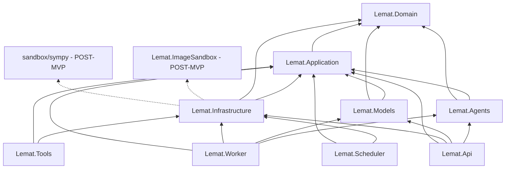
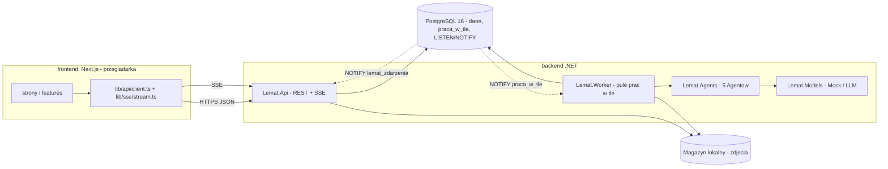
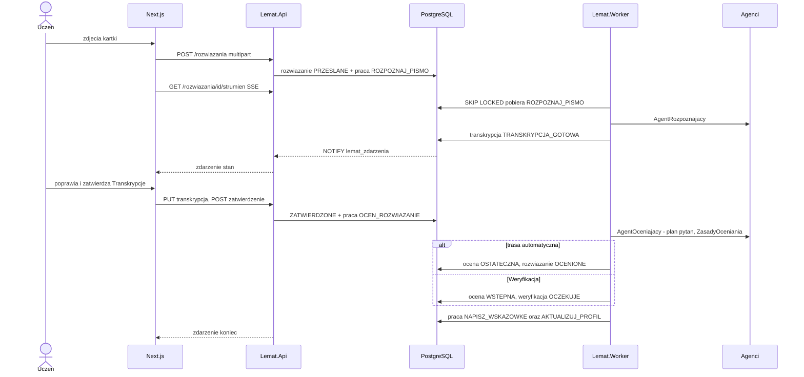
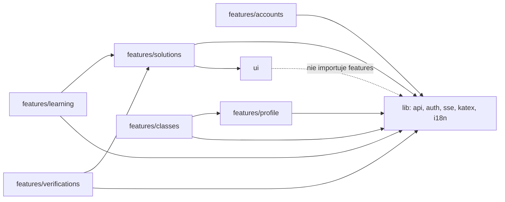

# Lemat — Mapa kodu (Living Documentation)

| Pole | Wartość |
|---|---|
| Dokument | `docs/CODEBASE_MAP.md` — **jedyny plik w `docs/` utrzymywany w trakcie implementacji** |
| Utrzymuje | `handoff-guardian` po każdym `TASK-XXX` (reguły: `CLAUDE.md` 5.2) |
| Stan kodu | szkielet solucji `backend/` (TASK-001: 9 projektów `src`, puste biblioteki + 4 minimalne `Program.cs`) + 7 projektów testowych `backend/tests` (TASK-002: testy architektury, słownika, nagłówków, ASCII); hosty `api`/`worker`/`scheduler` z `/zdrowie`, dispatcher `Lemat.Tools`, OpenAPI `backend/openapi/lemat-v1.json` (TASK-003); `frontend/` nie istnieje; pozostałe wiersze `planowane` |
| Ostatnia aktualizacja | 2026-11-01 (TASK-003) |
| Źródła planu | `docs/ARCHITECTURE_DETAILED.md` v3.5: 6.2 (moduły), 6.4 (projekty), 6.6 (agenci), 6.7/6.8 (drzewa), 12.3 (endpointy), 13.3 (prace w tle), 18 (RTM); `docs/spec/api.md` 7 (strony ↔ endpointy) |

**Jak czytać.** Kolumna *Status*: `planowane` → `w toku` (TASK `IN_PROGRESS`, rzadko używane) →
`gotowe` (TASK `[x]`, kod istnieje i przeszedł weryfikację) → `zmienione` (dotknięte późniejszym TASK).
Kolumna *TASK* wskazuje zadanie, które tworzy dany element (pierwszy numer) i zadania, które go
rozszerzają. Zakres: `MVP` albo `POST-MVP`. Ścieżki stron są względem `frontend/src/app`, endpointy
względem `/api/v1`, a nazwy typów C# są identyfikatorami ze słownika (pliki mają nazwy angielskie, 6.11).

**Reguły aktualizacji (dla `handoff-guardian`).** Po TASK: (1) wpisz nowe pliki do rejestru w sekcji 6;
(2) przestaw status wierszy tabel 1–4 i uzupełnij kolumny, które były „—” lub „?”; (3) jeśli powstała
nowa zależność między projektami, modułami lub modułami frontendu — zaktualizuj diagramy w sekcji 5;
(4) nie usuwaj wierszy `POST-MVP` — zmieniaj tylko ich status.

---

## 1. Przepływy: strona / komponent Next.js ↔ endpoint .NET ↔ przypadek użycia ↔ Agent/plugin AI ↔ encja/tabela

Przypadki użycia to handlery w `Lemat.Application.<Module>` (polecenia `Commands/`, zapytania
`Queries/`); „—” w kolumnie Agent oznacza, że przepływ nie używa Agentów AI.

### 1.1 Zakres MVP

| # | Strona / komponent (`frontend/src/app`, `src/features`) | Endpoint REST / SSE (`backend/src/Lemat.Api/Endpoints`) | Przypadek użycia (handler) | Agent / plugin AI / port | Encje / tabele | TASK | Zakres | Status |
|---|---|---|---|---|---|---|---|---|
| 1 | `(public)/register`, `features/accounts/RegisterForm` | `POST /auth/rejestracja` (`AccountsEndpoints`) | `ZarejestrujUzytkownikaHandler` | — | `uzytkownik`, `uczen`, `profil_ucznia`, `sciezka_nauki`, `token_odswiezania` | 016, 072, 082 | MVP | planowane |
| 2 | `(public)/register/teacher`, `features/accounts/RegisterTeacherForm` | `POST /auth/rejestracja` (`rola = NAUCZYCIEL`; w dev autozatwierdzenie, U-04) | `ZarejestrujUzytkownikaHandler` | — | `uzytkownik`, `nauczyciel` | 016, 072, 082 | MVP | planowane |
| 3 | `(public)/login`, `lib/auth/SessionProvider` | `POST /auth/logowanie`, `POST /auth/odswiezenie`, `POST /auth/wylogowanie` | `ZalogujHandler`, `OdswiezSesjeHandler`, `WylogujHandler` | — | `uzytkownik`, `token_odswiezania`, `proba_logowania` | 072, 081, 082 | MVP | planowane |
| 4 | `(student)/settings`, `features/accounts/LevelSettingsForm` | `GET /uczniowie/ja`, `PATCH /uczniowie/ja` (If-Match, JSON Merge Patch) | `PobierzUczniaHandler`, `ZmienUczniaHandler` | — | `uczen`, `opanowanie_umiejetnosci`, `element_sciezki` | 019, 073, 083 | MVP | planowane |
| 5 | `(student)/start`, `features/learning/NextElementCard` | `GET /uczniowie/ja/rekomendacje/nastepna`, `POST /elementy-sciezki/{id}/rozpoczecie`, `POST /elementy-sciezki/{id}/pominiecie` (`RecommendationsEndpoints`) | `NastepnyElementHandler` → `IRekomendacjaSynchroniczna` | **Agent rekomendujący** (`AgentRekomendujacy`, `POLITYKA_ELO`, `PredyktorSukcesuElo`; szablony uzasadnień) | `sciezka_nauki`, `element_sciezki`, `rekomendacja`, `opanowanie_umiejetnosci`, `zadanie` | 047, 076, 083 | MVP | planowane |
| 6 | `(student)/learning-path`, `features/learning/LearningPathList` | `GET /uczniowie/ja/sciezka-nauki`, `POST /elementy-sciezki/{id}/pominiecie` | `PobierzSciezkeNaukiHandler` | — | `sciezka_nauki`, `element_sciezki` | 076, 083 | MVP | planowane |
| 7 | `(student)/theory-inserts/[theoryInsertId]` (`?element=`), `features/learning/TheoryInsertView` | `GET /wkladki-teoretyczne/{id}`, `POST /elementy-sciezki/{id}/przeczytanie` | `PobierzWkladkeHandler`, `OznaczPrzeczytanieHandler` | — | `wkladka_teoretyczna`, `element_sciezki` | 073, 076, 083 | MVP | planowane |
| 8 | `(student)/diagnostic-test`, `features/profile/DiagnosticTestFlow` | `POST /uczniowie/ja/test-diagnostyczny`, `GET /testy-diagnostyczne/{id}`, `POST /testy-diagnostyczne/{id}/pozycje/{pozycja_testu_diagnostycznego_id}/odpowiedz`, `POST …/zakonczenie`, `POST …/pominiecie` | `UtworzTestDiagnostycznyHandler`, `OdpowiedzNaPozycjeTestuHandler`, `ZakonczTestHandler` | Praca `AKTUALIZUJ_PROFIL` (model Elo, bez LLM) | `test_diagnostyczny`, `pozycja_testu_diagnostycznego`, `odpowiedz`, `wynik_zadania`, `profil_ucznia`, `opanowanie_umiejetnosci`, `praca_w_tle` | 019, 050, 075, 084 | MVP | planowane |
| 9 | `(student)/profile`, `features/profile/ProfileView` | `GET /uczniowie/ja/profil`, `GET /dzialy`, `GET /umiejetnosci` | `PobierzProfilHandler`, `PobierzSlownikiHandler` | — | `profil_ucznia`, `opanowanie_umiejetnosci`, `dzial`, `umiejetnosc` | 073, 075, 084 | MVP | planowane |
| 10 | `(student)/exercises/[exerciseId]` (`?element=`), `features/solutions/ExercisePage`, `ClosedAnswerForm`, `PhotoUpload` | `GET /zadania/{id}`, `POST /zadania/{id}/odpowiedzi`, `POST /rozwiazania` (multipart, ADR-067) | `PobierzZadanieUczniaHandler`, `ZlozOdpowiedzHandler`, `PrzeslijRozwiazanieHandler` | `IObrobkaObrazow` (`ProstaObrobkaObrazow`), `IMagazynObiektow` (`MagazynObiektowLokalny`) | `zadanie`, `zadanie_wersja`, `odpowiedz`, `wynik_zadania`, `rozwiazanie`, `zdjecie_rozwiazania`, `element_sciezki` | 073, 076, 077, 085 | MVP | planowane |
| 11 | `(student)/solutions`, `features/solutions/SolutionList` | `GET /rozwiazania?status&kursor` | `ListaRozwiazanUczniaHandler` | — | `rozwiazanie` | 077, 086 | MVP | planowane |
| 12 | `(student)/solutions/[solutionId]`, `features/solutions/SolutionStatus`, `GradeView`, `lib/sse/stream.ts` | `GET /rozwiazania/{id}/strumien` (SSE, `stan`/`koniec`/`ping`/`wznow`), zapasowo `GET /rozwiazania/{id}`, `GET /rozwiazania/{id}/ocena`, `GET /rozwiazania/{id}/zdjecia/{zdjecie_rozwiazania_id}/adres`, `GET /magazyn-lokalny/{token}` (U-03) | `StrumienRozwiazania` (`SolutionStream`, `EventHub`), `PobierzRozwiazanieHandler`, `PobierzOceneHandler` | **Agent rozpoznający** (`ROZPOZNAJ_PISMO`), **Agent oceniający** (`OCEN_ROZWIAZANIE`), **Agent wyjaśniający** (`NAPISZ_WSKAZOWKE`) | `rozwiazanie`, `transkrypcja`, `krok_transkrypcji`, `ocena`, `ocena_kryterium`, `decyzja_modelu`, `weryfikacja` | 043–046, 049, 050, 078, 079, 086 | MVP | planowane |
| 13 | `(student)/solutions/[solutionId]`, `features/solutions/TranscriptionEditor` (Poprawki Ucznia) | `PUT /rozwiazania/{id}/transkrypcja` (If-Match), `POST /rozwiazania/{id}/zatwierdzenie`, `POST /rozwiazania/{id}/zdjecia`, `POST /rozwiazania/{id}/ponowienie-rozpoznania`, `POST /rozwiazania/{id}/porzucenie` | `PoprawTranskrypcjeHandler` (`ZasadyPoprawekTranskrypcji`), `ZatwierdzTranskrypcjeHandler`, `PrzeslijNoweZdjeciaHandler` | praca `OCEN_ROZWIAZANIE` zlecana przy zatwierdzeniu | `transkrypcja`, `krok_transkrypcji`, `rozwiazanie`, `praca_w_tle` | 020, 078, 087 | MVP | planowane |
| 14 | `(student)/classes`, `(public)/join/[code]`, `features/classes/JoinClassForm` | `POST /klasy/dolaczenie`, `DELETE /uczniowie/ja/klasy/{id}` | `DolaczDoKlasyHandler`, `OpuscKlaseHandler` | — | `klasa`, `czlonkostwo_klasy` | 018, 074, 088 | MVP | planowane |
| 15 | `(teacher)/teacher/classes`, `(teacher)/teacher/classes/[classId]`, `features/classes/ClassList`, `ClassDetails` | `POST /klasy`, `GET /klasy`, `GET /klasy/{id}`, `POST /klasy/{id}/kod-zaproszenia`, `POST /klasy/{id}/archiwizacja`, `DELETE /klasy/{id}/uczniowie/{uczen_id}` | `UtworzKlaseHandler`, `PobierzKlaseHandler`, `OdnowKodZaproszeniaHandler` | — | `klasa`, `czlonkostwo_klasy` | 018, 074, 088 | MVP | planowane |
| 16 | `(teacher)/teacher/classes/[classId]/students/[studentId]`, `features/profile/StudentProfileView` | `GET /uczniowie/{id}/profil` (N: członek Klasy), `GET /klasy/{id}/uczniowie/{uczen_id}/rozwiazania` | `PobierzProfilUczniaDlaNauczycielaHandler` | — | `profil_ucznia`, `opanowanie_umiejetnosci`, `czlonkostwo_klasy` | 075, 088 | MVP | planowane |
| 17 | `(teacher)/teacher`, `(teacher)/teacher/verifications`, `features/verifications/VerificationList` | `GET /weryfikacje?dostepnosc&powod&klasa_id&typ_kolejki&kursor`, `POST /weryfikacje/{id}/podjecie` | `KolejkaWeryfikacjiHandler` (reguła odczytu 11.4.2), `PodejmijWeryfikacjeHandler` | — | `weryfikacja`, `ocena`, `rozwiazanie`, `klasa` | 023, 080, 089 | MVP | planowane |
| 18 | `(teacher)/teacher/verifications/[verificationId]`, `features/verifications/VerificationPanel` | `GET /weryfikacje/{id}`, `POST /weryfikacje/{id}/zwolnienie`, `POST /weryfikacje/{id}/rozstrzygniecie` (If-Match), `GET /rozwiazania/{id}/zdjecia/{zdjecie_rozwiazania_id}/adres` | `RozstrzygnijWeryfikacjeHandler` (nowa wersja `Ocena`, `OSTATECZNA`), `ZwolnijWeryfikacjeHandler` | praca `AKTUALIZUJ_PROFIL` po rozstrzygnięciu | `weryfikacja`, `ocena`, `ocena_kryterium`, `rozwiazanie`, `wynik_zadania`, `decyzja_modelu` | 023, 080, 089 | MVP | planowane |
| 19 | (infrastruktura) | `GET /zdrowie` (`HealthEndpoints`, DTO `ZdrowieWyjscie`; gotowe), `GET /openapi.json` (runtime `/api/v1/openapi.json`; gotowe), ProblemDetails (gotowe: `AddProblemDetails`), `ETag`/`version`, paginacja kursorowa | `KoncentratorZdarzen`, filtry HTTP | — | — | 003, 071 | MVP | w toku (003 gotowe: zdrowie, OpenAPI, ProblemDetails; reszta 071) |
| 20 | (narzędzie CLI) `backend/src/Lemat.Tools` | polecenia `migrate`, `seed-dev` | `MigrujBazeCommand`, `SeedDevCommand` | konfiguracje modelu `mock`, próg 0,95, kalibrator tożsamościowy | wszystkie tabele DDL; dane: `dzial`, `umiejetnosc`, `zadanie`, `zadanie_wersja`, `kryterium_oceniania`, `wkladka_teoretyczna`, `konfiguracja_modelu`, `prog_pewnosci`, `kalibrator_pewnosci` | 013, 025–028 | MVP | planowane |

### 1.2 Po MVP (wiersze zarezerwowane — nie usuwać)

| # | Strona / komponent | Endpoint REST / SSE | Przypadek użycia | Agent / plugin AI / port | Encje / tabele | TASK | Status |
|---|---|---|---|---|---|---|---|
| 21 | `(teacher)/teacher/exercise-sets[...]`, `assignments[...]`, `(student)/assignments` | `/zestawy-zadan`, `/przypisania`, `/uczniowie/ja/przypisania` | `UtworzZestawHandler`, `UtworzPrzypisanieHandler` | — | `zestaw_zadan`, `pozycja_zestawu`, `przypisanie`, `przypisanie_uczen` | 029, 095 | planowane |
| 22 | `(teacher)/teacher/exercises/generate`, `.../[exerciseId]/review`, `(administrator)/admin/generation-requests[...]` | `POST /zadania/generowanie`, `GET /zlecenia-generowania/{id}[/strumien]`, `POST /zadania/{id}/przeglad|wycofanie` | `ZlecGenerowanieHandler`, `PrzegladZadaniaHandler` | **Agent generujący** + plugin `SprawdzanieSymbolicznePlugin` (`sympy_*`) | `zlecenie_generowania`, `zadanie`, `walidacja_zadania`, `przeglad_zadania` | 030, 060, 097 | planowane |
| 23 | `(administrator)/admin/cke-sheets[...]` | `POST /admin/arkusze-cke/importy`, `GET .../{id}[/strumien]` | `ImportujArkuszHandler` | — | `arkusz_cke`, `import_arkusza` | 031, 068, 098 | planowane |
| 24 | `(administrator)/admin/users`, `classes[...]` | `/admin/uzytkownicy`, `/admin/klasy` | `ZatwierdzNauczycielaHandler`, `PrzekazKlaseHandler` | — | `uzytkownik`, `klasa` | 094 | planowane |
| 25 | `(administrator)/admin/model-configurations`, `confidence-thresholds`, `calibration`, `safeguards` | `/admin/konfiguracje-modeli`, `/admin/progi-pewnosci`, `/admin/kalibracja`, `/admin/bezpieczniki` | `AktywujKonfiguracjeHandler`, `DezaktywujBezpiecznikHandler` | **Model decyzyjny** (`JevAdapter`, `CircuitBreakerModeluDecyzyjnego`), `KalibratorPewnosci` | `konfiguracja_modelu`, `prog_pewnosci`, `kalibrator_pewnosci`, `stan_bezpiecznika`, `probka_kalibracyjna` | 032, 052, 053, 063, 099 | planowane |
| 26 | `(administrator)/admin/verification-load`, `diagnostic-pool`, `background-jobs` | `/admin/obciazenie-weryfikacji`, `/admin/pula-diagnostyczna`, `/admin/praca-w-tle`, `/admin/harmonogram` | `ObciazenieWeryfikacjiQuery`, `PonowPraceHandler` | — | `weryfikacja`, `zadanie`, `praca_w_tle`, `przebieg_harmonogramu` | 035, 064, 100 | planowane |
| 27 | każda strona po zalogowaniu (układ ról), `features/notifications` | `GET /powiadomienia`, `GET /powiadomienia/strumien` (SSE), `POST /powiadomienia/{id}/przeczytanie` | `PowiadomieniaHandler` | — | `powiadomienie` | 036, 096 | planowane |
| 28 | `(student)/settings` (RODO), `(public)/password-reset[...]` | `DELETE /uczniowie/ja`, `GET /uczniowie/ja/eksport-danych`, `POST /auth/reset-hasla[...]` | `ZlozWniosekOUsuniecieHandler`, `EksportDanychHandler` | praca `USUN_KONTO`, `WYSLIJ_EMAIL` | `zdarzenie_rodo`, `uzytkownik` | 033, 066, 067, 092, 093 | planowane |
| 29 | `(teacher)/teacher/solutions/[solutionId]` | `POST /rozwiazania/{id}/korekty` | `KorygujOceneHandler` | — | `ocena`, `probka_kalibracyjna` | 101 | planowane |
| 30 | `(student)/solutions/[solutionId]` (autozapis, zgłoszenie błędu odczytu) | `PUT /rozwiazania/{id}/transkrypcja/szkic`, `POST /rozwiazania/{id}/zgloszenie-bledu-odczytu` | `ZapiszSzkicHandler`, `ZglosBladOdczytuHandler` | **Filtr danych osobowych**, praca `SPRAWDZ_POPRAWKI_TRANSKRYPCJI` | `szkic_transkrypcji`, `weryfikacja` | 034, 058, 059, 102, 103 | planowane |

---

## 2. Moduły backendu → projekty, fasady, tabele

Moduł = `Lemat.Domain.<Module>` + `Lemat.Application.<Module>` + grupa tras w `Lemat.Api/Endpoints`
(katalogi angielskie, 6.11.1). Kolumna *Fasada* to jedyne wejście z innych modułów.

| Moduł (katalog) | Projekty | Fasada | Tabele (właściciel) | Grupa tras | TASK (MVP) | Status |
|---|---|---|---|---|---|---|
| `Common` | Domain, Application | — | `dzien_wolny` | — | 014, 024 | planowane |
| `Accounts` | Domain, Application, Infrastructure (`Security`), Api | `IKontaFasada` (`IAccountsFacade`) | `uzytkownik`, `uczen`, `nauczyciel`, `token_odswiezania`, `proba_logowania` | `/auth`, `/uczniowie/ja`, `/nauczyciele/ja` | 016, 072, 073 | planowane |
| `Classes` | Domain, Application, Api | `IKlasyFasada` | `klasa`, `czlonkostwo_klasy` (MVP); `zestaw_zadan`, `przypisanie*` (POST-MVP) | `/klasy` | 018, 074 | planowane |
| `Content` | Domain, Application, Api | `ITresciFasada` | `dzial`, `umiejetnosc`, `zadanie`, `zadanie_wersja`, `zadanie_umiejetnosc`, `kryterium_oceniania`, `wkladka_teoretyczna` | `/dzialy`, `/umiejetnosci`, `/zadania`, `/wkladki-teoretyczne` | 017, 025, 027, 028, 073 | planowane |
| `Profile` | Domain, Application, Api | `IProfilFasada` | `profil_ucznia`, `opanowanie_umiejetnosci`, `wynik_zadania`, `test_diagnostyczny`, `pozycja_testu_diagnostycznego` | `/uczniowie/{id}/profil`, `/testy-diagnostyczne` | 019, 050, 075 | planowane |
| `Recommendations` | Domain, Application, Api | `IRekomendacjeFasada` | `sciezka_nauki`, `element_sciezki`, `rekomendacja` | `/uczniowie/ja/rekomendacje`, `/elementy-sciezki` | 019, 047, 076 | planowane |
| `Solutions` | Domain, Application, Api | `IRozwiazaniaFasada` | `rozwiazanie`, `zdjecie_rozwiazania`, `transkrypcja`, `krok_transkrypcji`, `odpowiedz` | `/rozwiazania`, `/zadania/{id}/odpowiedzi` | 020, 077, 078 | planowane |
| `Grading` | Domain, Application | `IOcenianieFasada` | `ocena`, `ocena_kryterium` | `/rozwiazania/{id}/ocena` | 021, 022, 078 | planowane |
| `Verifications` | Domain, Application, Api | `IWeryfikacjeFasada` | `weryfikacja` | `/weryfikacje` | 023, 080 | planowane |
| `Models` | Domain, Application (porty) | `IModeleFasada` | `konfiguracja_modelu`, `decyzja_modelu` | `/admin/konfiguracje-modeli` (POST-MVP) | 018, 038 | planowane |
| `Calibration` | Domain, Application | `IKalibracjaFasada` | `kalibrator_pewnosci`, `prog_pewnosci` (MVP: tylko odczyt progu); reszta POST-MVP | `/admin/progi-pewnosci` (POST-MVP) | 018, 032 | planowane |
| `Orchestration` | Application (`Handlers`, `Synchronous`), Worker | `IOrkiestrator`, `IRekomendacjaSynchroniczna` | `praca_w_tle` | `/admin/praca-w-tle` (POST-MVP) | 024, 047, 048–050 | planowane |
| `Notifications`, `Audit` | Domain, Application | `IPowiadomieniaFasada`, `IAudytFasada` | `powiadomienie`, `dziennik_audytu` | `/powiadomienia` | 036 (POST-MVP) | planowane |

---

## 3. Agenci, porty i implementacje

| Port / Agent (interfejs w `Lemat.Application`) | Implementacja domyślna (MVP) | Implementacja realna | Wybór | Role `konfiguracja_modelu` | TASK | Status |
|---|---|---|---|---|---|---|
| `IAgentRekomendujacy` | `AgentRekomendujacy` (Elo + szablony; bez LLM) | to samo (+ `JEV_CHOICE` POST-MVP) | — | `DECYZYJNY_GLOWNY` (tylko `JEV_CHOICE`) | 047, 069 | planowane |
| `IAgentRozpoznajacy` | `AgentRozpoznajacy` na `IModelGeneratywny` | j.w. z dostawcą LLM | `LEMAT_MODELE_DOSTAWCA` | `ROZPOZNAWANIE_PISMA` | 043 | planowane |
| `IAgentOceniajacy` | `AgentOceniajacy` (plan pytań) na `IModelDecyzyjny` + `ZasadyOceniania` (Domain) | j.w. | konfiguracja modelu | `DECYZYJNY_GLOWNY`, `DECYZYJNY_ZAPASOWY` | 044, 045 | planowane |
| `IAgentWyjasniajacy` | `AgentWyjasniajacy` + `StraznikWycieku` | j.w. | `LEMAT_MODELE_DOSTAWCA` | `GENERATYWNY_WSKAZOWKI` | 046 | planowane |
| `IAgentGenerujacy` | — | `AgentGenerujacy` + `SprawdzanieSymbolicznePlugin` | — | `GENERATYWNY_*` | 060, 061 (POST-MVP) | planowane |
| `IModelGeneratywny` → `KlientCzatuRoli` | `MockChatClient` w potoku `FabrykaKlientowCzatu` | `openai-zgodny`, `azure-openai`, `anthropic` (Microsoft.Extensions.AI) | `LEMAT_MODELE_DOSTAWCA` | wszystkie `GENERATYWNY_*`, `ROZPOZNAWANIE_PISMA` | 038, 039, 042 | planowane |
| `IModelDecyzyjny` | `MockModelDecyzyjny` | `ZapasowyLlmAdapter` (MVP); `JevAdapter` + `CircuitBreakerModeluDecyzyjnego` (POST-MVP) | konfiguracja modelu | `DECYZYJNY_*` | 039, 051, 052, 053 | planowane |
| `IMagazynObiektow` | `MagazynObiektowLokalny` | `MagazynObiektowS3` (POST-MVP) | `Lemat:Magazyn:Typ` | — | 040, 057 | planowane |
| `IObrobkaObrazow` | `ProstaObrobkaObrazow` | `ImageSandboxKlient` (POST-MVP) | `Lemat:Obrazy:Typ` | — | 040, 056 | planowane |
| `ISprawdzanieSymboliczne` | `ProsteSprawdzanieSymboliczne`, `FalszyweSprawdzanieSymboliczne` (testy) | `SympySidecarKlient` (POST-MVP) | `Lemat:Symbolika:Typ` | — | 040, 055 | planowane |
| `IPredyktorSukcesu` | `PredyktorSukcesuElo` | `PredyktorSukcesuGbm` (POST-MVP) | — | — | 047, 069 | planowane |
| `ISzablonyPromptow` | `SzablonyPromptow` (YAML Semantic Kernel w `Lemat.Agents/Prompts`) | — | wersja promptu w konfiguracji modelu | — | 041 | planowane |
| `IWywolanieUstrukturyzowane` | `WywolanieUstrukturyzowane` (JsonSchema.Net, 1 próba naprawy) | — | — | — | 041 | planowane |
| `IJednostkaPracy`, `IZlecaniePrac`, `ISklepPracWTle` | `JednostkaPracyEf`, `ZlecaniePracSql`, `SklepPracWTle` | — | — | — | 015, 024 | planowane |
| `IOgranicznikSzybkosci` | — (brak w MVP; `Mock`/lokalne bez limitu) | `OgranicznikSzybkosci` (POST-MVP) | — | — | 054 | planowane |

---

## 4. Prace w tle (`praca_w_tle`) — katalog 13.3

| Typ pracy | Pula | Handler (`Lemat.Application.Orchestration.Handlers`) | Agent | TASK | Zakres | Status |
|---|---|---|---|---|---|---|
| `ROZPOZNAJ_PISMO` | R | `RozpoznajPismoHandler` | Agent rozpoznający | 049 | MVP | planowane |
| `OCEN_ROZWIAZANIE` | O | `OcenRozwiazanieHandler` (trasowanie T-1…T-6, T-7 uproszczone, U-06) | Agent oceniający | 049 | MVP | planowane |
| `NAPISZ_WSKAZOWKE` | P | `NapiszWskazowkeHandler` | Agent wyjaśniający | 050 | MVP | planowane |
| `AKTUALIZUJ_PROFIL` | P | `AktualizujProfilHandler` (Elo, `FOR UPDATE profil_ucznia`) | — | 050 | MVP | planowane |
| `SPRAWDZ_POPRAWKI_TRANSKRYPCJI` | S | `SprawdzPoprawkiTranskrypcjiHandler` | Agent rozpoznający | 059 | POST-MVP | planowane |
| `PONOW_OCENE`, `OPINIA_POMOCNICZA` | O / W | `PonowOceneHandler`, `OpiniaPomocniczaHandler` | Agent oceniający | 062 | POST-MVP | planowane |
| `GENERUJ_ZADANIE`, `WALIDUJ_ZADANIE`, `UZUPELNIJ_PULE` | W | handlery generowania | Agent generujący | 060 | POST-MVP | planowane |
| `GENERUJ_SZKIC_WKLADKI` | W | `GenerujSzkicWkladkiHandler` | Agent generujący | 061 | POST-MVP | planowane |
| `IMPORTUJ_ARKUSZ` | W | `ImportujArkuszHandler` | — | 068 | POST-MVP | planowane |
| `KALIBRUJ`, `EWALUUJ_ZT1` | W | handlery kalibracji | — | 063 | POST-MVP | planowane |
| `ESKALUJ_WERYFIKACJE` | W | `EskalujWeryfikacjeHandler` | — | 065 | POST-MVP | planowane |
| `UTRZYMAJ_PARTYCJE`, `WYGAS_ELEMENTY`, `ZAMIATAJ_PROFILE`, `SPRAWDZ_ZAWIESZONE_ROZWIAZANIA`, `PORZUC_NIEZATWIERDZONE`, `SPRAWDZ_PULE_DIAGNOSTYCZNA` | W (scheduler) | handlery cykliczne | — | 064 | POST-MVP (partycje: U-08) | planowane |
| `USUN_KONTO`, `USUN_ZDJECIA`, `USUN_KOPIE_TRENINGOWE`, `UZGODNIJ_REJESTR_RODO`, `SPRZATAJ_OSIEROCONE_OBIEKTY`, `WYCZYSC_DANE_TECHNICZNE` | W | handlery RODO | — | 066 | POST-MVP | planowane |
| `WYSLIJ_EMAIL`, `KOPIUJ_DO_ZBIORU_TRENINGOWEGO` | W | `WyslijEmailHandler`, `KopiujDoZbioruHandler` | — | 067, 070 | POST-MVP | planowane |

---

## 5. Diagramy zależności (Mermaid)

### 5.1 Projekty backendu (strzałka = „ma referencję do”)

Stan (TASK-001 … TASK-004; TASK-004 nie zmienia grafu referencji projektów — `LematOpcje` jest w Application, hosty Api/Worker/Scheduler już referują Application; w TASK-003 Worker i Scheduler dostały `FrameworkReference Microsoft.AspNetCore.App` — to nie zmienia grafu referencji projektów): węzły `Lemat.*` istnieją jako szkielety `gotowe` (referencje zweryfikowane z `.csproj` i pilnowane testami `Lemat.Architecture.Tests`; projekty `Lemat.*.Tests` nie są częścią diagramu — każdy referuje wyłącznie testowany projekt, a Architecture.Tests wszystkie 9); węzły z linią przerywaną są POST-MVP i nie istnieją.



### 5.2 Przepływ danych w czasie działania (MVP, wszystko lokalnie)



### 5.3 Potok Rozwiązania (MVP)



### 5.4 Moduły frontendu (6.9; strzałka = „może importować przez index.ts”)



---

## 6. Rejestr plików (uzupełnia `handoff-guardian`; jeden wiersz na plik `.cs/.ts/.tsx`)

Format: ścieżka (względem korzenia repo) | `@Role` | `@DependsOn` | `@UsedBy` | `@Task`. Wiersze
kopiowane z nagłówków plików; rejestr nie zastępuje nagłówków.

| Ścieżka | Role | DependsOn | UsedBy | Task |
|---|---|---|---|---|
| `backend/src/Lemat.Api/Program.cs` | Punkt kompozycji procesu api (Minimal API, zdrowie, OpenAPI) | Lemat.Api.Configuration, Lemat.Application, Lemat.Infrastructure, Lemat.Agents, Lemat.Models | host ASP.NET Core, WebApplicationFactory | TASK-001, TASK-003 |
| `backend/src/Lemat.Worker/Program.cs` | Punkt kompozycji procesu worker (szkielet, /zdrowie na porcie 8081) | Lemat.Worker.Configuration, Lemat.Application, Lemat.Infrastructure | host ASP.NET Core | TASK-001, TASK-003 |
| `backend/src/Lemat.Scheduler/Program.cs` | Punkt kompozycji procesu scheduler (szkielet, /zdrowie na porcie 8082) | Lemat.Scheduler.Configuration, Lemat.Application, Lemat.Infrastructure | host ASP.NET Core | TASK-001, TASK-003 |
| `backend/src/Lemat.Tools/Program.cs` | Narzędzie wiersza poleceń (dispatcher; migrate i seed-dev w kolejnych zadaniach) | Lemat.Tools.Commands, Lemat.Application, Lemat.Infrastructure | operator, scripts | TASK-001, TASK-003 |
| `backend/src/Lemat.Api/Configuration/ApiHost.cs` | Kompozycja procesu api (logi JSON, ProblemDetails, OpenAPI, adres dev 5080); `CreateBuilder`, `MapEndpoints` | Microsoft.AspNetCore.OpenApi, LematKonfiguracja | Lemat.Api.Program, KontenerDiTests | TASK-003, TASK-004 |
| `backend/src/Lemat.Api/Endpoints/HealthEndpoints.cs` | Endpoint `GET /api/v1/zdrowie` (grupa tras; `MapGroup("/api/v1/...")` dla kolejnych) | Lemat.Api.Contracts.Common | ApiHost | TASK-003 |
| `backend/src/Lemat.Api/Contracts/Common/ZdrowieWyjscie.cs` | DTO odpowiedzi `GET /api/v1/zdrowie` | brak | HealthEndpoints | TASK-003 |
| `backend/src/Lemat.Worker/Configuration/WorkerHost.cs` | Kompozycja procesu worker (host ogólny, `/zdrowie` na 8081, bez logiki) | Microsoft.AspNetCore.App, LematKonfiguracja | Worker.Program, KontenerDiTests | TASK-003, TASK-004 |
| `backend/src/Lemat.Scheduler/Configuration/SchedulerHost.cs` | Kompozycja procesu scheduler (host ogólny, `/zdrowie` na 8082, bez logiki) | Microsoft.AspNetCore.App, LematKonfiguracja | Scheduler.Program, KontenerDiTests | TASK-003, TASK-004 |
| `backend/src/Lemat.Tools/Commands/CommandDispatcher.cs` | Dispatcher poleceń (`IPolecenie`, `--help`, nieznane polecenie -> kod 2) | brak | Tools.Program, testy | TASK-003 |
| `backend/tests/Lemat.Api.Tests/HealthEndpointTests.cs` | Test `GET /api/v1/zdrowie` i dokumentu OpenAPI (WebApplicationFactory) | Lemat.Api | dotnet test | TASK-003 |
| `backend/tests/Lemat.Architecture.Tests/Hosts/KontenerDiTests.cs` | Test kontenerów DI api/worker/scheduler (ValidateOnBuild, ValidateScopes) | Lemat.Api, Lemat.Worker, Lemat.Scheduler | dotnet test | TASK-003 |
| `backend/src/Lemat.Application/Common/LematOpcje.cs` | Parametry MVP (sekcja 22) wiązane z sekcją `Lemat`; wartości domyślne = tabela 22; wybór implementacji Mock/lokalnych | Microsoft.Extensions.Options | ApiHost, WorkerHost, SchedulerHost, LematOpcjeWalidator | TASK-004 |
| `backend/src/Lemat.Application/Common/LematOpcjeWalidator.cs` | Walidacja `LematOpcje` przy starcie (Production bez mocków, A-07 retencja, ścieżka magazynu, zakresy) | LematOpcje | LematKonfiguracja | TASK-004 |
| `backend/src/Lemat.Application/Common/LematKonfiguracja.cs` | Rejestracja Options + `ValidateOnStart`; mapowanie `LEMAT_*` -> klucze `Lemat:*` (`MapowanieZmiennych`, `DodajZmienneLemat`, `AddLematOpcje`) | LematOpcje, LematOpcjeWalidator | ApiHost, WorkerHost, SchedulerHost | TASK-004 |
| `backend/tests/Lemat.Application.Tests/Common/LematOpcjeTests.cs` | Testy `LematOpcje`: domyślne = tabela 22, nadpisanie `LEMAT_*`, walidacja startu | Lemat.Application.Common | dotnet test | TASK-004 |
| `backend/tests/Lemat.Architecture.Tests/Hosts/LematOpcjeHostyTests.cs` | Start hostów api/worker/scheduler w Development bez zmiennych, odrzucenie mocka w Production, spójność appsettings | Lemat.Api, Lemat.Worker, Lemat.Scheduler | dotnet test | TASK-004 |
| `backend/tests/Lemat.Domain.Tests/AssemblySmokeTests.cs` | Test dymny składu Lemat.Domain (szkielet do czasu pojawienia się typów) | Lemat.Domain | dotnet test | TASK-002 |
| `backend/tests/Lemat.Application.Tests/AssemblySmokeTests.cs` | Test dymny składu Lemat.Application (szkielet do czasu pojawienia się typów) | Lemat.Application | dotnet test | TASK-002 |
| `backend/tests/Lemat.Agents.Tests/AssemblySmokeTests.cs` | Test dymny składu Lemat.Agents (szkielet do czasu pojawienia się typów) | Lemat.Agents | dotnet test | TASK-002 |
| `backend/tests/Lemat.Models.Tests/AssemblySmokeTests.cs` | Test dymny składu Lemat.Models (szkielet do czasu pojawienia się typów) | Lemat.Models | dotnet test | TASK-002 |
| `backend/tests/Lemat.Infrastructure.Tests/AssemblySmokeTests.cs` | Test dymny składu Lemat.Infrastructure (szkielet do czasu pojawienia się typów) | Lemat.Infrastructure | dotnet test | TASK-002 |
| `backend/tests/Lemat.Api.Tests/AssemblySmokeTests.cs` | Test dymny składu Lemat.Api (szkielet do czasu pojawienia się typów) | Lemat.Api | dotnet test | TASK-002 |
| `backend/tests/Lemat.Architecture.Tests/Layers/LayerRule.cs` | Opis reguły warstwy (6.5): projekty, zabronione zespoły/pakiety i przestrzenie nazw | brak | LayerRules, LayerRulesTests | TASK-002 |
| `backend/tests/Lemat.Architecture.Tests/Layers/LayerRules.cs` | Definicje reguł warstw 6.5 i ich ewaluacja na grafie zależności (referencje projektów/pakietów/zespołów) oraz na typach (NetArchTest) | NetArchTest.Rules, System.Xml.Linq | LayerRulesTests | TASK-002 |
| `backend/tests/Lemat.Architecture.Tests/Layers/LayerRulesTests.cs` | Testy reguł warstw 6.5 na realnych projektach oraz testy negatywne na syntetycznych przykładach | LayerRules, NetArchTest.Rules | dotnet test | TASK-002 |
| `backend/tests/Lemat.Architecture.Tests/Layers/Synthetic/SyntheticDomainType.cs` | Syntetyczny typ naruszający regułę domeny (System.Net.Http) — materiał testu negatywnego | System.Net.Http | LayerRulesTests | TASK-002 |
| `backend/tests/Lemat.Architecture.Tests/Glossary/ForbiddenSynonymAnalyzer.cs` | Analizator Roslyn deklaracji identyfikatorów pod kątem zakazanych synonimów (3.1, 3.4) | Microsoft.CodeAnalysis.CSharp | ZakazaneSynonimyWIdentyfikatorachTests | TASK-002 |
| `backend/tests/Lemat.Architecture.Tests/Glossary/ZakazaneSynonimyWIdentyfikatorachTests.cs` | Strażnik słownika: brak zakazanych synonimów w identyfikatorach backend/src i backend/tests (wersja lekka) | ForbiddenSynonymAnalyzer, RepositoryLocator | dotnet test | TASK-002 |
| `backend/tests/Lemat.Architecture.Tests/Conventions/FileNamePolicy.cs` | Reguła nazw plików: ścieżki ASCII bez spacji (ADR-075) | brak | BrakNiestandardowychZnakowWNazwachPlikowTests | TASK-002 |
| `backend/tests/Lemat.Architecture.Tests/Conventions/LivingDocumentationHeader.cs` | Walidator nagłówka Living Documentation w plikach .cs | System.Text.RegularExpressions | NaglowekLivingDocumentationTests | TASK-002 |
| `backend/tests/Lemat.Architecture.Tests/Conventions/NaglowekLivingDocumentationTests.cs` | Testy nagłówka Living Documentation we wszystkich .cs backendu (+ testy negatywne) | LivingDocumentationHeader, RepositoryLocator | dotnet test | TASK-002 |
| `backend/tests/Lemat.Architecture.Tests/Conventions/BrakNiestandardowychZnakowWNazwachPlikowTests.cs` | Test ASCII w ścieżkach z git ls-files (ADR-075) | FileNamePolicy, RepositoryLocator | dotnet test | TASK-002 |
| `backend/tests/Lemat.Architecture.Tests/Support/RepositoryLocator.cs` | Lokalizacja katalogów repozytorium i plików źródłowych dla testów architektury | system plików, git | Layers, Glossary, Conventions | TASK-002 |

Projekt `Lemat.Application` ma od TASK-004 `Common/` (LematOpcje); projekty `Lemat.Domain`, `Lemat.Agents`, `Lemat.Models`, `Lemat.Infrastructure` nie mają jeszcze plików `.cs` (tylko `.csproj`).
Pliki nie-C# (TASK-004): `backend/src/Lemat.{Api,Worker,Scheduler}/appsettings.json` i `appsettings.Development.json` (sekcja `Lemat`, domyślnie Mock/lokalne); `Lemat.Application.csproj` ma teraz pakiety Options/Configuration (graf referencji projektów bez zmian).
Pliki nie-C# (TASK-003): `backend/openapi/lemat-v1.json` (OpenAPI 3.1.1, generowany przy buildzie `Lemat.Api`, deterministyczny, commitowany; źródło typów TS, ADR-061), `backend/Directory.Packages.props` (pakiet OpenAPI), `.csproj` Api/Worker/Scheduler.

Pliki konfiguracyjne solucji (TASK-001, TASK-002): `backend/{Lemat.slnx,global.json,Directory.Build.props,Directory.Packages.props,BannedSymbols.txt,BannedSymbols.Sdk.txt,.editorconfig}`, `backend/src/Directory.Build.props` (analizator BannedApiAnalyzers tylko dla `src`), `backend/tests/Directory.Build.props` (xUnit v3, Shouldly; poza zakresem BannedApi), `.gitignore`.
Projekty testowe (TASK-002): `backend/tests/Lemat.{Domain,Application,Agents,Models,Infrastructure,Api,Architecture}.Tests` — referencje do projektu testowanego wg 6.4; testy architektury sprawdzają graf z sekcji 5.1.

### 6.1 Planowane drzewo (skrót; pełne: 6.7 i 6.8 architektury)

```text
backend/src/Lemat.Domain/        Common/ Accounts/ Classes/ Content/ Profile/ Recommendations/ Solutions/(+PersonalDataFilter POST-MVP)
                                 Grading/ Verifications/ Calibration/ Models/            [planowane: TASK-014, 016–023]
backend/src/Lemat.Application/   Common/(BackgroundJobs) <Module>/(Commands Queries Repositories I*Facade) Models/ Agents/ Orchestration/(Handlers Synchronous)
                                                                                           [planowane: TASK-004, 024, 038, 047–050, 071–080]
backend/src/Lemat.Agents/        Recommendations/ Recognition/ Grading/ Explanation/ Common/ Prompts/        [planowane: TASK-041–047]
backend/src/Lemat.Models/        Mock/(Data Scenarios) Llm/ Fallback/ Schemas/ AdapterRegistry.cs          [planowane: TASK-039, 042, 051]
backend/src/Lemat.Infrastructure/ Persistence/(Configurations Migrations/Sql Data) BackgroundJobs/ Storage/ Sandboxes/ Security/ Email/
                                                                                           [planowane: TASK-013, 015, 024, 040, 072]
backend/src/Lemat.Api/           Program.cs Endpoints/ Contracts/ Validators/ Errors/ Configuration/ Streams/ Infrastructure/   [TASK-003 gotowe: Program, Configuration, Endpoints/Health, Contracts/Common; planowane: 071–080]
backend/src/Lemat.Worker/        Program.cs BackgroundJobPoolHostedService.cs                                 [planowane: TASK-003, 048]
backend/src/Lemat.Scheduler/     Program.cs (szkielet MVP; harmonogram POST-MVP)                             [planowane: TASK-003, 064]
backend/src/Lemat.Tools/         Program.cs, Commands/ (dispatcher gotowy: TASK-003; migrate, seed-dev planowane: TASK-013, 026)
frontend/src/app/                (public) (student) (teacher)/teacher (administrator)/admin layout.tsx proxy.ts   [planowane: TASK-006, 082–089]
frontend/src/features/           accounts learning solutions profile classes verifications (+POST-MVP assignments content administration notifications)
frontend/src/lib/                api/ auth/ sse/ photos/ katex/ i18n/                                        [planowane: TASK-006, 081]
frontend/messages/pl-PL.json     teksty UI (NFR-10)                                                          [planowane: TASK-006+]
```
