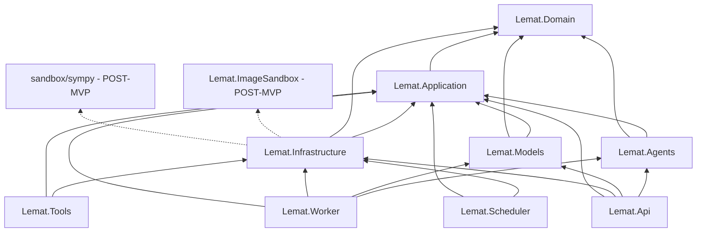
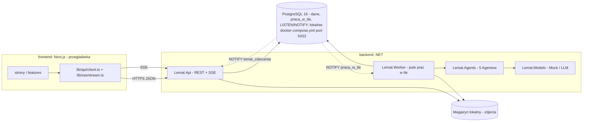
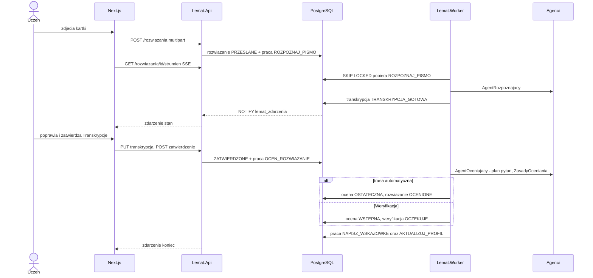
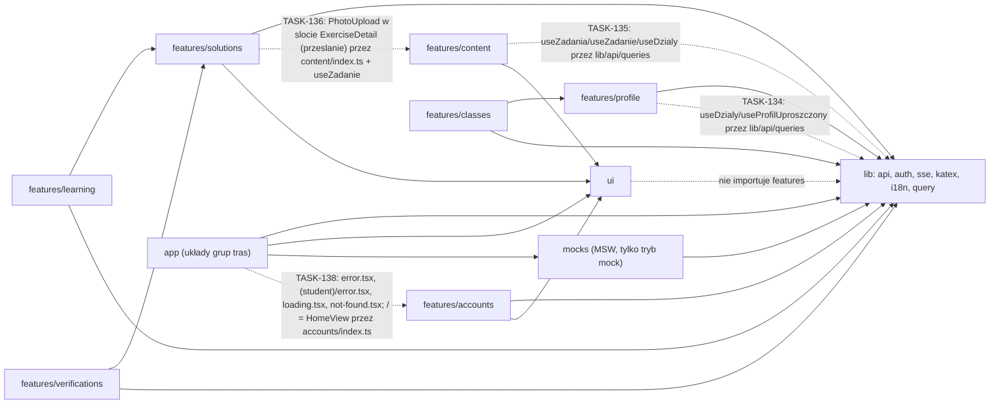

# Lemat — Mapa kodu (Living Documentation)

| Pole | Wartość |
|---|---|
| Dokument | `docs/CODEBASE_MAP.md` — **jedyny plik w `docs/` utrzymywany w trakcie implementacji** |
| Utrzymuje | `handoff-guardian` po każdym `TASK-XXX` (reguły: `CLAUDE.md` 5.2) |
| Stan kodu | `Lemat.Domain.Profile`/`Recommendations` + `Lemat.Application.Profile`/`Recommendations` + trwałość w `Persistence/{Configurations,Repositories}/{Profile,Recommendations}` (TASK-019: `ProfilUcznia`, `OpanowanieUmiejetnosci`, `WynikZadania`, `TestDiagnostyczny`, `ModelElo`, `SciezkaNauki`, `ElementSciezki`, `Rekomendacja`, `IProfilFasada`, `IRekomendacjeFasada`; hosty jeszcze nie wołają `DodajModulProfil`/`DodajModulRekomendacje`; bez powiązań stron/endpointów); szkielet solucji `backend/` (TASK-001: 9 projektów `src`, puste biblioteki + 4 minimalne `Program.cs`) + 7 projektów testowych `backend/tests` (TASK-002: testy architektury, słownika, nagłówków, ASCII); hosty `api`/`worker`/`scheduler` z `/zdrowie`, dispatcher `Lemat.Tools`, OpenAPI `backend/openapi/lemat-v1.json` (TASK-003); `LematOpcje` (TASK-004); środowisko bazy: `docker-compose.yml` + `scripts/db-*.sh` (TASK-005); szkielet `frontend/` (TASK-006: Next.js App Router, next-intl pl-PL, KaTeX `Wzor`/`TrescMarkdown`, `src/ui`, QueryProvider, `check-headers.mjs`; bez stron biznesowych i bez wywołań API); skrypty weryfikacji `scripts/verify-*.sh` + `.github/workflows/ci.yml` + sekcja „Szybki start” w `README.md` (TASK-007; bez powiązań stron/endpointów); schemat bazy: `Persistence/` w `Lemat.Infrastructure` (`LematDbContext`, migracja SQL `SchematPoczatkowy`, `MigratorBazy`), polecenie `Lemat.Tools migrate`, `backend/tools/extract-ddl.sh`, `PostgresFixture` (TASK-013; bez encji EF); `Lemat.Domain.Accounts` + `Lemat.Application.Accounts` + trwałość Kont w `Persistence/{Configurations,Repositories}/Accounts` (TASK-016: `Uzytkownik`, `Uczen`, `Nauczyciel`, `TokenOdswiezania`, `ProbaLogowania`, `IKontaFasada`, 5 repozytoriów; hosty jeszcze nie wołają `DodajModulKonta`; bez powiązań stron/endpointów); `Lemat.Domain.Common` (TASK-014: `Agregat<TId>`, `IZdarzenieDomenowe`, `IIdentyfikator<T>`, `WyjatekDomenowy`/`NiezmiennikNaruszonyException`, `PoziomMatury`, `RodzajZadania`, `PoziomTrudnosci`, `GeneratorUuid`, `KonwencjaNazw`; bez pakietów, bez powiązań stron/endpointów); `Lemat.Domain.Classes`/`Models`/`Calibration` + `Lemat.Application.Classes`/`Models`/`Calibration` + trwałość w `Persistence/{Configurations,Repositories}/{Classes,Models,Calibration}` (TASK-018: `Klasa`, `CzlonkostwoKlasy`, `KonfiguracjaModelu`, `DecyzjaModelu`, `PlanPytan`, `KalibratorPewnosci`, `ProgPewnosci`, `IKlasyFasada`, `IModeleFasada`, `IKalibracjaFasada`, 5 repozytoriów; hosty jeszcze nie wołają `DodajModulKlasy/Modele/Kalibracji`; bez powiązań stron/endpointów); pozostałe wiersze `planowane` |
| Ostatnia aktualizacja | 2026-11-04 (TASK-138 [POC-B]) |
| Źródła planu | `docs/ARCHITECTURE_DETAILED.md` v3.5: 6.2 (moduły), 6.4 (projekty), 6.6 (agenci), 6.7/6.8 (drzewa), 12.3 (endpointy), 13.3 (prace w tle), 18 (RTM); `docs/spec/api.md` 7 (strony ↔ endpointy) |

**Jak czytać.** Kolumna *Status*: `planowane` → `w toku` (TASK `IN_PROGRESS`, rzadko używane) →
`gotowe` (TASK `[x]`, kod istnieje i przeszedł weryfikację) → `zmienione` (dotknięte późniejszym TASK).
Kolumna *TASK* wskazuje zadanie, które tworzy dany element (pierwszy numer) i zadania, które go
rozszerzają. Zakres: `MVP` albo `POST-MVP`. Ścieżki stron są względem `frontend/src/app`, endpointy
względem `/api/v1`, a nazwy typów C# są identyfikatorami ze słownika (pliki mają nazwy angielskie, 6.11).

**Reguły aktualizacji (dla `handoff-guardian`).** Po TASK: (1) wpisz nowe pliki do rejestru w sekcji 6;
(2) przestaw status wierszy tabel 1–4 i uzupełnij kolumny, które były „—” lub „?”; (3) jeśli powstała
nowa zależność między projektami, modułami lub modułami frontendu — zaktualizuj diagramy w sekcji 5;
(4) nie usuwaj wierszy `POST-MVP` — zmieniaj tylko ich status.

---

## 1. Przepływy: strona / komponent Next.js ↔ endpoint .NET ↔ przypadek użycia ↔ Agent/plugin AI ↔ encja/tabela

Przypadki użycia to handlery w `Lemat.Application.<Module>` (polecenia `Commands/`, zapytania
`Queries/`); „—” w kolumnie Agent oznacza, że przepływ nie używa Agentów AI.

### 1.1 Zakres MVP

| # | Strona / komponent (`frontend/src/app`, `src/features`) | Endpoint REST / SSE (`backend/src/Lemat.Api/Endpoints`) | Przypadek użycia (handler) | Agent / plugin AI / port | Encje / tabele | TASK | Zakres | Status |
|---|---|---|---|---|---|---|---|---|
| 1 | `(public)/register`, `features/accounts/RegisterForm` | `POST /auth/rejestracja` (`AccountsEndpoints`) | `ZarejestrujUzytkownikaHandler` | — | `uzytkownik`, `uczen`, `profil_ucznia`, `sciezka_nauki`, `token_odswiezania` | 016, 072, 082, 133 | MVP | frontend POC gotowy: TASK-133 (`/register`, `RegisterForm`, mock MSW); backend POC gotowy: TASK-123 |
| 2 | `(public)/register/teacher`, `features/accounts/RegisterTeacherForm` | `POST /auth/rejestracja` (`rola = NAUCZYCIEL`; w dev autozatwierdzenie, U-04) | `ZarejestrujUzytkownikaHandler` | — | `uzytkownik`, `nauczyciel` | 016, 072, 082 | MVP | planowane |
| 3 | `(public)/login`, `lib/auth/SessionProvider` | `POST /auth/logowanie`, `POST /auth/odswiezenie`, `POST /auth/wylogowanie` | `ZalogujHandler`, `OdswiezSesjeHandler`, `WylogujHandler` | — | `uzytkownik`, `token_odswiezania`, `proba_logowania` | 072, 081, 082, 133 | MVP | frontend POC gotowy: TASK-133 (`/login`, `LoginForm`, `SessionProvider`, `StudentShell` z `wyloguj`); backend POC gotowy: TASK-123 |
| 4 | `(student)/settings`, `features/accounts/SettingsForm` (docelowo `LevelSettingsForm`, TASK-083) | `GET /uczniowie/ja`, `PATCH /uczniowie/ja` (If-Match, JSON Merge Patch), `GET /dzialy` | `PobierzUczniaHandler`, `ZmienUczniaHandler` | — | `uczen`, `opanowanie_umiejetnosci`, `element_sciezki` | 019, 073, 083, 134 | MVP | frontend POC gotowy: TASK-134 (`/settings`, `SettingsForm`, mock MSW); backend POC gotowy: TASK-124 |
| 5 | `(student)/start`, `features/learning/NextElementCard` | `GET /uczniowie/ja/rekomendacje/nastepna`, `POST /elementy-sciezki/{id}/rozpoczecie`, `POST /elementy-sciezki/{id}/pominiecie` (`RecommendationsEndpoints`) | `NastepnyElementHandler` → `IRekomendacjaSynchroniczna` | **Agent rekomendujący** (`AgentRekomendujacy`, `POLITYKA_ELO`, `PredyktorSukcesuElo`; szablony uzasadnień) | `sciezka_nauki`, `element_sciezki`, `rekomendacja`, `opanowanie_umiejetnosci`, `zadanie` | 047, 076, 083 | MVP | planowane |
| 6 | `(student)/learning-path`, `features/learning/LearningPathList` | `GET /uczniowie/ja/sciezka-nauki`, `POST /elementy-sciezki/{id}/pominiecie` | `PobierzSciezkeNaukiHandler` | — | `sciezka_nauki`, `element_sciezki` | 076, 083 | MVP | planowane |
| 7 | `(student)/theory-inserts/[theoryInsertId]` (`?element=`), `features/learning/TheoryInsertView` | `GET /wkladki-teoretyczne/{id}`, `POST /elementy-sciezki/{id}/przeczytanie` | `PobierzWkladkeHandler`, `OznaczPrzeczytanieHandler` | — | `wkladka_teoretyczna`, `element_sciezki` | 073, 076, 083 | MVP | planowane |
| 8 | `(student)/diagnostic-test`, `features/profile/DiagnosticTestFlow` | `POST /uczniowie/ja/test-diagnostyczny`, `GET /testy-diagnostyczne/{id}`, `POST /testy-diagnostyczne/{id}/pozycje/{pozycja_testu_diagnostycznego_id}/odpowiedz`, `POST …/zakonczenie`, `POST …/pominiecie` | `UtworzTestDiagnostycznyHandler`, `OdpowiedzNaPozycjeTestuHandler`, `ZakonczTestHandler` | Praca `AKTUALIZUJ_PROFIL` (model Elo, bez LLM) | `test_diagnostyczny`, `pozycja_testu_diagnostycznego`, `odpowiedz`, `wynik_zadania`, `profil_ucznia`, `opanowanie_umiejetnosci`, `praca_w_tle` | 019, 050, 075, 084 | MVP | planowane |
| 9 | `(student)/profile`, `features/profile/ProfileView` (POC-B: widok uproszczony, wiersz 9a) | `GET /uczniowie/ja/profil`, `GET /dzialy`, `GET /umiejetnosci` | `PobierzProfilHandler`, `PobierzSlownikiHandler` | — | `profil_ucznia`, `opanowanie_umiejetnosci`, `dzial`, `umiejetnosc` | 073, 075, 084 | MVP | planowane (`GET /dzialy` backend POC gotowy: TASK-124) |
| 9a | `(student)/profile`, `features/profile/ProfileView` (POC-B: uproszczony widok) | `GET /uczniowie/ja/profil-uproszczony` (`ProfileEndpoints`, kontrakt POC 4.3) | `PobierzProfilUproszczonyHandler` (+ `IProfilUproszczonyCzytnik`, nazwy Działów z `ITresciFasada`) | — (bez Elo, U-28) | `rozwiazanie`, `ocena`, `zadanie`, `dzial` | 129, 134 | POC | gotowe (backend TASK-129, frontend TASK-134: `ProfileView`, mock MSW) |
| 10 | `(student)/exercises/[exerciseId]` (`?element=`), `features/solutions/ExercisePage`, `ClosedAnswerForm`, `PhotoUpload` | `GET /zadania/{id}`, `POST /zadania/{id}/odpowiedzi`, `POST /rozwiazania` (multipart, ADR-067) | `PobierzZadanieUczniaHandler`, `ZlozOdpowiedzHandler`, `PrzeslijRozwiazanieHandler` | `IObrobkaObrazow` (`ProstaObrobkaObrazow`), `IMagazynObiektow` (`MagazynObiektowLokalny`) | `zadanie`, `zadanie_wersja`, `odpowiedz`, `wynik_zadania`, `rozwiazanie`, `zdjecie_rozwiazania`, `element_sciezki` | 073, 076, 077, 085 | MVP | częściowo: frontend POC — TASK-135 (`/exercises/[exerciseId]`, `features/content/ExerciseDetail`, szczegóły + slot „Prześlij rozwiązanie”; TASK-136: `features/solutions/PhotoUpload` + `lib/photos/to-jpeg.ts` ↔ `POST /rozwiazania` multipart, pola `zadanie_wersja_id`, `zdjecia`); backend POC gotowy: TASK-127 (`POST /rozwiazania` multipart); `POST /zadania/{id}/odpowiedzi` poza POC |
| 10a | `(student)/exercises`, `features/content/ExerciseList` (POC-B: lista Zadań z filtrem Działu; docelowo wejście z Rekomendacji) | `GET /zadania` (filtr `dzial_id`, kontrakt POC 6.3), `GET /zadania/{id}` (`ExerciseDetail`), `GET /dzialy` (filtr) | `ListaZadanUczniaHandler`/`PobierzZadanieUczniaHandler` (przez `ITresciFasada` → `ContentFacade`) | — (brak Agenta/pluginu AI) | `zadanie`, `zadanie_wersja`, `zadanie_umiejetnosc`, `umiejetnosc`, `dzial` | 125, 135 | POC | gotowe (backend TASK-125, frontend TASK-135: `ExerciseList`, `ExerciseDetail`, KaTeX przez `TrescMarkdown`, mock MSW; 404 → „Nie znaleziono zadania”) |
| 11 | `(student)/solutions`, `features/solutions/SolutionList` | `GET /rozwiazania?status&kursor` | `ListaRozwiazanUczniaHandler` | — | `rozwiazanie` | 077, 086 | MVP | częściowo: frontend POC — TASK-137 (`/solutions`, `features/solutions/SolutionList` + `useRozwiazania` ↔ `GET /rozwiazania` z kursorem); backend POC gotowy: TASK-127, `GET /rozwiazania` z kursorem) |
| 12 | `(student)/solutions/[solutionId]`, `features/solutions/SolutionStatus`, `GradeView`, `lib/sse/stream.ts` | `GET /rozwiazania/{id}/strumien` (SSE, `stan`/`koniec`/`ping`/`wznow`), zapasowo `GET /rozwiazania/{id}`, `GET /rozwiazania/{id}/ocena`, `GET /rozwiazania/{id}/zdjecia/{zdjecie_rozwiazania_id}/adres`, `GET /magazyn-lokalny/{token}` (U-03) | `StrumienRozwiazania` (`SolutionStream`, `EventHub`), `PobierzRozwiazanieHandler`, `PobierzOceneHandler` | **Agent rozpoznający** (`ROZPOZNAJ_PISMO`), **Agent oceniający** (`OCEN_ROZWIAZANIE`), **Agent wyjaśniający** (`NAPISZ_WSKAZOWKE`) | `rozwiazanie`, `transkrypcja`, `krok_transkrypcji`, `ocena`, `ocena_kryterium`, `decyzja_modelu`, `weryfikacja` | 043–046, 049, 050, 078, 079, 086 | MVP | częściowo: frontend POC — TASK-137 (`/solutions/[solutionId]`, `SolutionView`, `SolutionGrade`, `SolutionPhotos`, `useRozwiazanie` z odpytywaniem `nastepne_odpytanie_ms` zamiast SSE ↔ `GET /rozwiazania/{id}`, `GET …/ocena`, `GET …/zdjecia/{id}/adres`); backend POC gotowy: TASK-127 `GET /rozwiazania/{id}`, `.../zdjecia/{id}/adres`, `GET /magazyn-lokalny/{token}`; TASK-128 `GET /rozwiazania/{id}/ocena` (404 do `OCENIONE`), handlery `RozpoznajPismoHandler`/`OcenRozwiazanieHandler` na Mockach `MockAgentRozpoznajacy`/`MockAgentOceniajacy`; SSE poza POC, U-27) |
| 13 | `(student)/solutions/[solutionId]`, `features/solutions/TranscriptionEditor` (Poprawki Ucznia) | `PUT /rozwiazania/{id}/transkrypcja` (If-Match), `POST /rozwiazania/{id}/zatwierdzenie`, `POST /rozwiazania/{id}/zdjecia`, `POST /rozwiazania/{id}/ponowienie-rozpoznania`, `POST /rozwiazania/{id}/porzucenie` | `PoprawTranskrypcjeHandler` (`ZasadyPoprawekTranskrypcji`), `ZatwierdzTranskrypcjeHandler`, `PrzeslijNoweZdjeciaHandler` | praca `OCEN_ROZWIAZANIE` zlecana przy zatwierdzeniu | `transkrypcja`, `krok_transkrypcji`, `rozwiazanie`, `praca_w_tle` | 020, 078, 087 | MVP | częściowo: frontend POC — TASK-137 (`SolutionTranscript`: podgląd Transkrypcji + „Zatwierdź” ↔ `POST …/zatwierdzenie`, `If-Match`; edycja poza POC); backend POC gotowy: TASK-128 `POST /rozwiazania/{id}/zatwierdzenie` z `If-Match` i zleceniem `OCEN_ROZWIAZANIE` w jednej transakcji; `PUT .../transkrypcja` i pozostałe poza POC, U-26) |
| 14 | `(student)/classes`, `(public)/join/[code]`, `features/classes/JoinClassForm` | `POST /klasy/dolaczenie`, `DELETE /uczniowie/ja/klasy/{id}` | `DolaczDoKlasyHandler`, `OpuscKlaseHandler` | — | `klasa`, `czlonkostwo_klasy` | 018, 074, 088 | MVP | planowane |
| 15 | `(teacher)/teacher/classes`, `(teacher)/teacher/classes/[classId]`, `features/classes/ClassList`, `ClassDetails` | `POST /klasy`, `GET /klasy`, `GET /klasy/{id}`, `POST /klasy/{id}/kod-zaproszenia`, `POST /klasy/{id}/archiwizacja`, `DELETE /klasy/{id}/uczniowie/{uczen_id}` | `UtworzKlaseHandler`, `PobierzKlaseHandler`, `OdnowKodZaproszeniaHandler` | — | `klasa`, `czlonkostwo_klasy` | 018, 074, 088 | MVP | planowane |
| 16 | `(teacher)/teacher/classes/[classId]/students/[studentId]`, `features/profile/StudentProfileView` | `GET /uczniowie/{id}/profil` (N: członek Klasy), `GET /klasy/{id}/uczniowie/{uczen_id}/rozwiazania` | `PobierzProfilUczniaDlaNauczycielaHandler` | — | `profil_ucznia`, `opanowanie_umiejetnosci`, `czlonkostwo_klasy` | 075, 088 | MVP | planowane |
| 17 | `(teacher)/teacher`, `(teacher)/teacher/verifications`, `features/verifications/VerificationList` | `GET /weryfikacje?dostepnosc&powod&klasa_id&typ_kolejki&kursor`, `POST /weryfikacje/{id}/podjecie` | `KolejkaWeryfikacjiHandler` (reguła odczytu 11.4.2), `PodejmijWeryfikacjeHandler` | — | `weryfikacja`, `ocena`, `rozwiazanie`, `klasa` | 023, 080, 089 | MVP | planowane |
| 18 | `(teacher)/teacher/verifications/[verificationId]`, `features/verifications/VerificationPanel` | `GET /weryfikacje/{id}`, `POST /weryfikacje/{id}/zwolnienie`, `POST /weryfikacje/{id}/rozstrzygniecie` (If-Match), `GET /rozwiazania/{id}/zdjecia/{zdjecie_rozwiazania_id}/adres` | `RozstrzygnijWeryfikacjeHandler` (nowa wersja `Ocena`, `OSTATECZNA`), `ZwolnijWeryfikacjeHandler` | praca `AKTUALIZUJ_PROFIL` po rozstrzygnięciu | `weryfikacja`, `ocena`, `ocena_kryterium`, `rozwiazanie`, `wynik_zadania`, `decyzja_modelu` | 023, 080, 089 | MVP | planowane |
| 19 | (infrastruktura) | `GET /zdrowie` (`HealthEndpoints`, DTO `ZdrowieWyjscie`; gotowe), `GET /openapi.json` (runtime `/api/v1/openapi.json`; gotowe), ProblemDetails (gotowe: `AddProblemDetails`), `ETag`/`version`, paginacja kursorowa | `KoncentratorZdarzen`, filtry HTTP | — | — | 003, 071 | MVP | w toku (003 gotowe: zdrowie, OpenAPI, ProblemDetails; reszta 071) |
| 20 | (narzędzie CLI) `backend/src/Lemat.Tools` | polecenia `migrate`, `seed-poc` (gotowe, TASK-122: 13 Działów, 5 Umiejętności, 5 Zadań z Kryteriami, 2 konta demo, konfiguracja mock, kalibrator, próg 0.95), `seed-dev` | `MigrujBazeCommand` (gotowe, TASK-013) → `MigratorBazy` → `LematDbContext` (migracja `SchematPoczatkowy`, pliki `Migrations/Sql/0000…0007`), `SeedDevCommand` (planowane) | konfiguracje modelu `mock`, próg 0,95, kalibrator tożsamościowy | wszystkie tabele DDL (61 tabel, 43 typy enum, 15 triggerów, partycje `decyzja_modelu` bieżący miesiąc + 12; gotowe w TASK-013, `konfiguracja_modelu` pusta); dane: `dzial`, `umiejetnosc`, `zadanie`, `zadanie_wersja`, `kryterium_oceniania`, `wkladka_teoretyczna`, `konfiguracja_modelu`, `prog_pewnosci`, `kalibrator_pewnosci` | 013, 025–028 | MVP | w toku (`migrate` gotowe w TASK-013; `seed-dev` 026–028) |

### 1.2 Po MVP (wiersze zarezerwowane — nie usuwać)

| # | Strona / komponent | Endpoint REST / SSE | Przypadek użycia | Agent / plugin AI / port | Encje / tabele | TASK | Status |
|---|---|---|---|---|---|---|---|
| 21 | `(teacher)/teacher/exercise-sets[...]`, `assignments[...]`, `(student)/assignments` | `/zestawy-zadan`, `/przypisania`, `/uczniowie/ja/przypisania` | `UtworzZestawHandler`, `UtworzPrzypisanieHandler` | — | `zestaw_zadan`, `pozycja_zestawu`, `przypisanie`, `przypisanie_uczen` | 029, 095 | planowane |
| 22 | `(teacher)/teacher/exercises/generate`, `.../[exerciseId]/review`, `(administrator)/admin/generation-requests[...]` | `POST /zadania/generowanie`, `GET /zlecenia-generowania/{id}[/strumien]`, `POST /zadania/{id}/przeglad|wycofanie` | `ZlecGenerowanieHandler`, `PrzegladZadaniaHandler` | **Agent generujący** + plugin `SprawdzanieSymbolicznePlugin` (`sympy_*`) | `zlecenie_generowania`, `zadanie`, `walidacja_zadania`, `przeglad_zadania` | 030, 060, 097 | planowane |
| 23 | `(administrator)/admin/cke-sheets[...]` | `POST /admin/arkusze-cke/importy`, `GET .../{id}[/strumien]` | `ImportujArkuszHandler` | — | `arkusz_cke`, `import_arkusza` | 031, 068, 098 | planowane |
| 24 | `(administrator)/admin/users`, `classes[...]` | `/admin/uzytkownicy`, `/admin/klasy` | `ZatwierdzNauczycielaHandler`, `PrzekazKlaseHandler` | — | `uzytkownik`, `klasa` | 094 | planowane |
| 25 | `(administrator)/admin/model-configurations`, `confidence-thresholds`, `calibration`, `safeguards` | `/admin/konfiguracje-modeli`, `/admin/progi-pewnosci`, `/admin/kalibracja`, `/admin/bezpieczniki` | `AktywujKonfiguracjeHandler`, `DezaktywujBezpiecznikHandler` | **Model decyzyjny** (`JevAdapter`, `CircuitBreakerModeluDecyzyjnego`), `KalibratorPewnosci` | `konfiguracja_modelu`, `prog_pewnosci`, `kalibrator_pewnosci`, `stan_bezpiecznika`, `probka_kalibracyjna` | 032, 052, 053, 063, 099 | planowane |
| 26 | `(administrator)/admin/verification-load`, `diagnostic-pool`, `background-jobs` | `/admin/obciazenie-weryfikacji`, `/admin/pula-diagnostyczna`, `/admin/praca-w-tle`, `/admin/harmonogram` | `ObciazenieWeryfikacjiQuery`, `PonowPraceHandler` | — | `weryfikacja`, `zadanie`, `praca_w_tle`, `przebieg_harmonogramu` | 035, 064, 100 | planowane |
| 27 | każda strona po zalogowaniu (układ ról), `features/notifications` | `GET /powiadomienia`, `GET /powiadomienia/strumien` (SSE), `POST /powiadomienia/{id}/przeczytanie` | `PowiadomieniaHandler` | — | `powiadomienie` | 036, 096 | planowane |
| 28 | `(student)/settings` (RODO), `(public)/password-reset[...]` | `DELETE /uczniowie/ja`, `GET /uczniowie/ja/eksport-danych`, `POST /auth/reset-hasla[...]` | `ZlozWniosekOUsuniecieHandler`, `EksportDanychHandler` | praca `USUN_KONTO`, `WYSLIJ_EMAIL` | `zdarzenie_rodo`, `uzytkownik` | 033, 066, 067, 092, 093 | planowane |
| 29 | `(teacher)/teacher/solutions/[solutionId]` | `POST /rozwiazania/{id}/korekty` | `KorygujOceneHandler` | — | `ocena`, `probka_kalibracyjna` | 101 | planowane |
| 30 | `(student)/solutions/[solutionId]` (autozapis, zgłoszenie błędu odczytu) | `PUT /rozwiazania/{id}/transkrypcja/szkic`, `POST /rozwiazania/{id}/zgloszenie-bledu-odczytu` | `ZapiszSzkicHandler`, `ZglosBladOdczytuHandler` | **Filtr danych osobowych**, praca `SPRAWDZ_POPRAWKI_TRANSKRYPCJI` | `szkic_transkrypcji`, `weryfikacja` | 034, 058, 059, 102, 103 | planowane |

---

## 2. Moduły backendu → projekty, fasady, tabele

Moduł = `Lemat.Domain.<Module>` + `Lemat.Application.<Module>` + grupa tras w `Lemat.Api/Endpoints`
(katalogi angielskie, 6.11.1). Kolumna *Fasada* to jedyne wejście z innych modułów.

| Moduł (katalog) | Projekty | Fasada | Tabele (właściciel) | Grupa tras | TASK (MVP) | Status |
|---|---|---|---|---|---|---|
| `Common` | Domain, Application | — | `dzien_wolny` | — | 014, 015, 024 | w toku (typy wspólne `Lemat.Domain.Common` gotowe w TASK-014; port `IJednostkaPracy`, `RodzajProcesu`, `KonfliktWspolbieznosciException` w `Lemat.Application.Common` gotowe w TASK-015; `dzien_wolny`: 024) |
| `Accounts` | Domain, Application, Infrastructure (`Security`), Api | `IKontaFasada` (`IAccountsFacade`) | `uzytkownik`, `uczen`, `nauczyciel`, `token_odswiezania`, `proba_logowania` | `/auth`, `/uczniowie/ja`, `/nauczyciele/ja` | 016, 072, 073 | w toku (TASK-016: domena, `IKontaFasada`, repozytoria EF, 5 konfiguracji; endpointy/uwierzytelnianie: TASK-123 gotowe w zakresie POC — `/auth/*`, JWT ES256, refresh w cookie; `/uczniowie/ja` GET+PATCH: TASK-124 gotowe w zakresie POC — `Opcjonalne<T>`, If-Match) |
| `Classes` | Domain, Application, Api | `IKlasyFasada` | `klasa`, `czlonkostwo_klasy` (MVP); `zestaw_zadan`, `przypisanie*` (POST-MVP) | `/klasy` | 018, 074 | w toku (TASK-018: domena `Klasa`/`CzlonkostwoKlasy`, `IKlasyFasada`, repozytorium EF; zestawy/przypisania: 034; endpointy: 074) |
| `Content` | Domain, Application, Api | `ITresciFasada` (`IContentFacade`) | `dzial`, `umiejetnosc`, `zadanie`, `zadanie_wersja`, `zadanie_umiejetnosc`, `kryterium_oceniania`, `wkladka_teoretyczna` | `/dzialy`, `/umiejetnosci`, `/zadania`, `/wkladki-teoretyczne` | 017, 025, 027, 028, 073 | w toku (TASK-017: domena, `ITresciFasada`, repozytoria EF, konfiguracje jsonb; dane referencyjne: 025; `GET /dzialy`: TASK-124 gotowe; `/zadania`: 125; reszta endpointów: 073) |
| `Profile` | Domain, Application, Api | `IProfilFasada` (`IProfileFacade`) | `profil_ucznia`, `opanowanie_umiejetnosci`, `wynik_zadania`, `test_diagnostyczny`, `pozycja_testu_diagnostycznego` | `/uczniowie/{id}/profil`, `/testy-diagnostyczne` | 019, 050, 075 | w toku (TASK-019: domena + `ModelElo`, `IProfilFasada`, 5 portów, repozytoria EF, kalibracja trudności SQL; praca `AKTUALIZUJ_PROFIL`: 050; endpointy: 075)|
| `Recommendations` | Domain, Application, Api | `IRekomendacjeFasada` (`IRecommendationsFacade`) | `sciezka_nauki`, `element_sciezki`, `rekomendacja` | `/uczniowie/ja/rekomendacje`, `/elementy-sciezki` | 019, 047, 076 | w toku (TASK-019: `SciezkaNauki`/`ElementSciezki` (8.5)/`Rekomendacja`/`Seria`, `IRekomendacjeFasada`, repozytoria EF; Agent rekomendujący: 040, 047; endpointy: 076) |
| `Solutions` | Domain, Application, Api | `IRozwiazaniaFasada` | `rozwiazanie`, `zdjecie_rozwiazania`, `transkrypcja`, `krok_transkrypcji`, `odpowiedz` | `/rozwiazania`, `/zadania/{id}/odpowiedzi` | 020, 077, 078 | w toku (TASK-126 [POC-A]: domena, repozytoria EF, fasada odczytowa; TASK-127: `PrzeslijRozwiazanieHandler`, `EndpointyRozwiazan` (POST/GET /rozwiazania, adres zdjęcia), lista Rozwiązań Ucznia; zatwierdzenie i handlery prac w 128) |
| `Grading` | Domain, Application | `IOcenianieFasada` | `ocena`, `ocena_kryterium` | `/rozwiazania/{id}/ocena` | 021, 022, 078 | w toku (TASK-126 [POC-A]: `Ocena`, `OcenaKryterium`, repozytorium EF, fasada odczytowa; handler 128) |
| `Verifications` | Domain, Application, Api | `IWeryfikacjeFasada` | `weryfikacja` | `/weryfikacje` | 023, 080 | planowane |
| `Models` | Domain, Application (porty) | `IModeleFasada` | `konfiguracja_modelu`, `decyzja_modelu` | `/admin/konfiguracje-modeli` (POST-MVP) | 018, 038 | w toku (TASK-018: domena `KonfiguracjaModelu`/`DecyzjaModelu`/`PlanPytan`, `IModeleFasada`, repozytoria EF; porty `IModelDecyzyjny`/`IModelGeneratywny`: 038, 054) |
| `Calibration` | Domain, Application | `IKalibracjaFasada` | `kalibrator_pewnosci`, `prog_pewnosci` (MVP: tylko odczyt progu); reszta POST-MVP | `/admin/progi-pewnosci` (POST-MVP) | 018, 032 | w toku (TASK-018: `KalibratorPewnosci`, `ProgPewnosci`, `IKalibracjaFasada`, repozytoria EF; `StanBezpiecznika`, `ProbkaKalibracyjna`: 032) |
| `Orchestration` | Application (`Handlers`, `Synchronous`), Worker | `IOrkiestrator`, `IRekomendacjaSynchroniczna` | `praca_w_tle` | `/admin/praca-w-tle` (POST-MVP) | 024, 047, 048–050 | planowane |
| `Notifications`, `Audit` | Domain, Application | `IPowiadomieniaFasada`, `IAudytFasada` | `powiadomienie`, `dziennik_audytu` | `/powiadomienia` | 036 (POST-MVP) | planowane |

---

## 3. Agenci, porty i implementacje

| Port / Agent (interfejs w `Lemat.Application`) | Implementacja domyślna (MVP) | Implementacja realna | Wybór | Role `konfiguracja_modelu` | TASK | Status |
|---|---|---|---|---|---|---|
| `IAgentRekomendujacy` | `AgentRekomendujacy` (Elo + szablony; bez LLM) | to samo (+ `JEV_CHOICE` POST-MVP) | — | `DECYZYJNY_GLOWNY` (tylko `JEV_CHOICE`) | 047, 069 | planowane |
| `IAgentRozpoznajacy` | `AgentRozpoznajacy` na `IModelGeneratywny` | j.w. z dostawcą LLM | `LEMAT_MODELE_DOSTAWCA` | `ROZPOZNAWANIE_PISMA` | 043, 128 | port + `MockAgentRozpoznajacy` (Lemat.Models.Mock, dane z `poc-mock.json`) gotowe w TASK-128; `AgentRozpoznajacy` na LLM planowany |
| `IAgentOceniajacy` | `AgentOceniajacy` (plan pytań) na `IModelDecyzyjny` + `ZasadyOceniania` (Domain) | j.w. | konfiguracja modelu | `DECYZYJNY_GLOWNY`, `DECYZYJNY_ZAPASOWY` | 044, 045, 128 | port + `MockAgentOceniajacy` (stała pewność 0.995) gotowe w TASK-128; `AgentOceniajacy` z Modelem decyzyjnym planowany |
| `IAgentWyjasniajacy` | `AgentWyjasniajacy` + `StraznikWycieku` | j.w. | `LEMAT_MODELE_DOSTAWCA` | `GENERATYWNY_WSKAZOWKI` | 046 | planowane |
| `IAgentGenerujacy` | — | `AgentGenerujacy` + `SprawdzanieSymbolicznePlugin` | — | `GENERATYWNY_*` | 060, 061 (POST-MVP) | planowane |
| `IModelGeneratywny` → `KlientCzatuRoli` | `MockChatClient` w potoku `FabrykaKlientowCzatu` | `openai-zgodny`, `azure-openai`, `anthropic` (Microsoft.Extensions.AI) | `LEMAT_MODELE_DOSTAWCA` | wszystkie `GENERATYWNY_*`, `ROZPOZNAWANIE_PISMA` | 038, 039, 042 | planowane |
| `IModelDecyzyjny` | `MockModelDecyzyjny` | `ZapasowyLlmAdapter` (MVP); `JevAdapter` + `CircuitBreakerModeluDecyzyjnego` (POST-MVP) | konfiguracja modelu | `DECYZYJNY_*` | 039, 051, 052, 053 | planowane |
| `IMagazynObiektow` (+ `IOdczytPodpisanegoAdresu`) | `MagazynObiektowLokalny` (HMAC `Lemat:Magazyn:Klucz`, katalog `Lemat:Magazyn:Sciezka`) | `MagazynObiektowS3` (POST-MVP) | `Lemat:Magazyn:Typ` | — | 040, 057, 127 | gotowe (POC, TASK-127) |
| `IObrobkaObrazow` | `ProstaObrobkaObrazow` (tylko `NormalizujAsync`; JPEG, magic bytes, SOF, sha256) | `ImageSandboxKlient` (POST-MVP) | `Lemat:Obrazy:Typ` | — | 040, 056, 127 | gotowe (POC, TASK-127) |
| `ISprawdzanieSymboliczne` | `ProsteSprawdzanieSymboliczne`, `FalszyweSprawdzanieSymboliczne` (testy) | `SympySidecarKlient` (POST-MVP) | `Lemat:Symbolika:Typ` | — | 040, 055 | planowane |
| `IPredyktorSukcesu` | `PredyktorSukcesuElo` | `PredyktorSukcesuGbm` (POST-MVP) | — | — | 047, 069 | planowane |
| `ISzablonyPromptow` | `SzablonyPromptow` (YAML Semantic Kernel w `Lemat.Agents/Prompts`) | — | wersja promptu w konfiguracji modelu | — | 041 | planowane |
| `IWywolanieUstrukturyzowane` | `WywolanieUstrukturyzowane` (JsonSchema.Net, 1 próba naprawy) | — | — | — | 041 | planowane |
| `IJednostkaPracy`, `IZlecaniePrac`, `ISklepPracWTle` | `JednostkaPracyEf`, `ZlecaniePracSql`, `SklepPracWTle` | — | — | — | 015, 024, 127, 128 | w toku (TASK-127: `IZlecaniePrac` + `ZlecaniePracSql`; TASK-128: uproszczona kolejka `IKolejkaPrac` (`IBackgroundJobQueue`) + `KolejkaPracSql` (`FOR UPDATE SKIP LOCKED`, dzierżawa, ponowienia, MARTWA) zamiast `ISklepPracWTle`, U-26) |
| `IOgranicznikSzybkosci` | — (brak w MVP; `Mock`/lokalne bez limitu) | `OgranicznikSzybkosci` (POST-MVP) | — | — | 054 | planowane |

---

## 4. Prace w tle (`praca_w_tle`) — katalog 13.3

| Typ pracy | Pula | Handler (`Lemat.Application.Orchestration.Handlers`) | Agent | TASK | Zakres | Status |
|---|---|---|---|---|---|---|
| `ROZPOZNAJ_PISMO` | R | `RozpoznajPismoHandler` | Agent rozpoznający | 049 | MVP | gotowe w wersji POC (TASK-127 zlecanie; TASK-128 handler `RozpoznajPismoHandler`, `MockAgentRozpoznajacy`, pętla `PocPracaHostedService`) |
| `OCEN_ROZWIAZANIE` | O | `OcenRozwiazanieHandler` (trasowanie T-1…T-6, T-7 uproszczone, U-06) | Agent oceniający | 049 | MVP | gotowe w wersji POC (TASK-128 `OcenRozwiazanieHandler`: Ocena OSTATECZNA z `MockGradingAgent`, `decyzja_modelu` na Kryterium, `wynik_zadania`, `UkonczAsync` Elementu; bez trasowania, U-26) |
| `NAPISZ_WSKAZOWKE` | P | `NapiszWskazowkeHandler` | Agent wyjaśniający | 050 | MVP | planowane |
| `AKTUALIZUJ_PROFIL` | P | `AktualizujProfilHandler` (Elo, `FOR UPDATE profil_ucznia`) | — | 050 | MVP | planowane |
| `SPRAWDZ_POPRAWKI_TRANSKRYPCJI` | S | `SprawdzPoprawkiTranskrypcjiHandler` | Agent rozpoznający | 059 | POST-MVP | planowane |
| `PONOW_OCENE`, `OPINIA_POMOCNICZA` | O / W | `PonowOceneHandler`, `OpiniaPomocniczaHandler` | Agent oceniający | 062 | POST-MVP | planowane |
| `GENERUJ_ZADANIE`, `WALIDUJ_ZADANIE`, `UZUPELNIJ_PULE` | W | handlery generowania | Agent generujący | 060 | POST-MVP | planowane |
| `GENERUJ_SZKIC_WKLADKI` | W | `GenerujSzkicWkladkiHandler` | Agent generujący | 061 | POST-MVP | planowane |
| `IMPORTUJ_ARKUSZ` | W | `ImportujArkuszHandler` | — | 068 | POST-MVP | planowane |
| `KALIBRUJ`, `EWALUUJ_ZT1` | W | handlery kalibracji | — | 063 | POST-MVP | planowane |
| `ESKALUJ_WERYFIKACJE` | W | `EskalujWeryfikacjeHandler` | — | 065 | POST-MVP | planowane |
| `UTRZYMAJ_PARTYCJE`, `WYGAS_ELEMENTY`, `ZAMIATAJ_PROFILE`, `SPRAWDZ_ZAWIESZONE_ROZWIAZANIA`, `PORZUC_NIEZATWIERDZONE`, `SPRAWDZ_PULE_DIAGNOSTYCZNA` | W (scheduler) | handlery cykliczne | — | 064 | POST-MVP (partycje: U-08) | planowane |
| `USUN_KONTO`, `USUN_ZDJECIA`, `USUN_KOPIE_TRENINGOWE`, `UZGODNIJ_REJESTR_RODO`, `SPRZATAJ_OSIEROCONE_OBIEKTY`, `WYCZYSC_DANE_TECHNICZNE` | W | handlery RODO | — | 066 | POST-MVP | planowane |
| `WYSLIJ_EMAIL`, `KOPIUJ_DO_ZBIORU_TRENINGOWEGO` | W | `WyslijEmailHandler`, `KopiujDoZbioruHandler` | — | 067, 070 | POST-MVP | planowane |

---

## 5. Diagramy zależności (Mermaid)

### 5.1 Projekty backendu (strzałka = „ma referencję do”)

TASK-123: graf referencji projektów bez zmian (Api już referuje Application i Infrastructure). Zależności wewnątrz modułu Kont: `EndpointyKont` (Api) → `ZarejestrujUzytkownikaHandler`/`ZalogujHandler`/`OdswiezSesjeHandler`/`WylogujHandler` (Application) → `IKontaFasada`, `IProfilFasada`, `IRekomendacjeFasada`, `IRefreshTokenRepository`, `IHasherHasel`, `IWystawcaTokenow` (porty) ← `HaszowanieHasel`, `WystawcaTokenow` + `KluczJwt` (Infrastructure/Security), `RefreshTokenRepositoryEf` (SELECT … FOR UPDATE); Api: JWT Bearer ES256 + polityki `Anonimowy`/`Zalogowany`/`Uczen` (`AuthorizationPolicies`), `WalidacjaWejscia` (FluentValidation). Powiązanie warstwowe: strony frontendu (`(public)/register`, `(public)/login`, `lib/auth/SessionProvider`; TASK-131+) ↔ `POST /auth/rejestracja|logowanie|odswiezenie|wylogowanie` ↔ handlery kont ↔ brak Agenta/pluginu AI ↔ tabele `uzytkownik`, `uczen`, `profil_ucznia`, `sciezka_nauki`, `token_odswiezania`.

TASK-124: graf referencji bez zmian. `EndpointyUcznia` (Api) → `PobierzUczniaHandler`/`ZmienUczniaHandler` (Application) → `IUczenRepozytorium`, `IUzytkownikRepozytorium`, `ITresciFasada` (walidacja Działu), `IJednostkaPracy`; `EndpointyTresci` (`GET /dzialy`) → `ITresciFasada`. Api: `Opcjonalne<T>` + `OpcjonalneKonwerter` (JSON Merge Patch) i `TransformatorOpcjonalnychOpenApi`, `NaglowekIfMatch`. Powiązanie warstwowe: `(student)/settings`, `features/accounts/LevelSettingsForm` (TASK-083) ↔ `GET|PATCH /uczniowie/ja` ↔ `PobierzUczniaHandler`/`ZmienUczniaHandler` ↔ brak Agenta/pluginu AI ↔ tabele `uczen`, `uzytkownik`; `(student)/profile` ↔ `GET /dzialy` ↔ `ITresciFasada` ↔ tabela `dzial`.

TASK-125: graf referencji bez zmian. `EndpointyTresci` (Api) → `ITresciFasada.ListaZadanUczniaAsync`/`PobierzZadanieUczniaAsync` (Application, `ContentFacade`) → `IExerciseRepository` (indeks id + poziom nominalny, batch-odczyt strony) ← `ExerciseRepositoryEf`; kursor = HMAC `{poziom_trudnosci,id}` (`KodekKursora`); nazwy Działów/Umiejętności składane w API przez `ITresciFasada`. Powiązanie warstwowe: `(student)/exercises`, `(student)/exercises/[exerciseId]` (TASK-135+) ↔ `GET /zadania`, `GET /zadania/{id}` ↔ `ContentFacade` ↔ brak Agenta/pluginu AI ↔ tabele `zadanie`, `zadanie_wersja`, `zadanie_umiejetnosc`, `umiejetnosc`, `dzial`.

TASK-126: graf referencji bez zmian (Infrastructure → Application → Domain). `Lemat.Domain.Solutions` (`Rozwiazanie`, `Transkrypcja`) i `Lemat.Domain.Grading` (`Ocena`) → porty `IRozwiazanieRepozytorium`/`ITranskrypcjaRepozytorium`/`IOcenaRepozytorium` ← `*RepositoryEf`; fasady odczytowe `IRozwiazaniaFasada`, `IOcenianieFasada`; `DodajModulRozwiazan`/`DodajModulOceniania` w ApiHost i WorkerHost. Powiązanie warstwowe: `(student)/solutions/[solutionId]` (TASK-136+) ↔ `GET /rozwiazania/{id}`, `GET …/ocena` (TASK-127/128) ↔ `SolutionsFacade`/`GradingFacade` ↔ brak Agenta (Mock w 128) ↔ tabele `rozwiazanie`, `zdjecie_rozwiazania`, `transkrypcja`, `krok_transkrypcji`, `ocena`, `ocena_kryterium`, `wynik_zadania`, `decyzja_modelu`.

TASK-127: graf referencji bez zmian. `EndpointyRozwiazan` (Api) → `PrzeslijRozwiazanieHandler` (Application.Solutions) → `IRozwiazanieRepozytorium`, `ITresciFasada`, `IRekomendacjeFasada.RozpocznijProbeAsync` (U-24), `IObrobkaObrazow`, `IMagazynObiektow`, `IZlecaniePrac`, `IJednostkaPracy` (porty w `Lemat.Application.Models` i `Common.BackgroundJobs`) ← `ProstaObrobkaObrazow` (Infrastructure/Sandboxes), `MagazynObiektowLokalny` (Infrastructure/Storage, także `IOdczytPodpisanegoAdresu` dla `GET /magazyn-lokalny/{token}`), `ZlecaniePracSql` (Infrastructure/BackgroundJobs) → tabele `rozwiazanie`, `zdjecie_rozwiazania`, `praca_w_tle`; odczyt: `IRozwiazaniaFasada` + `IOcenianieFasada.PobierzAktualnaAsync` → `MapperRozwiazan` → `RozwiazanieWyjscie`. Powiązanie warstwowe: `(student)/exercises/[exerciseId]` (`PhotoUpload`), `(student)/solutions`, `(student)/solutions/[solutionId]` (TASK-136+) ↔ `POST/GET /rozwiazania`, `GET /rozwiazania/{id}`, `.../zdjecia/{id}/adres` ↔ `PrzeslijRozwiazanieHandler`/`IRozwiazaniaFasada` ↔ `rozwiazanie`, `zdjecie_rozwiazania`, `praca_w_tle` (`ROZPOZNAJ_PISMO`; Mock w `ladunek.mock_scenariusz`).

TASK-019: graf referencji projektów bez zmian. Zależności wewnątrz modułów: Profil — `ProfileFacade` (Application, `IProfilFasada`) → `IProfileRepository`/`IExerciseResultRepository`/`IDiagnosticTestRepository`/`IExerciseEloParameters`/`IDifficultyCalibrationUpdater` (porty) ← `ProfileRepositoryEf`/`ExerciseResultRepositoryEf`/`DiagnosticTestRepositoryEf`/`ExerciseEloParametersEf`/`DifficultyCalibrationUpdaterSql` (Infrastructure) → `LematDbContext` + konfiguracje `Profile/*` → `Lemat.Domain.Profile` (`ProfilUcznia`, `OpanowanieUmiejetnosci`, `WynikZadania`, `TestDiagnostyczny`, czysty `ModelElo`); `ProfilUcznia` → `Lemat.Domain.Accounts.UczenId`, `OpanowanieUmiejetnosci` → `Lemat.Domain.Content` (`UmiejetnoscId`, `DzialId`, `ZadanieId`). Rekomendacje — `RecommendationsFacade` (`IRekomendacjeFasada`) → `ILearningPathRepository`/`IRecommendationRepository` ← `*RepositoryEf` → konfiguracje `Recommendations/*` → `Lemat.Domain.Recommendations` (`SciezkaNauki`, `ElementSciezki` z maszyną 8.5, `Rekomendacja`, `Seria`); `AggregateVersionInterceptor` podnosi `version` korzenia dla `ElementSciezki`. Moduły nie wołają się nawzajem (bez zależności od Orchestration). Powiązanie warstwowe: brak strony/endpointu/agenta (konsumenci: Rozwiązania TASK-020, `AgentRekomendujacy` TASK-040/047, praca `AKTUALIZUJ_PROFIL` TASK-050, endpointy TASK-073/075/076); tabele `profil_ucznia`, `opanowanie_umiejetnosci`, `wynik_zadania`, `test_diagnostyczny`, `pozycja_testu_diagnostycznego`, `sciezka_nauki`, `element_sciezki`, `rekomendacja`, `kalibracja_trudnosci` (zapis atomowy), `dziennik_audytu` (`POZIOM_TRUDNOSCI_SKALIBROWANY`).

TASK-018: graf referencji projektów bez zmian. Zależności wewnątrz modułów: Klasy — `ClassesFacade` (Application, `IKlasyFasada`) → `IClassRepository` ← `ClassRepositoryEf` → `LematDbContext` + konfiguracje `Classes/*` → `Lemat.Domain.Classes` (`Klasa`, `CzlonkostwoKlasy`, `KodZaproszenia`); `Klasa` → `Lemat.Domain.Accounts` (`NauczycielId`, `UczenId`). Modele — `ModelsFacade` (`IModeleFasada`) → `IModelConfigurationRepository`/`IModelDecisionRepository` ← `*RepositoryEf` → konfiguracje `Models/*` (jsonb przez `ModelsJson`) → `Lemat.Domain.Models` (`KonfiguracjaModelu`, `DecyzjaModelu`, `PlanPytan`, `Pytanie*`); `ModelsFacade` → `LematOpcje` (A-07, mock w Production). Kalibracja — `CalibrationFacade` (`IKalibracjaFasada`) → `IConfidenceCalibratorRepository`/`IConfidenceThresholdRepository` ← `*RepositoryEf` → konfiguracje `Calibration/*` (jsonb przez `CalibrationJson`) → `Lemat.Domain.Calibration` (`KalibratorPewnosci`, `ProgPewnosci`); `ProgPewnosci`/`KalibratorPewnosci` → `Lemat.Domain.Models` (`KonfiguracjaModeluId`, `RolaModelu`). Powiązanie warstwowe: brak strony/endpointu/agenta (konsumenci: Ocenianie TASK-021/022, `AgentOceniajacy` TASK-044/045, `OcenRozwiazanieHandler` TASK-049; endpointy Klas: TASK-074); tabele `klasa`, `czlonkostwo_klasy`, `konfiguracja_modelu`, `decyzja_modelu` (partycje miesięczne), `kalibrator_pewnosci`, `prog_pewnosci`.

TASK-017: graf referencji projektów bez zmian. Zależności wewnątrz modułu Treści: `ContentFacade` (Application, `ITresciFasada`) → `IExerciseRepository`/`ITheoryInsertRepository`/`ICurriculumRepository` (porty) ← `ExerciseRepositoryEf`/`TheoryInsertRepositoryEf`/`CurriculumRepositoryEf` (Infrastructure) → `LematDbContext` + `ExerciseEntityTypeConfiguration`/`TheoryInsertEntityTypeConfiguration`/`CurriculumEntityTypeConfigurations` (jsonb przez `ContentJson`) → agregaty `Lemat.Domain.Content` (`Zadanie` + `ZadanieWersja` + `KryteriumOceniania`, `WkladkaTeoretyczna`, `Dzial`, `Umiejetnosc`, `KalibracjaTrudnosci`); `Zadanie` → `Lemat.Domain.Accounts.UzytkownikId`. Powiązanie warstwowe: brak strony/endpointu/agenta (endpointy: TASK-073; konsumenci fasady: Rekomendacje TASK-019/040, Ocenianie TASK-021); tabele `dzial`, `umiejetnosc`, `zadanie`, `zadanie_wersja`, `zadanie_umiejetnosc`, `kryterium_oceniania`, `wkladka_teoretyczna`, `kalibracja_trudnosci`.

TASK-016: graf referencji projektów bez zmian. Zależności wewnątrz modułu Kont: `AccountsFacade` (Application) → `IUserRepository`/`IStudentRepository`/`ITeacherRepository`/`IRefreshTokenRepository`/`ILoginAttemptRepository` (porty) ← `*RepositoryEf` (Infrastructure) → `LematDbContext` + `*EntityTypeConfiguration` → agregaty `Lemat.Domain.Accounts` (`Uzytkownik`, `Uczen`, `Nauczyciel`, `TokenOdswiezania`, `ProbaLogowania`); `Uczen` → `Lemat.Domain.Content.DzialId`; `Fnv1a` (Domain.Common) → `GrupaEksperymentu`. Powiązanie warstwowe: brak strony/endpointu/agenta; tabele `uzytkownik`, `uczen`, `nauczyciel`, `token_odswiezania`, `proba_logowania`.

TASK-015: graf referencji projektów bez zmian (`Lemat.Infrastructure/Persistence` implementuje port `IJednostkaPracy` z `Lemat.Application.Common` i używa typów `Lemat.Domain.Common`; kierunek Infrastructure → Application/Domain już istniał). Zależności wewnątrz Infrastructure: `PersistenceRegistration` → `JednostkaPracyEf`, interceptory (`WersjaAgregatuInterceptor`, `ZnacznikiCzasuInterceptor`), `MapowanieTypowWyliczeniowych`, `TlumaczBledowBazy` → `LematDbContext` (Npgsql). Powiązanie warstwowe: brak strony/endpointu/agenta; dotyka wszystkich tabel przez konwencje (enumy PG, identyfikatory, jsonb, `version`, `updated_at`); `TlumaczBledowBazy` zasila mapowanie Api na 412/409 (TASK-071).

TASK-014: graf referencji projektów bez zmian (`Lemat.Domain.Common` żyje w `Lemat.Domain`, który nadal nie referuje żadnego projektu ani pakietu; `Lemat.Domain.Tests` referuje tylko `Lemat.Domain`).

TASK-013: graf referencji projektów `src` bez zmian (`Lemat.Tools` → `Lemat.Infrastructure` już istniało; `MigrujBazeCommand` używa `MigratorBazy`). Zmiana tylko w testach: `Lemat.Infrastructure.Tests` referuje dodatkowo `Lemat.Tools` (test polecenia `migrate`); projekty testowe nie są częścią diagramu.

Stan (TASK-001 … TASK-004; TASK-004 nie zmienia grafu referencji projektów — `LematOpcje` jest w Application, hosty Api/Worker/Scheduler już referują Application; w TASK-003 Worker i Scheduler dostały `FrameworkReference Microsoft.AspNetCore.App` — to nie zmienia grafu referencji projektów): węzły `Lemat.*` istnieją jako szkielety `gotowe` (referencje zweryfikowane z `.csproj` i pilnowane testami `Lemat.Architecture.Tests`; projekty `Lemat.*.Tests` nie są częścią diagramu — każdy referuje wyłącznie testowany projekt, a Architecture.Tests wszystkie 9); węzły z linią przerywaną są POST-MVP i nie istnieją.



### 5.2 Przepływ danych w czasie działania (MVP, wszystko lokalnie)



TASK-128: graf referencji bez zmian (Worker → Application ← Infrastructure; `Lemat.Models` → Application). `PocPracaHostedService` (Worker) → `ProcesorPrac` (`BackgroundJobProcessor`, Application) → `IKolejkaPrac` (`IBackgroundJobQueue`) ← `KolejkaPracSql` (Infrastructure, `FOR UPDATE SKIP LOCKED`, dzierżawa, ponowienia, MARTWA) oraz `IHandlerPracy` ← `RozpoznajPismoHandler` (Solutions) i `OcenRozwiazanieHandler` (Grading) → porty `IAgentRozpoznajacy`/`IAgentOceniajacy` (`Lemat.Application.Models`) ← `MockAgentRozpoznajacy`/`MockAgentOceniajacy` (`Lemat.Models.Mock`, dane osadzone `poc-mock.json`, rejestracja `MockModelsRegistration`; dostawca ≠ mock przerywa start workera). `EndpointyRozwiazan` → `ZatwierdzRozwiazanieHandler`  → `IZlecaniePrac` (`OCEN_ROZWIAZANIE`); `OcenRozwiazanieHandler` w tx B woła `IRekomendacjeFasada.UkonczAsync`. Powiązanie warstwowe: `(student)/solutions/[solutionId]` (`TranscriptionView`, `GradeView`, TASK-136+) ↔ `GET /rozwiazania/{id}`, `POST /rozwiazania/{id}/zatwierdzenie`, `GET /rozwiazania/{id}/ocena` ↔ `ZatwierdzRozwiazanieHandler`/`SolutionsFacade`/`GradingFacade` ↔ Agent rozpoznający i Agent oceniający (Mock) ↔ tabele `rozwiazanie`, `transkrypcja`, `krok_transkrypcji`, `ocena`, `ocena_kryterium`, `decyzja_modelu`, `wynik_zadania`, `element_sciezki`, `praca_w_tle`.

### 5.3 Potok Rozwiązania (MVP)



Stan POC-A (TASK-129: dodatkowo `GET /uczniowie/ja/profil-uproszczony` — `EndpointyProfilu` → `PobierzProfilUproszczonyHandler` → `IProfilUproszczonyCzytnik` (`ProfilUproszczonyCzytnikEf`: `rozwiazanie`, `ocena`, `zadanie`) + nazwy Działów z `ITresciFasada`; bez Elo) (TASK-128): gotowy cały zmockowany potok: `POST /rozwiazania` → PRZESLANE + `ROZPOZNAJ_PISMO` → pętla `PocPracaHostedService` (Worker) → `RozpoznajPismoHandler` (ROZPOZNAWANIE → TRANSKRYPCJA_GOTOWA) → `POST /rozwiazania/{id}/zatwierdzenie` (If-Match; ZATWIERDZONE + `OCEN_ROZWIAZANIE`) → `OcenRozwiazanieHandler` (OCENIANIE → OCENIONE, Ocena OSTATECZNA, `wynik_zadania`) → `GET /rozwiazania/{id}/ocena`; bez SSE (U-27, odpytywanie), bez Poprawek, Filtra, trasowania i Weryfikacji (U-26).

### 5.4 Moduły frontendu (6.9; strzałka = „może importować przez index.ts”)



---

## 6. Rejestr plików (uzupełnia `handoff-guardian`; jeden wiersz na plik `.cs/.ts/.tsx`)

Format: ścieżka (względem korzenia repo) | `@Role` | `@DependsOn` | `@UsedBy` | `@Task`. Wiersze
kopiowane z nagłówków plików; rejestr nie zastępuje nagłówków.

| Ścieżka | Role | DependsOn | UsedBy | Task |
|---|---|---|---|---|
| `backend/src/Lemat.Api/Program.cs` | Punkt kompozycji procesu api (Minimal API, zdrowie, OpenAPI) | Lemat.Api.Configuration, Lemat.Application, Lemat.Infrastructure, Lemat.Agents, Lemat.Models | host ASP.NET Core, WebApplicationFactory | TASK-001, TASK-003 |
| `backend/src/Lemat.Worker/Program.cs` | Punkt kompozycji procesu worker (szkielet, /zdrowie na porcie 8081) | Lemat.Worker.Configuration, Lemat.Application, Lemat.Infrastructure | host ASP.NET Core | TASK-001, TASK-003 |
| `backend/src/Lemat.Scheduler/Program.cs` | Punkt kompozycji procesu scheduler (szkielet, /zdrowie na porcie 8082) | Lemat.Scheduler.Configuration, Lemat.Application, Lemat.Infrastructure | host ASP.NET Core | TASK-001, TASK-003 |
| `backend/src/Lemat.Tools/Program.cs` | Narzędzie wiersza poleceń (dispatcher; migrate, seed-poc; seed-dev w kolejnych zadaniach) | Lemat.Tools.Commands, Lemat.Application, Lemat.Infrastructure | operator, scripts | TASK-001, TASK-003, TASK-013, TASK-122 |
| `backend/src/Lemat.Api/Configuration/ApiHost.cs` | (zmiana TASK-128) Kompozycja procesu api (logi JSON, JSON API, ProblemDetails RFC 9457, nagłówki, kursor, trwałość i moduły Konta/Treści, OpenAPI, adres dev) | Lemat.Application.Common, Lemat.Infrastructure.Persistence, JsonApi, Lemat.Api.Errors, Lemat.Api.Http | Lemat.Api.Program, Lemat.Architecture.Tests.KontenerDiTests, Lemat.Api.Tests | TASK-003, TASK-004, TASK-121, TASK-123, TASK-124, TASK-126, TASK-127, TASK-128 |
| `backend/src/Lemat.Api/Endpoints/HealthEndpoints.cs` | Endpoint `GET /api/v1/zdrowie` (grupa tras; `MapGroup("/api/v1/...")` dla kolejnych) | Lemat.Api.Contracts.Common | ApiHost | TASK-003 |
| `backend/src/Lemat.Api/Contracts/Common/ZdrowieWyjscie.cs` | DTO odpowiedzi `GET /api/v1/zdrowie` | brak | HealthEndpoints | TASK-003 |
| `backend/src/Lemat.Worker/Configuration/WorkerHost.cs` | (zmiana TASK-128) Kompozycja procesu worker (host ogólny + /zdrowie na porcie 8081, trwałość PostgreSQL, Mocki modeli i pętla prac w tle POC) | Lemat.Application.Common, Lemat.Infrastructure.Persistence, Microsoft.AspNetCore.App | Lemat.Worker.Program, Lemat.Architecture.Tests.KontenerDiTests | TASK-003, TASK-004, TASK-121, TASK-126, TASK-128 |
| `backend/src/Lemat.Scheduler/Configuration/SchedulerHost.cs` | Kompozycja procesu scheduler (host ogólny, `/zdrowie` na 8082, bez logiki) | Microsoft.AspNetCore.App, LematKonfiguracja | Scheduler.Program, KontenerDiTests | TASK-003, TASK-004 |
| `backend/src/Lemat.Tools/Commands/CommandDispatcher.cs` | Dispatcher poleceń (`IPolecenie`, `--help`, nieznane polecenie -> kod 2) | brak | Tools.Program, testy | TASK-003 |
| `backend/tests/Lemat.Api.Tests/HealthEndpointTests.cs` | Test `GET /api/v1/zdrowie` i dokumentu OpenAPI (WebApplicationFactory) | Lemat.Api | dotnet test | TASK-003 |
| `backend/tests/Lemat.Architecture.Tests/Hosts/KontenerDiTests.cs` | Test kontenerów DI api/worker/scheduler (ValidateOnBuild, ValidateScopes) | Lemat.Api, Lemat.Worker, Lemat.Scheduler | dotnet test | TASK-003 |
| `backend/src/Lemat.Application/Common/LematOpcje.cs` | (zmiana TASK-128) Parametry systemu MVP (sekcja 22) wiązane z sekcją Lemat; wartości domyślne = tabela 22; wybór implementacji Mock/lokalnych | Microsoft.Extensions.Options | Lemat.Api.Configuration.ApiHost, Lemat.Worker.Configuration.WorkerHost, Lemat.Scheduler.Configuration.SchedulerHost, LematOpcjeWalidator | TASK-004, TASK-123, TASK-127, TASK-128 |
| `backend/src/Lemat.Application/Common/LematOpcjeWalidator.cs` | (zmiana TASK-128) Walidacja LematOpcje przy starcie (Production bez mocków, A-07 retencja, ścieżka magazynu, zakresy) | LematOpcje, Microsoft.Extensions.Options | LematKonfiguracja | TASK-004, TASK-127, TASK-128 |
| `backend/src/Lemat.Application/Common/LematKonfiguracja.cs` | (zmiana TASK-127) Rejestracja LematOpcje (Options + ValidateOnStart) i mapowanie zmiennych środowiskowych LEMAT_* na klucze sekcji Lemat | LematOpcje, LematOpcjeWalidator, Microsoft.Extensions.Configuration | Lemat.Api.Configuration.ApiHost, Lemat.Worker.Configuration.WorkerHost, Lemat.Scheduler.Configuration.SchedulerHost | TASK-004, TASK-127 |
| `backend/tests/Lemat.Application.Tests/Common/LematOpcjeTests.cs` | (zmiana TASK-127) Testy jednostkowe LematOpcje: wartości domyślne (tabela 22), nadpisanie zmiennymi LEMAT_*, walidacja startu | Lemat.Application.Common | dotnet test | TASK-004, TASK-127 |
| `backend/tests/Lemat.Architecture.Tests/Hosts/LematOpcjeHostyTests.cs` | Start hostów api/worker/scheduler w Development bez zmiennych, odrzucenie mocka w Production, spójność appsettings | Lemat.Api, Lemat.Worker, Lemat.Scheduler | dotnet test | TASK-004 |
| `backend/tests/Lemat.Domain.Tests/AssemblySmokeTests.cs` | Test dymny składu Lemat.Domain (szkielet do czasu pojawienia się typów) | Lemat.Domain | dotnet test | TASK-002 |
| `backend/tests/Lemat.Application.Tests/AssemblySmokeTests.cs` | Test dymny składu Lemat.Application (szkielet do czasu pojawienia się typów) | Lemat.Application | dotnet test | TASK-002 |
| `backend/tests/Lemat.Agents.Tests/AssemblySmokeTests.cs` | Test dymny składu Lemat.Agents (szkielet do czasu pojawienia się typów) | Lemat.Agents | dotnet test | TASK-002 |
| `backend/tests/Lemat.Models.Tests/AssemblySmokeTests.cs` | Test dymny składu Lemat.Models (szkielet do czasu pojawienia się typów) | Lemat.Models | dotnet test | TASK-002 |
| `backend/tests/Lemat.Infrastructure.Tests/AssemblySmokeTests.cs` | Test dymny składu Lemat.Infrastructure (szkielet do czasu pojawienia się typów) | Lemat.Infrastructure | dotnet test | TASK-002 |
| `backend/tests/Lemat.Api.Tests/AssemblySmokeTests.cs` | Test dymny składu Lemat.Api (szkielet do czasu pojawienia się typów) | Lemat.Api | dotnet test | TASK-002 |
| `backend/tests/Lemat.Architecture.Tests/Layers/LayerRule.cs` | Opis reguły warstwy (6.5): projekty, zabronione zespoły/pakiety i przestrzenie nazw | brak | LayerRules, LayerRulesTests | TASK-002 |
| `backend/tests/Lemat.Architecture.Tests/Layers/LayerRules.cs` | Definicje reguł warstw 6.5 i ich ewaluacja na grafie zależności (referencje projektów/pakietów/zespołów) oraz na typach (NetArchTest) | NetArchTest.Rules, System.Xml.Linq | LayerRulesTests | TASK-002 |
| `backend/tests/Lemat.Architecture.Tests/Layers/LayerRulesTests.cs` | Testy reguł warstw 6.5 na realnych projektach oraz testy negatywne na syntetycznych przykładach | LayerRules, NetArchTest.Rules | dotnet test | TASK-002 |
| `backend/tests/Lemat.Architecture.Tests/Layers/Synthetic/SyntheticDomainType.cs` | Syntetyczny typ naruszający regułę domeny (System.Net.Http) — materiał testu negatywnego | System.Net.Http | LayerRulesTests | TASK-002 |
| `backend/tests/Lemat.Architecture.Tests/Glossary/ForbiddenSynonymAnalyzer.cs` | Analizator Roslyn deklaracji identyfikatorów pod kątem zakazanych synonimów ze słownika (3.1, 3.4) | Microsoft.CodeAnalysis.CSharp | ZakazaneSynonimyWIdentyfikatorachTests | TASK-002, TASK-018 |
| `backend/tests/Lemat.Architecture.Tests/Glossary/ZakazaneSynonimyWIdentyfikatorachTests.cs` | Test strażnika słownika: brak zakazanych synonimów w identyfikatorach backend/src i backend/tests (wersja lekka 3.4) | ForbiddenSynonymAnalyzer, RepositoryLocator | dotnet test | TASK-002, TASK-018 |
| `backend/tests/Lemat.Architecture.Tests/Conventions/FileNamePolicy.cs` | Reguła nazw plików: ścieżki ASCII bez spacji (ADR-075) | brak | BrakNiestandardowychZnakowWNazwachPlikowTests | TASK-002 |
| `backend/tests/Lemat.Architecture.Tests/Conventions/LivingDocumentationHeader.cs` | Walidator nagłówka Living Documentation w plikach .cs | System.Text.RegularExpressions | NaglowekLivingDocumentationTests | TASK-002 |
| `backend/tests/Lemat.Architecture.Tests/Conventions/NaglowekLivingDocumentationTests.cs` | Testy nagłówka Living Documentation we wszystkich .cs backendu (+ testy negatywne) | LivingDocumentationHeader, RepositoryLocator | dotnet test | TASK-002 |
| `backend/tests/Lemat.Architecture.Tests/Conventions/BrakNiestandardowychZnakowWNazwachPlikowTests.cs` | Test ASCII w ścieżkach z git ls-files (ADR-075) | FileNamePolicy, RepositoryLocator | dotnet test | TASK-002 |
| `backend/tests/Lemat.Architecture.Tests/Support/RepositoryLocator.cs` | Lokalizacja katalogów repozytorium i plików źródłowych dla testów architektury | system plików, git | Layers, Glossary, Conventions | TASK-002 |
| `backend/src/Lemat.Infrastructure/Persistence/MigratorBazy.cs` | Stosuje migracje i dopilnowuje partycji `decyzja_modelu` na 12 miesięcy (U-08) | LematDbContext, SchematPoczatkowy, Npgsql, TimeProvider | MigrujBazeCommand, testy | TASK-013 |
| `backend/src/Lemat.Infrastructure/Persistence/Migrations/0001_InitialSchema.cs` | Migracja `SchematPoczatkowy` — wyłącznie pliki SQL 0000…0007 (bez ModelSnapshot) | ZasobSql, LematDbContext, Migrations/Sql/*.sql | MigratorBazy | TASK-013 |
| `backend/src/Lemat.Infrastructure/Persistence/Migrations/ZasobSql.cs` | Wczytuje osadzone pliki SQL migracji | zasoby osadzone Lemat.Infrastructure | SchematPoczatkowy, testy | TASK-013 |
| `backend/src/Lemat.Tools/Commands/MigrujBazeCommand.cs` | Polecenie `migrate [--polaczenie=...]` (idempotentne; partycje na 12 miesięcy; połączenie przez PolaczenieBazy) | MigratorBazy, PolaczenieBazy, IPolecenie | Tools.Program, operator, scripts | TASK-013, TASK-122 |
| `backend/tests/Lemat.Infrastructure.Tests/Persistence/PostgresFixture.cs` | Fixture: PostgreSQL 16 z Testcontainers albo `LEMAT_TEST_BAZA`; świeże puste bazy | Testcontainers.PostgreSql, Npgsql | SchematBazyTests, kolejne testy integracyjne | TASK-013 |
| `backend/tests/Lemat.Infrastructure.Tests/Persistence/SchematBazyTests.cs` | Testy schematu: obiekty z ddl.md, brak konfiguracji Mock, idempotencja migrate, smoke funkcji, deterministyczność extract-ddl | PostgresFixture, MigratorBazy, MigrujBazeCommand, ZasobSql | dotnet test | TASK-013 |
| `backend/src/Lemat.Domain/Common/DifficultyLevel.cs` | Value object Poziom trudności (1–5) | Lemat.Domain.Common.NiezmiennikNaruszonyException | moduły Content, Profile, Recommendations | TASK-014 |
| `backend/src/Lemat.Domain/Common/DomainException.cs` | Wyjątki domenowe: baza oraz naruszenie niezmiennika z kodem błędu 12.2 (mapowany na ProblemDetails) | — | agregaty domeny, TlumaczBledowBazy (TASK-015), Lemat.Api | TASK-014 |
| `backend/src/Lemat.Domain/Common/ExerciseKind.cs` | Wyliczenie Rodzaj zadania (typ PostgreSQL rodzaj_zadania) | — | moduły Content, Solutions, Grading, Calibration | TASK-014 |
| `backend/src/Lemat.Domain/Common/IDomainEvent.cs` | Zdarzenie domenowe zgłaszane przez agregat (katalog zdarzeń 13.6) | — | Lemat.Domain.Common.Agregat, moduły domenowe | TASK-014 |
| `backend/src/Lemat.Domain/Common/IIdentifier.cs` | Baza identyfikatorów silnie typowanych (readonly record struct <Korzen>Id; każdy typ w TASK modułu) | — | Lemat.Domain.Common.Agregat, konwertery EF (TASK-015) | TASK-014 |
| `backend/src/Lemat.Domain/Common/MaturaLevel.cs` | Wyliczenie Poziom matury (typ PostgreSQL poziom_matury) | — | moduły Accounts, Content, Profile | TASK-014 |
| `backend/src/Lemat.Domain/Common/NamingConvention.cs` | Konwencja nazw (ADR-049): konwersje PascalCase, snake_case, UPPER_SNAKE, kebab-case | System.Text.Json.JsonNamingPolicy | konwencje EF Core (TASK-015), test słownika, serializacja | TASK-014, TASK-121 |
| `backend/src/Lemat.Domain/Common/UuidGenerator.cs` | Generator identyfikatorów UUIDv7 (uporządkowanych czasowo) z TimeProvider | — | fabryki agregatów wszystkich modułów | TASK-014 |
| `backend/tests/Lemat.Domain.Tests/Common/AggregateTests.cs` | Testy Agregat<TId>: Version, kolekcja zdarzeń, kontrakt 3.6 | Lemat.Domain.Common.Agregat | dotnet test | TASK-014 |
| `backend/tests/Lemat.Domain.Tests/Common/CommonTypesTests.cs` | Testy wspólnych typów domeny: PoziomTrudnosci, wyjątki, wyliczenia, generator UUIDv7 | Lemat.Domain.Common | dotnet test | TASK-014 |
| `backend/tests/Lemat.Domain.Tests/Common/NamingConventionTests.cs` | Testy KonwencjiNazw: round-trip PascalCase, snake_case, UPPER_SNAKE, kebab-case (ADR-049) | Lemat.Domain.Common.KonwencjaNazw | dotnet test | TASK-014 |
| `backend/src/Lemat.Application/Common/ConcurrencyConflictException.cs` | Wyjątek aplikacyjny konfliktu współbieżności (token version/xmin, zakleszczenie, konflikt serializacji; 15.2) mapowany przez Api na 412/409 albo przez worker na rezultat przestarzały | — | Lemat.Infrastructure.Persistence.JednostkaPracyEf, Lemat.Api (TASK-071), handlery prac w tle | TASK-015 |
| `backend/src/Lemat.Application/Common/ProcessKind.cs` | Rodzaj procesu aplikacji (api, worker, scheduler) wybierający pulę połączeń i limity czasu bazy (ADR-001, ADR-059) | — | Lemat.Infrastructure.Persistence.PersistenceRegistration, hosty | TASK-015 |
| `backend/src/Lemat.Application/Common/UnitOfWork.cs` | Port jednostki pracy (ADR-056): jawna transakcja dla przypadku użycia zmieniającego stan; bez EnableRetryOnFailure | — | przypadki użycia wszystkich modułów, Lemat.Infrastructure.Persistence.JednostkaPracyEf, ZlecaniePracSql (TASK-024) | TASK-015 |
| `backend/src/Lemat.Domain/Common/Aggregate.cs` | Korzeń agregatu: Version (token współbieżności), kolekcja zdarzeń domenowych (3.6) | Lemat.Domain.Common.IZdarzenieDomenowe | agregaty wszystkich modułów domenowych, LematDbContext (TASK-015) | TASK-014, TASK-015 |
| `backend/src/Lemat.Domain/Common/VersionBumpExclusionAttribute.cs` | Oznacza właściwość, której zmiana sama nie podnosi version korzenia agregatu (ADR-029, np. theta Opanowania umiejętności) | — | Lemat.Infrastructure.Persistence.Interceptors.WersjaAgregatuInterceptor, encje modułu Profil | TASK-015 |
| `backend/src/Lemat.Infrastructure/Persistence/Conventions/EnumTypeMapping.cs` | Rejestr typów wyliczeniowych PostgreSQL (43 z ddl.md) i mapowanie na enumy C# dla źródła danych Npgsql oraz modelu EF Core (ef-core.md 3.2) | TlumaczNazwUpperSnake, Npgsql, Lemat.Domain.Common | PersistenceRegistration, LematDbContext, testy | TASK-015, TASK-016, TASK-017, TASK-018, TASK-019 |
| `backend/src/Lemat.Infrastructure/Persistence/Conventions/IdentifierConversions.cs` | Konwertery identyfikatorów silnie typowanych (readonly record struct XxxId : IIdentyfikator<Guid|int>) rejestrowane konwencją modelu (ef-core.md 3.1) | Lemat.Domain.Common.IIdentyfikator, Microsoft.EntityFrameworkCore | LematDbContext, testy | TASK-015 |
| `backend/src/Lemat.Infrastructure/Persistence/Conventions/JsonbSupport.cs` | Pomocnicy kolumn jsonb: konwerter System.Text.Json (snake_case, UnsafeRelaxedJsonEscaping) dla rekordów, JsonDocument i OwnsOne/OwnsMany ToJson (ef-core.md 3.3) | Microsoft.EntityFrameworkCore, Npgsql.EntityFrameworkCore.PostgreSQL | konfiguracje encji (TASK-016+), testy | TASK-015 |
| `backend/src/Lemat.Infrastructure/Persistence/Conventions/UpperSnakeEnumConverter.cs` | Konwerter enuma C# na kolumnę text z listą dozwolonych wartości UPPER_SNAKE (CHECK tekstowy; ef-core.md 3.2) | Lemat.Domain.Common.KonwencjaNazw, Microsoft.EntityFrameworkCore | konfiguracje encji (kod_bledu_rozpoznawania, pula, typ, metoda, sesja) | TASK-015 |
| `backend/src/Lemat.Infrastructure/Persistence/Conventions/UpperSnakeNameTranslator.cs` | Translator nazw Npgsql dla typów wyliczeniowych PostgreSQL: typ snake_case, członek UPPER_SNAKE (ADR-049, ef-core.md 3.2) | Lemat.Domain.Common.KonwencjaNazw, Npgsql | MapowanieTypowWyliczeniowych, UpperSnakeEnumConverter | TASK-015 |
| `backend/src/Lemat.Infrastructure/Persistence/DatabaseErrorTranslator.cs` | Tłumaczy błędy PostgreSQL na wyjątki domenowe/aplikacyjne: P0001 -> NiezmiennikNaruszonyException(kod), 23505 -> kod z katalogu indeksów unikalnych, 40001/40P01 -> konflikt współbieżności | Npgsql, Lemat.Domain.Common.NiezmiennikNaruszonyException, Lemat.Application.Common.KonfliktWspolbieznosciException | JednostkaPracyEf, repozytoria (TASK-016+) | TASK-015, TASK-017, TASK-018 |
| `backend/src/Lemat.Infrastructure/Persistence/Interceptors/AggregateVersionInterceptor.cs` | Interceptor SavingChanges: podnosi version korzenia agregatu (Agregat.PotwierdzZapis) przy zmianie dowolnego wiersza agregatu (ef-core.md 4, ADR-029, 3.6 p. 3), także dla encji wewnętrznych z wymaganym kluczem obcym do korzenia | Lemat.Domain.Common.IKorzenAgregatu, Lemat.Domain.Common.BezZmianyWersjiAttribute, Microsoft.EntityFrameworkCore | PersistenceRegistration | TASK-015, TASK-019 |
| `backend/src/Lemat.Infrastructure/Persistence/Interceptors/TimestampInterceptor.cs` | Interceptor SavingChanges: ustawia updated_at (TimeProvider) dla zmienianych encji z właściwością UpdatedAt; created_at ma DEFAULT w bazie (ef-core.md 5) | TimeProvider, Microsoft.EntityFrameworkCore | PersistenceRegistration | TASK-015 |
| `backend/src/Lemat.Infrastructure/Persistence/LematDbContext.cs` | DbContext Lemat (Npgsql, snake_case): konwencje modelu (identyfikatory silnie typowane, timestamptz, text), konfiguracje encji z zespołu, migracje SQL (ADR-063); DbSet-y niepubliczne | Microsoft.EntityFrameworkCore, EFCore.NamingConventions, KonwersjeIdentyfikatorow | Lemat.Infrastructure.Persistence.MigratorBazy, JednostkaPracyEf, PersistenceRegistration, repozytoria (TASK-016+) | TASK-013, TASK-015 |
| `backend/src/Lemat.Infrastructure/Persistence/PersistenceRegistration.cs` | (zmiana TASK-128) Rejestracja warstwy trwałości w DI: źródło danych Npgsql z enumami i dynamicznym jsonb, LematDbContext (+ fabryka), interceptory, IJednostkaPracy; pule połączeń wg procesu (ADR-059) | LematOpcje, RodzajProcesu, MapowanieTypowWyliczeniowych, JednostkaPracyEf | Lemat.Api/Worker/Scheduler/Tools (Program.cs), testy | TASK-015, TASK-016, TASK-017, TASK-018, TASK-019, TASK-126, TASK-127, TASK-128 |
| `backend/src/Lemat.Infrastructure/Persistence/UnitOfWorkEf.cs` | Implementacja IJednostkaPracy na EF Core: jawna transakcja READ COMMITTED, SaveChanges, Commit, tłumaczenie błędów bazy; ta sama transakcja dla EF i poleceń Npgsql (ADR-056) | LematDbContext, TlumaczBledowBazy, Lemat.Application.Common.IJednostkaPracy | przypadki użycia, ZlecaniePracSql (TASK-024), PersistenceRegistration | TASK-015 |
| `backend/tests/Lemat.Infrastructure.Tests/Persistence/PersistenceConventionsTests.cs` | Testy konwencji trwałości: typy wyliczeniowe PostgreSQL (rejestr 43 typów, translator UPPER_SNAKE), identyfikatory silnie typowane, jsonb, znaczniki czasu | BazaTestowa, MapowanieTypowWyliczeniowych, KonwersjeIdentyfikatorow, JsonbConverter | dotnet test | TASK-015 |
| `backend/tests/Lemat.Infrastructure.Tests/Persistence/Support/TestPersistenceModel.cs` | Model testowy dla LematDbContext: agregat testowy z identyfikatorem, enumami PostgreSQL, jsonb, owned JSON i tokenem version oraz fabryka kontekstu z interceptorami (bez encji produkcyjnych) | LematDbContext, WersjaAgregatuInterceptor, ZnacznikiCzasuInterceptor, MapowanieTypowWyliczeniowych, MigratorBazy | Lemat.Infrastructure.Tests.Persistence | TASK-015 |
| `backend/tests/Lemat.Infrastructure.Tests/Persistence/UnitOfWorkTests.cs` | Testy IJednostkaPracy/JednostkaPracyEf, TlumaczBledowBazy, wersjonowania agregatu (interceptor) i rejestracji DodajPersystencje na PostgreSQL | BazaTestowa, JednostkaPracyEf, TlumaczBledowBazy, WersjaAgregatuInterceptor, PersistenceRegistration | dotnet test | TASK-015 |
| `backend/src/Lemat.Application/Accounts/AccountRegistrationInput.cs` | Wejście rejestracji konta bez HTTP (skrót hasła argon2id liczy wywołujący; oświadczenie 16+ wymagane dla Ucznia) | Lemat.Domain.Accounts.RolaUzytkownika | IKontaFasada.ZarejestrujAsync, rejestracja HTTP (TASK-072), seed-dev (TASK-026) | TASK-016 |
| `backend/src/Lemat.Application/Accounts/AccountSummary.cs` | Skrót konta udostępniany innym modułom przez IKontaFasada (rola i status; bez skrótu hasła) | Lemat.Domain.Accounts | IKontaFasada, moduły Klasy, Weryfikacje, Rekomendacje | TASK-016 |
| `backend/src/Lemat.Application/Accounts/AccountsFacade.cs` | Implementacja IKontaFasada nad repozytoriami i jednostką pracy: odczyt konta/Grupy eksperymentu, rejestracja Ucznia/Nauczyciela/Administratora w jednej transakcji | IUzytkownikRepozytorium, IUczenRepozytorium, INauczycielRepozytorium, IJednostkaPracy, TimeProvider | DI (AccountsRegistration), moduły przez IKontaFasada | TASK-016 |
| `backend/src/Lemat.Application/Accounts/AccountsRegistration.cs` | Rejestracja w DI usług aplikacyjnych modułu Konta (fasada); repozytoria rejestruje warstwa trwałości | Microsoft.Extensions.DependencyInjection.Abstractions, KontaFasada | Lemat.Api/Worker/Scheduler/Tools (Program.cs), testy | TASK-016 |
| `backend/src/Lemat.Application/Accounts/IAccountsFacade.cs` | Fasada modułu Konta (jedyne wejście z innych modułów): odczyt roli, statusu i Grupy eksperymentu, rejestracja konta bez HTTP | Lemat.Domain.Accounts, KontoSkrot, RejestracjaKontaWejscie | moduły Klasy, Weryfikacje, Rekomendacje (IRekomendacjaSynchroniczna), Orkiestracja, Api | TASK-016 |
| `backend/src/Lemat.Application/Accounts/ILoginAttemptRepository.cs` | Port repozytorium Prób logowania (dziennik udanych i nieudanych prób) | Lemat.Domain.Accounts.ProbaLogowania | uwierzytelnianie (TASK-072), LoginAttemptRepositoryEf | TASK-016 |
| `backend/src/Lemat.Application/Accounts/IRefreshTokenRepository.cs` | Port repozytorium Tokenów odświeżania; rotacja z oknem tolerancji (ADR-057) dojdzie w TASK-072 jako atomowe UPDATE … RETURNING | Lemat.Domain.Accounts.TokenOdswiezania | uwierzytelnianie (TASK-072, TASK-081), RefreshTokenRepositoryEf | TASK-016 |
| `backend/src/Lemat.Application/Accounts/IStudentRepository.cs` | Port repozytorium agregatu Uczeń (klucz = identyfikator konta) | Lemat.Domain.Accounts.Uczen | AccountsFacade, moduły Profil i Klasy przez IKontaFasada, StudentRepositoryEf | TASK-016 |
| `backend/src/Lemat.Application/Accounts/ITeacherRepository.cs` | Port repozytorium agregatu Nauczyciel (klucz = identyfikator konta) | Lemat.Domain.Accounts.Nauczyciel | AccountsFacade, TeacherRepositoryEf, moduły Klasy i Weryfikacje przez IKontaFasada | TASK-016 |
| `backend/src/Lemat.Application/Accounts/IUserRepository.cs` | Port repozytorium agregatu Użytkownik (konto każdej roli); wczytuje agregaty do zmiany ze śledzeniem i ustawia oczekiwaną wersję (If-Match) | Lemat.Domain.Accounts.Uzytkownik, LoginData | AccountsFacade, uwierzytelnianie (TASK-072), RODO (TASK-033), UserRepositoryEf | TASK-016 |
| `backend/src/Lemat.Application/Accounts/LoginData.cs` | Dane konta potrzebne do weryfikacji hasła przy logowaniu (skrót hasła nie należy do agregatu Użytkownik) | Lemat.Domain.Accounts | IUzytkownikRepozytorium, uwierzytelnianie (TASK-072) | TASK-016 |
| `backend/src/Lemat.Domain/Accounts/AccountBlocked.cs` | Zdarzenie domenowe KontoZablokowane: Administrator zablokował konto (13.6) | Lemat.Domain.Common.IZdarzenieDomenowe | Lemat.Domain.Accounts.Uzytkownik, obsługi zdarzeń (unieważnienie rodzin tokenów, eskalacja Weryfikacji) | TASK-016 |
| `backend/src/Lemat.Domain/Accounts/AccountDeletionPending.cs` | Zdarzenie domenowe KontoUsuwane: złożono wniosek o usunięcie konta, start karencji (13.6, ADR-040) | Lemat.Domain.Common.IZdarzenieDomenowe | Lemat.Domain.Accounts.Uzytkownik, obsługi zdarzeń (TASK-033) | TASK-016 |
| `backend/src/Lemat.Domain/Accounts/AccountRestored.cs` | Zdarzenie domenowe KontoPrzywrocone: konto odzyskało status sprzed wniosku o usunięcie (13.6, ADR-040) | Lemat.Domain.Common.IZdarzenieDomenowe | Lemat.Domain.Accounts.Uzytkownik, obsługi zdarzeń (TASK-033) | TASK-016 |
| `backend/src/Lemat.Domain/Accounts/AccountStatus.cs` | Wyliczenie Status konta (typ PostgreSQL status_konta; 8.x) | — | Lemat.Domain.Accounts.Uzytkownik, OkresKarencji, Lemat.Application.Accounts | TASK-016 |
| `backend/src/Lemat.Domain/Accounts/ExperimentGroup.cs` | Obiekt wartości Grupa eksperymentu: procent_grupy_eksperymentu = fnv1a(uzytkownik_id) mod 100 (przydział A/B, deterministyczny) | Lemat.Domain.Common.Fnv1a, Lemat.Domain.Accounts.UzytkownikId | Lemat.Domain.Accounts.Uczen, konfiguracja EF uczen, IKontaFasada | TASK-016 |
| `backend/src/Lemat.Domain/Accounts/GracePeriod.cs` | Obiekt wartości Okres karencji (ADR-040): koniec 30-dniowej karencji usunięcia konta i status odtwarzany przy przywróceniu | Lemat.Domain.Accounts.StatusKonta, Lemat.Domain.Common.NiezmiennikNaruszonyException | Lemat.Domain.Accounts.Uzytkownik, konfiguracja EF uzytkownik | TASK-016 |
| `backend/src/Lemat.Domain/Accounts/LoginAttempt.cs` | Encja techniczna Próba logowania (bigint identity): e-mail, adres IP, wynik; podstawa limitów logowania (ADR-070) | System.Net.IPAddress | repozytorium prób logowania, uwierzytelnianie (TASK-072) | TASK-016 |
| `backend/src/Lemat.Domain/Accounts/PermissionRevoked.cs` | Zdarzenie domenowe UprawnienieOdebrane: odebrano Nauczycielowi uprawnienie (zwolnienie Blokad weryfikacji GLOBALNA) | Lemat.Domain.Common.IZdarzenieDomenowe | Lemat.Domain.Accounts.Nauczyciel, obsługi zdarzeń (moduł Weryfikacje) | TASK-016 |
| `backend/src/Lemat.Domain/Accounts/RefreshToken.cs` | Encja techniczna Token odświeżania (rodzina tokenów, ADR-057): skrót SHA-256, wygaśnięcie, unieważnienie, następca po rotacji i okno tolerancji 30 s | TokenOdswiezaniaId, UzytkownikId, Lemat.Domain.Common.NiezmiennikNaruszonyException | repozytorium tokenów, uwierzytelnianie (TASK-072, TASK-081) | TASK-016 |
| `backend/src/Lemat.Domain/Accounts/RefreshTokenId.cs` | Identyfikator silnie typowany Tokenu odświeżania (token_odswiezania.id) | Lemat.Domain.Common.IIdentyfikator | Lemat.Domain.Accounts.TokenOdswiezania, repozytorium tokenów | TASK-016 |
| `backend/src/Lemat.Domain/Accounts/Student.cs` | Agregat Uczeń: poziom matury, termin egzaminu, wybrany Dział, oświadczenie 16+ (A-06), zgoda na trening, Grupa eksperymentu (fnv1a) | Lemat.Domain.Common.Agregat, UzytkownikId, GrupaEksperymentu, PoziomMatury, DzialId | repozytoria Kont, IKontaFasada, moduły Profil, Rekomendacje, Klasy | TASK-016 |
| `backend/src/Lemat.Domain/Accounts/StudentId.cs` | Identyfikator silnie typowany Ucznia (uczen.uzytkownik_id; wartość równa UzytkownikId konta Ucznia) | Lemat.Domain.Common.IIdentyfikator | Lemat.Domain.Accounts.Uczen, moduły Klasy, Profil, Rozwiązania | TASK-016 |
| `backend/src/Lemat.Domain/Accounts/Teacher.cs` | Agregat Nauczyciel: flagi WeryfikatorGlobalny i RecenzentTresci, deklarowane minuty Weryfikacji, umowa poufności (A-13, A-14) | Lemat.Domain.Common.Agregat, UzytkownikId, StatusKonta, UprawnienieOdebrane | repozytoria Kont, IKontaFasada, moduły Klasy, Weryfikacje, Treści | TASK-016 |
| `backend/src/Lemat.Domain/Accounts/TeacherId.cs` | Identyfikator silnie typowany Nauczyciela (nauczyciel.uzytkownik_id; wartość równa UzytkownikId konta Nauczyciela) | Lemat.Domain.Common.IIdentyfikator | Lemat.Domain.Accounts.Nauczyciel, moduły Klasy, Weryfikacje | TASK-016 |
| `backend/src/Lemat.Domain/Accounts/TeacherPermission.cs` | Wyliczenie Uprawnienie Nauczyciela (flagi weryfikator_globalny, recenzent_tresci) | — | Lemat.Domain.Accounts.Nauczyciel, zdarzenie UprawnienieOdebrane | TASK-016 |
| `backend/src/Lemat.Domain/Accounts/User.cs` | Agregat Użytkownik (konto każdej roli): e-mail normalizowany (citext), status konta, karencja usunięcia, przejścia 8.x (zatwierdzenie, blokada, wniosek o usunięcie, przywrócenie) | Lemat.Domain.Common.Agregat, OkresKarencji, StatusKonta, RolaUzytkownika | repozytoria Kont, IKontaFasada, uwierzytelnianie (TASK-072), RODO (TASK-033) | TASK-016 |
| `backend/src/Lemat.Domain/Accounts/UserId.cs` | Identyfikator silnie typowany konta Użytkownika (uzytkownik.id, UUIDv7 z aplikacji) | Lemat.Domain.Common.IIdentyfikator | Lemat.Domain.Accounts.*, Lemat.Application.Accounts, repozytoria Kont, inne moduły (autor, Administrator) | TASK-016 |
| `backend/src/Lemat.Domain/Accounts/UserRole.cs` | Wyliczenie Rola użytkownika (typ PostgreSQL rola_uzytkownika) | — | Lemat.Domain.Accounts.Uzytkownik, autoryzacja, Lemat.Application.Accounts | TASK-016 |
| `backend/src/Lemat.Domain/Common/Fnv1a.cs` | Deterministyczny skrót FNV-1a 32-bit (fnv1a) nad bajtami identyfikatora UUID w kolejności sieciowej; podstawa przydziału do grupy eksperymentu i Kontroli losowej | — | Lemat.Domain.Accounts.GrupaEksperymentu, reguły trasowania T-5 (TASK-021) | TASK-016 |
| `backend/src/Lemat.Domain/Content/CurriculumSectionId.cs` | Identyfikator silnie typowany Działu (dzial.id, integer) | Lemat.Domain.Common.IIdentyfikator | Lemat.Domain.Accounts.Uczen (wybrany Dział, FR-09), moduł Treści | TASK-016 |
| `backend/src/Lemat.Infrastructure/Persistence/Configurations/Accounts/LoginAttemptEntityTypeConfiguration.cs` | Konfiguracja EF Core tabeli proba_logowania: bigint identity always, citext e-mail, inet adres IP | Lemat.Domain.Accounts.ProbaLogowania, Microsoft.EntityFrameworkCore | LematDbContext (ApplyConfigurationsFromAssembly) | TASK-016 |
| `backend/src/Lemat.Infrastructure/Persistence/Configurations/Accounts/RefreshTokenEntityTypeConfiguration.cs` | Konfiguracja EF Core tabeli token_odswiezania: samoodwołujący się następca po rotacji (ON DELETE SET NULL), smallint okna tolerancji; bez tokenu współbieżności (rotacja atomowym SQL, ADR-057) | Lemat.Domain.Accounts.TokenOdswiezania, Microsoft.EntityFrameworkCore | LematDbContext (ApplyConfigurationsFromAssembly) | TASK-016 |
| `backend/src/Lemat.Infrastructure/Persistence/Configurations/Accounts/StudentEntityTypeConfiguration.cs` | Konfiguracja EF Core tabeli uczen: PK uzytkownik_id (bez relacji EF do uzytkownik, FK odroczony w DDL), oswiadczenie_wieku_16, Grupa eksperymentu jako smallint (ef-core.md 6.1) | Lemat.Domain.Accounts.Uczen, Microsoft.EntityFrameworkCore | LematDbContext (ApplyConfigurationsFromAssembly) | TASK-016 |
| `backend/src/Lemat.Infrastructure/Persistence/Configurations/Accounts/TeacherEntityTypeConfiguration.cs` | Konfiguracja EF Core tabeli nauczyciel: PK uzytkownik_id (bez relacji EF do uzytkownik), deklarowane minuty jako smallint (ef-core.md 6.1) | Lemat.Domain.Accounts.Nauczyciel, Microsoft.EntityFrameworkCore | LematDbContext (ApplyConfigurationsFromAssembly) | TASK-016 |
| `backend/src/Lemat.Infrastructure/Persistence/Configurations/Accounts/UserEntityTypeConfiguration.cs` | Konfiguracja EF Core tabeli uzytkownik: citext e-mail, prywatny skrót hasła (shadow haslo_hash), Okres karencji jako owned w kolumnach tabeli, token współbieżności version (ef-core.md 6.1) | Lemat.Domain.Accounts.Uzytkownik, Microsoft.EntityFrameworkCore | LematDbContext (ApplyConfigurationsFromAssembly) | TASK-016 |
| `backend/src/Lemat.Infrastructure/Persistence/Repositories/Accounts/LoginAttemptRepositoryEf.cs` | Repozytorium EF Core Prób logowania: dopisanie próby i zliczanie nieudanych prób dla e-maila w oknie czasu | LematDbContext, IProbaLogowaniaRepozytorium | DI (PersistenceRegistration), uwierzytelnianie (TASK-072) | TASK-016 |
| `backend/src/Lemat.Infrastructure/Persistence/Repositories/Accounts/RefreshTokenRepositoryEf.cs` | Repozytorium EF Core Tokenów odświeżania: dodanie, wyszukanie po skrócie, masowe unieważnienie rodziny i konta jednym UPDATE (bez śledzenia zmian) | LematDbContext, ITokenOdswiezaniaRepozytorium | DI (PersistenceRegistration), uwierzytelnianie (TASK-072) | TASK-016 |
| `backend/src/Lemat.Infrastructure/Persistence/Repositories/Accounts/StudentRepositoryEf.cs` | Repozytorium EF Core agregatu Uczeń (ze śledzeniem do zmiany, bez śledzenia do odczytu, If-Match) | LematDbContext, IUczenRepozytorium | DI (PersistenceRegistration), AccountsFacade | TASK-016 |
| `backend/src/Lemat.Infrastructure/Persistence/Repositories/Accounts/TeacherRepositoryEf.cs` | Repozytorium EF Core agregatu Nauczyciel (ze śledzeniem do zmiany, bez śledzenia do odczytu, If-Match) | LematDbContext, INauczycielRepozytorium | DI (PersistenceRegistration), AccountsFacade | TASK-016 |
| `backend/src/Lemat.Infrastructure/Persistence/Repositories/Accounts/UserRepositoryEf.cs` | Repozytorium EF Core agregatu Użytkownik: wczytanie ze śledzeniem i If-Match (OriginalValue wersji), odczyt bez śledzenia, dane logowania ze skrótem hasła z shadow property | LematDbContext, IUzytkownikRepozytorium | DI (PersistenceRegistration), AccountsFacade | TASK-016 |
| `backend/tests/Lemat.Application.Tests/Accounts/AccountsFacadeTests.cs` | Testy jednostkowe KontaFasada (atrapy repozytoriów): rejestracja ról, autozatwierdzenie Nauczyciela, wymóg skrótu hasła, odczyt konta | KontaFasada, NSubstitute | dotnet test | TASK-016 |
| `backend/tests/Lemat.Domain.Tests/Accounts/ExperimentGroupTests.cs` | Testy Grupy eksperymentu: determinizm i wektory fnv1a(uzytkownik_id) mod 100, zakres 0-99 | Lemat.Domain.Accounts.GrupaEksperymentu | dotnet test | TASK-016 |
| `backend/tests/Lemat.Domain.Tests/Accounts/RefreshTokenTests.cs` | Testy Tokenu odświeżania i Próby logowania: wydanie, ważność, rotacja, okno tolerancji 30 s z limitem 5 użyć, unieważnienie | Lemat.Domain.Accounts.TokenOdswiezania, ProbaLogowania | dotnet test | TASK-016 |
| `backend/tests/Lemat.Domain.Tests/Accounts/StudentTests.cs` | Testy agregatu Uczen: oświadczenie 16+ (A-06), rola konta, Grupa eksperymentu z identyfikatora konta, poziom i termin egzaminu | Lemat.Domain.Accounts.Uczen | dotnet test | TASK-016 |
| `backend/tests/Lemat.Domain.Tests/Accounts/TeacherTests.cs` | Testy agregatu Nauczyciel: flagi, Weryfikator globalny (A-13, A-14, umowa poufności), Recenzent treści, zdarzenie odebrania uprawnienia | Lemat.Domain.Accounts.Nauczyciel | dotnet test | TASK-016 |
| `backend/tests/Lemat.Domain.Tests/Accounts/UserTests.cs` | Testy agregatu Uzytkownik: założenie konta (status startowy wg roli), normalizacja e-mail, walidacja nazw, przejścia statusów, karencja i przywrócenie | Lemat.Domain.Accounts.Uzytkownik | dotnet test | TASK-016 |
| `backend/tests/Lemat.Domain.Tests/Common/Fnv1aTests.cs` | Testy Fnv1a: wektory referencyjne FNV-1a 32-bit i skrót UUID w kolejności sieciowej | Lemat.Domain.Common.Fnv1a | dotnet test | TASK-016 |
| `backend/tests/Lemat.Infrastructure.Tests/Persistence/AccountsPersistenceTests.cs` | Testy bazy modułu Konta (PostgreSQL): zapis uzytkownik+uczen w jednej transakcji (FK odroczony), EMAIL_ZAJETY, CHECK weryfikator_globalny, karencja, wersjonowanie/If-Match, tokeny, próby logowania, DI | BazaTestowa, KontaFasada, repozytoria EF Kont, JednostkaPracyEf | dotnet test | TASK-016 |

| `frontend/src/app/layout.tsx` | Główny układ: `<html lang="pl">`, NextIntlClientProvider, QueryClientProvider, SessionProvider, MockProvider (MSW), style KaTeX | next-intl, lib/query/QueryProvider, lib/auth/SessionProvider, mocks/MockProvider, globals.css | Next.js App Router (wszystkie trasy) | TASK-006, TASK-132, TASK-133 |
| `frontend/src/app/(public)/layout.tsx` | Układ stref publicznych (bez logowania) | react | Next.js App Router | TASK-006 |
| `frontend/src/app/(public)/page.tsx` | Strona główna `/`: renderuje `HomeView` (linki do `/login` i `/register`; zalogowany → `/exercises`) | features/accounts (HomeView) | Next.js App Router (trasa `/`) | TASK-006, TASK-138 |
| `frontend/src/app/error.tsx` | Globalna granica błędów (komunikat po polsku, „Spróbuj ponownie” → `reset`) | next-intl, ui/Button | Next.js App Router | TASK-138 |
| `frontend/src/app/(student)/error.tsx` | Granica błędów strefy Ucznia (nawigacja `StudentShell` pozostaje) | next-intl, ui/Button | Next.js App Router | TASK-138 |
| `frontend/src/app/loading.tsx` | Stan ładowania trasy (komunikat dla czytników ekranu) | next-intl | Next.js App Router | TASK-138 |
| `frontend/src/app/not-found.tsx` | Strona 404 po polsku z linkiem na `/` | next-intl | Next.js App Router | TASK-138 |
| `frontend/src/app/(student)/layout.tsx` | Układ strefy Ucznia: owija strony w `StudentShell` (strażnik sesji, nawigacja) | features/accounts (StudentShell) | Next.js App Router | TASK-006, TASK-133 |
| `frontend/src/app/(public)/login/page.tsx` | Strona `/login` ↔ `POST /auth/logowanie` | features/accounts (LoginForm) | Next.js App Router | TASK-133 |
| `frontend/src/app/(public)/register/page.tsx` | Strona `/register` ↔ `POST /auth/rejestracja` | features/accounts (RegisterForm) | Next.js App Router | TASK-133 |
| `frontend/src/app/(teacher)/teacher/layout.tsx` | Układ strefy Nauczyciela (strażnik roli NAUCZYCIEL w kolejnych zadaniach) | react | Next.js App Router | TASK-006 |
| `frontend/src/app/(administrator)/admin/layout.tsx` | Układ strefy Administratora (strażnik roli ADMINISTRATOR w kolejnych zadaniach) | react | Next.js App Router | TASK-006 |
| `frontend/src/lib/i18n/request.ts` | Konfiguracja next-intl po stronie serwera: jedna lokalizacja pl-PL, strefa Europe/Warsaw | next-intl/server, messages/pl-PL.json | next.config.ts (plugin next-intl) | TASK-006 |
| `frontend/src/lib/query/QueryProvider.tsx` | Dostawca TanStack Query (`QueryClientProvider`) | @tanstack/react-query | app/layout.tsx | TASK-006 |
| `frontend/src/lib/katex/Formula.tsx` | Komponent `Wzor`: wzór LaTeX przez KaTeX (`throwOnError=false`, `trust=false`) | katex | TrescMarkdown, ekrany Zadań i Transkrypcji (TASK-082+) | TASK-006 |
| `frontend/src/lib/katex/MarkdownContent.tsx` | Komponent `TrescMarkdown`: Markdown z `$...$` (react-markdown + remark-math + rehype-katex), bez wykonywania HTML z wejścia | react-markdown, remark-math, rehype-katex | ekrany Zadań, Wkładek i Wskazówek (TASK-082+) | TASK-006 |
| `frontend/src/lib/katex/Formula.test.tsx` | Testy `Wzor` (klasa `katex`, brak wyjątku dla błędnego LaTeX) | Formula.tsx, Testing Library | vitest | TASK-006 |
| `frontend/src/lib/katex/MarkdownContent.test.tsx` | Testy `TrescMarkdown` (wzory przez KaTeX, brak wykonywania HTML) | MarkdownContent.tsx, Testing Library | vitest | TASK-006 |
| `frontend/src/ui/Button.tsx` | Podstawowy przycisk z wariantami Tailwind | react, clsx | ekrany wszystkich ról (planowane) | TASK-006 |
| `frontend/src/ui/Dialog.tsx` | Okno dialogowe na prymitywie Radix UI | radix-ui, ui/Button | ekrany wszystkich ról (planowane) | TASK-006 |
| `frontend/src/ui/List.tsx` | Lista dostępna semantycznie; komunikat pustej listy przekazywany z zewnątrz | react, clsx | ekrany wszystkich ról (planowane) | TASK-006 |
| `frontend/src/ui/Form.tsx` | Prymitywy formularza (`Formularz`, `PoleFormularza`) z etykietą i błędem | react, clsx | ekrany wszystkich ról (planowane) | TASK-006 |
| `frontend/src/ui/ui.test.tsx` | Testy komponentów `src/ui` | ui/*, Testing Library | vitest | TASK-006 |
| `frontend/src/messages.test.ts` | Test komunikatów: klucze używane w kodzie istnieją w pl-PL.json, wartości niepuste | messages/pl-PL.json | vitest | TASK-006 |
| `frontend/src/lib/api/types.ts` | Ręczne typy kontraktu POC 3–7 (enumy jako unie literałów, rekordy wejścia/wyjścia, `Strona<T>`) | docs/POC_CONTRACT.md | lib/api/client, mocks (TASK-132), features/* | TASK-131 |
| `frontend/src/lib/api/errors.ts` | `ProblemDetailsLemat`, `BladApi`, kody serwera/klienta, `kluczKomunikatuBledu` → `bledy.<KOD>` | lib/api/types, messages/pl-PL.json | lib/api/client, features/* | TASK-131 |
| `frontend/src/lib/api/client.ts` | Jedyny klient HTTP `/api/v1` (`fetch`): Bearer, If-Match, jednokrotne odświeżenie po 401, 16 funkcji endpointów (rejestracja … adres zdjęcia) | lib/api/types, lib/api/errors | features/*, SessionProvider (TASK-133) | TASK-131 |
| `frontend/src/lib/api/client.test.ts` | Testy klienta (Authorization, If-Match, odświeżenie, multipart, 412, błędy sieci/bramy) | client.ts | vitest | TASK-131 |
| `frontend/src/lib/api/errors.test.ts` | Testy `BladApi` i kompletności komunikatów `bledy.*` | errors.ts, pl-PL.json | vitest | TASK-131 |
| `frontend/src/lib/api/contract-examples.test.ts` | Przykłady JSON z kontraktu sprawdzane przez `satisfies` na typach | types.ts | vitest | TASK-131 |
| `frontend/src/lib/api/fetch-guard.test.ts` | Strażnik: `fetch('/api` tylko w `client.ts` (ESLint + test) | eslint.config.mjs | vitest | TASK-131 |
| `frontend/src/lib/auth/SessionProvider.tsx` | `SessionProvider` + `useSession`: token dostępu w `useRef`, odświeżenie przy starcie (single-flight) i 60 s przed `wygasa_at`, wstrzyknięcie `pobierzToken`/`odswiezSesje` do klienta, `zaloguj`/`zarejestruj`/`wyloguj` ↔ `POST /auth/logowanie\|rejestracja\|odswiezenie\|wylogowanie`; `SESJA_UNIEWAZNIONA` czyści sesję i cache | lib/api/client, @tanstack/react-query | app/layout.tsx, features/accounts | TASK-133 |
| `frontend/src/lib/auth/test-support.tsx` | Pomocniki testów: `nawigacjaMock`, `renderujZSesja`, `przekierujFetchNaLocalhost` | SessionProvider, lib/api/client | testy komponentów (TASK-133+) | TASK-133 |
| `frontend/src/lib/auth/SessionProvider.test.tsx` | Testy sesji (4): token poza Web Storage/cookie, odświeżenie przy starcie, wylogowanie, SESJA_UNIEWAZNIONA | SessionProvider, mocks/server | vitest | TASK-133 |
| `frontend/src/lib/api/use-error-message.ts` | Hook `useKomunikatBledu`: `bledy.<KOD>` → `detail` → `bledy.NIEZNANY` | lib/api/errors, next-intl | features/accounts i kolejne | TASK-133 |
| `frontend/src/features/accounts/schemas.ts` | Schematy zod logowania i rejestracji (reguły serwera, klucze `Konto.walidacja.*`) | zod | LoginForm, RegisterForm | TASK-133 |
| `frontend/src/features/accounts/field-errors.ts` | `przypiszBledyPol`: `bledy_pol` z serwera na pola react-hook-form | lib/api/errors, react-hook-form | LoginForm, RegisterForm | TASK-133 |
| `frontend/src/features/accounts/use-single-submit.ts` | `useJednaWysylka` / `useWysylkaPojedyncza`: blokada podwójnego wysłania formularza (druga zwalnia blokadę także po sukcesie) | react | LoginForm, RegisterForm, SettingsForm | TASK-133, TASK-134 |
| `frontend/src/features/accounts/LoginForm.tsx` | Formularz logowania ↔ `POST /auth/logowanie` | SessionProvider, schemas, field-errors | (public)/login/page | TASK-133 |
| `frontend/src/features/accounts/RegisterForm.tsx` | Formularz rejestracji Ucznia ↔ `POST /auth/rejestracja` | SessionProvider, schemas, field-errors | (public)/register/page | TASK-133 |
| `frontend/src/features/accounts/StudentShell.tsx` | Strażnik strefy Ucznia (bez sesji → `/login`) i nawigacja: Zadania, Rozwiązania, Profil, Ustawienia, Wyloguj; link „Przejdź do treści” | SessionProvider, next/navigation | (student)/layout.tsx | TASK-133, TASK-138 |
| `frontend/src/features/accounts/index.ts` | Publiczne API modułu `accounts` (+ `SettingsForm`, `HomeView`) | LoginForm, RegisterForm, StudentShell, SettingsForm, HomeView | src/app | TASK-133, TASK-134, TASK-138 |
| `frontend/src/features/accounts/HomeView.tsx` | Strona główna: opis platformy, linki „Zaloguj się”/„Załóż konto”, zalogowany → `/exercises` | lib/auth/SessionProvider, next/navigation, ui/Button | app/(public)/page | TASK-138 |
| `frontend/src/features/accounts/home.test.tsx` | Testy strony głównej i granic błędów/404 | features/accounts, app/error, app/(student)/error, app/not-found | vitest | TASK-138 |
| `frontend/src/features/accounts/accounts.test.tsx` | Testy formularzy i strażnika (14) na MSW | features/accounts, lib/auth/test-support | vitest | TASK-133 |
| `frontend/src/features/accounts/SettingsForm.tsx` | Formularz danych Ucznia (poziom matury, termin egzaminu, Dział) ↔ `GET/PATCH /uczniowie/ja` (merge-patch + If-Match, 412, 422), `GET /dzialy` | lib/api/client, lib/api/queries, settings-schema, field-errors, ui/Select, ui/Form, ui/Button | app/(student)/settings/page | TASK-134 |
| `frontend/src/features/accounts/settings-schema.ts` | Schemat zod ustawień i `zbudujZmiane` (merge-patch tylko zmienionych pól, pusty termin i „Wszystkie Działy” → null) | zod, lib/api/types | SettingsForm | TASK-134 |
| `frontend/src/features/accounts/settings.test.tsx` | Testy formularza ustawień (MSW): GET, merge-patch, If-Match, null, 412, 422, dwuklik, błąd wczytania | features/accounts, lib/auth/test-support, mocks | vitest | TASK-134 |
| `frontend/src/features/profile/ProfileView.tsx` | Widok uproszczonego Profilu ucznia ↔ `GET /uczniowie/ja/profil-uproszczony`: karty, Działy, ostatnie Oceny z linkami, stan pusty | lib/api/queries, lib/i18n/format, next-intl | app/(student)/profile/page | TASK-134 |
| `frontend/src/features/profile/index.ts` | Publiczne API modułu `profile` | ProfileView | app/(student)/profile/page | TASK-134 |
| `frontend/src/features/profile/profile.test.tsx` | Testy Profilu (MSW): stan pusty, przykład 4.3 (50,0%), format polski, linki, błąd i ponowienie | features/profile, lib/auth/test-support, mocks | vitest | TASK-134 |
| `frontend/src/app/(student)/settings/page.tsx` | Strona `/settings` ↔ `GET/PATCH /uczniowie/ja`, `GET /dzialy` | features/accounts (SettingsForm) | Next.js App Router | TASK-134 |
| `frontend/src/app/(student)/profile/page.tsx` | Strona `/profile` ↔ `GET /uczniowie/ja/profil-uproszczony` | features/profile (ProfileView) | Next.js App Router | TASK-134 |
| `frontend/src/lib/api/queries.ts` | Zapytania TanStack Query: `useUczen`, `useDzialy`, `useProfilUproszczony`, `useZadania(dzialId?)`, `useZadanie(id)`, `kluczeZapytan` (wspólne dla features) | lib/api/client, @tanstack/react-query | features/accounts, features/profile, features/content | TASK-134, TASK-135 |
| `frontend/src/lib/i18n/format.ts` | Formatowanie liczb, procentów i dat (Intl pl-PL) | Intl | features/profile | TASK-134 |
| `frontend/src/lib/i18n/format.test.ts` | Testy formatowania polskiego | lib/i18n/format | vitest | TASK-134 |
| `frontend/src/ui/Select.tsx` | Pole wyboru z etykietą i błędem, spójne z FormField | react, clsx | features/accounts/SettingsForm | TASK-134 |
| `frontend/src/features/content/ExerciseList.tsx` | Lista Zadań (kafelki: Dział, trudność, `punkty_max`, treść z KaTeX ucięta CSS line-clamp-3) z filtrem Działu; stany ładowania/pusty/błąd z ponowieniem ↔ `GET /zadania`, `GET /dzialy` | lib/api/queries, lib/katex/MarkdownContent, ui/Select, ui/Button | app/(student)/exercises/page | TASK-135 |
| `frontend/src/features/content/ExerciseDetail.tsx` | Szczegóły Zadania (KaTeX, Dział, trudność, punkty, Umiejętności), przycisk „Prześlij rozwiązanie” otwierający slot `przeslanie` (`<section id="zadanie-przeslanie">`), „Nie znaleziono zadania” przy 404 ↔ `GET /zadania/{id}` | lib/api/queries, lib/api/errors, lib/katex/MarkdownContent, ui/Button | app/(student)/exercises/[exerciseId]/page | TASK-135 |
| `frontend/src/features/content/index.ts` | Publiczne API modułu `content` | ExerciseList, ExerciseDetail | src/app | TASK-135 |
| `frontend/src/features/content/content.test.tsx` | Testy Zadań (MSW): kolejność 6.3, filtr Działu, KaTeX (także błędny LaTeX), 404/nie-UUID, 500 z ponowieniem | features/content, lib/auth/test-support, mocks | vitest | TASK-135 |
| `frontend/src/app/(student)/exercises/page.tsx` | Strona `/exercises` ↔ `GET /zadania`, `GET /dzialy` | features/content (ExerciseList) | Next.js App Router | TASK-135 |
| `frontend/src/app/(student)/exercises/[exerciseId]/page.tsx` | Strona `/exercises/[exerciseId]` (`exerciseId` → `zadanieId`) ↔ `GET /zadania/{id}`, `POST /rozwiazania` | features/content (ExerciseDetail), features/solutions (PhotoUpload) | Next.js App Router | TASK-135, TASK-136 |
| `frontend/src/lib/photos/to-jpeg.ts` | `naJpeg` (createImageBitmap `from-image`, skala ≤ 2000 px, JPEG 0.85, przezroczystość na biało), `KonwerterJpeg` (wstrzykiwalny), `BladZdjecia`, `przygotujZdjecie` (kontrola ≤ 10 MB) | canvas/createImageBitmap (przeglądarka) | features/solutions/PhotoUpload | TASK-136 |
| `frontend/src/lib/photos/to-jpeg.test.ts` | Testy walidacji po konwersji (limit 10 MB, mapowanie błędów) | lib/photos/to-jpeg | vitest | TASK-136 |
| `frontend/src/features/solutions/PhotoUpload.tsx` | Wybór 1–5 zdjęć kartki (aparat/galeria), miniatury, licznik, wysyłka `POST /rozwiazania` multipart (`zadanie_wersja_id` z `useZadanie`, `zdjecia`), nawigacja `/solutions/<id>` po 202, obsługa 409/413/415/422 ↔ `POST /rozwiazania` → `rozwiazanie`, `zdjecie_rozwiazania` | lib/api/client, lib/api/queries, lib/photos/to-jpeg, next/navigation | app/(student)/exercises/[exerciseId]/page | TASK-136, TASK-137 (po 202 zapis w cache `rozwiazanie(id)` + invalidacja listy) |
| `frontend/src/features/solutions/index.ts` | Publiczne API modułu `solutions` (PhotoUpload, SolutionView, SolutionList) | PhotoUpload, SolutionView, SolutionList | src/app | TASK-136, TASK-137 |
| `frontend/src/features/solutions/solutions.test.tsx` | Testy przesłania (MSW + wstrzyknięty konwerter): 1–5 plików, usuwanie, multipart, 202 → nawigacja, 409/415/422, podwójny klik | features/solutions, lib/auth/test-support, mocks | vitest | TASK-136 |
| `frontend/src/app/(student)/solutions/page.tsx` | Strona `/solutions` ↔ `GET /rozwiazania` | features/solutions (SolutionList) | Next.js App Router | TASK-137 |
| `frontend/src/app/(student)/solutions/[solutionId]/page.tsx` | Strona `/solutions/[solutionId]` (`solutionId` → `rozwiazanieId`) ↔ `GET /rozwiazania/{id}` | features/solutions (SolutionView) | Next.js App Router | TASK-137 |
| `frontend/src/features/solutions/use-solution.ts` | `useRozwiazanie` (odpytywanie wg `nastepne_odpytanie_ms`, limit 60 s, odśwież), `useZatwierdzenie`, `useRozwiazania` (kursor), `useAdresZdjecia` ↔ `GET /rozwiazania*`, `POST …/zatwierdzenie` → `rozwiazanie`, `ocena` | lib/api/client, lib/api/queries | SolutionView, SolutionList, SolutionPhotos | TASK-137 |
| `frontend/src/features/solutions/SolutionView.tsx` | Ekran Rozwiązania: postęp (aria-live), BLAD_ROZPOZNAWANIA, składanie widoków wg 7.11 ↔ `GET /rozwiazania/{id}` | use-solution, SolutionTranscript, SolutionGrade, SolutionPhotos | app/(student)/solutions/[solutionId]/page | TASK-137 |
| `frontend/src/features/solutions/SolutionTranscript.tsx` | Kroki Transkrypcji (KaTeX, niska pewność) i „Zatwierdź” (If-Match, 409/412) ↔ `POST …/zatwierdzenie` → `transkrypcja`, `krok_transkrypcji` | use-solution, lib/katex | SolutionView | TASK-137 |
| `frontend/src/features/solutions/SolutionGrade.tsx` | Ocena x/y, tabela Kryteriów, wyróżniony błędny krok, Wskazówka ↔ `GET …/ocena` → `ocena`, `ocena_kryterium` | lib/katex, lib/i18n/format | SolutionView | TASK-137 |
| `frontend/src/features/solutions/SolutionPhotos.tsx` | Podgląd zdjęć kartki przez podpisany adres ↔ `GET …/zdjecia/{id}/adres`, `GET /magazyn-lokalny/{token}` → `zdjecie_rozwiazania` | use-solution | SolutionView | TASK-137 |
| `frontend/src/features/solutions/SolutionList.tsx` | Lista Rozwiązań (statusy po polsku, punkty, „Pokaż więcej”) ↔ `GET /rozwiazania` → `rozwiazanie` | use-solution | app/(student)/solutions/page | TASK-137 |
| `frontend/src/features/solutions/solution.test.tsx` | Testy MSW z fałszywymi timerami: sekwencja do OCENIONE, bez Wskazówki, BLAD_ROZPOZNAWANIA, 409/412, limit 60 s, zdjęcie z adresu, lista, 404 | features/solutions, mocks | vitest | TASK-137 |
| `frontend/src/mocks/db.ts` | Stan mocka w pamięci (konta, sesje, Rozwiązania), przejścia stanów na timerach 0/3000/2000 ms (`version`+1, `nastepne_odpytanie_ms`), profil uproszczony liczony ze stanu, `resetujStan` | mocks/fixtures/*, lib/api/types | mocks/handlers, testy | TASK-132 |
| `frontend/src/mocks/http.ts` | Pomocniki odpowiedzi mocka: ProblemDetails 1.1, nagłówki, kursor/paginacja | lib/api/types | mocks/handlers | TASK-132 |
| `frontend/src/mocks/handlers.ts` | Handlery MSW dla endpointów 1–18 kontraktu POC (stanowe; 405/404 dla reszty `/api/v1/*`) ↔ backend `Lemat.Api` (te same ścieżki) | msw, mocks/db, mocks/http, mocks/fixtures/* | mocks/browser, mocks/server | TASK-132 |
| `frontend/src/mocks/browser.ts` | Worker MSW dla przeglądarki (`NEXT_PUBLIC_LEMAT_API=mock`) | msw/browser, mocks/handlers | mocks/MockProvider | TASK-132 |
| `frontend/src/mocks/server.ts` | Serwer MSW dla Node (Vitest, Playwright) | msw/node, mocks/handlers | testy komponentów (TASK-133+), e2e | TASK-132 |
| `frontend/src/mocks/MockProvider.tsx` | Uruchamia Service Worker tylko przy trybie mock (import dynamiczny; kod MSW poza buildem `real`, dzięki `env` w next.config.ts) i pokazuje baner „Dane przykładowe” | mocks/browser (dynamicznie), next-intl | app/layout.tsx | TASK-132, TASK-138 |
| `frontend/src/mocks/fixtures/dzialy.ts` | Dane mocka: 13 Działów (POC_CONTRACT 4.2) | lib/api/types | mocks/db, handlers | TASK-132 |
| `frontend/src/mocks/fixtures/zadania.ts` | Dane mocka: 5 Zadań w kolejności `GET /zadania` (6.3) | lib/api/types | mocks/db, handlers | TASK-132 |
| `frontend/src/mocks/fixtures/transkrypcje.ts` | Dane mocka: kroki Transkrypcji per Zadanie (7.2) | lib/api/types | mocks/db | TASK-132 |
| `frontend/src/mocks/fixtures/oceny.ts` | Dane mocka: Kryteria (6.3) i wyniki Oceny per Zadanie (7.3) | lib/api/types | mocks/db | TASK-132 |
| `frontend/src/mocks/fixtures/konta.ts` | Dane mocka: konta demo (6.1) i miniatura | lib/api/types | mocks/db | TASK-132 |
| `frontend/src/mocks/handlers.test.ts` | Testy mocków na `setupServer` (środowisko node): pełny przepływ z fałszywymi timerami, 5 Zadań vs 7.2/7.3, scenariusz `rozpoznanie-nieczytelne`, błędy 1.1 (28 testów) | mocks/server, mocks/__expected__/*.json | vitest | TASK-132 |
| `frontend/src/mocks/MockProvider.test.tsx` | Testy warunkowego uruchomienia MSW wg zmiennej środowiskowej | mocks/MockProvider | vitest | TASK-132, TASK-138 |
| `frontend/src/mocks/__expected__/*.json` | Wzorce testów: 5 wycinków JSON z kontraktu (nie `.ts`) | docs/POC_CONTRACT.md | handlers.test.ts | TASK-132 |
| `frontend/public/mockServiceWorker.js` | Generowany (`msw init`, msw 2.15.0) — bez nagłówka, nie edytować | msw | przeglądarka (tryb mock) | TASK-132 |
| `frontend/public/mock/kartka-przyklad.jpg` | Mała kartka JPEG do demonstracji mocka | — | mocks/handlers (adres zdjęcia) | TASK-132 |
| `frontend/.env.example` | `NEXT_PUBLIC_LEMAT_API=real` (domyślnie), `LEMAT_API_URL`, komentarz `NEXT_PUBLIC_LEMAT_MOCK_SCENARIUSZ` | — | next.config.ts, MockProvider | TASK-132, TASK-138 |
| `frontend/next.config.ts` | Konfiguracja Next.js: plugin next-intl, `rewrites` `/api/:path*` -> `LEMAT_API_URL` tylko w trybie real (przez `lib/api/proxy`), `env: { NEXT_PUBLIC_LEMAT_API }` (usuwa kod MSW z bundla real), `output: standalone` | next-intl/plugin, lib/api/proxy, LEMAT_API_URL | next dev/build | TASK-006, TASK-138 |
| `frontend/src/lib/api/proxy.ts` | `okreslTrybApi`, `regulyPrzekierowan`: rewrites `/api` → backend tylko w trybie real | — | next.config.ts, lib/api/proxy.test.ts | TASK-138 |
| `frontend/src/lib/api/proxy.test.ts` | Testy reguł rewrites (tylko real) | lib/api/proxy | vitest | TASK-138 |
| `frontend/vitest.config.ts` | Konfiguracja Vitest (jsdom, alias `@/`) | vitest | npm run test | TASK-006 |
| `frontend/vitest.setup.ts` | Setup testów: matchery jest-dom, sprzątanie DOM, zapasowy Web Storage dla Node ≥ 25 | @testing-library/jest-dom | vitest.config.ts | TASK-006, TASK-132 |
| `frontend/scripts/check-headers.mjs` | Sprawdza nagłówki Living Documentation w `.ts/.tsx` frontendu | node:fs, node:path | `npm run check:headers`, `scripts/verify-frontend.sh` (TASK-007) | TASK-006 |
| `backend/src/Lemat.Application/Content/ContentFacade.cs` | Implementacja ITresciFasada nad repozytoriami Treści (tylko odczyt; mapowanie agregatów na migawki) | IZadanieRepozytorium, IWkladkaTeoretycznaRepozytorium, IDzialRepozytorium, IUmiejetnoscRepozytorium | DI (ContentRegistration), moduły przez ITresciFasada | TASK-017 |
| `backend/src/Lemat.Application/Content/ContentRegistration.cs` | Rejestracja w DI usług aplikacyjnych modułu Treści (fasada); repozytoria rejestruje warstwa trwałości | Microsoft.Extensions.DependencyInjection.Abstractions, TresciFasada | Lemat.Api/Worker/Scheduler/Tools (Program.cs), testy | TASK-017 |
| `backend/src/Lemat.Application/Content/CurriculumSummaries.cs` | Skróty danych referencyjnych (Dział, Umiejętność) oraz opublikowanej Wkładki do doboru zwracane przez ITresciFasada | Lemat.Domain.Content | ITresciFasada, moduły Profil, Rekomendacje, Lemat.Api | TASK-017 |
| `backend/src/Lemat.Application/Content/ExerciseForGrading.cs` | Migawka wersji Zadania do oceny (z Kryteriami oceniania, Rozwiązaniem wzorcowym, Wynikiem końcowym wzorcowym i opcjami zamkniętymi) zwracana przez ITresciFasada.PobierzZadanieDoOcenyAsync | Lemat.Domain.Content | moduły Ocenianie, Weryfikacje, Agenci (przez fasadę) | TASK-017 |
| `backend/src/Lemat.Application/Content/ExerciseForStudent.cs` | Widok Zadania dla Ucznia (bez Rozwiązania wzorcowego, Kryteriów i klucza odpowiedzi) zwracany przez ITresciFasada.PobierzZadanieUczniaAsync; status, zasięg i autor służą autoryzacji w warstwie API | Lemat.Domain.Content | moduły Rozwiązania, Rekomendacje, Lemat.Api | TASK-017 |
| `backend/src/Lemat.Application/Content/IContentFacade.cs` | Fasada modułu Treści (jedyne wejście z innych modułów): migawki Zadania do oceny i dla Ucznia, kandydaci doboru, Działy, Umiejętności, opublikowana Wkładka | Lemat.Domain.Content, ZadanieDoOceny, ZadanieUcznia, ZadanieDoDoboru | moduły Ocenianie, Rozwiązania, Rekomendacje (IDaneDoboru), Profil, Klasy, Orkiestracja, Api | TASK-017 |
| `backend/src/Lemat.Application/Content/ICurriculumRepository.cs` | Porty repozytoriów danych referencyjnych: Działy i Umiejętności (odczyt list, dodanie wiersza przez loader danych TASK-025) | Lemat.Domain.Content.Dzial, Lemat.Domain.Content.Umiejetnosc | ContentFacade, CurriculumRepositoryEf, loader danych startowych | TASK-017 |
| `backend/src/Lemat.Application/Content/IExerciseRepository.cs` | Port repozytorium agregatu Zadanie (ze śledzeniem do zmiany z If-Match, do odczytu, po wersji, kandydaci doboru) | Lemat.Domain.Content.Zadanie, ZadanieDoDoboru, FiltrKandydatow | ContentFacade, ExerciseRepositoryEf, przypadki użycia Treści | TASK-017 |
| `backend/src/Lemat.Application/Content/ITheoryInsertRepository.cs` | Port repozytorium agregatu Wkładka teoretyczna (zmiana z If-Match, odczyt, opublikowana dla Umiejętności) | Lemat.Domain.Content.WkladkaTeoretyczna | ContentFacade, TheoryInsertRepositoryEf, przypadki użycia Treści | TASK-017 |
| `backend/src/Lemat.Application/Content/SelectionCandidate.cs` | Kandydat do doboru Zadania (ZadanieDoDoboru) i filtr kandydatów (10.1.2 krok 7: OPUBLIKOWANE, GLOBALNY, bez wstrzymania w doborze, Umiejętność główna, poziom matury, rodzaje) | Lemat.Domain.Content | ITresciFasada, adapter IDaneDoboru (Rekomendacje, TASK-019/040) | TASK-017 |
| `backend/src/Lemat.Domain/Content/CkeSheetId.cs` | Identyfikator silnie typowany Arkusza CKE (arkusz_cke.id); agregat Arkusza dochodzi w TASK importu (FR-35) | Lemat.Domain.Common.IIdentyfikator | Lemat.Domain.Content.Zadanie, import Arkuszy CKE | TASK-017 |
| `backend/src/Lemat.Domain/Content/ClosedForm.cs` | Wyliczenie Forma zamknięta (typ PostgreSQL forma_zamknieta) | — | Lemat.Domain.Content.Zadanie, OpcjeZamkniete, konfiguracje EF | TASK-017 |
| `backend/src/Lemat.Domain/Content/ClosedOptions.cs` | Opcje Zadania zamkniętego (value object, schemat jsonb 7.5.1): WYBOR_JEDNOKROTNY albo PRAWDA_FALSZ; Ocen = ocena kluczem (PRAWDA_FALSZ: punkt tylko gdy wszystkie stwierdzenia poprawne) | FormaZamknieta, NiezmiennikNaruszonyException | ZadanieWersja, konfiguracje EF (jsonb), moduły Rozwiązania (Odpowiedź), Ocenianie | TASK-017 |
| `backend/src/Lemat.Domain/Content/CriteriaRules.cs` | Reguły spójności Kryteriów oceniania (lustro trg_suma_kryteriow, W-1): suma punktów wariantu = punkty_max wersji, <= 1 kryterium wyniku końcowego na wariant, <= 24 kryteria, brak Kryteriów dla Zadań zamkniętych | KryteriumOceniania, RodzajZadania, NiezmiennikNaruszonyException | ZadanieWersja, Agent generujący (Walidacja W-1) | TASK-017 |
| `backend/src/Lemat.Domain/Content/CurriculumSection.cs` | Dział (13 Działów matury, dane referencyjne A-04): kod rzymski, nazwa, flaga tylko rozszerzony, kolejność | Lemat.Domain.Content.DzialId | ITresciFasada, repozytoria Treści, moduły Profil, Rekomendacje | TASK-017 |
| `backend/src/Lemat.Domain/Content/DifficultyCalibration.cs` | Kalibracja Poziomu trudności Zadania (tabela kalibracja_trudnosci, ADR-029): trudnosc_b modelu Elo, liczba Wyników kalibracji, skalibrowany Poziom trudności; aktualizowana wyłącznie atomowym SQL (10.1.3), poza zadanie.version | ZadanieId, PoziomTrudnosci | repozytorium Zadań (wiersz początkowy), ITresciFasada (dobór), moduł Profil (TASK-019) | TASK-017 |
| `backend/src/Lemat.Domain/Content/Exercise.cs` | Agregat Zadanie: pochodzenie, zasięg, rodzaj, Dział, Umiejętności (główna + dodatkowe), Poziom trudności nominalny, status (8.4), wersjonowanie (ADR-012: nowa wersja zamyka starą) | Lemat.Domain.Common.Agregat, ZadanieWersja, TrescWersji, UmiejetnoscId, DzialId, UzytkownikId | repozytoria Treści, ITresciFasada, moduły Rozwiązania, Rekomendacje, Klasy, Agent generujący | TASK-017 |
| `backend/src/Lemat.Domain/Content/ExerciseId.cs` | Identyfikator silnie typowany Zadania (zadanie.id) | Lemat.Domain.Common.IIdentyfikator | moduły Treści, Rozwiązania, Profil, Rekomendacje, Klasy | TASK-017 |
| `backend/src/Lemat.Domain/Content/ExerciseOrigin.cs` | Wyliczenie Pochodzenie zadania (typ PostgreSQL pochodzenie_zadania) | — | Lemat.Domain.Content.Zadanie, konfiguracje EF | TASK-017 |
| `backend/src/Lemat.Domain/Content/ExerciseScope.cs` | Wyliczenie Zasięg zadania (typ PostgreSQL zasieg_zadania) | — | Lemat.Domain.Content.Zadanie, konfiguracje EF | TASK-017 |
| `backend/src/Lemat.Domain/Content/ExerciseStatus.cs` | Wyliczenie Status zadania (typ PostgreSQL status_zadania; maszyna stanów 8.4) | — | Lemat.Domain.Content.Zadanie, konfiguracje EF | TASK-017 |
| `backend/src/Lemat.Domain/Content/ExerciseVersion.cs` | Wersja Zadania (encja niezmienna po utworzeniu, ADR-012): treść, opcje zamknięte, Rozwiązanie wzorcowe, Wynik końcowy wzorcowy, punkty, Kryteria oceniania; zastępowana nową wersją (zastapiona_at) | Lemat.Domain.Content (OpcjeZamkniete, RozwiazanieWzorcowe, WynikKoncowyWzorcowy, KryteriumOceniania, ZasadyKryteriow), RodzajZadania | Lemat.Domain.Content.Zadanie, konfiguracje EF, ITresciFasada | TASK-017 |
| `backend/src/Lemat.Domain/Content/ExerciseVersionId.cs` | Identyfikator silnie typowany wersji Zadania (zadanie_wersja.id) | Lemat.Domain.Common.IIdentyfikator | moduły Treści, Rozwiązania, Ocenianie, Profil | TASK-017 |
| `backend/src/Lemat.Domain/Content/GenerationOrderId.cs` | Identyfikator silnie typowany Zlecenia generowania (zlecenie_generowania.id); agregat Zlecenia dochodzi w module generowania | Lemat.Domain.Common.IIdentyfikator | Lemat.Domain.Content.Zadanie, Agent generujący | TASK-017 |
| `backend/src/Lemat.Domain/Content/GradingCriterion.cs` | Kryterium oceniania (pozycja Kryteriów oceniania wariantu): nr 1-12, punkty 1-3, znacznik wyniku końcowego, warunek zaliczenia wcześniejszego kryterium | WariantRozwiazania, NiezmiennikNaruszonyException | ZadanieWersja, ZasadyKryteriow, moduły Ocenianie, Agenci | TASK-017 |
| `backend/src/Lemat.Domain/Content/InsertStatus.cs` | Wyliczenie Status wkładki (typ PostgreSQL status_wkladki) | — | Lemat.Domain.Content.WkladkaTeoretyczna, konfiguracje EF | TASK-017 |
| `backend/src/Lemat.Domain/Content/ReferenceFinalResult.cs` | Wynik końcowy wzorcowy (value object, schemat jsonb 7.5.3): typ, latex, postać SymPy (wymagana poza typem TEKST) | NiezmiennikNaruszonyException | ZadanieWersja, konfiguracje EF (jsonb), Ocenianie (sprawdzanie symboliczne) | TASK-017 |
| `backend/src/Lemat.Domain/Content/ReferenceSolution.cs` | Rozwiązanie wzorcowe (value object, schemat jsonb 7.5.2): warianty z krokami (nr, latex, komentarz) | NiezmiennikNaruszonyException | ZadanieWersja, konfiguracje EF (jsonb), Agenci oceniający i generujący | TASK-017 |
| `backend/src/Lemat.Domain/Content/Skill.cs` | Umiejętność (dane referencyjne): należy do Działu, kod poziom.dział.punkt (np. R.XIII.2), waga egzaminacyjna (0,001-1), wymagane Umiejętności wstępne | UmiejetnoscId, DzialId, WymaganaUmiejetnosc, NiezmiennikNaruszonyException | ITresciFasada, repozytoria Treści, moduły Profil, Rekomendacje | TASK-017 |
| `backend/src/Lemat.Domain/Content/SkillId.cs` | Identyfikator silnie typowany Umiejętności (umiejetnosc.id, integer) | Lemat.Domain.Common.IIdentyfikator | moduły Treści, Profil, Rekomendacje, Rozwiązania | TASK-017 |
| `backend/src/Lemat.Domain/Content/SolutionVariant.cs` | Value object Wariant rozwiązania (1-4) | Lemat.Domain.Common.NiezmiennikNaruszonyException | Lemat.Domain.Content.KryteriumOceniania, moduł Ocenianie | TASK-017 |
| `backend/src/Lemat.Domain/Content/TheoryInsert.cs` | Agregat Wkładka teoretyczna: krótka teoria Umiejętności (Markdown + LaTeX, 1-15 min), szkic Agenta generującego lub treść ręczna, cykl SZKIC -> DO_PRZEGLADU -> OPUBLIKOWANA/WYCOFANA | Lemat.Domain.Common.Agregat, UmiejetnoscId, StatusWkladki, UzytkownikId | repozytoria Treści, ITresciFasada, moduł Rekomendacje (R-WKLADKA) | TASK-017 |
| `backend/src/Lemat.Domain/Content/TheoryInsertId.cs` | Identyfikator silnie typowany Wkładki teoretycznej (wkladka_teoretyczna.id) | Lemat.Domain.Common.IIdentyfikator | moduły Treści, Rekomendacje | TASK-017 |
| `backend/src/Lemat.Infrastructure/Persistence/Configurations/Content/ContentJson.cs` | Mapowanie kolumn jsonb zadanie_wersja (opcje_zamkniete 7.5.1, rozwiazanie_wzorcowe 7.5.2, wynik_koncowy_wzorcowy 7.5.3) między obiektami domeny a DTO JSON (snake_case, wartości wyliczeniowe UPPER_SNAKE); konwertery EF | Lemat.Domain.Content, LematJson, KonwencjaNazw | ExerciseVersionEntityTypeConfiguration, testy round-trip | TASK-017 |
| `backend/src/Lemat.Infrastructure/Persistence/Configurations/Content/CurriculumEntityTypeConfigurations.cs` | Konfiguracje EF Core tabel dzial, umiejetnosc (+ umiejetnosc_wymagana jako owned collection) i kalibracja_trudnosci (ef-core.md 6.2, 7) | Lemat.Domain.Content, Microsoft.EntityFrameworkCore | LematDbContext (ApplyConfigurationsFromAssembly) | TASK-017 |
| `backend/src/Lemat.Infrastructure/Persistence/Configurations/Content/ExerciseEntityTypeConfiguration.cs` | Konfiguracje EF Core agregatu Zadanie: tabela zadanie (enumy PG, token version, aktualna_wersja_id), wersje (zadanie_wersja z jsonb 7.5.1-7.5.3 i Kryteriami oceniania jako owned collection) oraz zadanie_umiejetnosc jako owned collection (ef-core.md 6.2) | Lemat.Domain.Content, ContentJson, Microsoft.EntityFrameworkCore | LematDbContext (ApplyConfigurationsFromAssembly) | TASK-017 |
| `backend/src/Lemat.Infrastructure/Persistence/Configurations/Content/TheoryInsertEntityTypeConfiguration.cs` | Konfiguracja EF Core agregatu Wkładka teoretyczna: tabela wkladka_teoretyczna, enum status_wkladki, token version (ef-core.md 7) | Lemat.Domain.Content.WkladkaTeoretyczna, Microsoft.EntityFrameworkCore | LematDbContext (ApplyConfigurationsFromAssembly) | TASK-017 |
| `backend/src/Lemat.Infrastructure/Persistence/Repositories/Content/CurriculumRepositoryEf.cs` | Repozytoria EF Core danych referencyjnych: Działy i Umiejętności (odczyt bez śledzenia, dodanie wiersza) | LematDbContext, IDzialRepozytorium, IUmiejetnoscRepozytorium | DI (PersistenceRegistration), TresciFasada, loader danych startowych (TASK-025) | TASK-017 |
| `backend/src/Lemat.Infrastructure/Persistence/Repositories/Content/ExerciseRepositoryEf.cs` | Repozytorium EF Core agregatu Zadanie (ze śledzeniem do zmiany, bez śledzenia do odczytu, If-Match, po wersji, kandydaci doboru z kalibracją trudności) | LematDbContext, IZadanieRepozytorium, KalibracjaTrudnosci | DI (PersistenceRegistration), TresciFasada | TASK-017 |
| `backend/src/Lemat.Infrastructure/Persistence/Repositories/Content/TheoryInsertRepositoryEf.cs` | Repozytorium EF Core agregatu Wkładka teoretyczna (ze śledzeniem do zmiany z If-Match, bez śledzenia do odczytu, opublikowana dla Umiejętności) | LematDbContext, IWkladkaTeoretycznaRepozytorium | DI (PersistenceRegistration), TresciFasada | TASK-017 |
| `backend/tests/Lemat.Application.Tests/Content/ContentFacadeTests.cs` | Testy jednostkowe TresciFasada (atrapy repozytoriów): migawka do oceny, widok Ucznia bez klucza, kandydaci doboru, Działy, Umiejętności, opublikowana Wkładka | TresciFasada, NSubstitute, Lemat.Domain.Content | dotnet test | TASK-017 |
| `backend/tests/Lemat.Domain.Tests/Content/ClosedOptionsTests.cs` | Testy OpcjeZamkniete.Ocen dla obu form (WYBOR_JEDNOKROTNY, PRAWDA_FALSZ: punkt tylko gdy wszystkie stwierdzenia poprawne) i walidacji opcji | Lemat.Domain.Content.OpcjeZamkniete | dotnet test | TASK-017 |
| `backend/tests/Lemat.Domain.Tests/Content/ContentTestData.cs` | Budowniczy danych testowych modułu Treści (Zadania zamknięte/obliczeniowe/dowód, Kryteria, wzorce) | Lemat.Domain.Content | testy domeny Treści | TASK-017 |
| `backend/tests/Lemat.Domain.Tests/Content/CriteriaRulesTests.cs` | Testy ZasadyKryteriow (lustro trg_suma_kryteriow): suma punktów wariantu, wynik końcowy, limit 24, brak Kryteriów dla Zadań zamkniętych, walidacja KryteriumOceniania i WariantRozwiazania | Lemat.Domain.Content.ZasadyKryteriow | dotnet test | TASK-017 |
| `backend/tests/Lemat.Domain.Tests/Content/ExerciseTests.cs` | Testy agregatu Zadanie: niezmienniki CHECK 7.3 (forma, arkusz, zlecenie, diagnostyczne), wersjonowanie (nowa wersja zamyka starą, zastapiona_at), maszyna stanów 8.4, Promuj | Lemat.Domain.Content.Zadanie | dotnet test | TASK-017 |
| `backend/tests/Lemat.Domain.Tests/Content/ReferenceValuesTests.cs` | Testy value objectów Rozwiązanie wzorcowe i Wynik końcowy wzorcowy oraz Umiejętności/Działu (niezmienniki) | Lemat.Domain.Content | dotnet test | TASK-017 |
| `backend/tests/Lemat.Domain.Tests/Content/TheoryInsertTests.cs` | Testy agregatu WkladkaTeoretyczna: limity treści i czasu, cykl SZKIC -> DO_PRZEGLADU -> OPUBLIKOWANA/WYCOFANA, edycja tylko przed publikacją | Lemat.Domain.Content.WkladkaTeoretyczna | dotnet test | TASK-017 |
| `backend/tests/Lemat.Infrastructure.Tests/Persistence/ContentPersistenceTests.cs` | Testy bazy modułu Treści (PostgreSQL): trg_suma_kryteriow, trg_umiejetnosc_glowna_w_dziale, CHECK diagnostyczne, round-trip jsonb (opcje_zamkniete, rozwiazanie_wzorcowe, wynik_koncowy_wzorcowy), Kryteria oceniania, wersjonowanie Zadania, kandydaci doboru, Wkładki, ITresciFasada, DI | BazaTestowa, repozytoria EF Treści, TresciFasada, JednostkaPracyEf | dotnet test | TASK-017 |
| `backend/src/Lemat.Application/Calibration/ActiveCalibration.cs` | Rekord Aktywna kalibracja – para Migawka progu + Migawka kalibratora dla (Konfiguracja modelu, Rodzaj zadania) | MigawkaProgu, MigawkaKalibratora | IKalibracjaFasada, Agent oceniający (planowane TASK-022) | TASK-018 |
| `backend/src/Lemat.Application/Calibration/CalibrationFacade.cs` | Implementacja IKalibracjaFasada nad repozytoriami Kalibratora i Progu pewności oraz IJednostkaPracy: odczyt migawek, zapis kalibratora tożsamościowego, ustawienie nowego aktywnego Progu w jednej transakcji | IKalibratorPewnosciRepozytorium, IProgPewnosciRepozytorium, IJednostkaPracy, TimeProvider | DI (CalibrationRegistration), moduły przez IKalibracjaFasada | TASK-018 |
| `backend/src/Lemat.Application/Calibration/CalibrationRegistration.cs` | Rejestracja w DI usług aplikacyjnych modułu Kalibracja (fasada); repozytoria rejestruje warstwa trwałości | Microsoft.Extensions.DependencyInjection.Abstractions, KalibracjaFasada | Lemat.Api/Worker/Scheduler/Tools (Program.cs), testy | TASK-018 |
| `backend/src/Lemat.Application/Calibration/ICalibrationFacade.cs` | Fasada modułu Kalibracja (jedyne wejście z innych modułów, 6.2): odczyt aktywnego Progu pewności i Kalibratora dla Konfiguracji modelu i Rodzaju zadania oraz zapis kalibratora tożsamościowego i nowego Progu (seed, Administrator) | Lemat.Domain.Calibration, KonfiguracjaModeluId, RodzajZadania | Agent oceniający (planowane TASK-022), seed-dev (TASK-026), Api (TASK-071), KALIBRUJ (TASK-032) | TASK-018 |
| `backend/src/Lemat.Application/Calibration/IConfidenceCalibratorRepository.cs` | Port repozytorium agregatu Kalibrator pewności (niezmienny): dodanie i odczyt po Id oraz najnowszego dla pary (Konfiguracja modelu, Rodzaj zadania) | Lemat.Domain.Calibration.KalibratorPewnosci | KalibracjaFasada, ConfidenceCalibratorRepositoryEf | TASK-018 |
| `backend/src/Lemat.Application/Calibration/IConfidenceThresholdRepository.cs` | Port repozytorium agregatu Próg pewności: dodanie, odczyt aktywnego dla pary (Konfiguracja modelu, Rodzaj zadania), dezaktywacja poprzedniego (ux_prog_aktywny) | Lemat.Domain.Calibration.ProgPewnosci | KalibracjaFasada, ConfidenceThresholdRepositoryEf | TASK-018 |
| `backend/src/Lemat.Application/Classes/ClassSummary.cs` | Rekordy odczytu modułu Klasy: KlasaSkrot (widok Klasy; Kod zaproszenia tylko dla prowadzącego Nauczyciela) i KodZaproszeniaSkrot | Lemat.Domain.Classes, PoziomMatury, NauczycielId | IKlasyFasada, KlasyFasada, Api (planowane TASK-071) | TASK-018 |
| `backend/src/Lemat.Application/Classes/ClassesFacade.cs` | Implementacja IKlasyFasada nad IKlasaRepozytorium i IJednostkaPracy: przypadki użycia Klasy z uprawnieniami obiektowymi (ADR-071), losowaniem Kodu zaproszenia i zapisem w jednej transakcji | IKlasaRepozytorium, IJednostkaPracy, TimeProvider, Lemat.Domain.Classes | DI (ClassesRegistration), moduły przez IKlasyFasada | TASK-018 |
| `backend/src/Lemat.Application/Classes/ClassesRegistration.cs` | Rejestracja w DI usług aplikacyjnych modułu Klasy (fasada); repozytorium rejestruje warstwa trwałości | Microsoft.Extensions.DependencyInjection.Abstractions, KlasyFasada | Lemat.Api/Worker/Scheduler/Tools (Program.cs), testy | TASK-018 |
| `backend/src/Lemat.Application/Classes/IClassRepository.cs` | Port repozytorium agregatu Klasa (z Członkostwami): wczytanie do zmiany ze śledzeniem i If-Match, odczyty bez śledzenia, wyszukanie po Kodzie zaproszenia | Lemat.Domain.Classes.Klasa, NauczycielId, UczenId | KlasyFasada, Weryfikacje (przydział 11.4.1, planowane), ClassRepositoryEf | TASK-018 |
| `backend/src/Lemat.Application/Classes/IClassesFacade.cs` | Fasada modułu Klasy (jedyne wejście z innych modułów, 6.2): zakładanie Klasy, Kod zaproszenia, dołączanie i opuszczanie, archiwizacja, Przekazanie Klasy, odczyty z uprawnieniami obiektowymi | Lemat.Domain.Classes, KlasaSkrot, NauczycielId, UczenId | moduły Weryfikacje (przydział kolejki), Przypisania, Api (planowane TASK-071) | TASK-018 |
| `backend/src/Lemat.Application/Models/DecisionPlanDeadline.cs` | Rekord Termin planu – terminy miękki i twardy wykonania Planu pytań przez Model decyzyjny oraz zakaz użycia Modelu zapasowego (13.1) | — | IModelDecyzyjny (planowane TASK-054), Agent oceniający (planowane TASK-022) | TASK-018 |
| `backend/src/Lemat.Application/Models/IModelConfigurationRepository.cs` | Port repozytorium agregatu Konfiguracja modelu: odczyt aktywnej konfiguracji roli, lista, dodanie, dezaktywacja poprzedniej aktywnej (ux_konfiguracja_aktywna) | Lemat.Domain.Models.KonfiguracjaModelu, RolaModelu | ModeleFasada, rejestr adapterów (planowane TASK-054), ModelConfigurationRepositoryEf | TASK-018 |
| `backend/src/Lemat.Application/Models/IModelDecisionRepository.cs` | Port repozytorium Decyzji modelu (tabela partycjonowana): wsadowy zapis i odczyt po kontekście | Lemat.Domain.Models.DecyzjaModelu, KontekstDecyzji | ModeleFasada, Agent oceniający (planowane TASK-022), ModelDecisionRepositoryEf | TASK-018 |
| `backend/src/Lemat.Application/Models/IModelsFacade.cs` | Fasada modułu Modele (jedyne wejście z innych modułów, 6.2): konfiguracje modeli per Rola modelu (odczyt aktywnej, zapis, aktywacja) oraz zapis i odczyt Decyzji modelu (Z-4) | Lemat.Domain.Models, KonfiguracjaModeluSkrot, NowaKonfiguracjaModelu | Orkiestracja, Agent oceniający (planowane TASK-022), rejestr adapterów (TASK-054), Api (TASK-071) | TASK-018 |
| `backend/src/Lemat.Application/Models/ModelConfigurationSummary.cs` | Rekord odczytu KonfiguracjaModeluSkrot (konfiguracja modelu bez szczegółów trwałości) i wejście ZapiszKonfiguracjeWejscie | Lemat.Domain.Models | IModeleFasada, ModeleFasada, Api (planowane TASK-071) | TASK-018 |
| `backend/src/Lemat.Application/Models/ModelsFacade.cs` | Implementacja IModeleFasada nad repozytoriami Konfiguracji modelu i Decyzji modelu oraz IJednostkaPracy; aktywacja w jednej transakcji z dezaktywacją poprzedniej | IKonfiguracjaModeluRepozytorium, IDecyzjaModeluRepozytorium, IJednostkaPracy, LematOpcje, TimeProvider | DI (ModelsRegistration), moduły przez IModeleFasada | TASK-018 |
| `backend/src/Lemat.Application/Models/ModelsRegistration.cs` | Rejestracja w DI usług aplikacyjnych modułu Modele (fasada); repozytoria rejestruje warstwa trwałości, porty modeli – moduł Lemat.Models | Microsoft.Extensions.DependencyInjection.Abstractions, ModeleFasada | Lemat.Api/Worker/Scheduler/Tools (Program.cs), testy | TASK-018 |
| `backend/src/Lemat.Domain/Calibration/CalibrationPoints.cs` | Wartość Punkty kalibratora (11.2.2): monotoniczna funkcja odcinkami liniowa pewność surowa → Pewność oceny; interpolacja liniowa, poza zakresem przycięcie do skrajnych punktów | NiezmiennikNaruszonyException | KalibratorPewnosci, konwerter jsonb kalibrator_pewnosci.punkty | TASK-018 |
| `backend/src/Lemat.Domain/Calibration/CalibratorMethod.cs` | Wyliczenie Metoda kalibratora (kolumna kalibrator_pewnosci.metoda, CHECK tekstowy): tożsamościowa (MVP) albo izotoniczna CV5 | — | KalibratorPewnosci, konfiguracja EF | TASK-018 |
| `backend/src/Lemat.Domain/Calibration/CalibratorSnapshot.cs` | Rekord Migawka kalibratora – niezmienny odczyt Kalibratora pewności (Id, metoda, punkty funkcji) przekazywany regułom oceniania; Kalibruj przelicza pewność surową | KalibratorPewnosci, PunktyKalibratora | IKalibracjaFasada, ZasadyOceniania i Agent oceniający (planowane TASK-022) | TASK-018 |
| `backend/src/Lemat.Domain/Calibration/CalibratorSource.cs` | Wyliczenie Źródło kalibratora (typ PostgreSQL zrodlo_kalibratora; rozłączne ze Źródłem progu) | — | KalibratorPewnosci, konfiguracja EF | TASK-018 |
| `backend/src/Lemat.Domain/Calibration/ConfidenceCalibrator.cs` | Agregat Kalibrator pewności (ADR-006/007, niezmienny): funkcja pewność surowa → Pewność oceny dla pary (Konfiguracja modelu, Rodzaj zadania); MVP: kalibrator tożsamościowy | Lemat.Domain.Common.Agregat, PunktyKalibratora, MetodaKalibratora, KonfiguracjaModeluId, RodzajZadania | IKalibratorRepozytorium, KalibracjaFasada, Agent oceniający (planowane TASK-022), KALIBRUJ (planowane TASK-032) | TASK-018 |
| `backend/src/Lemat.Domain/Calibration/ConfidenceCalibratorId.cs` | Identyfikator silnie typowany Kalibratora pewności (kalibrator_pewnosci.id, uuid) | Lemat.Domain.Common.IIdentyfikator | KalibratorPewnosci, ProgPewnosci, Ocena (planowane TASK-022) | TASK-018 |
| `backend/src/Lemat.Domain/Calibration/ConfidenceThreshold.cs` | Agregat Próg pewności (ADR-006, FR-24): wartość progu 0,800–1,000 (1,000 = Tryb pełnej weryfikacji, dla dowodu wymuszone) z źródłem i uzasadnieniem; niezmienny poza flagą aktywności, zmiana progu = nowy rekord | Lemat.Domain.Common.Agregat, KonfiguracjaModeluId, KalibratorPewnosciId, RodzajZadania, ZrodloProgu | IProgPewnosciRepozytorium, KalibracjaFasada, Agent oceniający (planowane TASK-022) | TASK-018 |
| `backend/src/Lemat.Domain/Calibration/ConfidenceThresholdId.cs` | Identyfikator silnie typowany Progu pewności (prog_pewnosci.id, uuid) | Lemat.Domain.Common.IIdentyfikator | ProgPewnosci, Ocena (planowane TASK-022) | TASK-018 |
| `backend/src/Lemat.Domain/Calibration/ThresholdSnapshot.cs` | Rekord Migawka progu – niezmienny odczyt aktywnego Progu pewności przekazywany regułom oceniania (Id, wartość, Tryb pełnej weryfikacji) | ProgPewnosci, ProgPewnosciId | IKalibracjaFasada, ZasadyOceniania i Agent oceniający (planowane TASK-022) | TASK-018 |
| `backend/src/Lemat.Domain/Calibration/ThresholdSource.cs` | Wyliczenie Źródło progu (typ PostgreSQL zrodlo_progu): ewaluacja ZT-1, kalibracja automatyczna, Administrator, Bezpiecznik | — | ProgPewnosci, konfiguracja EF | TASK-018 |
| `backend/src/Lemat.Domain/Classes/Class.cs` | Agregat Klasa (FR-30): grupa Uczniów jednego Nauczyciela z Kodem zaproszenia, Członkostwem, archiwizacją i Przekazaniem Klasy | Lemat.Domain.Common.Agregat, KodZaproszenia, CzlonkostwoKlasy, NauczycielId, UczenId | IKlasaRepozytorium, KlasyFasada, konfiguracja EF | TASK-018 |
| `backend/src/Lemat.Domain/Classes/ClassId.cs` | Identyfikator silnie typowany Klasy (klasa.id, uuid) | Lemat.Domain.Common.IIdentyfikator | Lemat.Domain.Classes.Klasa, moduły Weryfikacje, Przypisania, Api | TASK-018 |
| `backend/src/Lemat.Domain/Classes/ClassMembership.cs` | Encja wewnętrzna Członkostwo klasy: Uczeń w Klasie od chwili dołączenia (klucz klasa_id + uczen_id = unikalność członkostwa) | Lemat.Domain.Accounts.UczenId | Lemat.Domain.Classes.Klasa, konfiguracja EF | TASK-018 |
| `backend/src/Lemat.Domain/Classes/ClassTransferred.cs` | Zdarzenie domenowe KlasaPrzekazana: Przekazanie Klasy innemu Nauczycielowi (ADR-044) | Lemat.Domain.Common.IZdarzenieDomenowe, KlasaId, NauczycielId | Lemat.Domain.Classes.Klasa, obsługi zdarzeń (Audyt, Weryfikacje) | TASK-018 |
| `backend/src/Lemat.Domain/Classes/InvitationCode.cs` | Wartość Kod zaproszenia Klasy (8 znaków z alfabetu [A-HJ-NP-Z2-9], ważny 14 dni) i sprawdzenie ważności | NiezmiennikNaruszonyException | Lemat.Domain.Classes.Klasa, GeneratorKoduZaproszenia, KlasyFasada | TASK-018 |
| `backend/src/Lemat.Domain/Classes/InvitationCodeGenerator.cs` | Generator losowych Kodów zaproszenia Klasy (kryptograficzny RNG, alfabet bez mylących znaków, ważność 14 dni) | KodZaproszenia, System.Security.Cryptography | KlasyFasada, testy | TASK-018 |
| `backend/src/Lemat.Domain/Models/ChoiceQuestion.cs` | Pytanie typu CHOICE (2–42 unikalne opcje) do Modelu decyzyjnego | Pytanie, TypPytania | PlanPytan, FabrykaPlanuOceny (planowane TASK-022) | TASK-018 |
| `backend/src/Lemat.Domain/Models/ComponentDecision.cs` | Wartość Decyzja składowa (odpowiedź Modelu decyzyjnego na jedno Pytanie): wybór (moda) i rozkład prawdopodobieństw; walidacja sumy 1 ± 0,001 | TypPytania, NiezmiennikNaruszonyException | RezultatPytan, DecyzjaModelu, ZasadyOceniania (planowane TASK-022), adaptery | TASK-018 |
| `backend/src/Lemat.Domain/Models/DecisionContext.cs` | Wyliczenie Kontekst decyzji (typ PostgreSQL kontekst_decyzji): do czego służy Decyzja modelu | — | DecyzjaModelu, IModelDecyzyjny (planowane TASK-054) | TASK-018 |
| `backend/src/Lemat.Domain/Models/DecisionModelUsed.cs` | Wyliczenie Model decyzyjny użyty (główny albo zapasowy) w Rezultacie pytań – metryki i uzasadnienie 11.7 | — | RezultatPytan, adaptery (planowane TASK-054) | TASK-018 |
| `backend/src/Lemat.Domain/Models/FallbackReason.cs` | Wyliczenie Przyczyna użycia Modelu zapasowego (obwód otwarty, ograniczenie lokalne, błąd głównego) | — | RezultatPytan, adaptery (planowane TASK-054) | TASK-018 |
| `backend/src/Lemat.Domain/Models/FormulaRepresentation.cs` | Wyliczenie Reprezentacja wzorów w stanie przekazywanym modelowi (parametry.reprezentacja_wzorow) | — | ParametryModelu, konwerter jsonb | TASK-018 |
| `backend/src/Lemat.Domain/Models/JevMode.cs` | Wyliczenie Tryb Jev (parametry.tryb_jev): wsadowy (jedno żądanie na rundę) albo pojedynczy (jedno na pytanie) | — | ParametryModelu, JevAdapter (POST-MVP) | TASK-018 |
| `backend/src/Lemat.Domain/Models/ModelConfiguration.cs` | Agregat Konfiguracja modelu (ADR-003, FR-33): przypisanie dostawcy, modelu, parametrów i wersji promptu do Roli modelu; ≤ 1 aktywna na rolę; aktywacja sprawdza retencję (A-07) i zakaz Mocka w Production | Lemat.Domain.Common.Agregat, RolaModelu, ParametryModelu, DostawcyModeli | IKonfiguracjaModeluRepozytorium, ModeleFasada, moduł Kalibracja | TASK-018 |
| `backend/src/Lemat.Domain/Models/ModelConfigurationId.cs` | Identyfikator silnie typowany Konfiguracji modelu (konfiguracja_modelu.id, uuid) | Lemat.Domain.Common.IIdentyfikator | KonfiguracjaModelu, DecyzjaModelu, RezultatPytan, moduł Kalibracja | TASK-018 |
| `backend/src/Lemat.Domain/Models/ModelDecision.cs` | Agregat Decyzja modelu (Z-4, NFR-05): niezmienny zapis odpowiedzi modelu na Pytanie (rozkład, skrót stanu, czas, błąd) w partycjonowanej tabeli decyzja_modelu | Lemat.Domain.Common.Agregat, DecyzjaSkladowa, Pytanie, KontekstDecyzji, KonfiguracjaModeluId | IDecyzjaModeluRepozytorium, ModeleFasada, Agent oceniający (planowane TASK-022) | TASK-018 |
| `backend/src/Lemat.Domain/Models/ModelDecisionId.cs` | Identyfikator silnie typowany Decyzji modelu (decyzja_modelu.id; klucz główny tabeli to para id + created_at) | Lemat.Domain.Common.IIdentyfikator | DecyzjaModelu, repozytorium decyzji | TASK-018 |
| `backend/src/Lemat.Domain/Models/ModelParameters.cs` | Wartość Parametry modelu (schemat konfiguracja_modelu.parametry, 13.1): limity, ceny, retencja dostawcy; walidacja zakresów | ReprezentacjaWzorow, TrybJev, NiezmiennikNaruszonyException | KonfiguracjaModelu, konwerter jsonb, rejestr adapterów | TASK-018 |
| `backend/src/Lemat.Domain/Models/ModelProviders.cs` | Klucze adapterów dostawców modeli zapisywane w konfiguracja_modelu.dostawca (rejestr adapterów 13.1; anthropic jako dodatek U-13) | — | KonfiguracjaModelu, walidacja Konfiguracji modelu, RejestrAdapterow (planowane TASK-054) | TASK-018 |
| `backend/src/Lemat.Domain/Models/ModelRole.cs` | Wyliczenie Rola modelu (typ PostgreSQL rola_modelu, 8 ról): które zadanie pełni skonfigurowany model | — | KonfiguracjaModelu, IModeleFasada, rejestr adapterów (planowane TASK-054) | TASK-018 |
| `backend/src/Lemat.Domain/Models/NoulQuestion.cs` | Pytanie typu NOUL (tak/nie) do Modelu decyzyjnego | Pytanie, TypPytania | PlanPytan, FabrykaPlanuOceny (planowane TASK-022) | TASK-018 |
| `backend/src/Lemat.Domain/Models/PlannedQuestion.cs` | Pozycja Planu pytań: Pytanie z opcjonalnym Warunkiem (null = bezwarunkowe) | Pytanie, WarunekPytania | PlanPytan, adaptery Modelu decyzyjnego | TASK-018 |
| `backend/src/Lemat.Domain/Models/Question.cs` | Abstrakcyjny rekord Pytanie do Modelu decyzyjnego: kod, treść, typ i dozwolone odpowiedzi (kontrakt portu, ADR-026) | TypPytania | PytanieNoul, PytanieScore, PytanieChoice, PlanPytan, FabrykaPlanuOceny (planowane TASK-022) | TASK-018 |
| `backend/src/Lemat.Domain/Models/QuestionCondition.cs` | Warunek zadania Pytania w Planie pytań: zależność od mody rozkładu pytania nadrzędnego z tego samego planu (głębokość 1, ADR-026) | — | PytanieWPlanie, PlanPytan, adaptery Modelu decyzyjnego | TASK-018 |
| `backend/src/Lemat.Domain/Models/QuestionOptions.cs` | Wartość Opcje pytania zapisywana z Decyzją modelu (CHOICE: lista opcji, SCORE: zakres, NOUL: brak) | Pytanie, PytanieChoice, PytanieScore | DecyzjaModelu, konwerter jsonb | TASK-018 |
| `backend/src/Lemat.Domain/Models/QuestionPlan.cs` | Wartość Plan pytań (ADR-026): jedyny kontrakt Agent oceniający – Model decyzyjny; walidacja unikalności kodów, zależności tylko od pytań bezwarunkowych (głębokość 1, brak cykli), zgodność wartości warunku z opcjami nadrzędnego | PytanieWPlanie, WarunekPytania, NiezmiennikNaruszonyException | IModelDecyzyjny, FabrykaPlanuOceny (planowane TASK-022), adaptery | TASK-018 |
| `backend/src/Lemat.Domain/Models/QuestionResult.cs` | Rekord Rezultat pytań – wynik wykonania Planu pytań przez Model decyzyjny (decyzje składowe, pominięte kody, czas, koszt, użyty model) | DecyzjaSkladowa, KonfiguracjaModeluId, ModelDecyzyjnyUzyty, PrzyczynaZapasowego | IModelDecyzyjny, ZasadyOceniania (planowane TASK-022), Agent oceniający | TASK-018 |
| `backend/src/Lemat.Domain/Models/QuestionType.cs` | Wyliczenie Typ pytania do Modelu decyzyjnego (typ PostgreSQL typ_pytania: NOUL, SCORE, CHOICE) | — | Pytanie, DecyzjaSkladowa, DecyzjaModelu | TASK-018 |
| `backend/src/Lemat.Domain/Models/ScoreQuestion.cs` | Pytanie typu SCORE (liczba całkowita z przedziału, rozpiętość ≤ 10) do Modelu decyzyjnego | Pytanie, TypPytania | PlanPytan, FabrykaPlanuOceny (planowane TASK-022) | TASK-018 |
| `backend/src/Lemat.Infrastructure/Persistence/Configurations/Calibration/CalibrationJson.cs` | Mapowanie kolumny jsonb kalibrator_pewnosci.punkty (schemat 11.2.2: typ + punkty [[surowa, skalibrowana], …]) między PunktyKalibratora a JSON; konwerter EF | Lemat.Domain.Calibration.PunktyKalibratora, LematJson | ConfidenceCalibratorEntityTypeConfiguration, testy round-trip | TASK-018 |
| `backend/src/Lemat.Infrastructure/Persistence/Configurations/Calibration/ConfidenceCalibratorEntityTypeConfiguration.cs` | Konfiguracja EF Core agregatu Kalibrator pewności (niezmienny): tabela kalibrator_pewnosci, metoda jako text UPPER_SNAKE, zrodlo_kalibratora, punkty jako jsonb (JsonbConverter) | Lemat.Domain.Calibration.KalibratorPewnosci, CalibrationJson, UpperSnakeEnumConverter | LematDbContext (ApplyConfigurationsFromAssembly) | TASK-018 |
| `backend/src/Lemat.Infrastructure/Persistence/Configurations/Calibration/ConfidenceThresholdEntityTypeConfiguration.cs` | Konfiguracja EF Core agregatu Próg pewności (niezmienny poza aktywny): tabela prog_pewnosci, numeric(4,3), enum zrodlo_progu; aktywność zmienia ExecuteUpdate w transakcji (ef-core.md 7) | Lemat.Domain.Calibration.ProgPewnosci, Microsoft.EntityFrameworkCore | LematDbContext (ApplyConfigurationsFromAssembly) | TASK-018 |
| `backend/src/Lemat.Infrastructure/Persistence/Configurations/Classes/ClassEntityTypeConfiguration.cs` | Konfiguracja EF Core agregatu Klasa: tabele klasa i czlonkostwo_klasy (OwnsMany, klucz klasa_id + uczen_id), Kod zaproszenia w kolumnach kod_zaproszenia i kod_wazny_do, token version (ef-core.md 7) | Lemat.Domain.Classes.Klasa, Microsoft.EntityFrameworkCore | LematDbContext (ApplyConfigurationsFromAssembly) | TASK-018 |
| `backend/src/Lemat.Infrastructure/Persistence/Configurations/Models/ModelConfigurationEntityTypeConfiguration.cs` | Konfiguracja EF Core agregatu Konfiguracja modelu: tabela konfiguracja_modelu, enum rola_modelu, parametry jako jsonb (ParametryModelu), token współbieżności xmin zamiast version (ef-core.md 3.4, 7) | Lemat.Domain.Models.KonfiguracjaModelu, ModelsJson, Microsoft.EntityFrameworkCore | LematDbContext (ApplyConfigurationsFromAssembly) | TASK-018 |
| `backend/src/Lemat.Infrastructure/Persistence/Configurations/Models/ModelDecisionEntityTypeConfiguration.cs` | Konfiguracja EF Core agregatu Decyzja modelu (niezmienny): tabela partycjonowana decyzja_modelu z kluczem (id, created_at), enumy kontekst_decyzji i typ_pytania, jsonb opcje/wybor/rozklad, bytea skrot_stanu (ef-core.md 6.6) | Lemat.Domain.Models.DecyzjaModelu, ModelsJson, Microsoft.EntityFrameworkCore | LematDbContext (ApplyConfigurationsFromAssembly) | TASK-018 |
| `backend/src/Lemat.Infrastructure/Persistence/Configurations/Models/ModelsJson.cs` | Mapowanie kolumn jsonb modułu Modele (konfiguracja_modelu.parametry 13.1; decyzja_modelu.opcje, wybor, rozklad) między obiektami domeny a JSON (snake_case, wartości wyliczeniowe UPPER_SNAKE, klucze rozkładu bez zmian); konwertery EF | Lemat.Domain.Models, LematJson, KonwencjaNazw | ModelConfigurationEntityTypeConfiguration, ModelDecisionEntityTypeConfiguration, testy round-trip | TASK-018 |
| `backend/src/Lemat.Infrastructure/Persistence/Repositories/Calibration/ConfidenceCalibratorRepositoryEf.cs` | Repozytorium EF Core agregatu Kalibrator pewności (niezmienny): dodanie, odczyt po Id i najnowszego dla pary (Konfiguracja modelu, Rodzaj zadania) | LematDbContext, IKalibratorPewnosciRepozytorium | DI (PersistenceRegistration), KalibracjaFasada | TASK-018 |
| `backend/src/Lemat.Infrastructure/Persistence/Repositories/Calibration/ConfidenceThresholdRepositoryEf.cs` | Repozytorium EF Core agregatu Próg pewności: dodanie, odczyt aktywnego Progu pary i wyłączenie poprzedniego przez ExecuteUpdate (ux_prog_aktywny) | LematDbContext, IProgPewnosciRepozytorium | DI (PersistenceRegistration), KalibracjaFasada | TASK-018 |
| `backend/src/Lemat.Infrastructure/Persistence/Repositories/Classes/ClassRepositoryEf.cs` | Repozytorium EF Core agregatu Klasa: wczytanie ze śledzeniem i If-Match (OriginalValue wersji), wyszukanie po Kodzie zaproszenia, listy Nauczyciela i Ucznia (od najpóźniej dołączonej) | LematDbContext, IKlasaRepozytorium | DI (PersistenceRegistration), KlasyFasada | TASK-018 |
| `backend/src/Lemat.Infrastructure/Persistence/Repositories/Models/ModelConfigurationRepositoryEf.cs` | Repozytorium EF Core agregatu Konfiguracja modelu: wczytanie do zmiany, odczyt aktywnej konfiguracji roli, lista, dodanie i wyłączenie poprzedniej aktywnej przez ExecuteUpdate | LematDbContext, IKonfiguracjaModeluRepozytorium | DI (PersistenceRegistration), ModeleFasada | TASK-018 |
| `backend/src/Lemat.Infrastructure/Persistence/Repositories/Models/ModelDecisionRepositoryEf.cs` | Repozytorium EF Core Decyzji modelu: wsadowe dodanie (AddRange) do tabeli partycjonowanej i odczyt po kontekście (ix_decyzja_kontekst) | LematDbContext, IDecyzjaModeluRepozytorium | DI (PersistenceRegistration), ModeleFasada | TASK-018 |
| `backend/tests/Lemat.Application.Tests/Calibration/CalibrationFacadeTests.cs` | Testy jednostkowe KalibracjaFasada (atrapy repozytoriów): odczyt aktywnej kalibracji (próg + kalibrator), brak progu, zapis kalibratora tożsamościowego, ustawienie progu z dezaktywacją poprzedniego, reguły progu dowodu | KalibracjaFasada, NSubstitute, Lemat.Domain.Calibration | dotnet test | TASK-018 |
| `backend/tests/Lemat.Application.Tests/Classes/ClassesFacadeTests.cs` | Testy jednostkowe KlasyFasada (atrapa repozytorium): zakładanie z Kodem zaproszenia, dołączanie kodem, uprawnienia obiektowe prowadzącego (KLASA_NIE_ZNALEZIONA), odnowienie i unieważnienie kodu, archiwizacja, Przekazanie, ponawianie losowania kodu | KlasyFasada, NSubstitute, Lemat.Domain.Classes | dotnet test | TASK-018 |
| `backend/tests/Lemat.Application.Tests/Models/ModelsFacadeTests.cs` | Testy jednostkowe ModeleFasada (atrapy repozytoriów): zapis i aktywacja Konfiguracji modelu (dezaktywacja poprzedniej, retencja A-07, Mock w Production), zapis i odczyt Decyzji modelu | ModeleFasada, NSubstitute, Lemat.Domain.Models | dotnet test | TASK-018 |
| `backend/tests/Lemat.Application.Tests/Support/PassThroughUnitOfWork.cs` | Przezroczysta jednostka pracy do testów jednostkowych fasad: wykonuje przypadek użycia bez transakcji i zapisu (repozytoria są atrapami) | Lemat.Application.Common.IJednostkaPracy | testy fasad Klasy, Modele, Kalibracja | TASK-018 |
| `backend/tests/Lemat.Domain.Tests/Calibration/CalibrationTests.cs` | Testy modułu Kalibracja: Punkty kalibratora (interpolacja, monotoniczność), KalibratorPewnosci.Tozsamosciowy zwraca wejście, ProgPewnosci (zakres 0,800–0,990, tryb pełnej weryfikacji 1,000, dowód wymusza 1,000), migawki | Lemat.Domain.Calibration | dotnet test | TASK-018 |
| `backend/tests/Lemat.Domain.Tests/Classes/ClassTests.cs` | Testy agregatu Klasa: Kod zaproszenia (generowanie, format, ważność, unieważnianie, odnowienie), unikalność aktywnego członkostwa, opuszczanie, archiwizacja, Przekazanie Klasy | Lemat.Domain.Classes.Klasa, KodZaproszenia, GeneratorKoduZaproszenia | dotnet test | TASK-018 |
| `backend/tests/Lemat.Domain.Tests/Models/ComponentDecisionTests.cs` | Testy Decyzji składowej i Decyzji modelu: rozkład (suma 1 ± 0,001), moda, niezmienność, zgodność z Pytaniem, CHECK stanu, zerowanie stanu, zapis błędu | Lemat.Domain.Models.DecyzjaSkladowa, DecyzjaModelu | dotnet test | TASK-018 |
| `backend/tests/Lemat.Domain.Tests/Models/ModelConfigurationTests.cs` | Testy agregatu Konfiguracja modelu: walidacja dostawcy i Parametrów modelu, zależności parametrów od roli i dostawcy, aktywacja z kontrolą retencji (A-07) i zakazem Mocka w Production | Lemat.Domain.Models.KonfiguracjaModelu, ParametryModelu | dotnet test | TASK-018 |
| `backend/tests/Lemat.Domain.Tests/Models/QuestionPlanTests.cs` | Testy walidacji Planu pytań (ADR-026): unikalność kodów, zależności tylko od pytań bezwarunkowych (głębokość 1, brak cykli), zgodność warunku z opcjami pytania nadrzędnego, plan zbudowany jak w 10.4.4; testy Pytań | Lemat.Domain.Models.PlanPytan, Pytanie, PytanieNoul, PytanieScore, PytanieChoice | dotnet test | TASK-018 |
| `backend/tests/Lemat.Infrastructure.Tests/Persistence/CalibrationPersistenceTests.cs` | Testy bazy modułu Kalibracja (PostgreSQL): zapis Kalibratora tożsamościowego i izotonicznego (punkty jsonb), Próg pewności (CHECK zakresu 0,800–1,000, dowód = 1,000, rodzaj ≠ ZAMKNIETE), jeden aktywny Próg na parę (ux_prog_aktywny), odczyt Aktywnej kalibracji, DI | BazaTestowa, KalibracjaFasada, repozytoria EF Kalibracji, ModeleFasada | dotnet test | TASK-018 |
| `backend/tests/Lemat.Infrastructure.Tests/Persistence/ClassesPersistenceTests.cs` | Testy bazy modułu Klasy (PostgreSQL): zapis Klasy z Kodem zaproszenia, unikalność Kodu i aktywnego członkostwa (PK klasa_id + uczen_id), dołączanie, opuszczanie, odnowienie i unieważnienie kodu, archiwizacja (CHECK), Przekazanie, If-Match, uprawnienia obiektowe, kolejność Klas Ucznia, DI | BazaTestowa, KlasyFasada, repozytorium EF Klas, KontaFasada, JednostkaPracyEf | dotnet test | TASK-018 |
| `backend/tests/Lemat.Infrastructure.Tests/Persistence/ModelsPersistenceTests.cs` | Testy bazy modułu Modele (PostgreSQL): round-trip Konfiguracji modelu (jsonb parametry, xmin), jedna aktywna na rolę (ux_konfiguracja_aktywna), A-07 przy aktywacji, zapis Decyzji modelu do partycji miesięcznej i odtworzenie rozkładu, brak partycji, DI | BazaTestowa, ModeleFasada, repozytoria EF Modeli, JednostkaPracyEf | dotnet test | TASK-018 |
Projekt `Lemat.Application` ma od TASK-004 `Common/` (LematOpcje); `Lemat.Infrastructure` ma od TASK-013 `Persistence/`; `Lemat.Domain` ma od TASK-014 `Common/` (typy wspólne; `Lemat.Domain.Tests/Common/`); projekty `Lemat.Agents`, `Lemat.Models` nie mają jeszcze plików `.cs` (tylko `.csproj`).
Pliki nie-C# (TASK-013, schemat bazy): `backend/tools/extract-ddl.sh` (wycina bloki A i B z `docs/spec/ddl.md`; deterministyczny; `--check`), `backend/src/Lemat.Infrastructure/Persistence/Schema/ddl.sql` (A+B), `backend/src/Lemat.Infrastructure/Persistence/Migrations/Sql/0000_schema.sql … 0007_api.sql` (zasoby osadzone; powiązanie warstwowe: `Lemat.Tools migrate` ↔ baza PostgreSQL ↔ wszystkie tabele DDL); zmiana w `Lemat.Infrastructure.csproj` (EmbeddedResource) i `Lemat.Infrastructure.Tests.csproj` (referencja do `Lemat.Tools`).
Pliki nie-C#/nie-TS (TASK-007, CI; brak powiązań warstwowych strona/endpoint/agent/tabela): `scripts/verify-backend.sh` (restore, build `-warnaserror`, test, `dotnet format --verify-no-changes`), `scripts/verify-frontend.sh` (`npm ci`, typecheck, lint, test, build, `check:headers` -> `frontend/scripts/check-headers.mjs`), `scripts/verify-all.sh` (woła oba; `--backend-only`/`--frontend-only`), `.github/workflows/ci.yml` (job backend: PostgreSQL 16 + Testcontainers, cache NuGet; job frontend: Node 22, cache npm; test kontraktu OpenAPI dojdzie w TASK-071), `README.md` (Szybki start; rozbudowa TASK-112).
Pliki nie-TS frontendu (TASK-006): `frontend/{package.json,package-lock.json,tsconfig.json,postcss.config.mjs,eslint.config.mjs,.prettierrc.json,.prettierignore,.gitignore}`, `frontend/messages/pl-PL.json` (komunikaty UI, NFR-10), `frontend/src/app/globals.css` (Tailwind 4 + `katex.min.css`); brak powiązań strona/endpoint/agent/tabela (szkielet; `rewrites` `/api/*` -> `LEMAT_API_URL` gotowe, klient API od TASK-081). Reguła ESLint `react/jsx-no-literals` wymusza teksty z `messages/pl-PL.json`.
Pliki nie-C# (TASK-005, środowisko bazy; brak powiązań warstwowych strona/endpoint/agent, dostarcza instancję PostgreSQL 16 dla `Lemat.Infrastructure` od TASK-013): `docker-compose.yml` (usługa `postgres`, port `${LEMAT_PG_PORT:-5433}`), `docker/postgres/init-db.sh` (baza `lemat_test`, role `lemat_api/worker/scheduler`, rozszerzenia `citext`/`pg_trgm`), `.env.example` (wszystkie `LEMAT_*`), `scripts/db-up.sh`, `scripts/db-reset.sh`, `scripts/db-local-setup.sh` (PostgreSQL lokalny na 5432); `appsettings.Development.json` hostów Api/Worker/Scheduler dostały `Lemat:Baza:Polaczenie` (port 5433, `lemat_dev`).
Pliki nie-C# (TASK-004): `backend/src/Lemat.{Api,Worker,Scheduler}/appsettings.json` i `appsettings.Development.json` (sekcja `Lemat`, domyślnie Mock/lokalne); `Lemat.Application.csproj` ma teraz pakiety Options/Configuration (graf referencji projektów bez zmian).
Pliki nie-C# (TASK-003): `backend/openapi/lemat-v1.json` (OpenAPI 3.1.1, generowany przy buildzie `Lemat.Api`, deterministyczny, commitowany; źródło typów TS, ADR-061), `backend/Directory.Packages.props` (pakiet OpenAPI), `.csproj` Api/Worker/Scheduler.

Pliki konfiguracyjne solucji (TASK-001, TASK-002): `backend/{Lemat.slnx,global.json,Directory.Build.props,Directory.Packages.props,BannedSymbols.txt,BannedSymbols.Sdk.txt,.editorconfig}`, `backend/src/Directory.Build.props` (analizator BannedApiAnalyzers tylko dla `src`), `backend/tests/Directory.Build.props` (xUnit v3, Shouldly; poza zakresem BannedApi), `.gitignore`.
Projekty testowe (TASK-002): `backend/tests/Lemat.{Domain,Application,Agents,Models,Infrastructure,Api,Architecture}.Tests` — referencje do projektu testowanego wg 6.4; testy architektury sprawdzają graf z sekcji 5.1.
| `backend/src/Lemat.Application/Profile/IDiagnosticTestRepository.cs` | Port repozytorium agregatu Test diagnostyczny (z Pozycjami): wczytanie do zmiany, odczyt aktywnego lub zakończonego testu na poziom matury, lista Ucznia | Lemat.Domain.Profile.TestDiagnostyczny, UczenId, PoziomMatury | ProfilFasada, DiagnosticTestRepositoryEf | TASK-019 |
| `backend/src/Lemat.Application/Profile/IDifficultyCalibrationUpdater.cs` | Port atomowej kalibracji Poziomu trudności Zadania po Wyniku zadania (10.1.3, ADR-029): jedno polecenie SQL w transakcji jednostki pracy, wpis do dziennika audytu przy zmianie poziomu | ZadanieId | ProfilFasada, DifficultyCalibrationUpdaterSql | TASK-019 |
| `backend/src/Lemat.Application/Profile/IExerciseEloParameters.cs` | Port parametrów Zadań dla modelu Elo (Umiejętności, trudnosc_b, szansa odgadnięcia) — adapter nad danymi Treści | ZadanieId, ParametryEloZadania | ProfilFasada, ExerciseEloParametersEf | TASK-019 |
| `backend/src/Lemat.Application/Profile/IExerciseResultRepository.cs` | Port repozytorium Wyników zadania: dodawanie, oczekujące na Profil, unieważnione do odtworzenia, ważne chronologicznie, liczba prób w oknie 60 dni, wyszukiwanie po Ocenie | Lemat.Domain.Profile.WynikZadania, UczenId, ZadanieId | ProfilFasada, ExerciseResultRepositoryEf | TASK-019 |
| `backend/src/Lemat.Application/Profile/IProfileFacade.cs` | Fasada modułu Profil (6.2): Profil ucznia (Elo), rejestracja i zastosowanie Wyników zadania, unieważnianie i odtwarzanie, Test diagnostyczny; bez zależności od Orchestration | Lemat.Domain.Profile, ProfilSkrot, NowyWynikZadania, TestSkrot | Rekomendacje, Rozwiązania (TASK-020), Ocenianie (TASK-021), Orkiestracja (AKTUALIZUJ_PROFIL), Api (planowane TASK-073) | TASK-019 |
| `backend/src/Lemat.Application/Profile/IProfileRepository.cs` | Port repozytorium agregatu Profil ucznia (z Opanowaniem Umiejętności): wczytanie do zmiany z If-Match i odczyt bez śledzenia | Lemat.Domain.Profile.ProfilUcznia, UczenId | ProfilFasada, ProfileRepositoryEf | TASK-019 |
| `backend/src/Lemat.Application/Profile/ProfileFacade.cs` | Implementacja IProfilFasada: Profil ucznia, rejestracja Wyniku zadania z wagą, AKTUALIZUJ_PROFIL (Elo + atomowa kalibracja trudności) lub odtworzenie po unieważnieniu, Test diagnostyczny z propagacją — każdy przypadek w jednej transakcji | IProfilRepozytorium, IWynikZadaniaRepozytorium, ITestDiagnostycznyRepozytorium, IParametryZadaniaDlaProfilu, IAktualizacjaKalibracjiTrudnosci, ITresciFasada, IJednostkaPracy | DI (ProfileRegistration), moduły przez IProfilFasada | TASK-019 |
| `backend/src/Lemat.Application/Profile/ProfileRegistration.cs` | Rejestracja w DI usług aplikacyjnych modułu Profil (fasada); repozytoria i porty rejestruje warstwa trwałości | Microsoft.Extensions.DependencyInjection.Abstractions, ProfilFasada | Lemat.Api/Worker/Scheduler/Tools (Program.cs), testy | TASK-019 |
| `backend/tests/Lemat.Api.Tests/Poc/PocFlowTests.cs` | Test integracyjny pełnego przepływu POC (prawdziwa baza + `PocPracaHostedService`): rejestracja → PATCH → Zadania → JPEG → TRANSKRYPCJA_GOTOWA → zatwierdzenie → OCENIONE → Ocena → profil; izolacja Uczniów | ApiFactory, WorkerHost, PocPracaHostedService, PocSeed, KontraktPoc | dotnet test | TASK-130 |
| `backend/src/Lemat.Application/Profile/ProfileSummaries.cs` | Migawki i wejścia fasady Profilu: ProfilSkrot, OpanowanieSkrot, NowyWynikZadania, WynikSkrot, TestSkrot, PozycjaTestuSkrot, OdpowiedzNaPozycje | Lemat.Domain.Profile, UczenId, ZadanieId | IProfilFasada, ProfilFasada, Api (planowane TASK-073), Rekomendacje | TASK-019 |
| `backend/src/Lemat.Application/Recommendations/ILearningPathRepository.cs` | Port repozytorium agregatu Ścieżka nauki: wczytanie z elementami aktywnymi (PROPONOWANY, ROZPOCZETY) oraz wskazanym elementem, odczyt bez śledzenia, 10 ostatnich elementów dla Agenta rekomendującego | Lemat.Domain.Recommendations.SciezkaNauki, UczenId, ElementSciezkiId | RekomendacjeFasada, LearningPathRepositoryEf | TASK-019 |
| `backend/src/Lemat.Application/Recommendations/IRecommendationRepository.cs` | Port repozytorium niezmiennej Rekomendacji: dodawanie i odczyt po elemencie Ścieżki | Lemat.Domain.Recommendations.Rekomendacja, ElementSciezkiId | RekomendacjeFasada, RecommendationRepositoryEf | TASK-019 |
| `backend/src/Lemat.Application/Recommendations/IRecommendationsFacade.cs` | (zmiana TASK-127) Fasada modułu Rekomendacje (6.2): Ścieżka nauki, propozycja Elementu z Rekomendacją w jednej transakcji, przejścia stanów 8.5 (rozpoczęcie, ukończenie, pominięcie, przeczytanie, wygaszenie), Seria; bez zależności od Orchestration | Lemat.Domain.Recommendations, SciezkaSkrot, NowaRekomendacja | Agent rekomendujący (TASK-040), Rozwiązania (TASK-020, TASK-127), Orkiestracja (WYGAS_ELEMENTY), Api (planowane TASK-073) | TASK-019, TASK-127 |
| `backend/src/Lemat.Application/Recommendations/RecommendationSummaries.cs` | Migawki i wejścia fasady Rekomendacji: ElementSkrot, SeriaSkrot, SciezkaSkrot, RekomendacjaSkrot, NowaRekomendacja | Lemat.Domain.Recommendations, UczenId | IRekomendacjeFasada, RekomendacjeFasada, Api (planowane TASK-073), Agent rekomendujący (TASK-040) | TASK-019 |
| `backend/src/Lemat.Application/Recommendations/RecommendationsFacade.cs` | (zmiana TASK-127) Implementacja IRekomendacjeFasada nad repozytoriami i IJednostkaPracy: propozycja Elementu z Rekomendacją w jednej transakcji, przejścia stanów 8.5, Seria; uprawnienia obiektowe przez Ścieżkę Ucznia (ADR-071) | ISciezkaNaukiRepozytorium, IRekomendacjaRepozytorium, IJednostkaPracy, TimeProvider, Lemat.Domain.Recommendations | DI (RecommendationsRegistration), moduły przez IRekomendacjeFasada | TASK-019, TASK-127 |
| `backend/src/Lemat.Application/Recommendations/RecommendationsRegistration.cs` | Rejestracja w DI usług aplikacyjnych modułu Rekomendacje (fasada); repozytoria rejestruje warstwa trwałości | Microsoft.Extensions.DependencyInjection.Abstractions, RekomendacjeFasada | Lemat.Api/Worker/Scheduler/Tools (Program.cs), testy | TASK-019 |
| `backend/src/Lemat.Domain/Profile/DiagnosticTest.cs` | Agregat Test diagnostyczny (FR-03, 9.1): pozycje z puli diagnostycznej, Działy pominięte, statusy W_TOKU/ZAKONCZONY/POMINIETY (zakończenie i pominięcie tylko z W_TOKU) | Lemat.Domain.Common.Agregat, UczenId, PoziomMatury, PozycjaTestuDiagnostycznego, StatusTestu | ITestDiagnostycznyRepozytorium, ProfilFasada, konfiguracja EF | TASK-019 |
| `backend/src/Lemat.Domain/Profile/DiagnosticTestId.cs` | Identyfikator silnie typowany Testu diagnostycznego (test_diagnostyczny.id, uuid) | Lemat.Domain.Common.IIdentyfikator | Lemat.Domain.Profile.TestDiagnostyczny, WynikZadania | TASK-019 |
| `backend/src/Lemat.Domain/Profile/DiagnosticTestItem.cs` | Encja Pozycja Testu diagnostycznego: kolejność i wersja Zadania wybrana przy tworzeniu testu (ADR-018) | PozycjaTestuDiagnostycznegoId, ZadanieWersjaId | TestDiagnostyczny, konfiguracja EF, Odpowiedź (planowane TASK-020) | TASK-019 |
| `backend/src/Lemat.Domain/Profile/DiagnosticTestItemId.cs` | Identyfikator silnie typowany Pozycji Testu diagnostycznego (pozycja_testu_diagnostycznego.id, uuid) | Lemat.Domain.Common.IIdentyfikator | Lemat.Domain.Profile.PozycjaTestuDiagnostycznego, Odpowiedź (planowane TASK-020) | TASK-019 |
| `backend/src/Lemat.Domain/Profile/EloExerciseParameters.cs` | Parametry Zadania potrzebne modelowi Elo: Umiejętność główna i dodatkowe, trudnosc_b oraz szansa odgadnięcia c | UmiejetnoscId | ProfilUcznia, ProfilFasada, IParametryZadaniaDlaProfilu | TASK-019 |
| `backend/src/Lemat.Domain/Profile/EloModel.cs` | Czysty model Elo Profilu ucznia (10.1.3, ADR-010): sigma, Umiejętność efektywna, szansa odgadnięcia, prawdopodobieństwo sukcesu P, współczynnik K, przyrost theta, poziom opanowania, odstępy powtórek | FormaZamknieta | ProfilUcznia, OpanowanieUmiejetnosci, testy | TASK-019 |
| `backend/src/Lemat.Domain/Profile/ExerciseResult.cs` | Agregat Wynik zadania (8.6, 10.1.3): ułamek punktów, waga (1,00/0,50/0,25), flaga kalibracji, zastosowanie w Profilu, unieważnienie i zawieszenie (FR-28) | Lemat.Domain.Common.Agregat, UczenId, ZadanieId, ZadanieWersjaId, ZrodloWyniku | ProfilUcznia, IWynikZadaniaRepozytorium, ProfilFasada | TASK-019 |
| `backend/src/Lemat.Domain/Profile/ExerciseResultId.cs` | Identyfikator silnie typowany Wyniku zadania (wynik_zadania.id, uuid) | Lemat.Domain.Common.IIdentyfikator | Lemat.Domain.Profile.WynikZadania, IWynikZadaniaRepozytorium | TASK-019 |
| `backend/src/Lemat.Domain/Profile/MasteryInitialization.cs` | Źródło inicjalizacji Opanowania Umiejętności (DOMYSLNA, TEST_DIAGNOSTYCZNY, PROPAGACJA_Z_DZIALU; 10.1.3) | — | OpanowanieUmiejetnosci, konfiguracja EF | TASK-019 |
| `backend/src/Lemat.Domain/Profile/MasteryLevel.cs` | Value object Poziom opanowania Umiejętności: prawdopodobieństwo sukcesu przy Zadaniu o Poziomie trudności 4 (0-1, 3 miejsca po przecinku) | NiezmiennikNaruszonyException | OpanowanieUmiejetnosci, ModelElo, IProfilFasada | TASK-019 |
| `backend/src/Lemat.Domain/Profile/Profile.cs` | Agregat Profil ucznia (10.1.3, ADR-010): Opanowanie Umiejętności (theta, poziom, powtórki), stosowanie Wyników zadania modelem Elo, Test diagnostyczny z propagacją w Dziale i deterministyczne odtwarzanie od stanu DOMYŚLNEGO | Lemat.Domain.Common.Agregat, UczenId, OpanowanieUmiejetnosci, WynikZadania, ModelElo | IProfilRepozytorium, ProfilFasada, konfiguracja EF | TASK-019 |
| `backend/src/Lemat.Domain/Profile/ResultInvalidationReason.cs` | Powód unieważnienia (zawieszenia) Wyniku zadania: Ocena zastąpiona albo Zgłoszenie błędu odczytu (8.6, 10.1.3) | — | Lemat.Domain.Profile.WynikZadania, konfiguracja EF | TASK-019 |
| `backend/src/Lemat.Domain/Profile/ResultSource.cs` | Źródło Wyniku zadania (ODPOWIEDZ dla Zadań zamkniętych i Testu diagnostycznego, OCENA dla otwartych) | — | Lemat.Domain.Profile.WynikZadania, konfiguracja EF | TASK-019 |
| `backend/src/Lemat.Domain/Profile/SkillMastery.cs` | Encja Opanowanie Umiejętności w Profilu ucznia: theta, Poziom opanowania, licznik Wyników, powtórki (10.1.3) i źródło inicjalizacji | UmiejetnoscId, PoziomOpanowania, ModelElo, InicjalizacjaOpanowania | ProfilUcznia, konfiguracja EF, IProfilFasada | TASK-019 |
| `backend/src/Lemat.Domain/Profile/TestStatus.cs` | Status Testu diagnostycznego (W_TOKU, ZAKONCZONY, POMINIETY) | — | Lemat.Domain.Profile.TestDiagnostyczny, konfiguracja EF | TASK-019 |
| `backend/src/Lemat.Domain/Recommendations/ElementGoal.cs` | Cel Elementu Ścieżki nauki: NAUKA albo POWTORKA (Powtórka dotyczy wyłącznie Zadania) | — | ElementSciezki, PropozycjaElementu, konfiguracja EF | TASK-019 |
| `backend/src/Lemat.Domain/Recommendations/LearningPath.cs` | Agregat Ścieżka nauki (FR-05, 10.1): jeden PROPONOWANY element naraz (ELEMENT_JUZ_PROPONOWANY), Seria (ADR-030), numeracja kolejności, wygaszanie; ładuje wyłącznie elementy aktywne | Lemat.Domain.Common.Agregat, UczenId, ElementSciezki, Seria, PropozycjaElementu | ISciezkaNaukiRepozytorium, RekomendacjeFasada, konfiguracja EF | TASK-019 |
| `backend/src/Lemat.Domain/Recommendations/LearningPathElement.cs` | Encja Element Ścieżki nauki z maszyną stanów 8.5 (PROPONOWANY, ROZPOCZETY, UKONCZONY, POMINIETY, WYGASLY): rozpoczęcie, ukończenie, pominięcie, wygaszanie, dowód przeczytania Wkładki | ElementSciezkiId, TypElementuSciezki, StatusElementuSciezki, NiezmiennikNaruszonyException | SciezkaNauki, konfiguracja EF, IRekomendacjeFasada | TASK-019 |
| `backend/src/Lemat.Domain/Recommendations/LearningPathElementId.cs` | Identyfikator silnie typowany Elementu Ścieżki nauki (element_sciezki.id, uuid) | Lemat.Domain.Common.IIdentyfikator | ElementSciezki, Rekomendacja, Rozwiązania (planowane TASK-020) | TASK-019 |
| `backend/src/Lemat.Domain/Recommendations/LearningPathElementStatus.cs` | Status Elementu Ścieżki nauki wg maszyny stanów 8.5 | — | ElementSciezki, SciezkaNauki, konfiguracja EF | TASK-019 |
| `backend/src/Lemat.Domain/Recommendations/LearningPathElementType.cs` | Typ Elementu Ścieżki nauki (Wkładka teoretyczna albo Zadanie) | — | ElementSciezki, PropozycjaElementu, konfiguracja EF | TASK-019 |
| `backend/src/Lemat.Domain/Recommendations/LearningPathId.cs` | Identyfikator silnie typowany Ścieżki nauki (sciezka_nauki.id, uuid) | Lemat.Domain.Common.IIdentyfikator | Lemat.Domain.Recommendations.SciezkaNauki | TASK-019 |
| `backend/src/Lemat.Domain/Recommendations/Recommendation.cs` | Agregat Rekomendacja (niezmienny, FR-10, NFR-05): strategia, reguła, migawka cech, decyzja, przewidywane P sukcesu i uzasadnienie z faktami dla Ucznia | Lemat.Domain.Common.Agregat, UczenId, ElementSciezkiId, StrategiaRekomendacji, RegulaRekomendacji | IRekomendacjaRepozytorium, RekomendacjeFasada, Agent rekomendujący (planowane TASK-040) | TASK-019 |
| `backend/src/Lemat.Domain/Recommendations/RecommendationId.cs` | Identyfikator silnie typowany Rekomendacji (rekomendacja.id, uuid) | Lemat.Domain.Common.IIdentyfikator | Lemat.Domain.Recommendations.Rekomendacja | TASK-019 |
| `backend/src/Lemat.Domain/Recommendations/RecommendationRule.cs` | Reguła Rekomendacji (R-PRZYPISANIE, R-SERIA, ... 10.1) i jej kod tekstowy w kolumnie rekomendacja.regula | — | Rekomendacja, konfiguracja EF, szablony uzasadnień (planowane TASK-040) | TASK-019 |
| `backend/src/Lemat.Domain/Recommendations/RecommendationStrategy.cs` | Strategia Rekomendacji (POLITYKA_ELO w MVP, JEV_CHOICE po MVP) | — | Rekomendacja, konfiguracja EF | TASK-019 |
| `backend/src/Lemat.Domain/Recommendations/Series.cs` | Value object Seria (ADR-030): kolejne Zadania z jednej Umiejętności na rosnącym Poziomie trudności (≤ 8 elementów, 3 porażki, 7 dni) | UmiejetnoscId, PoziomTrudnosci | SciezkaNauki, Agent rekomendujący (planowane TASK-040) | TASK-019 |
| `backend/src/Lemat.Infrastructure/Persistence/Configurations/Profile/DiagnosticTestEntityTypeConfiguration.cs` | Konfiguracja EF Core agregatu Test diagnostyczny: tabele test_diagnostyczny (bez version, pominiete_dzialy jako integer[]) i pozycja_testu_diagnostycznego (OwnsMany), enum status_testu | Lemat.Domain.Profile.TestDiagnostyczny, Microsoft.EntityFrameworkCore | LematDbContext (ApplyConfigurationsFromAssembly) | TASK-019 |
| `backend/src/Lemat.Infrastructure/Persistence/Configurations/Profile/ExerciseResultEntityTypeConfiguration.cs` | Konfiguracja EF Core agregatu Wynik zadania: tabela wynik_zadania (bez version), numeric(4,3)/(3,2), enumy zrodlo_wyniku i powod_uniewaznienia_wyniku | Lemat.Domain.Profile.WynikZadania, Microsoft.EntityFrameworkCore | LematDbContext (ApplyConfigurationsFromAssembly) | TASK-019 |
| `backend/src/Lemat.Infrastructure/Persistence/Configurations/Profile/ProfileEntityTypeConfiguration.cs` | Konfiguracja EF Core agregatu Profil ucznia: tabele profil_ucznia i opanowanie_umiejetnosci (OwnsMany, klucz uczen_id + umiejetnosc_id), numeric(6,3)/(4,3), enum inicjalizacja_opanowania, token version (ef-core.md 6.5) | Lemat.Domain.Profile.ProfilUcznia, Microsoft.EntityFrameworkCore | LematDbContext (ApplyConfigurationsFromAssembly) | TASK-019 |
| `backend/src/Lemat.Infrastructure/Persistence/Configurations/Recommendations/LearningPathEntityTypeConfiguration.cs` | Konfiguracja EF Core agregatu Ścieżka nauki: tabela sciezka_nauki (Seria w kolumnach seria_*, token version) i encji wewnętrznej element_sciezki (HasMany, tylko aktywne ładowane filtrowanym Include), enumy typ_elementu_sciezki, cel_elementu, status_elementu_sciezki (ef-core.md 6.5) | Lemat.Domain.Recommendations.SciezkaNauki, ElementSciezki, Microsoft.EntityFrameworkCore | LematDbContext (ApplyConfigurationsFromAssembly) | TASK-019 |
| `backend/src/Lemat.Infrastructure/Persistence/Configurations/Recommendations/RecommendationEntityTypeConfiguration.cs` | Konfiguracja EF Core niezmiennego agregatu Rekomendacja: tabela rekomendacja (bez version), jsonb jako tekst JSON, reguła jako kod tekstowy (R-SERIA …), enum strategia_rekomendacji, relacja 1:1 do elementu Ścieżki (kolejność INSERT) | Lemat.Domain.Recommendations.Rekomendacja, KodyRegulRekomendacji, Microsoft.EntityFrameworkCore | LematDbContext (ApplyConfigurationsFromAssembly) | TASK-019 |
| `backend/src/Lemat.Infrastructure/Persistence/Repositories/Profile/DiagnosticTestRepositoryEf.cs` | Repozytorium EF Core agregatu Test diagnostyczny (z Pozycjami): wczytanie ze śledzeniem, odczyt bez śledzenia, test W_TOKU/ZAKONCZONY na poziom matury | LematDbContext, ITestDiagnostycznyRepozytorium | DI (PersistenceRegistration), ProfilFasada | TASK-019 |
| `backend/src/Lemat.Infrastructure/Persistence/Repositories/Profile/DifficultyCalibrationUpdaterSql.cs` | Atomowa kalibracja Poziomu trudności (10.1.3, ADR-029): jedno polecenie SQL w transakcji jednostki pracy (CTE: FOR UPDATE stary poziom, UPDATE trudnosc_b/poziom z histerezą poziom_z_b, INSERT dziennik_audytu POZIOM_TRUDNOSCI_SKALIBROWANY przy zmianie) | JednostkaPracyEf, Npgsql, funkcja SQL poziom_z_b | DI (PersistenceRegistration), ProfilFasada | TASK-019 |
| `backend/src/Lemat.Infrastructure/Persistence/Repositories/Profile/ExerciseEloParametersEf.cs` | Adapter IParametryZadaniaDlaProfilu nad tabelami Treści: Umiejętność główna i dodatkowe, trudnosc_b z kalibracji (lub początkowe 0,8·(poziom-3)) i szansa odgadnięcia z formy Zadania zamkniętego | LematDbContext, Zadanie, KalibracjaTrudnosci, ModelElo | DI (PersistenceRegistration), ProfilFasada | TASK-019 |
| `backend/src/Lemat.Infrastructure/Persistence/Repositories/Profile/ExerciseResultRepositoryEf.cs` | Repozytorium EF Core Wyników zadania: oczekujące na Profil, unieważnione do odtworzenia, ważne chronologicznie (created_at, id), wyszukiwanie po Ocenie/Odpowiedzi, liczba prób w oknie 60 dni | LematDbContext, IWynikZadaniaRepozytorium | DI (PersistenceRegistration), ProfilFasada | TASK-019 |
| `backend/src/Lemat.Infrastructure/Persistence/Repositories/Profile/ProfileRepositoryEf.cs` | Repozytorium EF Core agregatu Profil ucznia: wczytanie ze śledzeniem i If-Match (OriginalValue wersji), odczyt bez śledzenia | LematDbContext, IProfilRepozytorium | DI (PersistenceRegistration), ProfilFasada | TASK-019 |
| `backend/src/Lemat.Infrastructure/Persistence/Repositories/Recommendations/LearningPathRepositoryEf.cs` | Repozytorium EF Core agregatu Ścieżka nauki: wczytanie z filtrowanym Include elementów PROPONOWANY/ROZPOCZETY (+ wskazany element), If-Match, 10 ostatnich elementów osobnym zapytaniem (ef-core.md 6.5, C6-15 p. 4) | LematDbContext, ISciezkaNaukiRepozytorium | DI (PersistenceRegistration), RekomendacjeFasada | TASK-019 |
| `backend/src/Lemat.Infrastructure/Persistence/Repositories/Recommendations/RecommendationRepositoryEf.cs` | Repozytorium EF Core niezmiennej Rekomendacji: dodawanie i odczyt po elemencie Ścieżki | LematDbContext, IRekomendacjaRepozytorium | DI (PersistenceRegistration), RekomendacjeFasada | TASK-019 |
| `backend/tests/Lemat.Domain.Tests/Profile/DiagnosticTestTests.cs` | Testy agregatu Test diagnostyczny: tworzenie z pozycjami numerowanymi od 1, Działy pominięte, zakończenie i pominięcie tylko z W_TOKU | Lemat.Domain.Profile.TestDiagnostyczny | dotnet test | TASK-019 |
| `backend/tests/Lemat.Domain.Tests/Profile/EloModelTests.cs` | Testy czystego modelu Elo (10.1.3): tablica przypadków z wartościami liczbowymi, współczynnik K, szansa odgadnięcia, Umiejętność efektywna, poziom opanowania i property-test monotoniczności theta | Lemat.Domain.Profile.ModelElo, Lemat.Domain.Content.FormaZamknieta | dotnet test | TASK-019 |
| `backend/tests/Lemat.Domain.Tests/Profile/ExerciseResultTests.cs` | Testy agregatu Wynik zadania: wagi (1,00/0,50/0,25), Ocena wstępna 0,5, brak Wyniku przy możliwym błędzie odczytu (FR-28), flaga kalibracji, Test diagnostyczny 1,00, unieważnianie i zawieszanie | Lemat.Domain.Profile.WynikZadania | dotnet test | TASK-019 |
| `backend/tests/Lemat.Domain.Tests/Profile/ProfileTests.cs` | Testy agregatu Profil ucznia: stosowanie Wyników modelem Elo (główna i dodatkowe Umiejętności), idempotencja, powtórki, propagacja w Dziale po Teście diagnostycznym, deterministyczne odtwarzanie od stanu DOMYŚLNEGO, property-test monotoniczności | Lemat.Domain.Profile.ProfilUcznia, WynikZadania, ParametryEloZadania | dotnet test | TASK-019 |
| `backend/tests/Lemat.Domain.Tests/Recommendations/LearningPathElementTests.cs` | Testy maszyny stanów Elementu Ścieżki nauki 8.5: pełna macierz (każde dozwolone i każde zabronione przejście), okna wygasania, reguły Wkładki (przeczytanie, 60 s), Odpowiedź na Zadanie zamknięte | Lemat.Domain.Recommendations.SciezkaNauki, ElementSciezki | dotnet test | TASK-019 |
| `backend/tests/Lemat.Domain.Tests/Recommendations/LearningPathTests.cs` | Testy agregatu Ścieżka nauki: jeden element PROPONOWANY naraz (ELEMENT_JUZ_PROPONOWANY), wygaszanie przeterminowanego przed nowym, numeracja kolejności, termin Przypisania, Seria (≤ 8 elementów, 3 porażki, 7 dni), Rekomendacja i kody reguł | Lemat.Domain.Recommendations | dotnet test | TASK-019 |
| `backend/tests/Lemat.Infrastructure.Tests/Persistence/ProfilePersistenceTests.cs` | Testy bazy modułu Profil (PostgreSQL): założenie Profilu, inicjalizacja Opanowania, waga Wyniku (Ocena wstępna 0,5, kolejna próba), AKTUALIZUJ_PROFIL z Elo i atomową kalibracją trudności, odtworzenie po unieważnieniu, Test diagnostyczny (ux_test_jeden, propagacja w Dziale), wersja Profilu | BazaTestowa, ProfilFasada, repozytoria EF Profilu i Treści, KontaFasada, JednostkaPracyEf | dotnet test | TASK-019 |
| `backend/tests/Lemat.Infrastructure.Tests/Persistence/RecommendationsPersistenceTests.cs` | Testy bazy modułu Rekomendacje (PostgreSQL): założenie Ścieżki nauki, element PROPONOWANY z Rekomendacją w jednej transakcji, ux_jeden_proponowany (ELEMENT_JUZ_PROPONOWANY), przejścia 8.5 zapisane w bazie, wersja Ścieżki podnoszona zmianą elementu, filtrowane ładowanie aktywnych elementów, Seria, jsonb Rekomendacji | BazaTestowa, RekomendacjeFasada, repozytoria EF Rekomendacji, KontaFasada, JednostkaPracyEf | dotnet test | TASK-019 |
| `backend/tests/Lemat.Infrastructure.Tests/Persistence/Support/ZadaniaTestowe.cs` | Pomocnik testów bazy: tworzy i zapisuje opublikowane Zadanie (otwarte obliczeniowe lub zamknięte WYBOR_JEDNOKROTNY) z Umiejętnością główną i dodatkowymi w Dziale 5 | BazaTestowa, Zadanie, ZadanieRepozytoriumEf, JednostkaPracyEf | ProfilePersistenceTests, RecommendationsPersistenceTests | TASK-019 |
| `backend/src/Lemat.Api/Configuration/JsonApi.cs` | (zmiana TASK-127) Jedne opcje System.Text.Json dla żądań, odpowiedzi i generatora OpenAPI (snake_case z separacją cyfr, enumy UPPER_SNAKE, null jawnie, brak nieznanych pól) | Lemat.Domain.Common.KonwencjaNazw | ApiHost, ObslugaBledowWiazania, KodekKursora, testy | TASK-121, TASK-127 |
| `backend/src/Lemat.Api/Configuration/NazwyLemat.cs` | Polityka nazw JSON (oswiadczenie_wieku_16, liczba_wynikow_7d) | KonwencjaNazw | JsonApi | TASK-121 |
| `backend/src/Lemat.Api/Endpoints/IEndpointGroup.cs` | Port `IGrupaEndpointow` mapowany przez `ApiHost.MapEndpoints` (grupy dopisują się rejestracją w DI) | Microsoft.AspNetCore.Routing | ApiHost, grupy endpointów TASK-123+, testy | TASK-121 |
| `backend/src/Lemat.Api/Errors/ErrorCode.cs` | Podzbiór `KodBledu` (12.2) używany w POC | — | ErrorCatalog, ProblemDetailsLemat, handlery błędów | TASK-121 |
| `backend/src/Lemat.Api/Errors/FieldError.cs` | `BladPola` (pole, kod_reguly, komunikat) w 422 WALIDACJA | — | ProblemDetailsLemat, BladApiException | TASK-121 |
| `backend/src/Lemat.Api/Errors/ProblemDetailsLemat.cs` | Kształt odpowiedzi RFC 9457 (type, kod, trace_id, szczegoly, bledy_pol) | KodBledu, BladPola | ProblemWriter, testy | TASK-121 |
| `backend/src/Lemat.Api/Errors/ApiException.cs` | `BladApiException` – wyjątek warstwy HTTP z kodem, szczegółami i błędami pól | KodBledu, BladPola | NaglowekIfMatch, KodekKursora, FiltrScenariuszaMock, ObslugaWyjatkowDomenowych | TASK-121 |
| `backend/src/Lemat.Api/Errors/ErrorCatalog.cs` | Katalog kodów błędów POC (HTTP, tytuł, opis, type) i komunikaty reguł walidacji | KodBledu, KonwencjaNazw | ProblemWriter, handlery błędów | TASK-121 |
| `backend/src/Lemat.Api/Errors/ProblemWriter.cs` | Buduje i zapisuje `application/problem+json` | ErrorCatalog, ProblemDetailsLemat, JsonApi | handlery błędów, ApiHost (status code pages) | TASK-121 |
| `backend/src/Lemat.Api/Errors/BindingErrorHandling.cs` | `ObslugaBledowWiazania`: ucięty JSON -> 400, nieznane pole/zły typ -> 422, 413/415 | ProblemWriter, ErrorCatalog, JsonApi | ApiHost | TASK-121 |
| `backend/src/Lemat.Api/Errors/DomainExceptionHandling.cs` | `ObslugaWyjatkowDomenowych`: WyjatekDomenowy/konflikt współbieżności/baza niedostępna -> ProblemDetails | ProblemWriter, TlumaczBledowBazy, WyjatekDomenowy | ApiHost | TASK-121 |
| `backend/src/Lemat.Api/Pagination/Page.cs` | `Strona<T>` { elementy, nastepny_kursor } | — | endpointy list (TASK-125, TASK-127) | TASK-121 |
| `backend/src/Lemat.Api/Pagination/CursorCodec.cs` | `KodekKursora` – kursor z podpisem HMAC-SHA256 (`LEMAT_KURSOR_KLUCZ`) | JsonApi, BladApiException, LematOpcje | endpointy list | TASK-121 |
| `backend/src/Lemat.Api/Pagination/PageRequest.cs` | `ZapytanieStrony` (?limit 1..100, ?kursor) | BladApiException | endpointy list | TASK-121 |
| `backend/src/Lemat.Api/Http/IfMatchHeader.cs` | `NaglowekIfMatch` – If-Match/version: 428/400/412 z szczegoly.aktualny | BladApiException | PATCH/POST z wersją (TASK-124, TASK-128) | TASK-121 |
| `backend/src/Lemat.Api/Http/MockScenarioFilter.cs` | `FiltrScenariuszaMock` – nagłówek X-Lemat-Mock-Scenariusz tylko w Development/E2E | LematOpcje, BladApiException | POST /rozwiazania (TASK-127) | TASK-121 |
| `backend/src/Lemat.Api/Http/ResponseHeadersMiddleware.cs` | (zmiana TASK-127) Middleware ustawiający nagłówki odpowiedzi API: Cache-Control: no-store, Vary: Authorization, X-Lemat-Wersja-Api | — | ApiHost | TASK-121, TASK-127 |
| `backend/tests/Lemat.Api.Tests/HttpInfrastructureTests.cs` | Testy infrastruktury HTTP /api/v1 (35 testów razem): ProblemDetails, wiązanie, kursor, If-Match, nagłówki, JSON, Mock | Lemat.Api, ApiFactory | dotnet test | TASK-121 |
| `backend/tests/Lemat.Api.Tests/Support/ApiFactory.cs` | (zmiana TASK-127) Fabryka WebApplicationFactory<Program> z endpointami testowymi, bazą z LEMAT_BAZA, szybkim haszowaniem haseł i kolektorem logów | Lemat.Api.Program, TestoweEndpointy, HaszowanieHasel, KolektorLogow | Lemat.Api.Tests | TASK-121, TASK-123, TASK-127 |
| `backend/tests/Lemat.Api.Tests/Support/ApiTestDatabaseFixture.cs` | Fixture: pusta baza PostgreSQL 16 z migracjami (Testcontainers / LEMAT_TEST_BAZA) | Testcontainers, MigratorBazy | dotnet test | TASK-121 |
| `backend/tests/Lemat.Api.Tests/Support/TestEndpoints.cs` | Endpointy pomocnicze tylko dla testów infrastruktury HTTP | IGrupaEndpointow, Lemat.Api.Errors | dotnet test | TASK-121 |
| `backend/src/Lemat.Application/Accounts/IPasswordHasher.cs` | Port `IHasherHasel` (Haszuj, Weryfikuj; argon2id) | — | PocSeeder, uwierzytelnianie (TASK-123) | TASK-122 |
| `backend/src/Lemat.Infrastructure/Security/PasswordHashing.cs` | `HaszowanieHasel` – argon2id (m=64 MiB, t=3, p=4), skrót PHC samoopisujący się | Konscious.Security.Cryptography.Argon2, IHasherHasel | PocSeeder, TASK-123 | TASK-122 |
| `backend/src/Lemat.Infrastructure/Persistence/Data/poc-seed.json` | Zasób osadzony: 13 Działów, 5 Umiejętności, 5 Zadań z Kryteriami, 2 konta demo (kontrakt POC 6) | — | DaneStartowePoc | TASK-122 |
| `backend/src/Lemat.Infrastructure/Persistence/Seeding/PocSeedData.cs` | `DaneStartowePoc` – rekordy i loader zasobu poc-seed.json | System.Text.Json | SeederPoc, testy | TASK-122 |
| `backend/src/Lemat.Infrastructure/Persistence/Seeding/PocSeeder.cs` | `SeederPoc` – idempotentne fazy (dzial, umiejetnosc, zadanie+wersja+kryterium_oceniania, uzytkownik/uczen/profil_ucznia/sciezka_nauki, konfiguracja_modelu mock, kalibrator_pewnosci, prog_pewnosci 0.95) | IJednostkaPracy, repozytoria, IHasherHasel | SeedPocCommand, testy | TASK-122 |
| `backend/src/Lemat.Tools/Commands/SeedPocCommand.cs` | Polecenie `seed-poc` (odmowa w Production, wypisuje konta demo) | SeederPoc, DaneStartowePoc, HaszowanieHasel | Tools.Program, operator | TASK-122 |
| `backend/src/Lemat.Tools/Commands/DatabaseConnection.cs` | `PolaczenieBazy` – wspólny wybór połączenia (--polaczenie=, LEMAT_BAZA_MIGRACJE, LEMAT_BAZA) | LematKonfiguracja, LematOpcje | MigrujBazeCommand, SeedPocCommand | TASK-013, TASK-122 |
| `backend/tests/Lemat.Infrastructure.Tests/Persistence/PocSeedTests.cs` | Testy seed-poc (6): liczności, suma punktów, idempotencja, Production, zbalansowanie `$…$` | PostgresFixture, SeedPocCommand | dotnet test | TASK-122 |
| `backend/tests/Lemat.Infrastructure.Tests/Security/PasswordHashingTests.cs` | Testy haszowania argon2id (8 przypadków) | HaszowanieHasel | dotnet test | TASK-122 |
| `backend/src/Lemat.Application/Accounts/ITokenIssuer.cs` | Port `IWystawcaTokenow` (JWT ES256, 15 min); `WystawionyTokenDostepu` | Lemat.Domain.Accounts | SessionFactory, handlery kont, TokenIssuer | TASK-123 |
| `backend/src/Lemat.Application/Accounts/IssuedAccessToken.cs` | Wynik wystawienia tokenu dostępu (token + wygaśnięcie) | — | IWystawcaTokenow, FabrykaSesji | TASK-123 |
| `backend/src/Lemat.Application/Accounts/AuthenticationFailedException.cs` | `UwierzytelnienieNieudaneException` -> 401 NIEUWIERZYTELNIONY (identyczny komunikat dla złego e-maila i hasła) | — | LoginHandler, ObslugaWyjatkowDomenowych | TASK-123 |
| `backend/src/Lemat.Application/Accounts/SessionResult.cs` | Wynik operacji sesji (token dostępu + refresh do cookie) | — | handlery kont, AccountsEndpoints | TASK-123 |
| `backend/src/Lemat.Application/Accounts/RefreshTokenGenerator.cs` | `GeneratorTokenowOdswiezania` – losowy token + skrót sha256 | — | FabrykaSesji, RefreshSessionHandler, LogoutHandler | TASK-123 |
| `backend/src/Lemat.Application/Accounts/SessionFactory.cs` | `FabrykaSesji` – wystawia token dostępu i zapisuje `token_odswiezania` (rodzina, wygaśnięcie 14 dni) | IWystawcaTokenow, IRefreshTokenRepository, GeneratorTokenowOdswiezania | handlery kont | TASK-123 |
| `backend/src/Lemat.Application/Accounts/RegisterUserInput.cs` | Wejście rejestracji Ucznia (e-mail, hasło, imię, nazwisko, oświadczenia) | — | RegisterUserHandler, AccountsEndpoints | TASK-123 |
| `backend/src/Lemat.Application/Accounts/RegisterUserHandler.cs` | `ZarejestrujUzytkownikaHandler` – `uzytkownik`, `uczen`, `profil_ucznia`, `sciezka_nauki`, token w jednej transakcji (EMAIL_ZAJETY) | IKontaFasada, IProfilFasada, IRekomendacjeFasada, IHasherHasel, FabrykaSesji | AccountsEndpoints | TASK-123 |
| `backend/src/Lemat.Application/Accounts/LoginInput.cs` | Wejście logowania (e-mail, hasło) | — | LoginHandler, AccountsEndpoints | TASK-123 |
| `backend/src/Lemat.Application/Accounts/LoginHandler.cs` | `ZalogujHandler` – weryfikacja hasła z atrapą dla nieistniejącego konta, 403 KONTO_NIEAKTYWNE po poprawnym haśle | IKontaFasada, IHasherHasel, FabrykaSesji | AccountsEndpoints | TASK-123 |
| `backend/src/Lemat.Application/Accounts/RefreshSessionHandler.cs` | `OdswiezSesjeHandler` – rotacja refresh tokenu (SELECT … FOR UPDATE), ponowne użycie unieważnia rodzinę (U-22) | IRefreshTokenRepository, FabrykaSesji | AccountsEndpoints | TASK-123 |
| `backend/src/Lemat.Application/Accounts/LogoutHandler.cs` | `WylogujHandler` – unieważnia rodzinę tokenów (lub wszystkie tokeny konta) | IRefreshTokenRepository | AccountsEndpoints | TASK-123 |
| `backend/src/Lemat.Infrastructure/Security/JwtKey.cs` | `KluczJwt` – klucz ES256 z `LEMAT_JWT_KLUCZ` lub generowany lokalnie poza repozytorium (nie w Production) | Microsoft.IdentityModel.Tokens | WystawcaTokenow, uwierzytelnianie JWT Bearer | TASK-123 |
| `backend/src/Lemat.Infrastructure/Security/TokenIssuer.cs` | `WystawcaTokenow` – JWT ES256 (sub, rola, status, jti, exp), TimeProvider | KluczJwt, LematOpcje | FabrykaSesji | TASK-123 |
| `backend/src/Lemat.Infrastructure/Security/SecurityRegistration.cs` | `DodajBezpieczenstwo` – DI hashera (singleton), klucza JWT i wystawcy tokenów | HaszowanieHasel, KluczJwt, WystawcaTokenow | ApiHost | TASK-123 |
| `backend/src/Lemat.Api/Contracts/Accounts/RegistrationRole.cs` | `RolaRejestracji` (UCZEN/NAUCZYCIEL; w POC tylko UCZEN, U-21) | — | RejestracjaWejscie | TASK-123 |
| `backend/src/Lemat.Api/Contracts/Accounts/RegistrationInput.cs` | DTO `RejestracjaWejscie` (POST /auth/rejestracja) | RolaRejestracji | AccountsEndpoints, walidator | TASK-123 |
| `backend/src/Lemat.Api/Contracts/Accounts/LoginInput.cs` | DTO `LogowanieWejscie` (POST /auth/logowanie) | — | AccountsEndpoints, walidator | TASK-123 |
| `backend/src/Lemat.Api/Contracts/Accounts/UserFlags.cs` | DTO `FlagiUzytkownika` | — | UzytkownikSesji | TASK-123 |
| `backend/src/Lemat.Api/Contracts/Accounts/SessionUser.cs` | DTO `UzytkownikSesji` (id, rola, imię, flagi) | FlagiUzytkownika | SesjaWyjscie | TASK-123 |
| `backend/src/Lemat.Api/Contracts/Accounts/SessionOutput.cs` | DTO `SesjaWyjscie` (access_token, wygasa_at, uzytkownik) | UzytkownikSesji | AccountsEndpoints | TASK-123 |
| `backend/src/Lemat.Api/Contracts/Accounts/RegistrationOutput.cs` | DTO `RejestracjaWyjscie` (status konta + sesja) | SesjaWyjscie | AccountsEndpoints | TASK-123 |
| `backend/src/Lemat.Api/Validation/InputValidation.cs` | `WalidacjaWejscia.WymagajAsync` – FluentValidation -> 422 WALIDACJA z `bledy_pol` | FluentValidation, BladApiException | AccountsEndpoints, kolejne endpointy | TASK-123 |
| `backend/src/Lemat.Api/Validation/RegistrationInputValidator.cs` | Walidator rejestracji (hasło 10–128, oświadczenia, rola UCZEN) | FluentValidation, RejestracjaWejscie | AccountsEndpoints | TASK-123 |
| `backend/src/Lemat.Api/Validation/LoginInputValidator.cs` | Walidator logowania (obecność, limity długości) | FluentValidation, LogowanieWejscie | AccountsEndpoints | TASK-123 |
| `backend/src/Lemat.Api/Security/AuthorizationPolicies.cs` | Polityki `Anonimowy`/`Zalogowany`/`Uczen` + konfiguracja JWT Bearer ES256 (ClockSkew 0) | KluczJwt, LematOpcje | ApiHost, endpointy chronione | TASK-123 |
| `backend/src/Lemat.Api/Security/AuthorizationResultHandler.cs` | 403 KONTO_NIEAKTYWNE / BRAK_UPRAWNIEN jako ProblemDetails | ProblemWriter | ApiHost | TASK-123 |
| `backend/src/Lemat.Api/Http/CurrentUser.cs` | `BiezacyUzytkownik` – id zalogowanego z claimu `sub` | UzytkownikId | AccountsEndpoints, endpointy Ucznia (TASK-124+) | TASK-123 |
| `backend/src/Lemat.Api/Endpoints/AccountsEndpoints.cs` | `EndpointyKont`: POST /auth/rejestracja, /auth/logowanie, /auth/odswiezenie, /auth/wylogowanie (cookie `lemat_rt`) | handlery kont, WalidacjaWejscia, IGrupaEndpointow | ApiHost; frontend `lib/api/client` (TASK-131+) | TASK-123 |
| `backend/tests/Lemat.Api.Tests/Accounts/AuthenticationTests.cs` | Testy kont (26): rejestracja, logowanie, rotacja, rodzina, wylogowanie, 401/403, logi bez sekretów | ApiFactory, AuthClient | dotnet test | TASK-123 |
| `backend/tests/Lemat.Api.Tests/Support/AuthClient.cs` | `KlientAuth` – klient HTTP z ręczną obsługą cookie i tokenu | ApiFactory | testy Api | TASK-123 |
| `backend/tests/Lemat.Api.Tests/Support/LogCollector.cs` | Zbieracz logów testowych (kontrola braku haseł/tokenów) | ApiFactory | testy Api | TASK-123 |
| `backend/tests/Lemat.Infrastructure.Tests/Security/TokenIssuerTests.cs` | Testy wystawcy tokenów JWT | WystawcaTokenow | dotnet test | TASK-123 |
| `backend/tests/Lemat.Infrastructure.Tests/Security/JwtKeyTests.cs` | Testy klucza JWT (env, plik lokalny, Production) | KluczJwt | dotnet test | TASK-123 |
| `backend/tests/Lemat.Application.Tests/Accounts/RefreshTokenGeneratorTests.cs` | Testy generatora tokenów odświeżania | GeneratorTokenowOdswiezania | dotnet test | TASK-123 |
| `backend/src/Lemat.Domain/Accounts/User.cs` | (zmiana TASK-123) `Uzytkownik.TryNormalizujEmail` | — | — | TASK-123 |
| `backend/src/Lemat.Application/Accounts/AccountsRegistration.cs` | (zmiana TASK-123) `DodajUwierzytelnianie` (handlery kont) | — | — | TASK-123 |
| `backend/src/Lemat.Application/Accounts/IRefreshTokenRepository.cs` | (zmiana TASK-123) `PobierzDoZmianyAsync` (SELECT … FOR UPDATE) | — | — | TASK-123 |
| `backend/src/Lemat.Application/Common/LematOpcje.cs` | (zmiana TASK-123) `Jwt:OdswiezenieDni` 30 -> 14 (kontrakt POC 3.1) | — | — | TASK-123 |
| `backend/src/Lemat.Infrastructure/Persistence/Repositories/Accounts/RefreshTokenRepositoryEf.cs` | (zmiana TASK-123) blokada wiersza tokenu przy rotacji | — | — | TASK-123 |
| `backend/src/Lemat.Infrastructure/Persistence/Configurations/Accounts/RefreshTokenEntityTypeConfiguration.cs` | (zmiana TASK-123) relacja EF token -> `uzytkownik` (kolejność INSERT; DDL bez zmian) | — | — | TASK-123 |
| `backend/src/Lemat.Api/Configuration/ApiHost.cs` | (zmiana TASK-123) uwierzytelnianie JWT, polityki, walidatory, moduły Profil i Rekomendacje, grupa kont | — | — | TASK-123 |
| `backend/src/Lemat.Api/Errors/ProblemWriter.cs` | (zmiana TASK-123) parametr `przedZapisem` (czyszczenie cookie przy 401 SESJA_UNIEWAZNIONA) | — | — | TASK-123 |
| `backend/src/Lemat.Api/Errors/DomainExceptionHandling.cs` | (zmiana TASK-123) mapowanie `UwierzytelnienieNieudaneException` | — | — | TASK-123 |
| `backend/src/Lemat.Api/Errors/ErrorCatalog.cs` | (zmiana TASK-123) komunikat EMAIL_ZAJETY wg kontraktu | — | — | TASK-123 |
| `backend/src/Lemat.Application/Accounts/StudentView.cs` | `UczenWidok` – widok Ucznia (konto + profil poziomu) zwracany przez handlery | Lemat.Domain.Accounts, PoziomMatury | PobierzUczniaHandler, ZmienUczniaHandler, EndpointyUcznia | TASK-124 |
| `backend/src/Lemat.Application/Accounts/GetStudentHandler.cs` | `PobierzUczniaHandler` – odczyt własnego Ucznia (`test_diagnostyczny = BRAK`, `klasy = []`) | IUzytkownikRepozytorium, IUczenRepozytorium, UczenWidok | EndpointyUcznia, ZmienUczniaHandler | TASK-124 |
| `backend/src/Lemat.Application/Accounts/ChangeStudentHandler.cs` | `ZmienUczniaHandler` – PATCH Ucznia: `ZmianaPola<T>`, wynik `WynikZmianyUcznia` (Zmieniono/KonfliktWersji/DzialNieznany), zapis warunkowy po `version` | IUczenRepozytorium, ITresciFasada, IJednostkaPracy, PobierzUczniaHandler | EndpointyUcznia | TASK-124 |
| `backend/src/Lemat.Api/Contracts/Common/Optional.cs` | `Opcjonalne<T>` – JSON Merge Patch (ADR-072): Nieobecne/Obecne/null | OpcjonalneKonwerter | ZmianaUczniaWejscie, kolejne rekordy PATCH | TASK-124 |
| `backend/src/Lemat.Api/Contracts/Common/OptionalConverter.cs` | `OpcjonalneKonwerter` – fabryka konwerterów JSON dla `Opcjonalne<T>` (HandleNull) | Opcjonalne<T>, System.Text.Json | Opcjonalne<T>, ZmianaUczniaWejscie | TASK-124 |
| `backend/src/Lemat.Api/Contracts/Common/CurriculumSectionOutput.cs` | `DzialWyjscie` – element odpowiedzi `GET /dzialy` (kontrakt POC 4.2) | PoziomMatury | EndpointyTresci | TASK-124 |
| `backend/src/Lemat.Api/Contracts/Accounts/StudentOutput.cs` | `UczenWyjscie`, `KlasaUcznia`, `StanTestuDiagnostycznego` (kontrakt POC 4.1) | PoziomMatury | EndpointyUcznia | TASK-124 |
| `backend/src/Lemat.Api/Contracts/Accounts/StudentChangeInput.cs` | `ZmianaUczniaWejscie` – PATCH `/uczniowie/ja` przez `Opcjonalne<T>` | Opcjonalne<T>, PoziomMatury | EndpointyUcznia | TASK-124 |
| `backend/src/Lemat.Api/Configuration/OptionalOpenApiTransformer.cs` | Transformator OpenAPI: `Opcjonalne<T>` -> `T|null` (ADR-072 p. 2) | Opcjonalne<T>, Microsoft.AspNetCore.OpenApi | ApiHost (AddOpenApi), generator klienta TASK-081 | TASK-124 |
| `backend/src/Lemat.Api/Endpoints/StudentsEndpoints.cs` | `EndpointyUcznia` – `GET`/`PATCH /uczniowie/ja` (merge-patch, If-Match, 415/428/412/422) | PobierzUczniaHandler, ZmienUczniaHandler, NaglowekIfMatch, Opcjonalne<T> | ApiHost (IGrupaEndpointow) | TASK-124 |
| `backend/src/Lemat.Api/Endpoints/ContentEndpoints.cs` | `EndpointyTresci` – `GET /dzialy`, `GET /zadania` (filtr `dzial_id`, kursor, sort), `GET /zadania/{id}` (widok Ucznia, tylko OPUBLIKOWANE/GLOBALNY) | ITresciFasada, PolitykiAutoryzacji, KodekKursora, ZadanieUczniaWyjscie | ApiHost (IGrupaEndpointow) | TASK-124, TASK-125 |
| `backend/tests/Lemat.Api.Tests/Accounts/StudentEndpointsTests.cs` | Testy `GET`/`PATCH /uczniowie/ja` (`UczenEndpointsTests`, 18 przypadków, w tym wyścig dwóch PATCH) | ApiFactory, KlientZalogowany, DaneReferencyjne | dotnet test | TASK-124 |
| `backend/tests/Lemat.Api.Tests/Content/SectionsEndpointsTests.cs` | Testy `GET /dzialy` (13 pozycji wg kontraktu 4.2, 401) | ApiFactory, KlientZalogowany, DaneReferencyjne | dotnet test | TASK-124 |
| `backend/src/Lemat.Api/Contracts/Content/ExerciseForStudentOutput.cs` | `ZadanieUczniaWyjscie` – DTO Zadania dla Ucznia (kontrakt POC 5), bez pól wzorcowych | RodzajZadania, FormaZamknieta | EndpointyTresci | TASK-125 |
| `backend/tests/Lemat.Api.Tests/Content/ExercisesEndpointsTests.cs` | (zmiana TASK-127) Testy integracyjne GET /api/v1/zadania i GET /api/v1/zadania/{id} (kontrakt POC 5, 6.3): odpowiedź identyczna z kontraktem po seed-poc, filtr dzial_id, 404, brak pól wzorcowych, paginacja kursorowa, 401 | ApiFactory, KlientZalogowany, PocSeed | dotnet test | TASK-125, TASK-127 |
| `backend/tests/Lemat.Api.Tests/Content/zadania-poc.json` | Wzorcowy JSON listy Zadań z kontraktu POC 6.3 (porównanie strukturalne) | — | ExercisesEndpointsTests | TASK-125 |
| `backend/tests/Lemat.Api.Tests/Support/PocSeed.cs` | Ładuje dane startowe POC do bazy testowej przez `SeederPoc` (idempotentnie) | SeederPoc, DaneStartowePoc | ExercisesEndpointsTests | TASK-125 |
| `backend/src/Lemat.Application/Content/{ContentFacade,IContentFacade,IExerciseRepository,ExerciseForStudent}.cs`, `.../Repositories/Content/ExerciseRepositoryEf.cs` | (zmiana TASK-125) `ListaZadanUczniaAsync`; `ZadanieUcznia` + `PoziomTrudnosci`, `Umiejetnosci`; odczyt strony w repozytorium | — | EndpointyTresci | TASK-017, TASK-125 |
| `backend/tests/Lemat.Api.Tests/Support/AuthorizedClient.cs` | (zmiana TASK-127) Pomocnik testów endpointów Ucznia: rejestruje konto, trzyma token dostępu i wysyła GET/PATCH z nagłówkami (If-Match, Content-Type) oraz odczytem JSON | ApiFactory, KlientAuth, OdpowiedzTestowa | Accounts/UczenEndpointsTests, Content/SectionsEndpointsTests | TASK-124, TASK-127 |
| `backend/tests/Lemat.Api.Tests/Support/ReferenceData.cs` | Dane referencyjne testów: 13 Działów (SQL, ON CONFLICT DO NOTHING) | Npgsql, BazaTestowaFixture | testy endpointów Ucznia i Treści | TASK-124 |
| `backend/src/Lemat.Domain/Accounts/Student.cs` | (zmiana TASK-124) `Uczen.UstawPoziom`, `UstawTermin(DateOnly?)` | — | — | TASK-124 |
| `backend/src/Lemat.Application/Accounts/AccountsRegistration.cs` | (zmiana TASK-124) `DodajPrzypadkiUzyciaUcznia` | — | — | TASK-124 |
| `backend/src/Lemat.Api/Configuration/ApiHost.cs` | (zmiana TASK-124) rejestracja grup `EndpointyUcznia`/`EndpointyTresci` i transformatora OpenAPI | — | — | TASK-124 |
| `backend/src/Lemat.Api/Configuration/ApiHost.cs` | (zmiana TASK-126) Kompozycja procesu api (logi JSON, JSON API, ProblemDetails RFC 9457, nagłówki, kursor, trwałość i moduły Konta/Treści, OpenAPI, adres dev) | Lemat.Application.Common, Lemat.Infrastructure.Persistence, JsonApi, Lemat.Api.Errors, Lemat.Api.Http | Lemat.Api.Program, Lemat.Architecture.Tests.KontenerDiTests, Lemat.Api.Tests | TASK-003, TASK-004, TASK-121, TASK-123, TASK-124, TASK-126 |
| `backend/src/Lemat.Infrastructure/Persistence/Conventions/EnumTypeMapping.cs` | (zmiana TASK-126) Rejestr typów wyliczeniowych PostgreSQL (43 z ddl.md) i mapowanie na enumy C# dla źródła danych Npgsql oraz modelu EF Core (ef-core.md 3.2) | TlumaczNazwUpperSnake, Npgsql, Lemat.Domain.Common | PersistenceRegistration, LematDbContext, testy | TASK-015, TASK-016, TASK-017, TASK-018, TASK-019, TASK-126 |
| `backend/src/Lemat.Infrastructure/Persistence/PersistenceRegistration.cs` | (zmiana TASK-126) Rejestracja warstwy trwałości w DI: źródło danych Npgsql z enumami i dynamicznym jsonb, LematDbContext (+ fabryka), interceptory, IJednostkaPracy; pule połączeń wg procesu (ADR-059) | LematOpcje, RodzajProcesu, MapowanieTypowWyliczeniowych, JednostkaPracyEf | Lemat.Api/Worker/Scheduler/Tools (Program.cs), testy | TASK-015, TASK-016, TASK-017, TASK-018, TASK-019, TASK-126 |
| `backend/src/Lemat.Worker/Configuration/WorkerHost.cs` | (zmiana TASK-126) Kompozycja procesu worker (host ogólny + /zdrowie na porcie 8081, wpięta trwałość PostgreSQL) | Lemat.Application.Common, Lemat.Infrastructure.Persistence, Microsoft.AspNetCore.App | Lemat.Worker.Program, Lemat.Architecture.Tests.KontenerDiTests | TASK-003, TASK-004, TASK-121, TASK-126 |
| `backend/src/Lemat.Application/Grading/GradeSummaries.cs` | (zmiana TASK-127) Migawki fasady Ocen: OcenaSkrot i OcenaKryteriumSkrot (bez pól wewnętrznych progu i kalibratora) | Lemat.Domain.Grading | IOcenianieFasada, GradingFacade, Api (planowane TASK-127, TASK-128) | TASK-126 |
| `backend/src/Lemat.Application/Grading/GradingFacade.cs` | (zmiana TASK-127) Implementacja IOcenianieFasada: odczyt migawki Oceny aktualnej | IOcenaRepozytorium | DI (GradingRegistration), Api (planowane TASK-127, TASK-128) | TASK-126 |
| `backend/src/Lemat.Application/Grading/GradingRegistration.cs` | Rejestracja w DI usług aplikacyjnych modułu Ocenianie (fasada); repozytoria rejestruje warstwa trwałości | Microsoft.Extensions.DependencyInjection.Abstractions, OcenianieFasada | Lemat.Api/Worker (hosty), testy | TASK-126 |
| `backend/src/Lemat.Application/Grading/IGradeRepository.cs` | Port repozytorium agregatu Ocena: dodawanie, odczyt Oceny aktualnej (bez i ze śledzeniem), mapowanie numerów Kryteriów na identyfikatory wiersza kryterium_oceniania | Lemat.Domain.Grading.Ocena, RozwiazanieId, ZadanieWersjaId, WariantRozwiazania | GradingFacade, GradeRepositoryEf, handler OCEN_ROZWIAZANIE (planowane TASK-128) | TASK-126 |
| `backend/src/Lemat.Application/Grading/IGradingFacade.cs` | (zmiana TASK-127) Fasada modułu Ocenianie (6.2): odczyt Oceny aktualnej Rozwiązania; wystawianie Oceny dojdzie w TASK-128 | Lemat.Domain.Grading, OcenaSkrot, RozwiazanieId | Api (planowane TASK-127, TASK-128), moduły Rozwiązania i Weryfikacje | TASK-126 |
| `backend/src/Lemat.Application/Solutions/ISolutionRepository.cs` | (zmiana TASK-127) Port repozytorium agregatu Rozwiązanie: dodawanie, odczyt ze śledzeniem (przejścia stanów) i bez (widoki), wyszukiwanie nieukończonego Rozwiązania Ucznia przy Zadaniu | Lemat.Domain.Solutions.Rozwiazanie, UczenId, ZadanieId | SolutionsFacade, SolutionRepositoryEf, handlery prac w tle (planowane TASK-127, TASK-128) | TASK-126 |
| `backend/src/Lemat.Application/Solutions/ISolutionsFacade.cs` | (zmiana TASK-127) Fasada modułu Rozwiązania (6.2): odczyt własnego Rozwiązania Ucznia i jego Transkrypcji; przypadki zapisu dojdą w TASK-127 i TASK-128 | Lemat.Domain.Solutions, RozwiazanieSkrot, TranskrypcjaSkrot | Api (planowane TASK-127), moduły Ocenianie i Weryfikacje | TASK-126 |
| `backend/src/Lemat.Application/Solutions/ITranscriptionRepository.cs` | Port repozytorium agregatu Transkrypcja: dodawanie, odczyt po identyfikatorze i najnowszej wersji Rozwiązania | Lemat.Domain.Solutions.Transkrypcja, RozwiazanieId | SolutionsFacade, TranscriptionRepositoryEf, handler ROZPOZNAJ_PISMO (planowane TASK-128) | TASK-126 |
| `backend/src/Lemat.Application/Solutions/SolutionSummaries.cs` | (zmiana TASK-127) Migawki fasady Rozwiązań: RozwiazanieSkrot, ZdjecieSkrot, TranskrypcjaSkrot, KrokSkrot (bez kluczy obiektów poza zdjęciem) | Lemat.Domain.Solutions | IRozwiazaniaFasada, SolutionsFacade, Api (planowane TASK-127) | TASK-126 |
| `backend/src/Lemat.Application/Solutions/SolutionsFacade.cs` | (zmiana TASK-127) Implementacja IRozwiazaniaFasada: odczyt migawek Rozwiązania (z własnością Ucznia) i najnowszej Transkrypcji | IRozwiazanieRepozytorium, ITranskrypcjaRepozytorium | DI (SolutionsRegistration), Api (planowane TASK-127) | TASK-126 |
| `backend/src/Lemat.Application/Solutions/SolutionsRegistration.cs` | (zmiana TASK-128) Rejestracja w DI usług aplikacyjnych modułu Rozwiązania (fasada) i przypadków użycia zapisu; repozytoria rejestruje warstwa trwałości | Microsoft.Extensions.DependencyInjection.Abstractions, RozwiazaniaFasada | Lemat.Api/Worker (hosty), testy | TASK-126, TASK-127, TASK-128 |
| `backend/src/Lemat.Domain/Grading/AutomaticGradeData.cs` | Dane wejściowe fabryki Oceny automatycznej (wynik Modelu decyzyjnego po kalibracji pewności i trasowaniu): punkty, błąd, pewność, próg, kalibrator, Kryteria | StatusOceny, TypBledu, PewnoscOceny, PewnoscSurowa, WariantRozwiazania, Wskazowka, OcenaKryterium | Ocena.Automatyczna, handler OCEN_ROZWIAZANIE (planowane TASK-128) | TASK-126 |
| `backend/src/Lemat.Domain/Grading/ErrorType.cs` | Typ błędu Ucznia w Ocenie (typ PostgreSQL typ_bledu); błąd odczytu nie jest typem błędu Ucznia (FR-28) | — | Ocena, konfiguracja EF, MapowanieTypowWyliczeniowych | TASK-126 |
| `backend/src/Lemat.Domain/Grading/Grade.cs` | Agregat Ocena (niezmienny, Z-5): punkty, Kryteria, błąd, pewność, próg i kalibrator; dozwolone tylko przejście do ZASTAPIONA i jednokrotny zapis Wskazówki; niezmienniki CHECK ocena | Lemat.Domain.Common.Agregat, StatusOceny, ZrodloOceny, OcenaKryterium, Wskazowka, RozwiazanieId, TranskrypcjaId | IOcenaRepozytorium, GradingFacade, handler OCEN_ROZWIAZANIE (planowane TASK-128), moduł Weryfikacje | TASK-126 |
| `backend/src/Lemat.Domain/Grading/GradeConfidence.cs` | Wartość Pewność oceny (prawdopodobieństwo zgodności Oceny, 0-1, 4 miejsca po przecinku) | Lemat.Domain.Common.NiezmiennikNaruszonyException | Ocena, konfiguracja EF | TASK-126 |
| `backend/src/Lemat.Domain/Grading/GradeCriterion.cs` | Punkty przyznane za jedno Kryterium oceniania w Ocenie (ocena_kryterium) wraz z prawdopodobieństwem z rozkładu Modelu decyzyjnego | Lemat.Domain.Common.NiezmiennikNaruszonyException | Ocena, konfiguracja EF | TASK-126 |
| `backend/src/Lemat.Domain/Grading/GradeId.cs` | Identyfikator silnie typowany Oceny (ocena.id, uuid) | Lemat.Domain.Common.IIdentyfikator | Ocena, IOcenaRepozytorium, WynikZadania (przez OcenaId), moduł Weryfikacje | TASK-126 |
| `backend/src/Lemat.Domain/Grading/GradeSource.cs` | Źródło Oceny (typ PostgreSQL zrodlo_oceny): Model decyzyjny (automatyczna) albo Nauczyciel | — | Ocena, konfiguracja EF, MapowanieTypowWyliczeniowych | TASK-126 |
| `backend/src/Lemat.Domain/Grading/GradeStatus.cs` | Status Oceny (typ PostgreSQL status_oceny): wstępna, ostateczna, zastąpiona | — | Ocena, konfiguracja EF, MapowanieTypowWyliczeniowych | TASK-126 |
| `backend/src/Lemat.Domain/Grading/GradeVisibility.cs` | Widoczność Oceny dla Ucznia (pole wyliczane, bez kolumny): pełna albo wstrzymana przy podejrzeniu błędu odczytu | — | Ocena, OcenaWyjscie (planowane TASK-128) | TASK-126 |
| `backend/src/Lemat.Domain/Grading/Hint.cs` | Wartość Wskazówka (tekst ≤ 400 znaków i źródło), zapisywana jednokrotnie w Ocenie (ADR-025) | Lemat.Domain.Common.NiezmiennikNaruszonyException, ZrodloWskazowki | Ocena, konfiguracja EF | TASK-126 |
| `backend/src/Lemat.Domain/Grading/HintSource.cs` | Źródło Wskazówki (typ PostgreSQL zrodlo_wskazowki): Agent wyjaśniający, szablon albo Nauczyciel | — | Wskazowka, konfiguracja EF, MapowanieTypowWyliczeniowych | TASK-126 |
| `backend/src/Lemat.Domain/Grading/RawConfidence.cs` | Wartość Pewność surowa (przed kalibracją, 0-1, 4 miejsca po przecinku) | Lemat.Domain.Common.NiezmiennikNaruszonyException | Ocena, konfiguracja EF | TASK-126 |
| `backend/src/Lemat.Domain/Solutions/RecognitionErrorCode.cs` | Kod błędu rozpoznawania pisma zapisany w Rozwiązaniu (kolumna text UPPER_SNAKE, CHECK w DDL) | — | Rozwiazanie, konfiguracja EF, handler ROZPOZNAJ_PISMO (planowane TASK-128) | TASK-126 |
| `backend/src/Lemat.Domain/Solutions/Solution.cs` | Agregat Rozwiązanie (8.1, podzbiór POC 7.11): Zdjęcia, kontekst próby, przejścia PRZESLANE→ROZPOZNAWANIE→TRANSKRYPCJA_GOTOWA|BLAD_ROZPOZNAWANIA, ZATWIERDZONE→OCENIANIE→OCENIONE, znaczniki czasu i czas systemowy (NFR-01) | Lemat.Domain.Common.Agregat, StatusRozwiazania, ZdjecieRozwiazania, TranskrypcjaId, UczenId, ZadanieWersjaId, ElementSciezkiId | IRozwiazanieRepozytorium, SolutionsFacade, handlery prac w tle (planowane TASK-127, TASK-128) | TASK-126 |
| `backend/src/Lemat.Domain/Solutions/SolutionId.cs` | Identyfikator silnie typowany Rozwiązania (rozwiazanie.id, uuid) | Lemat.Domain.Common.IIdentyfikator | Rozwiazanie, Transkrypcja, Ocena, IRozwiazanieRepozytorium, moduły Ocenianie i Weryfikacje | TASK-126 |
| `backend/src/Lemat.Domain/Solutions/SolutionPhoto.cs` | Encja wewnętrzna Rozwiązania: Zdjęcie rozwiązania (fotografia kartki) z kluczem obiektu w magazynie, skrótem sha256, wymiarami i terminem usunięcia (≤ 90 dni, ADR-019) | Lemat.Domain.Common.NiezmiennikNaruszonyException | Rozwiazanie, konfiguracja EF, PrzeslijRozwiazanieHandler (planowane TASK-127) | TASK-126 |
| `backend/src/Lemat.Domain/Solutions/SolutionStatus.cs` | Status Rozwiązania (typ PostgreSQL status_rozwiazania, maszyna stanów 8.1); w POC przejścia obejmują 7 pierwszych wartości, pozostałe istnieją w typie | — | Rozwiazanie, konfiguracja EF, MapowanieTypowWyliczeniowych | TASK-126 |
| `backend/src/Lemat.Domain/Solutions/Transcription.cs` | Agregat Transkrypcja (niezmienny zapis odczytu pisma w wersjach): wersja, źródło, kroki 1-40 z ciągłą numeracją, niezmienniki CHECK transkrypcja; w POC wyłącznie wersja 1 z Agenta rozpoznającego | Lemat.Domain.Common.Agregat, KrokTranskrypcji, RozwiazanieId, KonfiguracjaModeluId | ITranskrypcjaRepozytorium, Rozwiazanie, handler ROZPOZNAJ_PISMO (planowane TASK-128) | TASK-126 |
| `backend/src/Lemat.Domain/Solutions/TranscriptionId.cs` | Identyfikator silnie typowany Transkrypcji (transkrypcja.id, uuid) | Lemat.Domain.Common.IIdentyfikator | Transkrypcja, Rozwiazanie, Ocena, repozytoria Rozwiązań | TASK-126 |
| `backend/src/Lemat.Domain/Solutions/TranscriptionSource.cs` | Źródło Transkrypcji (typ PostgreSQL zrodlo_transkrypcji): odczyt Agenta rozpoznającego albo Poprawka Ucznia | — | Transkrypcja, konfiguracja EF, MapowanieTypowWyliczeniowych | TASK-126 |
| `backend/src/Lemat.Domain/Solutions/TranscriptionStep.cs` | Krok Transkrypcji (numer 1-40, opis słowny, LaTeX, pewność odczytu) z niezmiennikami CHECK krok_transkrypcji; pola Poprawek Ucznia i Filtra danych osobowych w stanie wyjściowym POC | Lemat.Domain.Common.NiezmiennikNaruszonyException | Transkrypcja, konfiguracja EF, handler ROZPOZNAJ_PISMO (planowane TASK-128) | TASK-126 |
| `backend/src/Lemat.Infrastructure/Persistence/Configurations/Grading/GradeEntityTypeConfiguration.cs` | Konfiguracja EF Core agregatu Ocena (niezmienny, bez version): tabela ocena (enumy PG, Wskazówka w dwóch kolumnach, wartości pewności numeric(5,4)) i Kryteria jako owned collection w tabeli ocena_kryterium (ef-core.md 6.4) | Lemat.Domain.Grading.Ocena, OcenaKryterium, Wskazowka, Microsoft.EntityFrameworkCore | LematDbContext (ApplyConfigurationsFromAssembly) | TASK-126 |
| `backend/src/Lemat.Infrastructure/Persistence/Configurations/Solutions/SolutionEntityTypeConfiguration.cs` | Konfiguracja EF Core agregatu Rozwiązanie: tabela rozwiazanie (enum status_rozwiazania, kod błędu rozpoznawania jako text UPPER_SNAKE, czas systemowy w ms, token version) i encji wewnętrznej zdjecie_rozwiazania (ef-core.md 6.3) | Lemat.Domain.Solutions.Rozwiazanie, ZdjecieRozwiazania, UpperSnakeEnumConverter, Microsoft.EntityFrameworkCore | LematDbContext (ApplyConfigurationsFromAssembly) | TASK-126 |
| `backend/src/Lemat.Infrastructure/Persistence/Configurations/Solutions/TranscriptionEntityTypeConfiguration.cs` | Konfiguracja EF Core agregatu Transkrypcja (niezmienny, bez version): tabela transkrypcja z enumem zrodlo_transkrypcji, FK do rozwiazanie oraz kroki jako owned collection w tabeli krok_transkrypcji (ef-core.md 6.3) | Lemat.Domain.Solutions.Transkrypcja, KrokTranskrypcji, Microsoft.EntityFrameworkCore | LematDbContext (ApplyConfigurationsFromAssembly) | TASK-126 |
| `backend/src/Lemat.Infrastructure/Persistence/Repositories/Grading/GradeRepositoryEf.cs` | Repozytorium EF Core agregatu Ocena: dodawanie, Ocena aktualna (ze śledzeniem i bez) oraz mapowanie numerów Kryteriów na identyfikatory wierszy kryterium_oceniania | LematDbContext, IOcenaRepozytorium, ZadanieWersja | DI (PersistenceRegistration), OcenianieFasada | TASK-126 |
| `backend/src/Lemat.Infrastructure/Persistence/Repositories/Solutions/SolutionRepositoryEf.cs` | (zmiana TASK-127) Repozytorium EF Core agregatu Rozwiązanie: dodawanie, odczyt ze Zdjęciami (ze śledzeniem i bez), lista Rozwiązań Ucznia (kursor), nieukończone Rozwiązanie Ucznia przy Zadaniu | LematDbContext, IRozwiazanieRepozytorium | DI (PersistenceRegistration), RozwiazaniaFasada | TASK-126, TASK-127 |
| `backend/src/Lemat.Infrastructure/Persistence/Repositories/Solutions/TranscriptionRepositoryEf.cs` | Repozytorium EF Core agregatu Transkrypcja: dodawanie, odczyt po identyfikatorze i najnowszej wersji Rozwiązania | LematDbContext, ITranskrypcjaRepozytorium | DI (PersistenceRegistration), RozwiazaniaFasada | TASK-126 |
| `backend/tests/Lemat.Domain.Tests/Grading/GradeTests.cs` | Testy agregatu Ocena i wartości domenowych (Z-5): fabryka Oceny automatycznej z niezmiennikami CHECK, jednokrotna Wskazówka, zastąpienie, widoczność, zaokrąglenia pewności | Lemat.Domain.Grading.Ocena, DaneOcenyAutomatycznej, Wskazowka, PewnoscOceny | dotnet test | TASK-126 |
| `backend/tests/Lemat.Domain.Tests/Solutions/SolutionTests.cs` | Testy agregatu Rozwiązanie: fabryka, każde dozwolone przejście POC (7.11), każde niedozwolone (teoria stan × operacja), idempotencja przejść pracy w tle, znaczniki czasu, czas systemowy i niezmienniki Zdjęcia | Lemat.Domain.Solutions.Rozwiazanie, SolutionsTestData | dotnet test | TASK-126 |
| `backend/tests/Lemat.Domain.Tests/Solutions/SolutionsTestData.cs` | Dane testowe domeny Rozwiązań: fabryki Zdjęcia, Rozwiązania w zadanym stanie, kroków i Transkrypcji agenta oraz ustawianie stanu przez refleksję dla stanów nieosiągalnych w POC | Lemat.Domain.Solutions, UczenId, ZadanieId | Lemat.Domain.Tests.Solutions, Lemat.Domain.Tests.Grading | TASK-126 |
| `backend/tests/Lemat.Domain.Tests/Solutions/TranscriptionTests.cs` | Testy agregatu Transkrypcja i Kroku: fabryka z Agenta rozpoznającego, ciągła numeracja 1-40, zakresy pewności, limity tekstu | Lemat.Domain.Solutions.Transkrypcja, KrokTranskrypcji, SolutionsTestData | dotnet test | TASK-126 |
| `backend/tests/Lemat.Infrastructure.Tests/Persistence/SolutionsPersistenceTests.cs` | (zmiana TASK-127) Testy bazy modułów Rozwiązania i Ocenianie (PostgreSQL 16): zapis i odczyt agregatu ze Zdjęciami i Transkrypcją, wersjonowanie przejść, konflikt współbieżności, CHECK-i DDL, trg_ocena_niezmienna, UNIQUE (rozwiazanie_id, wersja), Ocena z Kryteriami i Wskazówką, Wynik zadania z Oceny, rejestracja modułów w DI | BazaTestowa, SeedPocCommand, RozwiazanieRepozytoriumEf, TranskrypcjaRepozytoriumEf, OcenaRepozytoriumEf, JednostkaPracyEf | dotnet test | TASK-126, TASK-127 |
| `backend/src/Lemat.Api/Configuration/UtcDateTimeOffsetConverter.cs` | Konwerter JSON DateTimeOffset: zapis zawsze w UTC jako RFC 3339 z sufiksem Z (kontrakt POC 1: 2026-11-02T10:00:00Z); odczyt standardowy | System.Text.Json | JsonApi | TASK-127 |
| `backend/src/Lemat.Api/Contracts/Solutions/GradeCriterionOutput.cs` | DTO punktów za Kryterium w Ocenie (KryteriumOcenyWyjscie, kontrakt POC 7.5) z opisem i punktami maksymalnymi z wersji Zadania | — | OcenaWyjscie, EndpointyRozwiazan | TASK-127 |
| `backend/src/Lemat.Api/Contracts/Solutions/GradeOutput.cs` | DTO Oceny w odpowiedzi API (OcenaWyjscie, kontrakt POC 7.5); w POC komunikat i termin zgłoszenia zawsze null | KryteriumOcenyWyjscie, StatusOceny, ZrodloOceny, TypBledu | RozwiazanieWyjscie, EndpointyRozwiazan | TASK-127 |
| `backend/src/Lemat.Api/Contracts/Solutions/PhotoAddressOutput.cs` | DTO adresu zdjęcia (AdresZdjeciaWyjscie, kontrakt POC 7.9): podpisany url i moment wygaśnięcia | — | EndpointyRozwiazan | TASK-127 |
| `backend/src/Lemat.Api/Contracts/Solutions/SolutionInput.cs` | Wejście POST /rozwiazania (multipart, [AsParameters], ADR-067): zadanie_wersja_id, pola opcjonalne ignorowane w POC (U-24) i pliki; odczyt pliku wyłącznie z pola zdjecia | Microsoft.AspNetCore.Http.IFormFileCollection | EndpointyRozwiazan | TASK-127 |
| `backend/src/Lemat.Api/Contracts/Solutions/SolutionOutput.cs` | DTO Rozwiązania w odpowiedzi API (RozwiazanieWyjscie, kontrakt POC 7.4/7.5) ze statusem, Zdjęciami, Transkrypcją, Oceną i nastepne_odpytanie_ms; Weryfikacja i szkic zawsze null w POC | ZdjecieRozwiazaniaWyjscie, TranskrypcjaWyjscie, OcenaWyjscie, StatusRozwiazania | EndpointyRozwiazan | TASK-127 |
| `backend/src/Lemat.Api/Contracts/Solutions/SolutionOutputMapper.cs` | (zmiana TASK-128) Składanie RozwiazanieWyjscie z migawek modułów Rozwiązania, Ocenianie i Treści: Transkrypcja (stałe pola POC), Ocena z opisami Kryteriów, nastepne_odpytanie_ms (1000 w stanach przejściowych) | IRozwiazaniaFasada, IOcenianieFasada, ITresciFasada | EndpointyRozwiazan | TASK-127, TASK-128 |
| `backend/src/Lemat.Api/Contracts/Solutions/SolutionPhotoOutput.cs` | DTO Zdjęcia rozwiązania w odpowiedzi API (ZdjecieRozwiazaniaWyjscie, kontrakt POC 7.4); bez klucza obiektu | — | RozwiazanieWyjscie, EndpointyRozwiazan | TASK-127 |
| `backend/src/Lemat.Api/Contracts/Solutions/TranscriptionOutput.cs` | DTO Transkrypcji w odpowiedzi API (TranskrypcjaWyjscie, kontrakt POC 7.5); zakres i zgodność Poprawek zawsze null w POC | KrokTranskrypcjiWyjscie, ZrodloTranskrypcji | RozwiazanieWyjscie, EndpointyRozwiazan | TASK-127 |
| `backend/src/Lemat.Api/Contracts/Solutions/TranscriptionStepOutput.cs` | DTO kroku Transkrypcji (KrokTranskrypcjiWyjscie, kontrakt POC 7.5); pola Filtra danych osobowych i niepewnych fragmentów stałe w POC | — | TranskrypcjaWyjscie, EndpointyRozwiazan | TASK-127 |
| `backend/src/Lemat.Api/Endpoints/SolutionsEndpoints.cs` | (zmiana TASK-128) Grupa endpointów Rozwiązań Ucznia: POST /rozwiazania (multipart, 202 + Location), GET /rozwiazania (status, kursor), GET /rozwiazania/{id} (odpytywanie), GET …/zdjecia/{id}/adres oraz GET /magazyn-lokalny/{token} oraz POST …/zatwierdzenie (If-Match, 202) i GET …/ocena (kontrakt POC 7.4 … 7.10) | PrzeslijRozwiazanieHandler, ZatwierdzRozwiazanieHandler, IRozwiazaniaFasada, MapperRozwiazan, IOdczytPodpisanegoAdresu, IMagazynObiektow, FiltrScenariuszaMock, KodekKursora | ApiHost (IGrupaEndpointow) | TASK-127, TASK-128 |
| `backend/src/Lemat.Application/Common/BackgroundJobs/BackgroundJobCatalog.cs` | (zmiana TASK-128) Katalog parametrów typów prac w tle (pula, priorytet, maks. prób wg tabeli 13.3) używany przy zlecaniu; w POC ROZPOZNAJ_PISMO i OCEN_ROZWIAZANIE (maks_prob 3 wg kontraktu POC; 13.3 podaje 4) | TypPracy, PulaPracy | ZlecaniePracSql | TASK-127, TASK-128 |
| `backend/src/Lemat.Application/Common/BackgroundJobs/BackgroundJobEnqueueOutcome.cs` | Wynik zlecenia pracy w tle: wstawiona nowa albo zdeduplikowana (istniejąca OCZEKUJE/W_TOKU) | — | RezultatZlecenia, ZlecaniePracSql | TASK-127 |
| `backend/src/Lemat.Application/Common/BackgroundJobs/BackgroundJobEnqueueResult.cs` | Rezultat zlecenia pracy w tle: identyfikator pracy i rodzaj wyniku | WynikZlecenia | IZlecaniePrac, ZlecaniePracSql | TASK-127 |
| `backend/src/Lemat.Application/Common/BackgroundJobs/BackgroundJobPool.cs` | Pula pracy w tle (13.4; kolumna praca_w_tle.pula, UPPER_SNAKE) | — | KatalogPrac, ZlecaniePracSql | TASK-127 |
| `backend/src/Lemat.Application/Common/BackgroundJobs/BackgroundJobRequest.cs` | Zlecenie pracy w tle: typ, ładunek (serializowany do jsonb w snake_case), klucz deduplikacji, opcjonalny termin dostępności i priorytet | TypPracy | IZlecaniePrac, PrzeslijRozwiazanieHandler | TASK-127 |
| `backend/src/Lemat.Application/Common/BackgroundJobs/BackgroundJobType.cs` | (zmiana TASK-128) Typ pracy w tle (katalog 13.3; wartość w bazie UPPER_SNAKE); w POC ROZPOZNAJ_PISMO i OCEN_ROZWIAZANIE, kolejne typy dopisują zadania, które je wykonują | — | ZleceniePracy, KatalogPrac, ZlecaniePracSql, PrzeslijRozwiazanieHandler, ZatwierdzRozwiazanieHandler | TASK-127, TASK-128 |
| `backend/src/Lemat.Application/Common/BackgroundJobs/IBackgroundJobEnqueuing.cs` | Port zlecania prac w tle (ADR-056 p. 2): INSERT do praca_w_tle w transakcji bieżącej jednostki pracy; wymaga otwartej transakcji | ZleceniePracy, RezultatZlecenia | PrzeslijRozwiazanieHandler, ZlecaniePracSql | TASK-127 |
| `backend/src/Lemat.Application/Models/IImageProcessing.cs` | Port obróbki obrazów: normalizacja przesłanego pliku do JPEG z wymiarami i sha256 (POC: walidacja bez przetwarzania; U-02, U-25) | ObrazZnormalizowany, ZdjecieNieprawidloweException | PrzeslijRozwiazanieHandler, adapter ProstaObrobkaObrazow | TASK-127 |
| `backend/src/Lemat.Application/Models/IObjectStorage.cs` | Port magazynu obiektów (zdjęcia kartek): zapis, odczyt, usunięcie (idempotentne) i podpisany adres o ograniczonej ważności | PodpisanyAdres | PrzeslijRozwiazanieHandler, adapter MagazynObiektowLokalny, endpoint adresu zdjęcia | TASK-127 |
| `backend/src/Lemat.Application/Models/ISignedAddressReader.cs` | Port odczytu obiektu magazynu po podpisanym tokenie adresu (magazyn lokalny, U-03): zwraca zawartość albo null dla tokenu zmienionego, wygasłego lub wskazującego brak obiektu | — | EndpointyRozwiazan (GET /magazyn-lokalny/{token}), adapter MagazynObiektowLokalny | TASK-127 |
| `backend/src/Lemat.Application/Models/InvalidImageException.cs` | Wyjątek odrzucenia zdjęcia przez obróbkę obrazów; kod to kod błędu API (ZDJECIE_ZA_DUZE, NIEOBSLUGIWANY_FORMAT, ZDJECIE_NIEPRAWIDLOWE) | — | IObrobkaObrazow, ProstaObrobkaObrazow, PrzeslijRozwiazanieHandler | TASK-127 |
| `backend/src/Lemat.Application/Models/NormalizedImage.cs` | Wynik normalizacji obrazu: bajty JPEG, wymiary, skrót sha256 i znacznik pochodzenia z HEIC | — | IObrobkaObrazow, PrzeslijRozwiazanieHandler | TASK-127 |
| `backend/src/Lemat.Application/Models/SignedAddress.cs` | Podpisany adres obiektu magazynu (url względny lub bezwzględny) i moment wygaśnięcia | — | IMagazynObiektow, endpoint adresu zdjęcia | TASK-127 |
| `backend/src/Lemat.Application/Solutions/SubmitSolutionHandler.cs` | Przypadek użycia POST /rozwiazania (kontrakt POC 7.4): kontrola Zadania i wersji, brak nieukończonego Rozwiązania, normalizacja i zapis zdjęć w magazynie, a w JEDNEJ transakcji Rozwiązanie PRZESLANE + Zdjęcia (usun_po = +90 dni) + techniczny element Ścieżki (U-24) + zlecenie ROZPOZNAJ_PISMO | ITresciFasada, IRekomendacjeFasada, IRozwiazanieRepozytorium, IRozwiazaniaFasada, IMagazynObiektow, IObrobkaObrazow, IZlecaniePrac, IJednostkaPracy, TimeProvider | Lemat.Api (EndpointyRozwiazan) | TASK-127 |
| `backend/src/Lemat.Infrastructure/BackgroundJobs/SqlBackgroundJobEnqueuing.cs` | Adapter ZlecaniePracSql (ADR-056 p. 2): INSERT … ON CONFLICT DO NOTHING do praca_w_tle w transakcji bieżącej jednostki pracy; deduplikacja OCZEKUJE/W_TOKU po (typ, klucz); NOTIFY wysyła trigger bazy | IZlecaniePrac, JednostkaPracyEf, KatalogPrac, Npgsql | PersistenceRegistration, PrzeslijRozwiazanieHandler | TASK-127 |
| `backend/src/Lemat.Infrastructure/Sandboxes/SimpleImageProcessing.cs` | Adapter ProstaObrobkaObrazow (U-02, U-25): przyjmuje wyłącznie JPEG (magic bytes FF D8 FF), ≤ 10 MB, odczytuje wymiary z nagłówka SOF i liczy sha256; bez przetwarzania i bez usuwania EXIF | IObrobkaObrazow, ObrazZnormalizowany, ZdjecieNieprawidloweException | ObjectStorageRegistration, PrzeslijRozwiazanieHandler | TASK-127 |
| `backend/src/Lemat.Infrastructure/Storage/LocalObjectStorage.cs` | Adapter MagazynObiektowLokalny (U-03): obiekty jako pliki w katalogu z LEMAT_MAGAZYN_SCIEZKA, adresy podpisane HMAC-SHA256 (token base64url(payload).base64url(podpis)) ważne do wygaśnięcia; odczyt po tokenie dla GET /magazyn-lokalny/{token} | IMagazynObiektow, IOdczytPodpisanegoAdresu, PodpisanyAdres, TimeProvider | ObjectStorageRegistration, PrzeslijRozwiazanieHandler, EndpointyRozwiazan | TASK-127 |
| `backend/src/Lemat.Infrastructure/Storage/ObjectStorageRegistration.cs` | Rejestracja w DI magazynu obiektów (lokalny, U-03) i obróbki obrazów (prosta, U-02) wybieranych konfiguracją Lemat:Magazyn/Obrazy (opcje czytane przy użyciu); ścieżka względna liczona od katalogu głównego aplikacji | LematOpcje, MagazynObiektowLokalny, ProstaObrobkaObrazow | Lemat.Api.Configuration.ApiHost | TASK-127 |
| `backend/tests/Lemat.Api.Tests/Solutions/SolutionsEndpointsTests.cs` | Testy integracyjne POST/GET /rozwiazania, adresu zdjęcia i GET /magazyn-lokalny/{token} (kontrakt POC 7.4 … 7.6, 7.9, 7.10): 202 + Location + praca ROZPOZNAJ_PISMO w jednej transakcji (wycofanie), błędy zdjęć, wersja Zadania, stan, własność zasobu, adres podpisany bez Authorization i wygasanie, lista z filtrem i kursorem, Mock | ApiFactory, KlientZalogowany, PocSeed, TestowyJpeg, MagazynObiektowLokalny | dotnet test | TASK-127 |
| `backend/tests/Lemat.Api.Tests/Support/TestCollections.cs` | Nazwy kolekcji xUnit serializujących testy modyfikujące wspólne dane startowe POC (Zadania, wersje) | — | Content/ExercisesEndpointsTests, Solutions/SolutionsEndpointsTests | TASK-127 |
| `backend/tests/Lemat.Api.Tests/Support/TestJpeg.cs` | Generator minimalnych poprawnych plików JPEG (SOI, JFIF, SOF0 z wymiarami, SOS, EOI) i plików niepoprawnych do testów przesyłania zdjęć | — | Solutions/SolutionsEndpointsTests | TASK-127 |
| `backend/tests/Lemat.Application.Tests/Solutions/SubmitSolutionHandlerTests.cs` | Testy jednostkowe PrzeslijRozwiazanieHandler (atrapy portów): kolejność kontroli (liczba zdjęć, Zadanie, wersja, rodzaj, stan, zdjęcia), mapowanie kodów zdjęć, zapis obiektów, zlecenie ROZPOZNAJ_PISMO z kluczem i ładunkiem, wyścig o nieukończone Rozwiązanie i sprzątanie obiektów po błędzie | PrzeslijRozwiazanieHandler, NSubstitute, PrzezroczystaJednostkaPracy | dotnet test | TASK-127 |
| `backend/tests/Lemat.Infrastructure.Tests/BackgroundJobs/EnqueuingTests.cs` | Testy ZlecaniePracSql na PostgreSQL: wstawienie pracy ROZPOZNAJ_PISMO (pula, priorytet, maks_prob, ładunek snake_case), deduplikacja OCZEKUJE/W_TOKU, ponowne zlecenie po zakończeniu, wymóg transakcji i wycofanie razem z jednostką pracy | BazaTestowa, ZlecaniePracSql, JednostkaPracyEf | dotnet test | TASK-127 |
| `backend/tests/Lemat.Infrastructure.Tests/Storage/StorageAdaptersTests.cs` | Testy adapterów MagazynObiektowLokalny (zapis/odczyt/usunięcie, podpisany adres, wygasanie, odporność na zmieniony token i ucieczkę ze ścieżki) i ProstaObrobkaObrazow (JPEG, magic bytes, wymiary SOF, limit 10 MB, sha256) | MagazynObiektowLokalny, ProstaObrobkaObrazow | dotnet test | TASK-127 |
| `backend/src/Lemat.Api/Contracts/Solutions/SolutionApprovalInput.cs` | DTO wejścia POST /rozwiazania/{id}/zatwierdzenie (kontrakt POC 7.7): zatwierdzana Transkrypcja i jej wersja | — | EndpointyRozwiazan, ZatwierdzenieRozwiazaniaWejscieWalidator | TASK-128 |
| `backend/src/Lemat.Api/Validation/SolutionApprovalInputValidator.cs` | Walidator ZatwierdzenieRozwiazaniaWejscie: wymagane transkrypcja_id (niepuste UUID) i wersja ≥ 1 | FluentValidation, ZatwierdzenieRozwiazaniaWejscie | EndpointyRozwiazan | TASK-128 |
| `backend/src/Lemat.Application/Common/BackgroundJobs/BackgroundJob.cs` | Praca w tle pobrana z kolejki do wykonania (identyfikator, typ, ładunek jsonb jako tekst, numer próby i limit prób) | TypPracy | IKolejkaPrac, ProcesorPrac, IHandlerPracy | TASK-128 |
| `backend/src/Lemat.Application/Common/BackgroundJobs/BackgroundJobProcessor.cs` | Procesor prac w tle (U-26): pobiera jedną pracę z kolejki, wykonuje ją handlerem w osobnym zakresie DI, kończy albo ponawia (limit prób → MARTWA); błąd jednej pracy nie zatrzymuje pętli | IKolejkaPrac, IHandlerPracy, LematOpcje, IServiceScopeFactory | PocPracaHostedService (Lemat.Worker), testy | TASK-128 |
| `backend/src/Lemat.Application/Common/BackgroundJobs/BackgroundJobsRegistration.cs` | Rejestracja w DI potoku prac w tle POC (tylko proces worker): procesor, handlery ROZPOZNAJ_PISMO i OCEN_ROZWIAZANIE; wymaga portów IKolejkaPrac, IAgentRozpoznajacy, IAgentOceniajacy oraz modułów Rozwiązania, Ocenianie, Treści, Modele, Kalibracja, Profil, Rekomendacje | ProcesorPrac, RozpoznajPismoHandler, OcenRozwiazanieHandler | Lemat.Worker (WorkerHost), testy | TASK-128 |
| `backend/src/Lemat.Application/Common/BackgroundJobs/IBackgroundJobHandler.cs` | Port handlera pracy w tle (13.4.1): wykonuje jeden typ pracy idempotentnie; wyjątek = ponowienie, a po wyczerpaniu prób MARTWA | TypPracy, PracaWTle | ProcesorPrac, RozpoznajPismoHandler, OcenRozwiazanieHandler | TASK-128 |
| `backend/src/Lemat.Application/Common/BackgroundJobs/IBackgroundJobQueue.cs` | Port kolejki prac w tle (13.4, uproszczony U-26): atomowe pobranie z dzierżawą (FOR UPDATE SKIP LOCKED), zakończenie, ponowienie z limitem prób (MARTWA) i odzyskiwanie wygasłych dzierżaw | PracaWTle, TypPracy, StatusPracy | ProcesorPrac, KolejkaPracSql | TASK-128 |
| `backend/src/Lemat.Application/Common/BackgroundJobs/JobPayloadJson.cs` | Wspólne opcje (de)serializacji ładunku pracy w tle (jsonb, klucze snake_case wg nazw ze słownika) | System.Text.Json | RozpoznajPismoHandler, OcenRozwiazanieHandler, ZatwierdzRozwiazanieHandler | TASK-128 |
| `backend/src/Lemat.Application/Common/BackgroundJobs/JobStatus.cs` | Status pracy w tle (typ PostgreSQL status_pracy) | — | IKolejkaPrac, KolejkaPracSql, ProcesorPrac | TASK-128 |
| `backend/src/Lemat.Application/Grading/GradeSolutionHandler.cs` | Handler pracy OCEN_ROZWIAZANIE (9.5, 11.1 podzbiór, U-26): ZATWIERDZONE→OCENIANIE, opóźnienie i wywołanie Agenta oceniającego POZA transakcją, zapis Oceny OSTATECZNEJ + Decyzji modelu (po jednej na Kryterium, Z-4), a następnie OCENIONE + Wynik zadania (waga 1,00 przy pierwszej próbie) + ukończenie elementu Ścieżki; idempotentny | IRozwiazanieRepozytorium, ITranskrypcjaRepozytorium, IOcenaRepozytorium, ITresciFasada, IModeleFasada, IKalibracjaFasada, IProfilFasada, IRekomendacjeFasada, IAgentOceniajacy, IJednostkaPracy, TimeProvider | ProcesorPrac (przez IHandlerPracy), DI (GradingRegistration) | TASK-128 |
| `backend/src/Lemat.Application/Models/GradingAgentResult.cs` | Wynik Agenta oceniającego: punkty i prawdopodobieństwo per Kryterium, pierwszy błędny krok, Typ błędu, Wskazówka, uzasadnienie i Pewność oceny | TypBledu | IAgentOceniajacy, OcenRozwiazanieHandler, MockAgentOceniajacy | TASK-128 |
| `backend/src/Lemat.Application/Models/IGradingAgent.cs` | Port Agenta oceniającego (10.4, U-26): Ocena Rozwiązania względem Kryteriów (punkty za Kryterium z prawdopodobieństwem, błąd, Wskazówka, uzasadnienie); w POC Mock deterministyczny zamiast Modelu decyzyjnego | ZadanieId, WejscieOceny, WynikOcenyAgenta | OcenRozwiazanieHandler, MockAgentOceniajacy | TASK-128 |
| `backend/src/Lemat.Application/Models/IRecognitionAgent.cs` | Port Agenta rozpoznającego (10.3, U-26): odczyt pisma Ucznia do kroków Transkrypcji; w POC implementacja Mock (deterministyczna), realna dojdzie w TASK-043/044 | ZadanieId, KodBleduRozpoznawania, WynikRozpoznania | RozpoznajPismoHandler, MockAgentRozpoznajacy | TASK-128 |
| `backend/src/Lemat.Application/Models/RecognitionResult.cs` | Wynik Agenta rozpoznającego: kroki odczytane z kartki z pewnością odczytu i zgodnością z Zadaniem albo kod błędu rozpoznawania | KodBleduRozpoznawania | IAgentRozpoznajacy, RozpoznajPismoHandler, MockAgentRozpoznajacy | TASK-128 |
| `backend/src/Lemat.Application/Solutions/ApproveSolutionHandler.cs` | Przypadek użycia POST /rozwiazania/{id}/zatwierdzenie (kontrakt POC 7.7): własność Rozwiązania, kontrola stanu, If-Match (version) i aktualności Transkrypcji; w JEDNEJ transakcji TRANSKRYPCJA_GOTOWA→ZATWIERDZONE + zlecenie OCEN_ROZWIAZANIE | IRozwiazanieRepozytorium, IRozwiazaniaFasada, IZlecaniePrac, IJednostkaPracy, TimeProvider | Lemat.Api (EndpointyRozwiazan) | TASK-128 |
| `backend/src/Lemat.Application/Solutions/RecognizeHandwritingHandler.cs` | Handler pracy ROZPOZNAJ_PISMO (9.4, U-26): PRZESLANE→ROZPOZNAWANIE (zapis), opóźnienie i wywołanie Agenta rozpoznającego POZA transakcją, zapis Transkrypcji wersja 1 → TRANSKRYPCJA_GOTOWA albo BLAD_ROZPOZNAWANIA; idempotentny, sprawdza warunek wykonania | IRozwiazanieRepozytorium, ITranskrypcjaRepozytorium, IAgentRozpoznajacy, IModeleFasada, IJednostkaPracy, TimeProvider, LematOpcje | ProcesorPrac (przez IHandlerPracy), DI (SolutionsRegistration) | TASK-128 |
| `backend/src/Lemat.Infrastructure/BackgroundJobs/SqlBackgroundJobQueue.cs` | Adapter KolejkaPracSql (13.4, uproszczony U-26): atomowe pobranie pracy z dzierżawą (UPDATE … FOR UPDATE SKIP LOCKED), zakończenie, ponowienie przez funkcję ponow_prace (limit prób → MARTWA) i odzyskiwanie dzierżaw; krótkie polecenia w autocommit na NpgsqlDataSource, bez LISTEN/NOTIFY | IKolejkaPrac, NpgsqlDataSource, KonwencjaNazw | PersistenceRegistration, ProcesorPrac | TASK-128 |
| `backend/src/Lemat.Models/Mock/MockData.cs` | Dane Mocka POC (kontrakt POC 7.2 i 7.3) wczytywane z zasobu osadzonego poc-mock.json: kroki Transkrypcji i wynik Oceny per Zadanie (klucz: identyfikator Zadania) | poc-mock.json, System.Text.Json | MockAgentRozpoznajacy, MockAgentOceniajacy, MockModelsRegistration | TASK-128 |
| `backend/src/Lemat.Models/Mock/MockGradingAgent.cs` | MockAgentOceniajacy (ADR-065, U-26): deterministyczna Ocena z danych POC 7.3 zależna od Zadania; prawdopodobieństwo = Lemat:Modele:MockMasaModeluDecyzyjnego (0.995), uzasadnienie składane szablonem z kontraktu | IAgentOceniajacy, MockDane, LematOpcje | OcenRozwiazanieHandler (przez DI) | TASK-128 |
| `backend/src/Lemat.Models/Mock/MockModelsRegistration.cs` | Rejestracja w DI Mocków modeli POC (Agent rozpoznający i Agent oceniający) wybierana konfiguracją Lemat:Modele:Dostawca=mock; inny dostawca w POC nie jest obsługiwany (realne adaptery: TASK-054 …) | LematOpcje, IAgentRozpoznajacy, IAgentOceniajacy, MockDane | Lemat.Worker (WorkerHost) | TASK-128 |
| `backend/src/Lemat.Models/Mock/MockRecognitionAgent.cs` | MockAgentRozpoznajacy (ADR-065, U-26): deterministyczny odczyt pisma z danych POC 7.2 zależny od Zadania; scenariusz rozpoznanie-nieczytelne zwraca błąd NIECZYTELNE; treść zdjęcia nie ma znaczenia | IAgentRozpoznajacy, MockDane | RozpoznajPismoHandler (przez DI) | TASK-128 |
| `backend/src/Lemat.Worker/Jobs/PocJobHostedService.cs` | Pętla odpytywania praca_w_tle w procesie worker (U-26): co Lemat:Poc:OdpytanieMs pobiera i wykonuje prace aż do opróżnienia kolejki, okresowo odzyskuje wygasłe dzierżawy; błąd iteracji nie zatrzymuje procesu | ProcesorPrac, IKolejkaPrac, LematOpcje, TimeProvider | WorkerHost | TASK-128 |
| `backend/tests/Lemat.Api.Tests/Solutions/SolutionsFlowTests.cs` | Testy integracyjne zmockowanego potoku POC (TASK-128) na prawdziwej bazie: PRZESLANE→ROZPOZNAWANIE→TRANSKRYPCJA_GOTOWA→ZATWIERDZONE→OCENIANIE→OCENIONE dla wszystkich 5 Zadań dokładnie wg tabel 7.2 i 7.3 kontraktu, zegar testowy, version +1 na przejście, idempotencja handlerów, scenariusz nieczytelny, błędy zatwierdzenia (428/400/412/409/422/404), wyścig zatwierdzeń, GET …/ocena | ApiFactory, WorkerTestowy, ZegarTestowy, KontraktPoc, PocSeed, TestowyJpeg | dotnet test | TASK-128 |
| `backend/tests/Lemat.Api.Tests/Support/FakeClock.cs` | Zegar testowy z automatycznym przesuwaniem: Task.Delay(…, TimeProvider) kończy się natychmiast i przesuwa czas o żądany odstęp, więc test nie czeka realnie 3 s + 2 s Mocka, a znaczniki czasu i czas systemowy są deterministyczne | System.TimeProvider | WorkerTestowy, Solutions/SolutionsFlowTests | TASK-128 |
| `backend/tests/Lemat.Api.Tests/Support/PocContract.cs` | Parser tabel 7.2 (Transkrypcje) i 7.3 (Oceny) z docs/POC_CONTRACT.md — niezależne od pliku danych Mocka źródło oczekiwanych wartości testów potoku | docs/POC_CONTRACT.md | Solutions/SolutionsFlowTests | TASK-128 |
| `backend/tests/Lemat.Api.Tests/Support/WorkerTestowy.cs` | Host procesu worker budowany w teście (bez startu Kestrela i pętli odpytywania) z zegarem testowym; testy wywołują ProcesorPrac wprost, więc potok PRZESLANE→OCENIONE przebiega deterministycznie na tej samej bazie co API | WorkerHost, ZegarTestowy, ProcesorPrac | Solutions/SolutionsFlowTests | TASK-128 |
| `backend/tests/Lemat.Infrastructure.Tests/BackgroundJobs/QueueTests.cs` | Testy KolejkaPracSql i ProcesorPrac na PostgreSQL: pobranie z dzierżawą (priorytet, dostępność), brak podwójnego pobrania przez dwóch workerów (SKIP LOCKED), zakończenie, ponowienie z limitem prób do MARTWA, odzyskiwanie wygasłych dzierżaw, błąd jednej pracy nie zatrzymuje procesora | BazaTestowa, KolejkaPracSql, ProcesorPrac, IHandlerPracy | dotnet test | TASK-128 |
| `backend/tests/Lemat.Models.Tests/Mock/MockAgentsTests.cs` | Testy Mocków modeli POC: dane osadzone dla 5 Zadań (liczba kroków, punkty), szablon uzasadnienia z przykładu kontraktu 7.5, scenariusz rozpoznanie-nieczytelne, nieznane Zadanie, odrzucenie dostawcy innego niż mock | MockAgentRozpoznajacy, MockAgentOceniajacy, MockDane, DodajModeleMock | dotnet test | TASK-128 |
| `backend/src/Lemat.Models/Mock/Data/poc-mock.json` | Osadzone dane mocka POC (transkrypcje 7.2 i oceny 7.3 dla 5 Zadań wg Id Zadania), czytane przez MockData | — | MockRecognitionAgent, MockGradingAgent (zasób osadzony) | TASK-128 |
| `backend/src/Lemat.Application/Profile/ISimplifiedProfileReader.cs` | Port odczytu danych do uproszczonego Profilu ucznia (U-28): liczba Rozwiązań i aktualne Oceny OSTATECZNA Rozwiązań OCENIONE | UczenId, RozwiazanieId, ZadanieId, DzialId | PobierzProfilUproszczonyHandler, SimplifiedProfileReaderEf | TASK-129 |
| `backend/src/Lemat.Application/Profile/GetSimplifiedProfileHandler.cs` | PobierzProfilUproszczonyHandler: agregat po Ocenach OSTATECZNA (sumy punktów, średni procent, rozbicie na Działy, 5 ostatnich Ocen) | IProfilUproszczonyCzytnik, ITresciFasada | EndpointyProfilu | TASK-129 |
| `backend/src/Lemat.Infrastructure/Persistence/Repositories/Profile/SimplifiedProfileReaderEf.cs` | ProfilUproszczonyCzytnikEf: zapytania EF Core (rozwiazanie, ocena, zadanie) dla uproszczonego Profilu | LematDbContext, IProfilUproszczonyCzytnik | DI (PersistenceRegistration), handler | TASK-129 |
| `backend/src/Lemat.Api/Contracts/Profile/SimplifiedProfileOutput.cs` | DTO ProfilUproszczonyWyjscie, DzialUproszczony, OstatniaOcenaSkrot (kontrakt POC 4.3) | ProfilUproszczonyWidok | EndpointyProfilu | TASK-129 |
| `backend/src/Lemat.Api/Endpoints/ProfileEndpoints.cs` | EndpointyProfilu: GET /api/v1/uczniowie/ja/profil-uproszczony | PobierzProfilUproszczonyHandler, PolitykiAutoryzacji | ApiHost | TASK-129 |
| `backend/tests/Lemat.Api.Tests/Profile/SimplifiedProfileEndpointTests.cs` | Testy integracyjne profilu uproszczonego: nowy Uczeń, przykład 4.3, izolacja Uczniów, 401 | ApiFactory, WorkerTestowy, PocSeed | — | TASK-129 |
| `backend/src/Lemat.Application/Profile/ProfileRegistration.cs` | (zmiana TASK-129) rejestracja PobierzProfilUproszczonyHandler w DI | ProfilFasada, PobierzProfilUproszczonyHandler | procesy hostów | TASK-019, TASK-129 |

Pliki nie-C# (TASK-130 [POC-A], uruchamianie backendu POC; brak powiązań warstwowych): `scripts/dev-up.sh` (baza → `Lemat.Tools migrate`/`seed-poc` → `Lemat.Api` :5080 + `Lemat.Worker`; `--stop`, `--reset`; logi `.logs/`, ignorowane), `scripts/poc-smoke.sh` (curl po `/api/v1`: pełny przepływ kontraktu POC, używany w TASK-140), `.env.example` (klucze `Lemat:Poc:*`), `README.md` (Szybki start POC), `.gitignore` (`.logs/`). Diagram Mermaid bez zmian (brak nowych typów produkcyjnych).

### 6.1 Planowane drzewo (skrót; pełne: 6.7 i 6.8 architektury)

```text
backend/src/Lemat.Domain/        Common/ Accounts/ Classes/ Content/ Profile/ Recommendations/ Solutions/(+PersonalDataFilter POST-MVP)
                                 Grading/ Verifications/ Calibration/ Models/            [planowane: TASK-014, 016–023]
backend/src/Lemat.Application/   Common/(BackgroundJobs) <Module>/(Commands Queries Repositories I*Facade) Models/ Agents/ Orchestration/(Handlers Synchronous)
                                                                                           [planowane: TASK-004, 024, 038, 047–050, 071–080]
backend/src/Lemat.Agents/        Recommendations/ Recognition/ Grading/ Explanation/ Common/ Prompts/        [planowane: TASK-041–047]
backend/src/Lemat.Models/        Mock/(Data Scenarios) Llm/ Fallback/ Schemas/ AdapterRegistry.cs          [planowane: TASK-039, 042, 051]
backend/src/Lemat.Infrastructure/ Persistence/(Configurations Migrations/Sql Data) BackgroundJobs/ Storage/ Sandboxes/ Security/ Email/
                                                                                           [planowane: TASK-013, 015, 024, 040, 072]
backend/src/Lemat.Api/           Program.cs Endpoints/ Contracts/ Validators/ Errors/ Configuration/ Streams/ Infrastructure/   [TASK-003, TASK-121 gotowe: Program, Configuration (JsonApi), Errors, Pagination, Http, Endpoints/Health+IGrupaEndpointow; TASK-123 gotowe: Endpoints/AccountsEndpoints, Contracts/Accounts, Validation, Security, Http/CurrentUser; planowane: 124–129]
backend/src/Lemat.Worker/        Program.cs BackgroundJobPoolHostedService.cs                                 [planowane: TASK-003, 048]
backend/src/Lemat.Scheduler/     Program.cs (szkielet MVP; harmonogram POST-MVP)                             [planowane: TASK-003, 064]
backend/src/Lemat.Tools/         Program.cs, Commands/ (dispatcher gotowy: TASK-003; migrate TASK-013, seed-poc TASK-122 gotowe; seed-dev planowane: 026)
frontend/src/app/                (public) (student) (teacher)/teacher (administrator)/admin layout.tsx proxy.ts   [TASK-006 gotowe: układy grup tras i `/`; TASK-133: `/login`, `/register`, StudentShell; proxy.ts i pozostałe strony: 082–089]
frontend/src/features/           accounts learning solutions profile classes verifications (+POST-MVP assignments content administration notifications)
frontend/src/lib/                api/ auth/ sse/ photos/ katex/ i18n/ query/                                [TASK-006 gotowe: katex, i18n, query; TASK-131: api; TASK-133: auth; TASK-136: photos; planowane: sse]
frontend/messages/pl-PL.json     teksty UI (NFR-10)                                                          [TASK-006 gotowe; rozszerzane w TASK-082+]
```
