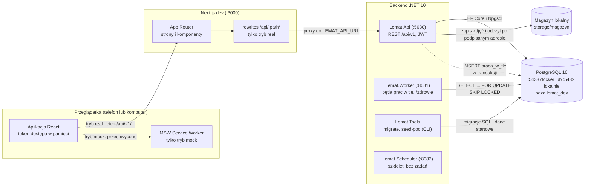
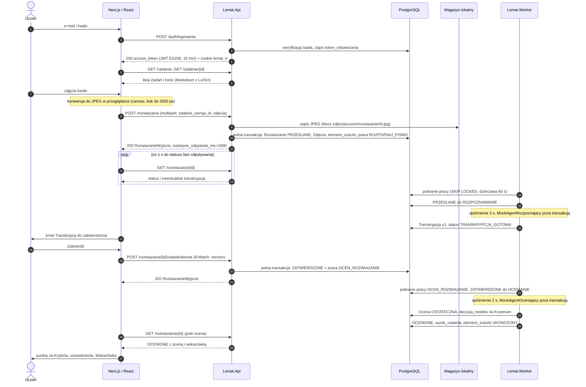
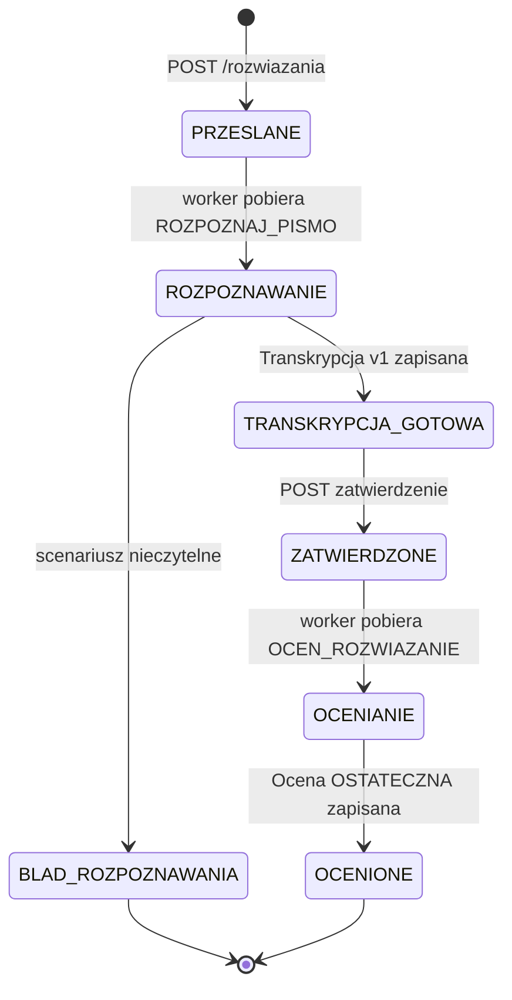
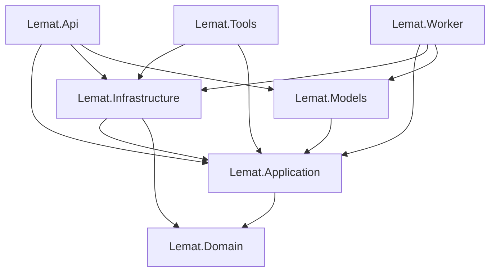

# POC_ARCHITECTURE.md — architektura zaimplementowanego POC Lemat

Dokument opisuje **to, co faktycznie działa w repozytorium** (stan po scaleniu ścieżek `[POC-A]` backend i `[POC-B]` frontend, TASK-121 … 139). Źródłem prawdy jest kod; `docs/POC_CONTRACT.md` (kontrakt HTTP), `docs/CODEBASE_MAP.md`, `HANDOFF.md` (sekcja 12, U-21 … U-31) i `TASKS.md` służą jako uzupełnienie. Rozbieżności dokumentów z kodem są oznaczone **[Rozbieżność]**. Pełna (docelowa) architektura: [`ARCHITECTURE_DETAILED.md`](ARCHITECTURE_DETAILED.md).

Konwencja nazw: pliki mają nazwy angielskie (`SubmitSolutionHandler.cs`), a typy w środku polskie (`PrzeslijRozwiazanieHandler`) — zgodnie z ADR-049/ADR-075. Poniżej podaję oba, gdy to pomaga w wyszukiwaniu.

---

## 1. Czym jest POC i czego w nim nie ma

POC to działający od końca do końca przepływ **jednego Ucznia**: rejestracja i logowanie, przeglądanie 5 Zadań z matematyki (z Działami 1 … 13), przesłanie zdjęcia kartki z rozwiązaniem, automatyczne „rozpoznanie pisma” (Transkrypcja do zatwierdzenia), zatwierdzenie i wystawienie Oceny z punktami za Kryteria oraz Wskazówką. Całość działa **bez żadnych kluczy**: rozpoznawanie i ocenianie to deterministyczne Mocki (dane z `poc-mock.json`), a magazyn zdjęć to katalog na dysku. Praca asynchroniczna jest realizowana kolejką w PostgreSQL (`praca_w_tle`) i procesem `Lemat.Worker`; frontend odpytuje API (bez SSE). Frontend ma też tryb **mock** (MSW), w którym działa w ogóle bez backendu.

**Czego nie ma** (w porównaniu z `ARCHITECTURE_DETAILED.md`): realnych modeli AI (Jev, LLM, `IChatClient`/Semantic Kernel) i Agenta wyjaśniającego; Weryfikacji i trasowania T-1 … T-7 (każda Ocena jest `OSTATECZNA`, ścieżka automatyczna); roli Nauczyciela, Klas, panelu Administratora; Poprawek Ucznia do Transkrypcji; testu diagnostycznego, Ścieżki nauki i Agenta rekomendującego (Zadania wybiera Uczeń z listy); aktualizacji Profilu (Elo — `wynik_zadania` jest zapisywany, ale Profil to tylko agregat po Ocenach); SSE, `LISTEN/NOTIFY`, pul workerów R/S/O/P/W; S3/MinIO, usuwania EXIF, SymPy; e-maila, RODO (eksport, usuwanie), limitów logowania; generowanego klienta z OpenAPI. Pełna lista: sekcja 10.

---

## 2. Kontenery i procesy



Uwagi:

- **Jeden obraz kodu, wiele punktów wejścia** — `Lemat.Api`, `Lemat.Worker`, `Lemat.Scheduler`, `Lemat.Tools` to osobne projekty uruchamialne; `Api` i `Worker` dzielą moduły przez DI (rejestracje `Dodaj…` z `Lemat.Application`/`Lemat.Infrastructure`).
- **Api i Worker nie komunikują się bezpośrednio.** Jedyny kanał to tabela `praca_w_tle` w PostgreSQL. Api zleca pracę w tej samej transakcji, w której zmienia agregat; Worker ją odpytuje.
- Przeglądarka rozmawia **wyłącznie z Next.js** (ten sam origin, więc cookie odświeżania działa bez CORS). W trybie `real` Next.js przekierowuje `/api/*` do `LEMAT_API_URL` (domyślnie `http://localhost:5080`); w trybie `mock` reguł `rewrites` nie ma, a żądania obsługuje MSW w przeglądarce (`frontend/public/mockServiceWorker.js`).
- **[Rozbieżność]** `CLAUDE.md` wspomina PostgreSQL na porcie 5432; `docker-compose.yml` publikuje bazę na **5433** (`LEMAT_PG_PORT`), a `scripts/dev-up.sh` przy braku Dockera wraca do lokalnego PostgreSQL na 5432.
- `Lemat.Scheduler` to tylko szkielet z `/zdrowie` (8082); żadne zadanie okresowe nie jest zaimplementowane.

---

## 3. Słowniczek pojęć POC

| Pojęcie | Typ w kodzie (C#) | JSON / URL | Tabela w bazie | Rola w POC |
|---|---|---|---|---|
| Użytkownik | `Uzytkownik` | `uzytkownik` | `uzytkownik` | konto (e-mail, hasło argon2id, rola `UCZEN`, status `AKTYWNE`) |
| Uczeń | `Uczen`, `UczenId` | `/uczniowie/ja` | `uczen` | profil edukacyjny konta: poziom matury, termin egzaminu, wybrany Dział |
| Dział | `Dzial`, `DzialId` | `/dzialy` | `dzial` | 13 działów podstawy programowej, `id` 1 … 13 |
| Umiejętność | `Umiejetnosc` | `umiejetnosc_id` | `umiejetnosc` | 5 umiejętności użytych przez Zadania POC |
| Zadanie | `Zadanie`, `ZadanieWersja` | `/zadania`, `zadanie_wersja_id` | `zadanie`, `zadanie_wersja` | treść (Markdown z LaTeX) i wersja; 5 Zadań w seedzie |
| Kryterium | `KryteriumOceniania` | `kryteria`, `nr_kryterium` | `kryterium_oceniania` | pozycja schematu oceniania (opis, punkty maks.), wariant 1 |
| Rozwiązanie | `Rozwiazanie` (agregat) | `/rozwiazania` | `rozwiazanie` | próba Ucznia nad Zadaniem; ma status (sekcja 4) |
| Zdjęcie | `ZdjecieRozwiazania` | `zdjecia`, `zdjecie_rozwiazania_id` | `zdjecie_rozwiazania` | fotografia kartki (1 … 5 JPEG), obiekt w magazynie |
| Transkrypcja | `Transkrypcja`, `KrokTranskrypcji` | pole `transkrypcja` w Rozwiązaniu | `transkrypcja`, `krok_transkrypcji` | odczyt pisma: kroki z `tekst`, `latex`, `pewnosc_odczytu`; wersja 1 od Agenta |
| Ocena | `Ocena`, `OcenaKryterium` | `/rozwiazania/{id}/ocena` | `ocena`, `ocena_kryterium` | punkty za Kryteria, pewność, uzasadnienie; niezmienna, status `OSTATECZNA` |
| Wskazówka | `Wskazowka` (część Oceny) | `wskazowka` w `OcenaWyjscie` | kolumny w `ocena` | stały tekst z mocka, źródło `SZABLON`; nie ma Agenta wyjaśniającego |
| Decyzja modelu | `DecyzjaModelu` | — (wewnętrzne) | `decyzja_modelu` | ślad każdej decyzji Agenta oceniającego (po jednej na Kryterium, Z-4) |
| Wynik zadania | `WynikZadania` | — (wewnętrzne) | `wynik_zadania` | wynik znormalizowany 0 … 1 po Ocenie, `zrodlo = OCENA` |
| Profil ucznia | `Profil` (zapisany), „profil uproszczony” (odczyt) | `/uczniowie/ja/profil-uproszczony` | `profil_ucznia` (+ agregat po `ocena`) | w POC tylko liczniki i średnie z Ocen; Elo nie jest aktualizowane (U-28) |
| Praca w tle | `PracaWTle`, `TypPracy` | — | `praca_w_tle` | jednostka pracy asynchronicznej: `ROZPOZNAJ_PISMO`, `OCEN_ROZWIAZANIE` |
| Konfiguracja modelu / Próg pewności / Kalibrator | `KonfiguracjaModelu`, `ProgPewnosci`, `KalibratorPewnosci` | — | `konfiguracja_modelu`, `prog_pewnosci`, `kalibrator_pewnosci` | seed: aktywna konfiguracja Mock, próg 0.95, kalibrator tożsamościowy |
| Element ścieżki | `ElementSciezki` | `element_sciezki_id` | `element_sciezki`, `sciezka_nauki` | techniczny kontekst próby tworzony przy przesłaniu (U-24) |

Reguły językowe: identyfikatory polskie ASCII (ADR-049), „zadanie” oznacza wyłącznie Zadanie (praca asynchroniczna to **praca w tle**), JSON i baza w `snake_case`, wartości wyliczeniowe `UPPER_SNAKE`.

---

## 4. Główny przepływ

### 4.1 Sekwencja



### 4.2 Maszyna stanów Rozwiązania (stany osiągalne w POC)

Typ `StatusRozwiazania` (`backend/src/Lemat.Domain/Solutions/SolutionStatus.cs`) ma 10 wartości; POC przechodzi przez 7. `OCZEKUJE_NA_WERYFIKACJE`, `PORZUCONE` i `ANULOWANE` istnieją w typie i bazie, ale nic ich w POC nie ustawia. Przejścia wykonują metody agregatu `Rozwiazanie` (`Solution.cs`).



- `BLAD_ROZPOZNAWANIA` jest stanem końcowym i **nie blokuje** kolejnego przesłania tego Zadania (blokują tylko stany „w trakcie”: m.in. `PRZESLANE`, `ROZPOZNAWANIE`, `TRANSKRYPCJA_GOTOWA`); kod błędu trafia do `kod_bledu_rozpoznawania` (`NIECZYTELNE`, …).
- Zatwierdzić można tylko najnowszą wersję Transkrypcji: `409 TRANSKRYPCJA_NIEAKTUALNA`; zły stan: `409`; niezgodny `If-Match`: `412`.
- Pole `nastepne_odpytanie_ms` jest `1000` w stanach przejściowych (`PRZESLANE`, `ROZPOZNAWANIE`, `ZATWIERDZONE`, `OCENIANIE`) i `null` w pozostałych — to sygnał dla frontendu, czy dalej odpytywać (`SolutionOutputMapper.NastepneOdpytanie`).

---

## 5. Backend

Katalog `backend/` (solucja `Lemat.slnx`, .NET 10, C# 14, `TreatWarningsAsErrors`). Testy: `backend/tests/Lemat.*.Tests` (xUnit v3, Testcontainers/`LEMAT_TEST_BAZA`, testy architektury warstw i słownika).

### 5.1 Projekty

| Projekt | Rola w POC |
|---|---|
| `Lemat.Domain` | Czysta domena (tylko BCL): agregaty `Rozwiazanie`, `Ocena`, `Transkrypcja`, `Uzytkownik`, `Uczen`, `Zadanie` i identyfikatory silnie typowane; wyjątki domenowe; czas jako parametr. |
| `Lemat.Application` | Przypadki użycia (handlery), **fasady** modułów (`I…Fasada`), **porty** (`IMagazynObiektow`, `IObrobkaObrazow`, `IAgentRozpoznajacy`, `IAgentOceniajacy`, `IKolejkaPrac`, `IZlecaniePrac`, `IJednostkaPracy`, repozytoria), `LematOpcje` (konfiguracja), `ProcesorPrac`. |
| `Lemat.Infrastructure` | Implementacje portów: EF Core + Npgsql (`LematDbContext`, repozytoria `…RepozytoriumEf`), migracje SQL, `KolejkaPracSql`/`ZlecaniePracSql`, `MagazynObiektowLokalny`, `ProstaObrobkaObrazow`, haszowanie haseł i JWT, `PocSeeder`. |
| `Lemat.Api` | Minimal API: grupy endpointów (`IGrupaEndpointow`), kontrakty (rekordy `…Wejscie`/`…Wyjscie`), błędy ProblemDetails, paginacja kursorowa, polityki autoryzacji, kompozycja `ApiHost`. |
| `Lemat.Worker` | Host z `/zdrowie` (8081) i `PocPracaHostedService` — pętla przetwarzania prac w tle. |
| `Lemat.Tools` | CLI: `migrate` (`MigrujBazeCommand`) i `seed-poc` (`SeedPocCommand`). |
| `Lemat.Models` | Mocki Agentów (`MockAgentRozpoznajacy`, `MockAgentOceniajacy`) + dane `Mock/Data/poc-mock.json`; **jedyne** miejsce na SDK dostawców modeli (w POC puste). |
| `Lemat.Agents` | **[Rozbieżność]** w architekturze to warstwa Agentów AI; w POC projekt jest pusty (sam `.csproj`). Interfejsy agentów leżą w `Lemat.Application/Models/`, a Mocki w `Lemat.Models/Mock/`. |
| `Lemat.Scheduler` | Szkielet procesu z `/zdrowie` (8082); bez zadań okresowych. |

### 5.2 Warstwy i kierunek zależności



Strzałka oznacza „zależy od”. Domena nie zna niczego, Application zna tylko Domain i abstrakcje `Microsoft.Extensions.*`, a EF Core, Npgsql, JWT i system plików są wyłącznie w Infrastructure. Endpointy nie dotykają `LematDbContext` — wołają handlery lub fasady. Granice pilnują referencje projektów i `Lemat.Architecture.Tests`.

### 5.3 Moduły faktycznie użyte

Moduły są rejestrowane metodami `Dodaj…` (np. `DodajModulTresci`) w `ApiHost` (`backend/src/Lemat.Api/Configuration/ApiHost.cs`) i `WorkerHost`.

| Moduł (katalog w `Lemat.Application`) | Fasada | Zastosowanie w POC |
|---|---|---|
| `Accounts` | `IKontaFasada` | rejestracja, logowanie, odświeżanie, wylogowanie, dane Ucznia (`/uczniowie/ja`) |
| `Content` | `ITresciFasada` | Działy, Zadania dla Ucznia, Zadanie z Kryteriami do oceny |
| `Solutions` | `IRozwiazaniaFasada` | przesłanie, odczyt, zatwierdzenie Rozwiązania, handler `ROZPOZNAJ_PISMO` |
| `Grading` | `IOcenianieFasada` | odczyt Oceny, handler `OCEN_ROZWIAZANIE` |
| `Models` | `IModeleFasada` | aktywna konfiguracja modelu, zapis Decyzji modelu |
| `Calibration` | `IKalibracjaFasada` | aktywny Próg pewności i Kalibrator |
| `Profile` | `IProfilFasada` | zapis Wyniku zadania, profil uproszczony |
| `Recommendations` | `IRekomendacjeFasada` | techniczny element Ścieżki nauki (rozpoczęcie i ukończenie próby) |
| `Classes` | `IKlasyFasada` | zarejestrowany, bez funkcji w POC |

### 5.4 Gdzie co leży (przykłady z POC)

| Co | Plik (typ) |
|---|---|
| Kompozycja Api | `Lemat.Api/Configuration/ApiHost.cs` (`ApiHost`), `Lemat.Api/Program.cs` |
| Endpointy kont | `Lemat.Api/Endpoints/AccountsEndpoints.cs` (`EndpointyKont`) |
| Endpointy Ucznia, Treści, Profilu | `StudentsEndpoints.cs`, `ContentEndpoints.cs`, `ProfileEndpoints.cs` |
| Endpointy Rozwiązań i magazynu | `Lemat.Api/Endpoints/SolutionsEndpoints.cs` (`EndpointyRozwiazan`) |
| Kontrakty JSON | `Lemat.Api/Contracts/{Accounts,Common,Content,Profile,Solutions}/*` |
| Błędy ProblemDetails RFC 9457 | `Lemat.Api/Errors/` (`ErrorCatalog`, `ProblemWriter`) |
| Autoryzacja (polityka `Uczen`) | `Lemat.Api/Security/AuthorizationPolicies.cs` |
| Przesłanie Rozwiązania | `Lemat.Application/Solutions/SubmitSolutionHandler.cs` (`PrzeslijRozwiazanieHandler`) |
| Rozpoznanie pisma (praca) | `Lemat.Application/Solutions/RecognizeHandwritingHandler.cs` (`RozpoznajPismoHandler`) |
| Zatwierdzenie | `Lemat.Application/Solutions/ApproveSolutionHandler.cs` (`ZatwierdzRozwiazanieHandler`) |
| Ocenianie (praca) | `Lemat.Application/Grading/GradeSolutionHandler.cs` (`OcenRozwiazanieHandler`) |
| Procesor prac | `Lemat.Application/Common/BackgroundJobs/BackgroundJobProcessor.cs` (`ProcesorPrac`) |
| Pętla w Workerze | `Lemat.Worker/Jobs/PocJobHostedService.cs` (`PocPracaHostedService`) |
| Kolejka SQL | `Lemat.Infrastructure/BackgroundJobs/SqlBackgroundJobQueue.cs` (`KolejkaPracSql`), `SqlBackgroundJobEnqueuing.cs` (`ZlecaniePracSql`) |
| Jednostka pracy (transakcja) | `Lemat.Infrastructure/Persistence/UnitOfWorkEf.cs` (`JednostkaPracyEf`) |
| Repozytoria | `Lemat.Infrastructure/Persistence/Repositories/<Moduł>/*RepozytoriumEf` |
| Mocki Agentów | `Lemat.Models/Mock/MockRecognitionAgent.cs`, `MockGradingAgent.cs`, dane `Mock/Data/poc-mock.json` |
| Magazyn i obrazy | `Lemat.Infrastructure/Storage/LocalObjectStorage.cs`, `Sandboxes/SimpleImageProcessing.cs` |
| Hasła i JWT | `Lemat.Infrastructure/Security/{PasswordHashing,TokenIssuer,JwtKey}.cs` |

**Agenci i mocki.** Porty `IAgentRozpoznajacy.RozpoznajAsync(zadanie, scenariusz)` i `IAgentOceniajacy.OcenAsync(wejscie)` wybiera konfiguracja `Lemat:Modele:Dostawca`; `DodajModeleMock` obsługuje wyłącznie `mock` (inna wartość kończy start błędem; w `Production` walidator `LematOpcjeWalidator` odrzuca także `mock`). Mocki są **deterministyczne i zależne od Zadania, nie od treści zdjęcia**: odczyt i punkty Kryteriów pochodzą z `poc-mock.json`, pewność to `Lemat:Modele:MockMasaModeluDecyzyjnego` (0.995), uzasadnienie składa szablon. Scenariusz `rozpoznanie-nieczytelne` (nagłówek `X-Lemat-Mock-Scenariusz`, tylko `Development`/`E2E`, filtr `FiltrScenariuszaMock`) kończy rozpoznawanie błędem `NIECZYTELNE`. Scenariusz wędruje w ładunku pracy (`mock_scenariusz`); zatwierdzenie zawsze zleca ocenę ze scenariuszem `domyslny`.

### 5.5 Worker i praca w tle

1. **Zlecenie** — `IZlecaniePrac.ZlecAsync` wstawia wiersz `praca_w_tle` (`INSERT … ON CONFLICT DO NOTHING`, deduplikacja po `(typ, klucz)`) **w tej samej transakcji** `IJednostkaPracy`, w której zmienia się Rozwiązanie. Klucz: `{rozwiazanie_id}:1:0` (rozpoznanie) i `{rozwiazanie_id}:{wersja_transkrypcji}` (ocena).
2. **Pobranie z dzierżawą** — `PocPracaHostedService` co `Lemat:Poc:OdpytanieMs` (500 ms) woła `ProcesorPrac.PrzetworzJednaAsync` aż do opróżnienia kolejki. `KolejkaPracSql.PobierzNastepnaAsync` robi jeden `UPDATE … WHERE id = (SELECT … FOR UPDATE SKIP LOCKED LIMIT 1)`: ustawia `status = 'W_TOKU'`, zwiększa `proby`, zapisuje `wykonawca` i `dzierzawa_do = now() + 60 s`. Dwa workery nie wezmą tej samej pracy.
3. **Wykonanie** — handler (`IHandlerPracy`) działa w osobnym zakresie DI. Najpierw sprawdza warunek wykonania (np. status Rozwiązania), więc jest **idempotentny**. Wywołanie Mocka i opóźnienie (`OpoznienieRozpoznaniaMs` 3000, `OpoznienieOcenyMs` 2000) odbywają się **poza transakcją**, a zapis wyniku jest warunkowy (`status`).
4. **Zakończenie** — `ZakonczAsync` ustawia `ZAKONCZONA` tylko jeśli worker nadal ma dzierżawę.
5. **Ponowienie** — wyjątek w handlerze → `ponow_prace(...)` (funkcja SQL): praca wraca do `OCZEKUJE` z `dostepna_od` za `OdstepPonowieniaMs` (2 s); po przekroczeniu `maks_prob` status to `MARTWA`.
6. **Odzyskiwanie** — co 20 iteracji pętla woła `odzyskaj_dzierzawy(100)`: prace `W_TOKU` z wygasłą dzierżawą wracają do kolejki (np. po zabiciu workera).
7. Brak `LISTEN/NOTIFY` w POC (U-26): opóźnienie startu pracy to do 500 ms.

### 5.6 Uwierzytelnianie

- **Rejestracja** (`POST /auth/rejestracja`) tworzy w jednej transakcji `uzytkownik`, `uczen`, `profil_ucznia` i pustą `sciezka_nauki`. Rola `NAUCZYCIEL` zwraca `422` (`ROLA_NIEOBSLUGIWANA`, U-21).
- **Hasło**: argon2id (64 MiB, t=3, p=4, format PHC), `HaszowanieHasel`.
- **Token dostępu**: JWT **ES256**, ważny 15 min, claims `sub`, rola, status, `jti`; klucz z `LEMAT_JWT_KLUCZ` (PEM) albo — poza Production — generowany i zapisywany w profilu użytkownika (`jwt-dev-es256.pem`). Frontend wysyła `Authorization: Bearer`.
- **Token odświeżania**: losowy, w bazie tylko skrót (`token_odswiezania`), w ciasteczku `lemat_rt` (`HttpOnly`, `SameSite=Strict`, `Path=/api/v1/auth`, 14 dni, `Secure` przy HTTPS). `POST /auth/odswiezenie` rotuje token (bez okna tolerancji, U-22); nieważny → `401 SESJA_UNIEWAZNIONA` i wyczyszczone ciasteczko.
- **Autoryzacja**: polityka `Uczen` = rola `UCZEN` + status konta `AKTYWNE` (inaczej `403 BRAK_UPRAWNIEN` / `KONTO_NIEAKTYWNE`). Zasoby Rozwiązania są sprawdzane pod kątem własności; cudze Rozwiązanie zwraca `404`.

### 5.7 Magazyn zdjęć

`MagazynObiektowLokalny` zapisuje pliki w `Lemat:Magazyn:Sciezka` (dev: `storage/magazyn`, ignorowany przez git) pod kluczem `zdjecia/{uczen}/{rozwiazanie}/{id}.jpg`. `GET /rozwiazania/{id}/zdjecia/{zid}/adres` zwraca adres podpisany HMAC-SHA256 ważny **5 minut** (`/api/v1/magazyn-lokalny/{token}`), a ten endpoint (anonimowy, token w adresie) streamuje `image/jpeg`. `ProstaObrobkaObrazow` przyjmuje wyłącznie JPEG (magic bytes), do 10 MB na plik, odczytuje wymiary i liczy `sha256`; nie usuwa EXIF (U-02). Limit ciała `POST /rozwiazania` to 52 MB (5 zdjęć). Obiekty są zapisywane poza transakcją, a po wycofaniu transakcji usuwane na bieżąco.

---

## 6. Baza danych

- **Schemat** pochodzi wyłącznie z SQL (ADR-063): `backend/src/Lemat.Infrastructure/Persistence/Migrations/Sql/0000_schema.sql … 0007_api.sql` (pełne DDL: typy enum, tabele, funkcje, wyzwalacze niezmienników, powiadomienia, partycje, uprawnienia, `praca_w_tle`, klucz idempotencji). Jedna migracja EF `0001_SchematPoczatkowy` (`Migrations/0001_InitialSchema.cs`) wykonuje te pliki po kolei; model EF Core **nie generuje** schematu. Pełne DDL zawiera ok. 60 tabel, a model EF mapuje te potrzebne MVP (U-01).
- **Uruchomienie**: `dotnet backend/src/Lemat.Tools/bin/Debug/net10.0/Lemat.Tools.dll migrate`, następnie `… seed-poc`.
- **`seed-poc`** (`PocSeeder`, dane `Persistence/Data/poc-seed.json`) jest idempotentny i odmawia pracy w `Production`. Wstawia: 13 Działów, 5 Umiejętności, 5 Zadań (stałe identyfikatory `a1000000-0000-4000-8000-00000000000N` dla Zadania i `b1…0N` dla wersji) z Kryteriami, 2 konta demo (`uczen1@lemat.local`, `uczen2@lemat.local`, hasło `Lemat-Demo-2026!`), aktywną konfigurację modelu Mock, kalibrator tożsamościowy i Próg pewności 0.95.

Tabele realnie używane przez POC:

| Tabela | Po co w POC |
|---|---|
| `uzytkownik`, `uczen`, `profil_ucznia` | konto, dane Ucznia, (pusty) Profil tworzony przy rejestracji |
| `token_odswiezania` | skróty tokenów odświeżania (rotacja, unieważnianie) |
| `dzial`, `umiejetnosc` | słownik programu; `GET /dzialy`, filtr Zadań |
| `zadanie`, `zadanie_wersja`, `zadanie_umiejetnosc` | Zadania i ich wersje (treść Markdown/LaTeX, punkty maks., wzorzec) |
| `kryterium_oceniania` | Kryteria wariantu 1 per wersja Zadania |
| `sciezka_nauki`, `element_sciezki` | techniczny kontekst próby wymagany przez DDL (U-24) |
| `rozwiazanie`, `zdjecie_rozwiazania` | agregat Rozwiązania i jego Zdjęcia (klucz obiektu, sha256, wymiary, wygaśnięcie) |
| `transkrypcja`, `krok_transkrypcji` | wersja 1 odczytu pisma i jej kroki |
| `ocena`, `ocena_kryterium` | niezmienna Ocena (trigger `trg_ocena_niezmienna`) i punkty za Kryteria |
| `decyzja_modelu` | ślad decyzji modelu (po jednej na Kryterium, rozkład tak/nie, skrót wejścia) |
| `konfiguracja_modelu`, `prog_pewnosci`, `kalibrator_pewnosci` | konfiguracja aktywnego modelu (Mock), próg i kalibrator wymagane przed oceną |
| `wynik_zadania` | wynik znormalizowany po Ocenie; źródło danych „profilu uproszczonego” |
| `praca_w_tle` | kolejka prac asynchronicznych (+ funkcje `ponow_prace`, `odzyskaj_dzierzawy`) |

Mapowane w EF, lecz bez funkcji w POC: `nauczyciel`, `klasa`, `czlonkostwo_klasy`, `rekomendacja`, `test_diagnostyczny`, `pozycja_testu_diagnostycznego`, `opanowanie_umiejetnosci`, `kalibracja_trudnosci`, `wkladka_teoretyczna`, `proba_logowania`, `umiejetnosc_wymagana`.

---

## 7. Frontend

Katalog `frontend/`: Next.js (App Router) + React + TypeScript `strict`, Tailwind, Radix UI, next-intl (`pl-PL`), TanStack Query, react-hook-form + zod, KaTeX, MSW; testy Vitest i Playwright.

### 7.1 Struktura

```text
frontend/src/
  app/                  trasy (App Router) — importują tylko features/<x>/index.ts
    (public)/           /  /login  /register
    (student)/          /exercises  /exercises/[exerciseId]  /solutions  /solutions/[solutionId]  /profile  /settings
    (teacher)/ (administrator)/   same layouty-szkielety (poza POC)
    layout.tsx          NextIntlClientProvider > QueryProvider > MockProvider > SessionProvider
  features/             accounts, content, profile, solutions (komponenty + hooki + testy)
  lib/api/              client.ts (jedyny klient /api/v1), types.ts (typy ręczne wg POC_CONTRACT), errors.ts, queries.ts, proxy.ts
  lib/auth/             SessionProvider.tsx (sesja)
  lib/photos/           to-jpeg.ts (konwersja zdjęcia po stronie klienta)
  lib/katex/            Formula.tsx, MarkdownContent.tsx (wzory, throwOnError: false)
  mocks/                MSW: browser.ts, handlers.ts, db.ts (stan w pamięci), fixtures/
  ui/                   Button, Dialog, Form, List, Select (Radix)
frontend/messages/pl-PL.json   wszystkie teksty UI
frontend/e2e/                  Playwright (poc-smoke.spec.ts)
```

- **Teksty**: wyłącznie `frontend/messages/pl-PL.json` (test `src/messages.test.ts` pilnuje spójności); w JSX nie ma tekstu na sztywno.
- **Sesja** (`lib/auth/SessionProvider.tsx`): token dostępu **tylko w pamięci**; przy starcie jedno odświeżenie (`POST /auth/odswiezenie`, single-flight), odświeżanie proaktywne 60 s przed wygaśnięciem, wstrzyknięcie dostawcy tokenu do klienta. Strażnik `StudentShell` (układ `(student)`) przekierowuje bez sesji na `/login`.
- **Klient** (`lib/api/client.ts`): cienki `fetch` z Bearer, `If-Match`, multipart, merge-patch, jednokrotnym ponowieniem po `401` i mapowaniem błędów na `BladApi`. **[Rozbieżność]** `CLAUDE.md` mówi o `openapi-fetch` + `openapi-typescript`; w POC typy są pisane ręcznie wg kontraktu (U-30), a skrypt `gen:api` to placeholder.
- **Odpytywanie** (`features/solutions/use-solution.ts`): `useQuery` z `refetchInterval` = `nastepne_odpytanie_ms` z odpowiedzi (`null` zatrzymuje); po 60 s (`LIMIT_ODPYTYWANIA_MS`) odpytywanie się zatrzymuje i UI oferuje wznowienie. Adres zdjęcia jest odświeżany 30 s przed wygaśnięciem.
- **Zdjęcie**: `PhotoUpload` + `lib/photos/to-jpeg.ts` (canvas, dłuższy bok do 2000 px, jakość 0.85, orientacja EXIF) — serwer przyjmuje tylko JPEG.

### 7.2 Tryb mock a real

| | `npm run dev:mock` | `npm run dev:real` (oraz domyślnie `npm run dev`) |
|---|---|---|
| Zmienna | `NEXT_PUBLIC_LEMAT_API=mock` | `real` lub brak (**[Rozbieżność]** wszystko poza `mock` oznacza `real`, `okreslTrybApi`) |
| Backend | niepotrzebny; `MockProvider` uruchamia MSW przed renderem, baner „Dane przykładowe” | wymaga `scripts/dev-up.sh`; `next.config.ts` dodaje `rewrites /api/:path*` do `LEMAT_API_URL` |
| Dane | stanowe, z przejściami czasowymi (`mocks/db.ts`, `fixtures/`), zgodne z kontraktem | prawdziwa baza |
| Kod MSW w buildzie | usuwany z buildu `real` (import dynamiczny, `env` jawne w `next.config.ts`) | — |

### 7.3 Mapa strona → endpointy

| Trasa | Komponent (`features/…`) | Endpointy |
|---|---|---|
| `/` | `accounts/HomeView` | brak (tylko stan sesji i przekierowanie) |
| `/login`, `/register` | `LoginForm`, `RegisterForm` | `POST /auth/logowanie`, `POST /auth/rejestracja` |
| (każda trasa Ucznia) | `SessionProvider`, `StudentShell` | `POST /auth/odswiezenie`, `POST /auth/wylogowanie` |
| `/exercises` | `content/ExerciseList` | `GET /dzialy`, `GET /zadania` |
| `/exercises/[exerciseId]` | `content/ExerciseDetail` + `solutions/PhotoUpload` | `GET /zadania/{id}`, `POST /rozwiazania` |
| `/solutions` | `solutions/SolutionList` | `GET /rozwiazania` |
| `/solutions/[solutionId]` | `solutions/SolutionView` (+ `SolutionTranscript`, `SolutionGrade`, `SolutionPhotos`) | `GET /rozwiazania/{id}` (odpytywanie), `POST …/zatwierdzenie`, `GET …/ocena`, `GET …/zdjecia/{zid}/adres` |
| `/profile` | `profile/ProfileView` | `GET /uczniowie/ja/profil-uproszczony` |
| `/settings` | `accounts/SettingsForm` | `GET`/`PATCH /uczniowie/ja`, `GET /dzialy` |

---

## 8. Endpointy POC

Wszystkie ścieżki mają prefiks `/api/v1`. Format: JSON `snake_case`, błędy ProblemDetails z kodem domenowym, paginacja kursorowa (`limit`, `kursor`). „Uczeń” = polityka `Uczen` (Bearer JWT). Zweryfikowano z `MapGet/MapPost/MapPatch` w `Lemat.Api/Endpoints/*`; 18 pozycji jak w `POC_CONTRACT.md` sekcja 2 — brak rozbieżności.

| Metoda | Ścieżka | Auth | Co robi | Kto woła |
|---|---|---|---|---|
| POST | `/auth/rejestracja` | anonimowy | zakłada konto Ucznia (201, ustawia cookie) | `RegisterForm`, `poc-smoke.sh` |
| POST | `/auth/logowanie` | anonimowy | weryfikuje hasło, zwraca `access_token`, ustawia `lemat_rt` | `LoginForm` |
| POST | `/auth/odswiezenie` | cookie | rotuje token odświeżania, nowy `access_token` | `SessionProvider` |
| POST | `/auth/wylogowanie` | Uczeń | unieważnia token odświeżania, czyści cookie (204) | `StudentShell` |
| GET | `/uczniowie/ja` | Uczeń | dane Ucznia (`version` do `If-Match`) | `SettingsForm`, kontekst sesji |
| PATCH | `/uczniowie/ja` | Uczeń | merge-patch: poziom matury, termin egzaminu, wybrany Dział (`If-Match`) | `SettingsForm` |
| GET | `/uczniowie/ja/profil-uproszczony` | Uczeń | liczniki Rozwiązań i średni wynik z Ocen (rozszerzenie POC) | `ProfileView` |
| GET | `/dzialy` | Uczeń | 13 Działów | `ExerciseList`, `SettingsForm` |
| GET | `/zadania` | Uczeń | strona Zadań, filtr `dzial_id` (rozszerzenie POC) | `ExerciseList` |
| GET | `/zadania/{id}` | Uczeń | Zadanie z Kryteriami i `zadanie_wersja_id` | `ExerciseDetail` |
| POST | `/rozwiazania` | Uczeń | multipart `zadanie_wersja_id` + 1 … 5 `zdjecia`; 202, zleca `ROZPOZNAJ_PISMO` | `PhotoUpload` |
| GET | `/rozwiazania` | Uczeń | lista własnych Rozwiązań, filtr `status` | `SolutionList` |
| GET | `/rozwiazania/{id}` | Uczeń (własne) | status, `nastepne_odpytanie_ms`, Transkrypcja, Ocena | `SolutionView` (odpytywanie) |
| POST | `/rozwiazania/{id}/zatwierdzenie` | Uczeń (własne) | zatwierdza Transkrypcję (`If-Match`), zleca `OCEN_ROZWIAZANIE` (202) | `SolutionTranscript` |
| GET | `/rozwiazania/{id}/ocena` | Uczeń (własne) | Ocena z Kryteriami i Wskazówką | `SolutionGrade` |
| GET | `/rozwiazania/{id}/zdjecia/{zdjecie_rozwiazania_id}/adres` | Uczeń (własne) | podpisany adres zdjęcia (5 min) | `SolutionPhotos` |
| GET | `/magazyn-lokalny/{token}` | token w adresie | zwraca `image/jpeg` z magazynu lokalnego (rozszerzenie POC) | `` w przeglądarce |
| GET | `/zdrowie` | anonimowy | `{ "status": "OK" }` | `dev-up.sh`, monitoring |
| GET | `/openapi.json` | anonimowy | dokument OpenAPI (`/api/v1/openapi.json`) | narzędzia |

Worker wystawia osobno `GET http://localhost:8081/zdrowie`.

---

## 9. Jak uruchomić i przetestować

**Wymagania**: .NET SDK 10, Node.js 22+, npm, Docker albo lokalny PostgreSQL 16, `curl` i `jq` (smoke test).

```bash
# Backend: baza + migracja + seed-poc + Api (:5080) + Worker (:8081) jednym poleceniem
scripts/dev-up.sh               # idempotentne; --stop zatrzymuje Api i Worker; --reset odtwarza pustą bazę i magazyn
scripts/poc-smoke.sh            # przepływ: rejestracja, logowanie, Zadanie, zdjęcie, zatwierdzenie, Ocena, profil, izolacja Uczniów

# Frontend
cd frontend && npm install
npm run dev:mock                # sam frontend z MSW (bez backendu)
npm run dev:real                # z prawdziwym API (LEMAT_API_URL, domyślnie http://localhost:5080)

# Testy
scripts/verify-all.sh                       # backend (build -warnaserror, test, format) + frontend (typecheck, lint, test, build)
dotnet test backend/Lemat.slnx              # xUnit v3 (Testcontainers lub LEMAT_TEST_BAZA)
npm --prefix frontend run test              # Vitest
npm --prefix frontend run e2e               # Playwright w trybie MSW
LEMAT_E2E_REAL=1 npm --prefix frontend run e2e   # Playwright przeciw działającemu API (dev-up.sh)
```

Konta demo: `uczen1@lemat.local` / `uczen2@lemat.local`, hasło `Lemat-Demo-2026!` (tylko lokalnie, `seed-poc` nie działa w `Production`). Logi: `.logs/api.log`, `.logs/worker.log`. Pełny przepływ trwa ok. 5 s opóźnień Mocka (3 s rozpoznanie + 2 s ocena).

**Gdzie zacząć czytać kod:**

1. `docs/POC_CONTRACT.md` — kontrakt HTTP (jedyny punkt styku backendu i frontendu).
2. `backend/src/Lemat.Api/Configuration/ApiHost.cs` — kompozycja procesu Api (moduły, endpointy, middleware).
3. `backend/src/Lemat.Api/Endpoints/SolutionsEndpoints.cs` — wejście HTTP głównego przepływu.
4. `backend/src/Lemat.Application/Solutions/SubmitSolutionHandler.cs` — transakcja „Rozwiązanie + praca w tle”.
5. `backend/src/Lemat.Domain/Solutions/Solution.cs` — agregat i maszyna stanów.
6. `backend/src/Lemat.Application/Common/BackgroundJobs/BackgroundJobProcessor.cs` oraz `RecognizeHandwritingHandler.cs` / `GradeSolutionHandler.cs` — jak pracuje Worker.
7. `frontend/src/lib/api/client.ts` i `frontend/src/features/solutions/SolutionView.tsx` — klient i ekran Rozwiązania z odpytywaniem.
8. `frontend/src/mocks/handlers.ts` — jak mock symuluje backend; `scripts/dev-up.sh` — jak składa się środowisko.

---

## 10. Uproszczenia i znane ograniczenia POC

Numeracja U-xx wg `HANDOFF.md` i `POC_CONTRACT.md` sekcja 9; U-01 … U-20 dotyczą uproszczeń MVP, z których POC dziedziczy U-01 … U-03.

| Obszar | Ograniczenie | Ślad |
|---|---|---|
| Role | tylko `UCZEN`; `klasy` zawsze `[]`, `test_diagnostyczny` zawsze `BRAK` | U-21 |
| Sesja | brak okna tolerancji rotacji tokenu, wielokartowości, limitów prób logowania i zapisu `proba_logowania`; brak zmiany/odzyskiwania hasła i e-maila | U-22 |
| Zadania | Uczeń sam wybiera Zadanie z listy; brak Agenta rekomendującego, Ścieżki nauki i testu diagnostycznego; kontekst próby to techniczny `element_sciezki` | U-23, U-24 |
| Zdjęcia | wyłącznie JPEG (konwersja po stronie klienta), brak normalizacji i usuwania EXIF, magazyn na dysku, brak sprzątania osieroconych obiektów | U-02, U-03, U-25 |
| Modele | Mocki zależne od Zadania, nie od treści zdjęcia; brak Jev, LLM, `IChatClient`, Semantic Kernel, filtra danych osobowych, retencji dostawcy | U-26 |
| Ocena | zawsze `OSTATECZNA`, pewność stała (0.995); brak Weryfikacji, trasowania T-1 … T-7, Nauczyciela, Poprawek Ucznia i ich limitów | U-26 |
| Wskazówka | stały tekst z mocka (`SZABLON`), bez Agenta wyjaśniającego i strażnika wycieku | U-27 |
| Profil | `wynik_zadania` zapisywany, Elo/Opanowanie nie są aktualizowane; „profil uproszczony” to agregat po Ocenach | U-28 |
| Dane | `seed-poc` zamiast pełnego seeda: 13 Działów, 5 Umiejętności, 5 Zadań, 2 konta demo ze stałym hasłem | U-29 |
| Frontend | typy pisane ręcznie, własny klient `fetch` (bez `openapi-fetch`/`gen:api`); MSW w `devDependencies` | U-30 |
| Błędy walidacji | lista `kod_reguly` zamknięta (POC-1.0) | U-31 |
| Komunikacja | odpytywanie co 1 s zamiast SSE; worker bez `LISTEN/NOTIFY` (opóźnienie do 500 ms), bez pul R/S/O/P/W | U-26 |
| Procesy | `Lemat.Scheduler` to szkielet; `Lemat.Agents` pusty; brak CORS (jeden origin przez rewrites), brak HTTPS lokalnie (`Secure` cookie tylko przy HTTPS) | kod |
| Produkcja | `mock` w `Production` kończy start błędem; nie ma panelu Administratora, RODO (eksport, usuwanie), S3, e-maila — POC nie nadaje się do danych prawdziwych Uczniów | ADR-055, HANDOFF |

Dalsze kroki (zadania `[MVP]` po zakończeniu POC): `TASKS.md`; otwarte pytania architektoniczne: `HANDOFF.md` sekcja 8.
